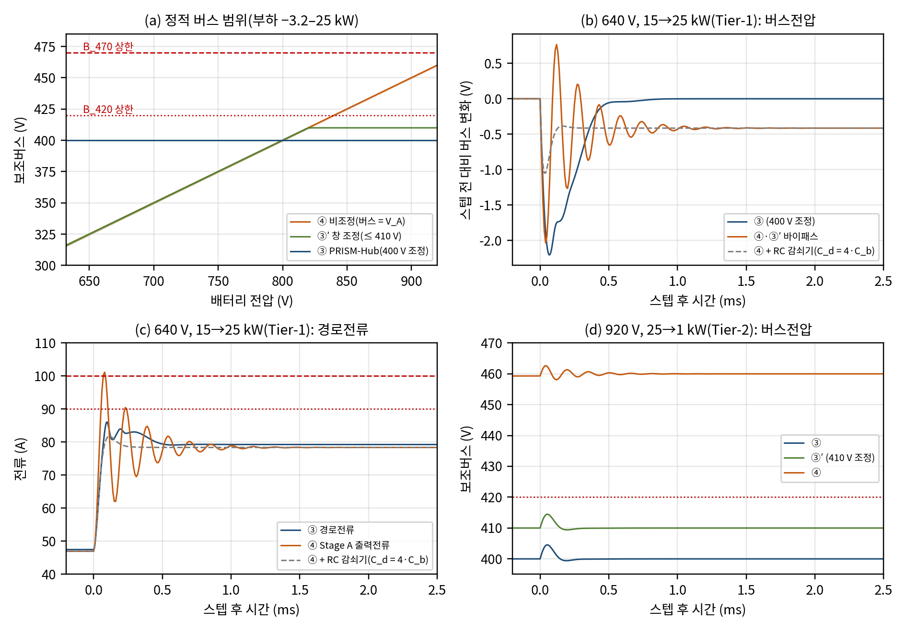

# 기준 구조 ③′·④ 평균모델과 1차 비교

- 문서 버전: v1.0 (2026-10-12)
- 대상: 중간보고서 표 8.2 일정의 "기준 구조 ③′·④ 평균모델 구축"(9/30–10/9)과, 11/21–12/4 "H5 1차 비교"의 입력
- 관련 요구: [docs/14](14_요구사항_부하등급_수락기준.md) D1·2.4절(400±8 V는 파생 요구, ③′를 H5 비교 대상에 추가), H5 수락 기준(손실·정격 VA·반도체 수 중 2개 이상에서 ④·③′보다 우수, 서비스 동등 이상)
- 근거 파일: [validation/2026-10-12-baseline-structures](../validation/2026-10-12-baseline-structures/README.md), 코드는 `submission/verification_code`의 E13
- 검증 수준: 평균모델(세 구조 공통 가정). 손실·반도체 수·정격 VA의 정량 비교는 포함하지 않는다.

## 1. 요약

| 구분 | ③ PRISM-Hub(400 V 조정) | ③′ 창 조정(≤ 410 V) | ④ 비조정(버스 = V_A) |
|---|---|---|---|
| 정적 보조버스(640–920 V, −3.2–25 kW) | 400 V | 319.0–410.0 V | 319.0–460.1 V |
| 400 V 부품 전압 등급 | B_420 | B_420 | B_470 |
| 고정이득(400/48) Stage C의 48 V 출력 | 48.0 V | 38.3–49.2 V | 38.3–55.2 V(52 V 초과) |
| Stage C 입력 변동비(최대/최소) | 1.00 | 1.29(±12.5 %) | 1.44(±18.1 %) |
| Stage B 동작 구간 | 전 구간 | 배터리 약 820 V 초과 | 없음 |
| Stage B 직렬전압(정상) | −60.1 ~ +81.0 V | −50.1 ~ 0 V(단극성) | — |
| DAB 링크전력(정상 / 과도 최대) | 6.44 kW / 7.35 kW | 2.69 kW / 4.79 kW | — |
| Tier-1·Tier-2 판정(같은 전류 기준) | 390/390·78/78 | 조정 구간 380/380·76/76, 바이패스 구간 322/350·35/70 | 462/490·56/98 |
| 과도 시 최대 경로전류 | 92.7 A(Tier-2) | 85.4 A(조정) / 136.8 A(바이패스) | 136.8 A |
| 경로전류 기준을 맞추는 대책 | 불필요(Stage B가 경로전류 제어) | 바이패스 구간에 ④와 같은 대책 | 버스 RC 감쇠기 C_d = 4·C_b(1.6 mF) 또는 Stage A 과도 정격 상향 |

세 가지가 확인되었다.

1. **정적 서비스.** 400 V 조정(③)만 고정이득 Stage C와 B_420 부품을 함께 허용한다. ③′는 B_420은 지키지만 Stage C가 입력 ±12.5 %를 조정해야 하고, ④는 B_470 부품과 ±18.1 % 조정이 필요하다. 이는 docs/14 2.4절의 정적 해석과 일치한다.
2. **버스전압 과도는 세 구조가 비슷하다.** 같은 부하 스텝에서 스텝 전 대비 최대 편차는 ③ 2.30 V·5.48 V(Tier-1·Tier-2), ④ 2.17 V·5.20 V다. Stage A가 고정비 전압원으로 동작하므로 비조정 구조도 버스가 단단하다. 따라서 400 V 조정의 가치는 과도 전압 품질이 아니라 정적 전압 범위와 경로전류 제어에서 나온다.
3. **비조정 구조는 경로 L–버스 C_b 공진의 감쇠가 작아(감쇠비 0.08–0.10) 부하 스텝에서 Stage A 출력전류가 최대 1.7배로 넘친다.** 같은 전류 기준(Tier-1 90 A, Tier-2 93.75 A, 정격 100 A)에서 ④는 Tier-1 102.6 A·Tier-2 136.8 A로 기준을 넘는다. 버스에 병렬 RC 감쇠기(C_d = 4·C_b, R_d = 48.6 mΩ)를 두면 공차를 포함해 전부 통과한다. 이 감쇠기(또는 Stage A의 과도 전류 정격 상향)는 H5 비교에서 ④와 ③′의 비용 항목으로 들어가야 한다.

H5의 우열 판정은 아직 하지 않는다. 이 문서는 세 구조를 같은 경계로 비교할 수 있는 모델과, H5 손실·정격 비교에 넘길 서비스·정격 요구를 확정하는 단계다.

## 2. 왜 이 비교가 필요한가

docs/14 D1에서 400±8 V 정밀 조정은 외부 요구가 아니라 고정이득 Stage C와 B_420 부품 선택에서 생기는 파생 요구로 재분류되었다. 외부 요구는 보조버스가 부하 하한 이상, 420 V(B_420) 또는 470 V(B_470) 이하라는 창 조건뿐이다. 그러면 Stage B의 존재 이유는 "조정하지 않는 구조(④)"와 "상한만 제한하는 구조(③′)"보다 손실·정격·부품 수에서 나은지로만 입증된다(보고서 8.6절, H5).

이 비교가 공정하려면 세 구조가 같은 Stage A, 같은 경로 임피던스, 같은 버스 커패시터, 같은 부하 계약과 시험 스텝을 써야 한다. 지금까지는 ③만 평균모델·스위칭 모델·MATLAB 이중 구현으로 검증되어 있었으므로, ③′·④를 같은 가정으로 구성하고 서비스 조건(버스 창, 48 V 품질, 부품 전압 등급, 경로전류)을 같은 시험으로 확인해야 H5의 손실·정격 비교가 의미를 가진다.

## 3. 비교 구조와 공통 가정

| 항목 | 공통 값 |
|---|---|
| Stage A | 이상 2:1 고정비 + 경로 저항 R 13.2 mΩ(Stage A 출력저항 포함) + 경로 인덕턴스 L 1.5 µH |
| 보조버스 커패시터 | C_b 400 µF |
| 부하 | 이상 정전력 부하(400 V 부하 + Stage C), 계약 −3.2–25 kW |
| 시험 | E5와 같은 Tier-1(±10 kW 스텝 10종)·Tier-2(1↔25 kW) 스텝, 20 ms, 공차 단일 변수 ±10 % |

| 구조 | 모델 |
|---|---|
| ③ PRISM-Hub | Stage B 6상태 평균모델 + 채택 제어기(E5–E7 결과 인용) |
| ③′ 창 조정 | V_A > 410 V: ③과 같은 플랜트·제어기 구조·이득, 기준전압만 410 V. V_A ≤ 410 V: 직렬 포트를 바이패스 스위치로 단락하고 Stage B를 정지(④와 같은 2상태 모델) |
| ④ 비조정 | L·di/dt = V_bat/2 − R·i − v_b, C_b·dv_b/dt = i − P/v_b (선택: 병렬 RC 감쇠기 C_d·R_d) |

③′의 410 V 상한은 과도 8 V를 더해도 420 V 미만이 되도록 정한 값이다(docs/14 2.4절). ④의 48 V는 광입력 Stage C가 조정한다고 보고, 여기서는 Stage C가 받아야 하는 입력 범위만 계산했다.

## 4. 정적 운전 범위

배터리 632·640–920 V(5 V 간격) × 부하 −3.2–25 kW(200 W 간격)의 정상점이다. 요약 수치는 보장 범위 640–920 V에서 계산했다.

| 배터리 전압, 부하 | ③ 버스 / 직렬전압 / 링크전력 | ③′ 버스 / 직렬전압 / 링크전력 | ④ 버스 |
|---|---|---|---|
| 640 V, 25 kW | 400 V / +81.05 V / 6.44 kW | 319.0 V / 0 / 0(바이패스) | 319.0 V |
| 700 V, 25 kW | 400 V / +50.95 V / 3.68 kW | 349.1 V / 0 / 0 | 349.1 V |
| 788 V, 25 kW | 400 V / +6.84 V / 0.44 kW | 393.2 V / 0 / 0 | 393.2 V |
| 860 V, 25 kW | 400 V / −29.23 V / −1.70 kW | 410 V / −19.23 V / −1.12 kW | 429.2 V |
| 920 V, 25 kW | 400 V / −59.28 V / −3.24 kW | 410 V / −49.28 V / −2.69 kW | 459.3 V |
| 920 V, −3.2 kW | 400 V / −60.09 V / +0.42 kW | 410 V / −50.09 V / +0.35 kW | 460.1 V |

링크전력의 음수는 링크에서 버스로 돌려보내는 방향이다. ③′의 Stage B는 V_A = 410 V가 되는 배터리 전압부터 동작하는데, 이 경계는 부하에 따라 819.8 V(회생 −3.2 kW)에서 821.6 V(25 kW)까지 1.8 V 폭으로 움직인다. 배터리 전압이 이 부근에 머무는 동안 부하 변화만으로 바이패스와 조정 모드가 오갈 수 있으므로, 모드 전환에는 히스테리시스와 전환 과도 검증이 필요하다(8절).

정적으로 ④의 버스는 920 V 무부하에서 460 V에 이르러 B_470 부품을 요구하고[1], 고정이득 Stage C를 쓰면 48 V 출력이 배터리 866.7 V 초과에서 ISO 21780의 공칭 범위 상한 52 V를 넘는다[2]. ③′와 ④는 모두 Stage C가 입력 변동을 조정해야 한다.

## 5. 동특성

### 5.1 ③′ 조정 구간(830·860·920 V)

③과 같은 Tier 기준을 기준전압 410 V로 적용했다. Tier-2 대역은 [394, 420] V로, B_420 절대 상한 420 V를 넘지 않아야 한다.

| 집합 | 사례 | 통과 | 최대 전류 | 스텝 후 버스 | 직렬전압 | 링크전력 최대 |
|---|---|---|---|---|---|---|
| Tier-1(공칭·공차 16종) | 350 | 350 | 72.94 A | 407.98–412.02 V | −51.2 ~ −3.0 V | 3.48 kW |
| Tier-1, 지연 +3.0 µs | 30 | 30 | 73.56 A | 407.97–412.03 V | −51.1 ~ −3.1 V | 3.56 kW |
| Tier-2(공칭·공차 16종) | 70 | 70 | 84.51 A | 405.16–414.81 V | −52.7 ~ −1.4 V | 4.63 kW |
| Tier-2, 지연 +3.0 µs | 6 | 6 | 85.35 A | 405.14–414.83 V | −52.5 ~ −1.6 V | 4.79 kW |

조정 구간의 직렬전압은 과도 중에도 음수로 유지되어 H-브리지를 단극성으로 설계할 수 있다. 다만 DAB 링크전력은 과도에서 정적 최대값(2.69 kW)의 1.8배인 4.79 kW까지 올라가므로, ③′의 DAB 정격을 정적 처리전력으로 잡으면 과도 전력을 제한하는 제어가 추가로 필요하다.

### 5.2 ④와 ③′ 바이패스 구간

조정 대상이 없으므로 서비스 창으로 판정했다. 버스는 260 V(조사한 400 V 부하 입력 하한의 최댓값) 이상, ④는 470 V(B_470), ③′ 바이패스 구간은 420 V(B_420) 이하여야 하고, 경로전류(= Stage A 출력전류)는 ③과 같은 Tier-1 90 A·Tier-2 93.75 A·정격 100 A를 적용했다.

| 구분 | 사례 | 통과 | 최대 경로전류 | 스텝 전 대비 최대 편차 | 버스 범위(스텝 후) | 정착(±0.5 V) |
|---|---|---|---|---|---|---|
| ④ Tier-1 | 490 | 462 | 103.3 A | 2.17 V | 313.2–461.3 V | 0.38 ms |
| ④ Tier-2 | 98 | 56 | 136.8 A | 5.20 V | 310.8–462.8 V | 0.62 ms |
| ③′ 바이패스 Tier-1(632–788 V) | 350 | 322 | 103.3 A | 2.17 V | 313.2–395.5 V | 0.38 ms |
| ③′ 바이패스 Tier-2(632–788 V) | 70 | 35 | 136.8 A | 5.20 V | 310.8–397.3 V | 0.62 ms |

실패는 모두 경로전류다. 버스전압은 모든 사례에서 서비스 창 안에 있었고(④ 최대 462.8 V, ③′ 바이패스 최대 397.3 V), 정착은 1 ms 이내다. 공칭 조건의 최대 경로전류는 배터리 전압이 낮을수록 크다(Tier-1: 632 V 102.6 A, 700 V 92.4 A, 788 V 82.0 A, 920 V 70.1 A, Tier-2: 632 V 134.9 A, 920 V 92.0 A). 정상 전류가 큰 저전압에서 스텝 크기가 같아도 공진 넘침이 정격을 먼저 넘기 때문이다.

③과의 차이는 경로전류 제어에 있다. ③은 Stage B 직렬전압으로 경로전류를 직접 제어하므로 같은 스텝에서 Tier-1 86.8 A, Tier-2 92.7 A에 머문다(그림 (c)).



그림 — (a) 정적 버스 범위, (b)·(c) 640 V 15→25 kW에서 버스전압 변화와 경로전류(③, ④, ④ + RC 감쇠기), (d) 920 V 25→1 kW에서 버스전압(③, ③′, ④).

### 5.3 비조정 구조의 감쇠 대책

경로 L과 버스 C_b는 약 6.5 kHz에서 공진하고, 감쇠는 거의 전부 경로 저항(Stage A 출력저항 포함)이 준다. 공진을 누르는 표준 방법인 버스 병렬 RC 감쇠기(C_d = n·C_b와 직렬 R_d)[3][5]를 n별로 설계했다. R_d는 최악 사례(632 V, 1→25 kW, 공칭)의 경로전류 피크가 가장 작은 값으로 골랐고, 그 설계로 Tier-1·Tier-2 × 공차(L·C_b·R·R_d·C_d 각각 ±10 %)를 판정했다.

| n (C_d) | R_d | Tier-1 | Tier-2 | 최대 경로전류 T1 / T2 | R ×0.5(민감도) |
|---|---|---|---|---|---|
| 0.5 (200 µF) | 137.1 mΩ | 737/770 | 99/154 | 97.0 / 121.6 A | 74/84 |
| 1 (400 µF) | 86.5 mΩ | 748/770 | 110/154 | 93.1 / 112.2 A | 76/84 |
| 2 (800 µF) | 61.2 mΩ | 770/770 | 123/154 | 88.4 / 100.9 A | 78/84 |
| 3 (1.2 mF) | 54.6 mΩ | 770/770 | 152/154 | 85.5 / 94.0 A | 81/84 |
| **4 (1.6 mF)** | **48.6 mΩ** | **770/770** | **154/154** | **83.5 / 89.3 A** | 82/84 |

Tier-1만 맞추려면 C_d = 2·C_b(800 µF), Tier-2까지 공차를 포함해 맞추려면 4·C_b(1.6 mF)가 필요하다. 감쇠기는 직류 손실이 없지만 Stage A 출력 리플 전류 일부가 R_d로 흐르므로 그 손실과 커패시터 부피는 H5 손실·정격 비교에 포함해야 한다. 대안은 Stage A가 과도 경로전류(최대 약 137 A, 수백 µs)를 견디도록 정격을 높이는 것이다.

## 6. 정전력 부하 안정성

④와 ③′ 바이패스 구간은 제어기 없이 정전력 부하를 직접 공급하므로, 정전력 부하의 음의 증분 저항(−V²/P)이 공진을 불안정하게 만들 수 있는지 확인해야 한다[3][4]. 평형점 선형화 A = [[−R/L, −1/L], [1/C_b, P/(V²C_b)]]의 고유값을 배터리 632–920 V, 부하 −3.2–25 kW에서 계산했다.

| 조건 | 최소 감쇠비 | 위치 | 공진 주파수 | 안정 한계 C_b |
|---|---|---|---|---|
| 공칭 | 0.100 | 632 V, 25 kW | 6.45 kHz | 28.6 µF |
| 공차 27조합(L·C_b·R 각 ±10 %) | 0.079 | 632 V, 25 kW(L ×1.1, C_b ×0.9, R ×0.9) | 6.50 kHz | 35.0 µF |
| 경로 저항 R ×0.5(민감도) | 0.046 | 632 V, 25 kW | 6.49 kHz | 57.1 µF |

모든 조건에서 소신호 안정이다. 감쇠 성분을 나누면 640 V·25 kW에서 R/L = 8,800 s⁻¹, 정전력 부하 항 P/(V²C_b) = 614 s⁻¹로, 감쇠의 대부분은 경로 저항이 준다. 안정성 자체는 여유가 크지만(C_b 400 µF는 한계의 약 11배), 감쇠비가 작아 5.2절의 전류 넘침이 생긴다. 실제 Stage A 출력 임피던스의 주파수 특성과 400 V 부하 입력 필터의 상호작용은 이 모델에 없다.

## 7. H5 1차 비교에 넘기는 항목

| 항목 | ③ | ③′ | ④ |
|---|---|---|---|
| 400 V 부품 등급 | B_420 | B_420 | B_470 |
| Stage C | 고정이득 가능 | 입력 319–410 V(과도 포함 310.8–414.8 V) 조정 | 입력 319–460 V(과도 포함 310.8–462.8 V) 조정 |
| Stage B H-브리지 | 양극성, 직렬 −60.1 ~ +81.0 V(과도 87.9 V), 경로 100 A | 단극성, 직렬 0 ~ −52.7 V(과도), 경로 100 A | 없음 |
| DAB | 정상 6.44 kW, 과도 7.35 kW(8 kW 정격) | 정상 2.69 kW, 과도 4.79 kW | 없음 |
| 추가 부품 | — | 바이패스 스위치(경로전류), 바이패스 구간 감쇠 대책 | 버스 감쇠기 C_d 1.6 mF + R_d, 또는 Stage A 과도 정격 상향 |
| Stage B 동작 시간 | 전 구간 | 배터리 약 820 V 초과(배터리 전압 분포에 따라 결정) | — |

손실은 운전 프로파일(배터리 전압 분포, 부하 분포)로 가중해 비교해야 한다. ③′는 Stage B가 동작하는 시간이 배터리 전압 분포에 따라 크게 달라지므로, 프로파일 가정이 H5 판정을 좌우할 수 있다.

## 8. 한계와 남은 검증

- 평균모델 비교다. Stage A 출력 임피던스는 R·L로만 표현했고(세 구조 공통), 부하는 이상 정전력 부하다.
- ③′의 바이패스 스위치와 모드 전환(바이패스 ↔ 조정) 과도, 히스테리시스 설계는 포함하지 않았다. 바이패스 구간에서 Stage B를 계속 동작시켜 경로전류를 능동 감쇠하는 대안도 있으며, 이 경우 감쇠기는 필요 없지만 Stage B 손실이 생긴다.
- Stage C 조정형 설계(③′ ±12.5 %, ④ ±18.1 %)와 48 V 배터리 충전 제어는 Stage C 재설계(P1)에서 다룬다.
- 손실·반도체 수·정격 VA의 정량 비교와 기준 구조 ①·②는 H5 1차 비교(11/21–12/4)에서 수행한다.

## 참고

[1] ISO 21498-1:2021, *Electrically propelled road vehicles — Electrical specifications and tests for voltage class B systems and components — Part 1: Voltage sub-classes and characteristics*.

[2] ISO 21780:2020, *Road vehicles — Supply voltage of 48 V — Electrical requirements and tests*.

[3] R. D. Middlebrook, "Input Filter Considerations in Design and Application of Switching Regulators," *IEEE Industry Applications Society Annual Meeting*, 1976, pp. 366–382.

[4] A. Emadi, A. Khaligh, C. H. Rivetta, G. A. Williamson, "Constant Power Loads and Negative Impedance Instability in Automotive Systems: Definition, Modeling, Stability, and Control of Power Electronic Converters and Motor Drives," *IEEE Transactions on Vehicular Technology*, vol. 55, no. 4, pp. 1112–1125, July 2006. doi:10.1109/TVT.2006.877483.

[5] R. W. Erickson, D. Maksimović, *Fundamentals of Power Electronics*, 3rd ed., Springer, 2020, "Input Filter Design" 장.

## 재현

```bash
cd python
python E13_baseline_structures.py            # 전체(2코어 약 15분)
python E13_baseline_structures.py static unreg damping stability summary   # 평균모델 ③′ 조정 구간 제외(약 2분)
```
