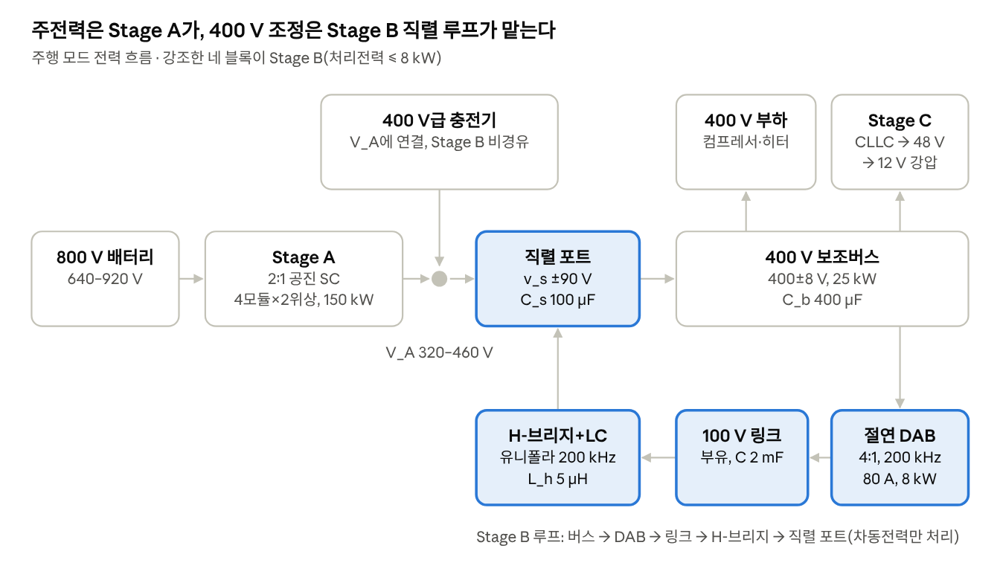

# PRISM-Hub 아키텍처 설계·검증 종합 보고서

작성일: 2026-10-12(10-28 갱신, Stage A 경부하 위상 셰딩·선행연구 대비 위치·충전 중 정지 협조·영교차 게이트 방향 반전 처리·선행기술 검색·Stage A 4모듈 경부하 운전 반영) · 대상: 프로젝트 전체 흐름을 처음 따라가는 독자

## 요약

PRISM-Hub는 800 V 전기자동차에서 150 kW급 주전력은 2:1 고정비 변환기(Stage A)가 맡고, 400 V 보조버스의 정밀 조정은 8 kW급 직렬 부분전력 조정기(Stage B)가 맡도록 역할을 나눈 통합 직류 전력 허브다. 2026년 10월 23일 현재 Stage B는 평균모델(Python·MATLAB 이중 구현)과 스위칭 수준 모델에서 과도 요구(H2)를 충족했고, 정지·기동 보호 요구까지 도출했다. 소자 수준 회로 모델(Simulink·Simscape Electrical)에서는 단별 테스트벤치(TB01–TB05)에 이어 세 단을 한 회로로 이은 주행 통합 모델(TB06)과 충전 통합 모델(TB07)까지 확인했다. 기준 구조와의 손실·정격 비교(E15)에서는 H5가 기각되었다. Stage A 충전 경로는 전전력 승압기보다 충전 손실이 72 % 작지만, Stage B의 400 V 조정은 조정 없는 구조(④)보다 손실·반도체 수·스위치 VA가 모두 크다. 따라서 Stage B는 400 V 버스 창·B\_420 부품·고정이득 48 V가 요구될 때 선택하는 기능으로 위치를 다시 정했다. 충전 중 보조버스(H3)는 평균모델·스위칭 모델·회로 모델(TB07)에서 충족했고, 충전전류 증가 램프 ≥ 100 µs라는 설계 요구가 새로 생겼다. 이어서 산업 적용 가치를 팩 등급 180–240s 전체에서 계산했다(E18, docs/23). 그 결과에 따라 아키텍처를 개선 구조 R2로 고쳤다. R2는 Stage A를 충전 호환·400 V 중간버스·48 V 공급의 핵심으로 두고, Stage B는 V\_A가 400 V급 부품 상한을 넘는 팩에만 붙이는 1–5 kW 창 조정 모듈로 줄인다. 창 조정 모듈의 축소 정격 과도, 모드 전환, DAB 고장 시 바이패스 강등은 평균모델에서 확인했고(E19), 1000 V급 팩용 R2-W460은 소자 수준 회로 모델(TB08)에서도 대표 사례 5개가 모두 통과했다. 이어서 측정 기반 보호 상태기계를 정했다(E17, docs/24). H-브리지 고장은 다이오드 클램프로 버스를 붙잡은 뒤 링크를 내리고 경로전류를 조절하며 바이패스하는 순서로 강등한다. 평균모델에서 추천 순서 44/44, 회로 모델(TB09)에서 4/4가 통과했다. 회로에서는 강등 중 DAB 순환전류가 정격점의 4.2배(링크 쪽 192 A)로 나타났다. 그래서 강등 상태의 DAB 변조와 순서를 바꿨다(E20, docs/25). 1차 내부 위상천이(EPS), 전압비 정합 유지, 첨두 상한, 일시 감발을 함께 넣었다. 평균모델에서 8/8 통과(해석 첨두 ≤ 1.5배)했고, 회로 모델(TB10)에서 3/3 통과했다. 회로 첨두는 79.4 A(1.73배)로 줄었지만 해석 목표 1.5배를 붕괴 구간에서 10–16 % 넘었다. 그 원인이 데드타임임을 스위칭 정상상태 모의로 재현했다(E21, docs/26). 회로 확인은 세 번 걸렸다. 첨두 표를 스위칭 반영값으로 바꾼 TB11은 지령표 칸 전환의 과도로 불통과(88.5 A)였다. 게이트 생성기에 직류 편류 방지와 변화율 상한을 넣은 TB12는 1/2 통과(70.0 A)였다. 측정한 전이 첨두를 설계 상한의 여유로 넣은 TB13(1.387 × 정격점)에서 두 사례 모두 1.5배 안(66.4·64.4 A)에 들었다. 이어서 R2 기본형의 48 V 공급원인 조정형 Stage C 5 kW를 설계했다(E22, docs/27). 동기 벅 + 공진점 CLLC 직류변압기 4.8:1이 입력 270–504 V에서 48 V를 조정하고(평균모델 시험 8/8), 회로 모델은 세 번 걸렸다. TB14 1차 실행은 레그 전이가 끝나지 않아 ZVS가 깨졌고(0/5), 레그 출력용량 모델로 자화 인덕턴스와 데드타임을 다시 정해 해결했다. 같은 모델에서 역방향 경부하의 DCX 이득 상승(받는 쪽 1차 레그 용량)을 새로 찾았고, ngspice와 회로(TB14 2차 실행 6/7)에서도 같았다. 경부하에서 두 브리지를 같은 위상으로 구동하는 TB15에서 5/5 통과했다. 끝으로 R2를 실제 Stage A·조정형 Stage C가 들어간 한 회로로 확인했다(E23, docs/28). R2 기본형(Stage A + 버스 감쇠기 + 조정형 Stage C)은 평균모델 3/3, 회로 모델(TB16) 3/3 통과했다. R2-W460 H-브리지 개방 강등 중에는 버스가 460 → 380–409 → 465–504 V로 움직이는 동안 48 V가 ±0.03 % 안에 머물렀다(TB17 2/2). 강등 순서와 회로 한계는 이상 V\_A·정전력 등가로 확인한 TB13과 같았다. 새로 확인한 한계는 Stage A 경부하 영전류 스위칭이다. 강등 뒤 Stage C만 남는 1008 V 경부하(약 10 A)에서 E1의 턴오프 전류 비율이 5.4 %로 기준 5 %를 넘었다(회로 4.44 %). 그래서 Stage A 모듈에 경부하 위상 셰딩을 넣었다(E24, docs/29). 모듈 출력이 15 A 아래로 100 µs 이어지면 위상 하나를 자연 턴오프 뒤 멈추고, 22 A(순시 36 A)를 넘으면 바로 되살린다. 정상 운전점 26/26에서 턴오프 비율이 ≤ 3.27 %(7.5 A 아래는 턴오프 전류 ≤ 0.48 A)가 되었다. 전환 과도는 스위칭 모델(E24)에서 9/10, 회로 모델(TB18)에서 5/5 통과했다(턴오프 위반 0, 위상 첨두 ≤ 52.5 A). 불통과 1건은 충전 램프 요구의 4배로 V\_A 노드에 75 A를 건 경우로, 셰딩 없이도 위상 정격을 넘는다. TB17 회로에 셰딩 게이트를 넣은 TB19에서도 2/2 통과했다. 강등 뒤 1008 V 경부하의 턴오프 비율이 4.44 %에서 1.31 %로 내려갔고, 셰딩은 강등 중 실제 전류 변화를 따라서만 전환했다. 이 과정에서 Stage A 스위칭 모델의 데드타임 처리 오차(잔류 전류)를 찾아 고쳤고, 회로 V\_A와의 차가 0.094 V에서 0.014 V로 줄었다. 이어서 가장 흔한 산업 방식인 모터·인버터 승압 충전과 800 V급 보조부품 설계를 같은 손실 규칙으로 비교했다(E25, docs/30). 400 V급 보조부품을 쓰는 조건에서 R2는 모터 승압 구조보다 보조 경로 손실이 26 % 작고(85.0 대 114.6 W) 충전 손실도 작다(0.50 대 1.17 kW, 모터 상저항 > 약 2 mΩ). 그러나 800 V급 보조부품을 쓰는 설계보다는 보조 경로 손실이 15 W 크고 반도체도 많아, R2의 이점은 400 V급 부품을 재사용하는 조건으로 한정된다. 선행연구 12건과 비교해 새롭지 않은 것(2:1 공진 차지 펌프 충전, 고정비 + 부분전력 조정)과 이 조사에서 찾지 못한 조합(같은 2:1 단의 주행 중 계속 사용, 팩 등급 조건부 창 조정과 고장 강등)을 나눴다. 이 가운데 첫 조합은 이후 선행기술 검색(docs/33)에서 개념의 선행이 확인되어 기여에서 뺐다. 고정비 2:1 모듈 하나를 400 V 충전소 충전과 400 V 부하 공급(주행 중 포함)에 함께 쓰는 구성이 제조사 발표(SAE WCX 2023)와 기술 기사에 있고, 9월 21일 내부 검토에도 있었는데 docs/30 작성 때 대조하지 못했다. 남는 기여는 그 구조의 성립 조건(E25)과 같은 노드 배치의 회로 검증, 팩 등급 조건부 창 조정과 고장 강등 순서(같은 것을 찾지 못함), 설계 규칙, H5 기각의 정량 결과다. 끝으로 충전 중 Stage A 정지 순서를 정했다(E26, docs/31). 배터리 경로가 끊기면 충전기 전류 때문에 V\_A가 0.01–1.1 ms 만에 470 V에 닿으므로, V\_A 클램프(468/463 V, 1 Ω, 최대 7 kJ)와 비상 정지 순서를 두었다. 회로(TB20)에서 경로 상실 2사례와 모듈 고장 1사례는 통과했고(클램프 에너지 모델과 1–6 % 안), 충전기 램프 사례는 방향 반전 반주기 턴오프 1번이 1.01 A로 기준 1.0 A를 넘어 불통과했다. 원인은 영교차 검출기의 무장 문턱(2.5 A)보다 첨두가 작은 반주기를 최대 도통시간(1.12·t\_on)까지 둔 것이었다. 무장하지 못한 반주기를 공칭 도통시간에 끄도록 게이트를 고쳤다(E27, docs/32). 스위칭 모델에서 같은 기구를 재현했고(이전 게이트 최대 1.26 A), 새 게이트는 사례 D 조건 7/7·방향 반전 격자 48/48에서 위반이 0이었다(무장 못 한 반주기 ≤ 0.48 A). 회로(TB21)는 4/4 통과했다(사례 D 최대 0.83 A, 나머지는 TB20과 같은 값). 회귀는 판정 변화가 없었지만, 시작 첫 펄스와 부하 계단의 작은 반주기 때문에 지표 차 두 가지가 미리 정한 허용폭을 넘어 엄격 기준으로는 불통과다. 이어서 Stage A 모듈 4개 가운데 몇 개를 동작시킬지 정하는 모듈 관리기를 위상 셰딩과 함께 넣었다(E28, docs/34). 모듈은 전체 전류가 동작 수 × 70 A를 넘거나 위상 순시 전류가 66 A를 넘으면 바로 더하고, 필요 수(⌈전류/60 A⌉)가 1 ms 동안 작으면 줄이며, 충전 요청이 오면 충전기 전류가 오르기 전에 모두 켠다. 세 번 실행하며 설계를 네 군데 고쳤다(시작 유지, 줄일 때 남는 모듈을 두 위상으로, 무장 전 부호 없는 영교차 검출, 모듈 수 판단 필터 20 µs). 마지막 게이트 변경은 E27의 "공칭 도통시간에 끔"을 대체한다(E24·E27 판정은 그대로). 최종 결과는 정상 운전점 33/36(불통과는 정격 충전점에서 판정 창이 시작 과도를 포함한 것뿐), 과도 공칭 6/7·공차 21/21, 회로(TB22) 3/4다. 불통과 과도는 모두 충전 요청 없이 충전기 전류가 오른 경우(위상 첨두 84.2 A)여서 충전 전 사전 기동을 요구사항으로 두었다. 부품 공차만으로 정격 충전점 위상 첨두가 76.5 A에서 84–86 A로 커지고, 멈춘 모듈의 플라잉 커패시터는 V\_bat/2보다 0–10 V 낮게 유지해야 한다는 요구도 나왔다.

| 항목 | 현재 상태 |
| --- | --- |
| 아키텍처 | 3단 구조(Stage A 2:1 공진 스위치드 커패시터, Stage B DAB–100 V 링크–H-브리지 직렬 조정기, Stage C CLLC 48 V)와 부하 승인 계층 SALS. 충전기는 Stage A 출력 노드 V\_A에 연결 |
| 완료된 검증 | Stage A 영전류 스위칭(E1), Stage B 평균모델 정합성·제어기 시험(E2–E9), Stage C 3 kW 공진점(E10), MATLAB 독립 구현 교차검증(E11), Stage B 스위칭 모델(E12), 기준 구조 1차 비교(E13), 보호·기동(E14), 기준 구조 손실·정격 비교(E15), 충전 중 보조버스(E16), 보호 상태기계 결합(E17), 팩 등급별 가치 지도(E18), R2 창 조정 모듈(E19), DAB 고장 모드 변조(E20), 고장 모드 변조의 회로 여유(E21), 조정형 Stage C 5 kW(E22), R2 통합 회로(E23), Stage A 경부하 위상 셰딩(E24), 모터 승압·800 V 부품 구조 비교(E25), 충전 중 정지 협조(E26), 영교차 게이트 방향 반전 처리(E27), Stage A 4모듈 경부하 운전(E28) |
| 가설 판정 | H1 충족, H2 충족(Stage B 모델 범위), H3 충족(조건: 충전전류 증가 램프 ≥ 100 µs), H4 충족(축약 모델), H5 기각(손실·VA·반도체 수 모두 ④에 열세, 서비스는 우위) |
| 소자 수준 회로 모델 | Simulink 테스트벤치 TB01–TB22: 단별(Stage A 1위상, Stage B 개루프·폐루프, Stage C), 통합(주행 모드 TB06, 충전 모드 TB07 — Stage A 4모듈 + 충전기), R2 창 조정 모듈(TB08 — 바이패스·모드 전환·DAB 고장 강등), R2 보호 상태기계(TB09 — H-브리지 개방 강등·DAB 고장 유지·전류 조향 켬), DAB 고장 모드 변조(TB10 — EPS 게이트, 전압비 정합 유지, 일시 감발), 회로 여유(TB11–TB13 — 스위칭 반영 첨두 표, EPS 지령 전이, 전이 여유), 조정형 Stage C(TB14 — 270–504 V → 48 V, TB15 — 경부하 두 브리지 구동), R2 통합(TB16 — 기본형, TB17 — R2-W460 강등 중 48 V), Stage A 경부하 위상 셰딩(TB18 — 모듈 1 + R2 버스, TB19 — R2-W460 강등 + 셰딩), 충전 중 정지 협조(TB20 — Stage A 4모듈 + 충전기 + V\_A 클램프, TB21 — 방향 반전 처리 게이트), Stage A 4모듈 경부하 운전(TB22 — 모듈 관리기 + 위상 셰딩). 설계 요구: 게이트 시간 분해능 ≤ 0.625 ns, 충전전류 증가 램프 ≥ 100 µs, V\_A 클램프(468/463 V, 1 Ω, 펄스 7 kJ), 충전 전 Stage A 사전 기동, 정지 모듈 C\_fly = V\_bat/2 − (0–10) V |
| 개선 구조 | R2(docs/23): Stage A + 조정형 Stage C가 기본형, 창 조정 Stage B(V\_W 410·460 V, DAB 1–5 kW, 바이패스)는 V\_A가 부품 상한을 넘는 팩의 선택 모듈. 800 V급 주력 팩(≤ 199s)에는 Stage B가 필요 없다 |
| 그다음 | 검증 먼저(11월 중순): SALS 분리·감발 연동 → 부품 정격 표. 그 뒤 최종 보고서(11월 말). 영교차 게이트 방향 반전 처리(E27·TB21)와 선행기술 검색(docs/33)은 10-27, Stage A 4모듈 경부하 운전(E28·TB22)은 10-28 완료 |

모든 통과 판정은 그 모델과 조건 안에서만 유효하다. 평균모델이나 스위칭 모델의 통과를 하드웨어 성능으로 넓혀 해석하지 않는다.

## 1. 배경과 목표

800 V 배터리는 같은 전력을 작은 전류로 보내 급속충전과 배선 손실에 유리하지만, 차량 안팎의 전압은 하나로 통일되지 않는다. 차량은 다음 기능을 동시에 수행해야 한다.

- 400 V급 급속충전기와 800 V 배터리 사이의 전압 호환
- 주행 중 400 V 보조부하(컴프레서, 히터)에 안정된 전원 공급
- 48 V·12 V 전원망의 절연 전압변환
- 여러 부하가 동시에 켜져도 변환기 정격을 넘지 않는 전력 관리

기존 방식은 각각 상충관계가 있다. 전전력 절연 DAB는 정밀 제어가 쉬운 대신 150 kW 전부를 처리하는 자기소자·반도체·냉각이 필요하다. 배터리 재구성은 접촉기·절연·셀 균형이 복잡해지고, 구동계 통합 충전은 충전 중 구동계를 점유한다. 2:1 고정비 변환은 효율이 높지만 출력 전압이 배터리 전압을 그대로 따라 움직인다(640–920 V → 320–460 V).

PRISM-Hub의 아이디어는 **대전력 전달과 정밀 조정을 분리**하는 것이다. 고정비 Stage A가 주전력을 효율적으로 전달하고, Stage B는 V\_A와 400 V의 차이(최대 약 +81 V에서 −60 V)만 직렬로 보태거나 빼서, 전체 전력의 일부만 처리한다.

연구는 세 가지 질문에 답하도록 구성했고, 각 질문을 판정 가능한 가설로 나누었다.

| 질문 | 내용 | 가설 |
| --- | --- | --- |
| Q1 정격 분리 | 주전력과 조정을 나누면 조정기는 차동전력만 처리하고, 충전 대전류는 조정기를 지나지 않는가 | H1 정격 분리, H3 충전 중 보조버스 |
| Q2 강건 제어·부하 관리 | 부하 변화·부품 공차·전달지연이 겹쳤도 전압 품질과 소자 정격을 함께 지킬 수 있는가 | H2 강건 제어, H4 부하 승인 |
| Q3 기준 구조 대비 이점 | 같은 조건에서 조정 없는 구조나 상한만 제한하는 구조보다 나은가 | H5 기준 구조 비교 |

## 2. 아키텍처

현재 후보(기준선 ③)는 세 단계의 변환기와 상위 부하 승인 계층으로 이루어진다. 충전기는 Stage A 출력 노드 V\_A에 붙고, 400 V 보조버스는 직렬 조정 포트 뒤에 있다. 따라서 충전 대전류는 Stage B를 지나지 않는다.

충전기와 주전력은 위쪽 경로(배터리–Stage A–V\_A)로 흐르고, Stage B는 버스에서 DAB와 100 V 링크를 거쳐 직렬 포트로 돌아오는 아래쪽 루프에서 전압 차이만 처리한다.

**Stage A — 2:1 공진 스위치드 커패시터(RSC).** 4모듈 × 2위상(총 8위상), 피크 150 kW. 플라잉 커패시터와 공진 인덕터가 직렬로 반주기마다 충전·방전하며, 공진전류가 0일 때 스위칭(ZCS)해 손실을 줄인다. 주행 중 저부하에서는 일부 모듈을 멈춘다(모듈 셰딩).

**Stage B — 직렬 부분전력 조정기.** 400 V 버스 ↔ 절연 DAB ↔ 100 V 부유 링크 ↔ 4상한 H-브리지 ↔ LC 필터 ↔ 직렬 커패시터 순서로 연결된다. H-브리지가 ±90 V의 직렬전압 v\_s를 만들어 v\_bus = V\_A + v\_s가 되게 하고, DAB는 그때 링크가 주고받는 차동전력을 버스와 교환한다. 배터리 640 V·25 kW에서 링크전력은 약 6.4 kW로, 전체의 약 4분의 1이다.

**Stage C — 대칭 CLLC.** 400 V 버스에서 절연된 48 V를 만든다. 공진점 고정 주파수로 운전하므로 출력은 입력에 비례한다(고정이득). 12 V는 48 V 뒤의 강압 변환기가 맡는다.

**SALS — 포화 인지형 부하 승인.** 빠른 전압제어가 아니라 상위 계층이다. 부하 등급별 계약(증가 속도, 승인 절차)에 따라 히터 같은 지연 가능 부하를 변환기 여유 안에서만 승인해, 접속 부하 합(29.1 kW)이 연속정격(25 kW)을 넘어도 정격을 지킨다.

| 구성 | 주요 설계값 | 검증 수준 |
| --- | --- | --- |
| Stage A | 4모듈 × 2위상, 플라잉 C 7.8 µF, 공진 L 144 nH, f\_r 150 kHz, f\_s 147 kHz(0.98 f\_r), 750 V급 SiC, 데드타임 100 ns | 스위칭 ODE, 영교차 추종 ZCS ±375 A |
| Stage B DAB | 4:1, 200 kHz, 누설 L 11.1 µH, 링크 100 V·80 A·8 kW, 단일 위상천이(SPS), 데드타임 100 ns | 평균모델 + 스위칭 ODE |
| Stage B H-브리지 | 유니폴라 PWM 200 kHz, 필터 L\_h 5 µH, 직렬 C\_s 100 µF, 링크 C 2 mF, 변조율 ±0.95, 데드타임 50 ns | 평균모델 + 스위칭 ODE |
| 직렬 포트·버스 | ±90 V, 경로·필터 전류 100 A, 버스 C\_b 400 µF, 400 V·25 kW | 평균모델 + 스위칭 ODE |
| Stage C | 권선비 25/3, 250 kHz, L\_r 11 µH, C\_r 36.8 nF, L\_m 66 µH, C\_o 470 µF, 현재 3 kW(재설계 목표 5 kW) | 스위칭 ODE(3 kW) |

모든 값은 모델용 설계값이며 부품 선정·열·절연 설계는 남아 있다.

**개선 구조 R2(2026-10-22, docs/23).** E15(H5 기각)와 산업 사례 조사, 팩 등급별 가치 지도(E18)에 따라 블록의 역할을 다시 나눴다.

- 기본형: Stage A + 버스 RC 감쇠기 + 조정형 Stage C(전단 벅부스트 + CLLC). 400 V 버스는 V\_A를 따른다(③′·④와 같은 계열).
- 선택 모듈 R2-W: V\_A > V\_W에서만 버스를 V\_W로 깎는 창 조정 Stage B. V\_W는 B\_420 부품이면 410 V, B\_470 부품이면 460 V다. DAB 권선비는 V\_W/100이고, 정격은 정적 최대 링크전력의 1.8배(1–5 kW)다. 그 아래에서는 바이패스 스위치가 직렬 포트를 단락하고 Stage B를 정지한다.
- 모드는 V\_bat/2와 V\_W의 비교로 ±5 V 히스테리시스를 두고 바꾼다. DAB 고장에서는 기준전압을 1 ms 동안 V\_A로 올린 뒤 바이패스해 Stage A를 멈추지 않고 강등한다.
- 이 문서의 3–8절 검증은 기준선 ③에 대한 것이다. R2-W의 창 조정은 같은 제어기를 기준전압·권선비·정격만 바꿔 쓰므로 E13·E19가 그 근거다.

## 3. 요구사항과 수락 기준

요구사항은 2026년 9월 28일 확정했다. 핵심은 보장 배터리 범위 640–920 V, 400 V 보조버스 25 kW, 그리고 두 단계 과도 기준(Tier-1·Tier-2)이다.

| 항목 | 기준 | 근거 |
| --- | --- | --- |
| 배터리 운전범위 | 640–920 V 보장, 614–640 V 저하 운전(기준전압 390 V) | 정적 한계 631.7 V + 여유 약 8 V |
| 보조버스 외부 요구 | 부하 하한 이상, 420 V 이하(ISO 21498-1 B\_420 등급) | 규격 |
| 보조버스 전압 품질 | Tier-1 400±8 V, Tier-2 384–416 V | Stage C 고정이득에서 생기는 파생 요구 |
| 연속전력 | 25 kW(62.5 A), SALS 예산 23.75 kW, 필수부하 최대 15.1 kW | 부하 등급·계약 표 |
| Tier-1(계약 내 부하 변화) | ±10 kW 스텝에서 전압 품질 전 항목, 경로·필터 ≤ 90 A | 계약 최악 증가 7.98 kW·감소 9.3 kW를 포함 |
| Tier-2(계약 위반·고장 포락선) | 1↔25 kW 스텝에서 포트 물리정격, 경로·필터 ≤ 93.75 A, 버스 384–416 V | 하드웨어 여유·보호 설계 대상 |
| 스위칭 모델 전류 여유 | 리플 포함 순시값 Tier-1 ≤ 98 A, Tier-2 ≤ 100 A | 평균모델 기준에 리플분 추가 |
| 포트 물리정격 | 링크 80 A·8 kW, 직렬 ±90 V, 링크 90–110 V, 변조율 0.95 | 부품 정격 후보 |
| 모델 밖 지연 예산 | +3.0 µs(센서·ADC·게이트 드라이버 최대값 합) | 부품 데이터시트 최대값 |

400±8 V의 정밀 조정은 외부 요구가 아니라 Stage C를 고정이득 CLLC로 두는 선택에서 나온 파생 요구다. 그래서 Stage B의 가치는 조정을 하지 않는 구조(④)와 상한만 제한하는 구조(③′)와의 비교(H5)로만 입증된다.

## 4. 제어기 설계

채택 제어기는 모든 운전점에서 같은 고정 이득을 쓰는 표본화 상태궤환 제어기다(재설계 R1, 2026-09-29). 제어주기는 5 µs(200 kHz)이고 PWM 반송파 최댓값에서 표본하며, 계산 후 5 µs 뒤에 지령을 적용한다. 한 번의 계산은 다음 순서로 진행한다.

1. **1주기 예측**: 전달지연을 상쇄하려고 빠른 상태(경로전류 i\_p, 직렬전압 v\_s, 필터전류 i\_h)를 직전 변조율로 5 µs 앞까지 공칭 모델로 적분한다.
2. **상태궤환 + 버스전압 적분**: 예측 상태와 버스전압으로 브리지 전류지령을 만들고 ±84 A로 포화한다(역포화 보정 포함). 이득은 극배치(주 극점 감쇠비 0.95)로 정했다.
3. **내부 전류 법칙**: 전류지령을 만들 H-브리지 변조율을 구하고 ±0.95로 제한한다.
4. **링크전압 PI(1 kHz, ζ 0.7) + 소비전류 앞먹임**: 100 V 링크를 유지하는 DAB 링크전류 지령을 만들고 min(80 A, 8 kW/v\_link, SPS 한계)로 제한한다.
5. **DAB 위상 산정**: 누설 인덕턴스를 공차 하한(−10 %)으로 보고 위상을 정해 실제 전류가 지령을 넘지 않게 하고, 측정 링크전류와 예측 전류의 비 ρ̂로 지령을 보정한다. 저전류 구간(예측 40 A 미만)에서는 데드타임으로 꺾인 전달 특성을 측정 전류의 차이 ε̂로 보정한다.
6. **H-브리지 데드타임 보상**: 전류별 교정표에서 읽은 전압오차의 κ배만 빼다. κ는 20 A 이하에서 0.6, 80 A에서 1.0이다. 경부하에서 전부 보상하면 교정 불확도 때문에 진동이 생겨 일부만 보상한다.

5·6번은 평균모델에는 없고 스위칭 모델 검증(E12)에서 필요가 드러나 추가한 변조기 설계다. 예측을 쓰기 전 고정이득 제어기는 추가 지연 여유가 +1.4 µs였고, R1에서 4.1 µs로 늘어 예산 +3.0 µs를 넘었다.

## 5. 검증 체계와 필요성

검증은 단순한 모델에서 자세한 모델로 올라가며, 각 단계는 아래 단계가 볼 수 없는 현상을 확인한다. 한 단계의 통과는 그 단계의 가정 안에서만 유효하므로, 위 단계의 완료로 넓혀 읽지 않는다.

1. **해석 계산**(E3·E4): 정상상태 전력수지와 요구 범위. 정격 분리(링크 ≤ 8 kW)와 보장 배터리 하한이 성립하는지 먼저 확인해야 제어기를 설계할 의미가 있다.
   기준 구조와의 손실·정격 비교(E15)도 이 단계의 설계 추정이다. 데이터시트 소자값과 같은 손실 규칙을 모든 구조에 적용하고, Stage A는 E1 스위칭 모델 값을 쓴다. 평균모델의 고정 효율 가정에는 경부하 고정 손실이 없어 구조 간 손실 비교에 쓸 수 없기 때문이다.
2. **평균모델**(E2, E5–E9, E13, E14, E16): 스위칭을 평균한 6상태 모델. 빨라서 수천 건의 부하 변화·공차·지연 조합을 시험할 수 있다. 제어기 설계와 크기 결정은 이 단계에서 한다. 에너지 보존·평형점 잔차로 모델 자체를 먼저 검산했다.
3. **독립 구현 교차검증**(E2·E11): 같은 사양을 MATLAB으로 따로 구현해 같은 시험을 다시 계산한다. 판정이 한 구현에서만 나오면 코드 오류와 설계 특성을 구별할 수 없기 때문이다.
4. **스위칭 수준 ODE 모델**(E1·E10·E12·E14·E16 일부): 스위치 상태를 5 ns 간격으로 따라가는 모델. 전류 리플, 데드타임, DAB 위상 동작, 센서·ADC 오차처럼 평균모델에 없는 현상을 확인한다. DAB 저전류 보정과 데드타임 부분 보상은 이 단계에서 찾아 설계했다.
5. **소자 수준 회로 모델**(Simulink·Simscape Electrical, 진행 중): 실제 결선, 스위치·다이오드·출력용량 소자, 게이트 타이밍을 가진 회로에서 같은 동작을 재현한다. 필요한 이유는 세 가지다. 스위칭 ODE가 직접 쓴 방정식과 근사(이상 다이오드 클램프, 손실 전류원)를 독립 회로 해석기로 점검하고, 따로 검증한 세 단을 한 회로에서 연결하며, 하드웨어 설계로 넘길 결선·게이트 사양을 제출물 형태로 남기기 위해서다.
6. **하드웨어 시험**(미착수): 부품 선정, 열·절연·전자기 적합성.

운영 원칙은 네 가지다. 판정 기준은 시험 전에 고정하고, 모델은 실제 상태를 강제로 자르지 않아 정격 위반을 그대로 드러낸다. 실패한 사례는 지우지 않고 회귀시험으로 남기며, 모델 사이의 차이(예: 에지 양자화, 추가 소자)는 문서에 명시한다.

## 6. 검증 결과 이력

시험은 E1–E28의 번호로 관리하며, 각 번호는 하나의 재현 가능한 스크립트와 결과 파일에 대응한다. 최신 시험이 위에 있다.

| 날짜 | 시험 | 목적 | 결과 | 판정 |
| --- | --- | --- | --- | --- |
| 2026-10-28 | E28 Stage A 4모듈 경부하 운전 + TB22 회로 | 모듈 4개의 동작 수를 정하는 관리기를 위상 셰딩·부품 공차와 함께 확인한다(docs/29 남은 과제 1·2) | 관리기: 추가 70 A/모듈·순시 66 A·충전 요청, 줄임 60 A/모듈·1 ms(손실 교차 77·134·189 A 아래). 1차 static 21/36·transient 4/7 → 시작 유지, 줄일 때 두 위상, 무장 전 부호 없는 영교차 검출 → 2차 static 27/36 → 모듈 수 판단 필터 20 µs → 최종 static 33/36(S4 −375 A만, 판정 창이 시작 과도 포함)·transient 공칭 6/7·공차 21/21(불통과 MF 사전 기동 없음 84.2 A). 공차 시 정격점 위상 첨두 84.3–85.5 A(공칭 76.5 A). 재시작 ΔvC −10–0 V 통과. 회귀 (G)·(G2) E27 55사례·(G3) E24 36 통과. TB22 MA·MB·MC 통과, MF 불통과(83.2 A) | 부분 통과(사전 기동 있음 통과, 사전 기동 없음·정격점 시작 과도 불통과) |
| 2026-10-27 | 선행기술 검색(docs/33, 시험 번호 없음) | docs/30의 "찾지 못한 것" 세 주장을 문헌·특허·제조사 자료로 다시 확인한다 | 주장을 요소로 나눠 29건과 대조. 같은 2:1 단의 계속 사용: Vicor 발표·기사에 개념이 있음(9월 21일 내부 검토에도 있었음). 팩 등급 조건부 창 조정 + 고장 강등 순서: 요소별 선행(차량 부분전력 바이패스, 스위치 고장 재구성, 소프트 스타트·보호)만 있고 같은 것은 없음. 정량 성립 조건: 없음 | 기여 1 수정(docs/30 v1.1), 기여 2–4 유지 |
| 2026-10-27 | E27 영교차 게이트 방향 반전 처리 + TB21 회로 | TB20 사례 D 불통과(무장 문턱 아래 반주기의 턴오프 1.010 A)의 원인을 재현하고 게이트를 고친다 | 이전 게이트 재현: TB20 D 조건에서 무장 못 한 반주기 턴오프 0.87–0.97 A(공차 표본 1.26 A, 위반 2), 램프 시작 12.4–12.8 µs 뒤(회로 12.6 µs). 새 게이트(무장 못 한 반주기를 t\_on에서 끔): 사례 D 조건 7/7, 방향 반전 격자 48/48(이전 45/48), 무장 못 한 반주기 ≤ 0.48 A. 회귀: 판정 변화 0, E1 표본 차 2.5×10⁻⁴(시작 첫 펄스)·E24 과도 위상 첨두 −0.70 A가 허용폭을 넘음. TB21 4/4(D 7,026번 위반 0, 최대 0.83 A, A·B·C는 TB20과 같은 값) | 통과(회로·모델). 회귀는 엄격 기준 불통과(판정 변화 없음) |
| 2026-10-26 | E26 충전 중 Stage A 정지 협조 + TB20 회로 | R2에서 충전기는 V\_A 노드에 붙으므로, 충전 중 Stage A가 멈추면 충전기 전류가 V\_A 노드로 들어간다. 400 V급 부품(470 V)과 충전기 반응 시간(30 ms) 사이의 정지 순서를 정한다 | 클램프 없으면 470 V까지 0.01–1.1 ms. 모듈 1개 고장: 남은 모듈 첨두 101.8 A(≤ 114.6 A). 경로 상실: V\_A 클램프 468/463 V·1 Ω + 비상 정지로 32/32 V\_A ≤ 469.4 V, 흡수 ≤ 7.0 kJ·220 kW. TB20 3/4(V\_A 468.69·468.17 V, 클램프 에너지 모델과 1–6 % 안, 모듈 고장 6위상 첨두 85.6 A). 충전기 램프 D 불통과: 턴오프 1번 1.010 A > 1.0 A(방향 반전 반주기 첨두 2.44 A < 무장 문턱 2.5 A) | 통과(정지 순서·클램프), 회로 1사례 불통과(게이트 방향 반전) |
| 2026-10-26 | E25 모터 승압·800 V 부품 구조 비교 | 가장 흔한 산업 방식(모터·인버터 승압 충전, 충전용 반도체 없음)과 800 V급 보조부품 설계 대비 R2의 이점이 성립하는 조건 | 충전 800 V: Stage A 0.50, 모터 승압 1.17(상저항 ≥ 5 mΩ 0.61–3.14), 전용 승압기 1.78 kW. 같아지는 상저항 1.9 mΩ. 보조 경로 ① 114.6·⑤ 114.6·④ 85.0·⑥ 70.1 W, 스위치 위치 24·12·44·24. ④ = ⑥ 손익분기 400–500 V급 충전 3.4 kWh/주행 h. Stage A 위상당 고정 손실 +14.8 W면 ④ = ⑤ | R2 이점은 400 V급 부품 재사용 조건에서만 성립 |
| 2026-10-26 | E24 Stage A 경부하 위상 셰딩 + TB18·TB19 회로 | R2 통합 회로에서 찾은 Stage A 경부하 영전류 스위칭 한계(2위상은 모듈 출력 10 A 이하에서 턴오프 비율 5 % 초과)를 위상 셰딩으로 해결하고, 셰딩이 만드는 전환 과도(멈춤·재시작·위상 하나의 부하 계단·반복 전환)를 확인 | 문턱 15 A(100 µs)·22 A·순시 36 A. 정상 26/26(7.5 A 이상 ≤ 3.27 %, 2위상 10 A 5.51 %). 과도 9/10(턴오프 위반 0, 반복 전환 없음, 사례 E는 충전 램프 요구의 4배에서 위상 첨두 93.6 A > 76.4 A, 셰딩 없이도 82.5 A). TB18 5/5(턴오프 3,547번 위반 0, 위상 첨두 ≤ 52.5 A, E24와 시각 2.3 µs·첨두 0.23 A·V\_A 0.005 V 안). TB19 2/2(강등 뒤 1008 V 10 A 턴오프 비율 4.44 → 1.31 %, 턴오프 17,561번 위반 0, 위상 첨두 ≤ 48.6 A, 멈춤·복귀 3·2번과 4·4번 모두 실제 전류 변화를 따름, 취소 0, 강등·48 V는 TB17과 같음). 데드타임 전류 소멸 처리로 모델–회로 V\_A 차 0.094 → 0.014 V | 통과(사례 E는 요구 밖 불통과) |
| 2026-10-26 | E23 R2 통합 회로 + TB16·TB17 회로 | 각 단을 다른 단의 등가로 확인한 것을 실제 Stage A·조정형 Stage C가 들어간 한 회로로 확인. R2 기본형의 48 V·버스 안정, R2-W460 강등 중 48 V 공급, Stage A 전류 급변 중 ZCS | R2 기본형: 평균모델 3/3(Middlebrook 여유 49.3 dB, C\_A 포함), TB16 3/3(48 V 44.16–48.19·48.00–48.04·47.73–50.73 V, 평균모델과 0.18 V 안, Stage A 턴오프 ≤ 2.27 %, Stage C V\_ds ≤ 0.21 V). R2-W460 강등: TB17 2/2(48 V 47.995–48.011 V, DAB 첨두 66.4·64.5 A, 전이 E17과 0.01 ms 안 = TB13과 같음). Stage A 경부하: 1008 V 강등 뒤 10 A에서 E1 5.40–5.47 %(회로 4.44 %), 2위상은 10 A 이하에서 5 % 초과, 위상 하나면 7.5 A까지 ≤ 3.3 % | 통과(Stage A 경부하 위상 셰딩 요구 도출) |
| 2026-10-25 | E22 조정형 Stage C 5 kW + TB14·TB15 회로 | R2 기본형에서 270–504 V 버스로부터 48 V(±2 %, 36–52 V, +5 / −3 kW, 배터리)를 조정하는 Stage C를 정하고 회로에서 확인 | 동기 벅 + CLLC 4.8:1 선택(1.5 kW 손실 4.3 % 작고 모드 경계 없음). 평균모델 T1–T8 8/8. **TB14 1차 0/5**(ZVS: 켜짐 직전 V\_ds 51.8–68.5 V) → 레그 출력용량 모델로 재현(1–15 %), L\_m 33 µH·데드타임 1차 100·2차 40 ns(출력용량 ±20 % 창). 역방향 경부하 DCX 이득 상승 발견(48 V 0.63 kW 미만에서 V\_I > 1.03·n·V\_o, ngspice 8 % 안). **TB14 2차 6/7**(ZVS ≤ 0.19 V, 경부하 끝 이득 0.910·0.911, 270 V 사례 불통과). 경부하 두 브리지 구동(\|P\| < 0.6 kW, 2차 90 ns) **TB15 5/5**(끝 이득 1.001·1.000) | 통과(TB15). 대가: 손실 +3.7 W(1.5 kW), 데드타임 창 20–30 ns |
| 2026-10-25 | E21 고장 모드 변조의 회로 여유 + TB11–TB13 회로 | TB10 회로 첨두가 해석의 1.10–1.16배인 원인을 찾고, 회로에서 1.5배(68.7 A) 안에 두는지 | 원인은 데드타임(+ 출력용량): 스위칭 정상상태 모의가 TB10 붕괴 구간 회로 첨두를 최대 2.9 %(평균 0.1–0.3 %) 안에서 재현. 스위칭 반영 첨두 표 P3s(1.455배) 평균모델 8/8. **TB11 불통과**(정상 주기 초과 1,082·916 → 7·3주기, 지령표 칸 전환의 직류 편류로 88.5·68.9 A). 게이트 생성기의 EPS 레그 2 반 이동·변화율 상한(이상 모델 편류 −16.6 → ≤ 2.7 A). **TB12 1/2**(70.0·68.5 A, 전이 끝 정상 상한 위 4.9 %). 설계 상한 1.387배 = 1.5 / (1.03 × 1.05)의 P3t 평균모델 8/8, **TB13 2/2**(66.4·64.4 A, 소프트 투입 0.048·0.027 J) | 통과(TB13). 대가: 붕괴가 10 ms 상한에 닿음. 지령표 연속화로 여유 회수 가능 |
| 2026-10-24 | E20 DAB 고장 모드 변조 + TB10 회로 | H-브리지 고장 강등 중 DAB 순환전류(TB09 192 A, 정격점 4.2배)를 정격 수준으로 낮출 수 있는지 | 원인은 SPS의 전압비 불일치(링크 → 0에서 197 A). EPS 지령표(정확한 구간 선형 해석, SPS 특수 경우 오차 0). 정책 비교: E17 추천 0/8(197·202 A), EPS만 0/4(136 A), 감발 없음 3/4(W460 930 V 링크 61 V 정체), **P3(정합 유지 + EPS 첨두 ≤ 1.5배 + 일시 감발 + 소프트 투입 시간 상한 → 이중 고장) 8/8**(68.8·90.0 A, 제동 ≤ 21.4 J). 감도 15/16. TB10 3/3: 링크 쪽 79.4·75.3 A(TB09 192·178 A), 링크 0.49 V까지 붕괴, 소프트 투입 0.024·0.026 J(TB09 1.22 J). 회로 첨두가 해석의 1.10–1.16배라 1.5배 목표는 붕괴 구간에서 초과(보간 오차는 ≤ 0.1 %) | 통과(회로 기준 2배). 해석 상한 약 1.3배 또는 데드타임 반영 지령표가 필요 |
| 2026-10-24 | E17 보호 상태기계 결합 + TB09 회로 | R2 모듈의 측정 기반 상태기계(켬·끔·DAB 고장·H-브리지 고장 강등)를 평균모델로 정하고 회로에서 확인. 링크전류 센서 감시(P6) 회귀 | 추천 순서 44/44(H-브리지 고장 8/8: 클램프 유지 → 분리 → 붕괴 → 전류 조절 소프트 투입, 경로 ≤ 90.3 A). 즉시 바이패스 0/8(766–869 A). 감시 회귀 1080건 판정 변화·오경보 0. TB09 1차 실행에서 H-브리지 고장 2사례 불통과(링크 붕괴 정체, 소프트 투입 177 A) → 정체 감지·경로전류 조절 추가 후 4/4. 회로 DAB 순환전류 192 A(정격점 4.2배, E17 SPS 해석 197 A). 변조율 고착 0/16(필터 128–147 A) | 통과(조건부). DAB 순환전류 대응(→ E20), 변조율 고착 시 필터 포화 전류 ≥ 150 A 필요 |
| 2026-10-23 | TB08 R2 창 조정 모듈 회로 | E19의 창 조정·전환·DAB 고장 강등을 소자 수준 회로(바이패스 스위치 포함)에서 확인 | 1008 V Tier-2·930 V Tier-1 창 조정은 E12와 일치(버스 455.95–460.79 V, 0.625 ns 리플 0.050 V). 끔·DAB 고장 강등·켬은 회로 한계 통과, E19와 버스 RMS ≤ 0.33 V. 바이패스 투입 시 직렬 커패시터 방전 펄스 최대 −173 A(약 1 µs, 소자당 펄스 정격의 0.26배), 바이패스 열림 뒤 19.6 kHz 출렁임(경로 ≤ 73.4 A) | 통과 5/5. 투입·열림 순서는 E17로 |
| 2026-10-22 | E19 R2 창 조정 모듈 | 축소 DAB 정격의 과도, 바이패스↔창 조정 전환, 고장 시 바이패스 강등 | 정격 1.25배(3.0·3.5 kW)는 최대 전압 Tier-2에서 포화 → 1.8배로 변경. 최종 정격 R2-W460(4.0 kW) 456/456·R2-W410(5.0 kW) 264/264. 전환 54/54. DAB 고장 + 1 ms 램프 강등 4/4(≤ 78.2 A), H-브리지 차단 후 즉시 바이패스 0/4(740–838 A) | 창 조정·전환·DAB 고장 강등 통과, H-브리지 고장 강등 미결 |
| 2026-10-22 | E18 산업 적용 가치 지도 | 팩 등급 180–240s × 부품 등급 B\_420·B\_470에서 구조 성립성·손실·정격, 500 V 충전기 호환 | ③은 216·224s에서만 성립하고 어디서도 최소 손실이 아님. 성립 구조 중 최소: ≤ 199s ④, B\_420 200–216s R2-W410, B\_470 224–240s R2-W460(240s 106.2 W 대 ② 121.7 W). 500 V 충전기로 237s까지 만충 | R2 정의 근거 |
| 2026-10-22 | E16 충전 중 보조버스·TB07 | 충전 375 A 중 보조버스 조정과 충전기 접속·해제, 모듈 기동·셰딩(H3) | 평균모델 동시 운전 Tier-1 460/460(87.43 A)·Tier-2 78/78(92.74 A), 모드 전환 240/240, 전체 순서 30/30, 스위칭 모델 48/48. 회로(TB07) 한계 7/7. 충전전류 10 µs 변화에서는 V\_A 노드 공진으로 경로전류 첨두가 등가 모델보다 3.3–13.4 A 큼(최대 98.49 A) | H3 충족(조건: 충전전류 증가 램프 ≥ 100 µs) |
| 2026-10-22 | E15 기준 구조 손실·정격 | 400 V 조정(Stage B)이 조정 없는 구조·창 조정 구조보다 손실·정격·반도체 수에서 나은지(H5) | 주행 대표 프로파일 평균 손실 ① 114.6, ② 123.8, ③ 133.8, ③′ 114.1, ④ 85.0 W. Stage B 경부하 고정 손실 약 65 W. 스위치 위치 ③ 52·④ 44, VA ③ 1,074·④ 953 kVA. 150 kW 충전 손실 Stage A 0.50 kW, 승압기 1.78 kW | H5 기각(③ vs ④ 0/3). 감도 7종 불변 |
| 2026-10-12 | E14 Stage B 보호·기동 | 직렬 조정기를 멈추거나 켤 때 저장 에너지가 과전류·과전압이 되지 않는지 | 직렬전압이 남은 채 단락하면 571–1,083 A. 버스 기준을 V\_A로 1 ms 램프한 뒤 정지하면 최대 83.5 A. 배터리 840 V 초과에서는 Stage A 협조 정지 필요. 링크전류 센서 고장: 감시 없으면 80.9 A·8.12 kW, 감시 있으면 56/56 안전·오경보 0/84 | 보호·기동 요구 P1–P6 도출 |
| 2026-10-12 | E13 기준 구조 ③′·④ | 조정의 가치를 같은 가정에서 비교(H5) | ③만 고정이득 Stage C와 B\_420을 함께 허용. 비조정 ④는 경로 L–버스 C 공진 감쇠비 0.08–0.10으로 Stage A 전류 최대 136.8 A(Tier-1 462/490, Tier-2 56/98). 버스 RC 감쇠기(1.6 mF·48.6 mΩ)로 전부 통과. ③은 최대 92.7 A | 서비스·과도 비교 완료(손실·정격은 E15) |
| 2026-10-11 (10-12 재계산) | E12 Stage B 스위칭 모델 | 리플·데드타임·DAB 위상 동작·센서 오차를 넣어도 평균모델 판정이 유지되는지 | Tier-1 480/480(최대 90.47 A), Tier-2 96/96(최대 96.46 A), 복합 공차 코너 256/256, 센서 사양 + 이득·오프셋 오차 168/168. 2.5 ns 재계산에서 판정 불변 | 통과 |
| 2026-10-11 | E11 MATLAB 교차검증 | 채택 제어기 판정이 구현 오류가 아닌지 | 1,542건 판정·세부 실패 항목 전부 일치, 지표 상대오차 ≤ 9.2×10⁻⁹ | 통과 |
| 2026-09-29 | E5–E7 제어기 R1 | 과도·공차·지연을 겹쳐도 H2 기준을 지키는지 | Tier-1 460/460(+3.0 µs 포함, 최대 87.62 A), Tier-2 78/78(최대 92.70 A), 지연 여유 1.4 → 4.1 µs | 통과(평균모델) |
| 2026-09-28 | E4 요구사항 분석 | 400 V 조정의 성격과 배터리 하한 근거 | 정적 한계 631.7 V → 보장 하한 640 V. 400±8 V는 파생 요구로 재분류 | 확정 |
| 2026-09-24 이전 | E10 Stage C CLLC 3 kW | 고정이득 운전이 가능한지 | 공진점 이득 0.998(48 V 출력 47.92 V), ZVS 여유 4.1 | 통과(3 kW 범위) |
| 2026-09-24 이전 | E9 제어기 설계 대안 | 더 단순한 대안으로 충분한지 | 대역폭 저하·전압항 포화로는 지연 여유 목표 미달 | 예측 보상 채택 근거 |
| 2026-09-24 이전 | E8 부하 승인(SALS) | 계약·승인만으로 정격을 지키는지 | 200회 × 20 s에서 예산 초과 0, 지연 가능 부하 미공급 7.0 %(정적 예약 35.2 %), 승인 지연 최대 17 ms | 통과(축약 모델) |
| 2026-09-24 이전 | E3 정상상태 전력수지 | 정격 분리가 전 범위에서 성립하는지 | 640 V·25 kW에서 직렬 +81.05 V, 링크 6.44 kW(최대) | 통과 |
| 2026-09-24 이전 | E2 평균모델 정합성 | 모든 수치의 바탕인 모델이 맞는지 | 에너지 잔차 < 10⁻⁷ W, MATLAB 대조 지표 차 1.91×10⁻¹⁰ | 통과 |
| 2026-09-24 이전 | E1 Stage A ZCS | 부품 공차에서도 영전류 스위칭이 유지되는지 | 고정 타이밍 20건 중 16건 실패(잔류 최대 40.1 %), 영교차 추종 정·역방향 각 20건 통과(최대 약 1.1 %) | 영교차 추종 채택 |

## 7. 가설·요구 충족 현황과 남은 쟁점

다섯 가설 가운데 H1·H2·H3·H4는 충족했고(H4는 축약 모델), 기준 구조 대비 가치(H5)는 기각되었다.

| 가설 | 수락 기준 | 현재 상태(2026-10-22) |
| --- | --- | --- |
| H1 정격 분리 | 링크 ≤ 8 kW(정상·Tier-1·Tier-2, 공차 포함), 충전전류 Stage B 비경유 | **충족**: 주행 중 링크 정상 최대 6.44 kW. 충전 중 정적 6.68 kW·과도 7.49 kW. 충전전류는 직렬 포트를 지나지 않음(회로 TB07에서 확인) |
| H2 강건 제어 | Tier-1·Tier-2, ±10 % 공차, 추가 지연 +3.0 µs | **충족(Stage B 모델 범위)**: 평균모델 R1, MATLAB 이중 구현, 스위칭 모델(센서 사양·공차 코너 포함) 전부 통과. Simscape 회로의 대표 사례(TB04·TB04B·TB06)도 일치 |
| H3 충전 중 보조버스 | 150 kW 충전 + 25 kW 보조부하 동시, 접속·해제 전이 | **충족(E16·TB07)**: 동시 운전 Tier-1 460/460·Tier-2 78/78, 모드 전환 240/240, 스위칭 모델 48/48, 회로 한계 7/7. 제어기는 충전 모드에서도 그대로 쓴다. 조건: 충전전류 증가 램프 ≥ 100 µs(V\_A 노드 공진 회피) |
| H4 부하 승인 | 예산 초과 0, 승인 지연 ≤ 25 ms, 미공급 < 정적 예약 | **충족(축약 모델)**: 전압 의존 예산·전기모델 결합은 남음 |
| H5 기준 구조 대비 이점 | 손실·정격 VA·반도체 수 중 2개 이상 우수, 서비스 동등 이상 | **기각**(E15): ③은 ④에 세 지표 모두 열세(133.8 대 85.0 W, 1,074 대 953 kVA, 52 대 44 위치), ③′에는 반도체 수만 우수. 서비스(B\_420·고정이득 48 V·감쇠기 불필요)는 ③만 충족(E13). 원인은 Stage B의 경부하 고정 손실(약 65 W). 팩 등급 전체로 넓혀도 ③은 최소 손실 구조가 아니다(E18). 대신 창 조정 모듈(R2-W)이 V\_A가 부품 상한을 넘는 팩에서 성립 구조 중 최소 손실이다(docs/23) |

남은 쟁점은 다음과 같다.

- 보호 상태기계(제어 정지, Stage A 협조 정지, 기동 인계)를 스위칭 모델에 결합하고 차단 지연을 반영해야 한다.
- 링크 프리차지는 링크 약 50 V까지 DAB 주파수 3배 또는 별도 경로가 필요하다.
- H5 기각에 따라 Stage B는 서비스 요구(400 V 버스 창, B\_420 부품, 고정이득 48 V)가 있을 때의 선택지로 정리한다. 손실 면에서 ④와 같아지려면 Stage B 경부하 고정 손실을 약 77 % 줄여야 하며, 그래도 반도체 수·VA는 ④가 낫다.
- 기존 방식 대비 위치(E25, docs/30): 400 V급 보조부품을 쓰는 조건에서 R2 기본형(④)은 모터·인버터 승압 구조(⑤)보다 보조 경로 손실이 26 % 작고 충전 손실도 작지만, 스위치 위치가 32개 많다. 800 V급 보조부품 설계(⑥)보다는 보조 경로 손실이 15 W 크다(85.0 대 70.1 W). R2의 ⑤ 대비 보조 손실 이점(29.6 W)은 Stage A 위상당 고정 손실 14.8 W에 해당하므로, 공심 공진 인덕터와 낮은 출력용량 소자가 설계 요구다. 측정된 2:1 하드웨어(100 kW, 전부하 97.4 %)와 모델(150 kW 99.7 %)의 차가 커서, 모든 손실 비교는 같은 규칙의 상대 비교로만 쓴다.
- 동특성 검증에 쓴 평균모델의 DAB 고정 효율 가정(무부하 손실 0)은 구조 간 손실 비교에 쓸 수 없다(그 가정이면 ③ 81.8 W로 순위가 뒤집힌다).
- Stage A 정적 등가(V\_bat/2 + R\_A)는 V\_A 노드 공진(C\_A–Stage A 공진 회로, 주기 약 30 µs)보다 느린 외란에서만 회로와 맞는다. R2 통합 회로의 외란(Stage C 계단, 400 V 부하 10 µs 계단, 강등 버스 궤적)에서는 맞았다(TB16·TB17). 충전전류 증가 램프 ≥ 100 µs를 설계 요구로 두고, 더 빠른 V\_A 외란을 다루려면 Stage A 동특성을 평균모델에 넣어야 한다.
- 충전 중 Stage A가 멈추면 V\_A가 약 0.94 V/µs로 오르므로, 충전 중 Stage A 정지는 충전기 전류 차단과 협조해야 한다(보호 상태기계 결합에서 정한다). → 정했다(E26·TB20, docs/31). 계획 정지는 충전기 전류를 먼저 0으로, 모듈 1개 고장은 나머지 3개로 계속(위상 첨두 101.8 A ≤ 114.6 A), 배터리 경로 상실·모듈 2개 이상 고장은 V\_A 클램프(468/463 V, 1 Ω, 지연 1 µs) + 비상 정지 → 5 A 이하에서 접촉기 개방. 충전기 반응 30 ms(IEEE 2030.1.1)·통신 지연 10 ms에서 클램프는 최대 7.0 kJ·220 kW를 받는다. 920 V 충전의 정상 V\_A(461 V)와 B\_470 상한 사이가 9 V뿐이라 문턱 여유가 0.6 V 수준이다. 회로(TB20)는 3/4 통과했고, 충전기 램프 사례에서 영교차 게이트의 방향 반전 반주기(첨두 2.44 A < 무장 문턱 2.5 A)가 1.01 A로 꺼져 기준 1.0 A를 넘었다. → 무장하지 못한 반주기를 공칭 도통시간에 끄는 게이트로 고쳤다(E27·TB21, docs/32). TB21 4/4 통과, 사례 D 최대 턴오프 0.83 A.
- 조정형 Stage C 5 kW(입력 270–504 V)는 동기 벅 + 공진점 CLLC 직류변압기로 정했다(E22·TB14·TB15, docs/27). 남은 것은 두 가지다. 첫째, 데드타임 창이 20–30 ns라 하드웨어의 비선형 출력용량·게이트 지연으로 다시 정해야 한다. 둘째, 보내는 쪽 하나로 운전하는 역방향 하한(0.6–0.74 kW)에서 이득이 0.96–0.97로 기준 1 ± 3 %를 조금 벗어난다. 강등 중 48 V 공급은 R2 통합 회로에서 확인했다(TB17 47.995–48.011 V, docs/28).
- R2 통합 회로(E23·TB16·TB17, docs/28)에서 Stage A 경부하 영전류 스위칭의 여유가 작다는 것을 확인했다. 영교차 추종 2위상은 모듈 출력 10 A 이하에서 턴오프 전류/피크가 기준 5 %를 넘는다(E1). R2-W460 강등 뒤 1008 V에서 Stage C만 남으면 약 10 A다(E1 5.40–5.47 %, 회로 4.44 %). 위상 하나로 운전하면 7.5 A까지 ≤ 3.3 %라서 경부하 위상 셰딩(문턱 약 15 A)을 Stage A 제어 요구로 두었다. 클램프 유지 중(약 3 A)의 비율은 20–36 %지만 턴오프 순간 전류는 ≤ 0.72 A다. → 경부하 위상 셰딩을 설계하고 확인했다(E24·TB18·TB19, docs/29). 정상 운전점 26/26, 전환 과도 스위칭 모델 9/10·회로 5/5다. R2-W460 강등 회로(TB19)에서도 끝 경부하가 1.31 %(TB17 4.44 %)가 되었고, 클램프 유지 중 반주기별 비율도 약 24 %에서 약 10 %로 내려갔다. 남은 것은 세 가지다. 첫째, 모듈 4개(위상 8개)에서 모듈 셰딩과 위상 셰딩의 조합. 둘째, 부품 공차(위상별 공진주파수 차)에서 문턱 확인. 셋째, 멈춘 위상 플라잉 커패시터의 누설(재시작 첫 펄스)이다. V\_A 노드에 충전 램프 요구보다 가파른 전류를 걸면 셰딩 없이도 위상 정격 첨두를 넘는다(E24 사례 E). 충전전류 증가 램프 요구가 위상 정격도 지킨다.
- R2 창 조정 모듈의 H-브리지 전 소자 차단 고장에서 바로 바이패스하면 직렬 커패시터 전압(45–52 V)이 단락되어 740–869 A가 흐른다(E19·E17). 다이오드 클램프 유지 → 400 V 부하 분리 → 링크 붕괴 → 경로전류 조절 소프트 투입으로 강등하는 순서를 정했다(E17 8/8, TB09). 이 순서에서는 DAB가 링크를 정격보다 크게 낮추므로 순환전류가 정격점의 4배를 넘었다(링크 쪽 192 A, 1차 41.7 A, docs/24). 강등 상태의 DAB를 EPS로 바꾸고 순서를 고쳐(전압비 정합 유지, 첨두 상한, 일시 감발) 회로에서 79.4 A(1차 17.3 A)로 낮췄다(E20·TB10, docs/25). 회로 첨두가 해석 목표 1.5배를 10–16 % 넘은 원인은 데드타임이었다. 스위칭 반영 첨두 표, 게이트 생성기의 지령 전이 보정, 설계 상한 1.387배로 회로에서 66.4·64.4 A가 되었다(E21·TB13, docs/26). 남은 것은 세 가지다. 첫째, 제동 저항이 고장당 ≤ 22.1 J(분리 20 ms)를 받는다. 둘째, 400 V 부하가 약 20 ms 안에 감발해야 한다. 셋째, 전이 여유 5 %는 지령표의 이웃 칸 불연속에서 나오므로 연속 제약 지령표로 되찾을 수 있다.
- 분리가 필요 없는 대전류 H-브리지 고장(930 V·25 kW)에서는 회로의 링크가 22 V에서 멈춰 바이패스 소프트 투입이 1.22 J를 소비했다(TB09). 일시 감발과 EPS를 넣은 순서에서는 링크가 0.49 V까지 내려가 0.026 J가 됐다(TB10). 바이패스 소자의 선형 영역 SOA 확인은 남는다.
- H-브리지 변조율 고착은 하드웨어 비교기 지연(1.2 µs) 동안 필터전류가 128–147 A까지 오른다(E17 0/16). 필터 인덕터 포화 전류 ≥ 150 A가 필요하다.
- 정상 순서(영벡터 → 바이패스)에서도 투입 순간 직렬 커패시터에 남은 0.2–0.6 V가 바이패스로 방전된다(TB08, 이상 루프에서 최대 −173 A·약 1 µs). 소자 펄스 정격 안이다. 바이패스를 열 때의 전류 이전 과도(19.6 kHz, 경로 ≤ 73.4 A)는 E17에서 정한 전류 조향 켬(바이패스 전류 → 0 뒤 열림)으로 없앴다(TB09 경로 ≤ 59.1 A).
- 소자 수준 회로(출력용량, 다이오드, 실제 결선)에서 스위칭 ODE의 판정이 유지됨을 확인했다(8절).
  - 확인됨: Stage A 1위상(TB01), Stage B H-브리지·DAB 개루프(TB02·TB03), Stage B 폐루프(TB04, 후보 소자 출력용량 TB04B), Stage C CLLC(TB05), 통합 모델(TB06 주행, TB07 충전), R2 창 조정 모듈(TB08: 1000 V급 창 조정, 끔, DAB 고장 강등, 켬), R2 보호 상태기계(TB09: H-브리지 개방 강등, DAB 고장 유지, 전류 조향 켬), DAB 고장 모드 변조(TB10: EPS 게이트로 강등 중 첨두 192 → 79.4 A), 회로 여유(TB11 불통과 → TB12 1/2 → TB13 2/2: 66.4 A ≤ 1.5배), 조정형 Stage C(TB14 1차 0/5 → 2차 6/7 → TB15 5/5: ZVS·역방향 경부하 이득).
  - 새 요구: **게이트 시간 분해능 ≤ 0.625 ns**(H-브리지 PWM·DAB 위상 에지, 고분해능 PWM). 더 거친 격자에서는 디지털 PWM 양자화로 리밋 사이클이 생겨 정상상태 버스 리플이 기준 0.1 V를 넘는다(TB04·TB04B, 검증 모델에 에지 양자화를 넣은 E12 gate_resolution).
  - TB04에서 남긴 쟁점(25 kW 리플의 출력용량 의존)은 닫았다. 원인은 변압기 직류 편류가 아니라 게이트 에지의 시간 양자화였고, 출력용량은 리밋 사이클의 크기만 바꾼다.

## 8. Simulink 스위칭 회로 모델(TB01–TB22)

현재 목표는 Stage A·B·C를 모두 스위칭 소자로 구성한 Simulink(Simscape Electrical) 모델을 제출물 수준으로 만들고, 그 모델에서 E1·E10·E12의 핵심 결과를 다시 확인하는 것이다. 한 파일을 계속 고치지 않고, 검증 단계마다 새 테스트벤치(TB) 파일을 만들어 남긴다. 그래야 어느 단계에서 무엇을 확인했는지 나중에도 그대로 다시 돌려 볼 수 있다.

**준비된 것(2026-10-12 오전)**: 모델 파라미터·초기조건 함수, Stage B 채택 제어기 함수, Stage B 게이트 생성기 함수(모두 MATLAB 코드), 작업 인계 문서(docs/19). MATLAB R2025a를 쓸 수 있게 되어 포트 이름으로 결선하는 기능(simscape.addConnection)을 쓸 수 있다. 이전 계획의 가장 큰 위험이던 포트 번호 불확실성이 없어진다.

**테스트벤치 시리즈(계획)**: 단순한 것부터 차례로 만들고, 각 TB는 기준값이 있는 검증 결과와 대조한다.

1. **TB01 Stage A 1위상 RSC** — 고정 타이밍(0.98 f\_r)에서 공진전류 반파 정현과 턴오프 잔류전류. 기준: E1 공칭 조건. 결과(10-12): 통과 — 공진전류·출력·C_fly 리플 0.2 % 이내 일치, 턴오프 전류 2.84 %(검증 모델 턴오프 순간 기준 2.66 %. E1 보고값 4.38 %는 턴오프 20 ns 전 표본).
2. **TB02 Stage B H-브리지 + LC 필터(개루프)** — 데드타임·출력용량에 따른 평균 전압오차. 기준: 데드타임 교정표. 결과(10-12): 통과 — 15사례 모두 교정표와 일치(최대 차이 0.135 V, 전체 오차 2 V). 5 A 부근에서 표가 약 7 % 작게 보지만 경부하 보상 비율 0.6의 여유 안.
3. **TB03 Stage B DAB(개루프)** — 위상 계단에서 링크전류와 변압기 직류 편류. 기준: SPS 식, 직류 편류 ≈ 0. 결과(10-12): 통과 — SPS 영역 링크전류가 검증 모델과 0.39 A 이내, 위상 부호 반전 편류 −6.52 A(검증 모델 −7.07 A, 데드타임에 의한 실제 현상). 새 발견: 데드타임 영역(δ < 2t_d) 전달 특성과 편류 감쇠 속도가 소자 출력용량 C_oss에 민감하다(0.15 rad에서 20/100/500 pF → 8.5/13.3/6.0 A, 검증 모델 5.3 A). 측정 기반 저전류 보정 ε̂가 흡수하는지 TB04 경부하에서 확인한다.
4. **TB04 Stage B 폐루프** — 이상 V\_A 전원 + Stage B 회로 + 채택 제어기, Tier-1 대표 스텝(640 V 15 → 25 kW, 788 V 0 → 10 kW). 기준: 같은 사례의 E12 스위칭 ODE 결과. 결과(10-13): **검증 모델과의 일치는 통과, 정상상태 리플은 조건부.**
   - 일치: 과도 응답이 판정 지표 전부에서 허용 오차 안이다(최저 버스전압 0.03 V, 최대 경로전류 0.4 A, 최종 경로전류 0.003 A 차이). 경로·링크·직렬전압 Tier-1 한계도 지켰다. 경부하 사례에서 DAB가 데드타임 영역에 있어도 ε̂와 링크 루프가 링크전압을 99.91–100.01 V로 유지했다. TB03에서 남긴 질문의 답이다.
   - 리플: 마지막 1 ms 리플(기준 0.1 V)은 적분 간격 5 ns에서 0.289 V(사례 A)·0.148 V(사례 B)였다. 게이트 시간 양자화로 생기는 리밋 사이클이고, 2.5 ns에서 사례 B 0.018 V, 사례 A 0.111 V가 됐다. 사례 A의 잔류분은 DAB 출력용량에 따라 달라졌다(2.5 ns에서 C\_oss 20/100/500 pF → 0.137/0.111/0.073 V). 이 쟁점은 TB04B에서 결론 냈다.
   - 회로 모델 쪽에서 정한 것: Simscape 첫 출력 표본(t = 0)이 초기화 중의 값이라 측정 입력에 시작 표본 보호를 넣었다. 스위치 셀 12개 회로는 고정 비용 해석으로 25배 이상 빨라졌다.
5. **TB04B Stage B 폐루프, DAB 후보 소자 출력용량** — TB04와 같은 회로·사례에서 DAB 1차(650 V GaN, C\_o(tr) 335 pF)·2차(150 V GaN, C\_oss(tr) 1371 pF) 출력용량을 데이터시트 값으로 둔다. 결과(10-15): **게이트 격자 0.625 ns에서 두 사례 모두 전 항목 통과**(리플 0.069·0.031 V).
   - 2.5 ns에서는 리플이 0.207·0.102 V로 TB04보다 컸다. 변압기 직류 편류 변동은 0.003–0.02 A로 원인이 아니었다. 링크전류 주기 평균은 격자 크기의 계단(2.5 ns에서 0.4 A)으로만 움직였다.
   - 검증 모델(E12)에 에지 양자화를 넣자 같은 현상이 재현됐다(5 ns 0.48·0.24 V). 주된 원인은 H-브리지 PWM 양자화였다(DAB만 양자화하면 ≤ 0.017 V). 경로저항이 작아 직렬전압 한 단계가 경로전류 수 A가 되기 때문이다. 리플은 격자를 줄일수록 줄었다.
   - 새 설계 요구: **게이트 시간 분해능 ≤ 0.625 ns**(TB04의 ≤ 2.5 ns를 대체). 고분해능 PWM(약 150 ps 단계)으로 만족한다.
   - TB06(5 ns)에서는 정상상태 리플을 정보로만 기록하고, 과도 응답과 한계로 판정한다.
6. **TB05 Stage C CLLC(개루프)** — 공진점 이득, 48 V 출력, 1차 ZVS. 기준: E10과 같은 식을 정상상태(2000주기)까지 계산한 값. 결과(10-13): **통과.**
   - 이득은 3/1.5/0.3 kW에서 0.9965/0.9984/1.0001이다. 1차·2차 RMS 전류와 자화 첨두는 1.6 % 안에서 일치한다.
   - 레그 전이는 데드타임 50 ns 중 10 ns에 끝나고, 켜지기 직전 V\_ds는 −0.08 V다(영전압 스위칭).
   - E10의 300–400주기 실행은 경부하에서 아직 정상상태가 아니었다(2차 전류 2–6 % 작음). 기준값을 2000주기로 다시 만들었다.
   - 후진 오일러 수치 감쇠가 공진망에 등가 손실을 만든다(3 kW에서 5 ns 34 W, 2.5 ns 18 W). 그래서 TB05는 2.5 ns로 판정했고, 통합 모델의 5 ns 결과에는 이 값을 함께 적는다.
7. **TB06 통합 모델(주행 모드)** — 배터리 → Stage A 모듈 1(2위상, 영교차 추종 게이트) → V\_A(C\_A 400 µF) → Stage B(TB04B 회로) → 400 V 버스 → Stage C 3 kW + 정전력 부하. 사례는 버스 총부하 640 V 15 → 25 kW, 788 V 5 → 15 kW, 920 V 25 → 15 kW(5 ns). 기준: Stage B는 E12(Stage A 등가 전원, Stage C 정전력 부하), Stage A는 E1(2위상), Stage C는 TB05. 결과(10-22): **세 사례 모두 통과.**
   - Stage B: 판정 지표 전부 E12와 일치했다(최저 버스전압 차 ≤ 0.38 V, 최대 경로전류 차 ≤ 1.2 A, 버스 궤적 RMS ≤ 0.08 V). TB06용으로 넓힌 허용폭이 아니라 TB04의 좁은 허용폭으로도 통과한다.
   - Stage A: 회로의 V\_A 강하가 출력전류당 10.6 mΩ였다(경로 3 mΩ를 더해 13.6 mΩ, 제어기 공칭 13.2 mΩ). V\_A 평균은 E1과 0.1 V 안이다. 영교차 추종 ZCS는 턴오프 전류 0.06–2.9 %(경부하에서 큼, 기준 5 %), 위상 전류 차 ≤ 0.6 %다.
   - Stage C: 48 V가 47.24–48.06 V(±2 % 안)이고, 끝 평균은 TB05와 0.003 V 안이다.
   - 정상상태 리플(정보): 5 ns 0.06–0.18 V, 사례 A 2.5 ns 0.079 V. 실행 시간은 사례당 약 75 s(5 ms)다.
   - Stage B를 설계할 때 쓴 두 등가(Stage A = V\_bat/2 + 13.2 mΩ, Stage C = 정전력 부하)가 회로에서도 성립한다.
8. **TB07 통합 모델(충전 모드)** — TB06에 Stage A 모듈 2–4(8위상)와 400 V급 충전기(제어 전류원)를 더했다. 사례는 세 가지다. A는 640 V 충전 375 A 중 15 → 25 kW(Tier-1), B는 920 V 25 kW에서 충전 비상 정지 326 → 0 A(10 µs), C는 788 V 5 kW에서 충전기 접속 0 → 375 A(10 µs)다. 추가 실행 4개는 C를 100 µs·1 ms로 바꾼 것과 640 V·25 kW 접속·정지다. 기준은 Stage B가 E16 스위칭 모드, Stage A가 E1 8위상이다. 결과(10-22): **회로 한계 7/7 통과, 검증 모델 일치는 조건부.**
   - Stage A 8위상은 역방향 대전류에서도 영전류 스위칭(턴오프 전류 ≤ 1.1 A)과 전류 분담(≤ 0.9 %)을 유지했다. 48 V는 ±2 % 안이다.
   - 충전 중 계단(A)과 100 µs 이상의 충전전류 변화(C2·C3)는 E16과 일치했다. 10 µs 변화(B·C·D)는 경로전류 첨두가 3.3–13.4 A 커서 일치 기준을 넘었다. 원인은 V\_A 노드 공진(주기 약 30 µs, V\_A 넘침 약 2.4 V)이다. 가장 불리한 640 V·25 kW 접속에서 회로 경로전류는 98.49 A(한계 100 A)다.
   - 설계 요구: 충전전류 증가 램프 ≥ 100 µs(≤ 3.75 A/µs). 충전전류는 차량 요청을 따르므로 차량 쪽 요청 램프로 만족시킨다.

9. **TB08 R2 창 조정 모듈(R2-W460)** — TB04B의 Stage B에서 DAB 권선비 4.6:1·누설 14.68 µH만 바꾸고, 바이패스 스위치(150 V GaN 2병렬 × 역직렬, 3.3 mΩ), 모드 시퀀서, 게이트 재정의, 제어기 무충격 재초기화를 더했다. 사례는 다섯 가지다. 창 조정 Tier-2(1008 V 1 → 25 kW)와 Tier-1(930 V 15 → 25 kW)은 E12와 대조하고, 끔(910 V), DAB 고장 강등(1008 V), 켬(930 V)은 E19와 대조했다. 결과(10-23): **5/5 통과.**
   - 창 조정: E12 일치 기준 전부 통과. 1008 V Tier-2에서 버스 455.95–460.79 V(B\_470 안), 경로 69.66 A, 링크전력 3.22 kW(정격 4 kW). 최대 경로·필터 전류 차는 +1.84·+2.08 A로 허용폭의 약 90 %이고, 0.625 ns에서도 같아 에지 양자화가 원인은 아니다. 0.625 ns 리플 0.050 V.
   - DAB 고장 강등: 링크 최대 109.76 V(E19 109.72 V), 강등 뒤 버스 503.2 V(400 V 부하 분리 필요).
   - 회로에서만 보인 것: 바이패스 투입 순간 직렬 커패시터 방전 펄스(최대 −173 A, 약 1 µs, 17 µJ, 소자당 펄스 정격의 0.26배)와 바이패스 열림 뒤 전류 이전 출렁임(19.6 kHz, 경로 ≤ 73.4 A). 둘 다 한계 안이며 E17 순서 설계로 넘긴다.
   - 모델 수정: 바이패스 셀 다이오드를 H-브리지용 이상 클램프(1 mV)에서 데이터시트 역방향 도통 전압(1.4 V)으로 고쳤다. 이상 클램프에서는 켜진 셀의 다이오드가 채널과 병렬로 도통해 바이패스 저항이 절반이 되고 투입 펄스가 두 배로 계산됐다.
10. **TB09 R2 보호 상태기계(R2-W460)** — TB08 회로에 소자 역방향 도통 2 V, 링크 제동 저항 3 Ω, 바이패스 소프트 투입 가변 저항, 버스 RC 감쇠기, 분리 신호를 받는 부하를 더하고, E17과 같은 논리의 상태기계(MATLAB Function)와 보호 게이트 재정의(하드웨어 비교기 래치, 고장 주입)를 넣었다. 사례는 1008·930 V H-브리지 개방, 930 V 켬(전류 조향), 1008 V DAB 고장이다(모두 25 kW). 기준: E17. 결과(10-24): **최종 실행 4/4 통과.**
   - 상태 전이 시각은 E17과 0–20 µs 안이다. H-브리지 차단 중 다이오드 클램프 식은 평균 −0.011·−0.050 V 오차로 성립했다.
   - 1차 실행에서는 H-브리지 개방 2사례가 불통과였다. 전압비가 극단인 DAB가 링크를 0.5 V까지 내리지 못하고 3.5–22 V에서 멈췄고, 남은 직렬전압을 로그 램프로 닫자 경로전류가 177 A가 되었다. 정체 감지와 경로전류 조절 소프트 투입을 넣고 E17·TB09를 다시 계산했다.
   - 회로에서만 보인 것: 강등 중 DAB 순환전류(링크 쪽 192 A, 1차 41.7 A, 정격점의 4.2배, E17 SPS 해석과 일치), 분리 없는 930 V 사례의 소프트 투입 에너지 1.22 J.
11. **TB10 DAB 고장 모드 변조(R2-W460)** — TB09 회로에 두 가지를 넣었다. 하나는 EPS 지령 블록(강등 상태 9–11에서 보조 링크전류 지령을 [φ; D1]으로)이다. 다른 하나는 1차 레그 2를 D1·T/2 늦추는 게이트 생성기다. 상태기계에는 전압비 정합 유지, 일시 감발, 소프트 투입 시간 상한 → 이중 고장을 켰다. 사례는 TB09의 A·B·C다. 기준: E17의 P3 설정(E20). 결과(10-24): **3/3 통과.**
   - DAB 링크 쪽 첨두는 A 79.4 A, B 75.3 A다(TB09 192.0·178.1 A). 유지 58.5·62.7 A, 소프트 투입 17.5 A다. 사전 회로 기준 2배(91.7 A)는 지켰다. 해석 목표 1.5배(68.7 A)는 붕괴 구간에서 10–16 % 넘었다. 지령표 보간은 원인이 아니다(E20 확인 ≤ 0.1 %). 데드타임(100 ns 대 1차 펄스 125–150 ns)과 소자 강하 같은 회로 효과다.
   - 링크가 0.49 V까지 붕괴해 TB09의 정체가 없어졌다. 소프트 투입 0.024·0.026 J, 경로 57.2·57.9 A다. 대신 강등 완료가 13.2–13.8 ms로 늦고(TB09 10.3–12.8 ms) 유지 중 버스가 낮다(최저 410·381 V).
   - 켬(C)은 TB09와 같아, 새 게이트 생성기는 EPS가 꺼지면 SPS 생성기와 같다.
12. **TB11 스위칭 반영 첨두 표(R2-W460)** — TB10 회로에서 지령 블록의 첨두 표만 같은 칸의 스위칭 정상상태 값(데드타임·출력용량·역방향 도통, E21)으로 바꾸고, 설계 상한을 1.455 × 정격점(66.7 A)으로 두었다. 판정에 강등 중 DAB 링크 쪽 첨두 ≤ 1.5배(68.7 A)를 시험 전에 더했다. 기준: E21 P3s. 결과(10-25): **불통과 2/2.**
   - 정상 주기 초과는 1,082·916주기에서 7·3주기로 줄었고, 정상 주기 첨두는 스위칭 모의와 0.3 A 안에서 같았다. 상태 전이 시각도 E17과 0.02 ms 안이다(TB10 0.36–0.63 ms).
   - 넘은 주기는 지령표 칸이 바뀌는 순간이었다. EPS 지령이 한 주기 만에 옮겨 가 직류 편류로 88.5 A가 나왔다(사례 B 68.9 A).
13. **TB12 EPS 지령 전이(R2-W460)** — TB11 + 게이트 생성기 `prism_gate_stageB_f`(레그 2 반 이동, 위상 0.01 rad/반주기·D1 0.005/에지 변화율 상한). 결과(10-25): **1/2 통과.** 70.0·68.5 A. 사례 A는 전이 끝 세 주기가 최대 1.3 A 넘었다(정상 상한 위 4.9 %).
14. **TB13 전이 여유(R2-W460)** — TB12 + 설계 상한 1.387 × 정격점(63.6 A) = 1.5배 / (1.03 × 1.05). 기준: E21 P3t. 결과(10-25): **2/2 통과.** 66.4·64.4 A(초과 주기 0·0, 기준까지 2.4 A). 대가로 링크 붕괴가 10 ms 상한에 닿아 소프트 투입 0.048·0.027 J(TB12 0.028·0.026 J), 사례 B 강등 완료 14.51 ms(TB12 13.98 ms)다.
15. **TB14 조정형 Stage C 5 kW** — 동기 벅(100 kHz) + 공진점 CLLC 직류변압기 4.8:1(250 kHz), 입력 270–504 V, 48 V 정전력 부하·배터리, 디지털 제어기(E22와 같은 알고리즘, Octave 대조 차 0). 기준: E22 평균모델.
   - 1차 실행(L\_m 62.2 µH, 데드타임 100 ns): **0/5.** 조정은 E22와 0.1 V 안이었지만 ZVS가 깨졌다(켜짐 직전 V\_ds 1차 51.8–68.5 V, 2차 48.0 V). E22 zvs의 레그 출력용량 모델로 재현하고 L\_m 33 µH, 데드타임 1차 100·2차 40 ns로 고쳤다.
   - 2차 실행(사례 7개, 역방향 경부하 F·G 추가): **6/7.** V\_ds ≤ 0.19 V. F·G의 끝 DCX 이득 0.910·0.911은 실행 전 예상(0.91)과 같았고, 270 V(G)는 벅 듀티 상한·보내는 쪽 41번 전환으로 불통과였다.
16. **TB15 경부하 두 브리지 구동** — TB14 + 출력 전력 지령 \|P\*\| < 0.6 kW에서 두 브리지 같은 위상(나감 0.7 kW, 2차 데드타임 90 ns). 결과(10-25): **5/5 통과.** 같은 조건의 끝 이득 1.001·1.000, 전환 0·2번, 270 V 사례 2차 소자 첨두 168.3 → 49.2 A. ±1 kW 램프에서 모드가 네 번 바뀌는 동안 47.79–48.07 V.
17. **TB16 R2 기본형 통합** — 배터리 → Stage A 모듈 1(2위상, 영교차 추종) → C\_A 400 µF → 배선 → 400 V 버스(C\_b, RC 감쇠기, 정전력 부하) → 조정형 Stage C(TB15와 같음) → 48 V 정전력 부하. Stage B는 없다. 사례는 540 V Stage C 0.1 → 5 kW, 806 V 400 V 부하 15 → 25 kW, 907 V Stage C 5 → −3 kW다. 기준: E23 base(E22 평균모델 + 버스 회로), E1. 결과(10-25): **3/3 통과.**
   - 48 V는 E23과 최저·최고 0.18 V, 끝 0.000 V 안이고, 버스는 끝 0.016 V 안이다. 버스 변동 0.45–0.84 V, 끝 진동 ≤ 0.001 V.
   - Stage A 턴오프 전류/피크 0.07–2.27 %(E1 0.84–3.80 %), V\_A − E1 −0.09 ∼ +0.02 V. Stage C 켜짐 직전 V\_ds ≤ 0.21 V.
18. **TB17 R2-W460 통합 강등** — TB13 회로의 이상 V\_A를 Stage A 모듈 1 + C\_A + 배선으로, Stage C 몫(정전력 5 kW)을 조정형 Stage C 회로(48 V 4.9 kW)로 바꿨다. 고장 시각 1.5 ms. 사례는 1008·930 V H-브리지 개방(25 kW)이다. 기준: E23 degrade(E17 버스 → E22), E17, E1. 결과(10-26): **2/2 통과.**
   - 강등 내내 48 V 47.995–48.011 V(E23과 0.004 V 안). 버스 409.4–503.9·380.3–464.9 V.
   - DAB 링크 쪽 첨두 66.4·64.5 A, 상태 전이 E17과 0.01 ms 안, 소프트 투입 0.051·0.027 J로 TB13과 같았다.
   - Stage A 턴오프 전류/피크: 사건 전 ≤ 0.77 %, 끝 4.44 %(1008 V, Stage C만 남은 10 A, E1 5.40–5.47 %)·0.73 %(930 V). 클램프 유지 중(약 3 A) 반주기별 최대 36 %, 턴오프 순간 전류 ≤ 0.72 A(정보).
   - Stage C 1차 켜짐 8,500번 모두 V\_ds ≤ 0.11 V. 사례당 약 16분(18 ms).
19. **TB18 Stage A 경부하 위상 셰딩** — Stage A 모듈 1(2위상) + 셰딩 게이트(`prism_gate_stageA_zcps`, E24와 같은 논리) + R2 버스(배선·C\_b·감쇠기·정전력 부하) + V\_A 노드 충전기 전류원. 사례는 버스 25 → 5 → 25 kW(1008·540 V), 버스 5 kW 중 충전기 74.4 A 주입(0.94 A/µs), 버스 20 → 1.5 → 20 kW 램프, 충전기 16 A 주입(역방향 경부하)이다. 사례마다 셰딩 켬·없음을 같은 회로로 계산한다. 기준: E24 transient F–J(데드타임 소멸 처리 모델). 결과(10-26): **5/5 통과.**
   - 턴오프 3,547번 가운데 기준(max(5 % × 반주기 첨두, 1 A))을 넘은 것 0번, 최대 0.77 A. 위상 첨두 ≤ 52.5 A(정격 76.4 A), 셰딩 없는 회로보다 ≤ 5.1 A 큼. 멈춤·복귀 사례마다 1번, 취소 없음.
   - E24와 멈춤·복귀 시각 −2.3–+0.3 µs, 위상 첨두 0.23 A, V\_A 최저·최고 0.005 V 안. 위상 하나로 운전하는 동안 V\_A가 약 0.1 V 낮다.
20. **TB19 R2-W460 통합 강등 + 셰딩** — TB17 회로에서 Stage A 게이트만 셰딩 게이트로 바꿨다. 사례·판정은 TB17과 같고, Stage A 끝 구간의 기준은 E24 모델(1008 V: 위상 하나, 930 V: 두 위상)이다. 셰딩 판정(T1 턴오프, T2 위상 첨두, T4 취소 없음)을 더했다. 결과(10-26): **2/2 통과.**
   - 1008 V 강등 뒤 경부하(10.0 A)를 위상 하나로 운전해 턴오프 전류/피크 1.31 %(TB17 4.44 %, 기준 E24 1.58 %), V\_A 503.792 V(기준 503.798 V).
   - 1 ms 이후 턴오프 8,708·8,853번 위반 0(최대 0.72 A), 위상 첨두 47.4·48.6 A. 멈춤·복귀 3·2번(A), 4·4번(B), 취소 0. 전환은 모두 실제 전류 변화(클램프 도달, 부하 분리, 링크 붕괴, 소프트 바이패스, 부하 복귀)를 따랐다. B는 출력이 15 A 근처로 천천히 내려간 구간에서도 한 번만 멈췄다.
   - 강등·48 V·Stage C 결과는 TB17과 같았다(48 V 47.996–48.012 V, DAB 첨두 66.4·64.4 A, 전이 E17과 0.01 ms 안). 사례당 약 15분.
21. **TB20 충전 중 R2 기본형 정지 협조** — Stage A 4모듈(8위상, 위상 동작 여부 태그로 사건 때 게이트 차단) + 400–500 V급 충전기(전류원) + V\_A 클램프(1 Ω + 스위치, 468/463 V, 1 µs) + 버스(감쇠기) + 조정형 Stage C. 사례는 배터리 경로 상실(920 V 충전기 3 ms 유지, 640 V 3 ms 감소), 모듈 4 고장(800 V), 충전기 0 → 375 → 0 A(3.75 A/µs)다. 충전기 정지 시간은 규격 30 ms 대신 3 ms(기준값도 같음). 기준: E26 run\_event, E22(E26 버스 궤적), Stage A ODE. 결과(10-26): **3/4 통과.**
   - 경로 상실: V\_A 1 µs 최고 468.69·468.17 V(모델 469.13·468.40), 클램프 흡수 443.2·21.5 J(모델 444.0·22.9 J), 동작 시간 2.046 ms(모델 2.047 ms). 48 V 47.988–48.065 V. 강제 차단 전류 최대 64.8 A, 50 µs 뒤 위상 전류 0.
   - 모듈 고장: 남은 6위상 첨두 85.6 A(모델 85.1 A), 턴오프 전류/피크 ≤ 1.34 %, 고장 순간 과도 첨두 98.0 A.
   - 충전기 램프(D) **불통과**: 턴오프 7,027번 중 1번 1.010 A(기준 1.0 A). 모듈 전류 방향 반전 반주기의 첨두(2.44 A)가 영교차 검출기 무장 문턱(2.5 A)보다 작아 최대 도통시간에 꺼졌다. 위상 첨두 71.9 A, 48 V·V\_A는 기준 안.
22. **TB21 영교차 게이트 방향 반전 처리** — TB20 회로·사례·판정에 Stage A 게이트만 방향 반전 처리판(`prism_gate_stageA_zcp_r`, 무장하지 못한 반주기를 공칭 도통시간 t\_on에서 끔)으로 바꿨다. 기준: TB20과 같음, 게이트는 E27. 결과(10-27): **4/4 통과.** 사례 D 턴오프 7,026번 위반 0, 최대 0.83 A(TB20 1.010 A), 위상 첨두 69.0 A. 사례 A·B·C는 TB20과 같은 값.
23. **TB22 Stage A 4모듈 경부하 운전** — Stage A 4모듈 + 모듈 관리기·위상 셰딩 게이트(`prism_gate_stageA_zcpm`, 무장 전 부호 없는 영교차 검출) + R2 버스 + V\_A 노드 충전기·충전 요청. 기준: E28(게이트 함수 대조 142,800간격 일치). 결과(10-28): **MA·MB·MC 통과, MF(사전 기동 없음) 불통과.** MC(800 V 충전 시작·종료) 턴오프 3,902번 위반 0, 위상 첨두 74.0 A. MF 위상 첨두 83.2 A·턴오프 1.14 A. 모델과 모듈 수 전환 시각 2 µs, 첨두 3.3 A 안.

**제출물 품질 기준**: 단별 서브시스템(전력단·게이트·제어·계측), 역할이 드러나는 소자 이름(예: S1\_VIN\_A), 결선·파라미터를 설명하는 주석 블록, 신호 묶음별 Scope, 한글 주석이 달린 제어 코드. 모델은 빌드 스크립트로 자동 생성하므로 언제든 같은 파일을 다시 만들 수 있다.

**알려진 모델 차이**(결과 해석 때 고려):

- 게이트 에지가 적분 간격에 맞춰진다. 이 양자화가 정상상태 리밋 사이클 리플의 원인이다(TB04·TB04B). 0.625 ns 이하에서 기준을 만족한다.
- DAB 소자 출력용량은 TB04까지 수치 안정용 100 pF였고, TB04B부터 후보 소자 C\_o(tr) 값(1차 335 pF, 2차 1371 pF)을 쓴다.
- V\_A 노드 출력 커패시터가 추가된다.
- DAB 손실은 회로 저항분만 남는다.
- Stage C는 이상 동기정류 대신 다이오드 정류다. 조정형 Stage C(TB14·TB15)의 받는 쪽도 역병렬 다이오드(Vf 50 mV)다. 경부하 두 브리지 구동에서는 받는 쪽도 게이트로 구동한다.
- Simscape 첫 출력 표본은 초기화 중의 값이라 측정 입력에 시작 표본 보호를 둔다.
- 후진 오일러는 공진망에 수치 감쇠를 만든다.
- TB08·TB09의 바이패스 루프에는 기생 인덕턴스가 없다(투입 펄스는 상한 쪽 값).
- TB09–TB13의 소프트 투입은 가변 저항이다(게이트 전압 → 채널 저항, 소자 온도 없음). 400 V 부하 분리·감발 시간은 3 ms로 줄였다(E17·E20 기본 20 ms).
- TB10의 EPS 첨두 표는 이상 소자 해석이다(데드타임·소자 강하 없음). 회로 첨두가 해석보다 10–16 % 컸다. TB11부터는 스위칭 반영 첨두 표(선형 C\_o(tr), 고정 데드타임 100 ns)를 쓴다.
- TB17은 조정형 Stage C 전류 PI 적분을 평형값으로 시작한다(4.9 kW 시작점의 시작 과도 제거). TB14–TB16과 E22는 0에서 시작하며, 판정 구간이 시작 과도 뒤라 결과는 같다.
- Stage A 기준값: TB01–TB17은 E1(이전 데드타임 처리)과 대조했다. TB18·TB19는 데드타임 전류 소멸 처리를 켠 E24 모델과 대조한다. 이전 처리는 V\_A를 0.05–0.09 V 높게, 중간 부하 턴오프 비율을 0.9–1.8 %(고친 처리 0.46 %)로 계산했다(docs/29 4절).

## 9. 이후 계획과 읽는 순서

Simulink 테스트벤치는 TB01–TB22(주행·충전 통합 모델, R2 창 조정 모듈, 보호 상태기계, DAB 고장 모드 변조와 회로 여유, 조정형 Stage C, R2 통합 회로, Stage A 위상 셰딩, 충전 중 정지 협조와 게이트 방향 반전 처리, Stage A 4모듈 경부하 운전 포함)까지 마쳤다. 이후에는 다음 순서로 진행한다. 넓은 시험 격자는 검증 모델(평균·스위칭 ODE)로 판정하고, 단계마다 대표 사례를 새 Simulink 테스트벤치로 확인한다.

우선순위는 2026-10-26에 다시 정했다. 검증 결과가 최종 보고서에 한 번에 들어가도록 검증 과제(1–5)를 먼저 끝내고(11월 중순 목표), 최종 보고서(6)는 마지막에 쓴다(11월 말).

1. **영교차 추종 게이트의 방향 반전 처리**(10-27 완료, docs/32): 무장하지 못한 반주기를 공칭 도통시간에 끄는 게이트. E27 사례 D 조건 7/7·방향 반전 48/48, TB21 4/4(사례 D 최대 0.83 A). 셰딩 게이트의 같은 변경은 3번에서 회로로 확인한다.
2. **선행기술 검색**(10-27 완료, docs/33): 기여 주장 세 가지를 요소로 나눠 문헌·특허·제조사 자료 29건과 대조했다. "같은 2:1 단의 주행 중 계속 사용"은 개념의 선행(Vicor 발표·기사)이 있어 기여에서 뺐고, 기여 1을 "성립 조건과 같은 노드 배치의 회로 검증"으로 고쳤다(docs/30 v1.1). 팩 등급 조건부 창 조정과 고장 강등 순서, 정량 성립 조건은 같은 것을 찾지 못했다. 중간보고서 10-26판 13.3절·요약과 구조 변경 쉬운 정리 문서의 해당 문장은 정정 대상이다.
3. **Stage A 모듈 셰딩과 위상 셰딩의 조합, 부품 공차**(10-28 완료, docs/34): 모듈 관리기(추가 70 A/모듈·순시 66 A·충전 요청, 줄임 60 A/모듈·1 ms)를 위상 셰딩과 함께 넣었다. 세 번 실행하며 설계를 네 군데 고쳤다(시작 유지, 줄일 때 두 위상, 무장 전 부호 없는 영교차 검출, 모듈 수 판단 필터 20 µs). 최종 static 33/36(S4 정격 충전점만, 시작 과도), transient 공칭 6/7·공차 21/21, TB22 3/4(불통과는 모두 사전 기동이 없는 MF). 새 요구: 충전 전 사전 기동, 정지 모듈 C\_fly = V\_bat/2 − (0–10) V, 공차 시 정격점 위상 첨두 84–86 A(부품 정격 표).
4. **SALS 분리·감발 연동**: 강등 순서가 400 V 부하 분리·감발 명령에 의존한다. 보호 상태기계 → SALS 명령 → 부하 응답 지연을 넣어 확인한다(H4는 축약 모델).
5. **부품 정격 표**: V\_A 클램프(7 kJ·220 kW), 제동 저항(고장당 ≤ 22.1–49.6 J), 바이패스 선형 영역 SOA, 누설 인덕터·변압기·필터 인덕터 포화 전류, 조정형 Stage C 데드타임을 데이터시트와 대조한다. 1–4에서 요구가 더 나올 수 있어 마지막에 한다.
6. **최종 보고서**: 중간보고서(10-26)를 뼈대로, 연구 주장을 "Stage A 중심 다기능 허브 + 팩 등급 조건부 창 조정 Stage B"로 정리하고, H5 기각과 가치 지도(E18), 기존 방식 대비 성립 조건(E25, docs/30)을 함께 보고한다. 기여 문장은 docs/33 5절의 문구를 쓴다.

후속(결론을 바꾸지 않아 한계·후속 과제로 넘김): 연속 제약 지령표로 전이 여유 5 % 회수, R2-W410 스위칭 표 회로 확인, DAB 고장 강등·켬·끔의 통합 회로 확인, Stage A 12위상 225 kW 확장, 하드웨어 실증(HIL·시제품).

처음 읽는 사람은 이 보고서(전체 흐름) → 요구사항 문서(docs/14, 기준의 출처) → 제어기 재설계(docs/15) → 교차검증·스위칭 모델(docs/16) → 기준 구조 비교(docs/17) → 보호·기동(docs/18) → Simulink 작업 인계(docs/19) → 기준 구조 손실·정격 비교(docs/21) → 충전 중 보조버스(docs/22) → 산업 가치 분석과 R2(docs/23) → R2 보호 상태기계(docs/24) → DAB 고장 모드 변조(docs/25) → DAB 회로 여유(docs/26) → 조정형 Stage C(docs/27) → R2 통합 회로(docs/28) → Stage A 위상 셰딩(docs/29) → 선행연구 대비 위치와 기여(docs/30) → 충전 중 정지 협조(docs/31) → 영교차 게이트 방향 반전 처리(docs/32) → 선행기술 검색과 기여 재확인(docs/33) → Stage A 4모듈 경부하 운전(docs/34) 순서로 읽으면 된다. 각 문서는 목적, 방법, 판정 기준, 결과, 한계 순서로 쓰여 있다. Simulink 테스트벤치 결과는 단계마다 이 보고서 8절과 검증 기록에 더해 간다.

## 부록

**용어**

| 용어 | 뜻 |
| --- | --- |
| RSC | 공진 스위치드 커패시터 변환기. 커패시터와 작은 공진 인덕터로 고정 전압비를 만든다 |
| ZCS / ZVS | 영전류 / 영전압 스위칭. 스위칭 손실을 줄이는 조건 |
| DAB | 듀얼 액티브 브리지. 두 풀브리지와 변압기로 양방향 절연 전력을 전달한다 |
| SPS | 단일 위상천이. DAB 두 브리지 구형파의 위상차로 전력을 정한다 |
| CLLC | 변압기 양쪽에 L·C 공진망을 둔 양방향 공진 변환기 |
| 부분전력 변환 | 전체 전력이 아니라 전압 차이에 해당하는 전력만 처리하는 변환 |
| SALS | 포화 인지형 부하 승인 계층 |
| Tier-1 / Tier-2 | 계약 내 부하 변화 / 계약 위반·고장 포락선의 과도 시험 등급 |
| 평균모델 / 스위칭 모델 | 스위칭을 한 주기로 평균한 모델 / 스위치 상태를 직접 따라가는 모델 |
| ③, ③′, ④ | 기준선(400 V 고정 조정), 창 조정 변형(버스 ≤ 410 V), 비조정 구조(버스 = V\_A) |
| R2, R2-W | 개선 구조. 기본형(Stage A + 조정형 Stage C, ④ 계열)과 창 조정 선택 모듈(V\_W 410·460 V, 바이패스 포함) |

**프로젝트 문서**: 01 제안서, 02 엔지니어링 설계검증서, 05 기술 개요·검토 결과, 12 개요·진행 보고서, 13 중간보고서 최종본, 14 요구사항·부하 등급·수락 기준, 15 제어기 재설계 R1, 16 MATLAB 교차검증·스위칭 모델, 17 기준 구조 1차 비교, 18 Stage B 보호·기동, 19 Simulink 작업 인계, 21 기준 구조 손실·정격 비교(H5), 22 충전 중 보조버스(H3), 23 산업 가치 분석과 개선 구조 R2.

**참고문헌**(프로젝트 문서에서 인용한 주요 문헌)

1. I. Aghabali et al., "800-V Electric Vehicle Powertrains: Review and Analysis of Benefits, Challenges, and Future Trends," *IEEE Trans. Transportation Electrification*, vol. 7, no. 3, 2021.
2. B. Zhao, Q. Song, W. Liu, Y. Sun, "Overview of Dual-Active-Bridge Isolated Bidirectional DC–DC Converter for High-Frequency-Link Power-Conversion System," *IEEE Trans. Power Electron.*, vol. 29, no. 8, pp. 4091–4106, 2014.
3. Z. Ni et al., "A 100-kW SiC Switched Tank Converter for Transportation Electrification," *IEEE Trans. Power Electron.*, vol. 35, no. 6, pp. 5770–5784, 2020.
4. Y. He, S. Jiang, C. Nan, "Switched Tank Converter Based Partial Power Architecture for Voltage Regulation Applications," IEEE APEC, pp. 91–97, 2018.
5. P. Wang, M. Chen, "Analysis and Design of Series Voltage Compensator for Differential Power Processing," *IEEE JESTPE*, vol. 10, no. 6, pp. 7890–7903, 2022.
6. H. Chen, H. Kim, R. W. Erickson, D. Maksimović, "Electrified Automotive Powertrain Architecture Using Composite DC–DC Converters," *IEEE Trans. Power Electron.*, vol. 32, no. 1, pp. 98–116, 2017.
7. ISO 21498-1:2021, Electrically propelled road vehicles — voltage class B systems and components, Part 1.
8. ISO 21780:2020, Road vehicles — Supply voltage of 48 V — Electrical requirements and tests.
