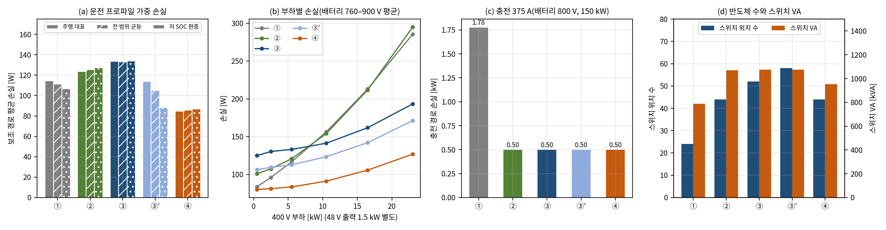

# 기준 구조 손실·정격 비교와 H5 판정

- 문서 버전: v1.1 (2026-10-29). v1.1: Stage A를 A25R로 바꾼 뒤 다시 계산한 값(E36, docs/41)으로 '정정' 절을 더했다. H5 판정(기각)은 같다. v1.0(2026-10-22)의 본문 값은 150 kHz Stage A 설계의 결과다.
- 관련 요구: [docs/14](14_요구사항_부하등급_수락기준.md) H5 수락 기준, [docs/17](17_기준구조_평균모델_1차비교.md) 기준 구조 ③′·④의 서비스·과도 비교
- 근거 파일: [validation/2026-10-22-baseline-loss-rating](../validation/2026-10-22-baseline-loss-rating/README.md), 코드는 검증 코드 묶음의 E15
- 검증 수준: 설계 단계 손실·정격 추정(데이터시트 소자값, 일정 비율 자성체 손실 규칙, Stage A는 E1 스위칭 모델). 열 결합과 하드웨어 측정은 포함하지 않는다.

## 정정(2026-10-29, A25R 반영)

이 문서의 시험은 150 kHz Stage A 설계(위치당 6 mΩ 가정, 출력용량 손실 4·E\_oss·f\_s, V\_A 노드 커패시터 C\_A 400 µF)로 했다. 그 뒤 E31에서 출력용량 손실이 작게 잡혀 있었음을 찾았고, Stage A를 25 kHz 설계 A25R(위치당 C4MS008075U2 2병렬, L\_r 864.6 nH, C\_fly 46.875 µF, C\_A 2.4 mF)로 바꿨다([docs/40](40_StageA25R_수정안_E35_TB27.md)). A25R로 다시 계산한 결과(E36 [docs/41](41_A25R_영향_재확인_E36_TB28.md), E37 [docs/42](42_부품정격표_2차_E37.md))에 따라 아래 값과 문장을 정정한다. 판정 기준은 원 시험의 것을 그대로 썼다. 본문은 원 시험의 기록으로 두고, 바뀐 곳에 〔정정: …〕을 달았다. 최종 설계와 최종 보고서는 이 절의 값을 쓴다.

| 항목 | 원 결과(150 kHz Stage A) | A25R(현재 설계) |
|---|---|---|
| 주행 대표 보조 경로 손실 ① / ② / ③ / ③′ / ④ | 114.6 / 123.8 / 133.8 / 114.1 / 85.0 W | 114.6 / 133.3 / 143.2 / 123.4 / **94.4 W**(E36 L1) |
| 손실 순위(주행 대표) | ④ < ③′ < ① < ② < ③ | ④ < ① < ③′ < ② < ③. 저 SOC 프로파일에서는 ③′(92.3 W)가 ①(107.1 W)보다 작다 |
| 150 kW 충전 경로 손실(Stage A 8위상) | 497 W(전압 무관) | 640·700·800·900 V에서 520·544·586·630 W. 승압기(①)보다 66–68 % 작다(150 kHz 값 72 %) |
| 스위치 VA ② / ③ / ③′ / ④(Stage A 부분) | 1,070 / 1,074 / 1,075 / 953 kVA(892 kVA) | 1,066 / 1,070 / 1,071 / 949 kVA(887 kVA). 위치·소자 수는 같다 |
| H5 판정 | 기각. ③은 ④에 0/3. ③′ 대비는 엄격 판정 2/3(스위치 VA·반도체 수), 동등범위 3 % 판정 1/3(반도체 수) | **같음(기각).** ③은 ④에 0/3, ③′ 대비는 엄격 2/3·동등범위 3 % 1/3. H5는 ④·③′ 모두에 대해 성립해야 하므로 기각이다. 프로파일 3종 모두 같다 |
| ③ = ④ 손익분기(Stage B 비도통 손실 배율) | 0.228 | 0.228(Stage A 항이 양쪽에서 같아 상쇄) |
| DAB 고정 효율 가정의 ③(1절 3항) | 81.8 W(④ 85.0 W보다 작게 나옴) | A25R로 다시 계산하지 않았다. 손실 비교에 고정 손실을 포함한 소자 모델이 필요하다는 결론은 Stage A 모델과 무관하다 |

- 손실 증가(Stage A 구조 9.3–9.5 W)는 설계가 나빠진 것이 아니라 손실 모델 정정의 결과다. 150 kHz 설계를 같은 E31 모델로 계산하면 위상당 출력용량 손실이 175 W가 된다(docs/37).

## 1. 요약

| 구조 | 보조 경로 평균 손실(주행 대표) | 150 kW 충전 경로 손실 | 스위치 위치 수 / 소자 수 | 스위치 VA | 설치 변환기 정격 |
|---|---|---|---|---|---|
| ① 전전력 승압기 + 800→400 V 보조 강압기 | 114.6 W | 1.78 kW | 24 / 28 | 789 kVA | 178.0 kW |
| ② Stage A + 전전력 조정기(V\_A→400 V) | 123.8 W | 0.50 kW | 44 / 80 | 1,070 kVA | 178.0 kW |
| **③ PRISM-Hub(Stage A + Stage B)** | **133.8 W** | 0.50 kW | 52 / 96 | 1,074 kVA | 161.0 kW |
| ③′ 창 조정(버스 ≤ 410 V) | 114.1 W | 0.50 kW | 58 / 100 | 1,075 kVA | 161.3 kW |
| ④ 비조정(Stage A + 조정형 Stage C) | **85.0 W** | 0.50 kW | 44 / 80 | 953 kVA | 156.3 kW |

〔정정: 위 표는 150 kHz Stage A 값이다. A25R 값은 '정정' 절 표를 쓴다. H5 판정은 같다.〕

**H5 판정: 지표 기준 불충족.** ③은 ④에 손실·스위치 VA·반도체 수 세 지표 모두 뒤진다. ③′에 대해서는 반도체 수만 앞서고, 스위치 VA는 동등(차 0.1 %), 손실은 뒤진다. H5는 ④와 ③′ 각각에 대해 세 지표 중 2개 이상에서 우수해야 성립하므로, 엄격 판정(차이가 있으면 우열)과 동등범위 3 % 판정 모두에서 불충족이다. 결론은 운전 프로파일 3종과 손실 계수 감도 7종에서 바뀌지 않는다.

세 가지가 확인되었다.

1. **Stage A 충전 경로의 이점은 분명하다.** 400 V급 충전기 375 A(배터리 800 V, 150 kW)에서 충전 경로 손실은 Stage A 8위상 0.50 kW, 전전력 승압기(①) 1.78 kW로 72 % 작다. 이 이점은 Stage A를 쓰는 ②·③·③′·④에 공통이다. 〔정정: A25R에서 0.59 kW, 67 % 작다(640–920 V 0.52–0.64 kW).〕
2. **Stage B의 400 V 조정은 손실·정격 면에서 이득이 아니다.** Stage B는 경부하에서도 약 65 W의 고정 손실을 낸다(DAB 무부하 45.8 W, H-브리지 약 19.5 W). H-브리지가 경로에 직렬이라 직렬전압이 0이어도 경로전류 전체를 흘리며 200 kHz로 스위칭하고, DAB는 링크전력이 0 근처에서 영전압 스위칭을 잃기 때문이다. 같은 조정을 3 kW Stage C 앞단(④)으로 옮기면 그 대가는 약 18 W다.
3. **평균모델의 손실 가정은 이 비교에 쓸 수 없다.** 지금까지의 평균모델·스위칭 모델은 DAB 손실을 방향별 효율 0.96 고정으로 두었다(무부하 손실 0). 이 가정으로 계산하면 ③이 81.8 W로 ④(85.0 W)보다 작게 나온다. 손실 순위가 경부하 고정 손실에 의해 결정되므로, 손실 비교에는 고정 손실을 포함한 소자 수준 모델이 필요하다. 〔정정: 150 kHz Stage A로 계산한 값이다. 결론은 그대로다.〕

따라서 Stage B는 손실·정격의 개선 수단이 아니라, **서비스 요구가 있을 때 선택하는 기능**으로 위치를 다시 정한다. 400 V 버스를 ±2 % 창에 두어 B\_420 부품과 고정이득 48 V Stage C를 함께 허용하고, 버스 감쇠기 없이 경로전류를 직접 제어하는 것은 ③만 할 수 있다(docs/17). 이 서비스가 필요하지 않으면 ④가 손실·반도체 수·VA에서 모두 낫다.

## 2. 왜 이 비교가 필요한가

docs/14 D1에서 400±8 V 정밀 조정은 외부 요구가 아니라 파생 요구로 분류되었다. 외부 요구는 보조버스가 부하 하한 이상, 부품 등급(B\_420 또는 B\_470) 이하에 있는 것뿐이다. 그러므로 Stage B의 존재 이유는 조정하지 않는 구조(④)와 상한만 제한하는 구조(③′)보다 손실·정격·부품 수에서 나은지로만 입증된다. docs/17은 세 구조의 서비스 범위와 과도 응답을 같은 평균모델로 비교했고, 손실·정격 비교를 이 단계로 남겼다.

손실 비교가 공정하려면 세 가지가 필요하다.

- 같은 소자 기술, 같은 자성체 손실 규칙, 같은 부하 분포를 모든 구조에 적용한다. 한 구조만 자세히 모델링하면 그 구조만 손실이 크게 나온다.
- 손실을 정격점 효율이 아니라 운전 프로파일로 가중한다. 보조부하는 대부분의 시간을 경부하에서 보내므로, 고정 손실(철손·출력용량·제어 전원)이 평균 손실을 좌우한다[1].
- 판정 기준은 시험 전에 고정한다. H5 기준은 docs/14에서 정했고, 이 문서는 그 기준으로 판정한다.

## 3. 비교 구조

모든 구조는 같은 서비스를 제공한다. 400 V급 충전기에서 375 A 충전, 400 V 보조부하(최대 23 kW), 48 V 출력(Stage C, 평균 1.5 kW)이다. 48→12 V 강압은 모든 구조에 공통이라 제외했다.

| 구조 | 충전 경로 | 400 V 보조버스 | Stage C(48 V) | 추가 부품 |
|---|---|---|---|---|
| ① | 전전력 승압기(V\_bat/2 → V\_bat, 1200 V SiC, 6위상 50 kHz, 150 kW) | 800→400 V 강압기(1200 V SiC, 2위상 50 kHz, 25 kW) | 고정이득 CLLC 3 kW | — |
| ② | Stage A(2:1 RSC 8위상) | Stage A + 4스위치 벅부스트(750 V SiC, 50 kHz, 25 kW) | 고정이득 | — |
| ③ | Stage A | Stage A + Stage B(DAB 8 kW, H-브리지 ±90 V, 200 kHz) | 고정이득 | — |
| ③′ | Stage A | V\_A > 410 V에서만 Stage B(단극성, DAB 5 kW), 그 아래는 바이패스 | 조정형(전단 벅부스트 + CLLC) | 바이패스 스위치, 버스 RC 감쇠기 |
| ④ | Stage A | 버스 = V\_A(319–460 V) | 조정형 | 버스 RC 감쇠기, B\_470 부품 |

조정형 Stage C는 650 V GaN 4스위치 벅부스트(100 kHz, 3.3 kW) 뒤에 같은 고정이득 CLLC를 둔 2단 구성으로 계산했다. 단일 단 광이득 CLLC는 반도체 수가 4개 적지만 이득 끝에서 손실이 커지므로, 이 비교에서는 손실을 따로 계산할 수 있는 2단 구성을 썼다.

## 4. 계산 방법

### 4.1 소자

각 위치에 같은 기술의 상용 소자를 두고, 도통저항은 접합온도 약 125 °C 값을 썼다. 정격전류(케이스 100 °C 또는 열 여유를 둔 값)를 넘으면 병렬 수를 늘린다.

| 용도 | 소자(데이터시트) | 125 °C 도통저항 | 스위칭 기준값 |
|---|---|---|---|
| 1200 V 하드 스위칭(①) | 1200 V SiC MOSFET C3M0016120K [2] | 24.7 mΩ(16 mΩ@25 °C·29 mΩ@175 °C 보간) | E\_on + E\_off 3,340 µJ @ 800 V·80 A, E\_oss 127 µJ |
| 750 V 하드 스위칭(②) | 750 V SiC FET UJ4SC075006K4S [3] | 9.8 mΩ | E\_total 829 µJ @ 400 V·80 A, E\_oss 38 µJ |
| 650 V GaN(DAB 1차, Stage C 1차, 조정형 Stage C 전단) | GS66516T [4] | 57 mΩ(25 mΩ@25 °C·65 mΩ@150 °C 보간) | E\_on + E\_off 151 µJ @ 400 V·20 A, E\_oss 17 µJ, C\_o(tr) 335 pF |
| 150 V GaN(DAB 2차, H-브리지, Stage C 2차, 바이패스) | EPC2305 [5] | 3.3 mΩ(2.2 mΩ typ × 1.5 가정) | Q\_oss 103 nC @ 75 V, C\_oss(tr) 1,371 pF, 전이시간 켜짐 3 ns·꺼짐 2 ns(가정) |
| Stage A | 750 V SiC 12 mΩ@125 °C 2병렬(설계검증서 기준 소자) | 6 mΩ | E1 모델 값 |

하드 스위칭 에너지는 데이터시트의 E\_on + E\_off를 두 부분으로 나눈다. 출력용량 에너지는 전류와 무관하게 남고(전압^1.5로 환산), 나머지 전이 손실은 전압·전류에 비례한다. 경부하에서 스위칭 손실이 0으로 가지 않는 것을 반영하기 위해서다.

### 4.2 손실 규칙(모든 구조에 같게 적용)

| 항목 | 규칙 |
|---|---|
| Stage A | E1 스위칭 모델(영교차 추종)의 위상별 손실(도통·다이오드·출력용량·게이트)과 V\_A 강하를 배터리 6점 × 위상 전류 9점 격자로 계산해 보간. 주행은 모듈 1(2위상), 충전은 8위상 375 A |
| 하드 스위칭 변환기 | 도통 I\_rms²·R\_on(인덕터 리플 30 % 포함), 스위칭 에너지(4.1절), 데드타임 역도통, 게이트 Q\_g·V\_g·f |
| DAB(SPS) | 누설전류 파형을 한 주기 계산해 실효전류와 스위칭 순간 전류를 구한다. 전류가 데드타임 안에 출력용량을 충방전하면 턴오프 손실만, 아니면 출력용량 에너지 손실 |
| H-브리지 | 유니폴라 PWM 200 kHz, 필터 전류가 한 방향이면 레그마다 하드 켜짐·꺼짐, 리플이 영을 지나면 꺼짐 손실만 |
| CLLC | TB05의 1차·2차 실효전류(3 / 1.5 / 0.3 kW) 보간, 자화전류에서 턴오프, 영전압 켜짐 |
| 자성체 | 인덕터: 권선 저항은 정격전류에서 정격전력의 0.15 %, 철손 등은 동작 중 정격의 0.1 %로 일정. 변압기: 권선 0.3 %, 철손 0.2 % |
| 제어·보조전원 | 동작 중인 변환기마다 5 W |
| 배선 | V\_A → 직렬 포트(또는 버스) 3 mΩ. ③′ 바이패스 스위치 3.3 mΩ |

③·③′의 정상점은 버스 전력수지(버스 × 경로전류 = 부하 + DAB 입력)를 경로전류에 대해 풀어 구한다. DAB 입력은 H-브리지 손실까지 포함한 링크전력에 DAB 손실을 더한 값이다. ③′는 V\_A가 410.5 V를 넘을 때만 Stage B를 켜고(버스 410 V), 그 아래는 Stage B를 끄고 바이패스한다.

### 4.3 운전 프로파일과 지표

| 항목 | 값 |
|---|---|
| 배터리 전압 분포 | 주행 대표 760–900 V 균등(판정용), 전 범위 640–920 V 균등, 저 SOC 640–780 V 균등 |
| 400 V 부하 분포(시간 비율) | 0.5 kW 30 %, 2.5 kW 30 %, 5.5 kW 20 %, 10.5 kW 12 %, 16.5 kW 6 %, 23 kW 2 % |
| 48 V 출력 | 1.5 kW 일정 |
| 충전 | 400 V급 충전기 375 A, 배터리 640–900 V |

- 손실: 배터리에서 400 V 부하·48 V 출력까지의 보조 경로 손실을 전압 분포 × 부하 분포로 가중한 평균.
- 스위치 VA: Σ(소자 전압 등급 × 정격 운전의 스위치 실효전류). Stage A는 충전 정격(위상 피크 74.3 A)으로 계산한다.
- 반도체 수: 스위치 위치 수(판정용)와 병렬을 포함한 소자 수.

## 5. 결과

### 5.1 보조 경로 손실

| 구조 | 주행 대표 | 전 범위 균등 | 저 SOC | 0.5 kW | 5.5 kW | 23 kW |
|---|---|---|---|---|---|---|
| ① | 114.6 | 111.4 | 107.1 | 83.8 | 116.6 | 285.5 |
| ② | 123.8 | 125.6 | 127.5 | 101.1 | 120.8 | 294.8 |
| ③ | 133.8 | 133.2 | 134.0 | 125.0 | 133.1 | 193.3 |
| ③′ | 114.1 | 105.0 | 88.6 | 106.5 | 112.7 | 171.2 |
| ④ | 85.0 | 85.9 | 86.9 | 80.2 | 83.6 | 126.9 |

(단위 W. 부하별 값은 주행 대표 전압 분포의 평균)

- ③의 Stage B는 고부하에서는 전전력 조정기(②)보다 손실이 작다(23 kW에서 193 W 대 295 W). 차동전력만 처리하는 부분전력 변환의 이점이다.
- 그러나 0.5–5.5 kW 구간(시간의 80 %)에서는 Stage B의 고정 손실 때문에 ③이 다섯 구조 중 가장 크다.
- ④는 모든 부하에서 가장 작다. 조정형 Stage C 전단의 대가(약 18 W)가 Stage B 고정 손실(약 65 W)보다 작기 때문이다.
- ③′는 바이패스 구간(배터리 820 V 이하)에서 ④와 같고, 조정 구간에서 ③과 비슷하다. 그래서 저 SOC 프로파일에서는 ④와 거의 같다(88.6 대 86.9 W).

Stage B 손실 내역(③, 링크전력은 버스 → 링크가 양수)은 다음과 같다.

| 운전점 | 직렬전압 | 링크전력 | H-브리지 | DAB |
|---|---|---|---|---|
| 640 V, 0.5 kW | +80.1 V | +541 W | 19.0 W | 35.7 W |
| 640 V, 23 kW | +81.0 V | +6,331 W | 62.6 W | 113.3 W |
| 800 V, 0.5 kW | +0.1 V | +19 W | 18.8 W | 45.8 W |
| 800 V, 23 kW | +0.7 V | +94 W | 48.5 W | 45.8 W |
| 900 V, 23 kW | −49.4 V | −2,660 W | 43.0 W | 38.3 W |

배터리 800 V 부근에서는 직렬전압이 거의 0이라 Stage B가 처리하는 전력이 수십 W뿐인데도, H-브리지와 DAB의 손실은 65–94 W다.

### 5.2 충전 경로 손실

| 배터리 | ① 승압기 | ②–④ Stage A 8위상 |
|---|---|---|
| 640 V | 1,614 W | 497 W |
| 700 V | 1,674 W | 497 W |
| 800 V | 1,775 W | 497 W |
| 900 V | 1,877 W | 497 W |

Stage A는 영전류 스위칭이라 손실이 도통과 출력용량 에너지로 정해지며, 이 모델(E1)에서는 출력용량 에너지를 전압과 무관한 값으로 두었으므로 배터리 전압에 따라 변하지 않는다. 〔정정: A25R(E32 직접 모의)에서는 출력용량 손실이 전압에 따라 커져 640·700·800·900 V에서 520·544·586·630 W다.〕

### 5.3 반도체 수와 정격

| 구조 | 구성(스위치 위치 / VA) | 합계 위치 | 합계 VA |
|---|---|---|---|
| ① | 승압기 12 / 636 kVA, 보조 강압기 4 / 106, Stage C 8 / 46 | 24 | 789 kVA |
| ② | Stage A 32 / 892, 조정기 4 / 133, Stage C 8 / 46 | 44 | 1,070 kVA |
| ③ | Stage A 32 / 892, Stage B 12 / 136, Stage C 8 / 46 | 52 | 1,074 kVA |
| ③′ | Stage A 32 / 892, Stage B 12 / 92, 바이패스 2 / 30, Stage C 8 / 46, 전단 4 / 15 | 58 | 1,075 kVA |
| ④ | Stage A 32 / 892, Stage C 8 / 46, 전단 4 / 15 | 44 | 953 kVA |

Stage A가 ②–④에 공통으로 892 kVA를 차지하므로, 구조 간 차이는 보조 경로 부분에서 나온다. ③의 Stage B(12 위치, 136 kVA)는 ④의 조정형 Stage C 전단(4 위치, 15 kVA)보다 위치 수가 3배, VA가 9배다. 설치 변환기 정격도 ④(156.3 kW)가 가장 작다.

### 5.4 H5 판정

| 비교 | 손실 | 스위치 VA | 반도체 수 | 엄격 판정 | 동등범위 3 % |
|---|---|---|---|---|---|
| ③ vs ④ | 133.8 > 85.0 W | 1,074 > 953 kVA | 52 > 44 | 0/3 → 불통과 | 0/3 → 불통과 |
| ③ vs ③′ | 133.8 > 114.1 W | 1,074 < 1,075 kVA | 52 < 58 | 2/3 → 통과 | 1/3 → 불통과(VA 동등) |
| H5 지표 기준 | | | | **불충족** | **불충족** |

프로파일 3종(주행 대표, 전 범위 균등, 저 SOC) 모두 불충족이다. H5의 서비스 조건(동등 이상)은 ③이 충족하지만(docs/17), 지표 조건을 충족하지 못하므로 H5는 기각한다.

## 6. 감도 분석

| 사례 | ① | ② | ③ | ③′ | ④ | 손실 순위 |
|---|---|---|---|---|---|---|
| 기본 | 114.6 | 123.8 | 133.8 | 114.1 | 85.0 | ④ < ③′ < ① < ② < ③ |
| 자성체 손실 ×0.5 | 95.2 | 104.5 | 116.6 | 102.2 | 78.0 | ④ < ① < ③′ < ② < ③ |
| 자성체 손실 ×2 | 153.3 | 162.6 | 168.0 | 138.0 | 98.9 | ④ < ③′ < ① < ② < ③ |
| 스위칭 에너지 ×0.7 | 100.8 | 120.2 | 124.0 | 108.2 | 83.4 | ④ < ① < ③′ < ② < ③ |
| 스위칭 에너지 ×1.5 | 137.5 | 129.9 | 150.0 | 123.8 | 87.7 | ④ < ③′ < ② < ① < ③ |
| 150 V GaN 전이시간 ×2 | 114.6 | 123.8 | 135.4 | 114.8 | 85.0 | ④ < ① < ③′ < ② < ③ |
| 제어 손실 0 | 104.5 | 108.8 | 118.8 | 96.4 | 69.9 | ④ < ③′ < ① < ② < ③ |
| Stage B 비도통 손실 ×0.5 | 114.6 | 123.8 | 102.2 | 100.3 | 85.0 | ④ < ③′ < ③ < ① < ② |
| Stage B 도통 손실만(이론 하한) | 114.6 | 123.8 | 70.6 | 86.7 | 85.0 | ③ < ④ < ③′ < ① < ② |
| 평균모델 손실 가정(η 0.96, 무부하 0) | 114.6 | 123.8 | 81.8 | 92.6 | 85.0 | ③ < ④ < ③′ < ① < ② |

(주행 대표 프로파일 평균 손실, 단위 W)

- 일반 계수(자성체·스위칭·전이시간·제어)의 감도 7종에서 ④가 항상 가장 작고 ③이 항상 가장 크다.
- ③이 손실에서 ④보다 작아지는 경우는 Stage B 비도통 손실(철손·스위칭·게이트·제어)을 없앤 이론 하한과, 무부하 손실이 없는 평균모델 가정뿐이다.
- 손익분기점은 Stage B 비도통 손실 배율 **0.23**이다. ③이 손실에서 ④와 같아지려면 Stage B의 경부하 고정 손실을 약 77 % 줄여야 한다(약 65 W → 15 W). 경부하 버스트 운전, H-브리지 주파수 저감, 직렬전압이 작을 때의 바이패스가 수단이지만, 마지막은 ③′에 가까워진다.
- 손실을 맞추더라도 반도체 수(52 대 44)와 스위치 VA(1,074 대 953 kVA)는 감도와 무관하게 ④가 낫다. 따라서 Stage B 최적화로 H5 지표 기준을 바꿀 수는 없다.

## 7. 해석과 연구 주장에 대한 영향

1. **정격 분리(H1)와 충전 경로의 가치는 유지된다.** Stage A는 충전 대전류를 영전류 스위칭으로 처리해 전전력 승압기보다 손실이 72 % 작다. 이것이 이 아키텍처의 주된 기여다. 다만 반도체 수와 VA는 Stage A(32 위치, 892 kVA)가 승압기(12 위치, 636 kVA)보다 크므로, 이 이점은 손실(냉각)과 소자 비용의 상충으로 보고해야 한다. 승압기를 구동 인버터로 대신하는 방식이면 ①의 추가 반도체는 더 줄어든다. 〔정정: A25R 66–68 %, Stage A 887 kVA〕
2. **부분전력 조정의 이득은 경부하 고정 손실에 상쇄된다.** 부분전력 변환은 처리 전력을 줄이지만, 직렬 H-브리지는 경로전류 전체를 항상 흘리고 DAB는 무부하 손실을 가진다. 보조부하처럼 경부하 시간이 긴 용도에서는 처리 전력보다 고정 손실이 평균 손실을 정한다.
3. **400 V 조정은 서비스 요구가 있을 때의 선택지다.** ③만 할 수 있는 일은 B\_420 부품 허용(④는 B\_470), 고정이득 48 V Stage C(④·③′는 조정형), 버스 감쇠기 없는 경로전류 제어(docs/17)다. 400 V 부품을 470 V 등급으로 둘 수 있고 48 V 측 조정을 Stage C에 맡길 수 있다면, ④가 손실·반도체 수·VA에서 모두 낫다.
4. **검증 체계에 대한 교훈.** 동특성 검증에 쓴 평균모델의 고정 효율 가정은 제어 설계에는 충분했지만, 구조 간 손실 비교에는 결론을 뒤집을 만큼 부족했다(③ 81.8 W 대 133.8 W). 손실 비교에는 고정 손실을 포함한 소자 수준 모델이 필요하다.

이후 작업의 방향은 다음과 같이 정리한다.

- 충전 통합(H3)과 보호 결합은 Stage A·Stage B 공통 기능이므로 계획대로 진행한다. 다만 H3 결과에는 ④에서의 충전 중 보조버스 동작을 함께 적는다.
- Stage C 재설계는 ③(고정이득)과 ④(조정형) 두 사양을 모두 정리해 두고, 구조 선택을 서비스 요구에 맡긴다.
- 최종 보고서의 연구 주장은 "Stage A 충전 경로 + 서비스 조건부 Stage B"로 정리하고, H5 기각과 그 원인을 그대로 보고한다.

## 8. 한계

- 소자는 기술마다 대표 소자 하나이고, 자성체는 정격 비율 규칙이다. 개별 자성체 설계, 열 결합(접합온도 반복 계산), 기생 성분, 소자 병렬 최적화는 포함하지 않았다. 감도 분석은 이 불확도를 계수 ×0.5–×2로 덮는다.
- Stage B와 조정형 Stage C의 경부하 운전 최적화(버스트, 주파수 가변)는 넣지 않았다. 두 쪽 모두 같은 조건이다. Stage B에만 최적화를 허용한 경우는 6절의 손익분기점으로 보였다.
- Stage A 손실은 E1 모델 값이며 출력용량 에너지를 전압과 무관하게 둔다. 위상 전류 3 A 이하(모듈 출력 약 6 A 이하)에서는 영교차 추종의 턴오프 전류 비가 5 %를 넘는다(턴오프 전류 ≤ 1.9 A). ②–④ 공통 항목이라 순위에는 영향이 없다.
- ④·③′ 조정형 Stage C 전단의 650 V GaN은 입력 460 V에서 전압 사용률 71 %로, 직류 응력 70 % 규칙의 경계다. 750 V 소자를 쓰면 ④의 손실이 조금 커지지만, Stage B와의 차이(약 50 W)에 비하면 작다.
- 버스 RC 감쇠기(④·③′)는 직류 손실이 거의 없어 손실에 넣지 않았고, 부품 항목으로만 기록한다.
- 스위치 VA는 소자 비용의 대리 지표이며, 전압 등급별 단가 차이는 반영하지 않는다.

## 참고문헌

1. H. Chen, H. Kim, R. W. Erickson, D. Maksimović, "Electrified Automotive Powertrain Architecture Using Composite DC–DC Converters," *IEEE Trans. Power Electron.*, vol. 32, no. 1, pp. 98–116, 2017.
2. Wolfspeed, *C3M0016120K Silicon Carbide Power MOSFET, 1200 V, 16 mΩ*, datasheet.
3. onsemi (UnitedSiC), *UJ4SC075006K4S 750 V, 5.9 mΩ G4 SiC FET*, datasheet.
4. GaN Systems (Infineon), *GS66516T Top-side cooled 650 V E-mode GaN transistor*, datasheet Rev. 210727.
5. EPC, *EPC2305 Enhancement Mode Power Transistor, 150 V, 2.2 mΩ*, datasheet.
