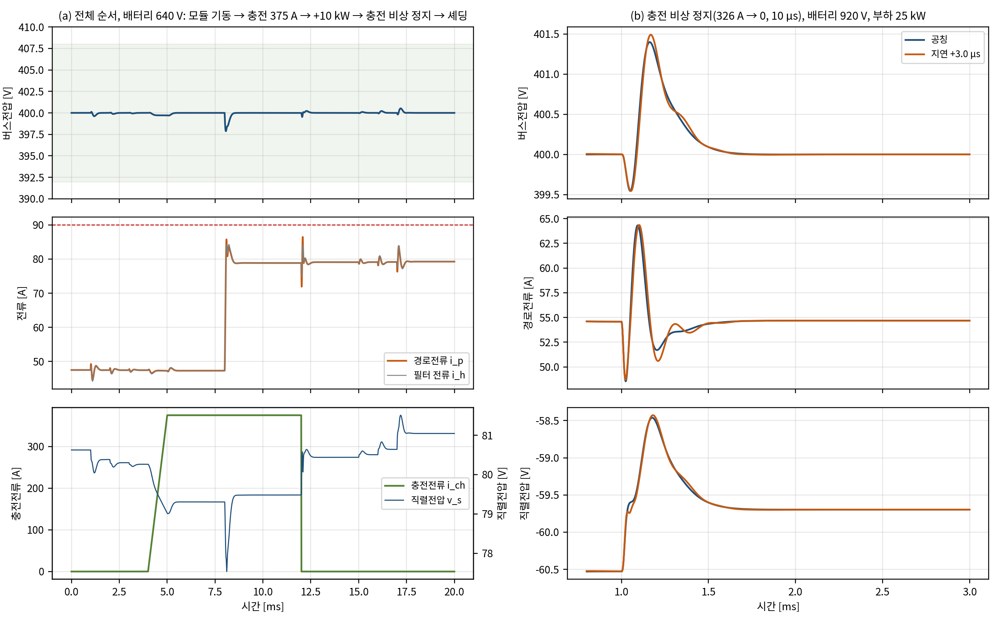

# 충전 중 보조버스(H3) 검증

- 문서 버전: v1.1 (2026-10-29). v1.1: Stage A를 A25R로 바꾼 뒤의 재확인(E36 D1, docs/41)과 바뀐 충전 요구(사전 기동·램프 600 µs, docs/40)로 '정정' 절을 더했다. H3 판정(충족)은 같다. v1.0(2026-10-22)의 본문 값은 150 kHz Stage A 설계의 결과다.
- 관련 요구: [docs/14](14_요구사항_부하등급_수락기준.md) H3 수락 기준(150 kW·375 A 충전 + 25 kW 보조부하 동시 운전, 충전기 접속·해제), H1의 충전 부분(충전전류 Stage B 비경유)
- 근거 파일: [validation/2026-10-22-charging-integration](../validation/2026-10-22-charging-integration/README.md)(평균모델·스위칭 모델 E16), Simulink 테스트벤치 TB07(회로 모델)
- 검증 수준: 평균모델(격자·전환·전체 순서), 스위칭 모델(대표 사례), 소자 수준 회로 모델(대표 사례 7개)

## 정정(2026-10-29, A25R 반영)

이 문서의 시험은 150 kHz Stage A 설계(위치당 6 mΩ 가정, 출력용량 손실 4·E\_oss·f\_s, V\_A 노드 커패시터 C\_A 400 µF)로 했다. 그 뒤 E31에서 출력용량 손실이 작게 잡혀 있었음을 찾았고, Stage A를 25 kHz 설계 A25R(위치당 C4MS008075U2 2병렬, L\_r 864.6 nH, C\_fly 46.875 µF, C\_A 2.4 mF)로 바꿨다([docs/40](40_StageA25R_수정안_E35_TB27.md)). A25R로 다시 계산한 결과(E36 [docs/41](41_A25R_영향_재확인_E36_TB28.md), E37 [docs/42](42_부품정격표_2차_E37.md))에 따라 아래 값과 문장을 정정한다. 판정 기준은 원 시험의 것을 그대로 썼다. 본문은 원 시험의 기록으로 두고, 바뀐 곳에 〔정정: …〕을 달았다. 최종 설계와 최종 보고서는 이 절의 값을 쓴다.

| 항목 | 원 결과(150 kHz Stage A) | A25R(현재 설계) |
|---|---|---|
| Stage A 모듈 출력저항 R\_A, V\_A 노드 C\_A | 10.2 mΩ, 400 µF | 9.0 mΩ(E32 800 V 2위상 V\_A 강하 기울기), 2.4 mF |
| 평균모델 H3 시험(E16) | 정적 4,118점 성립, Tier-1 460/460, Tier-2 78/78(92.74 A), 모드 전환 240/240(≤ 86.8 A), 전체 순서 30/30(397.81–401.64 V) | 같은 기준으로 모두 통과(E36 D1): 정적 모두 성립(링크 ≤ 8 kW), Tier-1 460/460, Tier-2 78/78(92.7 A), 모드 전환 240/240(≤ 86.3 A), 전체 순서 30/30(397.81–401.44 V) |
| 충전 전 사전 기동, 충전전류 증가 램프 | ≥ 100 µs(≤ 3.75 A/µs) | **≥ 600 µs(≤ 0.625 A/µs)**(E35, docs/40). 25 kHz 공진 15주기로, 150 kHz의 100 µs와 같은 주기 수다. 100 µs 램프는 A25R에서 턴오프 위반 12–22번(요구 밖, 정보) |
| 회로 확인 | TB07(150 kHz Stage A, 7/7 회로 한계 통과) | A25R 회로 TB27 4/4(느린 충전·모듈 고장, docs/40), TB28 4/4(충전 중 정지·모듈 고장·느린 충전 시작·종료, docs/41) |
| H3 판정 | 충족(조건: 램프 ≥ 100 µs) | **충족(조건: 사전 기동·램프 ≥ 600 µs)** |

- E16 평균모델은 V\_A를 V\_bat/2 + R\_A·(i\_ch − i\_p)/모듈 수의 정적 관계로 둔다. C\_A 2.4 mF에서는 C\_A·R\_A 시정수가 5–22 µs로 제어주기(5 µs)보다 길어 이 가정이 맞지 않는다. 정적 관계는 충전기 전류 변화가 V\_A에 바로 나타나게 하므로 C\_A가 큰 실제보다 보수적이다(docs/41 3.4절).
- 본문의 V\_A 노드 공진(주기 약 30 µs)은 150 kHz Stage A와 C\_A 400 µF의 값이다.

## 1. 요약

| 시험 | 조건 | 결과 |
|---|---|---|
| 정적 범위(평균모델) | 배터리 640–920 V × 보조부하 −3.2–25 kW, 충전전류 최대(375 A, 150 kW 제한) | 4,118점 모두 성립. 직렬전압 −60.9 ~ +83.5 V, 링크 ≤ 6.68 kW, 경로 ≤ 79.9 A. 충전기 단자 316.8–460.8 V |
| 동시 운전 Tier-1(평균모델) | E5와 같은 구성 460건(공차·지연 +3.0 µs 포함) | **460/460 통과**, 최대 87.43 A(주행 모드 E5 87.62 A) |
| 동시 운전 Tier-2(평균모델) | 78건(H2와 같은 판정 범위: 지연 없음) | **78/78 통과**, 최대 92.74 A(주행 모드 E5 92.70 A). 정보: 지연 +3.0 µs 14건은 13/14, 최대 93.96 A(632 V, 주행 모드 같은 조건 94.08 A) |
| 모드 전환(평균모델) | 충전기 접속·해제(10 µs, 1 ms), 모듈 기동·셰딩 × 5개 전압 × 부하 4종 × 공칭·지연 | **240/240 통과**(Tier-2), Tier-1 전압 품질도 240/240 |
| 전체 순서(평균모델) | 주행 → 모듈 기동 → 충전 → 충전 중 +10 kW → 충전 비상 정지 → 셰딩 | **30/30 통과**, 최대 87.04 A, 버스 397.8–401.6 V |
| 스위칭 모델 | 충전 중 Tier-1·Tier-2 40건, 충전기 접속·비상 정지 8건 | **48/48 통과**, 순시 최대 96.26 A(Tier-2·지연 +3.0 µs) |
| 회로 모델(TB07) | 사례 A·B·C + 추가 실행 4개 | **회로 한계 7/7 통과.** 검증 모델 일치는 충전전류가 10 µs 안에 바뀌는 3개 실행에서 불통과(경로전류 첨두 +3.3–13.4 A) |

**H3 판정: 충족(평균모델·스위칭 모델·회로 모델, 조건 1개).** 〔정정: A25R에서도 충족(E36 D1), 조건은 사전 기동·램프 ≥ 600 µs〕

- 충전 중 동시 운전(Tier-1·Tier-2)과 모드 전환(Tier-2)은 평균모델·스위칭 모델·회로 모델의 기준을 모두 만족한다.
- 조건은 **충전전류 증가 램프**다. 충전전류를 늘리는 변화는 100 µs 이상에 걸쳐야 한다(375 A 기준 ≤ 3.75 A/µs). 〔정정: A25R에서 600 µs 이상(≤ 0.625 A/µs), docs/40〕
  - 그보다 빠르면 V\_A 노드 공진으로 경로전류가 커진다.
  - 10 µs 경계 사례에서도 회로 한계는 지켰다. 다만 640 V·25 kW 접속은 98.49 A로, 한계 100 A에 1.5 A 남는다.
  - 이 사례들에서는 검증 모델과의 일치 기준을 만족하지 못했다.
- 정보로 기록한 Tier-2 + 지연 +3.0 µs 조합(H2에서도 판정 범위 밖)은 주행 모드와 같은 수준이다. 632 V에서 93.96 A로, 주행 모드는 94.08 A다.

**H1 충전 부분: 충족.** 충전전류는 V\_A 노드에서 Stage A로 바로 들어가며 직렬 포트를 지나지 않는다. 회로에서도 경로전류는 보조부하만큼만 흐르고(375 A 충전 중 13–79 A), Stage A 출력전류는 경로전류에서 충전전류를 뺀 값과 0.06 A 안에서 같다. 충전 중 링크전력은 정적 최대 6.68 kW, 과도 최대 7.49 kW로 8 kW 안이다.

## 2. 왜 필요한가

지금까지 Stage B 검증(E5–E7, E11, E12, TB04–TB06)은 모두 주행 모드였다. 주행 모드에서는 Stage A 모듈 1개(2위상)가 V\_A를 만든다. 400 V급 급속충전 중에는 경로 전원이 두 가지 점에서 다르다.

1. **경로저항이 공칭의 42 %가 된다.** Stage A 4모듈이 모두 동작해 V\_A 출력저항이 10.2 mΩ에서 2.55 mΩ으로 줄고, 플랜트 경로저항은 13.2 mΩ에서 5.55 mΩ이 된다. 제어기는 13.2 mΩ을 공칭값으로 쓴다. 이는 E7 공차(±10 %)의 범위를 크게 벗어나며, 경로저항은 경로 L–버스 C 공진의 자연 감쇠를 정한다.
2. **충전기 전류가 경로 전원을 움직인다.** V\_A = V\_bat/2 + R\_A·(i\_ch − i\_p)이므로 충전전류가 375 A 바뀌면 경로 전원이 약 0.96 V 계단처럼 바뀐다. 모듈 기동·셰딩은 R\_A를 계단처럼 바꾼다.

H3이 확인되지 않으면 주행·충전에 같은 Stage A 경로를 쓰는 아키텍처의 핵심 주장이 성립하지 않는다. 충전 중에도 400 V 보조부하(공조·배터리 열관리)와 48 V가 동작해야 하기 때문이다.

## 3. 모델과 시험

### 3.1 평균모델·스위칭 모델(E16)

경로 전원만 바꾸고 나머지는 E5·E12와 같다.

```
L di_p/dt = v_src(t) − R(t)·i_p + v_s − v_bus
v_src = V_bat/2 + R_A(n)·i_ch(t),   R = R_A(n) + R_w,   R_A(n) = 10.2 mΩ / n,   R_w = 3 mΩ
```

- 충전기는 차량이 요청한 전류를 스스로 제어하는 전류원으로 두고, 충전전류는 지령 프로파일을 따른다. 상한은 min(375 A, 150 kW/(V\_bat/2))다.
- 제어기는 바꾸지 않는다. 주행과 같은 공칭값(13.2 mΩ)과 이득을 쓰고, V\_bat 측정값은 실제 배터리 전압이다. 충전 모드인지 알 필요가 없다.
- 모듈 기동은 R\_A의 계단 변화로 둔다. 실제로는 모듈당 1 ms 소프트스타트라 더 완만하다.
- 스위칭 모델(E12 엔진)에는 제어기용 V\_bat과 플랜트 경로 전원을 따로 두는 선택과, 경로 전원의 선형 변화를 더했다. 이 선택을 쓰지 않으면 기존 계산과 비트 단위로 같다.

### 3.2 회로 모델(TB07)

TB06(주행 통합 모델)에 Stage A 모듈 2–4와 충전기(제어 전류원)를 더했다. Stage A 32개 스위치 셀이 8위상 영교차 추종 게이트로 동작한다. 기준값은 E16 스위칭 모드(Stage B)와 E1 8위상(Stage A)이다. 자세한 내용은 TB07 README에 있다.

### 3.3 판정 기준(docs/14 H3, 시험 전 고정)

- 동시 운전: Tier-1(전압 품질 6항목 + 경로·필터 ≤ 90 A, 스위칭 모델 순시 ≤ 98 A), Tier-2(≤ 93.75 A, 순시 ≤ 100 A, 버스 384–416 V, 끝 400 ± 4 V).
- 모드 전환·전체 순서: Tier-2.
- 공통: 포트 물리 한계, 내부 진동 검사.

## 4. 결과

### 4.1 정적 범위

| 항목 | 주행(모듈 1) | 충전(모듈 4, 최대 충전전류) |
|---|---|---|
| 성립(640–920 V × −3.2–25 kW) | 4,118/4,118 | 4,118/4,118 |
| 직렬전압 | −60.1 ~ +85.1 V | −60.9 ~ +83.5 V |
| 링크전력 최대(632 V 포함) | 6.85 kW | 6.68 kW |
| 640 V·25 kW 링크전력 / 직렬전압 | 6.44 kW / 81.0 V | 6.28 kW / 79.5 V |
| V\_A(충전기 단자) | 315.2–460.1 V | 316.8–460.8 V |
| 배터리 충전전류 | — | 135.8–192.5 A |

충전 중에는 V\_A가 약 0.9 V 높아 Stage B 부담이 조금 줄어든다. 충전기 단자전압은 400 V급 충전기 창(200–500 V) 안이다.

### 4.2 동시 운전과 모드 전환(평균모델)

| 시험 | 건수 | 통과 | 최대 경로·필터 전류 | 버스 범위 |
|---|---|---|---|---|
| Tier-1(지연 없음 / +3.0 µs) | 390 / 70 | 460/460 | 86.60 / 87.43 A | 397.78–402.21 V |
| Tier-2(지연 없음, 판정 / +3.0 µs, 정보) | 78 / 14 | 78/78 / 13/14 | 92.74 / 93.96 A | 394.72–405.24 V |
| 충전기 접속 10 µs / 1 ms | 40 / 40 | 40 / 40 | 86.05 / 82.91 A | 398.36–400.50 V |
| 충전 비상 정지 10 µs / 1 ms | 40 / 40 | 40 / 40 | 86.83 / 85.05 A | 399.50–401.64 V |
| 모듈 기동 / 셰딩 | 40 / 40 | 40 / 40 | 82.19 / 84.09 A | 399.14–400.64 V |
| 전체 순서 | 30 | 30 | 87.04 A | 397.81–401.64 V |



- 경로저항이 공칭의 42 %인데도 Tier-1 최대 전류는 주행 모드(E5, 87.62 A)와 거의 같다. 제어기의 상태궤환이 경로 공진의 감쇠를 대부분 정하고, 경로저항의 자연 감쇠 비중은 작기 때문이다.
- Tier-2 최대 전류는 92.74 A로 주행 모드(92.70 A)와 같다. 판정 범위는 H2와 같다. Tier-2는 공차·민감도 78건으로 판정하고, 추가 지연 +3.0 µs는 Tier-1에만 요구한다. 정보로 계산한 Tier-2 + 지연 +3.0 µs는 640 V에서 93.62 A, 632 V(저하 운전 영역)에서 93.96 A다. 주행 모드의 같은 조건은 94.08 A라서, 충전으로 나빠지지 않는다.
- 모드 전환은 모두 Tier-1 전압 품질 수준(±8 V 안, 1 ms 안 회복)으로 끝났다. 충전 비상 정지 때 버스는 최대 1.6 V 움직인다.

**설계 변형 확인(가장 불리한 Tier-2 사례, 지연 +3.0 µs)**

| 조건 | 제어기 | 최대 경로전류 |
|---|---|---|
| 640 V, 기준 400 V | 그대로(공칭 13.2 mΩ) | 93.62 A |
| 640 V, 기준 400 V | 충전 모드 반영(5.55 mΩ, 충전 경로 전원) | 94.93 A |
| 632 V, 기준 400 V | 그대로 | 93.96 A |
| 632 V, 기준 390 V(저하 운전, docs/14 D4) | 그대로 | 94.40 A(버스 384.66–390.01 V) |

예측 모델에 충전 모드를 반영하면 오히려 1.3 A 커진다. 공칭 경로저항이 클수록 예측이 경로전류 변화를 보수적으로 보기 때문이다. 따라서 **제어기는 충전 모드에서도 바꾸지 않는다.** 이 표의 사례는 모두 Tier-2와 지연 +3.0 µs를 겹친 조합이라 판정 범위 밖(정보)이다. 저하 운전 영역(기준 390 V)에서는 94.40 A다. 이 영역에서 지연 예산을 모두 쓰면서 계약 위반 부하 변화까지 겹치는 경우를 막으려면, SALS가 이 영역의 보조부하 예산을 줄이면 된다. 이 처리는 SALS 확장에서 다룬다.

### 4.3 스위칭 모델

| 시험 | 건수 | 통과 | 순시 최대(주기 평균) | 버스 |
|---|---|---|---|---|
| 충전 중 Tier-1(640·788·920 V, 공칭) | 30 | 30 | 88.39 A(86.75 A) | 397.33–402.30 V |
| 충전 중 Tier-2(공칭) | 6 | 6 | 92.05 A(91.76 A) | 394.57–405.21 V |
| 충전 중 Tier-2(지연 +3.0 µs, 640·920 V) | 4 | 4 | 96.26 A(96.09 A) | 394.36–405.38 V |
| 충전기 접속 10 µs(640·920 V × 1·25 kW) | 4 | 4 | 88.22 A | 398.24–400.47 V |
| 충전 비상 정지 10 µs | 4 | 4 | 87.82 A | 399.51–401.49 V |

리플·데드타임·DAB 위상 동작을 넣어도 평균모델 판정은 바뀌지 않았다.

### 4.4 회로 모델(TB07)

| 실행 | 조건 | 회로 한계 | 최대 경로전류(회로 / E16) | E16 일치 |
|---|---|---|---|---|
| A | 640 V, 충전 375 A, 15 → 25 kW | 통과(Tier-1) | 86.61 / 86.80 A | 통과 |
| B | 920 V, 25 kW, 비상 정지 326 → 0 A, 10 µs | 통과(Tier-2) | 67.69 / 64.36 A | 불통과(+3.33 A, 허용 3.22 A) |
| C | 788 V, 5 kW, 접속 0 → 375 A, 10 µs | 통과(Tier-2) | 33.05 / 19.64 A | 불통과(+13.4 A) |
| C2 | C를 100 µs로 | 통과 | 16.21 / 14.80 A | 통과 |
| C3 | C를 1 ms로 | 통과 | 13.76 / 13.26 A | 통과 |
| D | 640 V, 25 kW, 접속 10 µs | 통과(98.49 A ≤ 100 A) | 98.49 / 86.07 A | 불통과(+12.4 A) |
| E | 640 V, 25 kW, 비상 정지 10 µs | 통과 | 88.65 / 86.40 A | 통과 |

- **Stage A.** 충전 역방향 대전류(−270 ~ −360 A)와 보조 경로전류가 함께 흘러도 8위상 영전류 스위칭이 유지됐다. 턴오프 전류는 최대 1.07 A(피크의 1.5 % 이하)이고, 위상 분담은 0.9 % 이하다. V\_A 평균은 E1과 0.12 V 안이다.
- **Stage C.** 48 V는 47.18–48.04 V로 ±2 % 안이다.
- **불일치의 원인.** 충전전류가 10 µs 안에 바뀌면 V\_A 노드의 출력 커패시터와 Stage A 공진 회로가 주기 약 30 µs로 공진한다. V\_A는 최종값보다 약 2.4 V 넘친다. 정적 등가는 0.95 V 계단만 본다. 넘친 전압이 경로 인덕턴스에 걸려 경로전류 첨두가 커진다. 충전전류 변화가 공진 주기보다 충분히 느리면(100 µs 이상) 차이는 1.4 A 이하로 줄어든다.

## 5. 발견과 설계 반영

1. **충전 중 제어기를 바꿀 필요가 없다.** 경로저항이 공칭의 42 %로 바뀌어도 판정이 유지되고, 충전 모드를 반영한 예측 모델은 오히려 나빴다. 충전 모드 진입 시 Stage B 쪽 전환 동작은 없다.
2. **새 설계 요구: 충전전류 증가 램프 ≥ 100 µs(≤ 3.75 A/µs).** V\_A 노드(C\_A 400 µF)와 Stage A 공진 회로의 공진(주기 약 30 µs)을 빠른 충전전류 변화가 들뜨게 하지 않도록 정한다. 충전전류는 차량이 요청하는 값이므로 차량 쪽 요청 램프로 만족시킨다. 감소 방향(충전 중단)은 경로전류를 줄이는 방향이라 10 µs에서도 회로 한계 여유가 크다. 〔정정: A25R에서 ≥ 600 µs, docs/40〕
3. **검증 모델의 유효 범위를 명시한다.** Stage A 정적 등가(E12·E16)는 V\_A 노드 공진 주기보다 느린 변화에서만 회로와 맞는다. 부하 계단(TB06)과 100 µs 이상의 충전전류 변화(C2·C3)는 이 범위다. 더 빠른 V\_A 외란을 다루려면 Stage A 동특성(공진 회로의 등가 인덕턴스와 C\_A)을 평균모델에 넣어야 한다.
4. **보호로 넘기는 항목.** 충전 중 Stage A가 멈추면 충전기 전류가 C\_A로만 들어가 V\_A가 약 0.94 V/µs로 오른다(375 A ÷ 400 µF). 따라서 충전 중 Stage A 정지는 충전기 전류 차단과 협조해야 한다. 이 순서를 보호 상태기계 결합에서 정한다.
5. **H5와의 관계.** 충전 경로 이점은 Stage A에서 나오므로 ③과 ④에 공통이다. 비조정 구조 ④에서는 충전 중 버스가 V\_A(316.8–460.8 V)를 그대로 따른다. 따라서 B\_470 부품과 조정형 Stage C가 필요하다는 E13의 서비스 차이는 충전 중에도 그대로다.

## 6. 한계

- 충전기는 이상 전류원이다. 충전기 출력 커패시터·케이블 인덕턴스, 충전기 전류 루프와 차량 쪽 공진의 상호작용은 포함하지 않았다.
- 평균모델의 모듈 기동은 출력저항 계단이며 소프트스타트 과도를 포함하지 않는다. 회로 모델은 4모듈이 처음부터 동작하는 상태에서 시작했다.
- 회로 모델은 대표 사례 7개다. 넓은 시험 격자는 평균모델과 스위칭 모델로 판정했다.
- 열, 충전 프로토콜 타이밍(접촉기 투입·절연 감시), 800 V급 충전기 직결 충전은 다루지 않았다.
