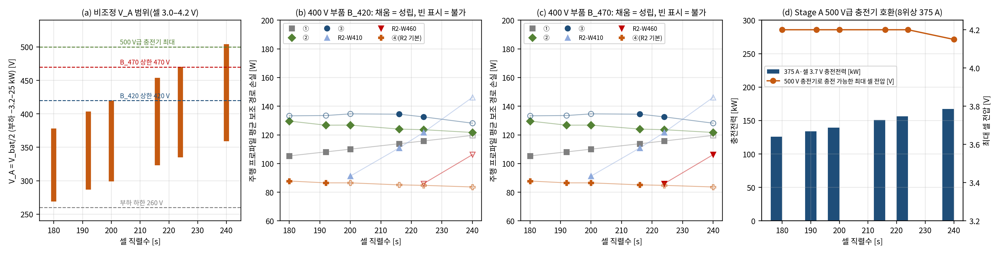
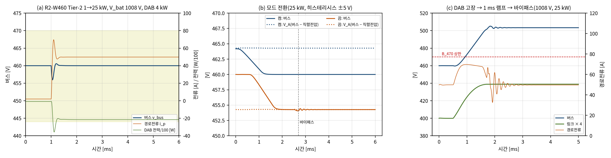

# 산업 적용 가치 분석과 개선 구조 R2

- 문서 버전: v1.1 (2026-10-23, 7.5절 회로 확인 추가)
- 관련 문서: [docs/21](21_기준구조_손실정격_비교_H5.md) 기준 구조 손실·정격 비교(H5 기각), [docs/22](22_충전통합_H3_검증.md) 충전 중 보조버스(H3), [docs/18](18_StageB_보호_기동_1차검증.md) 보호·기동, [docs/14](14_요구사항_부하등급_수락기준.md) 요구사항
- 근거 파일: [validation/2026-10-22-industry-value-r2](../validation/2026-10-22-industry-value-r2/README.md), 코드는 검증 코드 묶음의 E18·E19. 회로 모델: [TB08](../simulink/tb/TB08_R2_WindowModule/README.md)
- 검증 수준: E18은 E15와 같은 설계 단계 손실·정격 추정과 정적 성립성 판정이다. E19는 Stage B 평균모델(채택 제어기 R1)과 E14 모드 적분기를 쓴다. R2-W460은 소자 수준 회로 모델(Simulink TB08)에서 대표 사례 5개를 다시 확인했다(7.5절).

## 1. 요약

E15에서 H5가 기각된 뒤 남은 질문은 이 아키텍처가 산업에서 어디에 쓰일 수 있느냐였다. 실차 사례를 조사하고, 같은 손실 규칙으로 팩 등급 180–240s 전체를 다시 계산했다(E18). 결론은 세 가지다.

1. **산업 가치의 중심은 Stage A다.** 800 V 이상 차량에서는 500 V급 충전기(테슬라 V3, 구형 CCS)와의 호환이 공통 과제이고, 업계는 모터·인버터 승압, 전용 DC 충전기, 팩 분할, 팩 직병렬 전환 중 하나를 쓴다. Stage A는 이 기능을 영전류 스위칭 2:1 변환으로 맡는다. 충전 경로 손실은 전전력 승압기의 28 %이고(150 kW에서 0.50 대 1.78 kW), 인덕터 저장에너지는 3.2 mJ로 승압기(3.3 J)의 약 1/1000이다. 같은 하드웨어가 주행 중에는 400 V 중간버스와 48 V 공급원이 된다.
2. **Stage B는 전 범위 400 V 조정기(③)로는 어떤 팩 등급에서도 최선이 아니다.** 대신 V\_A가 400 V급 부품 상한을 넘을 때만 동작하는 1–5 kW 창 조정 모듈(R2-W)로 줄이면, B\_420 부품의 200–216s 팩과 B\_470 부품의 224–240s 팩(900–1000 V급)에서 성립하는 구조 가운데 손실이 가장 작다. 1000 V급 240s 팩에서는 전전력 조정기(②)보다 15.5 W(13 %) 작다.
3. **48 V 공급은 정밀한 400 V가 아니라 고장 시 연속성이 필요하다.** R2는 Stage B를 바이패스로 우회할 수 있게 해, Stage B 고장이 48 V 공급을 끊지 않도록 한다. DAB 고장에서는 기준전압을 1 ms 동안 V\_A로 올린 뒤 바이패스하면 Stage A를 멈추지 않고 경로가 유지된다(E19, 회로 모델 TB08에서도 같음). H-브리지 전 소자 차단 고장에서 바로 바이패스하면 수백 A의 충격전류가 생기므로, 이 경우의 보호 정책은 아직 정하지 못했다.

이에 따라 아키텍처를 다음과 같이 고친다(R2).

| 구성 | 기준선 ③ | R2 |
|---|---|---|
| Stage A | 2:1 RSC 4모듈(8위상), 충전 150 kW | 같음. 충전 225 kW는 12–16위상으로 확장(손실 0.61–0.81 kW, E18 추정) |
| 400 V 버스 | Stage B가 전 범위에서 400±8 V로 조정 | 기본형: 버스 = V\_A(버스 RC 감쇠기). 선택 모듈: V\_A > V\_W에서만 V\_W로 창 조정 |
| Stage B | DAB 8 kW + H-브리지 ±90 V, 항상 동작 | 선택형 창 조정 모듈. V\_W = 410 V(B\_420 부품) 또는 460 V(B\_470), DAB 1–5 kW(정적 최대 링크전력의 1.8배), 바이패스 스위치, 히스테리시스 ±5 V |
| Stage C | 고정이득 CLLC(입력 400±8 V) | 조정형(전단 벅부스트 + CLLC, 입력 V\_A 범위) |
| 48 V 공급 경로 | Stage B 직렬(고장 시 Stage A 협조 정지 필요, E14) | Stage B를 바이패스로 우회(DAB 고장 확인, H-브리지 고장은 미결) |

팩 등급과 부품 등급에 따른 권장 구성은 6.5절의 표로 정리했다. 800 V급 주력 팩(192s)에서는 Stage B가 필요 없다.

## 2. 왜 이 분석이 필요한가

E15는 이 프로젝트의 사양(배터리 640–920 V, 약 219s)에서 Stage B의 400 V 조정이 조정 없는 구조(④)보다 손실·반도체 수·스위치 VA 모두 크다는 것을 보였다. 이 결론만으로는 두 가지를 알 수 없다.

- 실제 차량의 팩 등급은 하나가 아니다. 800 V급 주력 팩은 V\_bat/2가 400 V급 부품 범위 안에 있지만, 900–1000 V급 팩은 그렇지 않다. 팩 등급이 바뀌면 구조의 성립 여부와 손실 순위가 함께 바뀔 수 있다.
- 산업에서 실제로 해결해야 하는 문제(충전 호환, 부품 전압 등급, 48 V 전원망, 자율주행 전원의 고장 대응)와 이 아키텍처의 블록이 어떻게 대응하는지 정리되지 않았다.

남은 한 달의 개발을 어디에 쓸지 정하려면, 가치가 있는 조건을 같은 계산 규칙으로 정량화해야 한다.

## 3. 산업 현황

### 3.1 500 V급 충전기 호환

800 V급 이상 차량이 400–500 V급 충전기에서 충전하려면 차량 안에서 전압을 맞춰야 한다. 공개 자료로 확인한 방식은 다음과 같다.

| 방식 | 사례 | 공개된 성능 | 상충관계 |
|---|---|---|---|
| 모터·인버터 승압 | 현대차그룹 E-GMP: 400 V 입력을 후륜 모터와 인버터로 800 V로 승압[1]. 루시드 Gravity(926 V): 후륜 구동 유닛으로 500 V를 승압, 테슬라 V3를 포함한 500 V급 충전기에서 최대 225 kW 지속[5] | 기아 EV9은 V3에서 최고 84 kW(800 V급 충전기에서는 200 kW 이상)[6] | 추가 하드웨어가 적다. 대신 충전전력이 모터 권선·인버터 전류로 제한되고, 높은 전력에는 전용 설계가 필요하다(루시드) |
| 전용 DC 충전기(승압기) | 포르쉐 Taycan: 400 V 충전용 차량 탑재 DC 충전기 50 kW 기본, 150 kW 선택[2] | 50/150 kW | 전전력 자성체·반도체가 추가된다 |
| 팩 분할 충전 | 아우디 PPE: 800 V 배터리를 같은 전압의 두 배터리로 나눠 병렬 충전, 최대 135 kW[3] | 135 kW | 접촉기 추가, 두 절반의 균형 관리 |
| 팩 직병렬 전환 | GM Ultium: 400 V 층 두 개를 800 V 충전 때만 직렬로 전환, 고정 800 V 구조보다 저렴하다고 설명[4] | — | 400 V 차량에 800 V 충전을 더하는 반대 방향의 해법 |

전압이 더 높은 플랫폼도 같은 과제를 가진다. BYD는 2025년 3월 1000 V 플랫폼을 발표하면서 공공 급속충전기와 호환되는 승압 충전 기능을 함께 밝혔다[7].

이 비교에서 Stage A의 위치는 분명하다. Stage A는 전용 하드웨어라 모터 승압보다 부품이 많다(32 스위치 위치, E15). 그러나 손실이 작고 자성체가 거의 없으며(1절), 같은 하드웨어가 주행 중 보조전원 기능을 겸한다. 전용 하드웨어의 비용을 충전 한 가지 기능이 아니라 여러 기능이 나눠 부담하는 것이 이 구조의 논리다.

### 3.2 플랫폼 전압 상승과 보조부품 전압 등급

- BYD 1000 V 플랫폼은 배터리·모터·전원·공조 부품을 모두 1000 V로 올렸고, 1500 V 정격 SiC 칩을 쓴다고 밝혔다[7]. 루시드 Gravity는 926 V다[5]. 800 V급 전동 컴프레서는 2022년부터 양산 수주가 보도되었다[8].
- 따라서 산업의 큰 흐름은 400 V급 부품의 재사용이 아니라 고전압 전용 부품이다. 400 V급 부품을 쓰는 가치는 400 V·800 V 플랫폼을 함께 운영하거나 1000 V급 부품을 따로 개발하지 않으려는 경우로 좁혀진다.
- 400 V급 부품의 상한은 하나가 아니다. ISO 21498-1은 B\_420과 B\_470을 나누고[13], 조사한 부품 가운데도 상한 432 V(Sanden SHS33 Gen2)와 470–490 V(Sanden SHS33 Gen3·SHS45, Webasto HVH)가 함께 있다(docs/14). 이 차이가 Stage B의 필요 여부를 정한다(6절).

### 3.3 48 V 전원망과 고정비 변환

- 테슬라 Cybertruck은 48 V 저전압 전원망과 모듈식 배선을 채택했고, 대전류 배선 질량이 84 % 줄었다고 밝혔다[9].
- 고전압 → 48 V 변환에는 고정비 버스 변환기가 이미 쓰인다. Vicor BCM6135는 800 V를 48 V로 바꾸는 2.5 kW 모듈로 효율 98 %, 전력밀도 158 kW/L다[10]. 데이터센터의 중간 버스 구조도 비조정 고정비 변환 뒤에 부하점 조정을 둔다[11].
- 이 사례들은 "고정비 변환은 이미 상용 기술"이라는 점과, 48 V 쪽 전압 품질은 하류 조정으로 맞춘다는 점을 보여 준다. 400 V를 정밀하게 조정해야 할 산업 요구는 확인되지 않았다.

### 3.4 자율주행 연산기 전원

앞선 분석에서 정리한 내용이다. 연산기 코어 전압의 정밀도와 과도 응답은 보드 위 전원(POL)이 정한다. 그 앞에는 12·48 V 전원망과 넓은 입력 범위(예: 3.5–36 V)를 받는 전단이 있어, 400 V 버스의 리플·과도는 프로세서까지 거의 전달되지 않는다. 자율주행 전원에서 요구되는 것은 고장 시에도 계속 동작하는 이중화된 저전압 공급이다[12]. 이 관점에서는 48 V 공급 경로에 직렬로 들어가는 Stage B가 고장점 하나를 더한다.

## 4. 지금까지의 근거로 본 블록별 가치

| 블록 | 검증된 근거 | 산업 요구와의 대응 | 판단 |
|---|---|---|---|
| Stage A(2:1 RSC) | 영교차 추종 ZCS(E1, TB01·TB07), 충전 경로 손실 0.50 kW(승압기 1.78 kW, E15), 충전전류는 Stage B를 지나지 않음(H1), 충전 중 보조버스 유지(H3) | 500 V급 충전기 호환(3.1절), 400 V 중간버스 | **핵심 가치** |
| Stage B(직렬 부분전력) | 과도 강건성 H2(평균·스위칭·회로 모델), 보호·기동(E14) | 400 V 정밀 조정은 산업 요구가 아님(3.3·3.4절). 400 V급 부품 상한을 넘는 팩에서만 필요(3.2절) | **조건부 선택 기능** |
| Stage C(CLLC) | 3 kW 공진점 고정이득(E10, TB05) | 48 V 전원망(3.3절). 5 kW·양방향·조정형으로 재설계 필요 | **필수, 재설계 필요** |
| SALS | 축약 모델 H4 | 정격 안에서 부하 승인, 고장 강등 시 400 V 부하 분리 명령 | **보조 기능** |

## 5. 개선 구조 R2

### 5.1 구성

R2는 기능별로 블록을 다시 나눈다.

- **기본형(모든 팩)**: Stage A + 버스 RC 감쇠기 + 조정형 Stage C. 400 V 버스는 V\_A를 그대로 따른다(E15의 ④와 같다). 충전기는 V\_A 노드에 붙는다(H1·H3 결과 그대로).
- **선택 모듈 R2-W**: V\_A가 부품 등급 상한을 넘는 팩에만 둔다. 창 기준 V\_W 아래에서는 바이패스 스위치가 직렬 포트를 단락하고 Stage B는 정지한다(고정 손실 0). V\_A > V\_W에서만 Stage B가 버스를 V\_W로 깎는다. 직렬전압은 음수(빼기)만 쓴다.
  - V\_W = 410 V는 B\_420 부품용, 460 V는 B\_470 부품용이다. Tier-2 상향 과도 여유 10 V를 둔다.
  - DAB 권선비는 V\_W/100, 누설 인덕턴스는 11.1 µH·(V\_W/400)²로 두어 400 V 설계와 같은 위상·전류 비를 쓴다.
  - DAB 정격은 정적 최대 링크전력의 1.8배다. E19에서 Tier-2(1↔25 kW) 과도의 DAB 전력 첨두가 정적 최대의 1.77–1.78배였기 때문이다(7.1절). 처음 후보였던 1.25배는 최대 배터리 전압의 Tier-2에서 DAB가 정격에 포화되어 버렸다. E18 계산으로 권장 구성의 정격은 1–5 kW다(③은 8 kW).

### 5.2 모드 논리와 고장 강등

| 상태 | 조건 | 동작 |
|---|---|---|
| 바이패스 | V\_bat/2 ≤ V\_W − 5 V이면 진입 | 바이패스 스위치 닫힘, Stage B 정지, 버스 = V\_A |
| 창 조정 | V\_bat/2 ≥ V\_W + 5 V이면 진입 | 영벡터(직렬 ≈ 0)에서 바이패스를 열고, 버스 기준을 V\_A → V\_W로 램프 |
| 끄기 | 바이패스 진입 조건 | 버스 기준을 V\_W → V\_A로 1 ms 램프, 1 ms 유지, 영벡터 0.2 ms 뒤 바이패스 |
| 고 SOC 기동 | Stage A 소프트스타트 중 V\_A = V\_W | Stage B가 영벡터에서 인계해 버스를 V\_W로 유지 |
| DAB 고장 강등 | DAB 고장 검출 | DAB 정지 상태로 기준을 V\_A로 1 ms 램프 → 영벡터 → 바이패스. Stage A는 계속 동작, 버스 = V\_A. V\_A가 부품 상한을 넘으면 400 V 부하를 분리(SALS 명령) |

±5 V 히스테리시스 안에서는 어느 모드든 버스가 V\_W + 5 V를 넘지 않는다(B\_420에서 415 V, B\_470에서 465 V).

### 5.3 기준선 ③과 달라지는 점

- Stage B가 48 V 경로에서 빠지지는 않지만(창 조정 중에는 직렬), 고장 시 바이패스로 우회할 수 있다. ③에서는 배터리 840 V 초과의 Stage B 정지에 Stage A 협조 정지가 필요했다(E14). 그동안 48 V는 저전압 배터리만으로 버텼다.
- 고정이득 Stage C 대신 조정형 Stage C를 쓴다. E15에서 그 대가는 약 18 W였다.
- 800 V급 주력 팩에서는 Stage B를 설치하지 않는다.

## 6. E18 결과: 팩 등급별 가치 지도

### 6.1 방법

E15와 같은 소자·손실 규칙과 E1 Stage A 격자(배터리 540–1010 V로 확장)를 쓰고, 다음 조건으로 계산했다.

- 팩 등급: 셀 직렬수 180·192·200·216·224·240s, 운전 범위 셀 3.0–4.2 V
- 주행 프로파일: 셀 3.47–4.11 V 균등. E15의 760–900 V를 219s 등가 팩으로 환산한 값이다
- 부하 분포: E15와 같다(400 V 부하 6단계 + 48 V 1.5 kW)
- 성립 조건(계산 전에 고정)
  - 정적 운전점(배터리 25점 × 부하 −3.2·0·25 kW)의 버스가 [260 V, 부품 등급 상한] 안
  - 조정 구간 정상점이 Stage B 포트 한계(직렬 ±90 V, 변조율 0.95, DAB 정격) 안
  - 창 기준 V\_W ≤ 상한 − 10 V
  - 소자 직류 전압 사용률 ≤ 80 %(1200 V SiC ≤ 960 V, 750 V SiC ≤ 600 V, 650 V GaN ≤ 520 V)

이 프로젝트의 사양(640–920 V)을 E15 프로파일로 다시 계산한 값은 E15와 0 W 차이로 같았다(회귀 확인).

### 6.2 성립성

| 팩 | 배터리 | V\_A | ① | ② | ③ | R2-W410 | R2-W460 | ④(R2 기본형) |
|---|---|---|---|---|---|---|---|---|
| 180s | 540–756 V | 270–378 V | 성립 | 성립 | 불가(직렬 한계, 621 V 이하) | 불필요 | 불필요 | 성립 |
| 192s | 576–806 V | 288–403 V | 성립 | 성립 | 불가(614 V 이하) | 불필요 | 불필요 | 성립 |
| 200s | 600–840 V | 300–420 V | 성립 | 성립 | 불가(620 V 이하) | 성립(1.0 kW) | 불필요 | B\_470만(B\_420 상한을 회생 −3.2 kW에서 0.1 V 초과) |
| 216s | 648–907 V | 324–454 V | 성립 | 성립 | 성립 | 성립(4.5 kW) | 불필요 | B\_470만 |
| 224s | 672–941 V | 336–470 V | 성립 | 성립 | 성립 | 성립(6.0 kW) | B\_470만(1.0 kW) | 불가(470.5 V) |
| 240s | 720–1008 V | 360–504 V | 불가(1200 V SiC 사용률 84 %) | 성립 | 불가(984 V 이상) | 불가(직렬 94.1 V) | B\_470만(4.0 kW) | 불가(504.1 V) |

(괄호 안은 창 조정 Stage B의 DAB 정격. "불필요"는 V\_A가 V\_W를 넘지 않아 Stage B를 설치하지 않는 경우로, ④와 같다.)

- **③(전 범위 400 V 조정)은 216–224s에서만 성립한다.** 직렬 ±90 V로는 V\_A 310–490 V만 400 V로 맞출 수 있기 때문이다. 이 프로젝트의 사양(640–920 V)이 그 범위에 맞춰 정해져 있었다. 800 V급 주력 팩(192s)에서는 저 SOC에서 성립하지 않는다.
- **④는 V\_A가 부품 상한 이하인 팩에서만 성립한다**(B\_420은 199s 이하, B\_470은 223s 이하).
- **240s(1000 V급)에서 B\_420 부품은 ②만 성립한다.** R2-W410은 직렬전압 94.1 V가 필요해 ±90 V를 4 V 넘는다.

### 6.3 손실·정격

주행 프로파일 평균 보조 경로 손실(W)과 성립 여부다. 굵은 값은 부품 등급별로 성립하는 구조 가운데 최소다.

| 팩 | ① | ② | ③ | R2-W410 | R2-W460 | ④ | B\_420 최선 | B\_470 최선 |
|---|---|---|---|---|---|---|---|---|
| 180s | 105.3 | 129.6 | (133.3) | = ④ | = ④ | **87.8** | ④ | ④ |
| 192s | 108.1 | 126.8 | (133.5) | = ④ | = ④ | **86.5** | ④ | ④ |
| 200s | 110.0 | 126.8 | (134.7) | **91.3** | = ④ | 86.5(B\_470) | R2-W410 | ④ |
| 216s | 113.8 | 124.0 | 134.4 | **110.9** | = ④ | 85.1(B\_470) | R2-W410 | ④ |
| 224s | **115.8** | 123.6 | 132.5 | 121.7 | **86.0** | (84.8) | ① | R2-W460 |
| 240s | (119.6) | **121.7** | (128.2) | (146.2) | **106.2** | (83.7) | ② | R2-W460 |
| 사양(640–920 V) | 114.6 | 123.8 | 133.8 | **114.4** | = ④ | 85.0(B\_470) | R2-W410(①과 0.2 W 차) | ④ |

(괄호는 성립하지 않는 구조의 참고값)

| 지표(사양 팩 기준) | ① | ② | ③ | R2-W410 | ④ |
|---|---|---|---|---|---|
| 스위치 위치 / 스위치 VA | 24 / 789 kVA | 44 / 1,070 kVA | 52 / 1,074 kVA | 58 / 1,075 kVA | 44 / 953 kVA |
| 인덕터 저장에너지 | 3,929 mJ | 226 mJ | 33 mJ | 44 mJ | 18 mJ |
| 충전 375 A 경로 손실(800 V) | 1.78 kW | 0.50 kW | 0.50 kW | 0.50 kW | 0.50 kW |

- 창 조정 Stage B의 동작 비율(주행 프로파일)은 200s 7 %, 216s 47 %, 사양 53 %(이상 V\_W 410 V), 224s 0 %, 240s 40 %(이상 V\_W 460 V)다. 동작하지 않는 동안 고정 손실이 없으므로, ③이 성립하는 팩(216·224s, 사양)에서 같은 팩의 ③보다 손실이 11–47 W 작다.
- R2-W410은 B\_420 부품에서 ①보다 200s 18.7 W, 216s 2.9 W 작고, 사양 팩에서는 0.2 W 차로 같다. 224s에서는 5.9 W 크다. 보조 경로 손실이 비슷한 곳에서도 충전 경로 손실(0.50 대 1.78 kW)과 인덕터 저장에너지(약 1/90)는 R2가 크게 낫다.
- R2-W460은 240s(1000 V급)·B\_470에서 ②보다 15.5 W(13 %) 작고, 스위치 VA도 1,062 대 1,070 kVA로 작다.
- 인덕터 저장에너지는 ①이 약 3.9 J로, 대부분이 150 kW 충전 승압기(3.3 J)다. Stage A 기반 구조는 16–47 mJ이고, ②만 전전력 조정기 때문에 0.2–0.36 J이다.

### 6.4 500 V급 충전기 호환(Stage A)

| 팩 | V\_A | 500 V 충전기로 충전 가능한 최대 셀 전압 | 375 A·셀 3.7 V 충전전력 | 150 kW(위상 수, 손실) | 225 kW(위상 수, 손실) |
|---|---|---|---|---|---|
| 192s | 288–403 V | 4.20 V(만충) | 134 kW | 10위상, 0.51 kW | 14위상, 0.81 kW |
| 216s | 324–454 V | 4.20 V | 151 kW | 10위상, 0.41 kW | 14위상, 0.65 kW |
| 224s | 336–470 V | 4.20 V | 156 kW | 8위상, 0.46 kW | 12위상, 0.70 kW |
| 240s | 360–504 V | 4.15 V | 167 kW | 8위상, 0.41 kW | 12위상, 0.61 kW |

- 2:1 비는 800 V급 팩을 400 V급 충전기 범위에, 1000 V급 팩을 500 V급 충전기 범위에 정확히 옮긴다. 500 V 충전기로 237s까지는 만충할 수 있고, 240s는 셀 4.15 V까지 충전된다(충전 경로 강하 2.1 V 포함).
- 현재 8위상(375 A)의 충전전력은 셀 3.7 V에서 126–167 kW다. 루시드 Gravity 수준(225 kW)에는 12–16위상(6–8모듈)이 필요하고, 위상당 전류를 유지하면 충전 경로 손실은 0.61–0.81 kW로 추정된다. 이는 E1 격자의 위상당 손실을 위상 수에 비례시킨 값이며 모듈 수를 늘린 회로 검증은 하지 않았다.

### 6.5 해석: 팩 등급별 권장 구성

| 팩 등급 | 400 V 부품 B\_420 | 400 V 부품 B\_470 | Stage B |
|---|---|---|---|
| 800 V급 주력(≤ 199s) | R2 기본형(④) | R2 기본형(④) | 불필요 |
| 200–216s | R2-W410(1–4.5 kW) | R2 기본형 | B\_420일 때만 |
| 224s | ①(R2-W410보다 5.9 W 작음. 충전 손실·자성체는 R2가 유리) | R2-W460(1 kW, 주행 중 거의 동작 안 함) | 상한 근처 SOC에서만 |
| 1000 V급(240s) | ②(R2-W410은 직렬 ±90 V 초과) | R2-W460(4 kW) | B\_470일 때 |

이 표가 부분전력 조정이 산업에서 가치를 갖는 범위다. 범위는 "V\_A가 400 V급 부품 상한을 넘고, 그 차이가 직렬 포트 범위 안에 있는 팩"으로 좁다. 그 대신 그 범위 안에서는 성립하는 대안 가운데 손실이 가장 작고, 충전 경로와 자성체에서 큰 이점을 함께 가진다.

## 7. E19 결과: R2 창 조정 모듈 검증

Stage B가 필요한 대표 두 사례를 시험했다. 판정 기준은 시험 전에 고정했다. 창 조정 과도는 E13과 같은 Tier 기준에 부품 등급 상한을 적용했다.

| 사례 | 팩·부품 | V\_W | 동작 구간 | 최종 DAB 정격 |
|---|---|---|---|---|
| R2-W460 | 240s(720–1008 V), B\_470 | 460 V | V\_bat > 921 V | 4.0 kW |
| R2-W410 | 사양(640–920 V), B\_420 | 410 V | V\_bat > 821 V | 5.0 kW |

### 7.1 DAB 정격: 1.25배는 부족했고 1.8배가 필요했다

처음에는 DAB 정격을 정적 최대 링크전력의 1.25배(③의 8 kW/6.44 kW와 같은 여유)로 잡았다(R2-W460 3.0 kW, R2-W410 3.5 kW). 공칭·지연 집합으로 정격을 바꿔 가며 다시 시험한 결과는 다음과 같다(각 72건).

| 정격 | R2-W460(정적 최대 2.16 kW) | R2-W410(정적 최대 2.69 kW) |
|---|---|---|
| 2.0 kW | 62/72. 정적 수요보다 작아 스텝 전 정상점부터 정격 밖(4건), 링크 115.4 V | — |
| 2.5 kW | 69/72 | — |
| 3.0 kW | 71/72. Tier-2 + 지연 1건에서 DAB가 정격에 포화, 순시 전력 3,000.2 W | 68/72 |
| 3.5 kW | 72/72(Tier-2에서 정격 3.50 kW에 포화) | 70/72. 920 V·1→25 kW에서 포화, 공칭 집합도 실패 |
| 4.0 kW | 72/72, 포화 없음(첨두 3.83 kW) | 72/72(4.00 kW 포화) |
| 5.0 kW | — | 72/72, 포화 없음(첨두 4.79 kW) |

- 실패는 모두 최대 배터리 전압의 Tier-2(1→25 kW) 스텝에서 DAB가 정격에 포화되어 순시 전력이 정격을 넘은 경우다. 버스 전압·전류 기준은 이 사례들에서도 지켰다.
- 포화 없는 과도 첨두는 정적 최대의 1.77배(R2-W460)·1.78배(R2-W410, E13 공차 포함 값 4.79 kW와 같음)였다. 그래서 정격 규칙을 **정적 최대 링크전력의 1.8배**로 바꿨다. 정격에 포화된 채 통과하는 정격(3.5·4.0 kW)은 제어기의 전류 한계 계산(표본 시점의 링크전압 사용)에 따라 결과가 갈리므로 설계값으로 쓰지 않았다.
- 이 규칙으로 E18의 정격을 다시 계산했다(6절 표가 그 결과다). R2-W410의 5.0 kW는 E15가 ③′에 가정한 값과 같다.

### 7.2 최종 정격의 Tier-1·Tier-2(공차 포함)

| 사례 | 건수 | Tier-1 | Tier-2 | 최대 전류 | 버스(스텝 후) | 직렬 최대 | DAB 첨두 | 링크 |
|---|---|---|---|---|---|---|---|---|
| R2-W460, 4.0 kW | 456 | 380/380 | 76/76 | 81.65 A | 455.7–464.3 V | 46.4 V | 3.83 kW | 99.8–100.2 V |
| R2-W410, 5.0 kW | 264 | 220/220 | 44/44 | 85.35 A | 405.1–414.8 V | 52.7 V | 4.79 kW | 99.7–100.3 V |

전압 3종 × 공칭·지연 +3.0 µs에 단일 변수 공차 16종(R2-W460은 930·1008 V, R2-W410은 920 V)을 더했다. 채택 제어기는 이득과 예측 구조를 바꾸지 않았고, 기준전압·DAB 권선비·누설 인덕턴스·정격만 창 조정 설계값으로 바꿨다. 1000 V급 팩에서도 버스는 B\_470 상한 안에 있다(최대 464.3 V).

### 7.3 모드 전환

| 전환 | 조건 | R2-W460 | R2-W410 |
|---|---|---|---|
| 켬(영벡터 → 창 조정) | V\_bat/2 = V\_W + 5 V, 기준 램프 0·0.5·1·2 ms × 부하 0·15·25 kW | 12/12, 최대 53.9 A, 버스 ≤ 465.0 V | 12/12, 최대 60.4 A, 버스 ≤ 415.0 V |
| 고 SOC 기동 인계 | Stage A 소프트스타트 60·20·6 V/ms 중 V\_A = V\_W에서 인계 × 부하 3종 | 9/9, 최대 77.9 A, 버스 459.4–466.1 V | 9/9, 최대 84.8 A, 버스 409.3–416.1 V |
| 끔(→ 바이패스) | V\_bat/2 = V\_W − 5 V·V\_W, 기준을 V\_A로 1 ms 램프 → 1 ms 유지 → 영벡터 0.2 ms → 바이패스 | 6/6, 최대 57.8 A, 바이패스 직전 직렬 ≤ 0.17 V | 6/6, 최대 65.0 A, 바이패스 직전 직렬 ≤ 0.19 V |

모든 전환에서 전류 ≤ 90 A, 직렬 ≤ 90 V, 링크 90–110 V, 버스 ≤ 부품 등급 상한을 지켰다. ±5 V 히스테리시스 덕분에 켜기 직전 버스는 V\_W + 5 V를 넘지 않는다.

### 7.4 고장 시 바이패스 강등

최대 배터리 전압(1008 V·920 V)에서 부하 5·25 kW로 시험했다.

| 고장과 대응 | R2-W460 | R2-W410 | 판정 |
|---|---|---|---|
| DAB 고장 → DAB 정지 상태로 기준을 V\_A로 **1 ms** 램프 → 영벡터 → 바이패스 | 2/2, 경로 ≤ 69.8 A, 링크 ≤ 109.7 V, 바이패스 직전 직렬 0.63 V | 2/2, 경로 ≤ 78.2 A, 링크 ≤ 112.2 V, 0.71 V | **통과** |
| 같은 대응, 램프 **0.5 ms** | 1/2(25 kW에서 경로 125.1 A) | 1/2(25 kW에서 220.2 A) | 불통과 → 램프 ≥ 1 ms 필요 |
| H-브리지 전 소자 차단 → 50 µs 후 바이패스 | 0/2, 경로 최대 740.5 A | 0/2, 838.2 A | **불통과** |

- **DAB 고장은 Stage A를 멈추지 않고 강등할 수 있다.** 링크가 직렬 포트의 전력을 흡수하는 동안(링크 ≤ 112.2 V, 기준 120 V) 직렬전압을 0으로 줄인 뒤 바이패스한다. ③에서는 같은 상황(배터리 840 V 초과)에 Stage A 협조 정지가 필요했다(E14).
- **강등 후 버스는 V\_A(503.9·459.9 V)다.** 부품 상한(470·420 V)을 넘으므로 400 V 부하는 분리해야 한다. 조정형 Stage C는 이 전압을 입력 범위 안에서 받으므로(650 V GaN 사용률 78 %) 48 V 공급은 이어진다. 400 V 부하 분리는 SALS 명령과 부하 측 차단 소자로 처리해야 하며, 이 시험의 모델 밖이다.
- **H-브리지 전 소자 차단 고장에서 바로 바이패스하면 안 된다.** 다이오드가 직렬 커패시터를 링크 쪽으로 충전한 상태(직렬 45.8–52.1 V)에서 단락하므로, E14의 "직렬전압이 남은 채 단락"과 같은 충격전류가 생긴다. 이 고장의 강등 방식(직렬전압 감시 후 투입, 전류 제한 바이패스, 또는 Stage A 협조 정지 동안 저전압 배터리로 버팀)은 보호 상태기계 결합(E17)에서 정한다.

시험 중 E14 모드 적분기의 수치 문제를 하나 찾았다. 다이오드 환류 모드에서 필터전류가 한 걸음 변화량(약 4.4 A)보다 작으면 중점법의 두 번째 평가에서 다이오드 방향이 뒤집혀, 전류가 0으로 가지 못하고 진동하며 링크를 충전했다. E19에서는 한 걸음 동안 다이오드 상태를 고정하도록 고쳤다. 이 수정으로 끔 전환의 링크 최대가 105.5 V에서 100.0 V로, DAB 고장 강등(R2-W460)이 114.3 V에서 109.7 V로 바뀌었다. 같은 수정으로 E14의 정지 전이 20건을 다시 계산하면 결과 차이는 경로전류 0.4 A 이하, 링크 0.01 V 이하라 E14의 결론은 바뀌지 않는다.

### 7.5 회로 확인(Simulink TB08, R2-W460)

E19의 결론을 소자 수준 스위칭 회로에서 다시 확인했다. 회로는 TB04B의 Stage B에서 DAB 권선비(4.6:1)와 누설 인덕턴스(14.68 µH)만 바꿨다. 여기에 바이패스 스위치(150 V GaN 2병렬 × 역직렬, 3.3 mΩ), 모드 시퀀서, 게이트 재정의, 제어기 무충격 재초기화를 더했다. 채택 제어기는 기준전압·DAB 정격·누설 인덕턴스·권선비만 바꿨다. 판정 기준은 시험 전에 고정했다. 창 조정 사례는 E12 스위칭 ODE와 TB04 허용폭으로 일치를 보고, 전환·고장 사례는 E19와 같은 회로 한계로 판정했다.

| 사례 | 조건 | 결과 |
|---|---|---|
| A 창 조정 Tier-2 | 1008 V, 1 → 25 kW | 통과. 버스 455.95–460.79 V(≤ B\_470), 경로 69.66 A, 링크전력 3.22 kW(정격 4 kW). E12 대비 최저 버스 −0.07 V, 최대 경로 +1.84 A(허용 2.03 A). 게이트 격자 0.625 ns에서 리플 0.050 V |
| B 창 조정 Tier-1 | 930 V, 15 → 25 kW | 통과. 버스 458.31–460.73 V, DAB 저전류 영역에서도 링크 99.94–100.02 V. E12 대비 최대 경로 +0.01 A |
| C 끔 | 910 V, 25 kW, 램프 → 영벡터 → 바이패스 | 통과. 경로 ≤ 57.2 A, 바이패스 직전 직렬 −0.22 V(E19 −0.17 V) |
| D DAB 고장 강등 | 1008 V, 25 kW, DAB 정지 + 1 ms 램프 → 영벡터 → 바이패스 | 통과. 링크 최대 109.76 V(E19 109.72 V), 경로 ≤ 69.7 A. 강등 뒤 버스 503.2 V(400 V 부하 분리 필요, E19와 같음) |
| E 켬 | 930 V, 25 kW, 바이패스 + 영벡터 → 바이패스 열림 → 제어 + 1 ms 램프 | 통과. 경로 ≤ 73.4 A, 버스 ≤ 465.4 V, 최종 460.02 V |

회로에서 새로 드러난 것은 두 가지다. 둘 다 회로 한계 안이고, 보호 상태기계(E17)의 순서 설계에 넘긴다.

- **바이패스 투입 펄스.** 영벡터 상태에서도 직렬 포트에는 0.2–0.6 V가 남는다. 영벡터 경로의 저항 강하와 영벡터 0.2 ms 동안 다 가라앉지 않은 진동 때문이다(E19 평균모델도 0.17–0.51 V). 바이패스를 닫으면 이 직렬 커패시터 전압이 3.3 mΩ로 방전된다. DAB 고장 사례에서 최대 −173 A, 폭 약 1 µs, 에너지 17 µJ다. 소자당 87 A로, 바이패스 소자(EPC2305) 펄스 정격 329 A[14]의 0.26배다. 기생 인덕턴스를 넣지 않은 이상 루프 값이다.
- **바이패스 열림 과도.** 켜기 전에는 바이패스와 영벡터가 저항비로 경로전류를 나눈다(바이패스 40 %). 바이패스가 열리면 이 전류가 영벡터 경로로 옮겨 가며 경로전류가 19.6 kHz로 출렁인다(28.6–73.4 A). E19 켬 모델은 영벡터 정상상태에서 시작해 이 과도가 없었다. 바이패스 열림 직후 바로 제어를 시작하는 순서를 E17에서 비교한다.

시험 중 회로 모델의 모델링 오류를 하나 고쳤다. 첫 실행에서는 바이패스 셀 다이오드에 H-브리지와 같은 이상 클램프(1 mV)를 썼다. 그러자 켜진 셀에서 다이오드가 채널과 병렬로 도통해, 바이패스 저항이 1.7 mΩ로 작아지고 투입 펄스가 두 배(−325 A)로 계산됐다. 다이오드를 데이터시트 역방향 도통 전압(1.4 V[14])으로 고쳐 다시 계산했다. 판정은 두 경우 모두 통과다.

## 8. 산업 가치 제안

정량 근거로 주장할 수 있는 것과 없는 것을 나눈다.

**주장할 수 있는 것**

- **충전 호환 + 보조전원을 한 하드웨어로.** Stage A는 500 V급 충전기 호환을 영전류 스위칭 2:1 변환으로 맡는다. 충전 경로 손실은 전전력 승압기의 28 %, 인덕터 저장에너지는 약 1/1000이다. 같은 하드웨어가 주행 중 400 V 중간버스와 48 V 공급원이 된다. 충전 중 보조버스(H3)와 정격 분리(H1)도 확인했다.
- **팩 등급에 맞춰 붙이는 전압 등급 어댑터.** V\_A가 400 V급 부품 상한을 넘는 팩(B\_420의 200–216s, B\_470의 224–240s)에서는 1–5 kW 창 조정 Stage B가 성립하는 대안 가운데 손실이 가장 작다(사양 팩에서는 ①과 같은 수준). 1000 V급 팩에서 400 V급 B\_470 부품을 그대로 쓸 수 있게 한다.
- **48 V 공급의 고장 강등.** DAB 고장에서 Stage A를 멈추지 않고 Stage B를 바이패스로 우회한다(E19).

**주장하지 않는 것**

- 400 V 정밀 조정 자체의 가치. 산업 요구로 확인되지 않았고(3.3·3.4절), 손실·정격으로도 이득이 없다(E15).
- 모든 팩 등급에서의 손실 우위. 800 V급 주력 팩에서는 Stage B를 빼는 것이 낫다.
- 모터 승압 대비 비용 우위. Stage A는 추가 반도체(32 위치)가 있고, 비용은 이 연구 범위 밖이다. 비교할 수 있는 것은 손실·자성체·충전전력이며, 그 이점을 충전과 보조전원이 함께 쓴다는 점이다.

## 9. 남은 기간의 개발 계획

| 순서 | 작업 | 내용 | 산업 가치와의 연결 |
|---|---|---|---|
| 1 | 보호 상태기계 결합(E17, R2 반영) | 바이패스 강등 정책을 상태기계에 넣는다. H-브리지 고장의 강등 방식(직렬전압 감시 후 바이패스, 소프트 바이패스, 또는 Stage A 협조 정지)을 정하고, 400 V 부하 분리와 SALS 명령을 연동한다 | 48 V 공급 연속성 |
| 2 | 조정형 Stage C 5 kW 재설계 | 입력 V\_A 범위(320–504 V), 48 V 배터리 양방향, 전단 벅부스트 + CLLC. 새 Simulink 테스트벤치로 확인 | R2 기본형의 필수 블록 |
| 3 | R2-W460 회로 확인 — **완료(10-23, TB08)** | 창 조정·끔·DAB 고장 강등·켬 5/5 통과. 바이패스 투입 펄스·열림 과도를 E17 순서 설계에 넘김 | 1000 V급 적용 범위 |
| 4 | Stage A 충전 정격 확장 검토 | 12위상 225 kW의 손실·전류 분담, V\_A 노드 공진을 포함한 동특성 | 500 V급 충전기 고출력 호환 |
| 5 | 최종 보고서 | 연구 주장을 "Stage A 중심 다기능 허브 + 팩 등급 조건부 창 조정 Stage B"로 정리. H5 기각과 이번 가치 지도를 함께 보고 | — |

## 10. 한계

- E18은 설계 단계 추정이다. 대표 소자, 자성체 비율 규칙, 정적 성립성만 쓰고 열·기생 성분·비용은 넣지 않았다. ①의 1000 V급 손실은 1200 V 소자 값의 참고치다.
- 셀 전압 범위(3.0–4.2 V)와 주행 프로파일(셀 3.47–4.11 V)은 대표값이다. 실제 팩의 SOC 창과 회생 한계가 다르면 경계(특히 200s의 0.1 V, 224s의 0.5 V)는 움직인다.
- 충전 정격 확장(225 kW)의 손실은 위상당 손실의 비례 추정이다.
- 산업 사례는 각 회사의 공개 자료와 언론 보도에 근거하며, 같은 조건의 시험값이 아니다(예: 기아 EV9의 84 kW는 한 차례 충전 기록).
- E19는 평균모델이다. 바이패스 소자와 H-브리지 영벡터 사이의 전류 이전은 R2-W460 회로 모델(TB08)에서 확인했지만, 바이패스 루프 기생 인덕턴스는 넣지 않았다. R2-W410의 회로 확인과 400 V 부하 분리 소자는 모델 밖이다.

## 참고문헌

1. Hyundai Motor Group, E-GMP 플랫폼 소개(Story), 2020-12-02. https://www.hyundaimotorgroup.com/en/story/CONT0000000000089071
2. Porsche Newsroom, "The charging process: Quick, comfortable, intelligent and universal," 2019-09-04. https://newsroom.porsche.com/en/products/taycan/charging-18558.html
3. Audi, "Focus on charging performance: the new Premium Platform Electric (PPE)," 2024-05-08. https://www.audi.com/en/press-releases/focus-on-charging-performance-the-new-premium-platform-electric-ppe-15927
4. C. Morris, "GM reveals more technical details of its Ultium battery packs," Charged EVs, 2021-07-12. https://chargedevs.com/newswire/gm-reveals-more-technical-details-of-its-ultium-battery-packs
5. Lucid Group, "Lucid Gravity: Combining 450 miles EPA Range, 400 kW Fast Charging, and Access to 20,000+ Superchargers," 2025-01-28. https://ir.lucidmotors.com/news-releases/news-release-details/lucid-gravity-combining-450-miles-epa-range-400-kw-fast-charging
6. W. Malone, "Kia EV9 Charging Is Held Back By The Tesla Supercharging Network," InsideEVs, 2024-03-30. https://insideevs.com/news/714388/kia-ev9-tesla-supercharging-800v/
7. BYD, "BYD Unveils Super e-Platform with Megawatt Flash Charging for Electric Vehicles, Matching Refueling Speeds," 2025-03-17. https://www.byd.com/us/news-list/BYD-Unveils-Super-e-Platform-Megawatt-Flash-Charging-Electric-Vehicles-Matching-Refueling-Speeds
8. MarkLines, "Mahle China receives multiple orders for its 800V electric compressor," 2022-12-13. https://www.marklines.com/en/news/280025
9. A. Weber, "Tesla's New Cybertruck Features Modular Wiring," ASSEMBLY, 2024-04-26. https://assemblymag.com/articles/98504-teslas-new-cybertruck-features-modular-wiring
10. eeNews Europe, "Power modules enable 48-V power systems for EVs," 2024-10-16. https://www.eenewseurope.com/en/power-modules-enable-48-v-power-systems-for-evs
11. Flex Power Modules, *Design Note 023: Architecture Selection*. https://flex.com/wp-content/uploads/2025/11/FPM-DesignNote023-Architecture-Selection-R1C.pdf
12. F. Köhler, B. Bertsche, "An Approach of Fail Operational Power Supply for Next Generation Vehicle Powernet Architectures," ESREL 2020. https://www.rpsonline.com.sg/proceedings/esrel2020/pdf/5731.pdf
13. ISO 21498-1:2021, *Electrically propelled road vehicles — Electrical specifications and tests for voltage class B systems and components — Part 1: Voltage sub-classes and characteristics*.
14. EPC, *EPC2305 Enhancement Mode Power Transistor, 150 V, 2.2 mΩ*, datasheet(최대 정격 I\_D,pulse 329 A @ 25 °C·300 µs, V\_SD 1.4 V). https://epc-co.com/epc/documents/datasheets/EPC2305_datasheet.pdf
