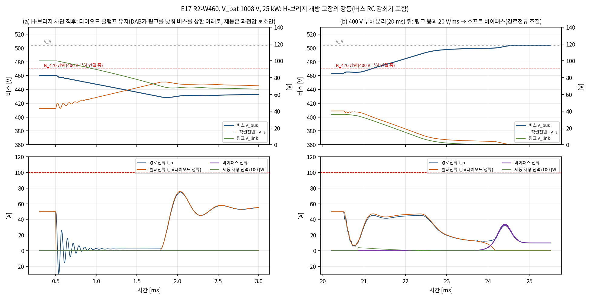
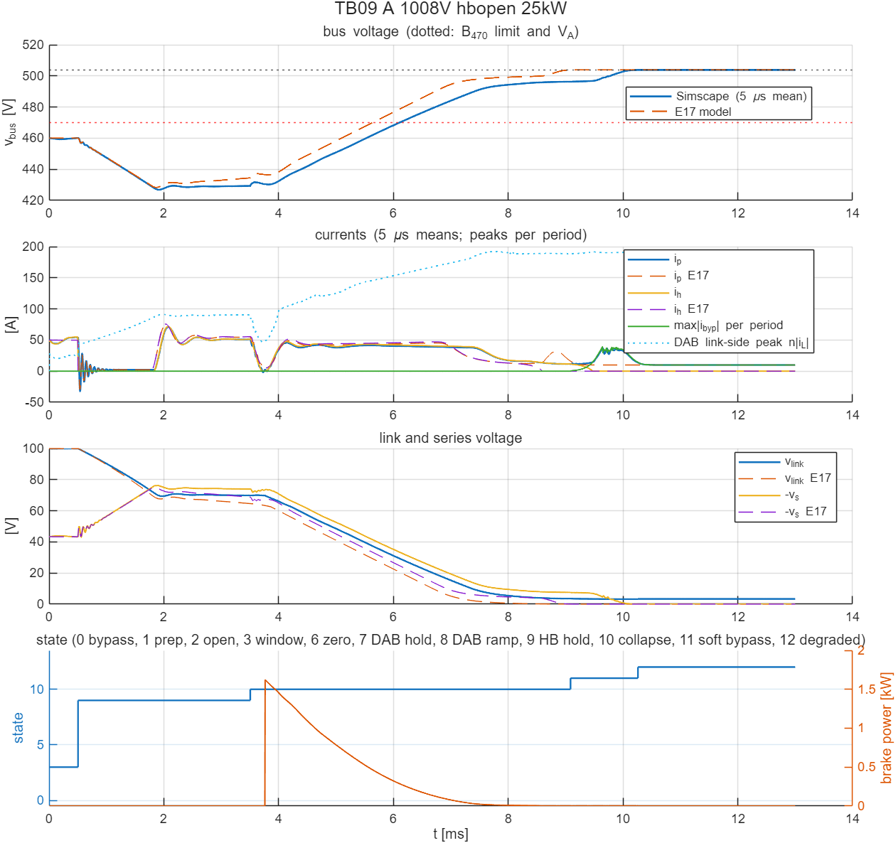
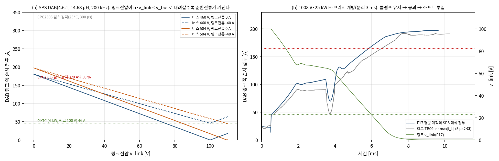

# R2 창 조정 모듈의 보호 상태기계: 평균모델(E17)과 회로 모델(TB09) 검증

- 문서 버전: v1.2 (2026-10-28, 남은 과제 4의 처리를 docs/35에 연결. v1.1 2026-10-24: 남은 위험 1·2의 후속을 docs/25에 연결)
- 관련 문서: [docs/23](23_산업가치_분석_R2_개선구조.md) 개선 구조 R2(E19, TB08), [docs/18](18_StageB_보호_기동_1차검증.md) Stage B 보호·기동 1차 검증(E14), [docs/14](14_요구사항_부하등급_수락기준.md) 요구사항
- 근거 파일: [validation/2026-10-24-protection-r2](../validation/2026-10-24-protection-r2/README.md), 코드는 검증 코드 묶음의 E17. 회로 모델: [TB09](../simulink/tb/TB09_R2_Protection/README.md)
- 검증 수준: E17은 R2 모듈의 일반화 모드 평균모델(적분 0.1 µs, 제어·감시 5 µs 표본, 전달지연 5 µs)에서 117건을 계산했다. TB09는 소자 수준 스위칭 회로(Simscape, 게이트 격자 2.5 ns)에서 대표 4사례를 같은 상태기계 코드로 다시 계산했다. 판정 기준은 시험 전에 고정했고, 부품 스트레스(DAB 순시 전류, 소프트 투입 에너지)는 판정에 넣지 않은 정보 항목이다.

## 1. 요약

docs/23에서 R2는 Stage B를 바이패스로 우회해 Stage B 고장이 48 V 공급을 끊지 않게 했다. DAB 고장의 강등은 확인했지만, H-브리지 고장에서 바로 바이패스하면 수백 A가 흘러 강등 방식을 정하지 못했다. 이 문서는 측정값으로 판단하는 보호 상태기계를 정하고 두 모델에서 검증한 결과다.

1. **H-브리지 고장의 강등 방식을 정했다.** H-브리지가 꺼지면 소자의 역방향 도통이 다이오드 정류기를 이루어 직렬전압이 −(v\_link + 2V\_D)로 묶인다. 이 성질을 써서 (1) DAB가 링크전압을 낮춰 400 V 부하 분리가 끝날 때까지 버스를 부품 상한 아래로 붙잡고, (2) 링크를 0 V 쪽으로 내린 뒤, (3) 경로전류를 보며 바이패스를 서서히 닫는다. E17에서 R2-W460·R2-W410 모두 8/8 통과했다(경로 ≤ 90.3 A, 400 V 부하 연결 중 버스 ≤ 467.1·417.1 V). 즉시 바이패스는 0/8(경로 766–869 A)이다.
2. **추천 순서 전체가 평균모델에서 44/44 통과했다.** 켬 12/12, 끔 8/8, DAB 고장(제동 저항 유지 → 분리 → V\_A 램프 → 바이패스) 16/16, H-브리지 고장 8/8이다. 링크전류 센서 감시(P6)를 켠 E12 격자·센서 요구 사양 회귀 1080건도 판정 변화와 오경보 없이 통과했다.
3. **회로 모델(TB09)의 최종 실행 4/4가 통과했다.** 상태 전이 시각은 E17과 0–20 µs 안에서 같았다(링크 붕괴 정체로 늦어진 소프트 투입과 그 뒤 제외). 다이오드 클램프 식(v\_s = −(v\_link + 2V\_D + R\_h|i\_h|))은 회로에서 평균 −0.011·−0.050 V 오차로 성립했다.
4. **첫 회로 실행에서는 H-브리지 고장 2사례가 모두 불통과였다.** 원인은 평균모델에 없던 두 현상이다. 첫째, 전압비가 극단(n·v\_link ≪ v\_bus)인 DAB는 링크를 0.5 V까지 내리지 못하고 3.5–22 V에서 멈췄다. 둘째, 남은 직렬전압을 로그 램프 저항으로 닫자 버스 RC 감쇠기(1.6 mF)를 충전하는 전류로 경로전류가 177 A까지 올랐다. 그래서 붕괴 정체 감지와 경로전류 조절 소프트 투입을 상태기계에 넣고, 같은 논리를 E17에도 넣어 두 모델을 다시 계산했다.
5. **남은 위험이 하나 있다. H-브리지 고장 강등 중 DAB 순환전류가 정격점의 4배를 넘는다.** 링크전압이 낮아지면 SPS DAB의 링크 쪽 순시 전류가 커진다. 회로에서 192 A(1차 41.7 A)였고, 정격점 첨두 45.8 A의 4.2배다. E17의 SPS 해석값 197 A와 같다. 소자(EPC2305 1개, 펄스 정격 329 A)는 견딜 수 있는 범위로 보이지만, 누설 인덕터는 정격의 4배 전류에서 포화하지 않아야 한다. 고장 모드 변조(EPS·DPS), 고장 상태의 주파수 상향, 또는 정격 상향이 필요하다. 다음 설계 과제로 넘긴다(7절). **후속(docs/25).** EPS 변조, 전압비 정합 유지, 첨두 상한, 일시 감발로 강등 순서를 바꿨다. 회로(TB10)에서 첨두가 79.4 A(1.73배)·75.3 A로 줄었다.
6. **변조율 고착 고장은 100 A 기준을 넘는다.** 하드웨어 비교기 지연(1.2 µs) 동안 필터전류가 128–147 A까지 오른다(0/16). 필터 인덕터 포화 전류를 150 A 이상으로 두거나 비교기를 빠르게 해야 한다.

## 2. 왜 필요한가

E19와 TB08은 "언제 어떤 모드로 바꿀지"를 시험 조건으로 정해 둔 계산이었다. 실제 장치는 다르다.

- **고장은 측정으로 판단한다.** 판단과 차단에는 지연이 있고, 그 사이 회로는 고장 상태로 움직인다. H-브리지는 하드웨어 비교기·게이트 구동기 고장 신호로, DAB는 링크전압 창으로, 제어 상실은 버스 조정 오차로 알아낸다.
- **운전 상태마다 절차가 다르다.** 강등 뒤 버스 = V\_A가 부품 상한을 넘는 팩(1000 V급)에서는 400 V 부하를 분리해야 한다. 분리(접촉기, 20 ms)가 끝날 때까지 버스를 상한 아래로 붙잡을 수 있느냐가 강등 순서를 정한다.
- **H-브리지 고장의 강등은 정해지지 않았다.** E19에서 즉시 바이패스는 740–838 A로 불통과였다(docs/23 7.4절). 이 방식이 정해지지 않으면 R2의 핵심 주장인 "Stage B 고장에도 48 V 공급 유지"가 H-브리지 고장에서는 성립하지 않는다.
- **평균모델로 정한 순서가 회로에서도 성립하는지 따로 확인해야 한다.** 다이오드 정류, 바이패스 투입 순간, 전압비가 극단인 DAB의 동작은 평균모델의 가정이 가장 약한 곳이다.

## 3. 보호 상태기계

### 3.1 상태와 전이

| 번호 | 상태 | 하는 일 | 다음 상태 |
|---|---|---|---|
| 0 | 바이패스 | 바이패스 닫힘, H-브리지·DAB 정지, 버스 = V\_A | V\_bat/2 ≥ V\_W + 5 V → 1 |
| 1 | 준비 | 바이패스 + H-브리지 전류 조향(바이패스 전류 → 0) 0.5 ms | → 2 |
| 2 | 열림 대기 | 바이패스 열림 | 대기 0(추천) → 3 |
| 3 | 창 조정 | 채택 제어기, 기준 V\_A → V\_W 1 ms 램프 | V\_bat/2 ≤ V\_W − 5 V → 4, 고장 → 7·9 |
| 4·5 | 끔 램프·유지 | 기준 → V\_A(1 ms) → V\_A 추정 추종 | \|v\_s\| ≤ 2 V가 50 µs → 6 |
| 6 | 영벡터 | 직렬전압 조향(v\_s → 0) 0.2 ms | → 0(끔) 또는 12(고장) |
| 7 | DAB 고장 유지 | DAB 정지, 링크 제동 저항으로 링크 ≤ 110 V, H-브리지는 계속 조정 | 400 V 부하 분리 끝 → 8 |
| 8 | DAB 고장 램프 | 기준 → V\_A(1 ms) → 추종 | \|v\_s\| ≤ 2 V가 50 µs → 6 |
| 9 | H-브리지 고장 유지 | H-브리지 꺼짐(다이오드 정류). DAB 보조 루프가 링크전압으로 버스를 V\_W에 붙잡음. 제동 저항은 링크 > 110 V일 때만 | 분리 끝(또는 불필요) → 10 |
| 10 | 링크 붕괴 | 링크 기준 20 V/ms로 0 V. 제동 저항은 링크 기준 + 5 V 위에서 | 링크 ≤ 0.5 V, 정체, 또는 10 ms → 11 |
| 11 | 소프트 바이패스 | 바이패스 저항 10 Ω에서 로그 단계로 낮춤. 경로전류 > 투입 시작값 + 25 A면 되올림 | 3.3 mΩ 도달 또는 5 ms → 12 |
| 12 | 강등 | 바이패스 닫힘, Stage B 정지, 버스 = V\_A | — |
| 13 | 이중 고장 | DAB 고장 중 H-브리지 차단: Stage A 협조 정지 필요(모델 밖) | — |

- **400 V 부하 분리.** 고장 검출 시 V\_A 추정이 부품 상한 − 2 V를 넘으면 분리 명령을 낸다. 20 ms 뒤 정전력 부하가 조정형 Stage C 몫(5 kW)으로 줄어드는 것으로 모델링했다.
- **켬 판단은 V\_bat/2로, 히스테리시스 ±5 V다.** 버스전압으로 판단하면 창 조정이 버스를 V\_W로 만들어 판단이 순환한다.

### 3.2 검출(시험 전에 고정)

| 대상 | 방법 | 문턱·지연 |
|---|---|---|
| 경로·필터 과전류, 링크 과전압, 직렬 과전압, 버스 과전압(정상 조정 상태만) | 하드웨어 비교기 → H-브리지 차단 래치 | 110 A, 115 V, 100 V, 부품 상한 / 1.2 µs |
| H-브리지 개방(게이트 구동기 고장) | 구동기 고장 신호 | 1 µs, 다음 표본(5 µs)에서 반응 |
| DAB 고장 | 링크전압 창 | 92–108 V를 벗어난 채 50 µs |
| 제어 상실 | 버스 조정 오차 | \|v\_bus − V\_ref\| > 20 V가 0.5 ms |

### 3.3 2차 실행에서 넣은 것(회로 1차 결과 반영)

| 항목 | 내용 | 이유 |
|---|---|---|
| 붕괴 정체 감지 | 링크 기준이 0에 닿은 뒤 0.5 ms 동안 링크가 0.5 V도 안 내려가고 링크 ≤ 15 V면 소프트 투입으로 | 회로에서 링크가 3.5 V에서 멈췄고, 0.5 V 문턱을 기다리면 10 ms 시간 상한까지 간다 |
| 경로전류 조절 소프트 투입 | 5 µs마다 저항을 1.0409배씩 낮추되(제한이 없으면 1 ms에 10 Ω → 3.3 mΩ) 경로전류가 투입 시작값 + 25 A를 넘으면 1.2배로 되올림. 상한 5 ms | 남은 직렬전압이 수–수십 V면 로그 램프만으로는 감쇠기 충전전류가 경로로 흘러 177 A가 됐다 |
| 유지 중 제동 저항 | 링크 과전압 보호(110 V 켬, 105 V 끔)만. 기준 추종 제동은 붕괴·소프트 투입 중에만 | 유지 중에도 기준 추종으로 켜면 링크가 빨리 내려가 버스가 급히 올라 경로전류가 커졌다(E17 W410 920 V·25 kW 103 A) |

## 4. 검증 방법

**E17(평균모델).** E19의 6상태 평균모델을 일반화했다. 바이패스는 직렬 포트 사이 컨덕턴스, H-브리지는 PWM·영벡터·전 소자 차단(역방향 도통 V\_D 2 V/소자), DAB는 1차 지연 전류원이다. 버스 RC 감쇠기(1.6 mF·48.6 mΩ, R2 기본형 구성)를 기본으로 넣었다. 대상은 R2-W460(V\_W 460 V, 상한 470 V, DAB 4 kW)과 R2-W410(410 V, 420 V, 5 kW)이고, 배터리 전압은 고장 사례에서 창 하단·최대(930·1008 V, 860·920 V), 부하는 5·25 kW다.

**TB09(회로 모델).** TB08의 R2-W460 회로에 보호 요소를 더했다. 소자 역방향 도통 2 V(H-브리지 다이오드 정류의 근거), 링크 제동 저항 3 Ω과 스위치, 바이패스 소프트 투입 가변 저항, 버스 RC 감쇠기, 분리 신호를 받는 정전력 부하, 그리고 E17과 같은 논리의 상태기계(`prism_r2_supervisor.m`)와 보호 게이트 재정의(하드웨어 비교기 래치, 고장 주입)다. 회로 계산 시간을 줄이려고 부하 분리 시간은 3 ms로 두었다. 기준값은 E17이 같은 조건으로 계산한다.

| 사례 | 조건 | 확인하는 것 |
|---|---|---|
| A | 1008 V·25 kW, H-브리지 개방 | 최악 전압의 전체 순서: 클램프 유지 → 분리 → 붕괴 → 소프트 투입 |
| B | 930 V·25 kW, H-브리지 개방 | V\_A(465 V) ≤ 상한이라 분리 없이 바로 붕괴. 대전류에서의 붕괴·투입 |
| C | 930 V·25 kW, 켬(전류 조향) | 바이패스 열림 과도 제거(TB08 사례 E의 19.6 kHz 출렁임) |
| D | 1008 V·25 kW, DAB 고장 | 링크 창 검출 → 제동 저항 유지 → 분리 → 램프 → 바이패스 |

**판정(E17·TB09 공통).** 고장: 순시 경로·필터 ≤ 100 A, 직렬 ≤ 120 V, 링크 ≤ 120 V, 바이패스 ≤ 329 A(2병렬, 소자당 펄스 정격의 50 %), 버스 ≥ 260 V, 강등 상태 도달, 400 V 부하가 연결된 동안 버스 ≤ 부품 상한. 켬: 전류 ≤ 90 A, 직렬 ≤ 90 V, 링크 90–110 V, 버스 ≤ 상한, 최종 V\_W ± 4 V. 끔: 켬 기준 + 바이패스 도달, 버스 ≥ 260 V.

## 5. E17 결과(평균모델)

### 5.1 링크전류 센서 감시(P6) 회귀

감시를 켠 채 E12 시험 격자(576건)와 센서 요구 사양 세 집합(각 168건)을 다시 계산했다. 1080건 모두 판정이 E12와 같았고 오경보는 없었다. 정상 운전 잔차는 최대 2.56 A로 감시 문턱보다 작다.

### 5.2 H-브리지 고장: 정책 비교

| 정책 | R2-W460 | R2-W410 | 무엇이 문제인가 |
|---|---|---|---|
| 즉시 바이패스(now) | 0/4, 경로 766 A | 0/4, 869 A | 링크 쪽으로 충전된 직렬 커패시터(45–52 V)를 단락 |
| 바로 붕괴(collapse\_now) | 2/4 | 0/4 | 붙잡지 않으면 V\_A가 상한을 넘는 팩에서 분리 전에 버스가 상한 초과(3.9–14.5 ms) |
| 클램프 유지, 제동 없음(clamp) | 4/4 | 4/4 | 통과. 단 930 V·25 kW에서 링크가 26.6 V에서 멈춰 소프트 투입 에너지 1.12 J |
| **클램프 유지 + 제동(clamp\_brk, 추천)** | **4/4** | **4/4** | 경로 ≤ 90.0·90.3 A, 연결 중 버스 ≤ 467.1·417.1 V, 소프트 투입 ≤ 0.063·0.028 J, 제동 ≤ 6.8·0.5 J |
| 붕괴 뒤 바로 닫기(clamp\_brk\_hard) | 0/4, 바이패스 1238 A | 0/4, 1014 A | 다이오드 전압 2V\_D(4 V) + 남은 링크전압을 3.3 mΩ로 단락 |

*그림 1. E17, R2-W460 1008 V·25 kW H-브리지 개방(추천 정책). (a) 고장 직후 다이오드 클램프: DAB가 링크를 낮춰 버스를 부품 상한 아래로 붙잡는다. DAB 정격(4 kW) 한계 때문에 링크는 약 67 V에 머물고 버스는 약 430 V다. (b) 분리(20 ms) 뒤 링크 붕괴와 경로전류 조절 소프트 투입.*

- **추천 정책의 버스 최저는 398.5 V(W460)·370.5 V(W410)다.** 다이오드 클램프 동안 버스가 V\_W 아래로 내려가지만 400 V 부하 하한(260 V)보다 높다.
- **유지 중 제동 저항은 과전압 보호만 한다.** 처음에는 유지 중에도 링크 기준 + 5 V 위에서 제동 저항을 켰다. 그러면 W410 920 V·25 kW에서 고장 직후 경로 103 A로 불통과였다. 제동 저항이 링크를 빨리 내리면 직렬전압이 빨리 줄어 버스가 급히 오르기 때문이다. 유지 중 제동을 링크 과전압(110 V) 보호로만 바꾸자 같은 사례가 86.8 A가 되었다.
- **붕괴에는 제동 저항이 필요하다.** 분리가 필요 없는 930 V·25 kW에서는 경로전류(약 60 A)가 다이오드로 링크를 계속 충전한다. 제동 없이는 링크가 26.6 V에서 멈춘다(clamp). 제동이 있으면 10 ms 안에 1.5 V까지 내려간다.

### 5.3 켬·끔·DAB 고장

| 시험 | R2-W460 | R2-W410 | 핵심 수치 |
|---|---|---|---|
| 켬(영벡터 0.5 ms → 열림 → 대기 0.2·0 ms 또는 전류 조향 → 대기 0) | 6/6 | 6/6 | 25 kW 열림 뒤 경로 최대: 대기 0.2 ms 70.3·78.9 A, 대기 0 84.9·86.1 A, **조향 57.0·63.8 A** |
| 끔(램프 → \|v\_s\| 확인 → 영벡터 또는 조향 → 바이패스) | 4/4 | 4/4 | 바이패스 투입 펄스 영벡터 60·64 A, 조향 55·62 A |
| DAB 고장 → 제동 저항 유지 → 분리 → 램프 → 바이패스(brk\_hold) | 8/8 | 8/8 | 링크 ≤ 110.1 V, 연결 중 버스 ≤ 465.0·410.1 V, 제동 에너지 ≤ 49.6·63.5 J, 바이패스 투입 ≤ 300·296 A(조향 225·222 A) |
| DAB 고장 → 검출 즉시 V\_A로 램프(ramp, E19 방식) | 2/4 | 0/4 | 분리 전 버스가 상한 초과, 링크 252·208 V |

- **켬은 전류 조향이 가장 좋다.** 바이패스 전류를 0으로 몬 뒤 열면 TB08 사례 E에서 본 열림 과도가 생기지 않는다.
- **DAB 고장의 검출 시간은 0.62–31.7 ms로 넓다.** 링크가 창을 벗어나는 속도는 H-브리지가 링크와 주고받는 전력에 비례한다. V\_A ≈ V\_W·5 kW에서는 그 전력이 수십 W라 31.7 ms가 걸렸다. 그동안 버스는 조정되고 있으므로 위험하지 않다. 처음 계산 시간(28.5 ms)이 이 경우보다 짧아 "강등 미도달"로 판정된 2건은 계산 시간을 늘려(45.5 ms) 다시 계산했다.
- **DAB 고장의 바이패스 투입 펄스는 최대 300 A다.** 기준 329 A 안이지만 여유가 9 %다. 투입 직전 직렬전압 조향(steer)을 쓰면 225 A로 줄어든다.

### 5.4 감도와 변조율 고착

| 감도(최대 전압·25 kW, H-브리지 고장은 추천 정책) | 결과 |
|---|---|
| 버스 RC 감쇠기 없음 | W460 통과(직렬 114 V, 링크 110 V), W410 불통과(필터 104 A). DAB 고장은 둘 다 통과 |
| V\_D 1.4·3.0 V | 4/4 통과 |
| 소프트 투입 제한 없는 램프 0.1 ms | 2/2 통과(경로전류 조절이 대신 제한) |
| 부하 분리 50 ms | 2/2 통과 |
| DAB 저링크 저하(링크 10 V 아래에서 DAB 전달 저하, 회로의 붕괴 정체 모사) | 4/4 통과. 정체 감지 또는 시간 상한으로 투입(링크 4.0–6.9 V), 소프트 투입 에너지 ≤ 0.358 J |
| 변조율 고착(+0.95·−0.95) | **0/16.** 비교기가 1.2 µs 안에 차단하지만 그동안 필터전류가 128–147 A로 오른다 |

변조율 고착은 E14(400 V 설계)에서도 본 한계다. 링크 100 V가 L\_h 5 µH에 걸리면 필터전류는 20 A/µs로 오른다. 110 A 문턱 + 1.2 µs 지연이면 130 A를 넘는다. 이 값은 소자 펄스 정격(EPC2305 329 A) 안이지만 100 A 판정 기준은 넘는다. 필터 인덕터의 포화 전류를 150 A 이상으로 정하거나, 비교기 문턱·지연을 낮춰야 한다(정상 운전 첨두가 85 A라 문턱을 크게 낮추기는 어렵다).

## 6. TB09 결과(회로 모델)

### 6.1 1차 실행: H-브리지 고장 2사례 불통과

| 사례 | 판정 | 무엇이 일어났나 |
|---|---|---|
| A 1008 V | 불통과(강등 미도달) | 클램프 유지·분리·붕괴 시작까지는 E17과 같았다(전이 시각 차 0–5 µs, 주기 평균 전류 최대값 차 ≤ 4.8 A). 그러나 링크가 3.5 V에서 멈춰 0.5 V 문턱에 닿지 못했다. 계산이 끝날 때(8 ms) 붕괴 상태였다 |
| B 930 V | 불통과(경로 177 A) | 링크가 10 ms 시간 상한까지 22 V 아래로 내려가지 못해 그 상태로 소프트 투입했다(직렬 −26 V). 로그 램프로 닫자 경로전류가 177 A로 올랐다 |
| C 켬 | 통과 | 경로 ≤ 59.1 A, 열림 과도 없음 |
| D DAB 고장 | 통과 | 링크 ≤ 110.0 V, 전이 시각 E17과 10–20 µs 차 |

- **링크가 멈춘 이유.** 링크를 0 V 쪽으로 내리려면 DAB가 다이오드로 들어오는 경로전류보다 많은 전류를 링크에서 빼내야 한다. 평균모델의 DAB는 지령 전류를 그대로 낸다. 회로의 DAB는 1차 460–500 V, 2차 수 V라 전압비가 극단이다. 사례 A에서 링크 3.5 V일 때 보조 루프 지령은 약 25 A였지만, 링크가 거의 내려가지 않은 것으로 보아 실제 전달은 경로전류(약 11 A) 수준이었다(링크 전압 변화에서 역산한 추정). 원인은 데드타임(100 ns) 동안의 다이오드 도통(2 V)이 2차 전압과 비슷해지는 것과, 제어기의 전달비 추정 ρ̂(0.75–1.25배 제한)이 이 영역을 보정하지 못하는 것으로 추정한다. 이 원인 분리는 하지 않았다.
- **경로전류가 오른 이유.** 직렬전압이 남은 채 바이패스가 닫히면 버스가 그만큼 오른다. 버스에는 400 µF 버스 커패시터와 1.6 mF 감쇠기 커패시터가 있다. 로그 램프의 마지막 구간에서 저항이 빨리 줄어 충전전류가 경로로 흘렀다. 평균모델에서는 링크가 0.5 V까지 내려가 남은 직렬전압이 4.5 V였기 때문에 이 문제가 작았다(투입 중 경로 증가 ≤ 20 A).

### 6.2 수정과 최종 실행

3.3절의 세 가지를 상태기계에 넣고 E17·TB09를 다시 계산했다. 첫 실행 결과는 그대로 남겼다.

| 사례 | 판정 | 회로 순시 최대 | 버스(5 µs 평균) | 소프트 투입 | E17 대조 |
|---|---|---|---|---|---|
| A 1008 V H-브리지 개방 | 통과 | 경로 71.1 A, 필터 71.6 A, 직렬 76.2 V | 426.9–503.8 V, 연결 중 ≤ 460.1 V | 정체 감지(링크 3.53 V, 직렬 −7.52 V), 1.18 ms, 0.076 J, 경로 ≤ 37.1 A | 클램프·분리·붕괴 시작 시각 0–5 µs. 소프트 투입은 정체 때문에 0.95 ms 늦음 |
| B 930 V H-브리지 개방 | 통과 | 경로 92.9 A, 필터 89.6 A | 396.9–464.1 V | 시간 상한(링크 22.0 V, 직렬 −26.1 V), 2.34 ms, **1.22 J**, 경로 ≤ 92.9 A | 붕괴·투입 시작 시각 0–5 µs |
| C 930 V 켬(조향) | 통과 | 경로 59.1 A, 필터 62.2 A, 직렬 4.3 V | 459.9–464.3 V | — | 전이 시각 같음, 버스 차 ≤ 0.05 V |
| D 1008 V DAB 고장 | 통과 | 경로 82.3 A, 링크 110.0 V, 바이패스 287 A | 459.4–503.9 V, 연결 중 ≤ 460.1 V | — | 전이 시각 10–20 µs, 링크 최대 차 0.03 V, 제동 에너지 9.74·9.81 J |

*그림 2. TB09 사례 A(최종 실행). 회로(실선, 5 µs 주기 평균)와 E17(점선). 맨 아래는 상태 번호와 제동 저항 전력.*

- **다이오드 클램프는 회로에서도 식대로다.** H-브리지 차단 중 v\_s + (v\_link + 2V\_D + R\_h|i\_h|)·sign(i\_h)의 평균은 A −0.011 V, B −0.050 V다.
- **B의 소프트 투입 에너지 1.22 J는 소자 확인이 필요하다.** 분리가 필요 없는 사례라 경로전류(약 55 A)가 그대로 다이오드로 링크를 충전한다. 회로의 DAB는 이 전류를 링크 22 V 아래로 빼내지 못했다. 그래서 바이패스 소자가 선형 영역에서 26 V부터 2.3 ms 동안 전압을 나눠 받았다. EPC2305는 R\_θJC 0.2 °C/W이고 SOA가 열로 제한된다[1]. 하지만 이 에너지가 SOA 안인지는 데이터시트 그림에서 확인해야 한다. 확인 전까지는 같은 사례에서도 400 V 부하 출력을 잠시 줄여(사례 A처럼 경로전류 약 11 A) 투입하는 순서를 대안으로 둔다(사례 A 0.076 J).

### 6.3 부품 스트레스: DAB 순환전류

*그림 3. (a) SPS DAB(4.6:1, 14.68 µH, 200 kHz)의 링크 쪽 순시 첨두와 링크전압. (b) 사례 A의 시간 궤적: E17 평균 궤적의 SPS 해석값과 회로의 n·max|i\_L|.*

H-브리지 고장 강등에서는 DAB가 링크전압을 정격(100 V)보다 크게 낮춘다. 유지 중 40–60 V, 붕괴 끝에서는 0 V 근처다. 1차 전압(v\_bus/n ≈ 100–110 V)과 2차 전압이 어긋나면 SPS DAB의 누설 인덕터에는 그 차이가 반주기 동안 걸린다. 링크 쪽 순시 전류는 v\_link → 0에서 위상과 무관하게 v\_bus/(4 n f\_s L′)에 가까워진다(L′ = L\_dab/n²). 1000 V급 팩에서 약 195 A다[2].

| 항목 | 정격점(4 kW, 링크 100 V) | H-브리지 고장 강등 중 최대 |
|---|---|---|
| 링크 쪽(2차) 순시 첨두, E17 SPS 해석 | 45.8 A | 197 A(W460), 202 A(W410, 정격점 60.0 A) |
| 링크 쪽 순시 첨두, TB09 회로 n·\|i\_L\| | — | 192.0 A(A), 178.1 A(B) |
| 1차 순시 첨두(누설 인덕터 전류), 회로 | 약 10 A | 41.7 A |

- **평균모델과 회로가 같은 값을 냈다.** 평균모델에는 순시 전류가 없으므로 E17은 평균 링크전류와 두 전압에서 SPS 식으로 첨두를 계산한다. 회로 측정과 2.5 % 안에서 같다.
- **소자는 견딜 범위로 보인다.** R2-W460의 DAB 2차는 위치마다 EPC2305 1개다(E18 정격 규칙). 192 A는 펄스 정격 329 A(25 °C, 300 µs)보다 작다. 삼각파 실효값은 약 110 A로 연속 정격 133 A(T\_J ≤ 125 °C)[1]보다 작다. 다만 노출 시간이 분리 시간(20 ms) + 붕괴 3–10 ms로 펄스 정격의 시간보다 길다. 판정 여유 규칙(펄스 정격의 50 %, 164.5 A)도 넘는다.
- **누설 인덕터가 더 큰 문제다.** 정격점 1차 첨두는 약 10 A인데 강등 중 41.7 A다. 누설 인덕터를 정격점에 맞춰 설계하면 포화해 인덕턴스가 줄고, 전류가 더 커진다.
- **같은 현상을 E14에서 이미 봤다.** 400 V 설계의 링크 프리차지(링크 0 V에서 DAB 시작)에서도 1차 첨두가 200 kHz에서 45.0 A로 정격 운전(21.0 A)의 두 배였다(docs/18). 그때는 링크 약 50 V까지 주파수를 3배(600 kHz)로 올리거나 별도 프리차지 경로를 두는 대응을 정했다(요구 P5).
- **대응은 세 가지다.** (1) 고장 모드 변조: 전압비가 어긋나는 상태(9–11)에서 1차 브리지에 내부 위상차를 주는 EPS·DPS 변조로 1차 전압의 펄스 폭을 n·v\_link에 맞추면 순환전류가 줄어든다[2]. (2) 고장 상태의 DAB 주파수 상향: 첨두는 1/f\_s에 비례하므로 600 kHz면 약 1/3(링크 쪽 약 65 A)이다. 스위칭 손실은 늘지만 수십 ms 동안이다. (3) 정격 상향: 누설 인덕터 포화 전류를 45 A 이상, DAB 2차를 2병렬로 한다. 부피·비용이 는다. 하드웨어를 바꾸지 않는 (1)·(2)를 먼저 검토한다.

## 7. 설계 결정과 남은 과제

**결정한 것**

| 항목 | 결정 |
|---|---|
| 켬 | 바이패스 + 전류 조향 0.5 ms → 열림 → 바로 제어(기준 V\_A → V\_W 1 ms) |
| 끔 | 기준 → V\_A 1 ms → \|v\_s\| ≤ 2 V 50 µs → 직렬전압 조향 0.2 ms → 바이패스 |
| DAB 고장 | 링크 창 검출 → 제동 저항으로 링크 ≤ 110 V 유지 → 400 V 부하 분리 → 기준 → V\_A → 조향 → 바이패스 |
| H-브리지 고장 | 구동기 고장 신호·비교기 → 다이오드 클램프 유지(DAB 보조 루프, 제동은 과전압 보호만) → 분리 → 링크 붕괴(제동 저항 사용, 정체 감지) → 경로전류 조절 소프트 투입. **docs/25에서 변경:** 유지는 DAB 전압비 정합, 강등 상태의 DAB는 EPS·첨두 ≤ 1.5배, H-브리지 고장이면 항상 감발, 소프트 투입 시간 상한은 이중 고장으로 |
| 추가 하드웨어 | 링크 제동 저항 3 Ω(110 V에서 4 kW, 고장당 ≤ 64 J), 바이패스 게이트의 선형 영역 구동(소프트 투입), 400 V 부하 분리 경로 |

**남은 과제**

| 순서 | 과제 | 근거 |
|---|---|---|
| 1 | 강등 중 DAB 순환전류 제한: 고장 모드 변조(EPS·DPS) 또는 주파수 상향. 평균모델의 해석식과 새 회로 테스트벤치로 확인. **진행(docs/25, E20·TB10):** 회로 192 → 79.4 A. 회로 판정 2배는 지켰고, 해석 목표 1.5배는 붕괴 구간에서 10–16 % 넘는다 | 6.3절, 링크 쪽 192 A·1차 41.7 A |
| 2 | 바이패스 소자의 선형 영역 에너지 확인(EPC2305 SOA). 넘으면 투입 전 400 V 부하 출력 감소 순서 추가. **docs/25:** 감소 순서(일시 감발)를 넣어 B가 0.026 J로 줄었다. SOA 확인은 남는다 | 6.2절, B 1.22 J |
| 3 | 필터 인덕터 포화 전류 ≥ 150 A 또는 비교기 개선 | 5.4절, 변조율 고착 128–147 A |
| 4 | 이중 고장(13)의 Stage A 협조 정지와 SALS 연동. **처리(docs/35, E29·TB23):** 400 V 부하 감발을 SALS 메시지·계약 응답으로 바꾸고 유지 종료를 부하전류 추정으로 정했다(연동 강등 74/74). 이중 고장은 Stage A 정지 + 접촉기 분리 + SALS 감발 + 제동 저항 과전압 보호로 링크 ≤ 110 V(경로전류 소멸 5 ms 기준은 1/4). 48 V 회생에는 Stage C 회생 차단이 필요 | 모델 밖 → docs/35 |

## 8. 한계

- 회로 모델의 V\_A는 이상 전원(V\_bat/2 + 13.2 mΩ + 1.5 µH)이다. Stage A 회로와 결합한 R2 통합 모델은 조정형 Stage C 재설계 뒤에 만든다.
- 바이패스 루프·제동 저항 루프의 기생 인덕턴스와 바이패스 셀 출력용량은 넣지 않았다. 바이패스 투입 첨두는 상한 쪽 값이다.
- 소프트 투입은 가변 저항으로 모델링했다. 게이트 전압과 채널 저항의 관계, 소자 온도는 모델 밖이다.
- 400 V 부하 분리는 시간 지연 뒤 정전력 부하가 줄어드는 것으로만 모델링했다. 접촉기 아크·부하 측 커패시터는 넣지 않았다.
- 회로 계산은 대표 4사례이고, 부하 분리 시간은 3 ms로 줄였다(E17 기본 20 ms). 유지 시간이 길어지면 DAB 순환전류에 노출되는 시간도 길어진다.
- R2-W410의 회로 확인은 하지 않았다. 평균모델 결과(8/8)와 SPS 해석(202 A)만 있다.

## 참고문헌

1. EPC, *EPC2305 Enhancement Mode Power Transistor, 150 V, 2.2 mΩ*, datasheet(I\_D 133 A 연속 T\_J ≤ 125 °C, 329 A 펄스 25 °C·300 µs, R\_θJC 0.2 °C/W, SOA 그림 11). https://epc-co.com/epc/documents/datasheets/EPC2305_datasheet.pdf
2. B. Zhao, Q. Song, W. Liu, Y. Sun, "Overview of Dual-Active-Bridge Isolated Bidirectional DC–DC Converter for High-Frequency-Link Power-Conversion System," *IEEE Trans. Power Electron.*, vol. 29, no. 8, pp. 4091–4106, 2014. doi:10.1109/TPEL.2013.2289913
