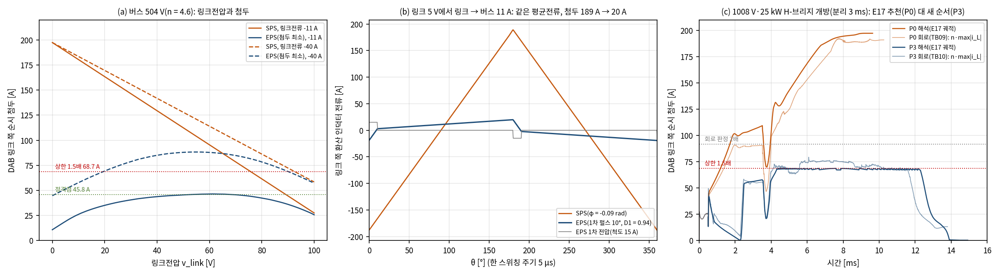

# H-브리지 고장 강등의 DAB 순환전류 제한: 고장 모드 변조(E20)와 회로 확인(TB10)

- 문서 버전: v1.0 (2026-10-24)
- 관련 문서: [docs/24](24_R2_보호상태기계_E17_TB09.md) R2 보호 상태기계(E17·TB09, 이 문서가 닫는 남은 위험), [docs/18](18_StageB_보호_기동_1차검증.md) 보호·기동(E14 링크 프리차지), [docs/23](23_산업가치_분석_R2_개선구조.md) 개선 구조 R2
- 근거 파일: [validation/2026-10-24-dab-fault-modulation](../validation/2026-10-24-dab-fault-modulation/README.md), 코드는 검증 코드 묶음의 E20과 공용 모듈 `dab_modulation.py`. 회로 모델: [TB10](../simulink/tb/TB10_R2_FaultMod/README.md)
- 검증 수준: E20은 DAB 정상상태 파형의 정확한 구간 선형 해석(이상 소자, 데드타임 없음)과 E17 평균모델 상태기계를 쓴다. TB10은 TB09와 같은 소자 수준 회로(게이트 격자 2.5 ns)에 새 게이트 생성기를 넣어 대표 3사례를 계산했다. DAB 첨두 판정(해석 1.5배, 회로 2배)은 시험 전에 정했다.

## 1. 요약

H-브리지 고장 강등에서 DAB 누설 인덕터 전류가 정격점의 4배를 넘던 문제(TB09 링크 쪽 192 A)를, 변조와 강등 순서를 함께 바꿔 줄였다.

- **원인.** 강등 중 링크전압이 1차 환산 전압(v\_bus/n)보다 크게 낮아지는, 단일 위상천이(SPS) DAB의 전압비 불일치다. 링크가 0 V에 가까우면 첨두는 전달 전류와 상관없이 약 197 A(1008 V 팩)다.
- **변경(P3).** 강등 상태에서 다섯 가지를 함께 바꿨다.
  1. 1차 내부 위상천이(EPS) 변조를 쓴다.
  2. 버스를 V\_W 대신 DAB 전압비 정합점에 둔다(링크 ≈ 89 V, 버스 ≈ 410 V).
  3. EPS 첨두가 1.5 × 정격점을 넘지 않는 전류까지만 DAB에 지령하고, 나머지는 제동 저항이 받는다.
  4. H-브리지 고장이면 V\_A와 상관없이 400 V 부하를 일시 감발한다.
  5. 소프트 투입이 시간 상한에 걸리면 주 스위치를 강제로 닫지 않고 이중 고장으로 넘긴다.
- **평균모델(E20).** P3는 R2-W460·R2-W410 기본 8사례를 모두 통과했다. 해석 첨두는 68.8 A와 90.0 A로 1.5배 이하다. E17 추천 순서(P0)는 8사례 모두 불통과였다(197 A와 202 A). EPS만 더한 경우와 감발을 뺀 경우는 부족했다.
- **회로(TB10).** 3사례 모두 회로 판정을 통과했다. 링크 쪽 첨두는 79.4 A(1008 V)와 75.3 A(930 V)로, TB09의 192 A와 178 A보다 58–59 % 낮다. 정격점 대비로는 4.2·3.9배에서 1.73·1.64배가 됐다. 미리 정한 회로 기준(2배, 91.7 A)은 지켰다. 해석 설계 목표 1.5배(68.7 A)는 링크 붕괴 구간에서 10–16 % 넘었다. 표 보간 때문은 아니다(E20에서 확인, ≤ 0.1 %). 데드타임 같은 회로 효과로 남는다.
- **부수 효과.** EPS로 회로의 링크가 0.49 V까지 내려가, TB09의 붕괴 정체(3.5–22 V)가 없어졌다. 소프트 투입 에너지는 0.024–0.026 J(TB09 930 V는 1.22 J), 경로 순시 최대는 57–58 A(TB09는 71 A와 93 A)다.
- **비용.**
  - 유지 중 버스가 더 낮다(회로 최저 410 V와 381 V).
  - 고장당 제동 에너지가 늘었다(평균모델, 분리 20 ms에서 6.8 J → 21.4 J).
  - 강등 완료가 늦어졌다(회로 13.2–13.8 ms, TB09는 10.3–12.8 ms).
  - V\_A ≤ 상한 팩에서도 400 V 부하가 약 30 ms 줄어든다.

## 2. 왜 필요한가

docs/24에서 H-브리지 고장의 강등 순서를 정했지만, 그 순서에서는 DAB 누설 인덕터 전류가 정격점의 4배를 넘었다. 회로(TB09)에서 링크 쪽 192 A, 1차 41.7 A였고 정격점은 45.8 A, 약 10 A다.

- **누설 인덕터는 정격점 첨두에 맞춰 설계한다.** 4배 전류가 유지(분리 20 ms)와 붕괴(3–10 ms) 동안 이어지면 자성체가 포화할 수 있고, 포화하면 인덕턴스가 줄어 전류가 더 커진다.
- **하드웨어를 키우면 R2의 이점이 줄어든다.** 창 조정 모듈은 DAB를 4–5 kW로 줄인 것이 손실·부피 이점의 근거다(docs/23). 고장 한 번을 위해 인덕터와 2차 소자를 4배 정격으로 키우면 그 이점이 사라진다.
- **같은 현상이 E14 링크 프리차지에서도 있었다.** 링크 0 V에서 DAB를 시작하면 1차 첨두가 정격의 두 배였다(docs/18, 요구 P5). 전압비가 어긋난 DAB의 공통 문제다.

## 3. 원인: 단일 위상천이(SPS)의 전압비 불일치

SPS에서는 1차·2차 브리지가 모두 50 % 구형파이고, 두 파형의 위상차로 전력을 보낸다. 누설 인덕터(2차 환산 L′ = L\_dab/n²)에는 두 전압의 차가 걸린다. 링크전압 v\_link가 1차 환산 전압 v\_bus/n보다 크게 낮으면, 전달 전류와 상관없이 반주기마다 큰 전압이 인덕터에 걸린다. 링크가 0 V에 가까우면 링크 쪽 첨두는 위상과 무관하게 다음 값에 가까워진다.

```latex
\hat{i}_{2} \approx \frac{v_{bus}}{4\,n\,f_s\,L'} = \frac{504\ \mathrm{V}}{4 \cdot 4.6 \cdot 200\ \mathrm{kHz} \cdot 0.694\ \mu\mathrm{H}} \approx 197\ \mathrm{A}
```

H-브리지 고장 강등은 정확히 이 조건을 만든다. 버스를 V\_W에 붙잡으려고 링크를 40–67 V로 낮추고(유지), 바이패스 전에 링크를 0 V 쪽으로 내린다(붕괴). 유지 중에도 링크 쪽 130–176 A다.

## 4. 강등 방식의 변경



*그림 1. (a) 버스 504 V에서 링크전압에 따른 링크 쪽 첨두. SPS와 EPS(첨두 최소)를 링크 → 버스 11·40 A에서 비교. (b) 링크 5 V, 11 A에서 한 주기 인덕터 전류: 같은 평균전류에서 첨두 189 A → 20 A. (c) 1008 V·25 kW H-브리지 개방(분리 3 ms)의 링크 쪽 첨두. E17 추천 순서(P0)와 새 순서(P3)를 비교했다. 해석 첨두는 E17 궤적에서, 회로 첨두는 TB09·TB10의 5 µs 주기마다 n·max|i\_L|로 구했다. 점선은 해석 상한 1.5배와 회로 판정 2배다.*

세 가지를 함께 바꿨다. 하나만으로는 부족하다(5절 P1·P3n).

1. **1차 내부 위상천이(EPS) 변조.** 1차 브리지 두 레그 사이에 위상차 D1·π를 주면 1차 전압에 영구간이 생겨 반주기마다 펄스 폭이 (1 − D1)·π가 된다. 인덕터에 큰 전압이 걸리는 시간이 펄스 폭만큼으로 줄어든다. 링크가 낮을 때 2차 브리지를 펄스 뒤 평탄 구간에 맞추면 인덕터 전류가 거의 사각파가 되어, 첨두가 링크에서 빼내는 평균전류에 가까워진다[1]. 링크 5 V·11 A에서 SPS 189 A가 EPS 20 A가 된다(그림 1b).
2. **전압비 정합 유지.** EPS만으로는 유지 구간이 해결되지 않는다. 유지 중 DAB는 다이오드로 링크에 들어오는 경로전류(약 60 A)를 링크 40–67 V에서 빼내야 해서, EPS로도 첨두가 125–136 A다. 그래서 버스를 V\_W에 붙잡는 대신 DAB 전압비를 1로 두는 링크 기준을 쓴다.
   ```latex
   v_{link}^{*} = \frac{V_A - (R + R_h)\,i_p - 2V_D}{n + 1}, \qquad v_{bus} \approx n\, v_{link}^{*}
   ```
   1008 V에서 링크 약 89 V, 버스 약 410 V다. 버스는 V\_W(460 V)보다 낮지만 400 V 부하 범위(260 V–부품 상한) 안이다. DAB 정격(4 kW)을 넘는 링크전력은 제동 저항이 받는다.
3. **첨두 상한.** 강등 상태(9 유지, 10 붕괴, 11 소프트 투입)에서는 EPS로 첨두 ≤ 1.5 × 정격점 첨두(R2-W460 68.7 A, R2-W410 90.0 A)가 되는 전류까지만 DAB에 지령한다. 그 밖의 링크 방전은 제동 저항이 맡는다. 그래서 붕괴 속도는 지령(20 V/ms)보다 느려질 수 있다.
4. **일시 감발.** V\_A가 부품 상한 이하인 팩(930 V)에서는 분리가 필요 없어 전 부하(약 55–60 A)에서 붕괴했었다. 첨두 상한이 있으면 DAB가 이 전류를 빼내지 못해 링크가 61 V에서 멈춘다. 그래서 H-브리지 고장이면 V\_A와 상관없이 400 V 부하 출력을 줄인 뒤(분리와 같은 경로, 20 ms) 붕괴·투입하고, 강등 0.5 ms 뒤 되돌린다.
5. **소프트 투입 시간 상한.** 5 ms 안에 투입이 끝나지 않으면 주 스위치를 강제로 닫지 않고 이중 고장(Stage A 협조 정지)으로 넘긴다. 감발 없는 930 V 사례에서 강제로 닫으면 경로가 693 A였다.

**EPS 지령표.** 정규화 전압비 r = n·v\_link/v\_bus(0–1.4)와 정규화 링크전류 j(−0.78–0.78)의 격자마다, 1차 펄스 폭 d와 2차 위상 α 가운데 첨두가 가장 작은 조합을 찾았다(d 600 × α 1440 격자, 반주기 대칭 파형을 꺾이는 점에서 정확히 계산). SPS(d = π)는 이 조합의 특수 경우라 해석식과 오차 없이 같았다. 회로에서는 이 표를 쌍선형 보간해 [등가 위상 φ = α + D1·π; D1]로 게이트 생성기에 넘긴다.

## 5. E20 결과(평균모델 + 해석 첨두)

정책 네 가지를 E17 상태기계로 비교했다. 판정은 E17 고장 판정에 "DAB 링크 쪽 순시 첨두(해석) ≤ 1.5 × 정격점"을 더했다.

| 정책 | 내용 | R2-W460 | R2-W410 | DAB 첨두 최대(W460 / W410) |
|---|---|---|---|---|
| P0 | E17 추천(버스 V\_W 유지, SPS) | 0/4 | 0/4 | 197.3 / 202.0 A |
| P1 | P0 궤적 + EPS(상한 없음) | 0/2 | 0/2 | 135.7 / 136.4 A |
| P3n | 정합 유지 + EPS 상한, 감발 없음 | 1/2 | 2/2 | 68.8 / 90.0 A. W460 930 V·25 kW는 링크 61 V 정체 → 이중 고장 |
| **P3** | **P3n + 일시 감발(추천)** | **4/4** | **4/4** | **68.8 / 90.0 A** |

| P3 항목(W460 / W410) | 값 |
|---|---|
| 경로전류 최대 | 71.4 / 78.7 A(P0 90.0 / 90.3 A) |
| 유지 중 버스 최저 | 373 / 337 V(P0 398 / 370 V). 400 V 부하가 연결된 동안 최고 465 / 410 V |
| DAB 첨두: 유지 / 붕괴·투입 | 42–67 / 68.8 A, 42–87 / 90.0 A(P0 유지 130–176 A) |
| 제동 저항 에너지(분리 20 ms) | ≤ 21.4 / 6.3 J(분리 50 ms 감도 45.8 / 10.5 J) |
| 링크 붕괴 시간 | 9.0–9.9 / 6.7–7.3 ms(P0 1.8–10 ms) |
| 소프트 투입 에너지 | ≤ 0.027 / 0.028 J |

- **감도.** V\_D 1.4·3.0 V, 분리 50 ms, DAB 저링크 저하(회로의 붕괴 정체 모사)는 모두 통과했다. 버스 RC 감쇠기 없음은 W460 통과, W410 불통과(경로 100.2 A, E17 추천 순서의 같은 감도 104 A와 비슷)다.
- **상한 1.3배(회로 여유, 6절에서 정함).** W460·W410 25 kW 4사례 모두 통과했다. 첨두는 59.7 A와 78.0 A다. W460은 붕괴가 시간 상한 10 ms에 걸리고, 소프트 투입 에너지가 0.26 J, 제동 에너지가 28.5 J로 는다.
- **회로 지령 보간.** 회로 블록과 같은 보간(φ·D1 쌍선형, D1 ≤ 0.95)으로 지령을 상한에 붙여도, 실제 파형 첨두는 상한의 1.0007배 이내다(버스 380–504 V × 링크 1–95 V).
- **비용.** 유지 중 버스가 V\_W보다 50–80 V 낮다. 제동 저항이 DAB 정격 밖 전력을 받아 고장당 에너지가 E17의 6.8 J에서 21.4 J로 늘었다(DAB 고장 강등은 이미 49.6 J). V\_A ≤ 상한 팩에서도 400 V 부하가 약 30 ms(감발 20 ms + 붕괴·투입 약 10 ms) 동안 줄어든다.

## 6. TB10 결과(회로 모델)

TB09와 같은 소자 수준 회로에 두 가지를 넣었다. 하나는 지령표 블록(`prism_dab_eps_map`)이다. 다른 하나는 1차 레그 2를 D1·T/2 늦추는 게이트 생성기(`prism_gate_stageB_e`)다. 회로 계산 시간을 줄이려고 분리·감발을 3 ms로 줄였다. 기준값(E17의 P3 설정)도 같은 시간으로 다시 만들었다. 게이트 생성기는 회로에 넣기 전에 Octave에서 단독으로 확인했다. 네 지점(링크 5·50·89·100 V)의 평균 링크전류와 첨두가 해석값과 0.2 A 안에서 같았다.

| 항목 | A 1008 V, H-브리지 개방 | B 930 V, H-브리지 개방 | TB09(A / B) |
|---|---|---|---|
| 회로 판정 | 통과 | 통과 | 통과 / 통과 |
| DAB 링크 쪽 첨두(유지 / 붕괴 / 소프트 투입) | 58.5 / **79.4** / 17.6 A | 62.7 / **75.3** / 17.5 A | 최대 192.0 / 178.1 A |
| 정격점(45.8 A) 대비 | 1.73배 | 1.64배 | 4.19 / 3.89배 |
| 1차 첨두 | 17.3 A | 16.4 A | 41.7 / 38.7 A |
| 경로 순시 최대 | 57.2 A | 57.9 A | 71.1 / 92.9 A |
| 버스 최저(5 µs 평균) | 409.6 V | 380.6 V | 426.9 / 396.9 V |
| 소프트 투입 진입 링크전압 | 0.49 V | 0.49 V | 3.53 / 22.0 V |
| 소프트 투입 소자 에너지 | 0.024 J | 0.026 J | 0.076 / 1.22 J |
| 제동 저항 에너지(분리 3 ms) | 6.9 J | 5.8 J | 2.2 / 8.3 J |
| 강등 완료(사건 0.5 ms 기준 시각) | 13.80 ms | 13.18 ms(부하 되돌림 13.68 ms) | 10.26 / 12.85 ms |

- **첨두 초과는 붕괴 구간에서만 나왔다.** 1.5배를 넘은 주기는 모두 상태 10(링크 붕괴)이었다. 붕괴 주기 가운데 41 %(A)와 36 %(B)가 넘었고, 링크 8–83 V 전 범위에 퍼져 있었다(링크 50–60 V 근처가 가장 큼). 유지(58.5·62.7 A)와 소프트 투입(17.5 A)은 목표 안이다. 붕괴는 지령(20 V/ms)이 상한보다 큰 전류를 요구해 내내 상한에 붙어 돈다. 그래서 회로와 이상 해석의 차이가 그대로 초과로 나타난다.
- **원인 범위를 좁혔다.** E20에서 회로 블록과 같은 보간(φ·D1 쌍선형, D1 ≤ 0.95)을 상한에 붙여 써 봤다. 실제 파형 첨두는 상한의 1.0007배 이내였다. 표 보간은 원인이 아니다. 남는 원인은 표에 없는 회로 효과다.
  - 데드타임 100 ns: 붕괴 막바지의 1차 펄스 폭 125–150 ns(D1 0.94–0.95)와 비슷한 크기다.
  - 소자 역방향 도통 강하 2 V: 링크 수 V에서 상대적으로 크다.
  - 주기마다 바뀌는 지령: 표는 정상상태 파형이다.

  회로의 붕괴가 평균모델보다 0.4–0.6 ms 빨랐다. 회로 DAB가 같은 지령에서 더 큰 전류를 냈다는 뜻이고, 첨두가 큰 것과 같은 방향이다. 어느 효과가 주된지는 따로 가르지 않았다.
- **회귀(C).** EPS가 꺼진 켬 순서는 TB09 C와 판정 항목·수치가 같다. 새 게이트 생성기는 D1 = 0에서 SPS 생성기와 같다.
- **E17 대조(정보).** 상태 전이 시각은 유지·붕괴 진입이 같고, 소프트 투입·강등이 0.36–0.63 ms 빠르다. 버스 최저는 2.5–4.6 V 높다. 링크 최저 −2 V는 소자 역방향 도통이고, 평균모델에는 없다.

## 7. 설계 결정과 남은 과제

**결정한 것(docs/24의 H-브리지 고장 강등을 바꿈)**

| 단계 | 이전(docs/24) | 변경 |
|---|---|---|
| 유지 | 버스를 V\_W에(링크 40–67 V), 제동은 과전압 보호만 | DAB 전압비 정합(링크 ≈ 80–90 V, 버스 ≈ 340–410 V), 제동 저항이 DAB 정격 밖 전력 |
| 400 V 부하 | V\_A > 상한일 때만 분리 | H-브리지 고장이면 항상 감발·분리, V\_A ≤ 상한이면 강등 0.5 ms 뒤 되돌림 |
| DAB 변조 | SPS | 강등 상태 9–11에서 EPS, 첨두 ≤ 1.5 × 정격점 |
| 소프트 투입 시간 상한 | 주 스위치를 닫음 | 이중 고장(Stage A 협조 정지)으로 |

**남은 과제**

1. **회로 첨두의 여유.** 회로 첨두가 해석 첨두의 1.10–1.16배였다. 회로에서 1.5배 안에 두려면 해석 상한을 약 1.3배로 낮춰야 한다. E20 감도에서는 1.3배로도 R2-W460·W410 25 kW 4사례가 모두 통과했다(첨두 59.7 A와 78.0 A). 대가가 셋 있다.
   - W460은 붕괴가 시간 상한 10 ms에 걸린다.
   - 소프트 투입이 더 높은 링크에서 시작해 에너지가 0.26 J로 는다. TB09 930 V의 1.22 J보다는 작다.
   - 제동 에너지가 28.5 J로 는다.

   회로로는 확인하지 않았다. 대안이 둘 있다. 데드타임을 넣은 파형으로 지령표를 다시 만드는 것, 그리고 측정 첨두로 상한을 되먹임하는 것이다.
2. **제동 저항의 열.** 고장당 에너지는 분리 20 ms에서 ≤ 21.4 J, 50 ms에서 45.8 J, 상한 1.3배에서 28.5 J다. DAB 고장 강등은 49.6 J다. 저항·스위치의 펄스 정격과 반복 고장은 보지 않았다.
3. **부하 쪽 감발 응답.** 400 V 부하가 20 ms 안에 출력을 줄인다고 가정했다. 차량 쪽 신호 경로와 압축기·히터의 응답은 모델 밖이다.
4. **R2-W410 회로.** 평균모델과 해석 첨두만 있다. 정격점 첨두가 60.0 A로 커서 2배 기준이 120 A다.
5. **자성체·소자 정격.** 누설 인덕터와 변압기, 2차 소자는 회로 첨두 약 80 A(1차 17.3 A)에서 포화하지 않아야 한다. 정격점의 2배를 설계 여유로 두는 것이 맞다.

## 8. 한계

- EPS 지령표는 이상 소자 파형이다. 데드타임(100 ns), 출력용량, 소자 역방향 도통은 회로에서만 들어간다. D1은 데드타임 때문에 0.95로 제한했다.
- 제동 저항의 열(고장당 ≤ 46 J)과 반복 고장은 보지 않았다.
- 400 V 부하 감발은 시간 지연 뒤 정전력 부하가 5 kW로 줄어드는 것으로 모델링했다. 실제 부하의 감발 응답(통신 지연, 압축기·히터 제어)은 모델 밖이다.
- 회로 계산은 R2-W460 대표 3사례이고, 분리·감발 시간은 3 ms로 줄였다. R2-W410은 평균모델과 해석 첨두만 있다.

## 참고문헌

1. B. Zhao, Q. Song, W. Liu, Y. Sun, "Overview of Dual-Active-Bridge Isolated Bidirectional DC–DC Converter for High-Frequency-Link Power-Conversion System," *IEEE Trans. Power Electron.*, vol. 29, no. 8, pp. 4091–4106, 2014. doi:10.1109/TPEL.2013.2289913
