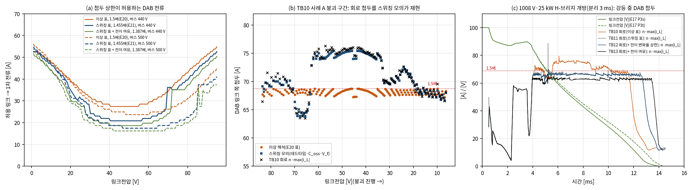

# DAB 고장 모드 변조의 회로 여유: 데드타임 반영 첨두 표(E21)와 지령 전이(TB11–TB13)

- 문서 버전: v1.0 (2026-10-25)
- 관련 문서: [docs/25](25_DAB_고장모드변조_E20_TB10.md) DAB 고장 모드 변조(E20·TB10, 이 문서가 닫는 남은 과제 1), [docs/24](24_R2_보호상태기계_E17_TB09.md) R2 보호 상태기계
- 근거 파일: [validation/2026-10-25-dab-switching-margin](../validation/2026-10-25-dab-switching-margin/README.md). 코드는 검증 코드 묶음의 E21과 공용 모듈 `dab_switching.py`다. 회로 모델은 [TB11](../simulink/tb/TB11_R2_FaultMod_SW/README.md), [TB12](../simulink/tb/TB12_R2_FaultMod_TR/README.md), [TB13](../simulink/tb/TB13_R2_FaultMod_TA/README.md)이다.
- 검증 수준:
  - E21: DAB 한 운전점의 시간 영역 주기 정상상태(데드타임·출력용량·역방향 도통)와 E17 평균모델 상태기계.
  - 게이트 전이 확인: 게이트 생성기 + 이상 스위칭 + 누설 인덕터(MATLAB·Octave).
  - TB11–TB13: TB10과 같은 소자 수준 회로(게이트 격자 2.5 ns)의 대표 2사례.
  - 판정 기준(회로 1.5배)은 시험 전에 정했다.

## 1. 요약

강등 중 DAB 첨두의 회로 여유를 세 단계로 확인했다. 결과는 성공 하나와 실패 둘이다. 실패한 두 단계도 원인을 찾아 다음 단계의 근거로 삼았다.

- **원인은 데드타임이었다(E21).** 스위칭 정상상태 모의가 TB10 회로의 붕괴 구간 첨두를 평균 0.1–0.3 %, 최대 2.9 % 안에서 재현했다. 모의에는 데드타임 100 ns, 출력용량, 역방향 도통이 들어 있다. 같은 모의로 회로 지령 블록의 첨두 표를 다시 만들었고, 설계 상한은 1.455 × 정격점(66.7 A)으로 두었다.
- **TB11(스위칭 반영 첨두 표): 불통과.** 정상 주기의 초과는 거의 없어졌다(1.5배 초과 1,082·916주기 → 7·3주기). 그러나 지령표 칸이 바뀌는 주기에 EPS 지령이 한 번에 옮겨 가면서 직류 편류로 88.5 A가 나왔다.
- **TB12(게이트 생성기의 직류 편류 방지 + 변화율 상한): 1/2 통과.** 전이 첨두는 88.5 → 70.0 A로 줄었다. 사례 A는 전이 끝 세 주기가 68.7 A를 최대 1.3 A 넘었다. 전이 첨두는 정상 상한 위로 최대 4.9 %였다.
- **TB13(설계 상한에 전이 여유 5 %, 1.387 × 정격점 63.6 A): 통과 2/2.** 강등 중 DAB 링크 쪽 첨두는 66.4·64.4 A였고, 1.5배를 넘은 주기는 0·0이었다. 기준까지 여유는 2.4 A다. 대가로 소프트 투입 에너지가 0.028 → 0.048 J로 늘었고(사례 A), 강등 완료는 13.98 → 14.51 ms로 늦어졌다(사례 B).
- **설계 상한 = 1.5배 / (1.03 × 1.05).** 1.03은 스위칭 표와 회로의 정상상태 차, 1.05는 지령 전이 과도다. 해석만으로 정한 상한(E20)은 회로에서 지켜지지 않았다. 두 여유는 모두 모델이나 회로에서 잰 값이다.

## 2. 왜 필요한가

TB10에서 강등 중 DAB 첨두는 정격점의 1.73·1.64배(79.4·75.3 A)였다. 미리 정한 회로 기준(2배)은 지켰지만 해석 설계 목표(1.5배)는 링크 붕괴 구간에서 10–16 % 넘었다.

- **누설 인덕터와 변압기의 포화 전류는 첨두로 정한다.** 목표와 회로가 10–16 % 다르면 자성체 정격을 정할 수 없다.
- **경험적 여유는 근거가 약하다.** E20 감도에서 해석 상한을 1.3배로 낮추는 안을 봤다. 회로/해석 비(1.10–1.16)에 맞춘 값일 뿐이고, 붕괴가 시간 상한(10 ms)에 걸렸다.
- **원인을 모델로 재현하면 같은 모델로 고칠 수 있다.** 하드웨어의 데드타임·출력용량이 정해지면 같은 계산을 다시 하면 된다.

## 3. 원인: 데드타임(스위칭 정상상태 모의)

### 3.1 모델

`dab_switching.py`는 TB10 회로의 DAB와 같은 구성을 시간 영역에서 계산한다.

- **회로 구성.** 1차 풀브리지(버스) – 누설 인덕터 14.68 µH·20 mΩ(1차) – 이상 변압기 4.6:1 – 2차 풀브리지(링크).
- **레그 전환.** 목표가 바뀌면 켜진 소자를 끄고 데드타임 100 ns 뒤 새 소자를 켠다.
- **데드타임 중 중점 전압.** 두 소자의 출력용량(1차 2 × 335 pF, 2차 2 × 1,371 pF)을 레그 전류로 충방전한다. 레일을 넘으면 역방향 도통 2 V로 묶인다.
- **EPS 게이트.** 회로 블록과 같다. 1차 레그 1은 가상 에지에서, 레그 2는 D1·π 늦게, 2차는 φ에서 바뀐다.
- **계산 방법.** 이상 해석의 정상상태 전류에서 출발한다. 주기 평균 전류(직류 편류)를 빼며 60주기 계산한다. 시간 간격은 T/8000(0.625 ns)이다.

### 3.2 확인

| 확인 | 결과 |
|---|---|
| (a) 소자 효과를 끈 모의 = 정확 해석(E20) | 6개 운전점, 첨두·전류 오차 ≤ 0.10 % |
| (b) TB10 붕괴 구간 재현(붕괴 0.5 ms 뒤, 링크 ≥ 6 V, 10주기 간격) | 1008 V: 150주기, 회로/모의 최대 1.029·평균 1.003. 930 V: 136주기, 최대 1.020·평균 1.001. 같은 주기의 회로/해석은 최대 1.131·1.098 |
| (c) 효과별 기여, 버스 447 V·링크 52.8 V | 해석 67.6 A → 데드타임 74.6 A → + 출력용량 74.0 A → + 역방향 도통 74.4 A |
| (c) 버스 460 V·링크 39.3 V | 68.3 → 72.7 → 74.6 → 74.9 A |
| (c) 버스 476 V·링크 23.6 V | 68.0 → 64.6 → 72.3 → 72.3 A |
| (c) 버스 431 V·링크 68.3 V | 68.5 → 58.6 → 64.7 → 64.5 A |

- **TB10의 초과는 데드타임과 그 동안의 출력용량 충방전 때문이다.** 모의가 회로 첨두를 평균 0.1–0.3 %, 최대 2.9 % 안에서 재현했다. 역방향 도통의 기여는 작다.
- **데드타임의 영향은 운전점마다 부호가 다르다.** 링크 30–60 V에서는 첨두를 키우고(최대 1.10배), 링크 60–70 V에서는 줄인다(0.94배).
- **실제 링크전류도 지령과 다르다.** 같은 지령에서 회로 DAB가 10–20 % 많거나 적은 전류를 낸다. TB10의 붕괴가 평균모델보다 0.4–0.6 ms 빨랐던 이유다.

## 4. 대책 1: 데드타임 반영 첨두 표(E21)

회로 지령 블록(`prism_dab_eps_map.m`)의 구조와 (D1, φ) 지령표는 그대로 두고, **첨두 표만 같은 칸의 스위칭 정상상태 값으로 바꾼다.**

- **계산.** 칸마다(r 71 × j ≤ 0 79) 회로 블록이 내는 (D1 ≤ 0.95, φ)로 버스 380·440·500 V에서 정상상태를 계산했다. 첨두는 세 버스전압 가운데 최댓값을, 실제 링크전류는 평균을 쓴다. 표는 모듈마다(R2-W460 권선비 4.6, R2-W410 4.1) 따로 만들고, 한 번에 약 2분 걸린다.
- **설계 상한.** 1.5배 / 1.03 = 1.455 × 정격점(R2-W460 66.7 A)이다. 3 %는 (b)에서 본 모의와 회로의 최대 차(2.9 %)다.
- **평균모델.** E17 `r2_run`에 `pk_table='sw'`를 주면 세 가지가 스위칭 표로 바뀐다. 첨두 상한 탐색, 첨두 지표, DAB가 실제로 내는 링크전류다(데드타임 영향).

| 확인 | R2-W460 | R2-W410 |
|---|---|---|
| (d) 표로 정한 지령의 실제 첨두(버스 337–505 V × 링크 1–95 V, 각 273점, 실제 버스전압에서 모의) | 최대 1.466배 | 최대 1.462배 |
| P3s 기본 사례(930·1008 V / 860·920 V × 5·25 kW) | 4/4, 스위칭 첨두 66.8 A, 경로 ≤ 71.2 A | 4/4, 87.4 A, 경로 ≤ 66.4 A |
| 버스 최저 / 제동(분리 20 ms) / 소프트 투입 | 373 V / ≤ 19.2 J / ≤ 0.029 J | 342 V / ≤ 5.6 J / ≤ 0.025 J |
| 링크 붕괴 시간 | ≤ 10.0 ms(시간 상한에 닿음) | ≤ 7.6 ms |
| 감도(감쇠기 없음, V\_D 1.4·3.0 V, 분리 50·3 ms) | 5/5 | 4/5(감쇠기 없음 100.3 A, E20과 같은 감도 불통과) |

*그림 1. (a) 첨두 상한이 허용하는 DAB 전류: 이상 표 1.5배(E20), 스위칭 표 1.455배(E21 P3s)·1.387배(P3t), 버스 440·500 V. (b) TB10 사례 A 붕괴 구간의 첨두: 해석, 스위칭 모의, 회로. (c) 1008 V·25 kW H-브리지 개방에서 E17 P3s·P3t 링크전압과 회로 DAB 첨두(TB10–TB13, 강등 상태만).*

## 5. TB11 결과: 정상 주기는 해결, 지령 전이 과도가 남음

TB11은 TB10과 같은 회로·게이트 생성기·지령 블록이다. 첨두 표 값과 상한만 바꿨다. 판정 기준은 시험 전에 1.5배(68.7 A)로 좁혀 고정했다.

| 항목 | A 1008 V | B 930 V | TB10(A / B) |
|---|---|---|---|
| 판정(1.5배 포함) | 불통과(DAB 첨두만) | 불통과(DAB 첨두만) | 통과 / 통과(2배 기준) |
| DAB 링크 쪽 첨두(유지 / 붕괴 / 소프트 투입) | 58.5 / 88.5 / 22.1 A | 62.7 / 68.9 / 17.6 A | 최대 79.4 / 75.3 A |
| 1.5배 초과 주기 / 강등 상태 주기 | 7 / 2801 | 3 / 2688 | 1082 / 916 |
| 경로·필터 순시 최대 | 57.3 A | 57.9 A | 57.3 / 57.9 A |
| 소프트 투입(진입 링크, 소자 에너지) | 1.06 V, 0.028 J | 0.49 V, 0.026 J | 0.49 V, 0.024·0.026 J |
| 강등 완료 | 14.51 ms | 13.95 ms | 13.80 / 13.18 ms |
| E17 대조(전이 시각) | 0–0.005 ms | 0.02 ms | 0.36–0.63 ms |

- **정상 주기는 해결됐다.** 정상 주기의 회로 첨두는 같은 (버스, 링크)의 스위칭 모의와 0.3 A 안에서 같았다.
- **넘은 주기는 지령표 칸이 바뀌는 순간이었다.** 사례 A 5.215 ms에서 허용 전류 탐색의 정지 칸이 바뀌었다. EPS 지령 (위상, D1)이 (−0.029 rad, 0.278)에서 (0.199 rad, 0.379)로 한 주기 만에 옮겨 갔고, 그 주기의 첨두가 88.5 A였다(앞 주기 66.9 A). 두 지령은 정상상태로는 첨두(66.6·66.5 A)와 실제 링크전류(−32.5·−32.4 A)가 거의 같다. 남은 초과는 정상상태가 아니라 지령 전이의 과도다.
- **평균모델과의 일치는 크게 좋아졌다.** 스위칭 표의 실제 링크전류를 쓴 E17과 상태 전이 시각이 0.02 ms 안에서 같았다. 다만 평균모델은 지령 전이 과도를 다루지 않으므로 첨두 판정은 회로에서만 드러났다.

## 6. 대책 2: 직류 편류 없는 EPS 지령 전이(TB12)

### 6.1 원인 확인

게이트 생성기만 떼어 내 같은 계단을 계산했다(`TB12/ref/check_gate_transition.m`). 조건은 이상 스위칭, 누설 인덕터 14.68 µH·20 mΩ, 버스 432 V·링크 67.5 V이고, 지령 (φ, D1)을 (−0.029, 0.278)에서 (0.199, 0.379)로 바꿨다.

| 게이트 생성기 | 계단 전 첨두 | 계단 뒤 1–4주기 첨두 | 남은 직류 편류 |
|---|---|---|---|
| `prism_gate_stageB_e.m`(TB10·TB11) | 70.1 A | 92.6, 76.9, 76.8, 76.7 A | −16.6 A(R/L 0.73 ms로만 줄어듦) |
| `prism_gate_stageB_f.m`(TB12) | 70.1 A | 70.6, 69.6, 69.7, 68.6 A | ≤ 2.7 A |

- **SPS 위상 변화는 이미 대비되어 있었다.** 전이 반주기에 이전·새 위상의 평균을 쓰는 직류 편류 방지가 있다.
- **EPS의 레그 2 지연(D1)은 대비되어 있지 않았다.** 상향 에지에서 잡아 한 주기 동안 그대로 썼다. 1차 전압의 양·음 펄스 폭은 같게 유지되지만, 펄스 위치가 한 번에 옮겨지면서 누설 전류에 직류 편류가 남았다.
- **회로에서는 편류가 빨리 줄었다.** TB11 A에서 계단 뒤 첨두가 88.5 → 69.4 → 68.2 A로 수 주기 안에 줄었다. 데드타임이 편류를 감쇠시킨다. 이상 모델에는 이 감쇠가 없어 편류가 그대로 남는다.

### 6.2 고친 것(`prism_gate_stageB_f.m`)

1. **레그 2 반 이동.** D1이 바뀌면 그 뒤 첫 레그 2 에지는 이전·새 값의 중간으로 옮기고, 다음 에지부터 새 값을 쓴다. 구형파 레그 하나의 에지가 Δ 옮겨질 때 첫 에지를 Δ/2만 옮기면, 그 레그가 만드는 인덕터 전류에 직류 편류가 남지 않는다. SPS 위상의 전이 반주기 평균과 같은 원리를 레그마다 적용한 것이다.
2. **변화율 상한.** EPS 위상은 반주기마다 0.01 rad, D1은 에지마다 0.005까지만 옮긴다. 지령표의 큰 칸 전환(위상 0.23 rad)은 약 12주기(60 µs)에 나눠 옮긴다. 정상 붕괴 중의 변화(주기당 D1 약 0.0006)보다 충분히 커서 평소 동작에는 영향이 없다. EPS가 켜질 때는 지금 쓰던 SPS 위상에서 출발한다.

EPS가 꺼져 있으면 이전 판과 같은 게이트를 낸다(켬·끔·창 조정 순서에 영향 없음).

### 6.3 TB12 결과

TB12는 TB11과 같은 회로·지령 블록·첨두 표에 고친 게이트 생성기만 넣었다. 판정 기준은 TB11과 같다.

| 항목 | A 1008 V | B 930 V | TB11(A / B) |
|---|---|---|---|
| 판정(1.5배 포함) | 불통과(DAB 첨두만) | 통과 | 불통과 / 불통과 |
| DAB 링크 쪽 첨두(유지 / 붕괴 / 소프트 투입) | 58.0 / 70.0 / 22.2 A | 58.0 / 68.5 / 17.6 A | 최대 88.5 / 68.9 A |
| 1.5배 초과 주기 / 강등 상태 주기 | 3 / 2801 | 0 / 2694 | 7 / 3 |
| 경로·필터 순시 최대 | 57.1 A | 57.9 A | 57.3 / 57.9 A |
| 소프트 투입(진입 링크, 소자 에너지) | 1.07 V, 0.028 J | 0.49 V, 0.026 J | 1.06·0.49 V, 0.028·0.026 J |
| 강등 완료 | 14.51 ms | 13.98 ms | 14.51 / 13.95 ms |

- **전이 첨두는 88.5 → 70.0 A로 줄었다.** 1.5배 초과 주기는 7·3 → 3·0이다.
- **사례 A는 한 전이의 끝 세 주기가 넘었다.** TB11과 같은 5.215 ms 칸 전환을 약 12주기에 나눠 옮겼고, 그 끝인 5.260–5.270 ms에 70.0·69.3·68.8 A였다. 같은 (버스, 링크)의 스위칭 정상상태는 약 66 A다. 전이 경로 중간의 (D1, 위상)은 정상 상한 칸보다 첨두가 조금 높고, D1 변화의 직류 편류도 몇 A 남는다(6.1절의 ≤ 2.7 A).
- **전이 첨두는 정상 주기 상한(66.7 A) 위로 최대 4.9 %였다**(사례 A 70.0 A, 사례 B 68.5 A = 2.7 %).

## 7. 대책 3: 지령 전이 여유를 넣은 설계 상한(TB13)

### 7.1 왜 여유인가

TB12에 남은 초과를 없애는 길은 두 가지다. 전이를 더 매끄럽게 만들거나, 설계 상한에 전이 여유를 넣는 것이다.

- **전이를 매끄럽게 하는 안을 먼저 점검했다.** 상한 탐색을 두 행(이웃 전압비)에서 따로 해 r로 보간하면 허용 전류가 전압비에 연속이 된다. TB11 사례 A의 궤적에서 오프라인으로 계산하니, 주기당 지령 도약은 위상 0.227 → 0.202 rad로 11 %만 줄었다.
- **큰 도약은 지령표 자체에서 나온다.** 같은 전압비에서 전류 방향으로 이웃한 칸의 최적 (D1, 위상)이 최대 0.41 rad 차이 난다. 첨두를 가장 작게 하는 해가 칸마다 다른 가지에 있기 때문이다. 이를 고치려면 연속 제약을 둔 지령표를 새로 만들어야 하고, 첨두가 조금 커진다.
- **그래서 TB13은 회로에서 잰 전이 첨두를 여유로 넣었다.** 여유 5 %(TB12 최대 4.9 %)를 더해 설계 상한을 1.5배 / (1.03 × 1.05) = 1.387 × 정격점(63.6 A)으로 낮췄다. 회로·지령 블록·표·게이트 생성기는 TB12와 같고 상한 값만 다르다.

### 7.2 평균모델(E21 P3t)

| 확인 | R2-W460 | R2-W410 |
|---|---|---|
| P3t 기본 사례(930·1008 V / 860·920 V × 5·25 kW) | 4/4, 스위칭 첨두 63.7 A, 경로 ≤ 70.5 A | 4/4, 83.4 A, 경로 ≤ 66.3 A |
| 버스 최저 / 제동(분리 20 ms) / 소프트 투입 | 373 V / ≤ 22.1 J / ≤ 0.058 J | 342 V / ≤ 5.9 J / ≤ 0.025 J |
| 링크 붕괴 시간 | ≤ 10.0 ms(시간 상한) | ≤ 8.0 ms |
| 분리 3 ms(회로 사례) | 1/1, 소프트 투입 0.049 J | 1/1 |

- **대가는 소프트 투입 에너지다.** 붕괴 구간 DAB 전류가 약 5 % 줄어 R2-W460의 링크가 시간 상한(10 ms) 안에 덜 내려간다. 소프트 투입 소자 에너지가 0.029 → 0.058 J로 늘었다. TB09의 1.22 J보다는 한 자릿수 작다.

### 7.3 TB13 결과

| 항목 | A 1008 V | B 930 V | TB12(A / B) |
|---|---|---|---|
| 판정(1.5배 포함) | **통과** | **통과** | 불통과 / 통과 |
| DAB 링크 쪽 첨두(유지 / 붕괴 / 소프트 투입) | 58.0 / 66.4 / 58.3 A | 58.0 / 64.4 / 19.2 A | 최대 70.0 / 68.5 A |
| 1.5배 초과 주기 / 강등 상태 주기 | 0 / 2801 | 0 / 2801 | 3 / 0 |
| 1차 첨두 | 14.4 A | 14.0 A | 15.2 / 14.9 A |
| 경로·필터 순시 최대 | 57.1 A | 57.9 A | 57.1 / 57.9 A |
| 버스 최저(5 µs 평균) | 409.5 V | 380.4 V | 409.5 / 380.4 V |
| 소프트 투입(진입 링크, 소자 에너지) | 4.27 V, 0.048 J | 0.68 V, 0.027 J | 1.07·0.49 V, 0.028·0.026 J |
| 제동 저항 에너지 | 8.1 J | 6.7 J | 7.6 / 6.3 J |
| 강등 완료 | 14.51 ms | 14.51 ms(되돌림 15.01 ms) | 14.51 / 13.98 ms |
| E17 대조(전이 시각) | 0–0.005 ms | 0–0.005 ms | 0–0.005 / 0–0.05 ms |

- **두 사례 모두 1.5배 기준을 포함해 통과했다.** 첨두는 66.4·64.4 A로 정상 주기 상한(63.6 A) 위 최대 4.4 %다. 넣은 여유 5 % 안이다.
- **평균모델과 잘 맞는다.** 상태 전이 시각은 E17 P3t와 0.005 ms 안에서 같았고, 소프트 투입 에너지도 0.0485 J로 같았다(사례 A).
- **대가는 붕괴가 덜 되는 것이다.** 붕괴 구간 DAB 전류가 약 5 % 줄어 두 사례 모두 링크 붕괴가 시간 상한(10 ms)에 닿았다.
  - 사례 A는 소프트 투입 진입 링크가 4.27 V(TB12 1.07 V)였다. 소자 에너지가 0.048 J로 늘었고, 소프트 투입 중 DAB 첨두가 58.3 A였다(기준 안).
  - 사례 B는 강등 완료가 0.53 ms 늦어졌다.
- **세 단계의 여유가 필요했다.** 강등 중 DAB 첨두는 해석(정상상태 최적 지령표) → 스위칭 정상상태(3 %) → 지령 전이(5 %)를 거쳐 회로에서 설계 목표 안에 들었다.

## 8. 결정과 남은 과제

**결정한 것(docs/25의 강등 방식에 더함)**

| 항목 | 이전(docs/25) | 변경 |
|---|---|---|
| 첨두 상한 탐색 표 | 이상 해석(정상상태 최적) | 같은 칸의 스위칭 정상상태(데드타임·출력용량·역방향 도통), 버스 380·440·500 V 최대 |
| 설계 상한 | 1.5 × 정격점 | 1.387 × 정격점 = 1.5배 / (1.03 × 1.05): 스위칭 표–회로 정상상태 차 3 %, 지령 전이 과도 5 %. 판정은 1.5배 |
| EPS 지령 전이 | D1 한 주기 유지, 위상은 SPS 평균 갱신 | 레그 2 반 이동 + 위상 0.01 rad/반주기·D1 0.005/에지 변화율 상한(`prism_gate_stageB_f.m`) |
| 평균모델 | DAB = 지령 전류원 | 스위칭 표의 실제 링크전류(상태 전이 시각이 회로와 0.02 ms 안) |

**남은 과제**

1. **지령표 연속화(P1).** 전이 여유 5 %는 지령표의 (D1, 위상)이 이웃 칸 사이에서 크게 바뀌는 데서 나온다. 전류 방향 연속 제약을 둔 지령표로 바꾸면 여유를 되찾아 붕괴 구간 DAB 전류를 늘릴 수 있다. 완료 기준은 전이 여유 없이(1.455배) 회로 1.5배 통과다.
2. **R2-W410 회로 확인(P1).** R2-W410은 평균모델(P3t 4/4, 83.4 A)과 스위칭 모의만 있다. 권선비 4.1의 스위칭 표로 대표 사례를 회로에서 확인해야 한다.
3. **자성체 정격(P1, docs/25 남은 과제 2와 함께).** 누설 인덕터·변압기 포화 전류의 근거를 R2-W460 1차 15.2 A(TB12 최대) / 14.4 A(TB13)로 정한다. 부품 사양 대조가 남았다.
4. **하드웨어 값 반영.** 데드타임·출력용량·게이트 지연이 정해지면 `E21 table`로 스위칭 표를 다시 만들고, 전이 여유는 대표 사례 회로로 다시 잰다.

## 9. 한계

- 스위칭 표는 선형 출력용량(C\_o(tr))과 고정 데드타임 100 ns로 계산했다. 실제 GaN의 비선형 출력용량, 게이트 드라이버 지연 편차, 온도에 따른 도통저항은 넣지 않았다. 하드웨어 값이 정해지면 같은 계산으로 표를 다시 만든다.
- 칸마다 버스 380·440·500 V의 최댓값을 쓰므로 그 사이 버스전압에서는 보수적이다. (d) 확인은 실제 버스전압에서 모의해 1.466배 이하였다.
- 게이트 전이 확인(6.1절)은 이상 스위칭 모델이다. 회로에서의 효과는 TB12로만 확인했다.
- 전이 여유 5 %는 R2-W460 두 사례의 회로에서 잰 값이다. 지령표 칸 전환이 일어나는 위치와 크기는 운전점에 따라 다르므로, 다른 팩 전압·부하에서는 여유가 부족하거나 남을 수 있다. 연속 제약 지령표가 근본 대책이다.
- 회로 계산은 R2-W460 대표 2사례(분리·감발 3 ms)다. R2-W410은 평균모델과 스위칭 모의만 있다.

## 참고문헌

1. B. Zhao, Q. Song, W. Liu, Y. Sun, "Overview of Dual-Active-Bridge Isolated Bidirectional DC–DC Converter for High-Frequency-Link Power-Conversion System," *IEEE Trans. Power Electron.*, vol. 29, no. 8, pp. 4091–4106, 2014. doi:10.1109/TPEL.2013.2289913
