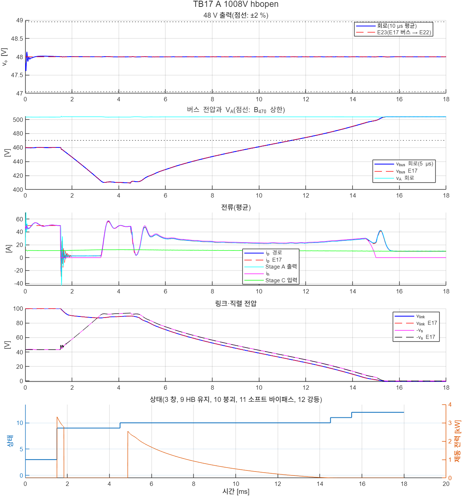

# R2 통합 회로: 기본형(E23·TB16)과 창 조정 모듈 강등 중 48 V 공급(E23·TB17)

- 문서 버전: v1.0 (2026-10-26)
- 관련 문서:
  - [docs/23](23_산업가치_분석_R2_개선구조.md): 산업 가치 분석과 R2
  - [docs/24](24_R2_보호상태기계_E17_TB09.md)–[docs/26](26_DAB_회로여유_E21_TB11_TB13.md): R2-W460 보호 상태기계와 강등
  - [docs/27](27_조정형_StageC_E22_TB14_TB15.md): 조정형 Stage C(이 문서가 닫는 남은 과제 1)
  - [docs/20](20_종합보고서_아키텍처_설계검증.md): 종합 보고서
- 근거 파일: [validation/2026-10-25-r2-integrated](../validation/2026-10-25-r2-integrated/README.md). 코드는 검증 코드 묶음의 E23이다. 회로 모델은 [TB16](../simulink/tb/TB16_R2_Base/README.md)·[TB17](../simulink/tb/TB17_R2_Integrated/README.md)이다.
- 검증 수준:
  - E23 base·degrade: E22 평균모델(전단 벅 + DCX 등가 + 디지털 제어)에 버스를 붙였다. base는 버스 회로를 같이 풀고, degrade는 E17 보호 상태기계의 버스 궤적을 넣는다. Stage A는 정적 등가다.
  - E23 zbus: 버스 임피던스와 Stage C 입력 임피던스(Middlebrook 기준[1]).
  - E1: Stage A 영교차 추종 스위칭 ODE(Stage A 기준값, 경부하 위상 수 비교).
  - TB16·TB17: 소자 수준 회로(Simscape Electrical, 후진 오일러 2.5 ns, 고정 비용). Stage A·Stage B·Stage C가 모두 스위치 소자이고, 제어기·게이트·상태기계는 MATLAB 함수 블록이다.
  - 판정 기준은 시험 전에 정했다. TB17의 Stage A 끝 구간은 E1이 기준을 넘는다는 예상을 실행 전에 적었다(5.3절).

## 1. 요약

R2의 두 구성을 실제 Stage A·조정형 Stage C가 들어간 한 회로로 확인했다. 지금까지는 각 단을 다른 단의 등가로 확인했다.

- **R2 기본형(Stage A + 버스 감쇠기 + 조정형 Stage C): E23 3/3, TB16 3/3 통과.**
  - Stage C 0.1 → 5 kW 계단, 400 V 부하 15 → 25 kW 계단, Stage C 회생 −3 kW에서 48 V는 44.16–48.19 / 48.00–48.04 / 47.73–50.73 V였다.
  - 회로의 48 V는 평균모델과 최저·최고 0.18 V, 끝 0.000 V 안이었다.
  - 버스는 사건마다 0.45–0.84 V만 움직였고, 끝 0.5 ms 진동은 ≤ 0.001 V였다.
  - C\_A를 넣은 버스 임피던스의 Middlebrook 여유는 49.3 dB였다.
- **R2-W460 H-브리지 개방 강등 중 48 V 공급: E23 2/2, TB17 2/2 통과.**
  - 버스가 460 V → 다이오드 클램프(최저 409·380 V) → 링크 붕괴 → V\_A(504·465 V)로 움직이는 16.5 ms 동안 48 V는 47.995–48.011 V였다.
  - 강등 순서와 회로 한계는 이상 V\_A·정전력 등가로 확인한 TB13과 같았다(DAB 첨두 66.4·64.5 A, 전이 E17과 0.01 ms 안).
- **두 단이 서로를 흔들지 않았다.** Stage A 영전류 스위칭(판정 구간)과 Stage C 영전압 스위칭이 모두 유지되었다.
  - Stage A: 턴오프 전류/피크 ≤ 4.44 %
  - Stage C: 켜짐 직전 V\_ds ≤ 0.21 V
  
  지금까지 Stage B 설계·보호 검증에 쓴 두 등가(Stage A = V\_bat/2 + 13.2 mΩ, Stage C = 정전력 부하)가 이 조건에서 회로와 맞는다.
- **새로 확인한 한계: Stage A 경부하 영전류 스위칭.**
  - 강등 뒤 1008 V에서 Stage C만 남으면 Stage A 출력은 약 10 A다. 이 점에서 E1은 턴오프 전류/피크 5.40–5.47 %로 기준 5 %를 넘었다. 회로는 4.44 %로 통과했지만 여유가 작다.
  - 클램프 유지 중(약 3 A)에는 반주기별 비율이 최대 36 %다. 턴오프 순간 전류의 절대값은 ≤ 0.72 A다.
  - E1에서 위상 하나만 운전하면 10 A에서 2.43 %다. 경부하 위상 셰딩을 Stage A 제어 요구로 둔다(7절).

## 2. 왜 필요한가

R2는 Stage A를 충전 호환·400 V 중간버스·48 V 공급의 핵심으로 두고, 창 조정 Stage B는 V\_A가 부품 상한을 넘는 팩에만 붙인다(docs/23). 지금까지의 확인은 각 단을 따로, 다른 단을 등가로 두고 했다.

| 확인 | Stage A | Stage B | Stage C |
|---|---|---|---|
| E12·E17–E21, TB04–TB13 | V\_bat/2 + 13.2 mΩ(정적 등가) | 회로 | 정전력 부하(R2에서는 분리 뒤 5 kW) |
| E22, TB14·TB15 | 없음(이상 버스 전원) | 없음 | 회로 |
| TB06·TB07 | 회로 | 회로(R1 Stage B) | 고정이득 CLLC 3 kW |

통합 회로가 필요한 이유는 세 가지다.

- **R2 기본형에서는 Stage C가 버스의 정전력 부하다.** 400 V 버스는 V\_A를 그대로 따른다. 버스를 붙잡는 조정기가 없고, Stage C(5 kW)와 400 V 부하가 Stage A 출력저항과 C\_A·감쇠기에 직접 물린다. 정전력 부하는 제어 대역 안에서 음의 증분 저항이다. 그래서 버스 임피던스와의 관계로 안정성이 정해진다[1][2]. E22는 Stage C를 이상 버스 전원으로 확인했다(Middlebrook 여유 49 dB, C\_A 없음).
- **강등 중 48 V 공급은 R2의 요구다.** R2-W460의 H-브리지 개방 강등은 400 V 부하를 분리하거나 감발한다. 그동안에도 48 V 전원망은 살아 있어야 한다. 이때 Stage C 입력은 460 V → 380 V → 504 V로 움직이고, 변화율은 최대 약 130 V/ms다. 조정형 Stage C는 이 궤적을 확인하지 않았다.
- **Stage A가 극단 전류 변화를 겪는다.** 고장 직후 경로전류가 약 50 A에서 수 A로 떨어지고, 잠시 역방향(−6 A)이 된다. 강등 뒤에는 부하에 따라 10 A 또는 54 A가 된다. 영교차 추종 게이트는 경부하·역방향에서 턴오프 전류 비율이 커진다(E1). Stage A ZCS를 판정한 것은 지금까지 주행·충전 정상 운전점(TB06·TB07)뿐이었다.

## 3. 통합 회로 구성

| 요소 | E23 base | TB16 | E23 degrade | TB17 |
|---|---|---|---|---|
| 배터리 | 이상 전압원 | 이상 전압원 | 이상 전압원 | 이상 전압원 |
| Stage A | V\_bat/2 + 10.2 mΩ | 모듈 1(2위상, 영교차 추종) | (E17 안) V\_bat/2 + 13.2 mΩ | 모듈 1(TB16과 같음) |
| V\_A 노드·배선 | C\_A 400 µF, 3 mΩ·1.5 µH | 같음(회로) | – | 같음(회로) |
| Stage B | 없음 | 없음 | E17 상태기계 + 평균모델(P3t) | TB13 회로·상태기계·EPS |
| 400 V 버스 | C\_b 400 µF ∥ 감쇠기 48.6 mΩ + 1.6 mF ∥ 정전력 부하 | 같음(회로) | E17(같은 값) | TB13과 같음 |
| Stage C | E22 평균모델(같이 풂) | 회로(TB15와 같음) | E22 평균모델(E17 버스를 이상 전원으로) | 회로(TB15와 같음) |
| 48 V 쪽 | 정전력 부하, 배터리 없음 | 같음 | 정전력 부하 4.9 kW | 같음 |

- **Stage A 출력저항은 회로에서 생긴다.** E23의 R\_A 10.2 mΩ는 설계 추정이다(TB06 회로 10.6 mΩ). TB17의 경로는 Stage A 출력저항 + 배선 3 mΩ로, TB13·E17의 13.2 mΩ와 같다.
- **TB17의 Stage C 몫.** 48 V 부하 4,905 W는 평균모델 정상상태에서 Stage C 입력이 5 kW(= E17 P\_C)가 되는 값이다. 400 V 정전력 부하는 25 − 5 = 20 kW이고 분리 뒤 0 W다.
- **TB17 고장 시각은 1.5 ms다(TB13 0.5 ms).** Stage A 회로는 주기 정상상태에서 시작하지 않는다(C\_fly = V\_bat/2, 공진전류 0). 그래서 정착 시간과 사건 전 판정 구간(1.3–1.5 ms)을 두었다. E17 기준도 같은 시각으로 다시 계산했다.
- **TB17에서는 Stage C 전류 PI 적분을 평형값으로 시작한다.** 시작 부하가 4.9 kW라 0에서 시작하면 약 1 ms의 시작 과도(평균모델에서 47.08 V까지)가 생긴다. 이 과도가 고장 판정 구간 앞부분과 겹친다. E22 `run_avg`(start\_eq)와 회로 제어기(prm 27)에 선택 인자로 넣었다. 기존 결과(E22, TB14–TB16)는 바뀌지 않는다(E23 base 재계산 차 0).

## 4. 방법과 판정 기준(시험 전에 고정)

### 4.1 R2 기본형(E23 base, TB16)

| 사례 | 배터리(V\_A) | 사건(2 ms, 5 ms까지) | 48 V 기준 |
|---|---|---|---|
| A | 540 V(≈ 270 V, Stage C 입력 최저) | 400 V 부하 10 kW, Stage C 0.1 → 5 kW 계단 | 36–52 V(견고성) |
| B | 806 V(≈ 403 V, B\_420 근처) | Stage C 3 kW, 400 V 부하 15 → 25 kW(10 µs) | ±2 %(계약 과도) |
| C | 907 V(≈ 453 V, B\_470) | 400 V 부하 10 kW, Stage C 5 → −3 kW 계단 | 36–52 V |

| 항목 | 기준 |
|---|---|
| (a) 48 V | 사례별 범위(사건 0.2 ms 전부터 끝까지). E23은 5 µs, TB16은 10 µs 평균 |
| (b) 버스 범위 | 평균 버스가 [사건 전·끝 평형의 낮은 값 × 0.97, 높은 값 × 1.03] 안 |
| (c) 버스 안정 | 끝 0.5 ms 동안 평균 버스의 최대 − 최소 ≤ 0.5 V |
| (d) Stage C 전류 | 출력 100 µs 이동평균 ≤ 136.5 A, 2차 소자 순간 ≤ 329 A(E22와 같음) |
| (e) Stage C ZVS(TB16) | 켜짐 직전 V\_ds ≤ 레일 5 % |
| (f) Stage A(TB16) | 위상별 턴오프 전류/피크 ≤ 5 %, V\_A − E1 ≤ 0.3 V, 위상 전류 차 ≤ 5 %(사건 전·끝 0.2 ms, TB06과 같음) |
| (g) E23 대조(TB16) | v\_o 최저·최고 ±0.5 V, 끝 ±0.1 V, 버스 최저·최고 ±1 V, 끝 ±0.5 V |
| (h) 끝 DCX 이득(TB16) | 1 ± 3 % |
| zbus | \|Z\_bus\| ≤ \|Z\_in\|/2(6 dB, 10 Hz–20 kHz, 5 kW, 입력 270·504 V) |

10 µs 평균은 벅 한 주기이면서 Stage A 출력 리플(약 600 kHz)의 6주기다. 그래서 두 리플이 함께 빠진다.

### 4.2 R2-W460 강등 중 48 V(E23 degrade, TB17)

| 사례 | 조건 | 강등 뒤 |
|---|---|---|
| A | 1008 V(V\_A ≈ 504 V), 400 V 부하 20 kW + Stage C 5 kW. H-브리지 개방(1.5 ms) → 전압비 정합 유지 → 400 V 부하 분리(3 ms) → 링크 붕괴(EPS) → 소프트 바이패스 → 강등 | 버스 = V\_A > B\_470이라 400 V 부하는 분리된 채, Stage C만 |
| B | 930 V(V\_A ≈ 465 V), 같은 고장. 일시 감발(3 ms) → 붕괴 → 소프트 바이패스 → 강등 | 0.5 ms 뒤 400 V 부하 되돌림 |

| 항목 | 기준 |
|---|---|
| 보호·강등(TB13과 같음) | 순시 경로·필터 ≤ 100 A, \|v\_s\| ≤ 120 V, 링크 ≤ 120 V, 바이패스 ≤ 329 A, 버스 ≥ 260 V, 강등 상태 도달, 400 V 부하가 연결된 동안 버스 ≤ 470 V, DAB 링크 쪽 첨두 ≤ 1.5 × 정격점(68.7 A) |
| 48 V | 평균 v\_o가 ±2 %(47.04–48.96 V) 안. 고장 0.2 ms 전부터 끝까지(강등 내내) |
| Stage C | 전류(4.1 (d)와 같음), 1 ms 이후 모든 켜짐의 ZVS, 끝 DCX 이득 1 ± 3 % |
| Stage A | 4.1 (f)와 같음(사건 전 1.3–1.5 ms, 끝 0.2 ms) |

## 5. 결과

### 5.1 R2 기본형

**E23(평균모델): 3/3 통과.**

| 사례 | v\_o | 버스(사건 전 → 끝) | Stage A 출력(사건 전 → 끝) | E1 Stage A 턴오프 전류/피크(사건 전 / 끝) |
|---|---|---|---|---|
| A | 44.31–48.18 V | 269.07–269.51 V(269.51 → 269.26) | 37.5 → 56.1 A | 1.46·1.63 % / 1.04·1.12 % |
| B | 48.00–48.03 V | 401.58–402.41 V(402.41 → 402.08) | 44.8 → 69.7 A | 1.39·1.41 % / 0.84·0.91 % |
| C | 47.75–50.91 V | 453.06–453.58 V(453.06 → 453.30) | 33.3 → 15.5 A | 1.75·1.78 % / 3.73·3.80 % |

- 버스 변동은 사건마다 0.43–0.83 V였다. 끝 0.5 ms 진동은 ≤ 0.0001 V였다.
- **Middlebrook 여유(zbus)는 최소 49.3 dB였다(270 V, 3 kHz).** C\_A·R\_A를 넣지 않은 E22 T7은 49.1 dB였다. C\_A는 R\_A를 kHz 대역에서 우회해 버스 임피던스를 조금 낮춘다.

**TB16(회로): 3/3 통과.**

| 사례 | v\_o 회로(E23) | 버스 회로(E23) | V\_A 회로 / E1 | Stage A 턴오프 전류/피크 사건 전 / 끝 | Stage C V\_ds 1차 / 2차 |
|---|---|---|---|---|---|
| A | 44.16–48.19(44.31–48.18) V | 269.05–269.50(269.07–269.51) V | 269.611 / 269.666 V | 0.12·0.07 % / 0.75·0.71 % | 0.21 / 0.06 V |
| B | 48.00–48.04(48.00–48.03) V | 401.56–402.40(401.58–402.41) V | 402.533 / 402.612 V | 0.54·0.50 % / 0.97·0.93 % | 0.15 V / – |
| C | 47.73–50.73(47.75–50.91) V | 453.05–453.60(453.06–453.58) V | 453.153 / 453.218 V | 0.14·0.14 % / 2.27·2.27 % | 0.11 / 0.07 V |

- **회로의 48 V·버스가 평균모델과 맞았다.** 48 V 끝 차는 0.000 V, 버스 끝 차는 ≤ 0.016 V였다. Stage C 출력 100 µs 평균 최대는 E23과 0.2 A 안이었다.
- **Stage A는 E1보다 턴오프 전류 비율이 작았다.** V\_A는 E1과 −0.09 ∼ +0.02 V 차였다. 위상 전류 차는 ≤ 0.80 %였다.
- **Stage C 맥동 전류가 Stage A 영교차 검출을 흐트러뜨리지 않았다.** 버스 원파형 리플은 0.06–0.08 V였다.
- 사례 B는 정방향 3 kW라 2차가 다이오드 정류만 한다(2차 켜짐 없음).

### 5.2 R2-W460 강등 중 48 V

**E23 degrade(평균모델): 2/2 통과.** E17 버스 궤적에서 48 V는 47.992–48.012 V(±0.03 %)였다. Stage C 입력은 4.97–5.03 kW였다. E17 고장 판정도 두 사례 모두 통과했고, 고장 시각만 늦췄을 뿐 TB13 기준과 같다.

**TB17(회로): 2/2 통과.**

| 항목 | A 1008 V | B 930 V |
|---|---|---|
| 48 V(10 µs 평균, 1.3 ms부터) 회로(E23) | 47.995–48.008(47.992–48.006) V | 47.996–48.011(47.992–48.012) V |
| 버스(5 µs 평균) 회로(E17) | 409.4–503.9(409.5–503.8) V | 380.3–464.9(380.5–464.8) V |
| 순시 경로 / 필터 / 바이패스 | 57.2 / 57.3 / 44.7 A | 56.8 / 54.5 / 56.8 A |
| DAB 링크 쪽 첨두(상태 9–11, 기준 68.7 A) | 66.4 A | 64.5 A |
| 소프트 투입: 에너지, 경로 첨두 | 0.051 J, 42.3 A | 0.027 J, 33.5 A |
| 상태 전이(E17 대비) | −0.01–0 ms | −0.01–0 ms |
| Stage C 출력 100 µs 평균 최대 / 2차 소자 첨두 / 입력 전력 | 102.6 / 80.7 A / 5.01–5.12 kW | 102.7 / 80.8 A / 5.01–5.12 kW |
| Stage C ZVS(1차 켜짐 8,500번) / 끝 DCX 이득 | 0.11 V / 0.977 | 0.11 V / 0.977 |
| Stage A 사건 전: 턴오프 전류/피크(E1), V\_A − E1 | 0.52·0.51 %(0.85·1.27 %), −0.10 V | 0.77·0.73 %(1.15·1.15 %), −0.10 V |
| Stage A 끝: 출력, 턴오프 전류/피크(E1), V\_A − E1 | 10.0 A, 4.44·4.44 %(5.40·5.47 %), +0.04 V | 54.0 A, 0.72·0.73 %(1.16·1.15 %), −0.09 V |

- **강등이 48 V에 준 영향은 ±0.01 V 수준이다.** Stage C 제어기는 버스 전압으로 듀티를 나눠 쓴다(입력 앞먹임). 그래서 약 130 V/ms의 버스 변화가 48 V로 거의 넘어가지 않는다.
- **실제 Stage A·Stage C를 넣어도 강등은 TB13과 같았다.** TB13과의 차는 다음과 같았다.
  - 순시 경로·필터: −3.3 ∼ +0.2 A
  - DAB 첨두: ≤ 0.1 A
  - 소프트 투입 에너지: ≤ +0.002 J
  - 제동 에너지: +0.03–0.05 J
  
  Stage C 입력이 E17의 5 kW보다 최대 2.4 % 컸다(평균모델에 없는 스위칭·다이오드 손실). 그래도 상태 전이 시각은 바뀌지 않았다.
- **Stage C 영전압 스위칭이 강등 내내 유지되었다.** CLLC 입력은 벅이 조정한 중간전압(약 235 V)이라 버스 궤적과 무관하다.

### 5.3 Stage A: 시험 전 예상과 결과

E1은 TB17 사례 A 끝(9.9 A)에서 턴오프 전류/피크 5.40–5.47 %로 기준 5 %를 넘었다. TB16에서 회로는 E1보다 늘 낮았다(15.6 A에서 2.27 % 대 3.73 %). 그래서 기준을 바꾸지 않고 판정했고, 회로는 4.44 %로 통과했다. 이 결과는 7절의 요구로 이어진다.

## 6. 등가의 확인

지금까지 Stage B 설계와 보호 검증에 쓴 두 등가가 R2 통합 회로에서 맞는다.

| 등가 | 쓴 곳 | 통합 회로의 확인 |
|---|---|---|
| Stage A = V\_bat/2 + 13.2 mΩ(+ 1.5 µH) | E12–E21, TB04–TB13 | TB17 상태 전이·버스·DAB 첨두가 TB13(등가)과 같다. TB16 버스가 E23(정적 등가 + C\_A)과 끝 0.016 V 안이다 |
| Stage C(R2) = 정전력 부하 5 kW | E17–E21, TB09–TB13 | 실제 Stage C 입력 5.01–5.12 kW. 강등 지표 차는 위와 같다 |
| Stage C 입력 = 이상 버스 전원 | E22, TB14·TB15 | TB16의 48 V가 E23(버스 회로 포함)과 0.18 V 안이다. TB17의 48 V가 E23(E17 버스)과 0.004 V 안이다 |

유효 범위는 TB07(docs/22)과 같다. Stage A 정적 등가는 V\_A 노드 공진(주기 약 30 µs)보다 느린 외란에서 맞는다. 이 문서의 외란(Stage C 계단, 400 V 부하 10 µs 계단, 강등 버스 궤적)은 그 범위였다.

## 7. Stage A 경부하 영전류 스위칭

영교차 추종 게이트는 전류 영교차를 검출(문턱 0.5 A, 지연 20 ns)하고 데드타임 100 ns 뒤 다음 구간을 켠다. 공진전류 첨두가 작으면 검출 문턱·지연이 반주기에서 차지하는 몫이 커진다. 그래서 턴오프 전류/피크 비율이 오른다.

E1(영교차 추종, V\_A 노드 400 µF, 마지막 10주기)로 출력전류별 턴오프 전류/피크의 위상 최대를 계산했다.

| 출력전류 [A] | 3 | 5 | 7.5 | 10 | 15 | 20 | 30 |
|---|---|---|---|---|---|---|---|
| 540 V, 2위상 | 18.42 % | 12.71 % | 7.20 % | **5.50 %** | 3.80 % | 2.13 % | 2.04 % |
| 540 V, 위상 하나 | 10.40 % | 4.97 % | 3.27 % | 2.02 % | 1.82 % | 1.51 % | 0.57 % |
| 1008 V, 2위상 | 16.52 % | 12.49 % | 7.19 % | **5.46 %** | 3.81 % | 2.41 % | 1.86 % |
| 1008 V, 위상 하나 | 10.40 % | 5.33 % | 3.27 % | 2.43 % | 1.45 % | 1.20 % | 1.04 % |

(검증 코드 E23 light, `results/E23/light.json`)

- **2위상 운전은 10 A에서 기준 5 %를 넘고, 15 A에서는 3.8 %다.** 배터리 전압에는 거의 의존하지 않는다.
- **위상 하나로 운전하면 같은 출력전류에서 비율이 절반 아래로 내려간다.** 7.5 A까지 ≤ 3.27 %다. 15 A(약 7.6 kW)는 위상 하나의 정격(모듈 37.5 kW의 절반)보다 충분히 작다.
- **3 A에서는 위상 하나로도 10.4 %다.** 이 영역은 비율 대신 턴오프 전류의 절대값으로 봐야 한다.
- **회로는 E1보다 낮았다(TB16·TB17).** 그래도 TB17 사례 A의 4.44 %는 여유가 작다.
- **절대 턴오프 전류는 작다.** TB17 클램프 유지 중(약 3 A)의 반주기별 비율은 20–36 %였지만, 턴오프 순간 전류는 ≤ 0.72 A였다. 이 구간은 3 ms 정도다(분리 3 ms 가정). 분리가 E17 기본 20 ms라면 더 길다.

**요구(Stage A 제어, P1).** 모듈 출력전류가 문턱(예: 15 A) 아래이면 위상 하나로 운전하는 경부하 위상 셰딩을 둔다. 15 A 근처에서는 2위상(3.8 %)과 위상 하나(1.5–1.8 %)가 모두 기준 안이라 히스테리시스를 둘 수 있다. 위상 전환 과도와 인터리빙이 없어진 V\_A 리플은 E1과 회로로 확인해야 한다. 이 문서의 회로(TB16·TB17)는 셰딩 없이 2위상으로 운전했다.

## 8. 결정과 남은 과제

**결정한 것**

- **R2 기본형은 통합 회로에서 성립한다.** 조건은 버스 감쇠기(48.6 mΩ + 1.6 mF), C\_A 400 µF, 조정형 Stage C(docs/27)다. 48 V 계약 과도와 버스 안정을 평균모델과 회로에서 확인했다.
- **R2-W460 강등 중 48 V 공급을 확인했다.** H-브리지 개방 강등(P3t, docs/26)의 버스 궤적에서 48 V는 ±0.03 % 안이다. 강등 순서는 실제 Stage A·Stage C에서도 바뀌지 않는다.
- **Stage C 전류 PI 적분의 시작값.** 부하가 있는 시작점에서는 평형값으로 시작한다. 기동 순서(Stage C를 무부하에서 켜는지)에 따라 하드웨어에서 정한다.

**남은 과제**

1. **Stage A 경부하 위상 셰딩(P1).** 7절. 셰딩 문턱과 전환 과도를 E1과 회로로 확인한다.
2. **400 V 부하 분리 시간(P1).** TB09–TB17은 3 ms로 줄였다. E17 기본 20 ms에서는 클램프 유지가 길어진다. 그동안 Stage A가 약 3 A 경부하로 머물고, 제동 저항 에너지가 커진다(≤ 22.1 J, docs/26).
3. **R2 통합 회로의 다른 사건(P2).** DAB 고장 강등, 켬·끔, 충전 중(Stage A 4모듈 + 충전기) R2는 통합 회로로 확인하지 않았다. 버스 변화는 이 문서의 사례보다 작다(TB08 DAB 고장 뒤 버스 503.2 V).
4. **조정형 Stage C 하드웨어 값(P1, docs/27).** 데드타임 창 20–30 ns를 비선형 출력용량·게이트 지연으로 다시 정한다.
5. **모듈 수.** Stage A는 모듈 1개로 계산했다. 모듈을 늘리면 출력저항이 줄어 버스 변동은 작아진다. 모듈 사이 분담과 셰딩은 확인하지 않았다.

## 9. 한계

- **배터리는 이상 전압원이고, Stage A는 모듈 1개(2위상)다.**
- **400 V 부하는 정전력 등가다.** 인버터·압축기의 스위칭 맥동은 넣지 않았다.
- **48 V 쪽에 배터리가 없다.** 가장 엄격한 조건이다. 배터리가 있는 경우는 TB14 사례 E에서 확인했다.
- **해석기 수치 감쇠.** 후진 오일러 2.5 ns는 수 MHz 공진에 수치 감쇠를 만든다(docs/27 13절). Stage A 공진(150 kHz)은 영향이 작다(TB01: E1과 0.2 % 안).
- **E23 degrade는 단방향 결합이다.** E17 버스 궤적을 Stage C 평균모델에 넣었고, Stage C의 실제 입력 동특성은 E17에 5 kW 정전력 부하로만 들어 있다. 이 결합은 TB17 회로로 확인했다.

## 참고문헌

1. R. D. Middlebrook, "Input Filter Considerations in Design and Application of Switching Regulators," *Proc. IEEE Industry Applications Society Annual Meeting*, 1976.
2. A. Emadi, A. Khaligh, C. H. Rivetta, G. A. Williamson, "Constant Power Loads and Negative Impedance Instability in Automotive Systems: Definition, Modeling, Stability, and Control of Power Electronic Converters and Motor Drives," *IEEE Trans. Veh. Technol.*, vol. 55, no. 4, pp. 1112–1125, 2006. doi:10.1109/TVT.2006.877483
