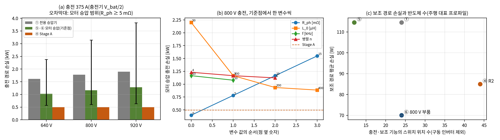

# 선행연구·산업 방식 대비 위치와 기여(E25 포함)

- 문서 버전: v1.0 (2026-10-26)
- 관련 문서:
  - [docs/21](21_기준구조_손실정격_비교_H5.md): 기준 구조 손실·정격 비교(E15, H5 기각)
  - [docs/23](23_산업가치_분석_R2_개선구조.md): 산업 가치 분석과 개선 구조 R2(E18)
  - [docs/02](02_엔지니어링_설계검증서.md) 2.5절: 이전 신규성 정리(기준선 ③ 시점)
  - [docs/20](20_종합보고서_아키텍처_설계검증.md): 종합 보고서
- 근거 파일: [validation/2026-10-26-positioning](../validation/2026-10-26-positioning/README.md). 코드는 검증 코드 묶음의 E25다.
- 검증 수준: E25는 E15·E18과 같은 설계 단계 손실 추정이다. 소자 데이터시트 값과 같은 손실 규칙을 모든 구조에 쓴다. 모터 승압 충전의 모터 파라미터는 공개 값을 찾지 못해 범위로 두었다. 선행연구 비교는 문헌·특허·제조사 공개 자료 조사다. 특허 전수 검색과 권리 범위 판단은 하지 않았다.

## 1. 요약

R2의 이점은 조건부로만 성립한다.

- **조건은 400 V급 보조부품을 쓰는 차량이다.** 400·800 V 플랫폼 공용이나 1000 V급 팩에 400 V급 부품을 쓰는 경우가 여기에 해당한다. 이 조건에서 R2는 비교한 대안보다 보조 경로 손실과 충전 손실이 모두 작다.
  - 같은 400 V급 부품을 쓰는 모터·인버터 승압 구조(⑤, 현대차그룹 E-GMP 방식) 대비 보조 경로 손실이 85.0 대 114.6 W로 26 % 작다.
  - 충전 손실도 0.50 대 1.17 kW(모터 승압 기준점)로 작다. 모터 상저항이 약 1.9 mΩ보다 크면 이 순서는 바뀌지 않는다.
  - 대가는 충전·보조 기능의 스위치 위치가 44 대 12로 많다는 것이다. 모터 승압은 구동 인버터를 다시 쓰므로 충전용 반도체를 더하지 않는다.
- **800 V급 보조부품을 쓰는 주류 설계(⑥) 대비 손실 이점은 없다.** ⑥은 400 V 변환 없이 보조부하를 배터리에 직결한다.
  - 보조 경로 손실은 ⑥이 70.1 W로 R2보다 15 W 작다. 스위치 위치도 24로 20개 적다.
  - R2가 앞서는 것은 400–500 V급 충전 손실뿐이다. 충전 손실의 차로 보조 손실의 차를 메우려면 주행 1시간당 3.4 kWh 이상을 400–500 V급 충전기로 충전해야 한다(모터 승압 기준점). 일반적인 사용에서는 비슷하거나 ⑥이 낫다.
- **구성 원리는 새롭지 않다.** 각 원리의 선행이 이미 있다.
  - 2:1 공진 스위치드 커패시터로 400 V 충전기와 800 V 차량을 잇는 것: Preh HV 부스터(제조사 공개 효율 97 %), NIO USA 특허
  - 고정비 공진 변환 + 부분전력 조정: He 등(2018), Ni 등(2019)
  - 구동계를 충전기로 다시 쓰는 것: E-GMP, Eull 등(2022)
- **이 조사 범위에서 같은 조합은 찾지 못했다.** R2가 기여로 내세울 수 있는 것은 네 가지다.
  1. 같은 2:1 단을 주행 중 400 V 중간버스·48 V 공급원으로 계속 쓰고, 충전기를 그 출력 노드에 두어 충전 중에도 보조버스가 살아 있게 하는 다기능 구조
  2. 팩 등급 조건부 창 조정 모듈과 그 고장 강등 순서. 회로 수준까지 확인했다.
  3. 검증으로 도출한 정량 설계 규칙
  4. 부분전력 400 V 조정이 보조부하 프로파일에서 이득이 없다는 정량 결과(H5 기각)
- **R2 이점의 손실 예산은 작다.** ⑤ 대비 보조 손실 이점(29.6 W)은 Stage A 위상당 고정 손실 14.8 W에 해당한다. 지금 모델의 위상당 고정 손실(출력용량·게이트)은 15.6 W다. 철심 공진 인덕터를 쓰면(정격 0.1 % 규칙, 18.8 W/위상) 이점이 사라진다. 공심(또는 배선 루프) 공진 인덕터가 설계 요구다.

## 2. 왜 필요한가

E15·E18은 Stage A 기반 구조를 전용 승압기(①)와 Stage A + 전전력 조정기(②)와 비교했다. 그 결과 R2를 정했다(docs/21·23). 그러나 두 가지가 빠져 있었다.

- **가장 흔한 산업 방식과의 비교.** 800 V급 차량이 400–500 V급 충전기를 쓰는 방식은 크게 넷이다. 모터·인버터 승압, 전용 승압기, 팩 분할, 팩 직병렬 전환이다(docs/23 3.1절). 이 가운데 모터·인버터 승압은 충전용 반도체를 더하지 않는다. 그래서 Stage A의 32개 스위치 위치를 정당화하려면 이 방식과 비교해야 한다.
- **400 V 보조버스를 두지 않는 설계와의 비교.** 800 V급 전동 컴프레서는 2022년부터 양산 수주가 보도되었다(docs/23 [8]). 보조부품을 800 V급으로 두면 400 V 중간버스가 필요 없다. R2의 다기능 이점이 이 설계보다 나은지 확인해야 한다.

또 R2로 구조를 바꾼 뒤 신규성 정리를 다시 하지 않았다. docs/02 2.5절의 정리(기준선 ③)는 "충전 모드 바이패스"를 근거로 들었다. 그러나 이 바이패스는 R2에 없다. 충전기는 V\_A 노드에 직결된다.

## 3. 비교 구조와 방법(E25)

### 3.1 구조

E15와 같은 소자·손실 규칙, 같은 배터리 분포(주행 대표 760–900 V)와 부하 분포를 쓴다. 사양 팩은 640–920 V(약 219s)다.

| 구조 | 충전(400–500 V급 충전기) | 400 V급 보조부하 | 48 V | 보조부품 등급 |
|---|---|---|---|---|
| ① | 전용 승압기(하드 스위칭 6상 부스트, 1200 V SiC) | 800 → 400 V 강압기 | 고정이득 CLLC | 400 V급 |
| ⑤ | 모터·인버터 승압(E-GMP 방식) | 800 → 400 V 강압기 | 고정이득 CLLC | 400 V급 |
| ④ R2 기본형 | Stage A(2:1 공진 SC, 8위상) | 버스 = V\_A(RC 감쇠기) | 조정형 Stage C | 400 V급(B\_470) |
| ⑥ 800 V 부품 | 모터·인버터 승압 | 없음(배터리 직결) | 입력 직렬·출력 병렬 조정형 Stage C 2개 | 800 V급 |

⑤의 보조 경로는 ①과 같고 충전 경로만 다르다. ⑥은 보조부품 등급이 달라 서비스가 같지 않다. 800 V급 보조부품의 비용과 그 자체의 효율 차는 넣지 않았다.

### 3.2 모터·인버터 승압 충전 모델

- **결선과 운전.** 충전기(V\_bat/2, 375 A, Stage A 충전과 같은 조건)를 모터 중성점에 연결한다. 구동 인버터 세 레그를 120° 엇갈린 동기 부스트로 운전해 V\_bat로 승압한다. 상전류는 125 A, 듀티는 0.5다.
- **인덕턴스.** 세 상 전류가 같아 회전 자계가 생기지 않는다. 그래서 상마다 보이는 인덕턴스는 영상(누설) 인덕턴스 L\_0다. 상전류 리플은 V\_in·D/(L\_0·f)다.
- **인버터 손실.** 1200 V SiC(E15와 같은 C3M0016120K 규칙)를 쓰고, 스위치 위치마다 n개를 병렬로 둔다. 손실 항은 도통, 하드 스위칭 켜짐·꺼짐(데이터시트 비 2552 : 788 µJ), 데드타임 역도통, 게이트다. 리플이 0을 지나면 켜짐을 영전압으로 보고 켜짐 손실을 뺀다.
- **모터 권선 손실.** 직류 I²·R\_ph에 리플 성분 (ΔI²/12)·R\_ph·k\_ac(k\_ac = 3)를 더한다. 리플에 의한 철손과 자석 와전류 손실은 넣지 않았다. 그래서 모터 승압 손실은 하한 쪽이고, 비교는 모터 승압에 유리하다.
- **파라미터 범위.** 양산 차량의 영상 인덕턴스와 상저항 공개 값은 찾지 못했다. 그래서 범위 전체(96조합)를 계산하고, 그 범위에서 바뀌지 않는 결론만 쓴다.

| 파라미터 | 범위 | 기준점 |
|---|---|---|
| 상저항 R\_ph | 0(하한)·5·10·15 mΩ | 10 mΩ |
| 영상 인덕턴스 L\_0 | 50·100·200·400 µH | 100 µH |
| 스위칭 주파수 f | 10·20 kHz | 10 kHz |
| 위치당 병렬 n | 4·5·6 | 5 |

상저항의 크기는 구동 모터의 정격 동손으로 가늠할 수 있다. 100–200 kW급 모터의 정격 동손을 1–2.5 kW, 정격 상전류를 180–300 A rms로 보면 R\_ph = P\_cu/(3I²) ≈ 4–26 mΩ다(이 문서의 추정, 출처 있는 값이 아니다).

## 4. 결과

### 4.1 충전 경로 손실(375 A, 충전기 V\_bat/2)

| 배터리 | Stage A(④) | 모터 승압 기준점(⑤·⑥) | 모터 승압 범위(R\_ph ≥ 5 mΩ) | 전용 승압기(①) |
|---|---|---|---|---|
| 640 V | 0.50 kW | 1.03 kW | 0.57–2.38 kW | 1.61 kW |
| 800 V | 0.50 kW | 1.17 kW | 0.61–3.14 kW | 1.78 kW |
| 920 V | 0.50 kW | 1.29 kW | 0.63–3.83 kW | 1.90 kW |

- **모터 승압 손실은 권선 동손이 지배한다.** 800 V 기준점의 손실 1.17 kW는 다음과 같이 나뉜다.
  - 권선: 0.77 kW
  - 인버터 도통: 0.28 kW
  - 인버터 스위칭: 0.11 kW
- **상저항이 작은 경우.** 상저항이 0이라고 가정한 하한은 0.35 kW로 Stage A보다 작다. 모터 승압과 Stage A의 손실이 같아지는 상저항은 1.9 mΩ다(권선 외 손실이 가장 작은 조합 L\_0 100 µH·10 kHz·n 6). 기준점에서는 1.3 mΩ다.
- **결론.** 상저항이 약 2 mΩ보다 크면 Stage A의 충전 손실이 작다. 위의 추정 범위(4–26 mΩ)에서는 이 순서가 바뀌지 않는다.
- **영상 인덕턴스가 작은 경우.** 영상 인덕턴스가 50 µH면 상전류 리플이 400 A(첨두-첨두)로 상전류(125 A)보다 커진다. 이때 손실은 2.2 kW다. 실제 구현은 주파수를 높이거나 외부 인덕터를 둘 것이다. 이 모델에 없는 리플 철손과 자석 와전류 손실도 이 경우에 크다.

### 4.2 보조 경로 손실과 반도체

| 구조 | 보조 경로 평균 손실 | 충전용 스위치 위치 | 보조용 스위치 위치 | 합 |
|---|---|---|---|---|
| ① | 114.6 W | 12 | 12 | 24 |
| ⑤ | 114.6 W | 0 | 12 | 12 |
| ④ R2 | 85.0 W | 32 | 12 | 44 |
| ⑥ 800 V 부품 | 70.1 W | 0 | 24 | 24 |

(①·④는 E15와 0.0 W 차로 같다. 구동 인버터는 모든 구조에 공통이라 세지 않았다.)

- **④ 대 ⑤(같은 400 V급 부품).** R2가 보조 경로에서 29.6 W(26 %) 작다. ⑤는 400 V급 부품을 위해 800 → 400 V 강압기(1200 V SiC 하드 스위칭)를 둔다. R2는 그 일을 영전류 스위칭 2:1 단이 한다.
- **④ 대 ⑥(800 V급 부품).** ⑥이 14.9 W 작다. ⑥은 보조부하를 변환 없이 배터리에서 받는다. 남는 손실은 48 V 경로뿐이다.

### 4.3 손실 에너지 예시

주행 1,000시간 동안 400–500 V급 충전기로 1,000 kWh를 충전한 경우다. 사용 비율은 가정이며, 결론이 아니라 크기 감각을 위한 값이다.

| 구조 | 주행(보조 경로) | 충전 | 합 |
|---|---|---|---|
| ① | 114.6 kWh | 11.8 kWh | 126.4 kWh |
| ⑤ | 114.6 kWh | 7.8 kWh(범위 4.0–20.9) | 122.3 kWh |
| ④ R2 | 85.0 kWh | 3.3 kWh | 88.3 kWh |
| ⑥ | 70.1 kWh | 7.8 kWh | 77.8 kWh |

④가 ⑥과 같아지려면 400–500 V급 충전 에너지가 주행 1시간당 3.4 kWh여야 한다(모터 승압 기준점). 모터 승압 하한(R\_ph 5 mΩ)으로 계산하면 20.5 kWh다. 주행 1시간의 소비 에너지가 대략 그 정도 크기이므로, 충전 대부분을 400–500 V급 충전기로 하더라도 ⑥보다 확실히 낫다고 할 수 없다.

### 4.4 Stage A 손실 모델의 감도

E15는 Stage A 손실을 E1 모델로 계산했다. 포함한 항목은 스위치·ESR·인덕터 권선·배선 도통, 다이오드, 출력용량, 게이트다. 다른 변환기의 인덕터에 넣은 철손 항(정격의 0.1 %)은 넣지 않았다. 공진 인덕터 144 nH를 공심으로 보았기 때문이다.

| 감도 | ④ 보조 경로 | ④ 충전(800 V) |
|---|---|---|
| 기본 | 85.0 W | 0.50 kW |
| 수동소자 저항 2배(ESR·인덕터·배선, 150 kHz 교류저항 가정) | 86.0 W | 0.58 kW |
| 위상당 고정 손실 +ΔP | 85.0 + 2ΔP W | 0.50 + 8ΔP/1000 kW |

- **도통 손실이 커져도 결론은 같다.** 수동소자 저항 2배는 경부하에서 거의 영향이 없고, 충전에서 0.09 kW 늘 뿐이다.
- **고정 손실에는 결론이 민감하다.** ΔP = 14.8 W면 ④와 ⑤의 보조 손실이 같아진다. 지금 모델의 위상당 고정 손실은 15.6 W다(출력용량 14.1 W + 게이트 1.2 W 등). 철심 인덕터 규칙을 적용하면 18.8 W다. 따라서 R2의 ⑤ 대비 보조 손실 이점은 Stage A 고정 손실을 지금 모델 수준(위상당 약 15 W)으로 유지할 때만 성립한다. 공심 또는 배선 루프 공진 인덕터와 낮은 출력용량 소자가 설계 요구다.

### 4.5 측정된 하드웨어와의 차이

모든 구조의 손실은 같은 규칙의 모델 추정이다. 하드웨어 효율은 모든 구조에서 이보다 낮다.

- **측정값과 모델값.** 2:1 스위치드 탱크 변환기 100 kW 시제품(SiC, 300 → 600 V)의 측정 효율은 전부하 97.4 %, 최고 98.7 %였다[1]. Preh HV 부스터(공진 차지 펌프, 400 → 800 V)는 제조사 공개 효율이 97 %다[2]. 이 문서의 Stage A 모델은 150 kW 충전에서 99.7 %(8위상)다.
- **차이의 원인과 의미.** 위상 수(8위상은 위상당 전류가 작아 도통 손실이 작다), 기판·버스바 손실, 커패시터 유전 손실, 측정 손실이 차이를 만든다. 그래서 구조 간 상대 비교로만 써야 하고, 절대 효율 주장으로 쓰면 안 된다.

## 5. 선행연구·산업 방식 비교

| 구분 | 대표 | 400–500 V급 충전 호환 | 주행 중 400 V 버스 | 48 V | 충전용 추가 반도체 | 검증 수준(공개) |
|---|---|---|---|---|---|---|
| 모터·인버터 승압 | 현대차그룹 E-GMP[3], 루시드 Gravity(500 V에서 225 kW)[4], 학회 시제품 500 W[5] | 구동 인버터 + 모터 권선 | 없음(800 V 부품) | 별도 | 없음(접촉기) | 양산. 효율 비공개 |
| 구동계 통합 충전(교류) | Eull 등[6]: 11 kW, 충전 최고 99.4 %·정격 98.4 % | 직류 승압·강압 가능하다고 언급(결과는 교류 충전) | — | — | 필터·접촉기 | 측정 |
| 전용 승압기·차지 펌프 | 포르쉐 타이칸 50/150 kW[7], Preh HV 부스터 100–150 kW(공진 차지 펌프, 97 %)[2] | 별도 변환기, 800 V 충전에서는 바이패스 | 없음 | 별도 | 승압기 전체 | 양산·제조사 공개 |
| 공진 SC 충전 조정(특허) | NIO USA US 10,363,828·10,632,863[8] | 800 V 충전기 → 400 V 차량(방향 반대), 출력 380–420 V 조정 | 400 V 파워트레인·보조에 공급 | — | 공진 SC | 특허 |
| 2:1 스위치드 탱크 대전력 | Ni 등[1]: 100 kW, 측정 97.4 %(전부하) | 원리 동일(전압 2배) | — | — | — | 측정 |
| 고정비 + 부분전력 조정 | He 등[9](48 → 12 V, 500 W, 98.4 %), Ni 등[10](EV용 GaN STC + 부분전력 강압) | — | 조정 버스(단일 출력) | — | — | 측정(학회) |
| 결합 변환기·APM | Karma US 11,235,676[11], Chen 등[12](구동계 복합 DC–DC) | — | — | 결합 | — | 특허·측정 |
| **R2(이 연구)** | Stage A + 조정형 Stage C(+ 팩 등급 조건부 창 조정 모듈) | Stage A 2:1(충전기는 V\_A 노드) | **Stage A가 주행 중 계속 공급** | 조정형 Stage C, 고장 강등 중에도 공급 | Stage A 32위치 | 모델·소자 수준 회로(하드웨어 없음) |

### 5.1 새롭지 않은 것

- **2:1 공진 차지 펌프로 400 V급 충전기와 800 V 차량을 잇는 것.** Preh가 제품으로 공개했고[2], NIO USA 특허는 같은 원리를 반대 방향(800 V 충전기 → 400 V 차량)에 썼다[8]. 100 kW급 스위치드 탱크도 측정되었다[1].
- **고정비 공진 변환 + 부분전력 조정.** He 등[9], Ni 등[10]이 있다. R2의 창 조정 모듈은 같은 원리를 직렬 절연 셀로 구현한 것이다.
- **한 장치에 충전 변환과 보조 전원을 결합하는 것.** Karma 특허[11]가 있다.

### 5.2 이 조사 범위에서 찾지 못한 것

아래는 위 문헌·특허·제조사 자료(총 12건)에서 같은 조합을 찾지 못했다는 뜻이다. 신규성이나 권리 범위의 판단이 아니다. IEEE Xplore·특허 전수 검색은 하지 않았다.

1. **같은 2:1 단의 계속 사용.** 충전용 2:1 공진 단을 주행 중에도 계속 운전해 400 V급 보조부하와 48 V의 공급원으로 쓰는 구조. 충전기를 그 출력 노드(V\_A)에 둬서 충전전류가 조정기를 지나지 않고, 충전 중에도 보조버스가 유지된다. Preh 부스터와 전용 승압기는 800 V 충전·주행 중 바이패스되거나 쉰다.
2. **팩 등급 조건부 창 조정과 고장 강등 순서.** V\_A가 400 V급 부품 상한을 넘는 팩에서만 쓰는 1–5 kW 창 조정 모듈과 바이패스를 둔다. H-브리지 고장에서는 다이오드 클램프 → 400 V 부하 분리 → EPS 링크 붕괴 → 경로전류 조절 소프트 투입 순서로 강등한다. 이 순서를 소자 수준 회로에서 48 V 공급과 함께 확인했다(TB09–TB19).
3. **정량 적용 조건.** 부분전력 조정이 성립하는 팩 등급·부품 등급 범위(E18)와, 다기능 2:1 단의 이점이 성립하는 조건(이 문서)을 같은 손실 규칙으로 계산했다.

## 6. 기여(최종 보고서용)

1. **다기능 2:1 단 구조와 그 성립 조건.**
   - 영전류 스위칭 2:1 공진 스위치드 커패시터 단 하나가 세 가지를 함께 맡는다. 500 V급 충전기 호환, 주행 중 400 V급 보조버스, 48 V 공급원이다. 충전기는 그 출력 노드에 붙는다.
   - 400 V급 보조부품을 쓰는 조건에서, 같은 손실 규칙으로 계산한 보조 경로 손실이 모터·인버터 승압 구조보다 26 % 작다. 충전 손실도 작다(모터 상저항 > 약 2 mΩ).
   - 800 V급 보조부품 설계 대비 손실 이점은 없다.
2. **팩 등급 조건부 창 조정 모듈과 고장 강등.**
   - 400 V급 부품 상한을 넘는 팩(B\_420 200–216s, B\_470 224–240s)에서만 쓰는 1–5 kW 창 조정 모듈이다. 이 범위에서 성립하는 구조 가운데 손실이 가장 작다. 240s에서는 전전력 조정기보다 13 % 작다.
   - 그 고장 강등 순서를 소자 수준 회로에서 48 V 공급과 함께 확인했다.
3. **검증으로 도출한 설계 규칙.**
   - 충전전류 증가 램프 ≥ 100 µs(V\_A 노드 공진)
   - 창 조정 DAB 정격 = 정적 최대 링크전력 × 1.8
   - 게이트 시간 분해능 ≤ 0.625 ns
   - 강등 중 DAB 첨두 설계 상한 1.387배
   - Stage A 경부하 위상 셰딩 문턱 15·22·36 A
   - Stage A 위상당 고정 손실의 증가분 < 14.8 W(현재 모델 15.6 W, 합 약 30 W 미만. 공심 공진 인덕터, 이 문서 4.4절)
4. **부정적 결과.**
   - 직렬 부분전력 변환으로 400 V를 전 범위에서 정밀 조정하는 원래 구조(③)는 보조부하 주행 프로파일 평균에서 조정 없는 구조보다 손실·반도체 수·스위치 VA가 모두 컸다(H5 기각).
   - 원인은 정격점 효율이 아니라 경부하 고정 손실(약 65 W)이었다.
   - 부분전력 변환의 이점을 정격점 효율로만 판단하면 안 된다는 정량 근거다.

## 7. 이점이 성립하는 조건

| 조건 | R2의 위치 |
|---|---|
| 400 V급 보조부품을 그대로 쓴다(플랫폼 공용, 1000 V급 팩의 400 V급 부품) | **유리.** 손실(보조·충전)에서 ①·⑤보다 작다. 반도체는 많다 |
| 800 V급 보조부품을 쓴다 | **불리하거나 비슷하다.** 보조 손실과 반도체 수에서 ⑥이 낫고, 충전 손실만 R2가 작다 |
| 400–500 V급 충전 비중이 매우 크다 | ⑥과의 차가 줄지만, 주행 1시간당 3.4 kWh 이상이어야 같아진다 |
| Stage A 공진 인덕터가 철심이거나 위상당 고정 손실이 30 W 이상 | ⑤ 대비 보조 손실 이점이 사라진다 |
| 비용·무게·부피 | 이 연구 범위 밖이다. 반도체 위치 수(44 대 12·24)만 비교했다 |

## 8. 한계

- **모든 손실은 설계 단계 추정이다.** 대표 소자, 자성체 비율 규칙, 열·기생 성분 없음은 E15와 같다. 측정된 2:1 하드웨어(97.4 %)와 모델(99.7 %)의 차이가 크다(4.5절).
- **모터 승압 모델은 범위 추정이다.** 상저항·영상 인덕턴스는 공개 값이 없다. 리플 철손·자석 손실을 넣지 않아 모터 승압 손실을 낮게 잡았다.
- **⑥의 800 V급 보조부품 자체의 효율 차와 비용은 넣지 않았다.**
- **선행 조사는 12건이다.** 문헌 6건(저널 3, 학회 3), 특허 2건(패밀리 기준), 제조사·산업 자료 4건이다. 특허 청구항 비교와 전수 검색은 남아 있다.

## 참고문헌

1. Z. Ni, Y. Li, C. Liu, M. Wei, D. Cao, "A 100-kW SiC Switched Tank Converter for Transportation Electrification," *IEEE Trans. Power Electron.*, vol. 35, no. 6, pp. 5770–5784, 2020.
2. Preh GmbH, "High-Voltage Booster — Efficient charging of 800V vehicles at 400V charging stations," 제품 소개(제조사 공개 자료). https://www.preh.com/en/products/e-mobility/high-voltage-booster/en
3. Hyundai Motor Group, E-GMP 플랫폼 소개(Story), 2020-12-02. https://www.hyundaimotorgroup.com/en/story/CONT0000000000089071
4. Lucid Group, "Lucid Gravity: Combining 450 miles EPA Range, 400 kW Fast Charging, and Access to 20,000+ Superchargers," 2025-01-28. https://ir.lucidmotors.com/news-releases/news-release-details/lucid-gravity-combining-450-miles-epa-range-400-kw-fast-charging
5. G. Qiu, V. Khadkikar, M. R. Mohammed, B. Zahawi, "Power Transfer from 400V Charging Piles to 800V Electric Vehicles Using Motor Winding and Inverter," *Proc. IEEE PEDES*, 2024. doi:10.1109/PEDES61459.2024.10961770
6. M. Eull, L. Zhou, M. Jahnes, M. Preindl, "Bidirectional Nonisolated Fast Charger Integrated in the Electric Vehicle Traction Drivetrain," *IEEE Trans. Transportation Electrification*, vol. 8, no. 1, pp. 180–195, 2022. doi:10.1109/TTE.2021.3124936
7. Porsche Newsroom, "The charging process: Quick, comfortable, intelligent and universal," 2019-09-04. https://newsroom.porsche.com/en/products/taycan/charging-18558.html
8. M. Shen, F. Guo(NIO USA), "Systems and methods for regulating charging of electric vehicles," US 10,363,828 B1 / US 10,632,863 B2. https://patents.justia.com/patent/20190375311
9. Y. He, S. Jiang, C. Nan, "Switched tank converter based partial power architecture for voltage regulation applications," *Proc. IEEE APEC*, 2018. doi:10.1109/APEC.2018.8340993
10. Z. Ni, Y. Li, J. Johnson, M. Wei, C. Liu, X. Lyu, D. Cao, "A GaN Switched Tank Converter with Partial Power Voltage Regulation for Electric Vehicle Applications," *Proc. IEEE APEC*, 2019, pp. 1682–1689.
11. Karma Automotive, "Combined converter circuit," US 11,235,676 B2 / EP 3987646. https://patents.google.com/patent/US11235676B2/en
12. H. Chen, H. Kim, R. W. Erickson, D. Maksimović, "Electrified Automotive Powertrain Architecture Using Composite DC–DC Converters," *IEEE Trans. Power Electron.*, vol. 32, no. 1, pp. 98–116, 2017.
