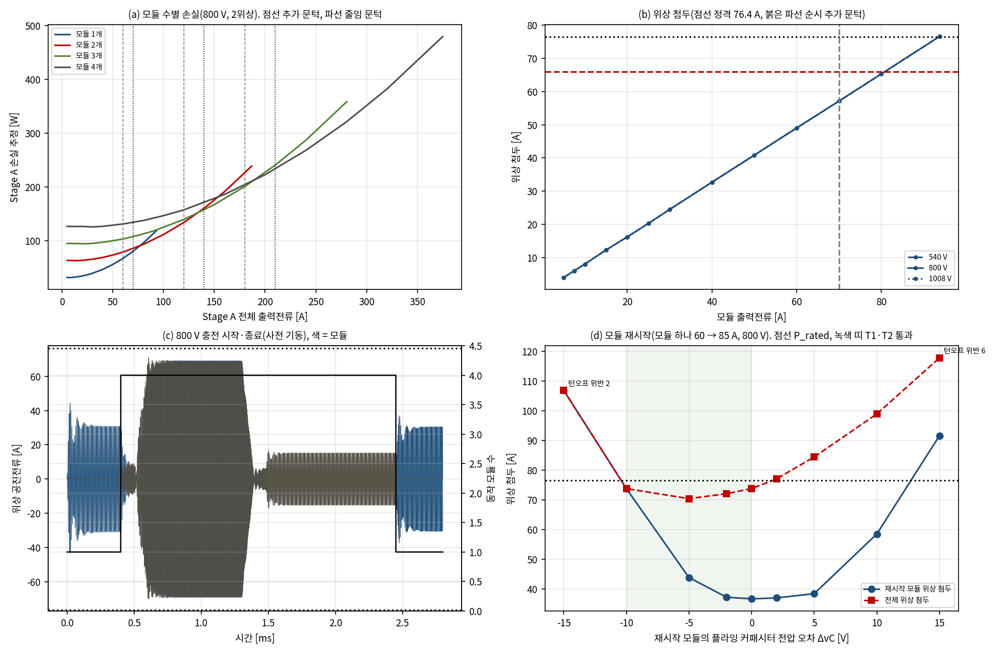
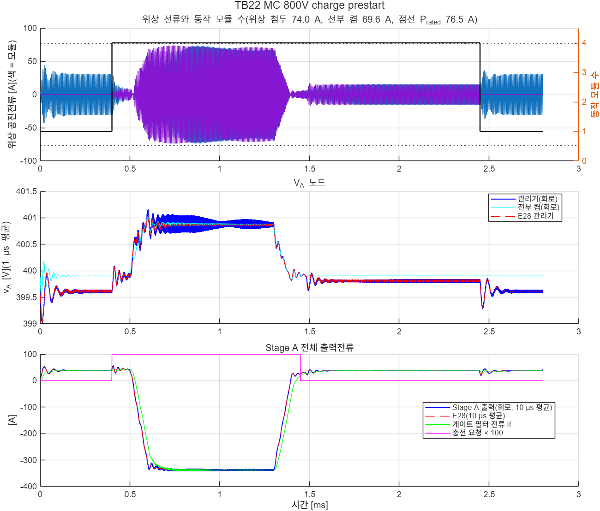

# Stage A 4모듈 경부하 운전: 모듈 관리기·위상 셰딩·부품 공차(E28·TB22)

- 문서 버전: v1.1 (2026-10-29). 〔정정 2(2026-10-29): 정정 절의 "④ 보조 경로 94.4 W"는 Stage C를 최종 설계로 바꾼 E38에서 101.5 W다([docs/43](43_외부검토대응_설계변경_E38_TB30_TB31.md))〕 v1.1: Stage A를 A25R로 바꾼 뒤의 문턱·요구(E32·E35, docs/38·40)로 '정정' 절을 더했다. 관리기 구조(추가·줄임·사전 기동)는 같다. v1.0(2026-10-28)의 본문 값은 150 kHz Stage A 설계의 결과다.
- 관련 문서:
  - [docs/29](29_StageA_위상셰딩_E24_TB18_TB19.md): Stage A 위상 셰딩(모듈 하나). 이 문서가 닫는 남은 과제 1(모듈 셰딩과 위상 셰딩의 조합)·2(부품 공차)가 나온 곳이다.
  - [docs/32](32_StageA_게이트_방향반전_E27_TB21.md): 영교차 게이트의 방향 반전 처리. 이 문서에서 무장하지 못한 반주기의 처리를 다시 바꿨다.
  - [docs/30](30_선행연구_대비_위치와_기여_E25.md): E25는 주행 중 Stage A 모듈 하나만 운전한다고 가정했다. 이 문서의 관리기가 그 가정을 실현한다.
  - [docs/20](20_종합보고서_아키텍처_설계검증.md): 종합 보고서
- 근거 파일: [validation/2026-10-28-stage-a-modules](../validation/2026-10-28-stage-a-modules/README.md). 코드는 검증 코드 묶음의 E28이다. 회로 모델은 [TB22](../simulink/tb/TB22_StageA_Modules/README.md)다.
- 검증 수준:
  - E28: Stage A 영교차 추종 스위칭 ODE(E1·E24와 같은 모델, 데드타임 소멸 처리)를 4모듈 8위상으로 썼다. 모듈 관리기와 R2 버스, V\_A 노드 충전기를 넣었다. 공차 표본 3개(C 5 %, L 10 %, R 10 %)를 공칭과 함께 계산했다.
  - TB22: 소자 수준 회로(Simscape Electrical, 후진 오일러 2.5 ns)다. 회로 게이트 함수는 모델과 간격마다 같은 상태를 낸다(142,800간격 대조).
  - 판정 기준은 시험 전에 정했고 바꾸지 않았다. 세 번 실행했다. 1·2차에서 불통과가 나와 설계를 네 군데 고쳤다(4절). 고친 뒤에도 남은 불통과는 그대로 보고한다.

## 정정(2026-10-29, A25R 반영)

이 문서의 시험은 150 kHz Stage A 설계(위치당 6 mΩ 가정, 출력용량 손실 4·E\_oss·f\_s, V\_A 노드 커패시터 C\_A 400 µF)로 했다. 그 뒤 E31에서 출력용량 손실이 작게 잡혀 있었음을 찾았고, Stage A를 25 kHz 설계 A25R(위치당 C4MS008075U2 2병렬, L\_r 864.6 nH, C\_fly 46.875 µF, C\_A 2.4 mF)로 바꿨다([docs/40](40_StageA25R_수정안_E35_TB27.md)). A25R로 다시 계산한 결과(E36 [docs/41](41_A25R_영향_재확인_E36_TB28.md), E37 [docs/42](42_부품정격표_2차_E37.md))에 따라 아래 값과 문장을 정정한다. 판정 기준은 원 시험의 것을 그대로 썼다. 본문은 원 시험의 기록으로 두고, 바뀐 곳에 〔정정: …〕을 달았다. 최종 설계와 최종 보고서는 이 절의 값을 쓴다.

| 항목 | 원 결과(150 kHz Stage A) | A25R(현재 설계) |
|---|---|---|
| 모듈 관리기 문턱(추가 / 줄임 / 순시) | 70 / 60 / 66 A | 같음(E32: 손실 교차 89·156·221 A ≥ 줄임 60·120·180 A) |
| 위상 셰딩 문턱(I\_off / I\_on / 순시) | 15 / 22 / 36 A | 20 / 30 / 53 A(두 위상 7.5–12.5 A의 턴오프 비율 때문) |
| 시간 상수(tau, t\_dwell, tau\_m, t\_lock, t\_hold) | 2 µs, 100 µs, 20 µs, 20 µs, 100 µs | 6배: 12 µs, 600 µs, 120 µs, 120 µs, 600 µs. t\_dwell\_m 1 ms 그대로 |
| 정격 충전점 위상 첨두 P\_rated | 76.4–76.5 A | 74.5 A(공차 표본 86.5–102.8 A) |
| 충전 전 사전 기동, 충전전류 램프 | ≥ 100 µs | **≥ 600 µs**(E35). 사전 기동 없는 충전(MF)은 A25R에서 첨두 217–221 A로 더 나빠져 사전 기동 요구가 더 중요해졌다 |
| 부하 계단 판정 | 20 kW 순간 계단(MA) 통과 | docs/14 D3 계약(Tier-1 ±10 kW)으로 판정해 통과(E35 6/6·6/6). 20 kW 순간 계단은 계약 밖 정보(불통과, 첨두 87–88 A) |
| 정상 운전점·과도·모듈 고장(모델) | static 33/36·99/108, transient 6/7·21/21 | E35: static 33/36(공칭, 정격 충전점 시작 과도)·36/36(표본), 요구 안 과도 6/6·6/6, 모듈 고장 16/16 |
| 회로 | TB22(사전 기동 3사례 통과, MF 불통과) | TB27 4/4(docs/40) |
| 주행 보조부하 40 A의 모듈 1개 / 4개 손실 | 46.5 / 126.6 W | 150 kHz 손실 모델 값이다. A25R 주행 손실은 E32 표(④ 보조 경로 94.4 W, docs/38) |
| 멈춘 모듈의 C\_fly 전압 요구(V\_bat/2 대비 −10–0 V) | 150 kHz에서 확인 | A25R에서 다시 확인하지 않았다(남은 확인 항목) |

## 1. 요약

Stage A 모듈 4개 가운데 몇 개를 동작시킬지 정하는 모듈 관리기를 설계했다. 관리기를 모듈별 위상 셰딩(E24)과 함께 모델·회로로 확인했다.

- **관리기.**
  - **추가(바로):** 모듈을 더하는 조건은 셋 가운데 하나다.
    - 전체 출력전류 > 동작 수 × 70 A
    - 위상 순시 전류 > 66 A
    - 충전 요청
  - **줄임(지속 뒤):** ⌈전체 전류/60 A⌉ < 동작 수가 1 ms 이어지면 줄인다.
    - 줄인 모듈은 지금 구간을 자연 턴오프로 끝내고 멈춘다.
    - 남는 모듈은 두 위상으로 되돌린다.
  - **충전 시작:** 충전 요청이 오면 충전기 전류가 오르기 전에 모듈을 모두 켠다(사전 기동). 〔정정: A25R에서 사전 기동·램프 ≥ 600 µs〕
  - **동작 모듈:** 모듈마다 E24의 위상 셰딩을 한다.
- **문턱의 근거.**
  - 모듈 N개와 N+1개의 손실은 전체 전류 77·134·189 A에서 같아진다(800 V, E28 design). 줄임 문턱 60·120·180 A는 이 교차점보다 낮다. 그래서 줄인 쪽의 손실이 작거나 같다.
  - 추가 문턱 70 A/모듈에서 위상 첨두는 57.1 A다. 정격 76.5 A에 19 A 여유가 있다.
  - 주행 보조부하 40 A에서 모듈 하나는 46.5 W, 넷은 126.6 W다(2위상, 손실 모델 값). E25가 가정한 "주행 중 모듈 하나"를 관리기가 실현한다. 〔150 kHz 손실 모델 값〕
- **정상 운전점(static): 주행·충전 S1–S3 전부 통과. S4는 정격 충전점(375 A)에서만 불통과.** 공칭 33/36, 공차 99/108이다.
  - 주행 24점·충전 12점 × 공칭·공차 표본 3개에서 다음을 모두 만족했다.
    - 동작 모듈 수와 모듈별 위상 수가 규칙과 같았다.
    - 턴오프 비율은 ≤ 4.1 %(|I\_m| ≥ 7.5 A), 턴오프 전류는 ≤ 0.91 A였다.
  - S4 불통과는 정격 충전점(−375 A) 12점뿐이다.
    - 원인은 판정 창이다. 0.1 ms 이후 전체를 재어 공진전류 0에서 시작하는 시작 과도(82.1 A)가 들어간다.
    - 첨두 기준 P\_rated는 같은 점의 정상 20주기 첨두다. 정상 창(마지막 10주기) 첨두는 모두 P\_rated 이하였다(공칭 76.5 A).
    - 판정 창은 바꾸지 않았다.
- **과도(transient): 공칭 6/7, 공차 표본 21/21.**
  - 다음 사례에서 턴오프 위반은 0이었다.
    - 부하 계단·램프
    - 충전 시작·종료(640·800·920 V, 사전 기동)
    - 1008 V 경부하
  - 모듈 수는 사건마다 한 번씩만 바뀌었고, 멈추기 취소는 없었다.
  - 충전 사례의 위상 첨두는 공칭 70.7–73.2 A였다(정격 76.5 A).
  - **불통과는 사전 기동이 빠진 경우(MF)다.** 관리기는 전류를 보고 20 µs마다 모듈을 더했다. 그래도 위상 첨두가 84.2 A로 정격을 넘었다. 그래서 충전 전 사전 기동을 요구사항으로 둔다. 〔정정: A25R에서 600 µs, MF 첨두 217–221 A〕
  - 공차 표본에서는 MF도 통과했다. 그 표본의 정격점 첨두(84–85.5 A)가 공칭보다 크기 때문이다. 위상 첨두 81–83 A 자체는 공칭 정격보다 크다.
- **회로(TB22): 사전 기동이 있는 세 사례 통과, MF 불통과(모델과 같음).**
  - 모듈 수 전환 시각은 모델과 2 µs 안, 위상 첨두는 3.3 A 안, V\_A 최저·최고는 0.07 V 안이었다.
  - MF 회로는 위상 첨두 83.2 A에 턴오프 1.14 A 한 번으로 T1·T2가 불통과였다.
- **부품 공차의 영향(부품 정격 표로 넘김).**
  - 공차 표본에서 정격 충전점의 위상 평균전류 불균형은 최대 8.5 %였다.
  - 위상 첨두는 84.3–85.5 A로 공칭(76.5 A)보다 10–12 % 컸다(E28 rated).
- **멈춘 모듈의 플라잉 커패시터 전압 요구.** 모듈 재시작은 플라잉 커패시터 전압 오차 ΔvC = V\_bat/2 대비 −10–0 V에서 T1·T2를 지켰다.
  - ΔvC가 +2 V 이상이면 새 모듈이 처음에 전류를 덜 내거나 받는다. 그래서 남은 모듈의 첨두가 정격을 넘었다(+2 V 77.1 A).
  - −15 V는 재시작 위상 첨두 106.9 A·턴오프 위반이었다.
  - 대칭 오차 범위는 없다. 정지 모듈의 균형 회로가 C\_fly를 V\_bat/2보다 0–10 V 낮게 유지해야 한다.
- **게이트 변경.** 무장하지 못한 반주기(첨두 < 2.5 A)는 이제 부호 없이 |i| < 0.5 A가 검출 지연만큼 이어질 때 블랭킹 뒤 끈다.
  - E27의 "공칭 도통시간에 끔"은 다음 펄스에서 1.01–1.24 A를 남겼다.
    - 공진주파수가 3 % 낮은 위상
    - 모듈 재시작 직후의 비대칭 펄스
  - 새 게이트로 다시 판정한 결과는 다음과 같다.
    - E27 사례 55개: 위반 0
    - E24 정상 26점·과도 10사례: 판정이 같았다.

## 2. 왜 필요한가

E24(docs/29)는 Stage A 모듈 하나만 계산했다. 실제 Stage A는 모듈 4개이고, 운전점마다 필요한 모듈 수가 다르다.

| 운전 | Stage A 전류 | 필요한 모듈 |
|---|---|---|
| 주행 보조부하(400 V 부하 + Stage C) | 수–100 A(540 V 팩 30 kW에서 111 A) | 1–2 |
| 400–500 V급 충전 | 375 A − 보조부하 | 4 |
| R2-W460 강등 뒤 | 약 10 A | 1(위상 하나) |

모듈 넷을 늘 돌리면 경부하에서 모듈당 전류가 작아진다. 그러면 영전류 스위칭 비율이 나빠지고(E24: 2위상 10 A에서 5.5 %), 위상당 고정 손실(약 15.6 W)이 여덟 번 든다. E25의 보조 손실 비교(85.0 W)도 주행 중 모듈 하나를 가정했다. 그래서 모듈을 줄여야 한다.

모듈을 줄이면 세 가지 과도가 새로 생긴다.

| 과도 | 위험 | 확인 |
|---|---|---|
| 부하 증가 | 남은 모듈이 다음 모듈을 켤 때까지 부하를 혼자 받는다 | 위상 첨두(T2) |
| 충전 시작 | 충전기 전류가 3.75 A/µs로 오른다. 모듈 하나가 받으면 정격을 넘는다(E24 사례 E) | 사전 기동이 있을 때와 없을 때(T2) |
| 모듈 재시작 | 오래 쉰 모듈의 플라잉 커패시터 전압이 운전 중 평균과 다르면 첫 펄스가 커진다(1 V당 최대 7.4 A = 1/√(L/C)) | 허용 오차(restart) |

부품 공차도 아직 다루지 않았다(docs/29 남은 과제 2). 공진 L·C가 위상마다 다르면 모듈 사이 분담과 위상 하나 운전의 첨두가 바뀐다.

## 3. 모듈 관리기 설계(E28 design)

### 3.1 손실과 위상 첨두

모듈 하나(2위상)를 모듈 전류의 함수로 계산하고, N개 모듈이 같은 전류를 나눌 때의 손실을 N·P(I/N)로 구했다. 배터리 전압(540·800·1008 V)에 따른 차는 없었다.

| 모듈 전류 [A] | 5 | 10 | 20 | 30 | 40 | 50 | 60 | 70 | 80 | 93.75 |
|---|---|---|---|---|---|---|---|---|---|---|
| 모듈 손실 [W] | 31.6 | 31.7 | 34.4 | 39.3 | 46.5 | 55.7 | 66.9 | 80.2 | 95.5 | 120.0 |
| 위상 첨두 [A] | 4.0 | 8.0 | 16.2 | 24.5 | 32.7 | 40.8 | 49.0 | **57.1** | 65.3 | **76.6** |
| 턴오프 비율 | 12.1 % | 5.51 % | 2.14 % | 0.46 % | 0.46 % | 0.46 % | 0.46 % | 0.46 % | 0.46 % | 0.46 % |

(`results/E28/design.json`. 손실은 도통·출력용량·게이트 손실의 합, 위상 셰딩 없음)

| 전체 전류 [A] | 20 | 40 | 60 | 90 |
|---|---|---|---|---|
| 모듈 1개 [W] | 34.4 | 46.5 | 66.9 | 113.3 |
| 모듈 2개 [W] | 63.3 | 68.7 | 78.7 | 102.2 |
| 모듈 4개 [W] | 126.5 | 126.6 | 131.1 | 142.0 |

### 3.2 문턱과 상태기계

| 항목 | 값 | 근거 |
|---|---|---|
| 추가 문턱 Im\_up | 동작 수 × 70 A(1→2 70, 2→3 140, 3→4 210 A) | 70 A/모듈의 위상 첨두 57.1 A, 정격 76.5 A에 19 A 여유(D1) |
| 순시 추가 Ipk\_m | 위상 \|i\| > 66 A | 정상 운전(70 A/모듈 57.1 A)보다 위, 정격보다 아래(D1) |
| 추가 뒤 막음 t\_lock | 20 µs | 새 모듈이 분담을 받기 전 같은 첨두로 연달아 더하지 않도록(시험 전 1차 확인에서 1 → 4로 한 번에 늘어남) |
| 줄임 문턱 Im\_dn | ⌈\|I\|/60 A⌉ < 동작 수(2→1 60, 3→2 120, 4→3 180 A) | 손실 교차 77·134·189 A 아래(D2). 추가 문턱과 10·20·30 A 히스테리시스 |
| 줄임 지속 t\_dwell\_m | 1 ms | 부하 요동에 모듈을 껐다 켰다 하지 않도록 |
| 시작 유지 t\_hold | 100 µs | 4절 변경 (1) |
| 모듈 수 판단 필터 τ\_m | 20 µs(위상 셰딩용 모듈 전류 필터는 2 µs 그대로) | 4절 변경 (4) |
| 충전 요청 | 모든 모듈 동작 | 충전기 전류 증가 전 사전 기동(MF 사례로 필요성 확인) |
| 위상 셰딩(모듈마다) | I\_off 15 A·100 µs, I\_on 22 A, I\_pk,on 36 A | E24와 같음 |

- **측정.** 위상 출력전류(충전 구간 +i, 방전 구간 −i)의 합이다. 게이트가 이미 보는 공진전류로 만든다. 전류 센서는 더하지 않는다.
- **번호 순서.** 번호가 큰 모듈부터 멈추고, 모듈 1은 늘 동작한다. 마모를 고르게 하는 순환은 넣지 않았다.
- **멈춤.** 모듈을 멈출 때는 위상마다 지금 구간을 자연 턴오프로 끝낸 뒤 막는다. 끄는 순간도 영전류다.
- **같은 논리의 두 구현.** 모델(`model_stage_a.mgr_step`)과 회로 게이트(`ctrl/prism_gate_stageA_zcpm.m`)에 같은 논리를 넣었다. 사례 MC의 모델 전류·충전 요청을 게이트 함수에 넣었다. 142,800간격 동안 위상별 구간, 동작 모듈 수, 모듈 모드가 한 번도 다르지 않았다(Octave, `ref/check_gate_parity.txt`).

## 4. 실행 경과와 설계 변경

판정 기준은 그대로 두고 세 번 실행했다. 1·2차 결과도 근거 파일에 남겼다(`*_run1*.json`, `static_run2_hold.json`).

| 실행 | static(공칭/공차) | transient(공칭/공차) | 불통과 원인 | 변경 |
|---|---|---|---|---|
| 1차 | 21/36, 63/108 | 4/7, 12/21 | (a) 공진전류 0에서 시작하는 과도의 전류 넘침으로 모듈을 하나 더 켬(S3, MD·MG의 T4). (b) 640 V 충전 종료 뒤 4 → 1로 줄이자 위상 하나로 돌던 남은 모듈이 넘쳐 다시 켬(MD T4). (c) 첨두 1.0–2.45 A의 무장하지 못한 반주기를 공칭 도통시간에 끈 턴오프 1.01–1.24 A(T1). (d) 사전 기동 없음(MF T2) | (1) 시작 유지 100 µs, (2) 줄일 때 남는 모듈을 두 위상으로, (3) 무장 전 부호 없는 영교차 검출 |
| 2차 | 27/36, 81/108 | (중단) | 모듈 수 판단 필터(τ 2 µs)가 위상 펄스 리플을 거르지 못해 60 A 평균에서 50–75 A로 흔들림(S3 60·130 A) | (4) 모듈 수 판단 필터 τ\_m 20 µs |
| 3차(최종) | 33/36, 99/108 | 6/7, 21/21 | S4 −375 A(시작 과도가 판정 창에 들어감), MF T2 | — |

- **(c)의 기구.** 공진주파수가 3.3 % 낮은 위상에서, 모듈 재시작 직후 첨두 2.45 A의 펄스가 1.86 µs에 최대가 되고 3.6 µs에 0을 지났다(공칭 도통시간 3.23 µs). 무장 문턱(2.5 A)을 넘지 못해 공칭 도통시간에 꺼졌고, 그때 −1.10 A였다. E27은 "첨두 < 2.5 A인 반주기는 공칭 도통시간에서 0.9 A 이하"라고 보았다. 이 판단은 중심이 맞는 반파 사인을 가정한 것이었다.
- **(3)의 근거.** 무장 전에도 |i| < i\_thr(0.5 A)가 검출 지연만큼 이어지면 블랭킹(0.80·t\_on) 뒤 끈다. 첨두 ≥ 0.5 A인 펄스는 실제 영교차 근처에서 꺼지고, 첨두 < 0.5 A인 펄스는 언제 꺼도 0.5 A 이하다. 무장한 반주기는 이전과 같다.
- **2차를 중단한 이유.** static에서 (4)의 원인을 찾은 뒤에는 transient를 끝까지 돌려도 최종 설계의 결과가 아니었다.
- **회로도 같은 순서였다.** TB22를 2차 설계(필터 τ 2 µs)로 한 번 실행했다. MA·MB·MC는 통과, MF는 T1·T2 불통과였다. 최종 설계로 다시 빌드·실행했다.

## 5. 방법과 판정 기준(시험 전에 고정)

〔정정 2026-10-29〕 이 기준은 결과와 같은 커밋(7f7f75f)으로 올렸다. 실행 전에 정했다고 적었으나, 그 순서를 저장소 기록으로는 확인할 수 없다(docs/45 B2).

### 5.1 첨두 기준(E28 rated)

P\_rated(표본)는 같은 공차 표본의 정격 충전점(V\_A 노드 375 A 주입, 4모듈 전부 켬, 640·800·920 V, 정상 20주기) 위상 첨두다. 공칭은 76.5 A다. 공칭값은 E24의 76.4 A(위상 하나 단독 46.875 A)와 0.1 A 다르다. 판정은 "관리기와 셰딩이 같은 하드웨어의 정격점보다 큰 첨두를 만들지 않는다"이다. 정격점 첨두 자체의 공차 영향은 부품 정격 표(검증 과제 5)로 넘긴다.

### 5.2 정상 운전점(static)

- **격자.**
  - 주행: 540·800·1008 V × V\_A 노드 부하 3–220 A(8점)
  - 충전: 640·800·920 V × 주입 30–375 A(4점, 충전 요청 켬)
  - 각 점을 공칭과 공차 표본 3개로 계산한다(144번).

| 항목 | 기준(마지막 10주기) |
|---|---|
| (S1) 동작 모듈 \|I\_m\| ≥ 7.5 A | 그 모듈 위상의 턴오프 전류/피크 ≤ 5 % |
| (S2) \|I\_m\| < 7.5 A | 턴오프 전류 ≤ 1.0 A |
| (S3) 모듈·위상 수 | 동작 수 = 규칙의 기대값(주행 ⌈\|I\|/70⌉, 충전 4), 운전 중 바뀌지 않음, 위상 수 = 기대값(\|I/N\| < 15 A면 하나) |
| (S4) 위상 첨두 | ≤ P\_rated(표본). 코드는 0.1 ms 이후 전체에서 잰다 |

### 5.3 과도(transient)

0.3 ms 이후 판정한다. 공칭과 공차 표본 3개로 계산한다(28번). 같은 프로파일·공차의 "전부 켬"(8위상, 관리기·셰딩 없음)을 비교 기준으로 함께 계산한다.

| 항목 | 기준 |
|---|---|
| (T1) 턴오프 | 모든 턴오프 \|i\_off\| ≤ max(5 % × 그 반주기 첨두, 1.0 A) |
| (T2) 위상 첨두 | ≤ P\_rated(표본) |
| (T3) V\_A | 최저·최고가 전부 켬과 1.0 V 안(모듈 하나의 출력저항이 넷의 4배라 70 A에서 정상 차만 0.54 V. E24의 0.5 V보다 넓힘) |
| (T4) 모듈 수 | 끝 동작 수 = 기대값, 추가·줄임 횟수 ≤ 사례별 상한, 멈추던 모듈의 취소 0 |

| 사례 | 조건 | 기대(끝 / 추가 상한 / 줄임 상한) |
|---|---|---|
| MA 540 V | 버스 정전력 부하 5 → 25 → 5 kW(0.5·1.5 ms 계단) | 1 / 1 / 1 |
| MB 800 V | 버스 2 → 36 → 2 kW 램프(각 1 ms) | 1 / 1 / 1 |
| MC 800 V | 버스 15 kW, 0.4 ms 충전 요청 → 0.5 ms 충전기 0 → 375 A(100 µs) → 1.3 ms 0 A(100 µs), 1.45 ms 요청 끝 | 1 / 1 / 1 |
| MD 640 V, ME 920 V | MC와 같음 | 1 / 1 / 1 |
| MF 800 V | MC와 같으나 충전 요청 없음 | 1 / 3 / 1 |
| MG 1008 V | 버스 25 → 5 → 25 kW(E24 F·TB18과 같음) | 1 / 0 / 0 |

### 5.4 모듈 재시작(restart)

판정이 아니라 설계값을 정한다.

- **조건.** 모듈 1이 60 A를 내다가 0.25 ms에 85 A로 오른다. 이때 모듈 2가 재시작한다.
- **변수.** 모듈 2의 플라잉 커패시터 초기 전압을 V\_bat/2 + ΔvC로 둔다(ΔvC −15–+15 V, 540·800·1008 V).
- **판정.** (T1)·(T2)를 지키는 ΔvC 범위를 구한다.

### 5.5 회귀(regress)

| 항목 | 기준 |
|---|---|
| (G) 관리기를 쓰지 않는 경로 | E24 과도 F·H, E27 repro(이전 게이트)의 지표가 저장된 결과와 같음(차 ≤ 1e-9) |
| (G2) 새 게이트의 방향 반전 | E27 repro(램프 시작 6가지 + 공차) + stress(48사례): 모든 턴오프 ≤ max(5 %·첨두, 1 A) |
| (G3) 새 게이트의 셰딩 | E24 static 26점·transient 10사례의 판정이 저장된 결과와 같음 |

E1(정격점 공차 표본)은 다시 계산하지 않았다. 정격점의 반주기는 모두 무장하므로 게이트 변경이 닿지 않는다.

### 5.6 회로(TB22)

과도 사례 MA·MB·MC·MF를 공칭 부품값으로 계산한다. 판정은 5.3절과 같다. "전부 켬"은 같은 회로·게이트 함수로 실행한다. 이때 충전 요청을 계속 켜고 위상 셰딩을 끈다(I\_off = −1).

## 6. 결과

### 6.1 정격점 위상 첨두와 공차(rated)

| 표본 | 공칭 | 공차 1 | 공차 2 | 공차 3 |
|---|---|---|---|---|
| P\_rated [A] | 76.5 | 85.5 | 84.3 | 84.4 |
| 위상 평균전류 최대/평균 | 1.003 | 1.085 | 1.077 | 1.080 |

- 배터리 전압(640·800·920 V)에 따른 차는 없었다.
- 공차(C 5 %, L 10 %, R 10 %)만으로 정격점 위상 첨두가 10–12 % 커졌다. 부품 정격 표에서 위상 소자·인덕터의 첨두 전류는 이 값으로 잡아야 한다.

### 6.2 정상 운전점(static): S1–S3 전부 통과, S4는 정격 충전점에서 불통과

| 점(800 V, 공칭) | 3 | 10 | 30 | 60 | 90 | 130 | 160 | 220 | −30 | −120 | −250 | −375 A |
|---|---|---|---|---|---|---|---|---|---|---|---|---|
| 동작 모듈 / 위상 | 1 / 1 | 1 / 1 | 1 / 2 | 1 / 2 | 2 / 2 | 2 / 2 | 3 / 2 | 4 / 2 | 4 / 1 | 4 / 2 | 4 / 2 | 4 / 2 |
| 턴오프 비율 최대 | 10.1 % | 1.58 % | 1.21 % | 0.58 % | 1.21 % | 0.88 % | 1.08 % | 0.74 % | 4.10 % | 0.59 % | 0.65 % | 0.64 % |
| 턴오프 전류 최대 [A] | 0.48 | 0.26 | 0.29 | 0.29 | 0.44 | 0.48 | 0.47 | 0.33 | 0.49 | 0.14 | 0.33 | 0.48 |
| 위상 첨두 [A](0.1 ms 이후) | 5.6 | 18.8 | 25.2 | 50.8 | 40.4 | 58.4 | 47.0 | 48.1 | 15.6 | 26.1 | 54.8 | **82.1** |

(540·1008 V, 640·920 V도 같은 값이다. 3 A는 |I\_m| < 7.5 A라 (S2) 턴오프 ≤ 1 A로 판정한다)

- **모든 점에서 동작 모듈 수와 위상 수가 규칙과 같았다(S3).** 공차 표본에서도 같았다.
  - 모듈 사이 분담은 최대/평균 1.061이었다.
  - 턴오프 비율은 최대 4.10 %(|I\_m| ≥ 7.5 A), 턴오프 전류는 최대 0.91 A였다.
- **S4는 −375 A 12점(공칭 3 + 공차 9)에서 불통과였다.** 1·2·3차 모두 같았다.
  - 0.1 ms 이후 전체의 첨두(82.1–92.4 A)에는 공진전류 0에서 정격 전류로 시작하는 과도가 들어간다.
  - 정상 창(마지막 10주기) 첨두는 공칭 76.5, 공차 82.1·84.3·82.6 A였다. 모두 같은 표본의 P\_rated 이하다.
  - 실제 충전은 충전기 램프(≥ 100 µs)로 시작한다. 이 시작 과도는 운전에서 생기지 않는다. 판정 창을 고치지 않고 불통과로 둔다.

### 6.3 과도(transient): 공칭 6/7, 공차 21/21

| 사례(공칭) | 판정 | 모듈 수 변화 [ms → 수] | 턴오프 최대 | 위상 첨두(전부 켬) | V\_A(전부 켬) [V] |
|---|---|---|---|---|---|
| MA 540 V | 통과 | 0.562 → 2, 2.551 → 1 | 0.54 A | 68.0(25.3) A | 268.96–270.00(269.60–270.01) |
| MB 800 V | 통과 | 1.111 → 2, 3.192 → 1 | 0.50 A | 58.5(18.7) A | 399.24–399.99(399.68–399.99) |
| MC 800 V | 통과 | 0.400 → 4, 2.450 → 1 | 0.67 A | 70.7(70.5) A | 399.31–401.11(399.82–401.06) |
| MD 640 V | 통과 | 0.400 → 4, 2.450 → 1 | 0.67 A | 73.2(67.4) A | 319.11–321.26(319.79–321.00) |
| ME 920 V | 통과 | 0.400 → 4, 2.450 → 1 | 0.67 A | 72.8(72.0) A | 459.38–461.13(459.83–461.11) |
| **MF 800 V 사전 기동 없음** | **불통과(T2)** | 0.540 → 2, 0.561 → 3, 0.582 → 4, 2.365 → 1 | 0.86 A | **84.2**(70.5) A | 399.29–401.59(399.82–401.06) |
| MG 1008 V | 통과 | 변화 없음(모듈 1, 위상 셰딩만) | 0.50 A | 47.9(12.2) A | 503.24–503.97(503.79–504.00) |

(`results/E28/transient.json`)

- **턴오프 위반은 모든 사례·표본에서 0이었다(T1).** 공차 표본의 턴오프 최대는 0.85 A였다.
- **모듈 수 전환은 사건마다 한 번이었고 멈추기 취소는 없었다(T4).**
  - MB는 램프로 문턱을 천천히 지나도 반복 전환이 없었다.
  - 충전 종료 뒤 4 → 1로 한 번에 줄였을 때, 남은 모듈은 두 위상으로 받아 다시 늘지 않았다.
- **사전 기동이 있으면 충전 중 첨두가 전부 켬과 거의 같다.**
  - 공칭 MC 70.7 A는 전부 켬 70.5 A와 거의 같다.
  - 공차 표본의 최대는 79.9 A(ME)로, 그 표본의 P\_rated(84.4–85.5 A) 안이었다.
- **사전 기동이 없으면(MF) 정격을 넘는다.**
  - 관리기는 전류가 70·140·210 A를 넘을 때마다 20 µs 간격으로 모듈을 더했다.
  - 그 사이 동작 모듈이 충전기 램프(3.75 A/µs)를 받아 첨두가 84.2 A가 되었다.
  - 공차 표본에서는 81.2–82.6 A로 그 표본의 P\_rated보다 작아 통과로 판정되었다. 그래도 공칭 정격 76.5 A보다 크다.
- **경부하 운전의 대가는 모듈 추가 전의 첨두다.**
  - 버스 부하 계단(MA, 540 V에서 18.5 → 92.6 A)에서 첨두는 68.0 A였다. 전부 켬은 25.3 A였다.
  - 순시 추가 문턱(66 A)이 이 값을 묶는다. 정격까지 8.5 A 여유다.

### 6.4 모듈 재시작(restart)

| ΔvC [V] | −15 | −10 | −5 | −2 | 0 | +2 | +5 | +10 | +15 |
|---|---|---|---|---|---|---|---|---|---|
| 재시작 위상 첨두 [A] | 106.9 | 73.8 | 43.9 | 37.3 | 36.7 | 37.0 | 38.5 | 58.6 | 91.6 |
| 전체 위상 첨두 [A] | 106.9 | 73.8 | 70.4 | 72.1 | 73.8 | **77.1** | 84.5 | 99.0 | 117.8 |
| 턴오프 위반 | 2 | 0 | 0 | 0 | 0 | 0 | 0 | 0 | 6 |
| T1·T2 | 불통과 | 통과 | 통과 | 통과 | 통과 | 불통과 | 불통과 | 불통과 | 불통과 |

(540·800·1008 V가 같은 값이다)

- **ΔvC가 음수(V\_bat/2보다 낮음)면 새 모듈이 처음부터 전류를 더 낸다.** 남은 모듈 첨두가 줄어 −5 V에서 70.4 A가 최소였다. −15 V에서는 새 모듈 자신의 첫 펄스가 106.9 A가 되었다.
- **ΔvC가 양수면 새 모듈이 처음에 전류를 덜 내거나 받는다.** 그래서 85 A를 받고 있던 모듈 1의 첨두가 커졌다(+2 V 77.1 A).
- **요구.** 정지 모듈의 균형 회로가 C\_fly를 V\_bat/2보다 0–10 V 낮게 유지해야 한다(목표 −5 V, 허용 ±5 V). 모든 스위치에 같은 저항을 걸면 C\_fly는 V\_bat/2가 된다. 의도한 낮은 쪽 치우침과 저항 공차는 부품 정격 표에서 정한다.
- **이 조건은 엄격한 쪽이다.** 모듈 1이 정격 근처(85 A, 85 A/93.75 A)에서 부하 계단을 받는 순간에 재시작한다. 줄임 문턱 아래에서 천천히 재시작하는 경우는 여유가 더 크다.

### 6.5 회귀(regress): (G)·(G2)·(G3) 통과

- **(G) 관리기를 쓰지 않는 경로는 저장된 E24·E27 결과와 차 0이었다.**
- **(G2) 새 게이트로 E27 55사례의 위반이 0이었다.** 턴오프 최대는 0.78 A, 무장하지 못한 반주기는 ≤ 0.50 A였다.
- **(G3) 새 게이트로 E24 정상 26점·과도 10사례의 판정이 모두 같았다.**
  - 과도의 턴오프 최대는 같거나 줄었다(A·B 0.85 → 0.67 A, E 1.01 → 0.84 A, H 0.73 → 0.49 A).
  - 사례 E(충전 4배 램프)는 이전처럼 T2로 불통과다.

### 6.6 회로(TB22): 사전 기동 사례 3/3 통과, MF 불통과

| 사례 | 판정 | 턴오프(위반), 최대 | 위상 첨두(전부 켬) | V\_A(전부 켬) [V] | 모듈 수 변화 | E28 대비 |
|---|---|---|---|---|---|---|
| MA 540 V | **통과** | 2,169(0), 0.72 A | 67.4(24.4) A | 268.96–269.99(269.60–270.01) | 0.561 → 2, 2.552 → 1 | 시각 ±0.3 µs, 첨두 −0.6 A, V\_A ≤ 0.007 V |
| MB 800 V | **통과** | 2,701(0), 0.60 A | 58.3(18.7) A | 399.22–399.98(399.67–399.99) | 1.109 → 2, 3.194 → 1 | 시각 ±1.9 µs, 첨두 −0.1 A, V\_A ≤ 0.012 V |
| MC 800 V | **통과** | 3,902(0), 0.95 A | 74.0(69.6) A | 399.28–401.18(399.82–401.06) | 0.400 → 4, 2.450 → 1 | 시각 0, 첨두 +3.3 A, V\_A ≤ 0.07 V |
| MF 800 V | **불통과(T1·T2)** | 3,592(1), 1.14 A | 83.2(69.6) A | 399.28–401.59(399.82–401.06) | 0.540 → 2, 0.561 → 3, 0.581 → 4, 2.365 → 1 | 시각 ±0.3 µs, 첨두 −1.0 A |

- **회로와 모델이 거의 같았다.** 회로의 턴오프 전류는 모델보다 0.1–0.3 A 컸다. 위상 첨두는 MC에서 3.3 A 컸다(74.0 A). 정격까지 2.5 A 여유다.
- **MF는 모델과 같이 정격을 넘었다(83.2 A).** 모델에 없던 턴오프 1.14 A가 한 번 있었다. 사전 기동이 빠진 경우의 결과이며, 사전 기동을 요구사항으로 두는 근거다.

## 7. 결정과 남은 과제

**결정한 것**

- **Stage A 모듈 관리기를 넣는다(3.2절 문턱).** 주행 중에는 모듈 1–2개로 운전한다. E25의 "주행 중 모듈 하나" 가정이 관리기로 실현된다.
- **충전 전 사전 기동을 요구사항으로 둔다.** 차량 충전 제어기는 충전기 전류를 올리기 전에 Stage A에 충전 요청을 보낸다. 모듈 기동에는 수 µs면 되지만, 시험에서는 100 µs 앞서 보냈다. 요청이 빠지면 관리기가 따라가도 정격을 넘는다(MF).
- **무장하지 못한 반주기는 부호 없는 영교차에서 끈다.** E27의 공칭 도통시간 방식을 대체한다. E24·E27 판정은 그대로였다.
- **정지 모듈 C\_fly 대기 전압: V\_bat/2 − (0–10) V.** 균형 회로의 요구로 부품 정격 표에 넣는다.
- **부품 공차에 따른 정격점 위상 첨두 84–86 A**(공칭 76.5 A)를 부품 정격 표에 넣는다. 위상 전류 불균형은 최대 8.5 %다.

**남은 과제**

1. **부품 정격 표(검증 과제 5).** 위상 첨두 86 A(공차), 정지 모듈 균형 회로(치우침·정확도·누설), 위 결과를 데이터시트와 맞춘다.
2. **모듈 고장(E26)과 관리기의 연동.** 고장 모듈을 관리기의 후보에서 빼는 처리를 아직 넣지 않았다. E26·TB20은 관리기 없이 모듈 4개를 전부 켠 상태였다.
3. **모듈 순환.** 모듈 1이 늘 동작해 마모가 한쪽에 몰린다. 시작 번호를 바꾸는 순환은 결론을 바꾸지 않아 후속으로 둔다.
4. **SALS 분리·감발 연동(검증 과제 4).** 다음 순서다.

## 8. 한계

- 충전기는 이상 전류원이다. 버스 부하는 정전력 등가다(Stage C 없음). 실제 충전기의 전류 제어 응답과 통신 지연은 넣지 않았다.
- 공차 표본은 3개다(E1·E27과 같은 시드). 최악 조합을 찾은 것은 아니다.
- 손실은 E1·E24 손실 모델의 도통·출력용량·게이트 손실이다.
- 멈춘 모듈의 C\_fly는 누설 없이 초기값을 유지한다. 재시작 시험은 초기 오차를 직접 주는 방식이다.
- 회로 확인은 공칭 부품값 4사례다.
- 판정 창 S4는 시작 과도를 포함했다(6.2절).

## 참고문헌

1. Y. Ahn, I. Jeon, J. Roh, "A Multiphase Buck Converter With a Rotating Phase-Shedding Scheme For Efficient Light-Load Control," *IEEE J. Solid-State Circuits*, vol. 49, no. 11, pp. 2673–2683, 2014. doi:10.1109/JSSC.2014.2360400
2. R. L. Valley, I. Cohen(Texas Instruments), "System and method for phase management in a multiphase switching power supply," US 8,120,334 B2, 2012.
3. A. Babazadeh, R. Renganathan, D. Clavette, C. Rainer(Infineon Technologies Austria), "Method and apparatus for zero-current switching control in switched-capacitor converters," US 10,122,256 B1, 2018.
4. K. Kesarwani, R. Sangwan, J. T. Stauth, "Resonant-Switched Capacitor Converters for Chip-Scale Power Delivery: Design and Implementation," *IEEE Trans. Power Electron.*, vol. 30, no. 12, pp. 6966–6977, 2015.
