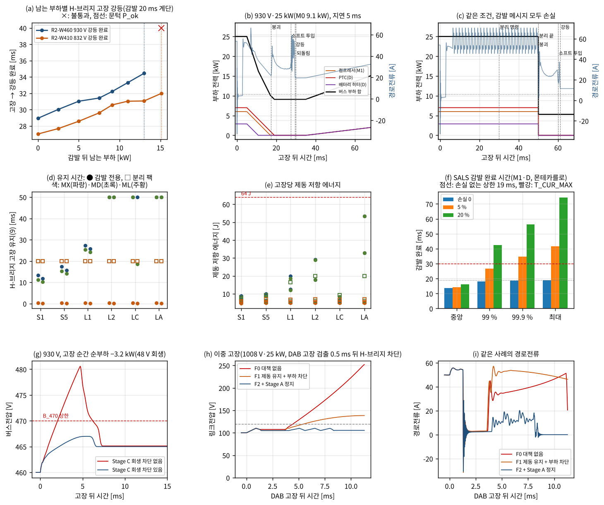
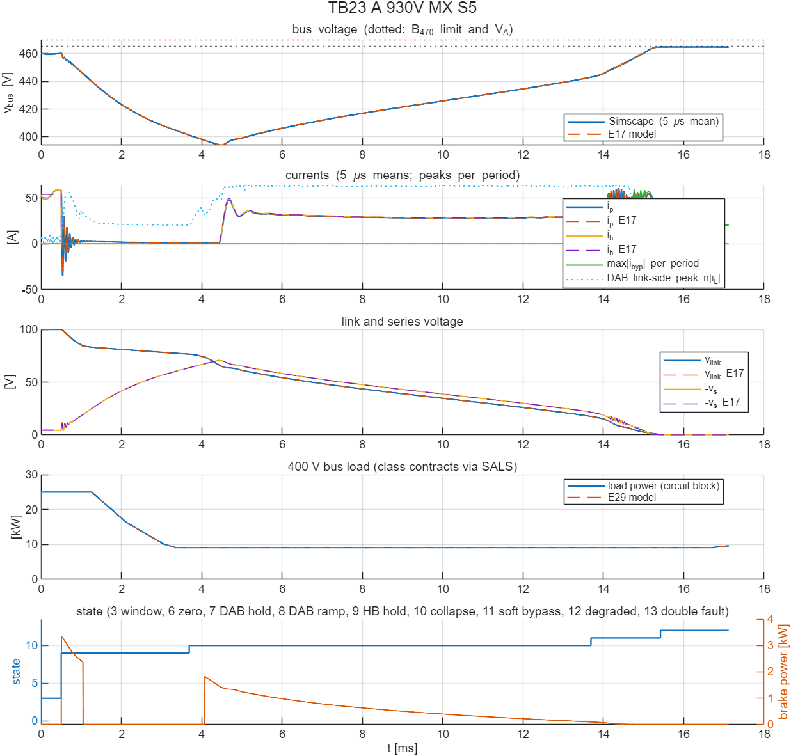

# 보호 상태기계와 SALS의 연동: 400 V 부하 분리·감발 명령의 지연·손실과 부하 응답(E29·TB23)

- 문서 버전: v1.1 (2026-10-29). v1.1: A25R(C\_A 2.4 mF)에서 이중 고장 F2가 나빠진 것(E36, docs/41)과 C\_A 방전 저항·부품 정격 2차(E37, docs/42)로 '정정' 절을 더했다. v1.0(2026-10-28)의 본문 값은 C\_A 400 µF의 결과다.
- 관련 문서:
  - [docs/24](24_R2_보호상태기계_E17_TB09.md): R2 보호 상태기계. 이 문서가 닫는 남은 과제 4("이중 고장(13)의 Stage A 협조 정지와 SALS 연동")가 나온 곳이다.
  - [docs/25](25_DAB_고장모드변조_E20_TB10.md)·[docs/26](26_DAB_회로여유_E21_TB11_TB13.md): 일시 감발과 강등 순서 P3t. 이 문서는 강등 순서를 그대로 두고 400 V 부하 쪽만 바꾼다.
  - [docs/14](14_요구사항_부하등급_수락기준.md): 부하 등급·계약(표 R-2)과 SALS 프로토콜(D6). 이 문서의 부하 응답은 그 계약을 그대로 쓴다.
  - [docs/28](28_R2_통합회로_E23_TB16_TB17.md): 남은 과제 2(400 V 부하 분리 시간)
  - [docs/20](20_종합보고서_아키텍처_설계검증.md): 종합 보고서(9절 검증 과제 4)
- 근거 파일: [validation/2026-10-28-sals-link](../validation/2026-10-28-sals-link/README.md). 코드는 검증 코드 묶음의 E29와 공용 모듈 `sals_loads.py`다. 회로 모델은 [TB23](../simulink/tb/TB23_R2_SALS_Link/README.md)이다.
- 검증 수준:
  - E29: E17 평균모델 상태기계(강등 순서는 E21 P3t)에 400 V 부하의 등급별 계약 응답을 넣었다. 메시지 지연·손실·재송신·워치독은 해석식으로 계산한다. 감발 완료 시간 분포는 따로 몬테카를로로 계산했다.
  - TB23: TB13과 같은 소자 수준 회로(Simscape Electrical, 후진 오일러 2.5 ns)에 같은 부하 블록과 상태기계 확장을 넣었다. 계산 시간 때문에 SALS 시간은 0.15배로 줄였다(TB09–TB13의 분리 20 ms → 3 ms와 같은 비율). 기준값도 같은 시간으로 계산했다.
  - 판정 기준과 설계값 규칙은 시험 전에 정했고 바꾸지 않았다. 실행 전 점검에서 설계 한 곳, 시험 설정 한 곳을 고쳤다(4절).

## 정정(2026-10-29, A25R 반영)

이 문서의 시험은 150 kHz Stage A 설계(위치당 6 mΩ 가정, 출력용량 손실 4·E\_oss·f\_s, V\_A 노드 커패시터 C\_A 400 µF)로 했다. 그 뒤 E31에서 출력용량 손실이 작게 잡혀 있었음을 찾았고, Stage A를 25 kHz 설계 A25R(위치당 C4MS008075U2 2병렬, L\_r 864.6 nH, C\_fly 46.875 µF, C\_A 2.4 mF)로 바꿨다([docs/40](40_StageA25R_수정안_E35_TB27.md)). A25R로 다시 계산한 결과(E36 [docs/41](41_A25R_영향_재확인_E36_TB28.md), E37 [docs/42](42_부품정격표_2차_E37.md))에 따라 아래 값과 문장을 정정한다. 판정 기준은 원 시험의 것을 그대로 썼다. 본문은 원 시험의 기록으로 두고, 바뀐 곳에 〔정정: …〕을 달았다. 최종 설계와 최종 보고서는 이 절의 값을 쓴다.

| 항목 | 원 결과(150 kHz Stage A) | A25R(현재 설계) |
|---|---|---|
| 이중 고장 F2(Stage A 정지 + 부하 차단 + 제동 유지) | 링크 ≤ 110.1 V, 직렬 ≤ 114.2 V(회로 한계 지킴), 경로전류 5 ms 1/4 | E36: 직렬 최대 123.3 V(3사례 120 V 초과), 링크 최고 110.5–119.2 V, 제동 19.5–30.9 J(기준 120 V·64 J 안), 경로전류 5 ms **0/4**(7.6 ms 이상). "F2는 회로 한계를 모두 지켰다"는 A25R에서 성립하지 않는다 |
| C\_A 방전 대책(E37 Q3) | — | Stage A 정지 뒤 V\_A 노드 방전 저항. 1 Ω에서 직렬 ≤ 66.8 V로 직렬 전압은 해결. 경로전류 5 ms는 W410 2사례만 통과(4.38–4.41 ms), W460 6.07–6.21 ms → **2/4**. 3·10 Ω은 0/4 |
| 경로전류가 남는 원인 | 부하가 V\_A 노드·버스 커패시터에서 전력을 뺌 | 같음(E37 진단): 연결된 400 V 부하가 버스를 저전압 차단(250 V)까지 끌어내리는 동안 경로전류가 수–14 A 남는다. W460은 460 V에서 시작해 약 6 ms가 걸린다. 대책은 부하 쪽 빠른 분리(남은 과제) |
| H-브리지 역방향 도통(최대 63 A) | 부품 정격 표로 | 통과: EPC2305 × 2, C\_A 2.4 mF에서도 T\_J ≤ 106 °C(E37 P7) |
| 바이패스 소프트 투입 소자 | 부품 정격 표로 | 불통과: EPC2305 1개 176 °C(E34, 데이터시트 그림 Z\_th), 선형 MOSFET 5종은 펄스 Z\_th 숫자가 없어 보수 계산 245.5 °C 이상(E37). 남은 과제 |
| 400 V 부하 접촉기(W460) | 부품 정격 표로 | 통과: TE ECK100B(1000 V)(E37) |

## 정정 2(2026-10-29, 외부 검토 대응·설계 변경 E38)

남은 과제 두 가지를 설계 변경으로 풀었다(E38·TB31, docs/43, 사용자 결정 2026-10-29).

| 항목 | E29·E37 | E38 |
|---|---|---|
| 바이패스 소프트 투입 에너지(P6) | ≤ 0.75 J(W460 930 V MX: 붕괴가 시간 상한에 걸려 직렬 −25.7 V에서 투입) | **링크 붕괴·소프트 투입 동안 Stage C 일시 정지**(허브 내부, 4 kW/ms, 8.7–12.4 ms): 연동 강등 74/74, 최악 0.036 J·104 W, EPC2305 1개 108.0 °C. 시간 상한 투입 30 → 0사례 |
| 이중 고장 경로전류 5 ms(F2) | 1/4(C\_A 400 µF), A25R 방전 저항 1 Ω 2/4 | **400 V 부하 정지(전용 배선 신호, 3 ms 램프), 방전 저항 없음**: 4/4, 경로전류 1 A 아래까지 1.83–1.98 ms, 직렬 ≤ 94.8 V |
| 끝 상태 | V\_A 노드 357–358 V(E29, C\_A 400 µF), A25R 방전 저항 1 Ω에서 185–189 V(E37). 재기동 사전충전 필요 | V\_A 노드는 V\_bat/2 근처(428–503 V)로 남는다 |
| 회로 | TB23(C\_A 400 µF) | **TB31 2/2**: A31 소프트 투입 0.0227 J·EPC2305 105.0 °C, E31 경로전류 1 A 아래까지 Stage A 정지 뒤 1.11 ms(모델과 전이 시각 차 ≤ 0.035 ms) |

## 1. 요약

R2의 H-브리지 고장 강등은 "400 V 부하가 명령 20 ms 뒤 5 kW로 줄어든다"는 가정 위에 있었다. 실제 경로는 둘이다. V\_A가 부품 상한을 넘는 팩은 접촉기로 분리한다. 상한 안 팩의 일시 감발은 SALS 메시지로 부하에 전한다. 메시지는 늦게 닿거나 잃어버릴 수 있다. 부하는 계약 변화율로만 줄고, M0(Stage C·V2L)는 줄지 않는다. 이 응답을 넣고 강등 순서를 다시 확인했다.

- **연동 설계.**
  - 고장을 검출하면 SALS 감발(D 허용치 0, M1 한도 0)과 Stage C 회생 차단을 함께 낸다. V\_A가 상한을 넘는 팩은 접촉기 분리도 바로 명령한다.
  - 감발 전용 팩에서는 H-브리지 고장 유지(9)를 시간이 아니라 측정으로 끝낸다. 기준은 부하전류 추정 i\_p − (C\_b + C\_dmp)·dv\_bus/dt다.
  - 30 ms 안에 부하가 줄지 않으면 접촉기 분리로 넘어간다.
  - 이중 고장(13)이면 Stage A를 멈추고, 접촉기 분리·SALS 감발과 링크 제동 저항의 과전압 보호를 함께 쓴다.
- **연동 강등(E29 seq): 74/74 통과.**
  - 팩 4개 × 부하 구성 3개 × 메시지 시나리오 6개에 접촉기 50 ms 감도 2사례를 더했다.
  - 감발 전용 팩(930·832 V)은 강등이 앞당겨지고 제동 에너지가 줄었다. 25 kW, 지연 5 ms에서 강등 완료는 23–30 ms, 제동 저항은 5.8–10.0 J이다. E21의 20 ms 계단 가정(R2-W460 930 V)에서는 31.5 ms, 22.1 J이었다.
  - 메시지가 두 번 이상 손실되거나 컴프레서 메시지를 모두 잃으면 접촉기로 넘어간다. 이때 유지는 50 ms, 제동 저항은 최대 53.3 J이다(기준 64 J).
- **새로 찾은 위험: 48 V 회생.** 고장 순간 버스 순부하가 음(Stage C −3.2 kW)이면 다이오드 정류 유지의 극성이 바뀐다.
  - Stage C 회생 차단이 없으면 4/4 불통과였다. 버스가 480.6·527.0·432.7·483.4 V까지 올랐다. 회로(TB23)에서도 481.0 V였다.
  - 차단하면 12/12 통과했다.
  - 차단은 검출 뒤 W460 1.0 ms·W410 0.5 ms 안에 시작해야 한다(4 kW/ms).
- **남는 부하의 대가: 소프트 투입 에너지.**
  - 감발해도 M0 9.1 kW가 남는다. R2-W460 930 V에서 소프트 투입 소자 에너지가 0.75 J이었다. E21의 5 kW 가정(0.031 J)의 24배다.
  - 남는 부하 13 kW까지는 판정을 통과했다(2.7 J). 15.1 kW는 소프트 투입 시간 상한에 걸려 이중 고장으로 갔다.
  - 바이패스 소자의 선형 영역 SOA 확인(검증 과제 5)이 더 중요해졌다.
- **이중 고장(E29 failsafe): Stage A 정지가 필요하다. 다만 5 ms 기준은 1/4만 통과했다.** 〔정정: A25R에서 0/4, 방전 저항 1 Ω으로 2/4(docs/41·42)〕
  - 대책이 없으면 링크가 178–252 V로 오른다. 제동 저항과 부하 차단만 쓰면 138–160 V까지 오른다. 둘 다 링크 기준 120 V를 넘는다.
  - Stage A를 멈추면 링크 ≤ 110.1 V, 직렬전압 ≤ 114.2 V, 제동 ≤ 7.5 J로 회로 한계를 모두 지켰다. 〔정정: A25R(C\_A 2.4 mF)에서 직렬 최대 123.3 V·링크 최고 119.2 V·제동 19.5–30.9 J(E36). 방전 저항 1 Ω에서 직렬 ≤ 66.8 V·링크 ≤ 110.1 V·제동 ≤ 2.3 J(E37)〕
  - 그러나 Stage A 정지 뒤 경로전류가 1 A 아래로 떨어지기까지 4.7–7.3 ms 걸렸다. 5 ms 기준은 1/4만 통과했다. 접촉기가 열리기 전(20 ms)에 부하가 V\_A 노드·버스 커패시터에서 전력을 빼기 때문이다. 버스가 저전압 차단(250 V)에 닿아야 전류가 멈춘다.
- **회로(TB23): 판정이 모델과 5사례 모두 같았다(통과 4, 회생 차단을 뺀 사례 불통과).**
  - 소자 수준 회로에서 SALS 시간을 0.15배로 줄여 확인했다.
  - 상태 전이 시각은 모델과 0.065 ms 안에서 같았다. 소프트 투입 에너지는 0.476 J(모델 0.471 J)였다.
  - 부하 블록 함수는 Python 모델과 40개 시나리오, 32,040점에서 최대 6 × 10⁻⁸ W 안으로 같았다.

*그림 1. E29. (a) 감발 뒤 남는 부하별 강등 완료 시각(20 ms 계단 감발, ×는 불통과). (b) 930 V·25 kW, 지연 5 ms: 부하가 계약 변화율로 줄고, 부하전류 추정이 문턱 아래가 되면 붕괴한다. (c) 같은 조건에서 감발 메시지를 모두 잃은 경우: 30 ms에 접촉기 분리로 넘어간다. (d)·(e) 시나리오별 유지 시간과 제동 저항 에너지. (f) SALS 감발 완료 시간. (g) 고장 순간 순부하 −3.2 kW에서 Stage C 회생 차단 유무. (h)·(i) 이중 고장의 링크전압과 경로전류.*

## 2. 왜 필요한가

H-브리지 고장 강등 순서(docs/24–26)는 네 단계다. 다이오드 정류로 버스를 붙잡고(유지), 400 V 부하가 줄면 링크를 0 V로 내리고(붕괴), 바이패스를 경로전류를 보며 닫는다(소프트 투입). 이 순서의 성패와 비용은 부하가 언제, 얼마나 줄어드는가에 달려 있다.

- **유지가 길어지면 비용이 는다.** DAB가 정격점 1.4배 첨두로 계속 돈다. 제동 저항이 DAB 정격 밖 전력을 받아 고장당 에너지가 는다.
- **남는 부하가 크면 실패할 수 있다.** DAB가 링크에서 빼낼 수 있는 전류는 첨두 상한 때문에 제한된다. 남는 부하가 크면 붕괴가 덜 되고, 소프트 투입 소자가 선형 영역에서 큰 에너지를 받는다. 시간 상한에 걸리면 이중 고장으로 간다.
- **지금까지의 가정은 낙관적이었다.**
  - E17·E20·E21은 "명령 20 ms 뒤 5 kW 계단"으로 두었다.
  - 하지만 SALS 계약(docs/14 표 R-2)에서는 D·M1이 0.5 kW/ms로만 줄고, M0(Stage C ≤ 5.3 kW, V2L 3.8 kW)는 줄지 않는다.
  - 메시지는 1–5 ms 늦게 닿고, 잃어버리면 10 ms마다 다시 보낸다. D는 50 ms 워치독이 있지만 M1에는 없다.
- **48 V 회생 극성.** 감발로 D·M1이 꺼지면 Stage C의 48 V 회생(−3.2 kW)만 남을 수 있다. 다이오드 정류 유지는 경로전류가 양일 때를 가정했다. 순부하가 음이면 직렬전압의 부호가 바뀌어 버스가 V\_A + v\_link까지 오를 수 있다.
- **이중 고장(13)은 모델 밖이었다.** DAB 고장 강등 중 H-브리지마저 꺼지면 버스를 조정할 수단이 없다. docs/24는 "Stage A 협조 정지가 필요"라고만 적었다.

## 3. 연동 설계

### 3.1 명령 경로

| 명령 | 언제 | 경로 | 부하 응답 |
|---|---|---|---|
| 접촉기 분리 | 고장 검출 때 V\_A 추정 > 상한 − 2 V, 또는 감발 대체(3.2절), 또는 이중 고장 | 상태기계 → 접촉기(하드웨어 신호), 20 ms(감도 50 ms) | 400 V급 부하(V2L·M1·D) 분리, Stage C만 남음 |
| SALS 감발 | H-브리지 고장 검출 때 항상, 분리가 필요한 DAB 고장, 이중 고장 | 상태기계 → SALS(허브 제어기 안) → 메시지(지연 1–5 ms, 10 ms마다 재송신) | D: 허용치 0, 0.5 kW/ms. 메시지를 못 받으면 마지막 수신 + 50 ms에 워치독으로 0. M1: 한도 0, 0.5 kW/ms(워치독 없음). M0: 줄이지 않음 |
| Stage C 회생 차단 | 고장 검출 때 | 상태기계 → Stage C(허브 안의 변환기, 통신 없음) | 0.1 ms 뒤 입력전력 하한을 0으로, 4 kW/ms. 양의 전력은 그대로 |
| SALS 되돌림 | 감발 전용 팩, 강등 0.5 ms 뒤(접촉기를 연 경우는 없음) | 감발과 같음(손실 수는 따로) | D·M1이 0.06 kW/ms로 요청값까지 |
| Stage A 정지 | 이중 고장(13) 진입 뒤 5 µs | 상태기계 → Stage A 게이트(허브 안) | 모든 위상 자연 턴오프, V\_A 노드는 C\_A(400 µF)만 남음 〔A25R 2.4 mF〕 |

- 메시지 순서는 docs/14 3.5절의 순번 규칙을 따른다. 되돌림이 감발보다 먼저 도착하면 감발은 버려진다.
- M1의 감발(한도 0)은 docs/14 계약에 없던 메시지다. 컴프레서가 한도 명령을 0.5 kW/ms로 따른다는 것을 새 인터페이스 요구로 둔다. 따르지 않거나 메시지를 모두 잃으면 3.2절의 대체 경로가 막는다.

### 3.2 상태기계 변경

- **유지(9)의 끝을 측정으로 정한다(감발 전용 팩).**
  - 부하전류를 i\_load = i\_p − (C\_b + C\_dmp)·dv\_bus/dt로 추정하고 0.2 ms로 거른다.
  - |i\_load| ≤ I\_COL이 0.2 ms 이어지면 링크 붕괴(10)로 간다.
  - 분리 팩은 이전과 같다(접촉기 분리 끝 → 붕괴).
- **대체 경로.** 명령 뒤 T\_CUR\_MAX = 30 ms 안에 확인이 안 되면 접촉기 분리를 명령한다. 분리가 끝나면(20 ms) 붕괴한다.
- **이중 고장(13).** 접촉기 분리, SALS 감발, Stage A 정지, 링크 제동 저항의 과전압 보호(110 V 켬·105 V 끔)를 함께 쓴다. 이전에는 상태 13에서 아무것도 하지 않았다(제동 저항도 꺼짐).

### 3.3 설계값과 그 규칙(시험 전에 고정)

〔정정 2026-10-29〕 이 기준은 결과와 같은 커밋(eae5863)으로 올렸다. 실행 전에 정했다고 적었으나, 그 순서를 저장소 기록으로는 확인할 수 없다(docs/45 B2).

| 값 | 규칙 | 결과 |
|---|---|---|
| I\_COL | 0.8 × P\_ok / (상한 − 2 V). P\_ok는 남는 부하 탐색(resid)에서 감발 전용 팩이 0부터 이어서 통과한 가장 큰 남는 부하 | R2-W460 22.22 A(P\_ok 13.0 kW), R2-W410 28.9 A(P\_ok 15.1 kW, 시험 최대) |
| T\_CUR\_MAX | 손실 없는 계약 상한 19 ms(지연 5 ms + 7 kW ÷ 0.5 kW/ms) + 재송신 한 번(10 ms)을 올림 | 30 ms |
| T\_CONF, 추정 필터 | 0.2 ms, 0.2 ms | — |

분모를 상한 − 2 V로 둔 것은 보수적이다. 유지 중 버스는 V\_A보다 낮아(380–465 V), 같은 전류에서 실제 남는 부하는 0.8 P\_ok보다 작다.

## 4. 실행 경과(기준은 바꾸지 않았다)

1. **(설계, seq 실행 전 점검) 경로전류만으로는 유지 끝을 판단할 수 없었다.**
   - 처음 설계는 측정 경로전류 |i\_p| ≤ I\_COL이었다.
   - 점검 실행에서 고장 0.29 ms 뒤에 감발 전에 확인이 성립했다. 그 상태로 붕괴해 소프트 투입 에너지가 6.3 J이 되었다.
   - 원인: H-브리지가 꺼진 직후 다이오드가 막힌 동안은 직렬 커패시터가 충전된다(25 kW에서 약 2.8 ms, 부하가 작을수록 길다). 이때 부하는 버스 커패시터가 대고 경로전류는 약 3 A다.
   - 그래서 3.2절의 부하전류 추정으로 바꿨다. 같은 추정을 회로 상태기계에도 넣었다.
2. **(시험 설정, failsafe 1차) 두 번째 고장 시점이 의도와 달랐다.**
   - 1차는 두 번째 고장(H-브리지 차단)을 DAB 고장 0.6 ms 뒤로 두었다.
   - 그런데 DAB 고장의 링크 창 검출은 팩에 따라 0.62–7.4 ms 걸렸다. 4사례 중 3사례에서 H-브리지 차단이 DAB 고장 검출보다 먼저였다.
   - 또 모델이 주입한 차단을 검출로 기록하지 않아 상태기계가 1.2 ms 동안 반응하지 않았다.
   - docs/24의 상태 13(DAB 고장 강등 중 H-브리지 차단)이 아니었으므로, 두 번째 고장을 "DAB 고장 검출 0.5 ms 뒤"로 바꾸고 주입한 차단을 비교기 검출로 기록하게 고쳐 다시 실행했다.
   - 1차 결과도 근거 파일에 남겼다(F2 2/4 통과, 같은 5 ms 항목에서 불통과).

## 5. 방법

### 5.1 부분

| 부분 | 내용 | 사례 수 |
|---|---|---|
| contract | 감발 대상(M1·D)이 0이 되는 시간. 장치별 손실 횟수는 기하분포, 지연 U(1, 5) ms, 부하 구성 무작위, 손실 0·5·20 % | 각 20,000 |
| resid | 감발 뒤 남는 부하 0–15.1 kW별 H-브리지 고장 강등(E21 P3t, 20 ms 계단 감발). 감발 전용 팩 R2-W460 930 V, R2-W410 832 V | 16 |
| seq | 연동 강등 × 부하 구성(MX·MD·ML) × 메시지 시나리오(S1·S5·L1·L2·LC·LA) × 팩 4개, 접촉기 50 ms 감도 2 | 74 |
| regen | 회생 부하 구성 R1·R2·R3 × 팩 4개 × Stage C 회생 차단 유무 | 20 |
| regen\_sens(정보) | R1, 차단 지연 0.1–2 ms × 팩 4개 | 20 |
| failsafe | 이중 고장 × 팩 4개 × 대책 F0·F1·F2 | 12 |
| regress | 새 인자를 주지 않은 r2\_run을 저장된 E17·E20·E21 결과와 비교 | 5 |

부하 구성(고장 순간, 400 V 측 전력)

| 이름 | Stage C | V2L | 컴프레서(M1) | PTC(D) | 배터리 히터(D) | 합 | 감발 뒤 남음(M0) |
|---|---|---|---|---|---|---|---|
| MX | 5.3 | 3.8 | 6.0 | 7.0 | 2.9 | 25 kW | 9.1 kW |
| MD | 5.3 | 0 | 5.7 | 7.0 | 7.0 | 25 kW | 5.3 kW |
| ML | 2.0 | 0 | 3.0 | 5.0 | 0 | 10 kW | 2.0 kW |
| R1 | −3.2 | 0 | 0 | 0 | 0 | −3.2 kW | −3.2 kW |
| R2 | −3.2 | 0 | 0 | 7.0 | 0 | +3.8 kW | −3.2 kW |
| R3 | −3.2 | 3.8 | 6.0 | 7.0 | 7.0 | 20.6 kW | +0.6 kW |

합 25 kW는 E17·E21과 같은 전력이다. SALS 예산(23.75 kW)보다 크므로 Tier-2 수준의 보수적 조건이다.

메시지 시나리오(감발·되돌림 메시지)

| 이름 | 지연 | 손실 |
|---|---|---|
| S1 | 1 ms | 없음 |
| S5 | 5 ms | 없음 |
| L1 | 5 ms | 장치마다 첫 송신 손실(재송신 10 ms 뒤 도착), 되돌림도 같음 |
| L2 | 5 ms | 두 번 손실 |
| LC | 5 ms | 컴프레서 메시지 모두 손실 |
| LA | 5 ms | 모두 손실(D는 워치독 50 ms) |

### 5.2 판정 기준(시험 전에 고정)

〔정정 2026-10-29〕 이 기준은 결과와 같은 커밋(eae5863)으로 올렸다. 실행 전에 정했다고 적었으나, 그 순서를 저장소 기록으로는 확인할 수 없다(docs/45 B2).

| 부분 | 기준 |
|---|---|
| resid·seq·regen | E17 고장 판정(경로·필터 ≤ 100 A, 직렬 ≤ 120 V, 링크 ≤ 120 V, 바이패스 ≤ 329 A, 버스 ≥ 260 V, 강등 상태 도달, 400 V 부하 연결 중 버스 ≤ 부품 상한) + DAB 링크 쪽 첨두 ≤ 1.5 × 정격점(E20·E21) + 제동 저항 에너지 ≤ 64 J/고장(docs/24의 설계값) |
| failsafe | 경로·필터 ≤ 100 A, 직렬 ≤ 120 V, 링크 ≤ 120 V, 400 V 부하 연결 중 버스 ≤ 상한, 제동 ≤ 64 J, Stage A 정지(또는 이중 고장 진입) 뒤 5 ms 안에 \|i\_p\| ≤ 1 A가 되어 끝까지 유지 |
| contract | 손실 없는 몬테카를로 최대 ≤ 해석 상한 19 ms |
| regress | 저장 결과와 수치 키가 모두 같음(차 0) |
| TB23 | H-브리지 고장(A–D): TB13의 회로 한계(순시값, 강등 상태 DAB 첨두 ≤ 1.5배 포함) + 제동 ≤ 64 J. 이중 고장(E): failsafe와 같은 항목(경로전류는 5 µs 평균) |

정보로만 남긴 것: 유지 시간, 강등 완료 시각, 접촉기 개방 순간 경로전류, 소프트 투입 에너지, 서비스 중단(감발 시작 → 되돌림 완료).

## 6. 결과(E29)

### 6.1 감발 완료 시간(contract)

| 손실률 | 중앙 | 99 % | 99.9 % | 최대 | T\_CUR\_MAX(30 ms) 초과 |
|---|---|---|---|---|---|
| 0 | 13.6 ms | 18.2 ms | 18.7 ms | 19.0 ms | 0 |
| 5 % | 14.1 ms | 26.6 ms | 34.7 ms | 41.6 ms | 0.34 % |
| 20 % | 16.1 ms | 42.4 ms | 56.2 ms | 74.4 ms | 6.9 % |

- 손실이 없으면 해석 상한(19 ms) 안이다(판정 통과).
- 손실 20 %에서는 100번에 7번꼴로 대체 경로(접촉기)가 쓰인다. 손실 5 %에서는 300번에 1번꼴이다.

### 6.2 남는 부하 문턱(resid)

| 남는 부하 | W460 930 V: 강등 완료 | 소프트 투입 에너지 | 제동 | W410 832 V: 강등 완료 | 소프트 투입 에너지 | 제동 |
|---|---|---|---|---|---|---|
| 0 kW | 28.9 ms | 0.012 J | 20.6 J | 27.0 ms | 0.012 J | 13.4 J |
| 5 kW | 31.0 ms | 0.031 J | 22.1 J | 28.6 ms | 0.026 J | 14.2 J |
| 9.1 kW | 32.2 ms | 0.77 J | 24.1 J | 30.6 ms | 0.039 J | 15.1 J |
| 11 kW | 33.3 ms | 1.58 J | 25.3 J | 31.0 ms | 0.045 J | 15.7 J |
| 13 kW | 34.4 ms | 2.67 J | 26.8 J | 31.1 ms | 0.11 J | 16.6 J |
| 15.1 kW | **불통과**(이중 고장) | 4.08 J | 28.6 J | 32.0 ms | 0.75 J | 17.8 J |

- **R2-W460은 13 kW까지 통과했다.** 15.1 kW는 링크 붕괴가 덜 된 상태(시간 상한 10 ms)에서 소프트 투입 시간 상한(5 ms)에 걸려 이중 고장으로 갔다.
- **R2-W410은 시험 최대 15.1 kW까지 통과했다.** 링크가 0.5 V나 정체 판정에 먼저 닿는다.
- **남는 부하가 크면 소프트 투입 에너지가 급히 는다.** R2-W460은 5 kW에서 0.031 J, 9.1 kW에서 0.77 J, 13 kW에서 2.7 J이다. 판정 항목은 아니지만, 바이패스 소자(EPC2305 2병렬)의 선형 영역 SOA로 확인해야 할 값이다.

### 6.3 연동 강등(seq): 74/74 통과

감발 전용 팩(유지 끝을 측정으로 정함)

| 팩·구성 | S1 | S5 | L1 | L2 | LC | LA |
|---|---|---|---|---|---|---|
| W460 930 V MX: 유지 / 강등 완료 / 제동 | 13.3 / 25.5 ms / 8.9 J | 17.3 / 29.5 / 10.0 | 27.3 / 39.5 / 19.9 | 50.0 / 61.0 / 29.0(접촉기) | 50.0 / 61.0 / 8.3(접촉기) | 50.0 / 61.0 / 53.3(접촉기) |
| W460 930 V MD | 11.3 / 22.3 / 7.5 | 15.3 / 26.3 / 8.6 | 25.3 / 36.3 / 18.5 | 접촉기, 29.0 | 접촉기, 8.3 | 접촉기, 53.3 |
| W410 832 V MX | 11.7 / 21.9 / 6.2 | 15.7 / 26.0 / 6.2 | 25.7 / 35.9 / 12.4 | 접촉기, 17.8 | 접촉기, 5.2 | 접촉기, 32.9 |
| W410 832 V MD | 10.2 / 19.2 / 5.8 | 14.2 / 23.2 / 5.8 | 24.2 / 33.2 / 12.0 | 접촉기, 17.8 | 18.6 / 29.6 / 6.6 | 접촉기, 32.9 |
| ML(두 팩) | 0.2–0.3 ms 유지 → 강등 8.3–11.3 ms, 제동 ≤ 5.2 J | | | | | |

- **메시지가 제때 닿으면 E21 가정보다 빠르고 가볍다.** W460 930 V MX·S5는 강등 29.5 ms, 제동 10.0 J다. E21의 20 ms 계단 가정은 31.5 ms, 22.1 J이었다. 부하가 계약 변화율로 줄면서 유지 중 제동 저항이 받는 전력도 함께 줄기 때문이다.
- **대체 경로(접촉기)는 11사례였다.** 두 번 손실, 컴프레서 메시지 손실, 모두 손실이다. 유지가 50 ms로 길어지고, 모두 손실(LA)에서 제동 저항이 53.3 J을 받았다. 기준 64 J까지 여유는 11 J이다. 접촉기로 분리한 부하는 강등 뒤 되돌리지 않는다(재연결은 부하 쪽 사전충전이 필요해 모델 밖이다).
- **M0 9.1 kW가 남는 구성(MX)은 소프트 투입 에너지가 0.75 J이다(W460 930 V).** MD(남는 5.3 kW)는 0.037 J이다. R2-W410은 0.039 J 이하다.
- **경부하(ML)는 감발이 필요 없었다.** 고장 순간 부하(10 kW)가 이미 문턱 아래라 0.2–0.3 ms 만에 붕괴로 갔다. 그래도 감발 명령은 나가므로 D·M1이 고장 뒤 약 80–120 ms 동안 줄었다가 돌아온다. 감발 메시지를 모두 잃은 LA에서는 되돌림이 먼저 도착해 줄지 않았다. 문턱 아래면 감발을 보내지 않는 개선은 후속으로 둔다.
- **분리 팩(1008·920 V)은 접촉기 시간(20 ms)이 유지를 정한다.** 강등 27.9–31.0 ms, 제동 ≤ 19.8 J, 소프트 투입 ≤ 0.080 J이다. SALS 감발이 함께 닿으면 접촉기 개방 순간 경로전류가 18.4·20.1 A로 준다(MX·S5). 메시지를 모두 잃으면 49.2·55.4 A다. 접촉기 50 ms 감도도 통과했다.
- **최대값(전체).** 경로·필터 ≤ 78.4 A, 직렬 ≤ 98.3 V, 링크 ≤ 100.0 V, 버스 ≥ 325.4 V, 부하 연결 중 버스 ≤ 464.9 V, DAB 첨두 ≤ 1.391배다. 경로 최대는 전 부하 유지가 길수록 컸다(W460 930 V MX: S1 59.7 A, S5 66.3 A, L1 이후 70.5 A). 아래 흔들림 때문이며, E21(20 ms 유지)도 70.5 A였다.
- **유지 중 경로전류의 주기적 흔들림.** 전 부하로 유지가 길면 제동 저항 히스테리시스(기준 + 5 V 켬, + 2 V 끔)를 따라 경로전류가 20–60 A로 흔들린다(그림 1(c)). E21에서도 같은 동작(20 ms 유지 중 45.6–70.5 A)이고 판정 안이다.

### 6.4 48 V 회생(regen)

| 팩 | R1 차단 없음: 버스 최대 | R1 차단 있음 | R2 없음 / 있음 | R3 있음 |
|---|---|---|---|---|
| W460 930 V(상한 470 V) | **480.6 V 불통과** | 467.0 V | 465.0 / 464.9 V | 464.9 V |
| W460 1008 V | **527.0 V 불통과** | 467.1 V | 460.0 / 460.0 V | 460.0 V |
| W410 832 V(상한 420 V) | **432.7 V 불통과** | 418.0 V | 416.0 / 415.9 V | 415.9 V |
| W410 920 V | **483.4 V 불통과** | 417.3 V | 410.0 / 410.0 V | 410.0 V |

- **고장 순간 순부하가 음이면 Stage C 회생 차단이 필요하다.**
  - H-브리지가 꺼지면 회생 전류가 직렬 커패시터를 충전해 직렬전압이 양이 된다. 버스는 V\_A보다 높아진다.
  - 차단이 없으면 버스가 고장 뒤 약 2 ms부터 부품 상한을 넘었다. 감발 전용 팩은 바이패스로 강등할 때까지(4.2·4.9 ms 동안), 분리 팩은 접촉기가 열릴 때까지(17.6·17.8 ms 동안) 넘었다.
- **R2(감발로 음이 되는 경우)는 차단 없이도 통과했다.** 감발 전용 팩은 고장 순간 부하(+3.8 kW)가 이미 문턱 아래라 바로 붕괴·강등했다. 감발이 PTC를 다 줄이기 전에 강등이 끝났다. 분리 팩에서는 접촉기 분리 뒤 Stage C만 남는데, Stage C는 V\_A 범위 입력이다.
- **차단 응답 요구(regen\_sens, 정보).** R1에서 통과하는 가장 긴 차단 지연은 R2-W460 1.0 ms(버스 469.9·470.0 V), R2-W410 0.5 ms(419.5·418.8 V)였다. Stage C는 허브 안의 변환기라 통신이 필요 없다. 다만 실제 응답 시간은 조정형 Stage C 제어기(docs/27)로 확인해야 한다(남은 과제 6).

### 6.5 이중 고장(failsafe, 2차)

두 번째 고장은 DAB 고장 검출 0.5 ms 뒤다. 검출은 930·1008·860·920 V에서 7.41·0.78·1.50·0.62 ms 걸렸다.

| 팩 | F0 대책 없음: 링크 / 직렬 | F1 제동 유지 + 부하 차단: 링크 / 제동 | F2 + Stage A 정지: 링크 / 직렬 / 제동 / \|i\_p\| ≤ 1 A까지 |
|---|---|---|---|
| W460 930 V | 213.2 / 215.5 V | 144.9 V / 35.9 J | 110.0 V / 114.2 V / 4.3 J / **6.83 ms** |
| W460 1008 V | 252.0 / 254.4 V | 138.4 V / 42.7 J | 110.0 / 114.1 / 7.5 J / **7.29 ms** |
| W410 860 V | 178.2 / 180.5 V | 159.9 V / 47.7 J | 110.0 / 114.2 / 3.5 J / 4.73 ms(통과) |
| W410 920 V | 208.2 / 210.5 V | 154.5 V / 52.3 J | 110.1 / 114.2 / 6.0 J / **5.07 ms** |

- **F0·F1은 모두 불통과다.**
  - DAB도 H-브리지도 없으면 경로전류가 다이오드로 링크를 계속 충전한다.
  - 제동 저항(3 Ω)만으로는 55–65 A를 받을 수 없다. 그래서 링크가 138–160 V에서 멈추고, 제동 저항이 계속 에너지를 받는다.
- **F2(Stage A 정지)는 회로 한계를 모두 지켰다.** Stage A가 멈추면 경로에 전류를 대는 것은 V\_A 노드 커패시터(400 µF)뿐이다. 링크는 제동 저항이 110 V로 묶었고, 제동 에너지는 ≤ 7.5 J이었다. 〔정정: A25R에서는 직렬 전압 3사례가 120 V를 넘었고, 링크 최고 119.2 V·제동 최대 30.9 J였다(E36)〕
- **그러나 경로전류 소멸 5 ms 기준은 1/4만 통과했다.** 〔정정: A25R 0/4, 방전 저항 1 Ω 2/4(W460 불통과)〕
  - 전류는 접촉기가 열리기(20 ms) 전까지 부하가 V\_A 노드·버스 커패시터에서 전력을 빼는 동안 흐른다. 버스가 저전압 차단(250 V)에 닿아야 멈춘다(4.7–7.3 ms).
  - 이 동안 H-브리지 소자의 역방향 도통이 최대 63 A를 나른다. 부품 정격 표에서 확인할 항목이다.
  - 판정 기준은 그대로 두고 불통과로 보고한다.
- **끝 상태.** V\_A 노드는 357–358 V까지 방전되고, 버스는 250 V에서 부하가 끊긴다. 48 V는 48 V 배터리가 맡는다.
  - 다시 시작하려면 V\_A 노드를 V\_bat/2 근처(E28: −10–0 V)로 미리 충전해야 한다.
  - 사전충전 경로와 재기동 절차는 차량 수준 과제로 넘긴다.

### 6.6 회귀(regress)

| 비교 | 수치 키 | 최대 차 | 사건 순서 |
|---|---|---|---|
| E21 P3t 930 V, 920 V(H-브리지 개방) | 42개 | 0 | 같음 |
| E20 P0 1008 V | 42개 | 0 | 같음 |
| E17 DAB 고장 1008 V, 켬 930 V | 34·29개 | 6.4 × 10⁻¹⁴, 9.8 × 10⁻¹⁵ | 같음 |

- 엄밀 기준(차 0)으로는 E17 두 행 때문에 불통과다.
- 이번 변경 전 코드(저장소의 직전 판)로 같은 두 행을 다시 계산했다. 현재 코드와 차 0이었다. 따라서 저장 결과(2026-10-24)와의 10⁻¹⁴ 차는 이번 변경 전부터 있던 부동소수 차다. 새 인자를 주지 않으면 이번 변경은 결과를 바꾸지 않는다.
- E20 행의 저장 판정이 다른 것은 E20 판정에 DAB 1.5배 항목이 더 있기 때문이다. 수치는 같다.

## 7. 회로(TB23)

### 7.1 회로와 사례

TB13과 같은 R2-W460 회로(EPS 지령 블록, 스위칭 반영 첨두 표, 설계 상한 1.387 × 정격점)에 다음을 더했다.

- **400 V 부하 = 등급별 계약 응답 블록**(`ctrl/prism_sals_loads.m`): 상태기계의 비트 명령(접촉기 열림, SALS 감발·되돌림, Stage C 회생 차단)에 메시지 지연·손실·워치독과 계약 변화율로 응답한다. Python 모델(`sals_loads.py`)과 무작위 40개 시나리오, 32,040점에서 최대 차 6 × 10⁻⁸ W였다.
- **상태기계 SALS 모드**(파라미터 69개): 부하전류 추정으로 유지를 끝내고, 시간 상한이면 접촉기 분리, 이중 고장이면 Stage A 정지까지 한다.
- **Stage A 정지 스위치 + V\_A 노드 커패시터 400 µF**, 보호 블록의 두 번째 고장 주입.
- **시간 축소 0.15.** 메시지 지연 5 → 0.75 ms, 재송신 10 → 1.5 ms, 워치독 50 → 7.5 ms, M1·D 감소 0.5 → 3.33 kW/ms, T\_CUR\_MAX 30 → 4.5 ms, 접촉기 20 → 3 ms다. 전기 측정(확인 0.2 ms, 추정 필터 0.2 ms)과 Stage C 회생 차단은 줄이지 않았다.

| 사례 | 조건 |
|---|---|
| A | 930 V, MX 25 kW, H-브리지 개방, 지연 5 ms |
| B | A와 같고 감발 메시지 모두 손실 → 접촉기 대체 |
| C | 930 V, 고장 순간 −3.2 kW(48 V 회생), Stage C 회생 차단 없음 |
| D | C와 같고 회생 차단 있음 |
| E | 1008 V, 25 kW, DAB 고장 → 검출 0.5 ms 뒤 H-브리지 차단 → 이중 고장 → Stage A 정지 |

### 7.2 결과: 판정이 모델과 5사례 모두 같음

| 항목 | A | B | C | D | E |
|---|---|---|---|---|---|
| 회로 판정 | **통과** | **통과** | **불통과** | **통과** | **통과** |
| 같은 축소의 E29 판정 | 통과 | 통과 | 불통과 | 통과 | 통과 |
| 순시 경로 / 필터 | 60.4 / 58.3 A | 70.6 / 71.2 A | 36.4 / 37.7 A | 11.0 / 8.6 A | 55.4 / 61.7 A |
| 직렬 / 링크 최대 | 70.8 / 100.1 V | 91.3 / 100.1 V | 16.0 / 100.0 V | 4.8 / 100.0 V | 98.2 / 110.0 V |
| 부하 연결 중 버스 최대(5 µs 평균) | 464.7 V | 460.1 V | **481.0 V**(모델 480.6 V) | 467.5 V(모델 467.0 V) | 460.1 V |
| 강등 중 DAB 링크 쪽 첨두 | 64.3 A | 64.4 A | 64.3 A | 64.3 A | — |
| 제동 저항(모델) | 7.53 J(7.46) | 9.22 J(9.15) | 4.31 J(4.60) | 4.32 J(4.60) | 1.98 J(1.96) |
| 소프트 투입 에너지(모델) | 0.476 J(0.471) | 0.036 J(0.036) | 0.021 J(0.020) | 0.005 J(0.003) | — |
| 상태 전이 시각 차 | ≤ 0.005 ms | ≤ 0.01 ms | ≤ 0.065 ms | ≤ 0.01 ms | ≤ 0.01 ms |

- **연동 논리가 회로에서도 같게 동작했다.**
  - A: 부하가 계약 변화율로 줄자 부하전류 추정이 문턱 아래로 내려가 3.69 ms에 붕괴했다(모델 3.685 ms).
  - B: 4.5 ms에 접촉기로 넘어갔다.
  - E: 이중 고장 1.78 ms, Stage A 정지 1.785 ms였다. 경로전류는 2.61 ms 뒤 1 A 아래가 되었다(모델 2.61 ms). 축소한 접촉기(3 ms)가 일찍 열려 5 ms 기준을 지켰다. 실제 시간에서는 6.5절처럼 4.7–7.3 ms다.
- **48 V 회생 위험이 회로에서도 나타났다.** C의 버스는 481.0 V로 모델(480.6 V)과 0.5 V 차였다. 회생 차단(D)이 있으면 467.5 V다.
- **실행 경과.** 1차 실행에서 C의 회로 부하 블록에 회생 차단 끔이 전달되지 않아(블록에 켬·끔 인자가 없었다) C가 D와 같은 조건이 되었다(통과, 467.5 V). 기준값 생성기에서 끔을 시작 지연 10⁹ s로 나타내게 고치고 C만 다시 계산했다. 1차 결과도 남겼다.

*그림 2. TB23 사례 A(930 V·25 kW, SALS 시간 0.15배). 회로(실선)와 E29 모델(점선). 부하 전력(4번째 칸)이 계약 변화율로 줄고, 부하전류 추정이 문턱 아래가 되자 붕괴(상태 10)로 간다.*

## 8. 결정과 남은 과제

**결정한 것**

- **유지(9)의 끝은 부하전류 추정으로 정한다(감발 전용 팩).** 경로전류만으로는 고장 직후 다이오드 차단 구간에 잘못 판단한다. 문턱 I\_COL은 R2-W460 22.2 A, R2-W410 28.9 A이고, 30 ms 안에 안 되면 접촉기로 넘어간다.
- **SALS 감발에 M1 한도 메시지를 더한다.** 컴프레서는 한도 명령을 0.5 kW/ms로 따른다(새 인터페이스 요구). M1에는 워치독이 없으므로 접촉기 대체가 마지막 보호다.
- **Stage C 회생 차단을 강등 순서의 첫 동작으로 넣는다.** 고장 검출 뒤 R2-W460 ≤ 1.0 ms, R2-W410 ≤ 0.5 ms 안에 시작하고 4 kW/ms 이상으로 0까지 올린다.
- **이중 고장(13)은 Stage A 정지 + 접촉기 분리 + SALS 감발 + 제동 저항 과전압 보호로 처리한다.** 회로 한계는 지켰다. 경로전류 소멸 5 ms 기준은 1/4만 지켰다(6.5절). 〔정정: A25R에서는 방전 저항 1 Ω이 필요하고, 경로전류 5 ms는 W460에서 남는다(docs/42)〕

**부품 정격 표(검증 과제 5)로 넘기는 값**

| 항목 | 값 | 출처 |
|---|---|---|
| 바이패스 소프트 투입 소자 에너지 | ≤ 0.75 J(R2-W460 930 V, M0 9.1 kW 남음). 남는 부하 13 kW에서 2.7 J | 6.2·6.3절 |
| 링크 제동 저항 고장당 에너지 | ≤ 53.3 J(감발 메시지 모두 손실 → 접촉기 대체), 이중 고장 ≤ 7.5 J〔정정: A25R 방전 없음 ≤ 30.9 J, 방전 저항 1 Ω ≤ 2.3 J〕 | 6.3·6.5절 |
| 400 V 부하 접촉기 차단 전류 | 18–21 A(SALS 감발이 먼저 닿음), 최대 55.4 A(메시지 모두 손실) | 6.3절 |
| H-브리지 소자 역방향 도통(이중 고장) | ≤ 63 A, ≤ 7.3 ms | 6.5절 |

**남은 과제**

1. **바이패스 SOA(검증 과제 5).** 0.75 J이 SOA 밖이면 I\_COL을 낮춰야 한다. 그러면 M0가 큰 구성에서 접촉기 대체가 늘어난다. 6.2절 표가 그 교환의 근거다.
2. **이중 고장 뒤 재기동.** V\_A 노드 사전충전 경로, 48 V 배터리가 버텨야 하는 시간, 400 V 부하 재연결 절차는 차량 수준 과제다.
3. **경부하 감발 생략.** 고장 순간 부하가 이미 문턱 아래면 감발을 보내지 않아도 된다(6.3절). 서비스 중단을 줄이는 개선이며 결론은 같다.
4. **SALS 메시지의 실제 구현.** 지연 1–5 ms, 재송신 10 ms, 워치독 50 ms는 docs/14의 할당값이다. 차량 네트워크에서 확인해야 한다.
5. **모듈 고장(E26)과 Stage A 모듈 관리기(E28)의 연동**(docs/34 남은 과제 2)은 부품 정격 표 단계에서 함께 다룬다.
6. **Stage C 회생 차단의 실제 응답.** 요구(검출 뒤 R2-W460 ≤ 1.0 ms, R2-W410 ≤ 0.5 ms 안에 시작, 4 kW/ms)를 조정형 Stage C 제어기(docs/27)의 입력전류 하한 제어로 확인한다.

## 9. 한계

- 부하는 계약을 지킨다고 두었다. 계약을 어기는 부하(서지, 승인 없는 기동)는 Tier-2 포락선의 대상이다.
- 메시지 지연은 장치마다 하나의 값이다(시나리오별 고정). 무작위 지연·손실의 분포는 contract의 1 ms 해석으로만 봤다.
- 접촉기는 시간 지연 뒤 이상적으로 열린다. 아크와 부하 쪽 커패시터는 넣지 않았다.
- Stage C는 정전력 등가다. 회생 차단은 입력전력 하한의 직선 변화로 두었다.
- 이중 고장 뒤 V\_A 노드는 C\_A만으로 두었다. Stage A 정지 중의 플라잉 커패시터와 다른 모듈의 상태는 넣지 않았다.
- 회로(TB23)는 R2-W460 대표 5사례이고, SALS 시간은 0.15배로 줄였다. R2-W410은 평균모델만 있다.
