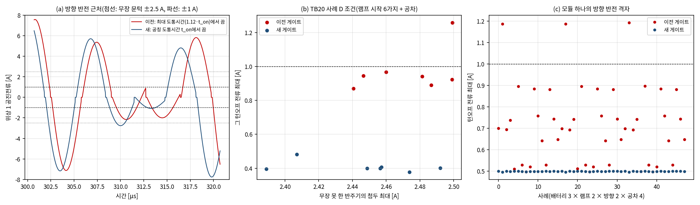
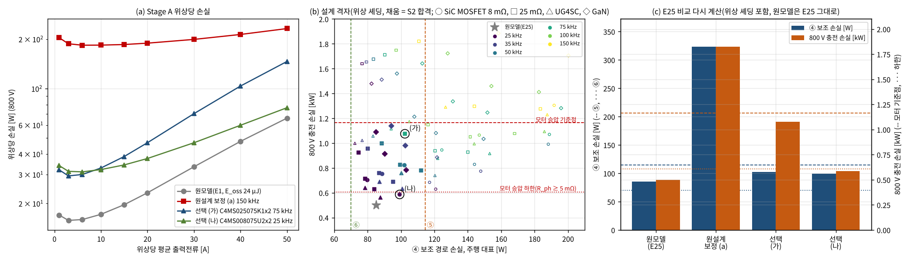
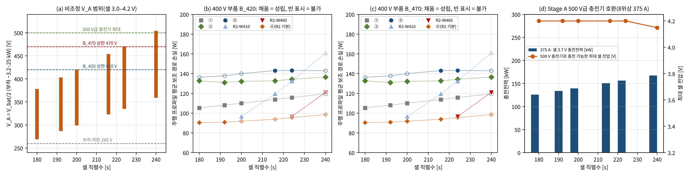
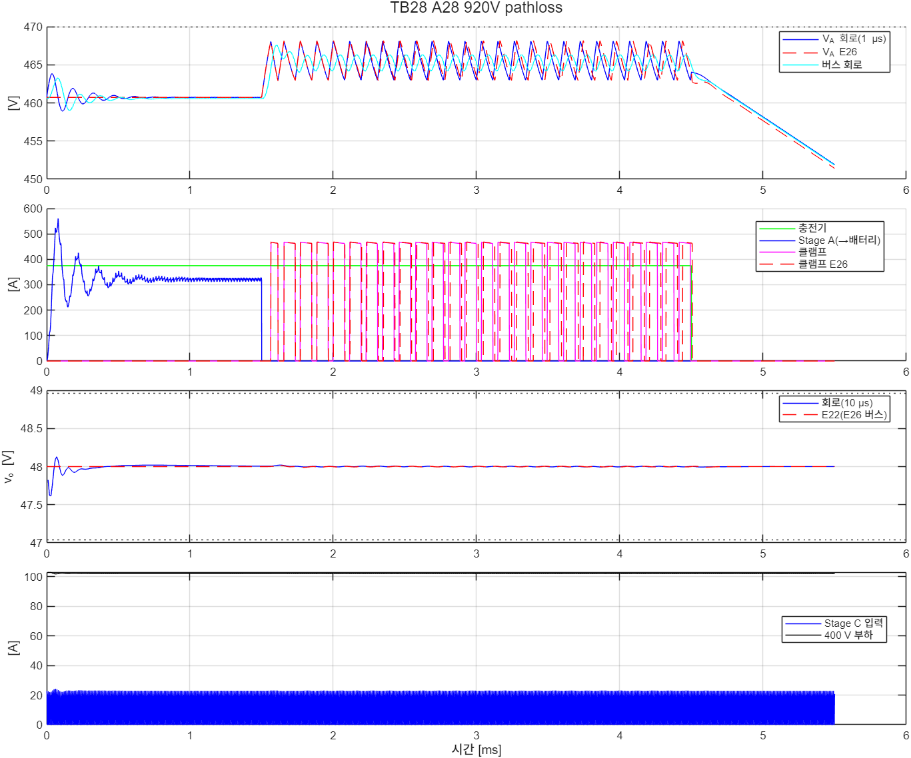
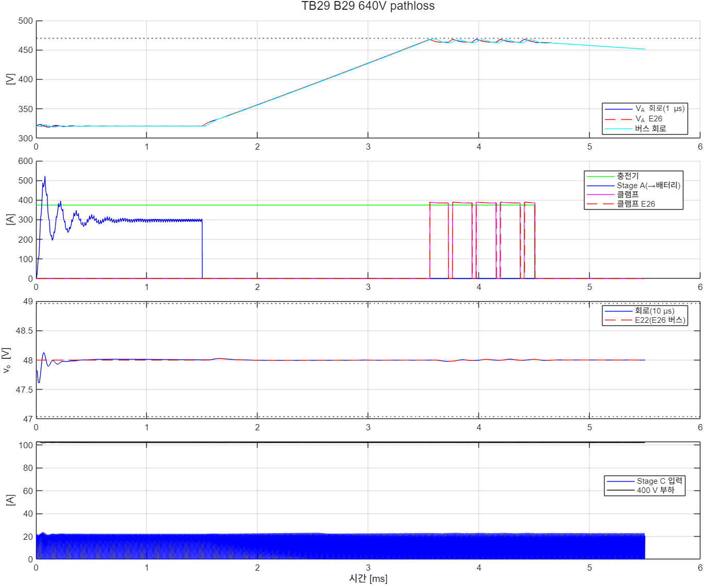
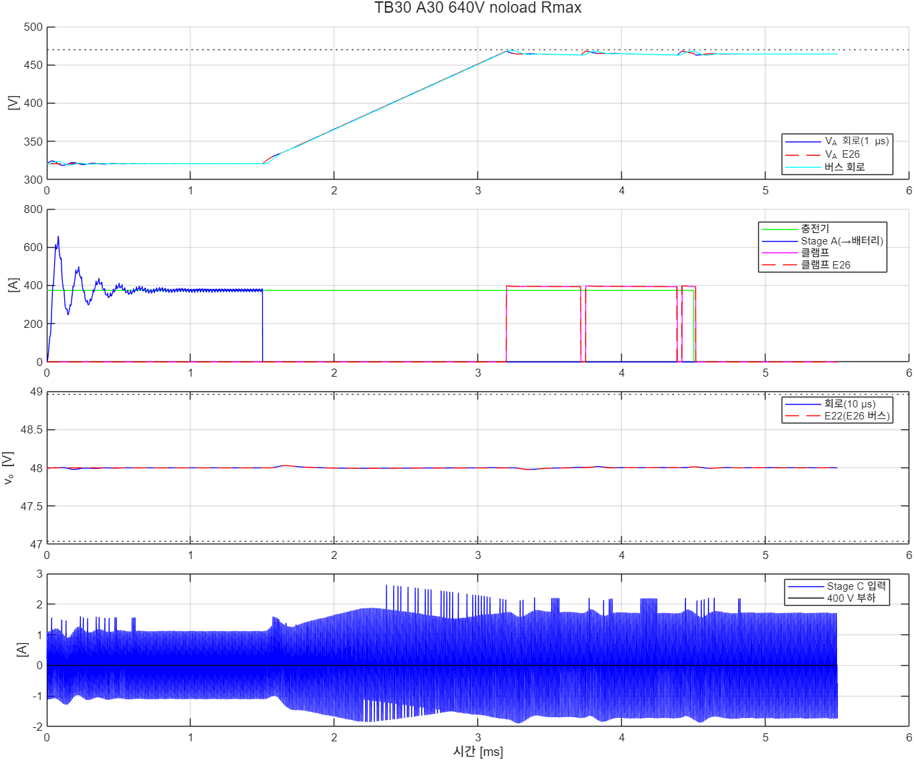
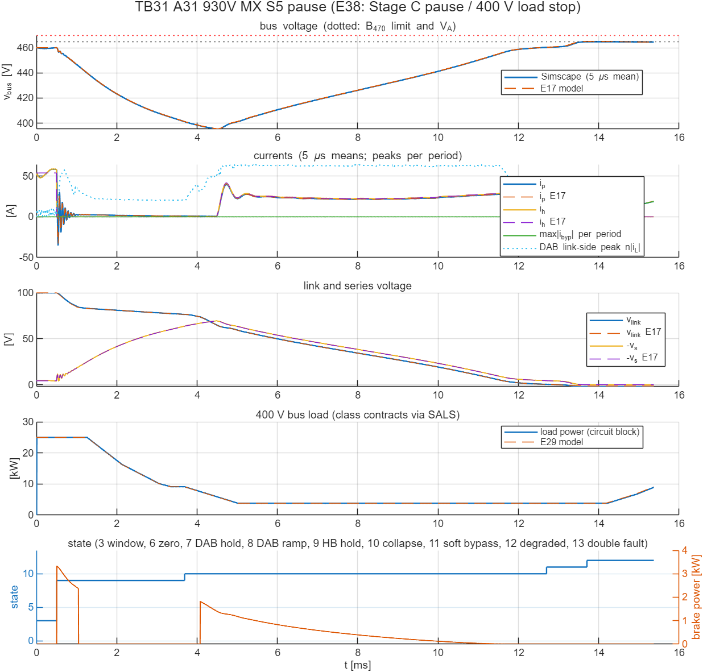
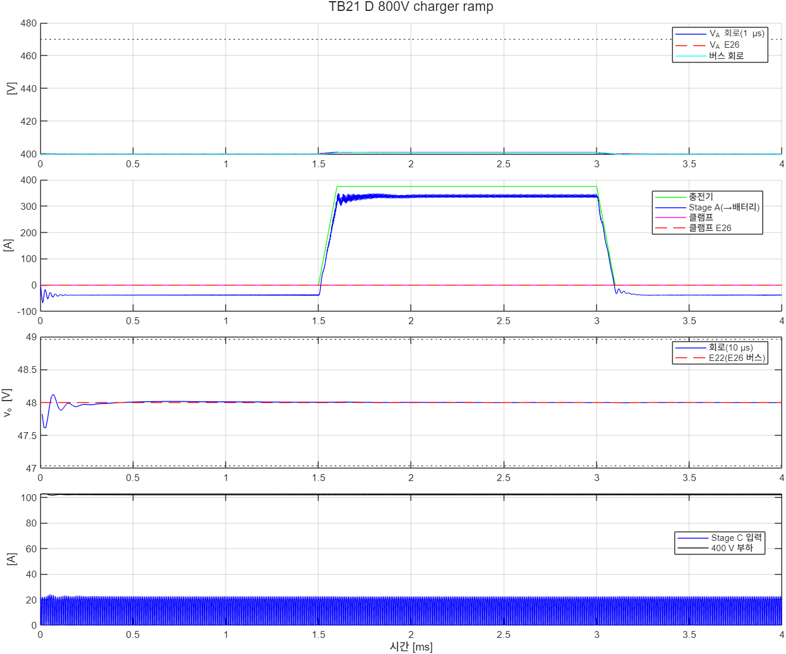

# 그림 목록(장별 추천)

- 1절은 [01_최종보고서_구성안.md](01_최종보고서_구성안.md)의 장 구성에 맞춘 **추천 그림**이다. "10-26판"은 중간보고서 원고(`report/interim4`)에서 이미 쓴 그림이고, **새 그림**은 10-27–10-29 검증(E27–E37, TB21–TB29)에서 나온 것이다. 2026-10-29: 장 번호를 01의 20장 구성에 맞추고 E30–E37·TB24–TB29 그림을 더했다. 6·7·13·15장의 10-26판 그림은 150 kHz 값이므로 최종 값(A25R) 그림으로 바꾼다.
- 그림 번호는 제안이다. 캡션 초안은 근거 문서의 그림 설명을 줄인 것이다.
- 2절은 새 그림을 미리 보기로 붙였다(GitHub에서 바로 확인).
- 부록은 `tools/build_index.py`가 저장소의 그림을 모두 모은 목록이다(이 파일의 부록 위는 손으로, 부록은 자동으로 고친다).

## 1. 장별 추천 그림

| 장 | 그림(제안) | 파일 | 캡션 초안 | 출처 | 비고 |
|---|---|---|---|---|---|
| 2 | 그림 2-1 | [fig12b_r2_architecture.png](../docs/fig/report/fig12b_r2_architecture.png) | R2 구조: Stage A 2:1(4모듈) 중심 허브, V\_A 노드의 충전기·보조버스·조정형 Stage C, 팩 등급 조건부 창 조정 모듈 | docs/23, 원고 `figs.py` | 10-26판. SALS 감발 경로를 그림에 넣을지 검토 |
| 3 | 그림 3-1 | [fig8_sals.png](../docs/fig/report/fig8_sals.png) | SALS 부하 승인 계층 | docs/14 | 1차 중간보고서(09-24) 그림. 3.5절 6항(보호 감발)을 다룰 때 함께 |
| 5 | 그림 5-1 | [fig4_traces.png](../docs/fig/report/fig4_traces.png), [fig11_corner_r1.png](../docs/fig/report/fig11_corner_r1.png) | Stage B 부하 스텝 응답(640·788·920 V의 버스전압·경로전류·링크전압)과 640 V 설계 코너의 포트별 사용률(R1 제어기, Tier-1·2) | docs/15, docs/16 | 1차 중간보고서 그림. 5장을 줄이면 하나만 |
| 6 | 그림 6-1 | [E15_comparison.png](../validation/2026-10-22-baseline-loss-rating/E15/E15_comparison.png) | 기준 구조 대비 손실·반도체 수·스위치 VA(H5 기각) | docs/21 | 10-26판 |
| 6 | **그림 6-2** | (새로 그릴 것) | 기준 구조 손실 비교의 A25R 값(docs/41 3.1절 표) | docs/21 정정 절, docs/41 | 그림 6-1은 150 kHz 값. E36 e15 결과로 다시 그리거나 표로 대신 |
| 7 | 그림 7-1 | [E18_value_map.png](../validation/2026-10-22-industry-value-r2/E18/E18_value_map.png) | 팩 등급별 V\_A 범위와 창 조정 모듈이 필요한 팩 | docs/23 | 10-26판 |
| 7 | 그림 7-2 | [tb08_bypass_transitions.png](../docs/fig/tb08_bypass_transitions.png) | TB08 창 조정 모듈의 바이패스 전이(회로) | docs/23 | 10-26판 |
| 7 | **그림 7-3** | [e18_A25R_value_map.png](../validation/2026-10-28-a25r-impact/E36/e18_A25R_value_map.png) | 가치 지도(A25R): 팩 등급·부품 등급별 최선 구조 | docs/41 3.3절 | **새 그림**. 그림 7-1 대신. 최종 Stage C로 다시 그린 [l1_e18_A25R_value_map.png](../validation/2026-10-29-review-response/E38/l1_e18_A25R_value_map.png)(E38, 칸 같음)을 쓸 수 있다 |
| 8 | 그림 8-1 | [E16_charging_transients.png](../validation/2026-10-22-charging-integration/E16/E16_charging_transients.png) | 충전 중 보조버스 과도(충전전류 램프 조건) | docs/22 | 10-26판 |
| 9 | 그림 9-1 | [fig13b_fault_sequence.png](../docs/fig/report/fig13b_fault_sequence.png) | R2 보호 강등 순서(다이오드 클램프 → 분리 → 붕괴 → 소프트 투입) | docs/24 | 10-26판. 감발·접촉기 대체 경로를 더할지 검토 |
| 9 | 그림 9-2 | [E20_dab_fault_modulation.png](../validation/2026-10-24-dab-fault-modulation/E20/E20_dab_fault_modulation.png) | DAB 고장 모드 변조 정책 비교(P3) | docs/25 | 10-26판 |
| 9 | 그림 9-3 | [E21_dab_switching_margin.png](../validation/2026-10-25-dab-switching-margin/E21/E21_dab_switching_margin.png) | DAB 회로 여유와 설계 상한 1.387배 | docs/26 | 10-26판. **원고 경로를 이 경로로 바꿀 것**(01 3절) |
| 9 | **그림 9-4** | [E29_sals_degradation.png](../validation/2026-10-28-sals-link/E29/E29_sals_degradation.png) | 보호 상태기계–SALS 연동: 남는 부하별 강등 완료 시각, 부하전류 추정에 의한 유지 종료, 30 ms 접촉기 대체, Stage C 회생 차단 유무, 이중 고장 | docs/35 그림 1 | **새 그림**. 9칸이라 보고서에서는 (a)(b)(c)(g)(h)만 쓰는 축약판을 검토 |
| 9 | **그림 9-5** | [TB23_A_930V_MX_S5_response.png](../simulink/tb/TB23_R2_SALS_Link/results/TB23_A_930V_MX_S5_response.png) | TB23 사례 A: 회로(실선)와 E29 모델(점선), 부하가 계약 변화율로 줄고 붕괴 | docs/35 그림 2 | **새 그림** |
| 9 | **그림 9-7** | [TB31_A31_930V_MX_S5_pause_response.png](../simulink/tb/TB31_R2_ScPause_LoadStop/results/TB31_A31_930V_MX_S5_pause_response.png) · [TB31_E31_1008V_dab_double_stop_response.png](../simulink/tb/TB31_R2_ScPause_LoadStop/results/TB31_E31_1008V_dab_double_stop_response.png) | Stage C 일시 정지가 있는 H-브리지 개방 강등(소프트 투입 0.0227 J), 이중 고장 400 V 부하 정지(경로전류 1.11 ms) | docs/43 4절, TB31 README | **새 그림** |
| 9 | (선택) 그림 9-6 | [TB23_C_930V_R1_noblock_response.png](../simulink/tb/TB23_R2_SALS_Link/results/TB23_C_930V_R1_noblock_response.png) · [TB23_D_930V_R1_block_response.png](../simulink/tb/TB23_R2_SALS_Link/results/TB23_D_930V_R1_block_response.png) | 48 V 회생: 차단 없음(481.0 V, 불통과)과 차단(467.5 V) | docs/35 7절 | **새 그림**. 불통과 결과를 보이는 그림 |
| 10 | 그림 10-1 | [E22_stage_c_regulated.png](../validation/2026-10-25-stage-c-regulated/E22/E22_stage_c_regulated.png) | 조정형 Stage C | docs/27 | 10-26판 |
| 10 | 그림 10-2 | [E23_degrade.png](../validation/2026-10-25-r2-integrated/E23/E23_degrade.png) | R2 통합 강등 | docs/28 | 10-26판 |
| 11 | 그림 11-1 | [E24_stage_a_shedding.png](../validation/2026-10-26-stage-a-shedding/E24/E24_stage_a_shedding.png) | Stage A 위상 셰딩 | docs/29 | 10-26판 |
| 11 | **그림 11-2** | [E28_stage_a_modules.png](../validation/2026-10-28-stage-a-modules/E28/E28_stage_a_modules.png) | 4모듈 관리기: 모듈 수별 손실, 문턱, 공차 표본 결과 | docs/34 | **새 그림** |
| 11 | **그림 11-3** | [TB22_MC_800V_charge_prestart_response.png](../simulink/tb/TB22_StageA_Modules/results/TB22_MC_800V_charge_prestart_response.png) · [TB22_MF_800V_charge_no_prestart_response.png](../simulink/tb/TB22_StageA_Modules/results/TB22_MF_800V_charge_no_prestart_response.png) | 충전 전 사전 기동 있음(MC 74.0 A, 통과)과 없음(MF 83.2 A, 불통과) | docs/34 | **새 그림**. 두 그림을 나란히 |
| 11 | **그림 11-4** | [E30_module_fault.png](../validation/2026-10-28-module-fault/E30/E30_module_fault.png) | Stage A 모듈 고장과 관리기 연동 | docs/36 | **새 그림**(150 kHz 설계) |
| 11 | (선택) 그림 11-5 | [TB24_FF_800V_charge_m1_response.png](../simulink/tb/TB24_StageA_ModuleFault/results/TB24_FF_800V_charge_m1_response.png) | TB24 충전 중 모듈 고장(회로) | docs/36 | 새 그림 |
| 12 | 그림 12-1 | [E26_charging_stop.png](../validation/2026-10-26-charging-stop/E26/E26_charging_stop.png) | 충전 중 Stage A 정지 협조와 V\_A 클램프 | docs/31 | 10-26판 |
| 12 | 그림 12-2 | [TB20_A_920V_pathloss_response.png](../simulink/tb/TB20_R2_Charging_Stop/results/TB20_A_920V_pathloss_response.png) | TB20 사례 A: 충전 중 경로 상실(회로) | docs/31 | 10-26판 |
| 12 | **그림 12-3** | [E27_zcp_reversal.png](../validation/2026-10-27-zcp-reversal/E27/E27_zcp_reversal.png) | 영교차 게이트의 방향 반전: 무장하지 못한 반주기의 턴오프 전류, 이전·새 처리 비교 | docs/32 | **새 그림** |
| 12 | **그림 12-4** | [TB20_D_800V_charger_ramp_response.png](../simulink/tb/TB20_R2_Charging_Stop/results/TB20_D_800V_charger_ramp_response.png) · [TB21_D_800V_charger_ramp_response.png](../simulink/tb/TB21_R2_Charging_Reversal/results/TB21_D_800V_charger_ramp_response.png) | 사례 D 수정 전(1.010 A, 불통과)과 수정 뒤(0.83 A, 통과) | docs/31, docs/32 | **새 그림**. 두 그림을 나란히 |
| 12 | **그림 12-5** | [TB28_A28_920V_pathloss_response.png](../simulink/tb/TB28_A25R_Charging_Stop/results/TB28_A28_920V_pathloss_response.png) | 최종 설계(A25R) 충전 중 경로 상실과 V\_A 클램프(회로) | docs/41 | **새 그림**. 그림 12-2(TB20) 대신 |
| 12 | **그림 12-6** | [TB29_B29_640V_pathloss_response.png](../simulink/tb/TB29_A25R_Clamp12/results/TB29_B29_640V_pathloss_response.png) | 클램프 1.2 Ω에서 640 V 경로 상실(버스 최고 468.93 V) | TB29 README, docs/42 | 새 그림(E38에서 대체: 그림 12-7) |
| 12 | **그림 12-7** | [TB30_A30_640V_noload_Rmax_response.png](../simulink/tb/TB30_A25R_ClampTol/results/TB30_A30_640V_noload_Rmax_response.png) · [TB30_B30_920V_noload_Rmin_response.png](../simulink/tb/TB30_A25R_ClampTol/results/TB30_B30_920V_noload_Rmin_response.png) | 재선정 클램프의 두 저항 모서리: 큰 저항 버스 469.35 V, 작은 저항 가지 392.7 A | docs/43 4절, TB30 README | **새 그림**. 그림 12-6 대신 |
| 13 | **그림 13-1** | [E31_stage_a_coss.png](../validation/2026-10-28-stage-a-coss/E31/E31_stage_a_coss.png) | Stage A 출력용량 손실: 영전류 스위칭의 하드 스위칭 전이, 설계 격자(f\_r ≤ 75 kHz만 합격) | docs/37 | **새 그림** |
| 13 | (선택) 그림 13-2 | [TB25_coss.png](../simulink/tb/TB25_StageA_Coss/results/TB25_coss.png) | 회로의 무부하 출력용량 손실 = 4·C·V²·f | docs/37 | 새 그림 |
| 13 | **그림 13-3** | [E32_stage_a_25k.png](../validation/2026-10-28-stage-a-25k/E32/E32_stage_a_25k.png) · [E33_stage_a_25k_dynamics.png](../validation/2026-10-28-stage-a-25k/E33/E33_stage_a_25k_dynamics.png) | A25 손실·문턱과 동특성(과도 불통과) | docs/38 | **새 그림** |
| 13 | **그림 13-4** | [TB27_MC27_800V_charge_slow_response.png](../simulink/tb/TB27_StageA25R_Integrated/results/TB27_MC27_800V_charge_slow_response.png) · [TB27_SC27_800V_charge_steady_response.png](../simulink/tb/TB27_StageA25R_Integrated/results/TB27_SC27_800V_charge_steady_response.png) | A25R 느린 충전과 정격 충전 정상상태(손실 대조 +3.0 %) | docs/40 | **새 그림**. E35 판정 요약 그림은 없음(표로) |
| 14 | **그림 14-1** | [e25_motor_boost.png](../validation/2026-10-28-a25r-impact/E36/e25_motor_boost.png) | 모터 승압 대비 충전 손실(A25R, 920 V에서 하한보다 6 W 큼) | docs/41 3.2절 | **새 그림**. 15장 그림 15-1(150 kHz) 대신. 보조 손실까지 최종 Stage C로 다시 그린 것은 [l1_e25_motor_boost.png](../validation/2026-10-29-review-response/E38/l1_e25_motor_boost.png)(E38) |
| 15 | 그림 15-1 | [E25_motor_boost.png](../validation/2026-10-26-positioning/E25/E25_motor_boost.png) | 모터·인버터 승압·800 V급 보조부품 설계와의 손실 비교 | docs/30 | 10-26판(150 kHz). 그림 14-1로 바꾸거나 "150 kHz 원 시험"이라고 적는다 |
| 16 | **그림 16-1** | [E34_parts_rating.png](../validation/2026-10-28-parts-rating/E34/E34_parts_rating.png) | 부품 정격 1차: 모의 스트레스와 데이터시트 여유 | docs/39 | **새 그림**. 2차(E37) 그림은 없음(docs/42 4절 표로) |

## 2. 새 그림 미리 보기

### E29 보호 상태기계–SALS 연동(9장)

### TB23 사례 A(9장)

### E28 4모듈 관리기(11장)

### TB22 사례 MC(11장)

### E27 영교차 게이트 방향 반전(12장)

### E31 Stage A 출력용량 손실(13장)

### 가치 지도 A25R(7장)

### TB28 사례 A(12장)

### TB29 사례 B(12·16장)

### TB30 두 저항 모서리(12·16장)

### TB31 Stage C 일시 정지·400 V 부하 정지(9장)

### TB21 사례 D(12장)

## 부록. 저장소의 그림 전체 목록(자동 생성)

검증 코드 그림(validation)과 회로 응답 그림(simulink/tb/*/results의 *_response.png, *_waveforms.png)이다.

- **2026-09-22-fixed-control**: [fixed_control.png](../validation/2026-09-22-fixed-control/fixed_control.png)
- **2026-09-22-integration**: [two_stage.png](../validation/2026-09-22-integration/two_stage.png)
- **2026-10-11-matlab-switching**: [E12_steady_700V.png](../validation/2026-10-11-matlab-switching/E12/E12_steady_700V.png), [E12_transient_640V.png](../validation/2026-10-11-matlab-switching/E12/E12_transient_640V.png)
- **2026-10-12-baseline-structures**: [E13_baseline_comparison.png](../validation/2026-10-12-baseline-structures/E13/E13_baseline_comparison.png)
- **2026-10-12-protection-startup**: [E14_protection_startup.png](../validation/2026-10-12-protection-startup/E14/E14_protection_startup.png)
- **2026-10-22-baseline-loss-rating**: [E15_comparison.png](../validation/2026-10-22-baseline-loss-rating/E15/E15_comparison.png)
- **2026-10-22-charging-integration**: [E16_charging_transients.png](../validation/2026-10-22-charging-integration/E16/E16_charging_transients.png)
- **2026-10-22-industry-value-r2**: [E18_value_map.png](../validation/2026-10-22-industry-value-r2/E18/E18_value_map.png), [E19_r2_window.png](../validation/2026-10-22-industry-value-r2/E19/E19_r2_window.png)
- **2026-10-24-dab-fault-modulation**: [E20_dab_fault_modulation.png](../validation/2026-10-24-dab-fault-modulation/E20/E20_dab_fault_modulation.png)
- **2026-10-24-protection-r2**: [E17_r2_dab_stress.png](../validation/2026-10-24-protection-r2/E17/E17_r2_dab_stress.png), [E17_r2_hbridge_fault.png](../validation/2026-10-24-protection-r2/E17/E17_r2_hbridge_fault.png), [E17_r2_transitions.png](../validation/2026-10-24-protection-r2/E17/E17_r2_transitions.png)
- **2026-10-25-dab-switching-margin**: [E21_dab_switching_margin.png](../validation/2026-10-25-dab-switching-margin/E21/E21_dab_switching_margin.png)
- **2026-10-25-r2-integrated**: [E23_degrade.png](../validation/2026-10-25-r2-integrated/E23/E23_degrade.png), [E23_r2_integrated.png](../validation/2026-10-25-r2-integrated/E23/E23_r2_integrated.png)
- **2026-10-25-stage-c-regulated**: [E22_stage_c_regulated.png](../validation/2026-10-25-stage-c-regulated/E22/E22_stage_c_regulated.png), [E22_zvs_gain.png](../validation/2026-10-25-stage-c-regulated/E22/E22_zvs_gain.png), [TB14_C_504V_rev_cllc.png](../validation/2026-10-25-stage-c-regulated/TB14_run1/TB14_C_504V_rev_cllc.png)
- **2026-10-26-charging-stop**: [E26_charging_stop.png](../validation/2026-10-26-charging-stop/E26/E26_charging_stop.png)
- **2026-10-26-positioning**: [E25_motor_boost.png](../validation/2026-10-26-positioning/E25/E25_motor_boost.png)
- **2026-10-26-stage-a-shedding**: [E24_stage_a_shedding.png](../validation/2026-10-26-stage-a-shedding/E24/E24_stage_a_shedding.png)
- **2026-10-27-zcp-reversal**: [E27_zcp_reversal.png](../validation/2026-10-27-zcp-reversal/E27/E27_zcp_reversal.png)
- **2026-10-28-a25r-impact**: [e18_A25R_value_map.png](../validation/2026-10-28-a25r-impact/E36/e18_A25R_value_map.png), [e18_R1_value_map.png](../validation/2026-10-28-a25r-impact/E36/e18_R1_value_map.png), [e25_motor_boost.png](../validation/2026-10-28-a25r-impact/E36/e25_motor_boost.png)
- **2026-10-28-module-fault**: [E30_module_fault.png](../validation/2026-10-28-module-fault/E30/E30_module_fault.png)
- **2026-10-28-parts-rating**: [E34_parts_rating.png](../validation/2026-10-28-parts-rating/E34/E34_parts_rating.png)
- **2026-10-28-sals-link**: [E29_sals_degradation.png](../validation/2026-10-28-sals-link/E29/E29_sals_degradation.png)
- **2026-10-28-stage-a-25k**: [E32_stage_a_25k.png](../validation/2026-10-28-stage-a-25k/E32/E32_stage_a_25k.png), [E33_stage_a_25k_dynamics.png](../validation/2026-10-28-stage-a-25k/E33/E33_stage_a_25k_dynamics.png)
- **2026-10-28-stage-a-coss**: [E31_stage_a_coss.png](../validation/2026-10-28-stage-a-coss/E31/E31_stage_a_coss.png)
- **2026-10-28-stage-a-modules**: [E28_stage_a_modules.png](../validation/2026-10-28-stage-a-modules/E28/E28_stage_a_modules.png)
- **2026-10-29-review-response**: [l1_e18_A25R_value_map.png](../validation/2026-10-29-review-response/E38/l1_e18_A25R_value_map.png), [l1_e18_R1_value_map.png](../validation/2026-10-29-review-response/E38/l1_e18_R1_value_map.png), [l1_e25_motor_boost.png](../validation/2026-10-29-review-response/E38/l1_e25_motor_boost.png)
- **TB01_StageA_RSC**: [TB01_waveforms.png](../simulink/tb/TB01_StageA_RSC/results/TB01_waveforms.png)
- **TB04B_StageB_DAB_Coss**: [TB04B_A_640V_15to25kW_device_0.625ns_response.png](../simulink/tb/TB04B_StageB_DAB_Coss/results/TB04B_A_640V_15to25kW_device_0.625ns_response.png), [TB04B_A_640V_15to25kW_device_1.25ns_response.png](../simulink/tb/TB04B_StageB_DAB_Coss/results/TB04B_A_640V_15to25kW_device_1.25ns_response.png), [TB04B_A_640V_15to25kW_device_5ns_response.png](../simulink/tb/TB04B_StageB_DAB_Coss/results/TB04B_A_640V_15to25kW_device_5ns_response.png), [TB04B_A_640V_15to25kW_device_response.png](../simulink/tb/TB04B_StageB_DAB_Coss/results/TB04B_A_640V_15to25kW_device_response.png), [TB04B_A_640V_15to25kW_er_response.png](../simulink/tb/TB04B_StageB_DAB_Coss/results/TB04B_A_640V_15to25kW_er_response.png), [TB04B_A_640V_15to25kW_tb04equiv_response.png](../simulink/tb/TB04B_StageB_DAB_Coss/results/TB04B_A_640V_15to25kW_tb04equiv_response.png), [TB04B_B_788V_0to10kW_device_0.625ns_response.png](../simulink/tb/TB04B_StageB_DAB_Coss/results/TB04B_B_788V_0to10kW_device_0.625ns_response.png), [TB04B_B_788V_0to10kW_device_1.25ns_response.png](../simulink/tb/TB04B_StageB_DAB_Coss/results/TB04B_B_788V_0to10kW_device_1.25ns_response.png), [TB04B_B_788V_0to10kW_device_response.png](../simulink/tb/TB04B_StageB_DAB_Coss/results/TB04B_B_788V_0to10kW_device_response.png)
- **TB04_StageB_ClosedLoop**: [TB04_A_640V_15to25kW_dt1.25ns_response.png](../simulink/tb/TB04_StageB_ClosedLoop/results/TB04_A_640V_15to25kW_dt1.25ns_response.png), [TB04_A_640V_15to25kW_dt2.5ns_Cossd20pF_response.png](../simulink/tb/TB04_StageB_ClosedLoop/results/TB04_A_640V_15to25kW_dt2.5ns_Cossd20pF_response.png), [TB04_A_640V_15to25kW_dt2.5ns_Cossd500pF_response.png](../simulink/tb/TB04_StageB_ClosedLoop/results/TB04_A_640V_15to25kW_dt2.5ns_Cossd500pF_response.png), [TB04_A_640V_15to25kW_dt2.5ns_response.png](../simulink/tb/TB04_StageB_ClosedLoop/results/TB04_A_640V_15to25kW_dt2.5ns_response.png), [TB04_A_640V_15to25kW_response.png](../simulink/tb/TB04_StageB_ClosedLoop/results/TB04_A_640V_15to25kW_response.png), [TB04_B_788V_0to10kW_dt2.5ns_response.png](../simulink/tb/TB04_StageB_ClosedLoop/results/TB04_B_788V_0to10kW_dt2.5ns_response.png), [TB04_B_788V_0to10kW_response.png](../simulink/tb/TB04_StageB_ClosedLoop/results/TB04_B_788V_0to10kW_response.png)
- **TB06_Integrated_Drive**: [TB06_A_640V_15to25kW_dt2.5ns_response.png](../simulink/tb/TB06_Integrated_Drive/results/TB06_A_640V_15to25kW_dt2.5ns_response.png), [TB06_A_640V_15to25kW_response.png](../simulink/tb/TB06_Integrated_Drive/results/TB06_A_640V_15to25kW_response.png), [TB06_B_788V_5to15kW_response.png](../simulink/tb/TB06_Integrated_Drive/results/TB06_B_788V_5to15kW_response.png), [TB06_C_920V_25to15kW_response.png](../simulink/tb/TB06_Integrated_Drive/results/TB06_C_920V_25to15kW_response.png)
- **TB07_Integrated_Charging**: [TB07_A_640V_chg_15to25kW_response.png](../simulink/tb/TB07_Integrated_Charging/results/TB07_A_640V_chg_15to25kW_response.png), [TB07_B_920V_chgstop_25kW_response.png](../simulink/tb/TB07_Integrated_Charging/results/TB07_B_920V_chgstop_25kW_response.png), [TB07_C2_788V_chgon_5kW_100us_response.png](../simulink/tb/TB07_Integrated_Charging/results/TB07_C2_788V_chgon_5kW_100us_response.png), [TB07_C3_788V_chgon_5kW_1ms_response.png](../simulink/tb/TB07_Integrated_Charging/results/TB07_C3_788V_chgon_5kW_1ms_response.png), [TB07_C_788V_chgon_5kW_response.png](../simulink/tb/TB07_Integrated_Charging/results/TB07_C_788V_chgon_5kW_response.png), [TB07_D_640V_chgon_25kW_response.png](../simulink/tb/TB07_Integrated_Charging/results/TB07_D_640V_chgon_25kW_response.png), [TB07_E_640V_chgstop_25kW_response.png](../simulink/tb/TB07_Integrated_Charging/results/TB07_E_640V_chgstop_25kW_response.png)
- **TB08_R2_WindowModule**: [TB08_A_1008V_1to25kW_0.625ns_response.png](../simulink/tb/TB08_R2_WindowModule/results/TB08_A_1008V_1to25kW_0.625ns_response.png), [TB08_A_1008V_1to25kW_response.png](../simulink/tb/TB08_R2_WindowModule/results/TB08_A_1008V_1to25kW_response.png), [TB08_B_930V_15to25kW_response.png](../simulink/tb/TB08_R2_WindowModule/results/TB08_B_930V_15to25kW_response.png), [TB08_C_910V_disable_25kW_response.png](../simulink/tb/TB08_R2_WindowModule/results/TB08_C_910V_disable_25kW_response.png), [TB08_D_1008V_dabfault_25kW_response.png](../simulink/tb/TB08_R2_WindowModule/results/TB08_D_1008V_dabfault_25kW_response.png), [TB08_E_930V_enable_25kW_response.png](../simulink/tb/TB08_R2_WindowModule/results/TB08_E_930V_enable_25kW_response.png)
- **TB09_R2_Protection**: [TB09_A_1008V_hbopen_25kW_response.png](../simulink/tb/TB09_R2_Protection/results/TB09_A_1008V_hbopen_25kW_response.png), [TB09_B_930V_hbopen_25kW_response.png](../simulink/tb/TB09_R2_Protection/results/TB09_B_930V_hbopen_25kW_response.png), [TB09_C_930V_enable_steer_25kW_response.png](../simulink/tb/TB09_R2_Protection/results/TB09_C_930V_enable_steer_25kW_response.png), [TB09_D_1008V_dabfault_25kW_response.png](../simulink/tb/TB09_R2_Protection/results/TB09_D_1008V_dabfault_25kW_response.png)
- **TB10_R2_FaultMod**: [TB10_A_1008V_hbopen_25kW_response.png](../simulink/tb/TB10_R2_FaultMod/results/TB10_A_1008V_hbopen_25kW_response.png), [TB10_B_930V_hbopen_25kW_response.png](../simulink/tb/TB10_R2_FaultMod/results/TB10_B_930V_hbopen_25kW_response.png), [TB10_C_930V_enable_steer_25kW_response.png](../simulink/tb/TB10_R2_FaultMod/results/TB10_C_930V_enable_steer_25kW_response.png)
- **TB11_R2_FaultMod_SW**: [TB11_A_1008V_hbopen_25kW_response.png](../simulink/tb/TB11_R2_FaultMod_SW/results/TB11_A_1008V_hbopen_25kW_response.png), [TB11_B_930V_hbopen_25kW_response.png](../simulink/tb/TB11_R2_FaultMod_SW/results/TB11_B_930V_hbopen_25kW_response.png)
- **TB12_R2_FaultMod_TR**: [TB12_A_1008V_hbopen_25kW_response.png](../simulink/tb/TB12_R2_FaultMod_TR/results/TB12_A_1008V_hbopen_25kW_response.png), [TB12_B_930V_hbopen_25kW_response.png](../simulink/tb/TB12_R2_FaultMod_TR/results/TB12_B_930V_hbopen_25kW_response.png)
- **TB13_R2_FaultMod_TA**: [TB13_A_1008V_hbopen_25kW_response.png](../simulink/tb/TB13_R2_FaultMod_TA/results/TB13_A_1008V_hbopen_25kW_response.png), [TB13_B_930V_hbopen_25kW_response.png](../simulink/tb/TB13_R2_FaultMod_TA/results/TB13_B_930V_hbopen_25kW_response.png)
- **TB14_StageC_Regulated**: [TB14_A_400V_ramp_response.png](../simulink/tb/TB14_StageC_Regulated/results/TB14_A_400V_ramp_response.png), [TB14_B_270V_step_response.png](../simulink/tb/TB14_StageC_Regulated/results/TB14_B_270V_step_response.png), [TB14_C_504V_rev_response.png](../simulink/tb/TB14_StageC_Regulated/results/TB14_C_504V_rev_response.png), [TB14_D_bus_step_response.png](../simulink/tb/TB14_StageC_Regulated/results/TB14_D_bus_step_response.png), [TB14_E_400V_bat_response.png](../simulink/tb/TB14_StageC_Regulated/results/TB14_E_400V_bat_response.png), [TB14_F_400V_rev_light_response.png](../simulink/tb/TB14_StageC_Regulated/results/TB14_F_400V_rev_light_response.png), [TB14_G_270V_rev_light_response.png](../simulink/tb/TB14_StageC_Regulated/results/TB14_G_270V_rev_light_response.png)
- **TB15_StageC_LightLoad**: [TB15_A_400V_ramp_response.png](../simulink/tb/TB15_StageC_LightLoad/results/TB15_A_400V_ramp_response.png), [TB15_C_504V_rev_response.png](../simulink/tb/TB15_StageC_LightLoad/results/TB15_C_504V_rev_response.png), [TB15_F_400V_rev_light_response.png](../simulink/tb/TB15_StageC_LightLoad/results/TB15_F_400V_rev_light_response.png), [TB15_G_270V_rev_light_response.png](../simulink/tb/TB15_StageC_LightLoad/results/TB15_G_270V_rev_light_response.png), [TB15_H_400V_cross_response.png](../simulink/tb/TB15_StageC_LightLoad/results/TB15_H_400V_cross_response.png)
- **TB16_R2_Base**: [TB16_A_540V_Cstep_response.png](../simulink/tb/TB16_R2_Base/results/TB16_A_540V_Cstep_response.png), [TB16_B_806V_Qstep_response.png](../simulink/tb/TB16_R2_Base/results/TB16_B_806V_Qstep_response.png), [TB16_C_907V_Cregen_response.png](../simulink/tb/TB16_R2_Base/results/TB16_C_907V_Cregen_response.png)
- **TB17_R2_Integrated**: [TB17_A_1008V_hbopen_response.png](../simulink/tb/TB17_R2_Integrated/results/TB17_A_1008V_hbopen_response.png), [TB17_B_930V_hbopen_response.png](../simulink/tb/TB17_R2_Integrated/results/TB17_B_930V_hbopen_response.png)
- **TB18_StageA_Shedding**: [TB18_F_1008V_bus_25_5_25kW_response.png](../simulink/tb/TB18_StageA_Shedding/results/TB18_F_1008V_bus_25_5_25kW_response.png), [TB18_G_540V_bus_13p5_2p7_13p5kW_response.png](../simulink/tb/TB18_StageA_Shedding/results/TB18_G_540V_bus_13p5_2p7_13p5kW_response.png), [TB18_H_1008V_bus5kW_charger_74A_response.png](../simulink/tb/TB18_StageA_Shedding/results/TB18_H_1008V_bus5kW_charger_74A_response.png), [TB18_I_1008V_bus_ramp_20_1p5_20kW_response.png](../simulink/tb/TB18_StageA_Shedding/results/TB18_I_1008V_bus_ramp_20_1p5_20kW_response.png), [TB18_J_1008V_bus5kW_rev_m16A_response.png](../simulink/tb/TB18_StageA_Shedding/results/TB18_J_1008V_bus5kW_rev_m16A_response.png)
- **TB19_R2_Integrated_Shed**: [TB19_A_1008V_hbopen_response.png](../simulink/tb/TB19_R2_Integrated_Shed/results/TB19_A_1008V_hbopen_response.png), [TB19_B_930V_hbopen_response.png](../simulink/tb/TB19_R2_Integrated_Shed/results/TB19_B_930V_hbopen_response.png)
- **TB20_R2_Charging_Stop**: [TB20_A_920V_pathloss_response.png](../simulink/tb/TB20_R2_Charging_Stop/results/TB20_A_920V_pathloss_response.png), [TB20_B_640V_pathloss_ramp_response.png](../simulink/tb/TB20_R2_Charging_Stop/results/TB20_B_640V_pathloss_ramp_response.png), [TB20_C_800V_module_fault_response.png](../simulink/tb/TB20_R2_Charging_Stop/results/TB20_C_800V_module_fault_response.png), [TB20_D_800V_charger_ramp_response.png](../simulink/tb/TB20_R2_Charging_Stop/results/TB20_D_800V_charger_ramp_response.png)
- **TB21_R2_Charging_Reversal**: [TB21_A_920V_pathloss_response.png](../simulink/tb/TB21_R2_Charging_Reversal/results/TB21_A_920V_pathloss_response.png), [TB21_B_640V_pathloss_ramp_response.png](../simulink/tb/TB21_R2_Charging_Reversal/results/TB21_B_640V_pathloss_ramp_response.png), [TB21_C_800V_module_fault_response.png](../simulink/tb/TB21_R2_Charging_Reversal/results/TB21_C_800V_module_fault_response.png), [TB21_D_800V_charger_ramp_response.png](../simulink/tb/TB21_R2_Charging_Reversal/results/TB21_D_800V_charger_ramp_response.png)
- **TB22_StageA_Modules**: [TB22_MA_540V_bus_5_25_5kW_response.png](../simulink/tb/TB22_StageA_Modules/results/TB22_MA_540V_bus_5_25_5kW_response.png), [TB22_MB_800V_bus_ramp_2_36_2kW_response.png](../simulink/tb/TB22_StageA_Modules/results/TB22_MB_800V_bus_ramp_2_36_2kW_response.png), [TB22_MC_800V_charge_prestart_response.png](../simulink/tb/TB22_StageA_Modules/results/TB22_MC_800V_charge_prestart_response.png), [TB22_MF_800V_charge_no_prestart_response.png](../simulink/tb/TB22_StageA_Modules/results/TB22_MF_800V_charge_no_prestart_response.png)
- **TB23_R2_SALS_Link**: [TB23_A_930V_MX_S5_response.png](../simulink/tb/TB23_R2_SALS_Link/results/TB23_A_930V_MX_S5_response.png), [TB23_B_930V_MX_LA_response.png](../simulink/tb/TB23_R2_SALS_Link/results/TB23_B_930V_MX_LA_response.png), [TB23_C_930V_R1_noblock_response.png](../simulink/tb/TB23_R2_SALS_Link/results/TB23_C_930V_R1_noblock_response.png), [TB23_D_930V_R1_block_response.png](../simulink/tb/TB23_R2_SALS_Link/results/TB23_D_930V_R1_block_response.png), [TB23_E_1008V_dab_double_response.png](../simulink/tb/TB23_R2_SALS_Link/results/TB23_E_1008V_dab_double_response.png)
- **TB24_StageA_ModuleFault**: [TB24_FA_800V_drive_15kW_m1_response.png](../simulink/tb/TB24_StageA_ModuleFault/results/TB24_FA_800V_drive_15kW_m1_response.png), [TB24_FB_540V_drive_25kW_m1_response.png](../simulink/tb/TB24_StageA_ModuleFault/results/TB24_FB_540V_drive_25kW_m1_response.png), [TB24_FF_800V_charge_m1_response.png](../simulink/tb/TB24_StageA_ModuleFault/results/TB24_FF_800V_charge_m1_response.png), [TB24_FH_800V_charge_m4_response.png](../simulink/tb/TB24_StageA_ModuleFault/results/TB24_FH_800V_charge_m4_response.png)
- **TB26_StageA25_Integrated**: [TB26_FA25_800V_drive_15kW_m1_response.png](../simulink/tb/TB26_StageA25_Integrated/results/TB26_FA25_800V_drive_15kW_m1_response.png), [TB26_FF25_800V_charge_m1_response.png](../simulink/tb/TB26_StageA25_Integrated/results/TB26_FF25_800V_charge_m1_response.png), [TB26_MC25_800V_charge_response.png](../simulink/tb/TB26_StageA25_Integrated/results/TB26_MC25_800V_charge_response.png)
- **TB27_StageA25R_Integrated**: [TB27_FF27_800V_charge_m1_response.png](../simulink/tb/TB27_StageA25R_Integrated/results/TB27_FF27_800V_charge_m1_response.png), [TB27_MA27_540V_bus_5_15_5kW_response.png](../simulink/tb/TB27_StageA25R_Integrated/results/TB27_MA27_540V_bus_5_15_5kW_response.png), [TB27_MC27_800V_charge_slow_response.png](../simulink/tb/TB27_StageA25R_Integrated/results/TB27_MC27_800V_charge_slow_response.png), [TB27_SC27_800V_charge_steady_response.png](../simulink/tb/TB27_StageA25R_Integrated/results/TB27_SC27_800V_charge_steady_response.png)
- **TB28_A25R_Charging_Stop**: [TB28_A28_920V_pathloss_response.png](../simulink/tb/TB28_A25R_Charging_Stop/results/TB28_A28_920V_pathloss_response.png), [TB28_B28_640V_pathloss_ramp_response.png](../simulink/tb/TB28_A25R_Charging_Stop/results/TB28_B28_640V_pathloss_ramp_response.png), [TB28_C28_800V_module_fault_response.png](../simulink/tb/TB28_A25R_Charging_Stop/results/TB28_C28_800V_module_fault_response.png), [TB28_D28_800V_charge_slow_response.png](../simulink/tb/TB28_A25R_Charging_Stop/results/TB28_D28_800V_charge_slow_response.png)
- **TB29_A25R_Clamp12**: [TB29_A29_920V_pathloss_response.png](../simulink/tb/TB29_A25R_Clamp12/results/TB29_A29_920V_pathloss_response.png), [TB29_B29_640V_pathloss_response.png](../simulink/tb/TB29_A25R_Clamp12/results/TB29_B29_640V_pathloss_response.png)
- **TB30_A25R_ClampTol**: [TB30_A30_640V_noload_Rmax_response.png](../simulink/tb/TB30_A25R_ClampTol/results/TB30_A30_640V_noload_Rmax_response.png), [TB30_B30_920V_noload_Rmin_response.png](../simulink/tb/TB30_A25R_ClampTol/results/TB30_B30_920V_noload_Rmin_response.png)
- **TB31_R2_ScPause_LoadStop**: [TB31_A31_930V_MX_S5_pause_response.png](../simulink/tb/TB31_R2_ScPause_LoadStop/results/TB31_A31_930V_MX_S5_pause_response.png), [TB31_E31_1008V_dab_double_stop_response.png](../simulink/tb/TB31_R2_ScPause_LoadStop/results/TB31_E31_1008V_dab_double_stop_response.png)
