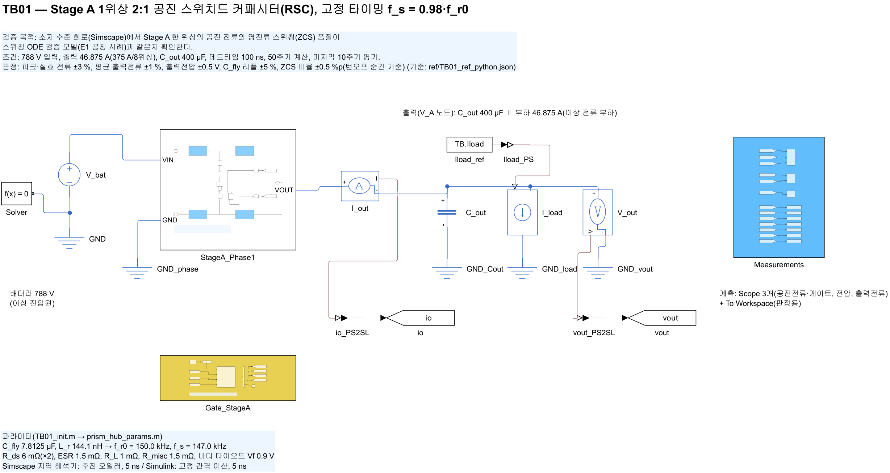
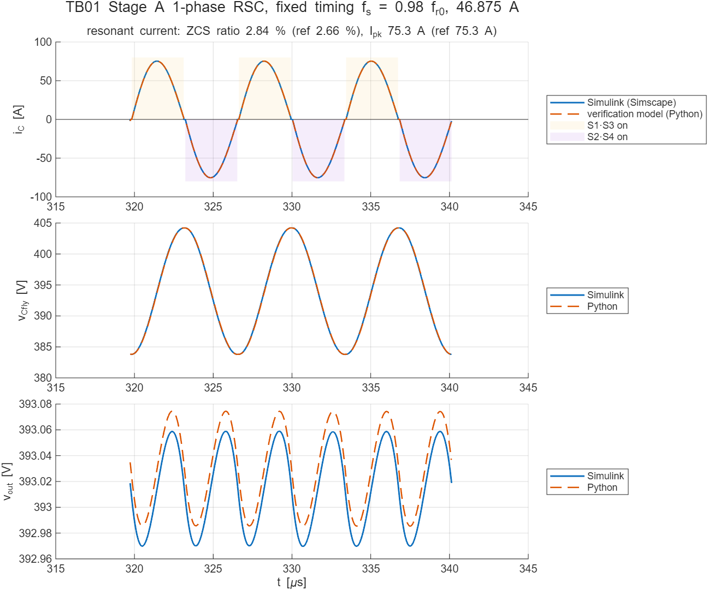

# TB01 — Stage A 1위상 2:1 공진 스위치드 커패시터(RSC)

**결론: 통과(2026-10-12).** Simscape 소자 수준 회로의 공진전류·플라잉 커패시터 전압·출력전압이 스위칭 ODE 검증 모델(E1 공칭 사례)과 0.2 % 이내로 일치했다. 턴오프 순간 전류는 피크의 2.84 %(검증 모델 2.66 %)로 ZCS 기준 5 %를 만족한다.

## 왜 필요한가

Stage A의 효율 이점은 영전류 스위칭(ZCS)에 달려 있다. E1은 이 동작을 직접 쓴 상미분방정식 모델로 확인했다. TB01은 같은 위상을 실제 소자(스위치, 바디 다이오드, 공진 L·C, 센서)로 결선한 회로에서 다시 계산한다. 두 모델이 독립적인 수치 해석기로 같은 파형을 내면, E1의 방정식과 결선 가정(경로 저항, 데드타임 중 다이오드 환류)이 옳다는 근거가 된다. 이 위상 서브시스템은 통합 모델(TB06)에서 그대로 재사용한다.

## 구성

| 그림 | 내용 |
| --- | --- |
|  | 배터리(이상 전압원) → `StageA_Phase1` → 출력전류 센서 → C_out ∥ 전류 부하. 게이트 생성기(`Gate_StageA`)와 계측부(`Measurements`)는 별도 서브시스템 |
|  | S1(VIN→A), S2(A→VOUT), S3(VOUT→B), S4(B→GND) 스위치 셀과 공진 경로 A–R_misc–L_r–C_fly–B. 셀 아래에 게이트 태그 표시 |

- 스위치 셀: 이상 스위치(R_on 6 mΩ) + 역병렬 바디 다이오드(Vf 0.9 V, 6 mΩ). 검증 모델과 같게 출력용량은 넣지 않았다.
- 게이트: `ctrl/prism_gate_stageA.m`(MATLAB Function 블록 안에 복사). 전반주기 [t_d, T/2) S1·S3, 후반주기 [T/2+t_d, T) S2·S4, T = 1/(0.98 f_r0), t_d = 100 ns.
- 해석기: Simulink 고정 간격 이산 5 ns, Simscape 지역 해석기 후진 오일러 5 ns. 50주기(340 µs) 계산, 마지막 10주기 평가. 실행 시간 약 6 s.

## 조건과 판정 기준

788 V 입력, 출력 46.875 A(375 A / 8위상, 이상 전류 부하), C_out 400 µF, 공칭 부품값. 기준은 `ref/TB01_ref_python.json`(검증 코드 `model_stage_a.sim_array`, 고정 타이밍 0.98, 공차 없음)이다.

## 결과

| 지표 | Simulink | 검증 모델 | 차이 | 판정 |
| --- | --- | --- | --- | --- |
| 턴오프 순간 전류 / 피크 | 2.84 % | 2.66 % | +0.18 %p | 통과(±0.5 %p) |
| 공진전류 피크 | 75.31 A | 75.33 A | −0.03 % | 통과(±3 %) |
| 공진전류 실효값 | 52.64 A | 52.64 A | −0.00 % | 통과(±3 %) |
| 평균 출력전류 | 46.877 A | 46.860 A | +0.04 % | 통과(±1 %) |
| 평균 출력전압 | 393.01 V | 393.03 V | −0.016 V | 통과(±0.5 V) |
| C_fly 리플(p-p) | 20.42 V | 20.46 V | −0.19 % | 통과(±5 %) |
| 출력 리플(p-p, 참고) | 0.0901 V | 0.0901 V | 0.0000 V | 참고 |



## 발견 사항: E1의 ZCS 지표 측정 시점

E1 보고값 4.38 %는 마지막 도통 간격(20 ns)의 **시작** 시점 전류로 계산한 값이다. 이 값은 실제 턴오프보다 20 ns 앞선 전류여서, 영교차 부근 기울기(약 I_pk·ω ≈ 7×10⁷ A/s)만큼 크게 나온다. 같은 모델로 턴오프 **순간** 전류를 쓰면 2.66 %이고, 적분 간격을 5 ns로 줄여도 같다. TB01은 턴오프 순간 기준으로 비교한다. 남은 0.18 %p 차이는 Simulink 게이트 에지가 5 ns 격자에 놓여 T/2보다 1.35 ns 먼저 꺼지기 때문이다.

E1의 결론은 바뀌지 않는다. 고정 타이밍은 부품 공차 표본에서 ZCS 기준을 넘고(같은 측정 기준으로 비교한 상대 판단), 영교차 추종 방식이 필요하다는 판단은 유지된다. 다만 공칭 사례의 절대값을 인용할 때는 턴오프 순간 기준(약 2.7 %)을 쓴다.

## 재현

```matlab
cd <패키지 폴더>
prism_run('build_TB01')   % TB01_StageA_RSC.slx 생성 + 모델 갱신 검사
prism_run('run_TB01')     % 시뮬레이션, 판정(results/TB01_summary.txt), 그림
```
