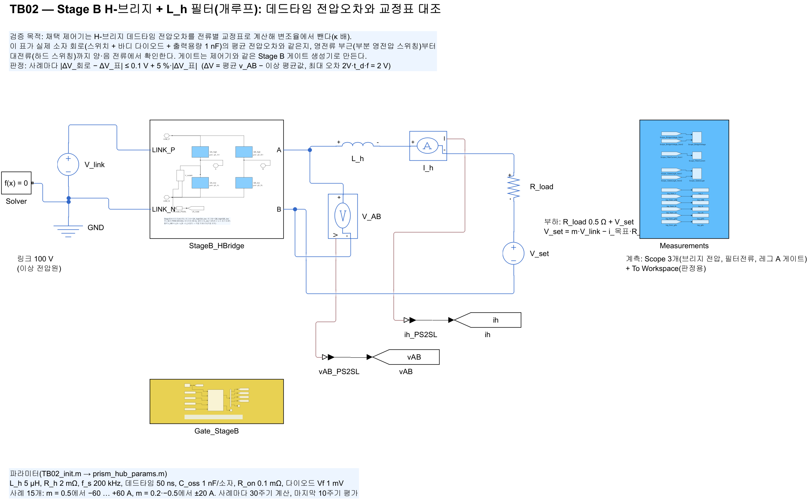
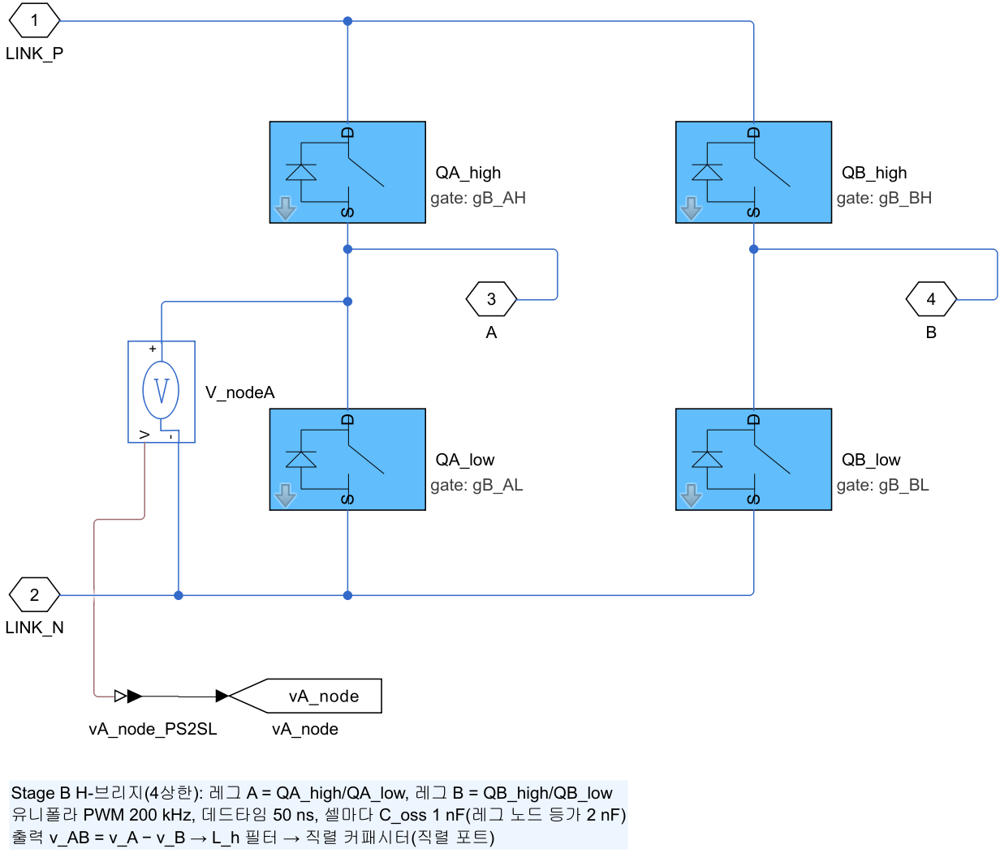
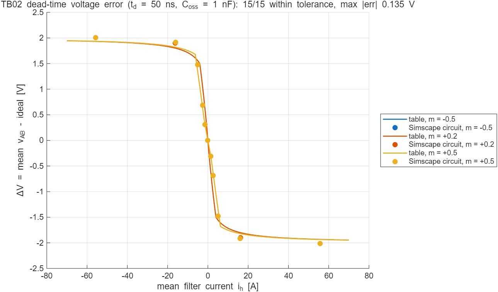
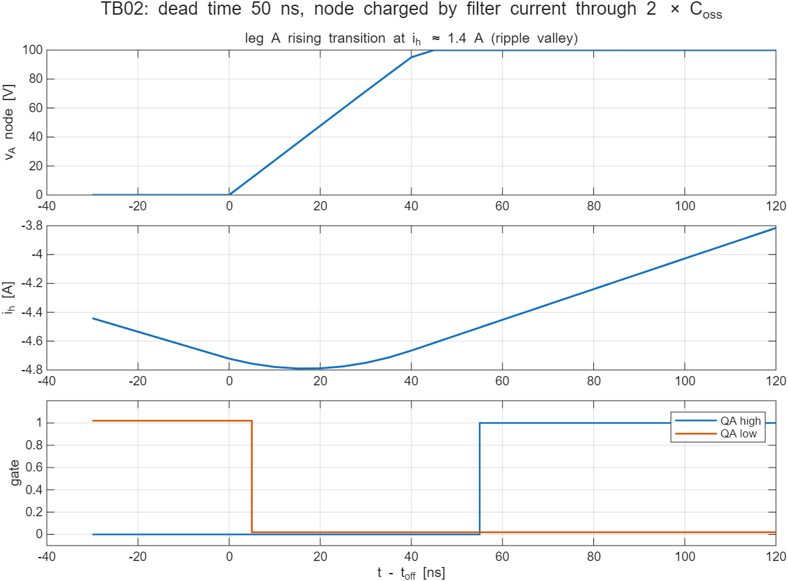

# TB02 — Stage B H-브리지 + L_h 필터(개루프): 데드타임 전압오차와 교정표 대조

**결론: 통과(2026-10-12).** 소자 회로(스위치 + 바디 다이오드 + 출력용량 1 nF)의 평균 데드타임 전압오차가 채택 제어기의 교정표와 15개 사례 모두 허용치 안에서 일치했다(최대 차이 0.135 V, 전체 오차 크기 2 V). 회로 쪽 오차가 표보다 일관되게 약간 크다(하드 스위칭 약 4 %, 5 A 부근 약 10 %). 적분 간격을 절반으로 줄이면 그중 약 3분의 1이 줄어들고, 간격 0으로 외삽한 남은 차이는 하드 스위칭 약 0.03 V, 5 A 부근 약 0.09 V다.

## 왜 필요한가

채택 제어기는 H-브리지 데드타임 때문에 생기는 평균 전압오차를 전류별 교정표에서 읽어 변조율에서 뺀다(경부하 60 %, 80 A에서 100 %). 이 보상은 E12 스위칭 ODE 모델에서 설계했고, 그 모델의 레그 노드 전이는 교정표와 같은 선형 출력용량 식이다. TB02는 같은 동작을 실제 소자로 결선한 회로가 독립적으로 계산했을 때도 표와 같은 오차를 내는지 확인한다. 표가 실제 회로와 다르면 보상이 과하거나 모자라 경부하 진동이나 저전압 정격 부하의 전류 여유 부족으로 이어진다.

## 구성

| 그림 | 내용 |
| --- | --- |
|  | 링크 전압원 100 V → `StageB_HBridge` → L_h(5 µH, 2 mΩ) → 전류 센서 → R_load 0.5 Ω + V_set. `Gate_StageB`는 Stage B 게이트 생성기(비교값 m 고정) |
|  | 레그 A(QA_high/QA_low), 레그 B(QB_high/QB_low). 셀마다 C_oss 1 nF, 레그 A 노드 전압 센서 |

- 게이트: `ctrl/prism_gate_stageB.m`(블록 안에 복사)의 H-브리지 부분. 유니폴라 PWM 200 kHz, 반송파는 표본 시점에서 최댓값, 데드타임 50 ns(10 간격). TB04 폐루프에서 그대로 쓰는 코드다.
- 부하: V_set = m·V_link − i_목표·R_load로 평균 전류를 정한다. 판정에는 실제로 측정한 평균 전류를 쓴다.
- 사례 15개: m = 0.5에서 −60…+60 A(영전류 부근 ±2, ±4, ±8 A 포함), m = 0.2와 −0.5에서 ±20 A. 사례마다 30주기 계산, 마지막 10주기 평가(사례당 약 1.5 s).

## 판정 방법

- ΔV_회로 = 평균 v_AB − V_link·(d_A − d_B). d_A, d_B는 게이트 목표(데드타임 전)의 실제 듀티이며 5 ns 격자 양자화를 반영한다.
- ΔV_표 = 제어기의 `dt_error_tab(m, i, V_link, L_h, f_s, 교정표)`. 리플 극값 전류(i ± r, r = V·m(1−m)/(4 L_h f_s))에서 전이별 손실을 표에서 읽는다.
- 기준: |ΔV_회로 − ΔV_표| ≤ 0.1 V + 5 %·|ΔV_표|.

## 결과



| m | 평균 전류 [A] | ΔV 회로 [V] | ΔV 표 [V] | 차이 [V] | 판정 |
| --- | --- | --- | --- | --- | --- |
| +0.5 | −55.76 | +2.008 | +1.935 | +0.072 | 통과 |
| +0.5 | −16.11 | +1.914 | +1.821 | +0.093 | 통과 |
| +0.5 | −5.03 | +1.475 | +1.340 | +0.135 | 통과 |
| +0.5 | −2.61 | +0.689 | +0.638 | +0.051 | 통과 |
| +0.5 | −1.37 | +0.312 | +0.295 | +0.017 | 통과 |
| +0.5 | 0.00 | 0.000 | 0.000 | 0.000 | 통과 |
| +0.5 | +1.37 … +55.76 | (부호만 반대, 같은 크기) | | | 통과 |
| +0.2 | ±16.13 | ∓1.904 | ∓1.801 | ∓0.103 | 통과 |
| −0.5 | ±16.11 | ∓1.915 | ∓1.821 | ∓0.094 | 통과 |

적분 간격 점검(대표 3사례를 2.5 ns로 다시 계산):

| 사례 | 평균 전류 [A] | ΔV 5 ns [V] | ΔV 2.5 ns [V] | ΔV 표 [V] |
| --- | --- | --- | --- | --- |
| 3 | −5.07 | +1.475 | +1.457 | +1.350 |
| 9 | +5.07 | −1.475 | −1.457 | −1.350 |
| 11 | +55.80 | −2.010 | −1.988 | −1.935 |



## 해석

- 전류 부호와 변조율 부호에 대해 대칭이다(±m, ±i 사례의 크기가 같다). 게이트 생성기와 셀 결선의 방향이 맞다는 뜻이다.
- 회로 오차가 표보다 크게 나오는 차이 가운데 일부는 적분 간격(5 ns) 때문이다. 하드 스위칭에서 남는 약 0.03 V는 출력용량 충전 순간의 처리 차이로 보이며 전체 오차의 1.5 %다.
- 5 A 부근(리플 골에서 전류가 0에 가까운 구간)에서는 표가 오차를 약 0.09 V(7 %) 작게 본다. 표는 전이 동안 전류를 일정하다고 보지만, 실제로는 리플 극값 근처에서 전류가 변한다. 채택 보상은 이 구간에서 표 값의 60 %만 빼므로(κ = 0.6), 표의 이 오차는 보상 설계 여유 안에 있다.
- 결론적으로 교정표는 소자 회로를 보상 목적에 충분한 정확도로 대표한다. 하드웨어에서는 같은 표를 측정 데드타임 전압오차로 만든다(E12 설계 그대로).

## 재현

```matlab
prism_run('build_TB02')   % TB02_StageB_HBridge.slx 생성
prism_run('run_TB02')     % 15사례 + 적분 간격 점검, results/에 표·그림
```
