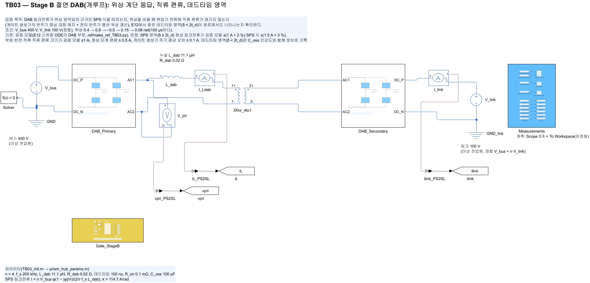
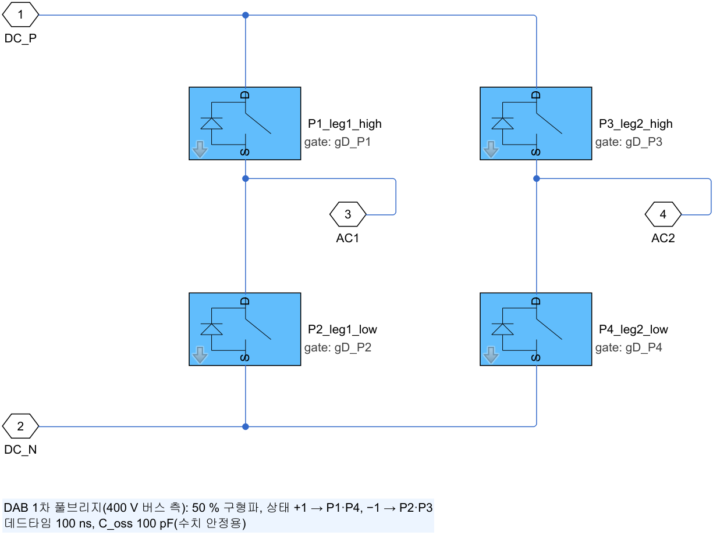
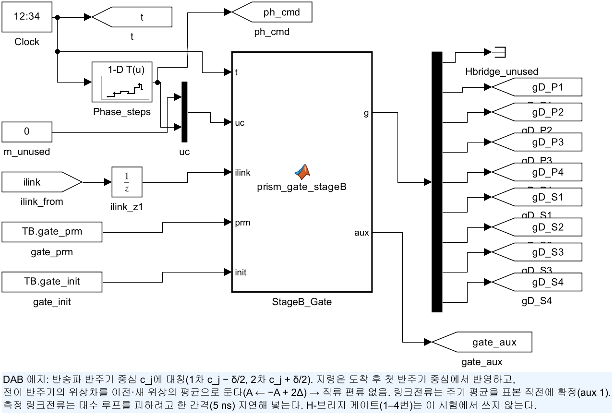
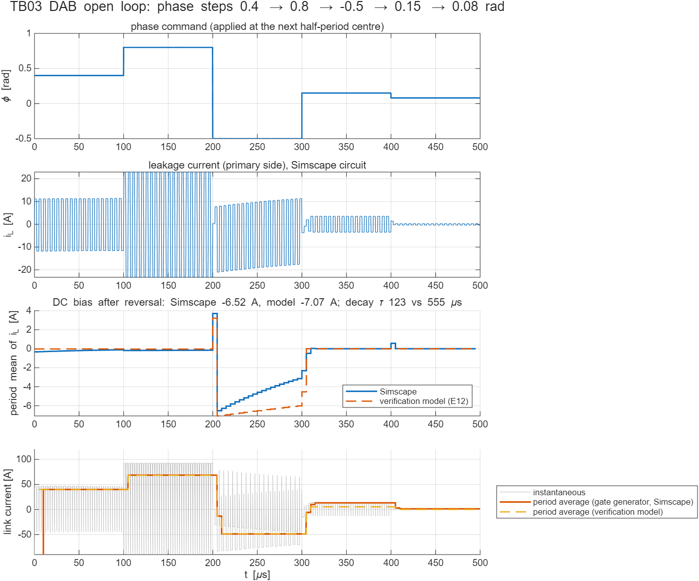
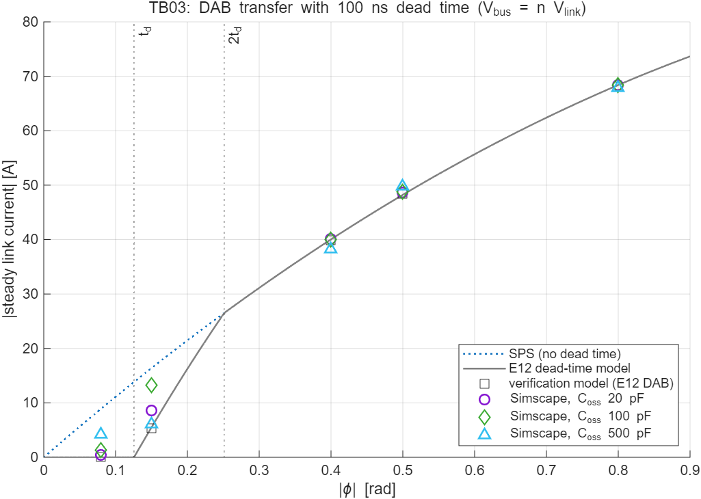

# TB03 — Stage B 절연 DAB(개루프): 위상 계단, 변압기 직류 편류, 데드타임 영역

**결론: 통과(2026-10-12).** SPS 영역(위상 시간 δ ≥ 2t_d)의 정상 링크전류는 검증 모델(E12 스위칭 ODE의 DAB 부분)과 최대 0.39 A, SPS 식과 최대 0.57 A 차이로 일치했다. 위상 부호를 뒤집는 계단에서 생기는 변압기 직류 편류도 같은 크기로 재현됐다(Simscape −6.52 A, 검증 모델 −7.07 A). 게이트 생성기가 표본 직전에 확정하는 링크전류 주기 평균은 측정 파형과 일치했다(차이 0.0000 A).

**새로 확인한 점:** 데드타임 영역(δ < 2t_d)의 전달 특성과 직류 편류의 감쇠 속도는 소자 출력용량 C_oss에 따라 크게 달라진다. 검증 모델에는 DAB 출력용량이 없으므로 이 두 가지는 회로 모델이 더 사실적이다. 저전류 구간은 채택 제어기의 측정 기반 보정 ε̂가 맡으므로 설계를 바꿀 필요는 없지만, 하드웨어 교정과 TB04 폐루프 경부하 시험에서 다시 본다.

## 왜 필요한가

채택 제어기는 DAB 링크전류를 위상 앞먹임(SPS 식)으로 만들고, 위상을 바꿀 때 변압기에 직류 편류가 쌓이지 않게 게이트 생성기가 에지를 반주기 중심에 대칭으로 두고 전이 반주기의 위상차를 이전·새 위상의 평균으로 맞춘다(A ← −A + 2Δ). 이 두 가지와 데드타임 영역의 동작은 E12 스위칭 ODE에서 설계했다. TB03은 같은 게이트 생성기 코드를 실제 소자로 결선한 DAB에 넣어 독립적인 회로 해석으로 같은 결과가 나오는지 확인한다.

## 구성

| 그림 | 내용 |
| --- | --- |
|  | 버스 400 V → `DAB_Primary`(풀브리지) → L_dab 11.1 µH·0.02 Ω → 이상 변압기 4:1 → `DAB_Secondary` → 링크 전류 센서 → 링크 100 V. 두 전압원은 정합(V_bus = n·V_link) |
|  | 레그 1(P1 상측·P2 하측), 레그 2(P3·P4). 셀마다 바디 다이오드와 C_oss 100 pF |
|  | `ctrl/prism_gate_stageB.m`(블록 안에 복사)의 DAB 부분. 위상 지령은 100 µs마다 계단, 측정 링크전류는 한 간격 지연해 입력 |

- 위상 계단: 0.4 → 0.8 → −0.5(부호 반전) → 0.15(t_d < δ < 2t_d) → 0.08 rad(δ < t_d), 각 100 µs. 해석기 5 ns(후진 오일러), 계산 500 µs, 실행 약 5 s.
- 기준값: `ref/make_ref_TB03.py`가 검증 코드 `model_stage_b_switching.run_core`의 DAB 에지 일정, 데드타임 구간 평균(전류가 있으면 다이오드가 출력을 정함), 영전류 클램프를 그대로 옮겨 같은 계단을 계산한다(`ref/TB03_ref_python.*`).

## 판정 기준과 결과

| 항목 | 기준 | 결과 | 판정 |
| --- | --- | --- | --- |
| SPS 영역 정상 링크전류(0.4, 0.8, −0.5 rad) | 검증 모델 ±(1 A + 2 %), SPS 식 ±(1.5 A + 3 %) | 39.94 / 68.39 / −48.79 A, 검증 모델 대비 +0.00 / +0.22 / −0.39 A | 통과 |
| 부호 반전 직후 직류 편류(첫 주기 i_L 평균) | 검증 모델 ±1 A | −6.52 A(검증 모델 −7.07 A) | 통과 |
| 정상 단계 직류 편류 | ≤ 0.5 A | 최대 0.19 A | 통과 |
| 게이트 생성기 링크전류 주기 평균 | 측정 평균 ±0.1 A | 차이 0.0000 A | 통과 |
| 적분 간격 점검(2.5 ns) | — | SPS 영역 0.3 A 이내 변화 | 정보 |



## 데드타임 영역과 출력용량(정보)



| 위상 [rad] | δ [ns] | SPS 식 [A] | 검증 모델 [A] | Simscape C_oss 20 pF | 100 pF | 500 pF |
| --- | --- | --- | --- | --- | --- | --- |
| 0.15 | 119 | 16.38 | 5.29 | 8.54 | 13.29 | 6.03 |
| 0.08 | 64 | 8.94 | 0.00 | 0.49 | 1.32 | 4.24 |

| 편류 감쇠 시정수(−0.5 rad 단계) | 검증 모델 | C_oss 20 pF | 100 pF | 500 pF |
| --- | --- | --- | --- | --- |
| τ [µs] | 555(= L/R) | 477 | 123 | 34 |

- **편류는 실제 현상이다.** 위상 부호가 뒤집히면 전이 반주기 동안 각 브리지 에지의 전류 방향이 바뀌어, 데드타임 동안 다이오드가 정하는 전압·시간이 한쪽으로 쌓인다. 크기는 대략 V·t_d/L_dab 두 번분(2 × 3.6 A)으로, 두 모델 모두 같은 크기를 낸다. 게이트 생성기의 위상 갱신 알고리즘 자체는 데드타임이 없는 이상 DAB에서 편류를 만들지 않는다(Octave 점검, 전이 주기 뒤 0.05 A 이하).
- **감쇠 속도는 출력용량이 정한다.** 편류가 있으면 상승·하강 에지의 전류 크기가 달라져 출력용량 충방전 시간이 달라지고, 그 차이가 편류를 되돌리는 방향의 전압·시간을 만든다. C_oss가 작을수록 검증 모델(권선저항만으로 감쇠)에 가까워진다. 폐루프에서는 위상이 천천히 바뀌므로 E12의 과도 편류는 최대 1.47 A였다. 개루프 1.3 rad 계단은 그보다 훨씬 가혹한 시험이다.
- **데드타임 영역 전달 특성은 C_oss에 민감하다.** 검증 모델은 전류가 0이 되면 브리지가 열린 채 상대 전압을 따른다고 본다(영전류 클램프). 실제로는 열린 브리지 노드가 출력용량과 L_dab로 공진하며, 그 결과는 C_oss와 데드타임의 비에 따라 달라진다(20 → 100 → 500 pF에서 8.5 → 13.3 → 6.0 A). 적분 간격을 절반으로 줄여도 같은 값이 나오므로(13.29 → 13.59 A) 수치 오차가 아니다.
- **설계에 대한 뜻.** 채택 제어기는 예측 전류 40 A 미만에서 측정 링크전류와 예측의 차이 ε̂(±10 A)를 빼므로 실제 소자의 전달 특성을 몰라도 된다. 위 표의 차이(최대 약 8 A)는 ε̂ 범위 안이다. 남은 확인은 TB04 폐루프 경부하 시험과 하드웨어의 실제 C_oss로 하는 교정이다. 변압기 설계에는 개루프 최악 편류(약 7 A)와 감쇠 시정수를 입력으로 넘긴다.

## 재현

```matlab
prism_run('build_TB03')   % TB03_StageB_DAB.slx 생성
prism_run('run_TB03')     % 위상 계단 + C_oss 20/500 pF + 2.5 ns 점검, results/에 표·그림
```

기준값 다시 만들기: `python ref/make_ref_TB03.py <검증 코드 python 폴더>`
