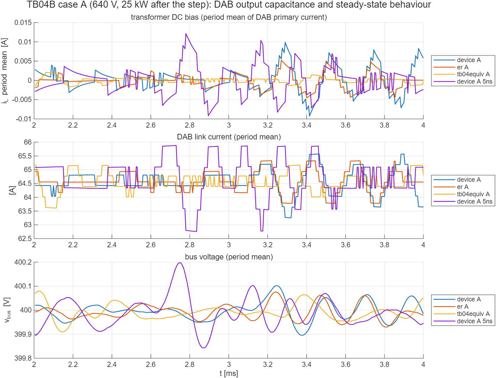
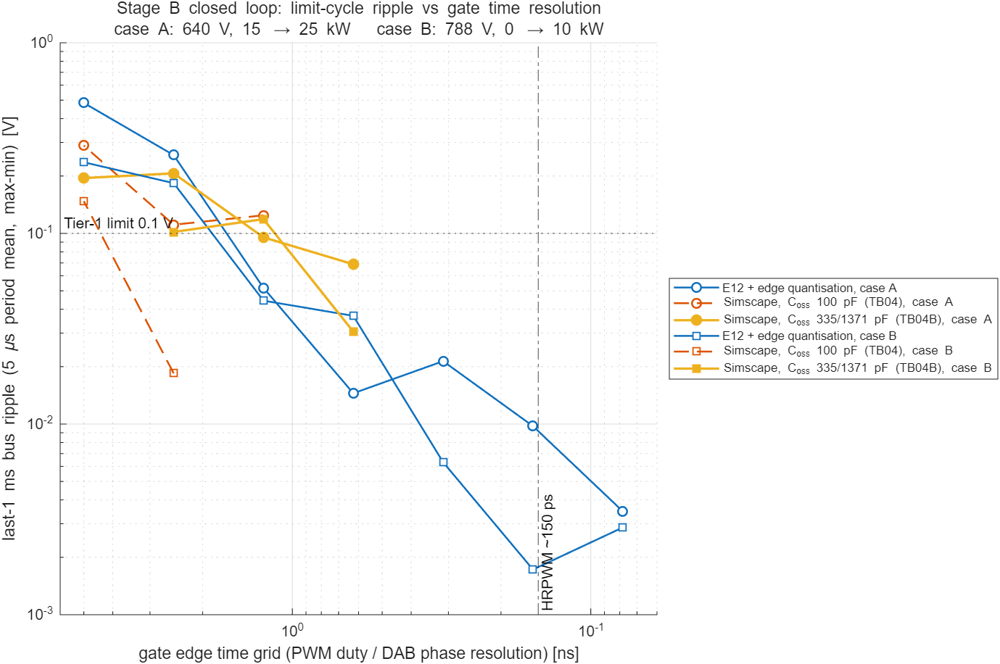

# TB04B — Stage B 폐루프: DAB 소자 출력용량(후보 소자)과 25 kW 정상상태 리플

**결론(2026-10-15)**: 후보 소자의 출력용량에서도 과도 응답은 검증 모델(E12)과 일치했다. 다만 적분 간격 2.5 ns에서는 마지막 1 ms 버스 리플이 더 커졌다(사례 A 0.207 V, 사례 B 0.102 V. 기준 0.1 V). 이 리플은 **게이트 에지의 시간 양자화로 생기는 리밋 사이클**이다. 변압기 직류 편류는 원인이 아니다. 게이트 격자를 0.625 ns로 줄이자 두 사례 모두 TB04의 판정 기준을 전부 통과했다(리플 0.069 V, 0.031 V). 따라서 TB04의 설계 요구 "게이트 시간 분해능 ≤ 2.5 ns"를 **≤ 0.625 ns**로 강화한다. 고분해능 PWM(약 150 ps 단계)이면 4배 여유로 만족한다. 이로써 TB04의 열린 쟁점을 닫는다.

- **원인 확인.** 직류 편류(1차 전류의 주기 평균)의 마지막 1 ms 변동은 0.003–0.02 A로, 링크전류 변동(1.2–3.1 A)의 1 %에 그친다. TB04에서 세운 "편류가 링크전류를 흔든다"는 가설은 맞지 않았다. 링크전류 주기 평균은 격자에 따라 0.75 A(5 ns), 0.4 A(2.5 ns), 0.2 A(1.25 ns) 계단으로만 움직였다. DAB 위상과 H-브리지 듀티가 격자에 묶여 연속값을 낼 수 없기 때문이다. 적분 동작이 있는 루프는 이 양자화 준위 사이를 오가는 리밋 사이클을 만든다(Peterchev & Sanders, 2003).
- **검증 모델로 분리.** 검증 모델(E12)은 에지를 간격 안의 정확한 위치로 처리해서 리플이 0이었다. 이 모델에 에지 양자화 선택(`gate_quantum`, `dab_quantum`)을 더해 같은 두 사례를 계산했다. 5 ns 격자에서 0.48 V(사례 A)·0.24 V(사례 B)가 나와 회로 모델의 현상이 재현됐다. 원인은 **H-브리지 PWM 양자화가 대부분**이었다. H-브리지만 양자화하면 0.21–0.31 V이고, DAB만 양자화하면 0.004–0.017 V다. 2.5 ns 격자에서 듀티 한 단계는 직렬전압 약 0.05–0.1 V다. 경로저항이 13.2 mΩ으로 작아서, 직렬전압 0.05 V 차이가 정상상태 경로전류로는 약 4 A에 해당한다. 그래서 듀티 양자화가 경로전류와 버스전압에 크게 드러난다. 리플은 격자를 줄일수록 줄었다(사례 A: 2.5 ns 0.26 V → 1.25 ns 0.052 V → 0.625 ns 0.015 V → 0.156 ns 0.010 V).
- **출력용량의 역할.** 같은 2.5 ns 격자에서 DAB 출력용량에 따라 리밋 사이클의 크기가 달라졌다(100/100 pF 0.111 V, 207/1053 pF 0.146 V, 335/1371 pF 0.207 V). 그러나 격자를 줄이면 모두 줄어든다. 출력용량은 리밋 사이클의 크기를 바꿀 뿐, 원인은 아니다. 측정 전류비 추정값 ρ̂은 출력용량이 클수록 작아졌다(0.892 → 0.874, 검증 모델 0.898). 실효 위상이 조금 줄어든 것을 추정기가 흡수한 것이다.
- **판정 범위 확인(검증 모델).** 회로 모델은 사례 두 개만 다룬다. 그래서 검증 모델의 시험 격자 기본 집합 168건(전압 7종 × 공칭·지연 +3.0 µs × Tier-1·Tier-2 스텝)을 요구 사양 센서(16비트·잡음)와 함께 격자별로 판정했다.

  | 게이트 격자 | 5 ns | 2.5 ns | 1.25 ns | **0.625 ns** | 0.156 ns |
  | --- | --- | --- | --- | --- | --- |
  | 통과 / 168 | 17 | 81 | 167 | **168** | 168 |
  | 마지막 1 ms 리플 최대 | 0.485 V | 0.214 V | 0.080 V | 0.057 V | 0.051 V |

  1.25 ns의 미통과 1건(788 V, 20 → 10 kW)은 리플이 아니라 내부 진동 기준(i_h 변동 1.021 A, 기준 1 A)이다. 0.625 ns 이하에서는 모두 통과했다. 0.156 ns에서도 리플이 약 0.05 V 남는 것은 센서 잡음 때문이다. 회로(TB04B)와 검증 모델이 같은 경계(0.625 ns)를 가리킨다.

## 왜 필요한가

TB04에서 Stage B 폐루프는 검증 모델(E12)과의 일치 지표를 모두 통과했다. Tier-1 기준 가운데 **마지막 1 ms 버스 리플 ≤ 0.1 V**만 사례 A(640 V, 25 kW)에서 남았다. 게이트 시간 분해능을 2.5 ns로 올리면 0.111 V가 됐는데, 이 잔류분은 DAB 소자 출력용량에 따라 달라졌다(같은 2.5 ns에서 20/100/500 pF → 0.137/0.111/0.073 V).

TB04의 DAB 소자 출력용량 100 pF는 소자 값이 아니다. 영전류 구간에서 열린 브리지 노드의 전위를 정하려고 넣은 수치 안정용 소값이고, 1차(400 V)와 2차(100 V)에 같은 값을 썼다. 그런데 실제 소자는 두 쪽이 크게 다르다. 400 V 쪽은 650 V 소자, 100 V 링크 쪽은 대전류 150 V 소자를 쓰므로 2차 소자의 출력용량이 몇 배 크다. 따라서 TB04의 리플 값으로는 실제 장치가 기준을 지키는지 판단할 수 없다. TB04B는 출력용량만 후보 소자 값으로 바꾸고, 나머지 회로·제어기·사례·판정 기준은 TB04와 똑같이 둔 채 다시 판정한다.

## 후보 소자와 출력용량

제안서(docs/01)의 Stage B DAB는 GaN 소전력 절연 DAB다. 전압·전류 정격에 맞는 대표 후보 소자의 제조사 데이터시트 값을 쓴다.

| 위치 | 정격 조건 | 대표 후보 소자 | C_o(tr)(시간 등가) | C_o(er)(에너지 등가) | 근거 |
| --- | --- | --- | --- | --- | --- |
| DAB 1차(400 V 버스 측) | 400 V, 1차 전류 약 20 A | GaN 650 V, 25 mΩ, 60 A (GS66516T) | 335 pF (V_DS 0–400 V) | 207 pF | 제조사 데이터시트 |
| DAB 2차(100 V 링크 측) | 100 V(90–110 V), 링크 전류 최대 80 A | GaN 150 V, 2.2 mΩ, 133 A (EPC2305) | 1371 pF (V_DS 0–75 V) | 1053 pF | 제조사 데이터시트 |

- Simscape Foundation 커패시터는 선형이다. GaN 출력용량은 전압이 낮을수록 크게 늘어나는 비선형이므로, 데드타임 전이 시간을 같게 주는 **시간 등가 용량 C_o(tr)**을 기본값으로 쓴다. 데드타임 동안 노드 전압이 얼마나 빨리 넘어가는지가 이 쟁점의 핵심이기 때문이다. 같은 소자의 에너지 등가 값 C_o(er)는 민감도로 함께 본다.
- 2차 소자의 C_oss(tr)는 0–75 V 구간 값이다. 링크 100 V까지의 값은 이보다 조금 작으므로(출력용량은 전압이 높을수록 작아진다) 보수적인 쪽이다.
- H-브리지 소자 출력용량은 TB02 데드타임 교정표와 맞춘 1 nF를 그대로 둔다(같은 링크 전압 등급이므로 실제 값도 같은 크기다).

## 구성

TB04와 같다(이상 V_A + 경로 R·L → `StageB_Regulator` → 400 V 버스, 채택 제어기, 게이트 생성기, 부하·손실 모델). 바뀐 것은 `StageB_Regulator` 안 DAB 1차·2차 브리지 스위치 셀의 출력용량 두 개(`TB.B.Coss_dp`, `TB.B.Coss_ds`)뿐이다. 공용 빌더 `lib/build_stageB.m`에 두 값을 따로 주는 선택 인자를 더했고, TB04는 기본값(두 쪽 모두 `TB.B.Coss_d`)으로 그대로 만들어진다. 기준값은 TB04와 같은 검증 모델 결과(`../TB04_StageB_ClosedLoop/ref`)를 쓰고, 판정 코드는 TB04와 공용인 `lib/tb_stageB_evaluate.m`이다.

적분 간격은 **2.5 ns**다. TB04에서 정한 게이트 시간 분해능 요구(≤ 2.5 ns)를 따른 것이다.

## 실행 목록

| 실행 | 사례 | 적분 간격 | DAB C_oss 1차 / 2차 | 용도 |
| --- | --- | --- | --- | --- |
| device_A | A 640 V 15 → 25 kW | 2.5 ns | 335 / 1371 pF | TB04 요구 격자(2.5 ns)에서 판정 |
| device_B | B 788 V 0 → 10 kW | 2.5 ns | 335 / 1371 pF | TB04 요구 격자(2.5 ns)에서 판정 |
| er_A | A | 2.5 ns | 207 / 1053 pF | 같은 소자의 다른 선형 등가(민감도) |
| tb04equiv_A | A | 2.5 ns | 100 / 100 pF | TB04 재현(모델 확인), 직류 편류 비교 기준 |
| device_A_5ns | A | 5 ns | 335 / 1371 pF | 통합 모델(TB06) 적분 간격에서의 값(정보) |
| device_A_1.25ns, device_B_1.25ns | A, B | 1.25 ns | 335 / 1371 pF | 게이트 격자 점검 |
| device_A_0.625ns, device_B_0.625ns | A, B | 0.625 ns | 335 / 1371 pF | 게이트 격자 점검 → **갱신 요구(≤ 0.625 ns)에서의 판정** |

추가 지표(정보): 변압기 직류 편류(1차 누설전류 i_L의 5 µs 주기 평균)의 마지막 1 ms 변동폭·RMS, 링크전류·경로전류 주기 평균 변동폭, 편류와 링크전류의 상관, 버스 리플의 주된 주파수.

## 결과

### 출력용량별(적분 간격 2.5 ns) — 실행 1–5

| 실행 | DAB C_oss 1차 / 2차 | 마지막 1 ms 리플 | Tier-1 | 검증 모델 일치 | 링크전류 변동 | 경로전류 변동 | 직류 편류 변동 | 판정 |
| --- | --- | --- | --- | --- | --- | --- | --- | --- |
| device_A | 335 / 1371 pF | 0.207 V | 리플만 미달 | 통과 | 2.32 A | 2.65 A | 0.019 A | 미달 |
| device_B | 335 / 1371 pF | 0.102 V | 리플만 미달 | 통과 | 1.45 A | 0.90 A | 0.170 A | 미달 |
| er_A | 207 / 1053 pF | 0.146 V | 리플만 미달 | 통과 | 1.55 A | 1.99 A | 0.010 A | (정보) |
| tb04equiv_A | 100 / 100 pF | 0.111 V | 리플만 미달 | 통과 | 1.16 A | 1.21 A | 0.003 A | (정보) |
| device_A_5ns | 335 / 1371 pF, 5 ns | 0.195 V | 리플만 미달 | 통과 | 3.09 A | 3.08 A | 0.019 A | (정보) |

- tb04equiv_A는 TB04의 2.5 ns 실행과 같은 값이 나왔다(최저 버스 397.663 V, 최대 경로전류 86.58 A, 리플 0.111 V). 공용 빌더에 선택 인자를 더한 뒤에도 모델은 TB04와 같다.
- 과도 응답 일치(최저 버스전압, 최대 경로전류, 계단 전·끝 평균, 버스전압 궤적)는 모든 실행에서 TB04 허용 오차 안이다. 사례 A의 최저 버스전압은 397.66–397.72 V이고 검증 모델은 397.71 V다. 최대 경로전류는 86.5–86.9 A이고 검증 모델은 86.75 A다.



위 그림에서 변압기 직류 편류(위)는 ±0.01 A 안에 머문다. 링크전류 주기 평균(가운데)은 격자 크기의 계단으로만 움직이고, 버스전압(아래)은 그 계단을 따라 흔들린다.

### 게이트 격자를 줄인 점검(후보 소자 출력용량) — 실행 6–9

| 사례 | 5 ns | 2.5 ns | 1.25 ns | 0.625 ns |
| --- | --- | --- | --- | --- |
| A 640 V 15 → 25 kW | 0.195 V | 0.207 V | **0.095 V**(전 항목 통과) | **0.069 V**(전 항목 통과) |
| B 788 V 0 → 10 kW | — | 0.102 V | 0.119 V | **0.031 V**(전 항목 통과) |

사례 B는 1.25 ns에서도 0.119 V였다. 경부하에서는 DAB가 데드타임 영역에서 동작한다. 이 영역의 증분 이득은 SPS의 약 2배이고(TB03), 링크전류가 위상 한 단계마다 약 1.4 A(2.5 ns 격자)씩 두 준위를 오간다. 이 진동이 버스 쪽으로 드물게 크게 번지는 구간이 마지막 1 ms에 들어갔다. 0.625 ns에서는 리플이 0.031 V로 줄었고, 두 사례가 판정 전 항목을 통과했다.




## 결론과 이후 단계

- **설계 요구(갱신)**: Stage B 게이트(H-브리지 PWM 에지·DAB 위상 에지)의 시간 분해능은 **≤ 0.625 ns**여야 한다. 기준은 Tier-1 정상상태 리플 ≤ 0.1 V이고, TB04의 "≤ 2.5 ns"를 대체한다. 고분해능 PWM 주변장치(MEP 단계 약 150 ps)로 구현한다. 제어기 구조와 이득은 바꾸지 않는다.
- **통합 모델(TB06)**: 적분 간격 5 ns를 쓴다. 이 격자에서는 리밋 사이클 리플이 0.2–0.5 V로 나오므로, 마지막 1 ms 리플은 TB06에서 판정하지 않고 정보로만 적는다. 근거는 이 시험(회로, 0.625 ns 통과)과 검증 모델의 양자화 계산이다. TB06의 판정은 과도 응답, 전류·전압 한계, 단 사이 상호작용으로 한다.
- **소자 값**: DAB 1차·2차 출력용량은 통합 모델에서도 후보 소자 C_o(tr)(335 / 1371 pF)를 쓴다.

## 재현

```matlab
prism_run('build_TB04B')            % TB04B_StageB_DAB_Coss.slx 생성
prism_run('run_TB04B')              % 실행 1–5(출력용량별, 2.5 ns). results/TB04B_coss_summary.*·사례별 판정·그림
prism_run('run_TB04B_resolution')   % 실행 6–8(1.25 ns 사례 A·B, 0.625 ns 사례 A). results/TB04B_resolution_summary.*
prism_run('run_TB04B_resolution_B') % 실행 9(0.625 ns 사례 B). results/TB04B_resolution_B_summary.*
prism_run('plot_TB04B_resolution')  % 리플 대 게이트 격자 그림(회로 + 검증 모델 양자화 결과 ref/E12_gate_resolution_representative.csv)
```

검증 모델 쪽 계산: `python E12_switching_verification.py gate_resolution`(검증 코드 폴더). 대표 두 사례의 격자 스윕과 기본 집합 168건 판정을 함께 낸다.

참고 자료

- GaN Systems (Infineon), *GS66516T Top-side cooled 650 V E-mode GaN transistor*, datasheet Rev. 210727 — C_o(tr) 335 pF, C_o(er) 207 pF (V_DS 0–400 V).
- EPC, *EPC2305 – Enhancement Mode Power Transistor*, datasheet — C_OSS(TR) 1371 pF, C_OSS(ER) 1053 pF (V_DS 0–75 V).
- A. V. Peterchev and S. R. Sanders, "Quantization resolution and limit cycling in digitally controlled PWM converters," *IEEE Trans. Power Electron.*, vol. 18, no. 1, pp. 301–308, 2003, doi:10.1109/TPEL.2002.807092.
- Texas Instruments, *Functional Safety Information, TMS320F280015x* (SFFS222), §6.4.5.9 HRPWM — MEP 단계 "of the order of 150 ps".
