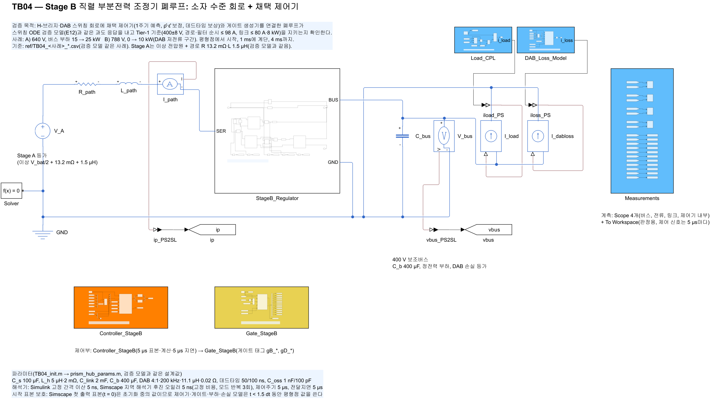
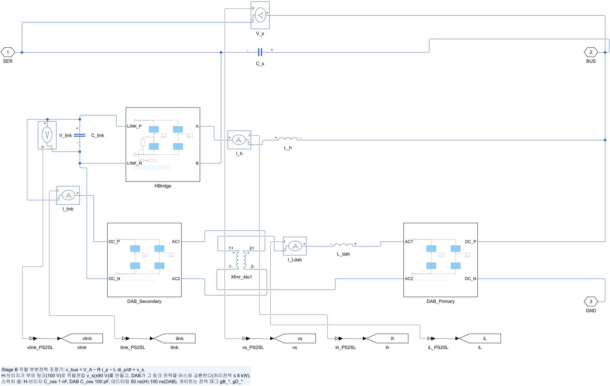
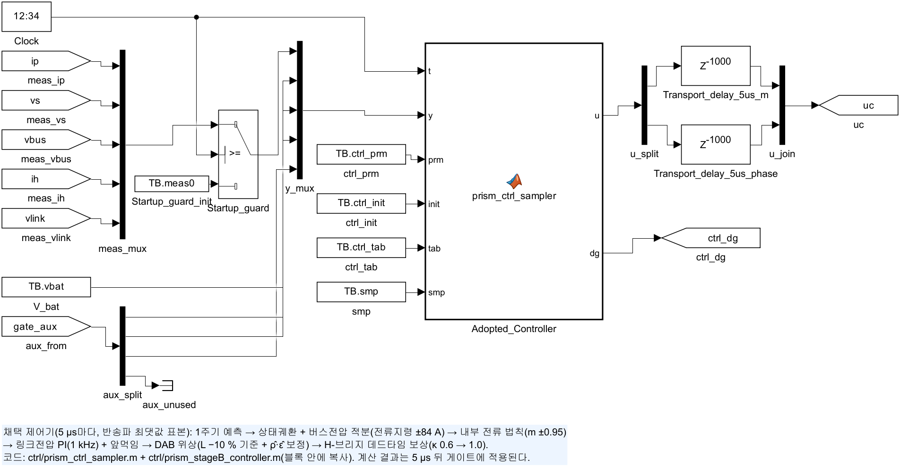
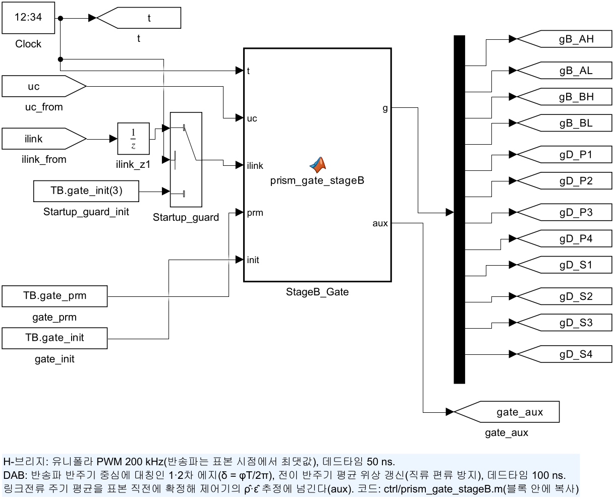
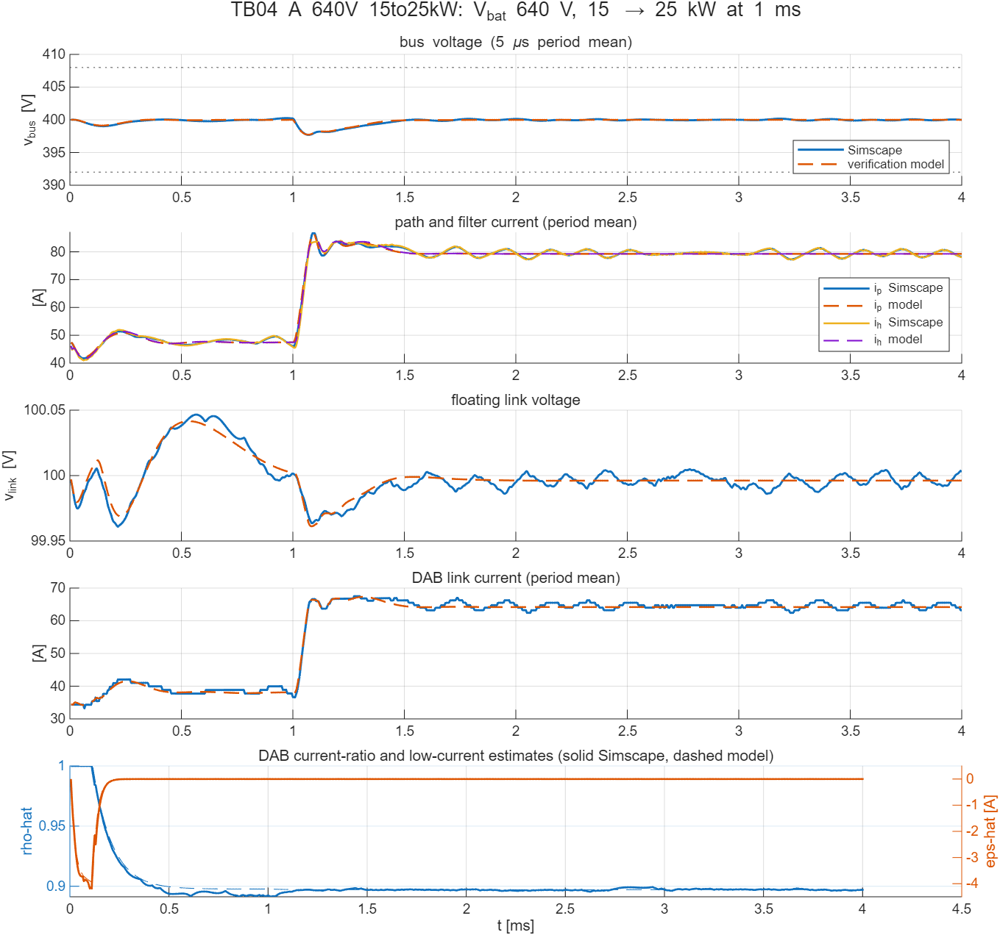
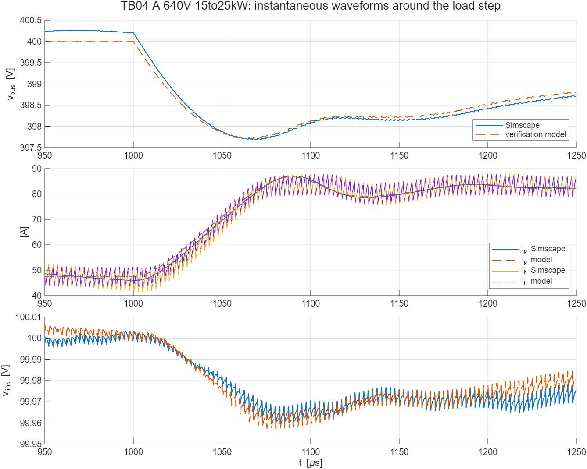
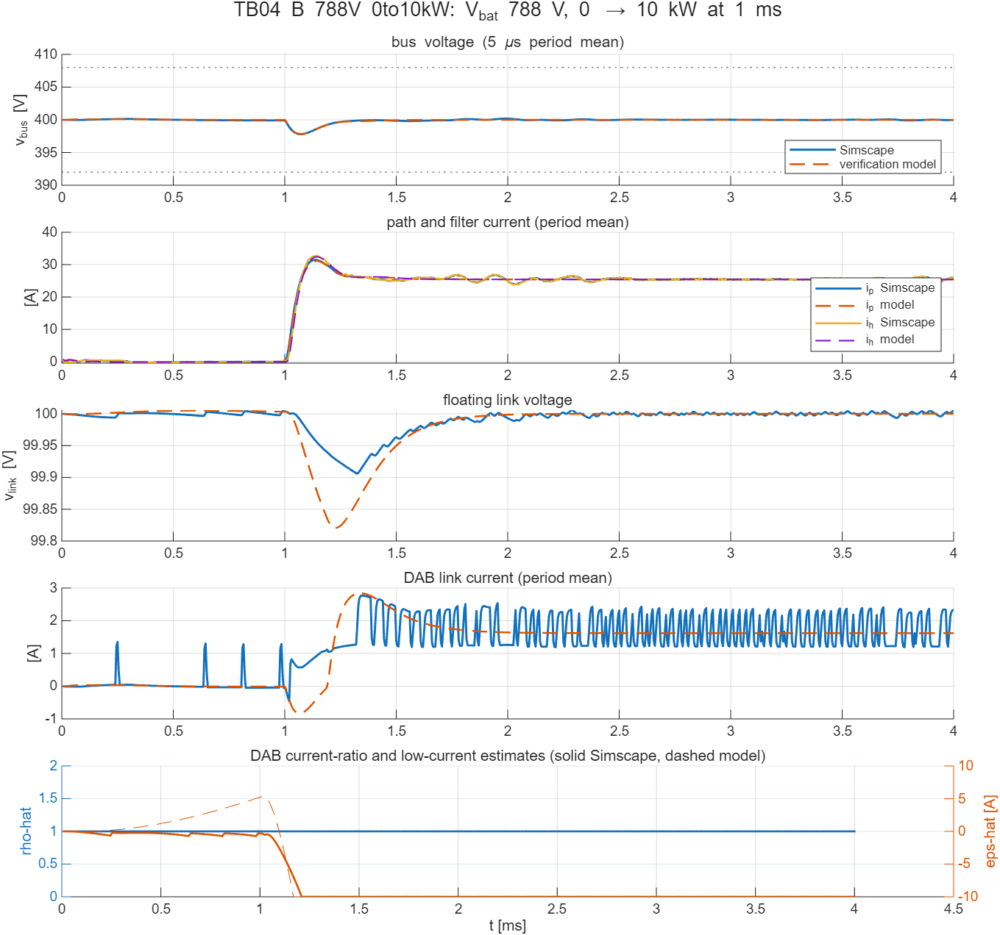

# TB04 — Stage B 직렬 부분전력 조정기 폐루프: 소자 수준 회로 + 채택 제어기

**결론(2026-10-13): 검증 모델과의 일치는 통과했다. Tier-1 한계는 정상상태 리플 한 항목만 조건부다.**

H-브리지·DAB를 스위치 셀(스위치 + 바디 다이오드 + C_oss)로 결선한 회로에 채택 제어기와 게이트 생성기를 연결했다. 이 폐루프는 두 사례 모두 검증 모델(E12 스위칭 ODE)과 같은 과도 응답을 냈다. 판정한 일치 지표(사례 A 13개, 사례 B 9개, 사례 B의 링크 지표 4개는 정보)가 모두 허용 오차 안이다.

- 계단 뒤 최저 버스전압: 397.68 V, 검증 모델과 0.03 V 차이.
- 최대 경로전류: 87.1 A, 0.4 A 차이.
- 마지막 경로전류 평균: 0.003 A 차이.

경로·필터 전류, 링크전류·전력, 링크전압, 직렬전압의 Tier-1 한계도 지켰다.

Tier-1의 **마지막 1 ms 버스 리플 ≤ 0.1 V**는 적분 간격 5 ns에서 넘었다. 사례 A가 0.289 V, 사례 B가 0.148 V이고, 검증 모델은 0.000 V다. 원인은 두 가지로 나뉜다.

1. **게이트 시간 분해능(양자화).** 회로 모델은 PWM 비교와 DAB 에지를 적분 간격 격자에 맞춘다. 검증 모델은 간격 안의 에지 위치로 스위치 상태를 평균하므로 분해능 제한이 없다. 디지털 PWM 분해능이 유한하면 적분 동작이 있는 루프는 양자화 준위 사이를 오가는 리밋 사이클을 낼 수 있다(Peterchev & Sanders, 2003). 간격을 2.5 ns로 줄이자 사례 B는 0.018 V로 통과했고, 사례 A는 0.111 V로 줄었다. **설계 요구로 넘긴다: 게이트 시간 분해능 ≤ 2.5 ns**(H-브리지 듀티 0.05 %, DAB 위상 3.1 mrad). 고분해능 PWM 주변장치(예: 150 ps 단계)로 충분히 만족한다.
2. **DAB 출력용량에 따른 잔류분(사례 A, 25 kW).** 1.25 ns에서도 0.124 V로 2.5 ns와 비슷해, 분해능만으로는 더 줄지 않는다. 같은 2.5 ns에서 DAB 소자 출력용량을 바꾸면 리플이 그에 따라 바뀐다: C_oss 20 pF → 0.137 V, 100 pF → 0.111 V, 500 pF → **0.073 V(통과)**. 변동은 1–5 kHz 대역에 퍼져 있으며, 경로전류 1.4 A pp와 링크전류 명령 1.2 A pp가 함께 움직인다. TB03에서 확인한 변압기 직류 편류의 감쇠 시정수(C_oss 20/100/500 pF → 477/123/34 µs)와 방향이 같다. 그래서 주기마다 바뀌는 위상이 데드타임을 거쳐 남기는 작은 편류가, C_oss가 작을수록 오래 남아 링크전류 주기 평균을 흔드는 것으로 본다. 검증 모델에는 DAB 출력용량이 없고 정확히 주기적인 정상상태로 수렴하므로 이 성분이 나타나지 않는다.

**판단.** 제어기 구조와 응답은 회로에서도 검증 모델과 같다. 25 kW 정상상태 리플은 실제 소자의 출력용량(전압 의존)과 게이트 분해능에 걸려 있다. 남은 일은 두 가지다.

- 실제 후보 소자의 C_oss(v)로 다시 판정한다.
- 기준을 넘으면 변압기 직류 편류 억제 수단을 검토한다. 후보는 1차 직렬 직류 차단 커패시터와 게이트 생성기의 편류 보정이다.

이 판정은 통합 모델(TB06) 전에 결론 낸다(docs/20 7절 남은 쟁점).

| 사례 A 리플(마지막 1 ms) | 5 ns | 2.5 ns | 1.25 ns |
| --- | --- | --- | --- |
| C_oss_d 20 pF | — | 0.137 V | — |
| C_oss_d 100 pF(기본) | 0.289 V | 0.111 V | 0.124 V |
| C_oss_d 500 pF | — | **0.073 V** | — |
| 사례 B(100 pF) | 0.148 V | **0.018 V** | — |

## 왜 필요한가

TB02·TB03은 H-브리지와 DAB를 각각 개루프로 확인했다. 채택 제어기의 성능, 곧 1주기 예측, 링크전류 제한(ρ̂), 저전류 보정(ε̂), 데드타임 보상은 이 두 회로와 제어기가 함께 돌아갈 때만 드러난다. 검증 모델(E12)은 같은 제어기 코드를 스위칭 ODE에 넣어 Tier-1 410건을 통과시켰다. TB04는 같은 제어기를 Simscape 소자 회로에 넣고, 독립된 회로 해석으로 같은 결과가 나오는지 확인한다. 여기서 통과해야 통합 모델(TB06)의 Stage B 결과를 믿을 수 있다.

## 구성

| 그림 | 내용 |
| --- | --- |
|  | Stage A 등가(이상 V_bat/2 + 13.2 mΩ + 1.5 µH) → `StageB_Regulator`(SER → BUS) → 400 V 버스(C_b 400 µF ∥ 정전력 부하 ∥ DAB 손실 등가). 부하·손실 전류는 계산 서브시스템(`Load_CPL`, `DAB_Loss_Model`)이 제어 전류원으로 끈다 |
|  | 직렬 커패시터 C_s, H-브리지(C_oss 1 nF) + L_h 5 µH, 부유 링크 C_link 2 mF, DAB(4:1, 11.1 µH, C_oss 100 pF) |
|  | 측정 5개 → 시작 표본 보호 → 채택 제어기(`ctrl/prism_ctrl_sampler.m` + `prism_stageB_controller.m`, 5 µs마다 계산) → 5 µs 전달지연(성분별 Delay) |
|  | `ctrl/prism_gate_stageB.m`: H-브리지 유니폴라 PWM, DAB 대칭 에지와 전이 반주기 위상 갱신, 링크전류 주기 평균(aux) |

- 사례: A) 640 V, 버스 부하 15 → 25 kW(Tier-1 대표, 가장 큰 전류). B) 788 V, 0 → 10 kW(경부하, 직렬전압 약 6 V, DAB 저전류 구간). 평형점에서 시작해 1 ms에 계단을 넣고 4 ms까지 계산한다.
- 기준값: `ref/make_ref_TB04.py`가 검증 코드 `simulate_switching`으로 같은 사례를 계산한다(5 µs 주기 기록, 계단 전후 파형, 평형점과 제어기 초기상태).
- 해석기: Simulink 고정 간격 5 ns, Simscape 지역 해석기 후진 오일러 5 ns, **고정 비용(모드 반복 3회)**. 사례당 약 60 s가 걸린다.

## 판정 기준과 결과

| 항목 | 기준 | 사례 A(640 V, 15 → 25 kW) | 사례 B(788 V, 0 → 10 kW) |
| --- | --- | --- | --- |
| 버스전압 주기 평균 | 400 ± 8 V | 397.70–400.26 V | 397.81–400.19 V |
| 경로·필터 순시 전류 | ≤ 98 A | 87.1 / 88.0 A | 31.5 / 33.9 A |
| 링크전류·전력(주기 평균) | ≤ 80 A, ≤ 8 kW | 67.5 A, 6.75 kW | 2.8 A, 0.28 kW |
| 링크전압, 직렬전압 | 90–110 V, \|v_s\| ≤ 90 V | 99.96–100.05 V, 81.2 V | 99.91–100.01 V, 6.5 V |
| 마지막 1 ms 리플 | ≤ 0.1 V | 0.289 V(5 ns), 0.111 V(2.5 ns), 0.124 V(1.25 ns) | 0.148 V(5 ns), **0.018 V(2.5 ns)** |
| 계단 뒤 최저 버스전압 | 검증 모델 ± 0.5 V | 397.68 V(모델 397.71 V) | 397.80 V(모델 397.83 V) |
| 계단 뒤 최대 경로전류 | 검증 모델 ± max(2 A, 3 %) | 87.14 A(모델 86.75 A) | 31.49 A(모델 31.15 A) |
| 주기 평균 버스전압 궤적 | RMS 차 ≤ 0.2 V | 0.085 V | 0.057 V |
| 마지막 평균 v_bus, i_p | 0.2 V, 1 A | −0.0003 V, −0.003 A | −0.028 V, +0.22 A |
| 링크전압·링크전류 | 0.5 V, 1.5 A + 3 % | +0.001 V, +0.26 A | 정보: +0.001 V, +0.15 A |





사례 B(경부하)는 DAB가 데드타임 영역(δ < 2t_d)에서 링크전류 약 1.7 A를 보낸다. TB03에서 이 영역의 전달 특성이 C_oss에 민감했는데, 폐루프에서는 저전류 보정 ε̂(−10 A, 검증 모델과 같은 값)와 링크전압 루프가 차이를 흡수해 링크전압이 99.91–100.01 V로 유지된다. TB03에서 남긴 질문, 곧 ε̂가 실제 소자 특성을 흡수하는지에 대한 답이다.



## 회로 모델에서 새로 정한 것

- **시작 표본 보호.** Simscape 지역 해석기의 첫 출력 표본(t = 0)은 초기화 계산 중의 값이다. 진단 실행에서 v_bus 199.5 V, 링크전류 −3.3 × 10⁷ A가 한 표본 나왔다. 디지털 제어기가 이 값을 표본하면 적분기와 링크전류 주기 평균이 망가져 50 µs 안에 경로전류가 −104 A까지 뒤집혔다(`diag_TB04.m`). 제어기·게이트 생성기·부하·손실 모델의 측정 입력에 Switch 블록(`lib/sl_startup_guard.m`)을 두고, t < 1.5·dt 동안 평형점 값을 쓴다. 실제 장치에서 ADC가 기동 직후 값을 버리는 것과 같다. TB03 그림의 첫 주기 aux 이상값도 같은 원인이다.
- **고정 비용 해석.** 스위치 셀 12개 회로에서 가변 비용 해석은 간격당 약 1.9 ms가 걸렸다(4 ms 사례 하나에 약 25분). 모드 반복을 2–3회로 고정하면 50 µs 실행의 버스전압이 소수 셋째 자리까지 같고, 전체 실행 기준 간격당 약 70 µs로 25배 이상 빠르다(`probe_TB04_speed.m`, `results/TB04_speed_probe.txt`).

## 재현

```matlab
prism_run('build_TB04')            % TB04_StageB_ClosedLoop.slx 생성
prism_run('run_TB04')              % 두 사례, 5 ns. results/에 요약·그림
prism_run('run_TB04_resolution')   % 2.5 ns(두 사례), 1.25 ns(사례 A)
prism_run('run_TB04_coss')         % 사례 A, 2.5 ns, DAB C_oss 20/500 pF(results/TB04_coss.txt)
```

기준값 다시 만들기: `python ref/make_ref_TB04.py <검증 코드 python 폴더>`

참고: A. V. Peterchev and S. R. Sanders, "Quantization resolution and limit cycling in digitally controlled PWM converters," *IEEE Trans. Power Electron.*, vol. 18, no. 1, pp. 301–308, 2003.
