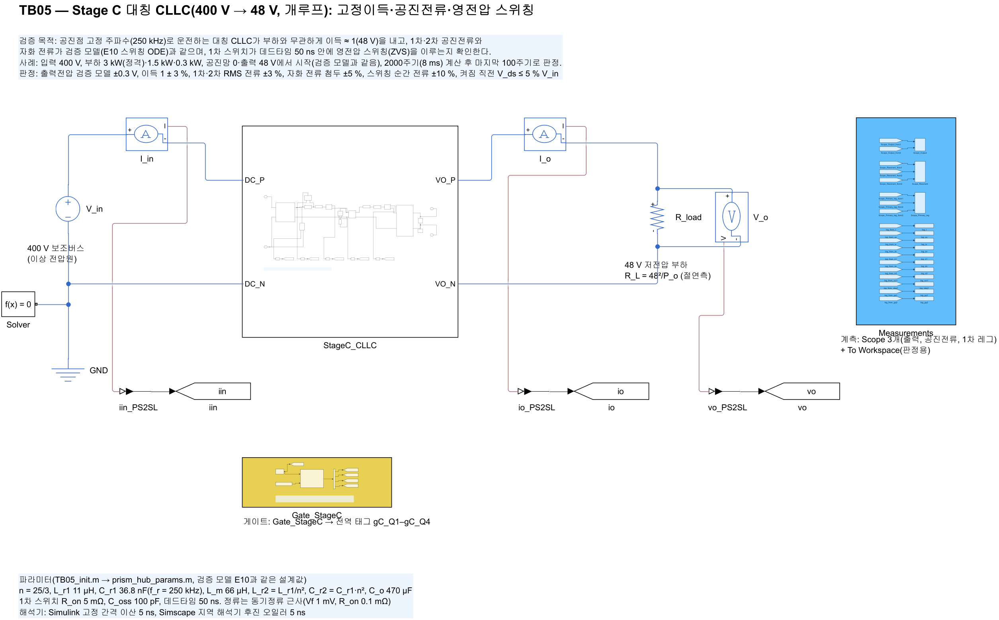
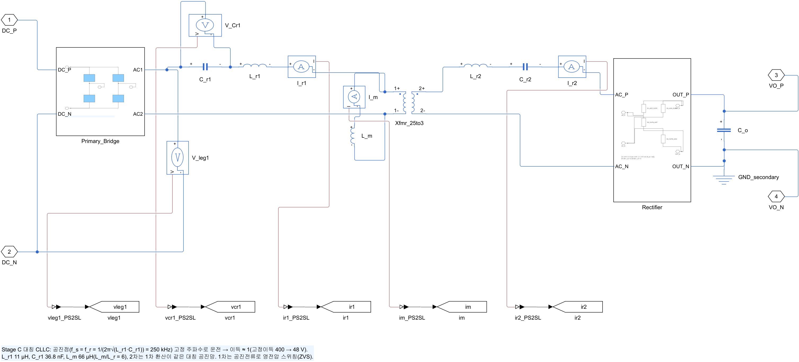
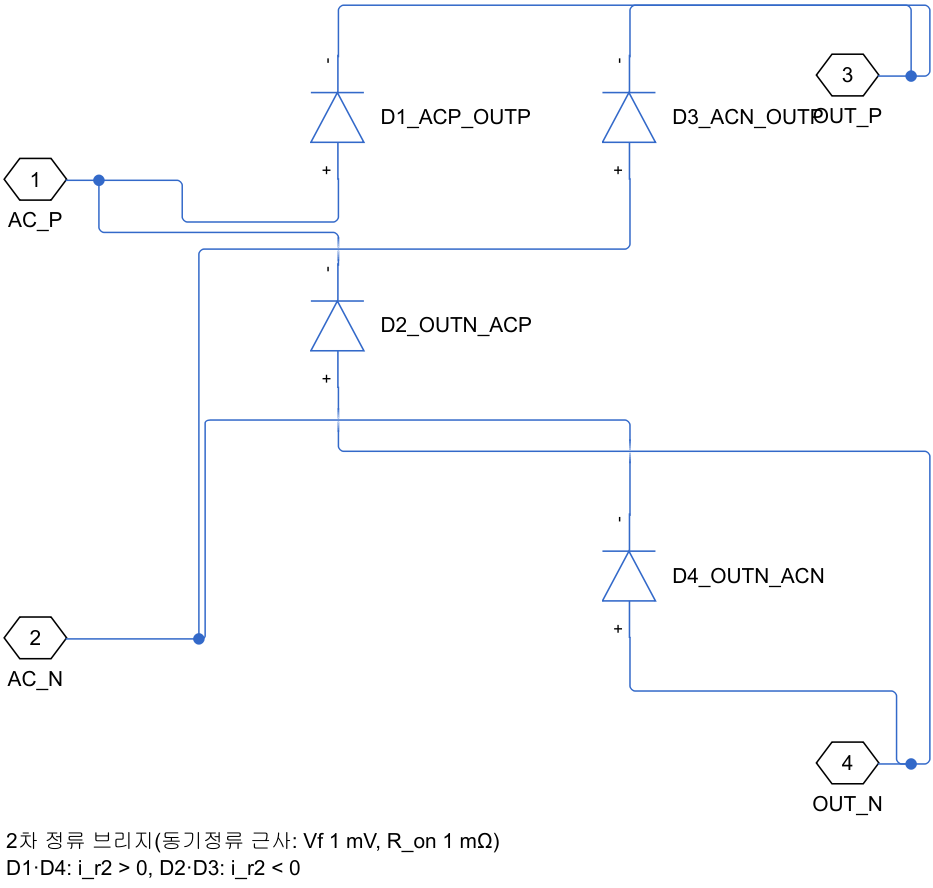
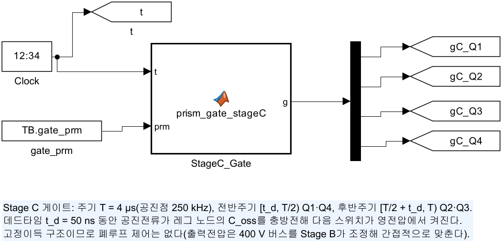
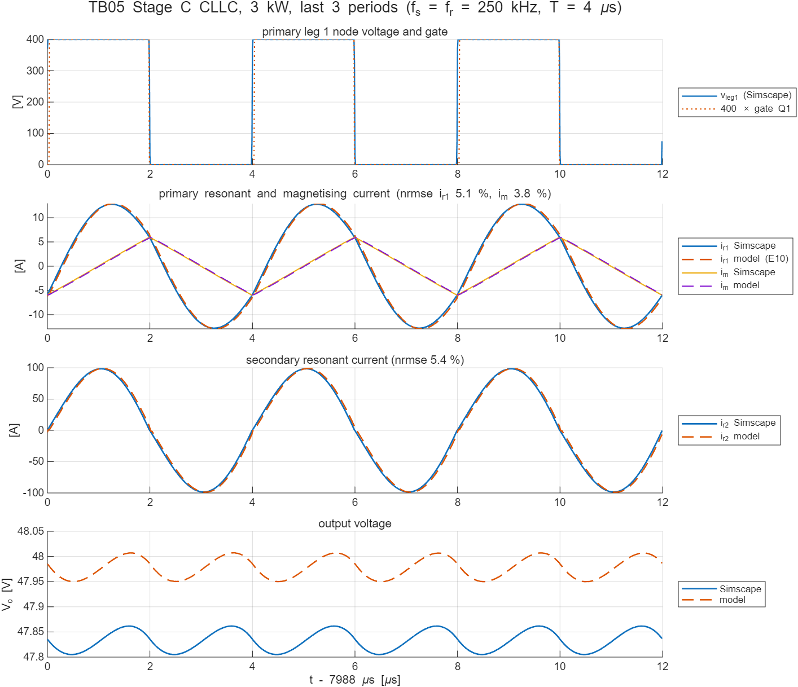
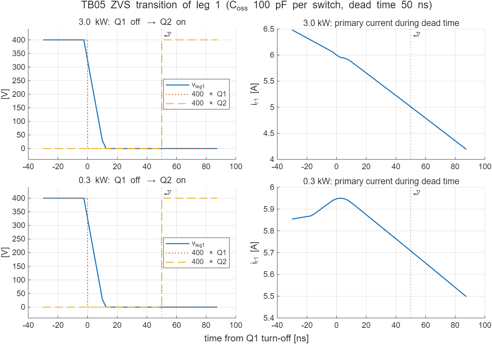
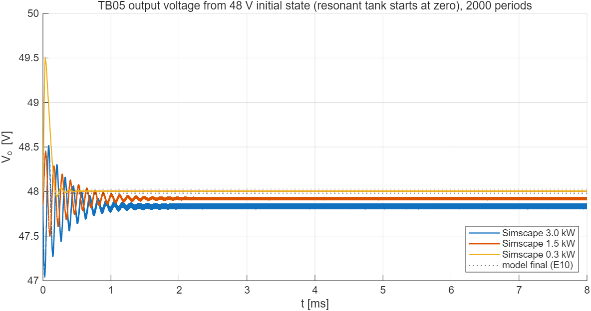

# TB05 — Stage C 대칭 CLLC(400 V → 48 V, 개루프): 고정이득·공진전류·영전압 스위칭

**결론: 통과(2026-10-13).** 공진점 고정 주파수에서 이득이 부하와 관계없이 1에 가깝다(3 kW 0.9965, 1.5 kW 0.9984, 0.3 kW 1.0001). 정상상태의 1차·2차 RMS 전류와 자화 전류 첨두는 세 부하 모두 검증 모델(E10과 같은 식)과 1.6 % 안에서 일치했다. 1차 스위치는 데드타임 50 ns 가운데 처음 약 10 ns 안에 레그 노드 전압이 반대편으로 넘어가 바디 다이오드가 도통한 상태에서 켜진다(켜지기 직전 V_ds = −0.08 V, 영전압 스위칭). 3 kW 파형의 1차 공진전류는 검증 모델과 정규화 RMS 차 5.1 %다.

**새로 확인한 점.**

- **스위칭 순간 전류 차이.** 꺼짐 순간 1차 전류가 3 kW에서 검증 모델보다 8 % 작다(6.06 A, 모델 6.60 A). 검증 모델은 데드타임 50 ns 동안 브리지 전압을 0으로 두지만, 회로에서는 레그 노드가 약 10 ns 만에 반대 전압으로 넘어간다. 그만큼 인가 전압의 위상이 앞서고, 공진전류도 약 20 ns 앞당겨진다. ZVS 여유는 충분하다(전이 10 ns ≪ 50 ns).
- **E10 실행 길이.** E10의 300–400주기 실행은 경부하에서 아직 정상상태가 아니었다. 0.3·1.5 kW의 2차 전류가 2–6 % 작게 나왔다. 기준값을 2000주기 정상상태로 다시 만들었다.
- **수치 감쇠.** 후진 오일러의 수치 감쇠가 공진망에 등가 손실을 만든다. 3 kW에서 5 ns 34 W, 2.5 ns 18 W이고, 소자 도통 손실은 약 2 W다. 통합 모델(5 ns)의 Stage C 효율·출력전압은 이만큼 낮게 나온다는 점을 기록해 둔다.

## 왜 필요한가

Stage C는 400 V 보조버스를 권선비 25/3의 고정이득으로 48 V로 바꾼다. 출력전압을 따로 조정하지 않으므로, 공진점(f_s = f_r = 250 kHz)에서 이득이 부하와 관계없이 1에 가까워야 한다. 이것이 Stage B가 400 V 버스를 조정하는 이유이기도 하다. 검증 모델(E10 스위칭 ODE)은 이상 동기정류와 데드타임 중 v_p = 0을 가정했다. TB05는 같은 공진망을 스위치 셀(R_on, 바디 다이오드, C_oss 100 pF), 이상 변압기 + 자화 인덕턴스, 다이오드 정류 브리지로 결선하고 다음 세 가지를 확인한다.

1. 이득과 전류(1차·2차 RMS, 자화 전류 첨두)가 검증 모델과 같은가.
2. 데드타임 50 ns 안에 공진전류가 레그 노드 출력용량을 충방전해 ZVS가 되는가. 검증 모델은 이를 여유 지표(i_sw·t_d/(2C_oss·V_in) ≈ 4)로만 보았다.
3. 통합 모델(TB06)에 쓸 수 있도록 적분 간격과 해석기 선택을 정한다.

## 구성

| 그림 | 내용 |
| --- | --- |
|  | 400 V 이상 전압원 → 입력전류 센서 → `StageC_CLLC` → 출력전류 센서 → R_L = 48²/P_o. `Gate_StageC`: 250 kHz, 50 % 상보, 데드타임 50 ns |
|  | 1차 풀브리지(Q1–Q4) → C_r1 36.8 nF → L_r1 11 µH → 이상 변압기 25/3:1(1차에 L_m 66 µH) → L_r2 = L_r1/n², C_r2 = C_r1·n² → 정류 브리지 → C_o 470 µF. 절연 2차측 음극에 기준 접지(전위 고정용) |
|  | 다이오드 4개(Vf 1 mV, R_on 0.1 mΩ, 동기정류 근사) |
|  | `ctrl/prism_gate_stageC.m`(블록 안에 복사) → 태그 gC_Q1–gC_Q4 |

- 사례: 부하 3 kW(정격)·1.5 kW·0.3 kW. 공진망 0, 출력 48 V에서 시작해 2000주기(8 ms)를 계산하고 마지막 100주기로 판정한다.
- 기준값: `ref/make_ref_TB05.py`. E10과 같은 식·적분(RK4, 주기당 400단계, 1차 환산 6상태)이다. E10의 300–400주기 실행은 경부하에서 아직 과도 상태라(출력 시정수 C_o·R_L = 0.36/1.8/3.6 ms, 공진 커패시터 직류분의 느린 감쇠), 같은 식을 2000주기까지 돌려 정상상태 값을 기준으로 삼는다. 2000주기와 3000주기의 차이는 3 kW·1.5 kW 지표에서 0.1 % 이하다. 0.3 kW의 2차 RMS 전류만 이상 정류기 모델 특성으로 ±1.5 % 흔들린다.
- 해석기: 후진 오일러, **적분 간격 2.5 ns**. 근거는 아래 수치 점검.

## 판정 기준과 결과

2000주기 계산 뒤 마지막 100주기(적분 간격 2.5 ns, 기준값도 같은 창)로 판정한다.

| P_o | V_o 회로 / 모델 [V] | 이득 | 1차 RMS [A] | 2차 RMS [A] | 자화 첨두 [A] | 꺼짐 순간 전류 [A] | 켜짐 직전 V_ds | 판정 |
| --- | --- | --- | --- | --- | --- | --- | --- | --- |
| 3 kW | 47.833 / 47.978 | 0.9965 | 9.165 / 9.251 | 69.33 / 69.59 | 5.956 / 5.900 | 6.06 / 6.60 | −0.08 V | 통과 |
| 1.5 kW | 47.921 / 47.994 | 0.9984 | 5.679 / 5.707 | 34.88 / 34.94 | 5.959 / 5.923 | 6.01 / 6.20 | −0.08 V | 통과 |
| 0.3 kW | 48.005 / 48.028 | 1.0001 | 3.894 / 3.862 | 7.65 / 7.53 | 5.950 / 5.899 | 5.94 / 5.89 | −0.08 V | 통과 |

기준: 출력전압 검증 모델 ±0.3 V, 이득 1 ± 3 %, 1차·2차 RMS ±3 %, 자화 첨두 ±5 %, 꺼짐 순간 전류 ±10 %, 켜짐 직전 V_ds ≤ 5 % V_in(20 V). 3 kW 파형의 정규화 RMS 차는 1차 공진전류 5.1 %(기준 10 %), 자화 전류 3.8 %, 2차 전류 5.4 %다. 레그 전이(꺼짐 → 90 % 스윙)는 세 부하 모두 10 ns다.







## 수치 점검: 공진 변환기와 후진 오일러

3 kW, 400주기에서 해석기와 적분 간격을 바꿨다(`probe_TB05_solver.m`, `results/TB05_solver_probe.txt`).

| 해석기 | 간격 | V_o [V] | 1차 RMS [A] | 2차 RMS [A] | 자화 첨두 [A] | P_in − P_out [W] | 실행 시간 |
| --- | --- | --- | --- | --- | --- | --- | --- |
| 후진 오일러 | 5 ns | 47.683 | 9.135 | 69.11 | 5.943 | 33.7 | 12 s |
| 후진 오일러 | **2.5 ns** | **47.830** | 9.155 | 69.24 | 5.956 | 14.7 | 20 s |
| 후진 오일러 | 1.25 ns | 47.896 | 9.148 | 69.14 | 5.962 | −0.9 | 260 s |
| 사다리꼴 | 5 ns | 47.940 | 9.071 | 68.58 | 5.960 | (입력전류 가짜 진동) | 238 s |
| 사다리꼴 | 2.5 ns | 47.940 | 9.085 | 68.58 | 5.965 | (입력전류 가짜 진동) | 477 s |

후진 오일러 세 간격의 출력전압을 외삽하면 수렴값은 약 47.96 V이고, 사다리꼴 공식은 47.94 V다. 400주기는 아직 정상상태 전이므로(아래 판정은 2000주기) 이 표는 해석기 사이의 상대 비교로만 쓴다. 400주기 실행의 P_in − P_out에는 평가 창 동안의 출력 커패시터·공진망 저장 에너지 변화가 섞여 있어 손실로 바로 읽을 수 없다(1.25 ns의 −0.9 W가 그 예다).

후진 오일러는 무조건 안정하지만 수치 감쇠가 있다. 250 kHz 공진망에서 간격당 ωΔt = 2π·250 kHz·5 ns ≈ 0.008이고, 주기마다 공진 에너지가 조금씩 사라져 등가 직렬 손실처럼 동작한다. 그 결과 출력전압이 낮아진다(5 ns에서 외삽 수렴값 대비 −0.28 V). 오차는 간격에 비례해 2.5 ns에서 절반이 된다. 사다리꼴 공식은 수치 감쇠가 없어 출력전압은 맞지만, 스위칭 순간 입력전류에 가짜 진동이 생기고(입력전력 평균이 음수로 계산됨) 같은 간격의 후진 오일러보다 20배 느리다. 그래서 TB05는 2.5 ns 후진 오일러로 판정한다. 통합 모델은 Stage B 때문에 5 ns를 쓰므로, 그때 Stage C 결과에는 약 1 %의 수치 손실이 포함된다는 점을 함께 적는다.

## 재현

```matlab
prism_run('build_TB05')          % TB05_StageC_CLLC.slx 생성
prism_run('run_TB05')            % 3·1.5·0.3 kW(2.5 ns) + 3 kW 5 ns 정보. results/에 표·그림
prism_run('probe_TB05_solver')   % 해석기·적분 간격 점검(3 kW, 400주기)
```

기준값 다시 만들기: `python ref/make_ref_TB05.py`
