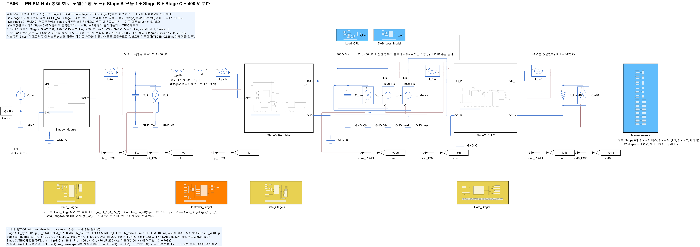
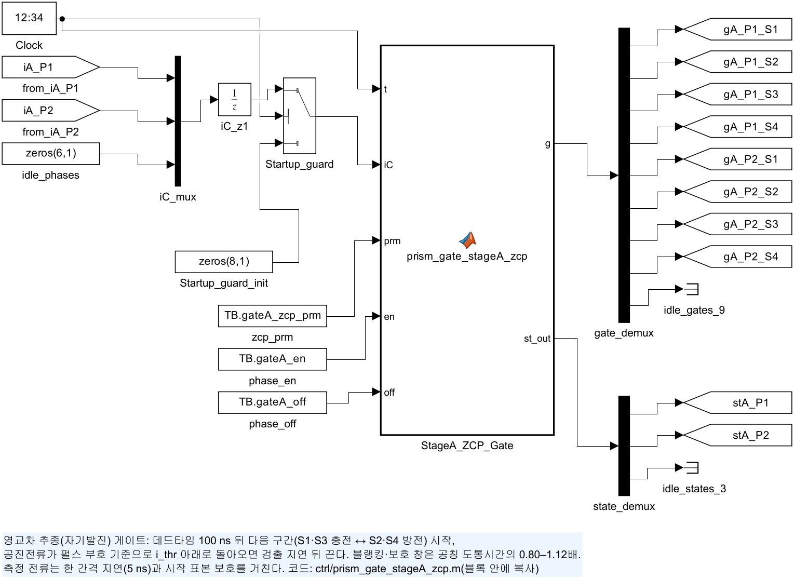
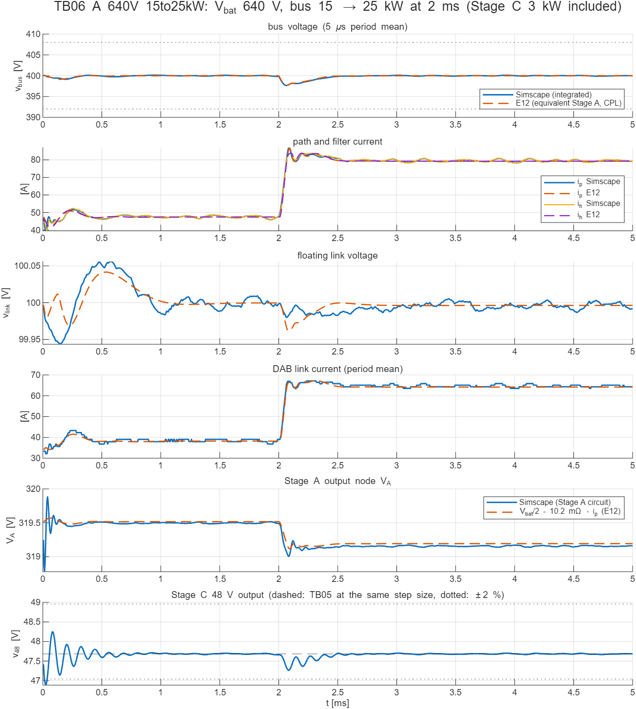
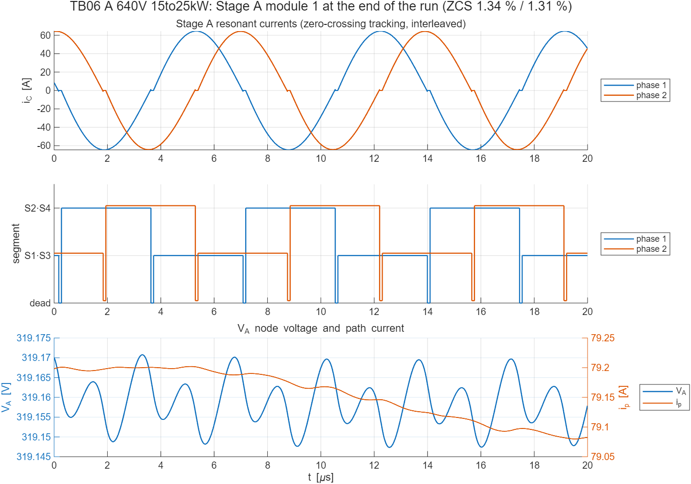

# TB06 — 통합 회로 모델(주행 모드): Stage A 모듈 1 + Stage B + Stage C + 400 V 부하

**결론(2026-10-22): 세 사례 모두 통과.** 따로 검증한 세 단을 한 Simscape 회로로 이었다.

- Stage B의 과도 응답은 Stage A·Stage C를 등가로 둔 검증 모델(E12)과 같았다. TB04의 좁은 허용 오차로 다시 판정해도 모든 지표가 통과한다.
- Stage A는 Stage B가 끌어가는 경로전류에서도 영전류 스위칭(ZCS)을 유지했다. 위상별 턴오프 전류는 피크의 0.06–2.9 %다.
- Stage C 48 V 출력은 부하 계단 중에도 ±2 % 안에 있었다.

Stage B를 설계할 때 쓴 두 등가 가정은 회로에서도 성립한다. Stage A는 V_bat/2와 13.2 mΩ로, Stage C는 버스 정전력 부하로 두었다.

## 왜 필요한가

지금까지는 단을 하나씩 검증했다. TB01은 Stage A 1위상, TB02–TB04B는 Stage B, TB05는 Stage C를 다뤘고, 각 시험에서 나머지 단은 이상 전원이나 이상 부하로 두었다. 실제 장치에서는 세 단이 같은 노드를 공유하므로, 다음 상호작용이 판정을 바꾸는지 확인해야 한다.

1. **Stage A 출력 → Stage B.** Stage B 제어기는 Stage A를 V_bat/2와 경로저항 13.2 mΩ(Stage A 출력저항 포함)로 보고 경로전류를 예측한다. 실제 Stage A는 공진 스위치드 커패시터와 출력 커패시터 C_A다. 출력전압이 반주기마다 충방전으로 움직이고, 등가 출력저항은 영교차 추종 타이밍과 데드타임에 따라 정해진다.
2. **Stage B → Stage A.** Stage A 출력전류는 Stage B가 제어하는 경로전류다. 부하 계단으로 경로전류가 빠르게 바뀔 때 Stage A 각 위상이 영교차 추종으로 ZCS를 유지하는지, 두 위상이 전류를 고르게 나누는지 확인한다.
3. **버스 → Stage C → 버스.** Stage C는 고정이득이라 버스전압 변동이 그대로 48 V에 나타나고, 입력전류는 250 kHz로 맥동한다. Stage B가 조정한 버스에서 48 V가 범위 안에 있는지, Stage C 입력이 Stage B 판정을 바꾸지 않는지 확인한다.

## 회로

| 그림 | 내용 |
| --- | --- |
|  | 배터리(이상 전압원) → `StageA_Module1`(위상 1·2) → Stage A 출력전류 센서 → V_A 노드(C_A 400 µF) → 경로 3 mΩ·1.5 µH → `StageB_Regulator`(TB04B와 같은 회로) → 400 V 버스(C_b 400 µF ∥ 정전력 부하 ∥ DAB 손실 등가) → Stage C 입력전류 센서 → `StageC_CLLC`(TB05와 같은 회로) → 48 V 저항부하 0.768 Ω |
|  | 위상 2개를 VIN·GND·VOUT에 병렬 연결(모듈 목표 정격 37.5 kW) |
|  | 스위치 셀 4개(S1 VIN–A, S2 A–V_A, S3 V_A–B, S4 B–GND) + R_misc·L_r·C_fly 직렬 공진 경로(TB01과 같음) |
|  | 영교차 추종 게이트(`ctrl/prism_gate_stageA_zcp.m`): 위상 전류 측정 → 한 간격 지연 → 시작 표본 보호 → 상태기계 → 게이트 태그 |

- **Stage A 게이트(채택 방식, 처음으로 회로에 구현).** 위상마다 상태기계를 둔다. 데드타임 100 ns 뒤 다음 구간(S1·S3 충전 ↔ S2·S4 방전)을 시작한다. 공진전류가 펄스 부호 기준으로 0.5 A 아래로 돌아오면 검출 지연 20 ns 뒤 끈다. 블랭킹·보호 창은 공칭 도통시간의 0.80–1.12배다. 논리는 검증 모델 E1(`model_stage_a.py`, mode `zcp`)과 같다. 두 위상은 T/4 엇갈려 시작한다.
- **Stage B.** TB04B와 같은 회로·제어기·게이트를 쓴다(DAB 후보 소자 출력용량 1차 335 pF·2차 1371 pF). 경로저항은 배선 3 mΩ만 넣었다. Stage A 출력저항은 회로에서 생긴다. 제어기의 공칭 모델은 바꾸지 않았다(13.2 mΩ).
- **Stage C.** TB05와 같은 회로·게이트(250 kHz 고정, 데드타임 50 ns)를 쓴다. 48 V 정격 3 kW 저항부하다.
- **부하.** 사례의 부하는 버스 총부하(Stage C 입력 포함)다. 정전력 부하 = 총부하 − Stage C 입력 추정 2994 W(TB05 3 kW, 5 ns 실측). 실제 Stage C 입력은 2994–3001 W였다.
- **해석기.** Simulink 고정 간격 이산 5 ns, Simscape 지역 해석기 후진 오일러 5 ns(고정 비용, 모드 반복 3회). 스위치 셀 24개와 정류 다이오드 4개로, 5 ms 계산이 사례당 약 75 s 걸린다(2.5 ns는 약 155 s).
- **초기조건.** 경로·직렬·버스·링크는 E12 평형점에서, V_A = V_bat/2 − 10.2 mΩ·i_p, C_fly = V_bat/2, 공진 인덕터 전류 0에서 시작한다. Stage C는 공진망 0, 출력 47.68 V에서 시작한다. Stage A·Stage C가 주기 정상상태에서 시작하지 않으므로 처음 1 ms는 판정에서 뺐다. 부하 계단은 2 ms, 끝은 5 ms다.

## 사례와 기준값

| 사례 | 배터리 | 버스 총부하(2 ms 계단) | 고른 이유 |
| --- | --- | --- | --- |
| A | 640 V | 15 → 25 kW | 설계 코너: 경로전류·링크전력 최대 |
| B | 788 V | 5 → 15 kW | 직렬전압 ≈ 0, DAB 저전류 구간 |
| C | 920 V | 25 → 15 kW | 음의 직렬전압(링크 → 버스), Stage A 최고 입력전압, 부하 감소 |

기준값(`ref/make_ref_TB06.py`)은 두 가지다.

- **Stage B — E12.** Stage A를 V_bat/2 + 13.2 mΩ + 1.5 µH로, Stage C를 정전력 부하로 둔 같은 사례를 계산했다. 결과는 `TB06_<사례>_init.json`·`_rec.csv`·`_wave.csv`다.
- **Stage A — E1.** 영교차 추종 2위상, 출력 400 µF에서 E12의 계단 전·끝 평균 경로전류를 일정 전류로 끄는 정상상태를 계산했다. 결과는 `TB06_<사례>_stageA.json`이다.

## 판정 기준(시험 전에 고정)

판정 구간은 1 ms 이후다.

1. **Tier-1(회로).**
   - 5 µs 주기 평균 버스 400 ± 8 V
   - 경로·필터 순시 전류 ≤ 98 A
   - 링크전류 주기 평균 ≤ 80 A, 링크전력 ≤ 8 kW
   - 링크전압 90–110 V
   - |v_s| ≤ 90 V
   - 마지막 1 ms 리플은 정보로만 기록한다. 5 ns 게이트 격자의 리밋 사이클을 포함하기 때문이다. 0.1 V 기준은 TB04B에서 0.625 ns로 만족했다.
2. **E12와 일치.**
   - 계단 전(1.8–2.0 ms)·끝(4.8–5.0 ms) 평균: 버스 0.2 V, 경로·필터 1 A. 링크전압 0.5 V·링크전류 1.5 A + 3 %는 사례 A만 판정한다.
   - 계단 뒤: 최저·최고 버스전압 1.0 V, 최대 경로·필터 순시 전류 max(3 A, 5 %), 주기 평균 버스전압 궤적 RMS 0.3 V.
   - 과도 허용폭은 TB04(0.5 V, max(2 A, 3 %), 0.2 V)보다 넓게 잡았다. 실제 Stage A 출력 임피던스와 Stage C 입력이 등가 모델과 다르다고 예상했기 때문이다. 결과는 TB04의 좁은 허용폭도 모두 만족했다.
3. **Stage A.**
   - 위상별 ZCS 비율 ≤ 5 %(설계 기준, 턴오프 순간 전류/피크, TB01과 같은 정의)
   - V_A 평균: E1과 ±0.3 V
   - 위상 간 평균 출력전류 차 ≤ 5 %
   - 계단 전·끝 0.2 ms 구간에서 판정한다.
4. **Stage C.**
   - 48 V 출력 ±2 %(47.04–48.96 V, 1 ms 이후 전 구간)
   - 끝 평균이 같은 적분 간격의 TB05와 ±0.15 V

## 결과

| 항목 | 사례 A(640 V, 15 → 25 kW) | 사례 B(788 V, 5 → 15 kW) | 사례 C(920 V, 25 → 15 kW) |
| --- | --- | --- | --- |
| 버스 주기 평균(1 ms 이후) | 397.67–400.11 V | 397.96–400.86 V | 398.96–401.84 V |
| 최대 경로 / 필터 순시 전류 | 87.13 / 87.75 A | 51.44 / 54.93 A | 55.60 / 61.75 A |
| 링크전류·전력 최대(주기 평균) | 67.2 A, 6.72 kW | 4.7 A, 0.47 kW | 32.7 A, 3.27 kW |
| 링크전압 / 최대 \|v_s\| | 99.98–100.01 V / 81.2 V | 99.99–100.01 V / 7.1 V | 99.90–100.06 V / 60.3 V |
| E12 대비: 최저 / 최고 버스전압 | −0.07 / +0.13 V | −0.02 / +0.12 V | −0.38 / +0.005 V |
| E12 대비: 최대 경로 / 필터 전류 | +0.38 / −0.13 A | +1.19 / +1.24 A | −0.41 / −0.45 A |
| E12 대비: 버스 궤적 RMS, 끝 경로전류 | 0.075 V, +0.36 A | 0.037 V, +0.15 A | 0.076 V, +0.05 A |
| Stage A ZCS(계단 전 / 끝, 위상 1·2) | 0.50·0.47 % / 1.34·1.31 % | 2.90·2.93 % / 0.49·0.47 % | 0.93·0.89 % / 0.08·0.06 % |
| V_A 평균 − E1(계단 전 / 끝) | −0.07 / −0.10 V | +0.02 / −0.08 V | −0.10 / −0.07 V |
| 위상 전류 차(계단 전 / 끝) | 0.53 / 0.45 % | 0.15 / 0.34 % | 0.50 / 0.38 % |
| 48 V 출력(1 ms 이후) / 끝 평균 | 47.24–47.73 / 47.683 V | 47.28–47.84 / 47.683 V | 47.46–48.06 / 47.686 V |
| 마지막 1 ms 버스 리플(정보) | 0.179 V | 0.060 V | 0.157 V |
| 판정 | **통과** | **통과** | **통과** |





**해석**

- **Stage A 등가는 맞다.** 회로의 V_A 강하는 세 사례 모두 출력전류당 10.6 mΩ였다. 경로 3 mΩ를 더하면 13.6 mΩ로, 제어기 공칭값 13.2 mΩ와 3 % 차이다(제어기 공차 시험 ±10 % 안). E1 계산과도 V_A 평균이 0.1 V 안에서 맞았다. C_A가 있는 실제 V_A 노드에서도 Stage B 과도 응답은 등가 전원일 때와 같았다. 버스 궤적 RMS 차는 0.04–0.08 V다.
- **Stage A ZCS는 부하가 가벼울수록 커진다.** 턴오프 전류 비율은 12.8 A(사례 B 계단 전)에서 2.9 %로 가장 컸다. 검출 문턱 0.5 A와 검출 지연이 피크 대비 상대적으로 커지기 때문이며, E1도 같은 경향(3.8 %)이다. 설계 기준 5 % 안이다. 두 위상의 전류 차는 0.6 % 이하다.
- **Stage C는 버스 과도를 그대로 받는다.** 계단 뒤 48 V 주기 평균은 최대 0.42 V 움직였다. 버스 편차(최대 2.3 V)를 권선비로 옮긴 값과 Stage C 출력 LC 진동의 합이며, ±2 %(0.96 V) 안이다. 끝 평균은 TB05와 0.003 V 안에서 같다.
- **정상상태 리플(정보).** 5 ns 게이트 격자에서 0.06–0.18 V다. 사례 A를 2.5 ns로 다시 계산하면 0.079 V로 줄었다(아래). 판정 기준은 TB04B의 게이트 분해능 요구(≤ 0.625 ns)로 갈음한다.

**적분 간격 2.5 ns(사례 A, 정보).** 판정 항목이 모두 통과했고, 값은 5 ns와 거의 같다.

- E12 대비 최저 버스전압 −0.03 V, 최대 경로전류 +0.37 A, 끝 경로전류 +0.05 A
- ZCS 0.53·0.50 % / 1.15·1.15 %, V_A − E1 −0.07 / −0.08 V
- 48 V 끝 평균 47.832 V(TB05 2.5 ns 47.833 V)
- 리플 0.079 V. 실행 시간은 154 s였다.

## 모델 간 차이(해석 때 고려)

- 게이트 에지는 적분 간격 격자에 맞춰진다. 이 양자화가 정상상태 리밋 사이클 리플의 원인이다(TB04B).
- 후진 오일러는 Stage C 공진망에 수치 감쇠를 만든다. 5 ns에서 3 kW 기준 약 34 W 등가 손실이 Stage C 입력에 포함된다(TB05).
- Stage A 피크 공진전류는 E1보다 2–4 % 크다(정보). E1은 RK4 20 ns 간격의 이상 소자 모델이고, 회로는 5 ns 후진 오일러에 스위치 셀(도통저항, 다이오드)을 쓴다. 영교차 검출 시점도 간격 크기만큼 다르다.
- E1 ZCS 기준값은 E1의 표본 간격(약 20 ns) 한 단계 전 전류라서, 회로의 턴오프 순간 값과 직접 비교하지 않는다(설계 기준 5 %로만 판정).
- 충전기는 연결하지 않았다(주행 모드). 충전 중 동시 운전과 모드 전환은 다음 단계(H3)다.

## 재현

```matlab
prism_run('build_TB06')       % TB06_Integrated_Drive.slx 생성
prism_run('probe_TB06')       % 0.5 ms 점검(기동 거동, 실행 시간)
prism_run('run_TB06')         % 사례 A·B·C(5 ns) 판정, results/TB06_summary.*·사례별 파일·회로도 그림
prism_run('run_TB06_fine')    % 정보: 사례 A를 2.5 ns로(results/TB06_summary_runs_4.*)
```

기준값: `python ref/make_ref_TB06.py <검증 코드 python 폴더>`(약 40 s).
