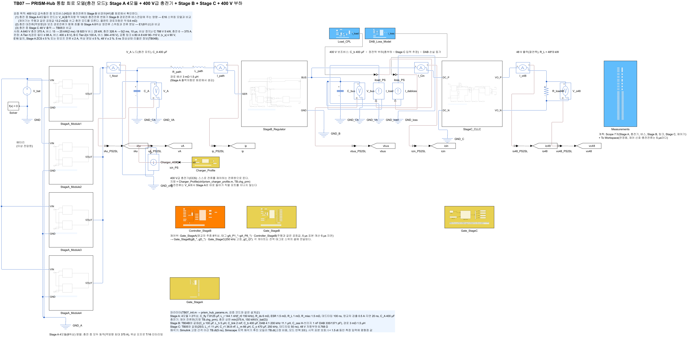
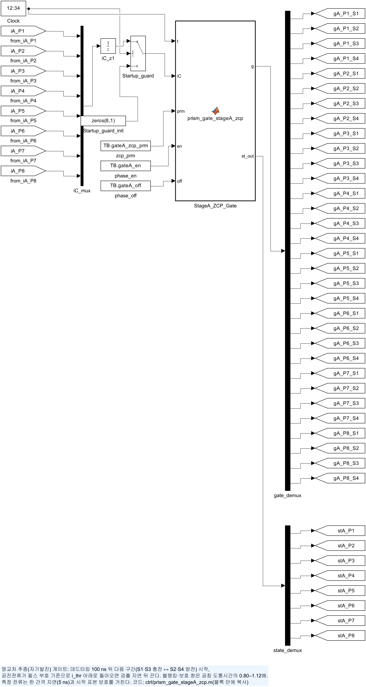
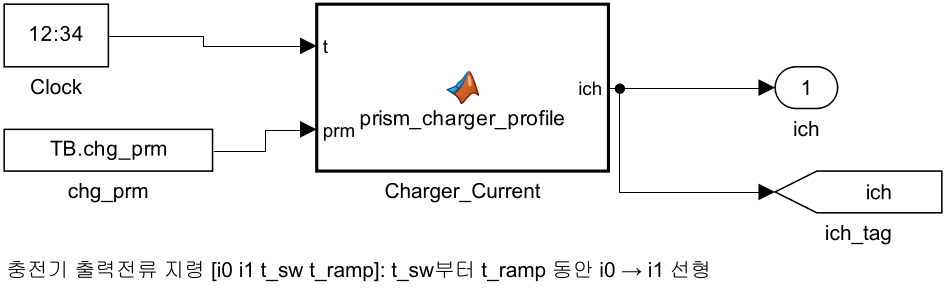
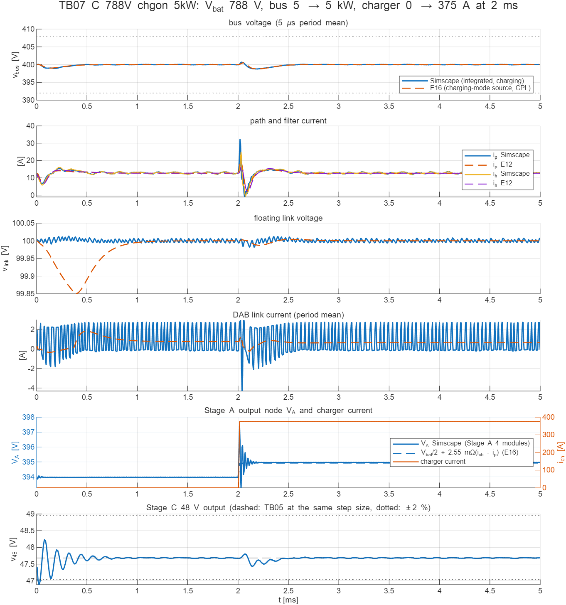
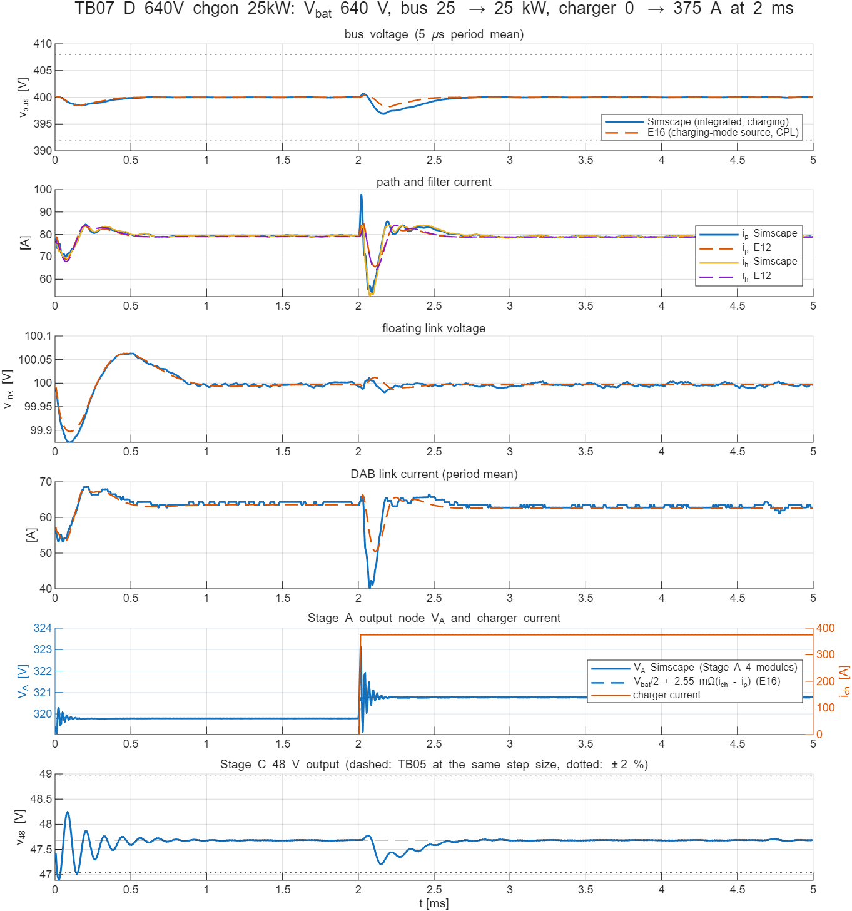

# TB07 — 통합 회로 모델(충전 모드): Stage A 4모듈 + 400 V급 충전기 + Stage B + Stage C + 400 V 부하

**결론(2026-10-22)**

- **회로 한계는 7개 실행 모두 통과했다.** 충전 375 A 중 보조부하 계단은 Tier-1, 충전기 접속·비상 정지는 Tier-2로 판정했다. Stage A 8위상의 영전류 스위칭(턴오프 전류 ≤ 1.1 A), 위상 전류 분담(≤ 0.9 %), 48 V 출력(±2 %)도 모두 기준 안이다.
- **Stage B 검증 모델(E16)과의 일치 기준은 사례별로 결과가 다르다.**
  - 충전전류가 일정한 사례 A와, 충전전류가 100 µs 이상에 걸쳐 바뀌는 실행(C2·C3)은 일치했다.
  - 충전전류가 10 µs 안에 바뀌는 사례 B·C는 불통과다(추가 실행 D도 같다). 원인은 회로 경로전류 첨두가 기준 모델보다 3.3–13.4 A 큰 것이다.
- **원인은 Stage A 출력 노드의 동특성이다.** 충전전류가 빠르게 바뀌면 V\_A 노드의 출력 커패시터 C\_A와 Stage A 공진 회로가 주기 약 30 µs로 공진한다. 이 공진으로 V\_A가 정적 값보다 약 2.4 V 넘쳐, 그만큼 경로전류가 커진다. 기준 모델은 Stage A를 정적 등가(V\_bat/2 + R\_A)로 두므로 이 공진이 없다.
- **최대 경로전류 코너가 판정 여유를 정한다.** 640 V·25 kW에서 10 µs 충전기 접속 시 회로 경로전류는 98.49 A로, Tier-2 한계 100 A에 1.5 A 남는다.
- **설계 요구를 하나 더한다.** 충전전류를 늘리는 변화는 100 µs 이상에 걸쳐야 한다(375 A 기준 3.75 A/µs 이하). 충전전류는 차량이 요청하는 값을 충전기가 따르므로, 차량 쪽 요청 램프로 이 요구를 만족시킨다.

## 왜 필요한가

TB06은 주행 모드, 곧 Stage A 모듈 1개가 V\_A를 만드는 경우만 다뤘다. 400 V급 급속충전 중에는 두 가지가 다르다.

1. **경로 전원이 바뀐다.** Stage A 4모듈이 모두 동작해 V\_A 출력저항이 약 1/4로 줄고, 충전기가 V\_A 노드에 최대 375 A를 넣는다. Stage B 제어기는 주행과 같은 공칭값(경로저항 13.2 mΩ)을 쓰므로, 플랜트 경로저항(약 5.6 mΩ)이 공칭의 42 %인 조건에서 동작한다. 평균모델·스위칭 모델 검증(E16)은 이 변화를 정적 등가 전원 V\_bat/2 + R\_A·i\_ch로 두었다. 그 등가가 실제 회로에서도 맞는지 확인해야 한다.
2. **Stage A가 역방향 대전류와 보조 경로전류를 함께 처리한다.** 충전 중 Stage A 출력전류는 i\_p − i\_ch(약 −270 ~ −360 A)다. 8위상 영교차 추종이 이 조건에서도 영전류 스위칭과 전류 분담을 유지하는지 확인한다.

충전전류는 V\_A 노드에서 Stage A로 바로 들어가며 직렬 포트를 지나지 않는다(정격 분리, H1). 회로에서는 경로전류가 충전전류와 무관하게 보조부하만큼만 흐르는 것으로 확인된다.

## 회로

| 그림 | 내용 |
| --- | --- |
|  | 배터리 → `StageA_Module1`–`4`(VIN·GND·VOUT 병렬, 위상 1–8) → Stage A 출력전류 센서 → V\_A 노드(C\_A 400 µF) ∥ `Charger_400V`(제어 전류원) → 경로 3 mΩ·1.5 µH → `StageB_Regulator`(TB06과 같음) → 400 V 버스 → `StageC_CLLC` → 48 V 부하 |
|  | 위상 2개 병렬(TB06과 같은 빌더). 모듈 m의 위상 번호는 2m−1, 2m |
|  | 영교차 추종 게이트 8위상(`ctrl/prism_gate_stageA_zcp.m`). 위상 오프셋 k·T/16(검증 모델 E1과 같음) |
|  | 충전기 출력전류 지령 `ctrl/prism_charger_profile.m`: [i0 i1 t\_sw t\_ramp] |

- **충전기.** CCS 충전기는 차량이 요청한 전류를 스스로 제어하므로, 지령 프로파일을 따르는 제어 전류원으로 두었다. 충전전류 상한은 min(375 A, 150 kW/(V\_bat/2))이다. 충전기 출력 필터·케이블은 포함하지 않았다.
- **Stage A.** 4모듈 8위상이 모두 동작한다. 게이트 논리와 소자값은 TB06과 같다. 초기 V\_A = V\_bat/2 + 2.55 mΩ·(i\_ch − i\_p)다.
- **Stage B·Stage C·부하·해석기.** TB06과 같다. 스위치 셀은 Stage A 32개, Stage B 12개, Stage C 4개(+정류 다이오드 4개)다. 5 ms 계산이 사례당 약 200 s 걸린다.

## 사례와 기준값

| 실행 | 배터리 | 버스 총부하 | 충전전류(2 ms) | 판정 | 고른 이유 |
| --- | --- | --- | --- | --- | --- |
| A | 640 V | 15 → 25 kW(2 ms) | 375 A 일정 | Tier-1 | 충전 중 동시 운전, 경로전류·링크전력 최대 |
| B | 920 V | 25 kW | 326 → 0 A, 10 µs | Tier-2 | 충전 비상 정지, 음의 직렬전압, 최고 전압 |
| C | 788 V | 5 kW | 0 → 375 A, 10 µs | Tier-2 | 충전기 접속, 직렬전압 ≈ 0, DAB 저전류 |
| C2(추가) | 788 V | 5 kW | 0 → 375 A, 100 µs | 정보 | 충전전류 변화 속도 의존 |
| C3(추가) | 788 V | 5 kW | 0 → 375 A, 1 ms | 정보 | 같음 |
| D(추가) | 640 V | 25 kW | 0 → 375 A, 10 µs | 정보 | 최대 경로전류 코너의 충전기 접속 |
| E(추가) | 640 V | 25 kW | 375 → 0 A, 10 µs | 정보 | 최대 경로전류 코너의 비상 정지 |

10 µs는 충전전류 변화의 경계 사례다. 실제 충전기 전류는 차량 요청을 따라 훨씬 느리게 바뀌고, 비상 정지도 케이블·출력 필터 때문에 이보다 느리다. 추가 실행 C2·C3은 변화 속도에 따른 차이를 보려고 결과를 본 뒤 더했다. D·E는 회로 한계 여유를 보려고 더했다. 판정 기준은 바꾸지 않았다.

기준값(`ref/make_ref_TB07.py`)은 두 가지다.

- **Stage B — E16 스위칭 모드.** E12 엔진에 충전 경로 전원을 넣었다. 경로 전원은 V\_bat/2 + R\_A·i\_ch, 경로저항은 R\_A + 3 mΩ(R\_A = 10.2 mΩ/4)이고, 충전전류 변화는 같은 시간의 선형 변화다. 제어기는 실제 V\_bat과 공칭값을 쓴다. 결과는 `TB07_<사례>_init.json`·`_rec.csv`·`_wave.csv`다.
- **Stage A — E1 8위상.** 출력 400 µF에서 같은 평균 출력전류(i\_p − i\_ch)를 끄는 정상상태다. 결과는 `TB07_<사례>_stageA.json`이다.

## 판정 기준(시험 전에 고정)

판정 구간은 1 ms 이후다.

1. **회로 한계.**
   - 버스(5 µs 주기 평균): Tier-1은 400 ± 8 V, Tier-2는 384–416 V이고 끝 400 ± 4 V.
   - 경로·필터 순시 전류: Tier-1 ≤ 98 A, Tier-2 ≤ 100 A.
   - 공통: 링크전류 주기 평균 ≤ 80 A, 링크전력 ≤ 8 kW, 링크전압 90–110 V, |v\_s| ≤ 90 V.
2. **E16과 일치.** TB06과 같은 허용폭이다.
   - 전환 전·끝 평균: 버스 0.2 V, 경로·필터 1 A.
   - 전환 뒤: 최저·최고 버스 1.0 V, 최대 경로·필터 순시 전류 max(3 A, 5 %), 버스 궤적 RMS 0.3 V.
3. **Stage A.**
   - 위상별 턴오프 전류 ≤ 피크의 5 % 또는 ≤ 2 A. 경부하 기준을 더한 이유는 다음과 같다. 사례 C 접속 전에는 위상당 약 1.6 A만 흘러 비율이 커진다. 2 A의 턴오프 에너지(½·V·I·20 ns ≤ 9 µJ)는 출력용량 에너지 24 µJ보다 작다.
   - V\_A 평균: E1과 ±0.3 V.
   - 위상 출력전류 분담 ≤ 5 %.
4. **Stage C.** 48 V ±2 %, 끝 평균이 TB05와 ±0.15 V.

## 결과

| 실행 | 버스(1 ms 이후) | 최대 경로 / 필터 순시 | E16 대비 최대 경로전류 | E16 대비 버스 RMS | Stage A 턴오프 전류(최대) | 48 V | 회로 한계 | E16 일치 |
| --- | --- | --- | --- | --- | --- | --- | --- | --- |
| A | 397.86–400.13 V | 86.61 / 88.46 A | −0.19 A | 0.05 V | 0.91 A(1.4 %) | 47.26–47.74 V | 통과(Tier-1) | 통과 |
| B | 399.42–401.70 V | 67.69 / 75.23 A | **+3.33 A**(허용 3.22 A) | 0.10 V | 0.49 A | 47.55–48.04 V | 통과(Tier-2) | **불통과** |
| C | 398.77–400.67 V | 33.05 / 25.87 A | **+13.4 A** | 0.06 V | 1.07 A | 47.40–47.83 V | 통과(Tier-2) | **불통과** |
| C2 | 398.73–400.30 V | 16.21 / 16.89 A | +1.41 A | 0.06 V | 1.07 A | 47.47–47.77 V | 통과 | 통과 |
| C3 | 399.55–400.11 V | 13.76 / 15.15 A | +0.50 A | 0.06 V | 1.07 A | 47.60–47.73 V | 통과 | 통과 |
| D | 396.99–400.67 V | **98.49** / 88.47 A | **+12.4 A** | **0.43 V** | 0.78 A | 47.18–47.81 V | 통과(Tier-2, 여유 1.5 A) | 불통과 |
| E | 399.37–400.12 V | 88.65 / 87.71 A | +2.25 A | 0.08 V | 0.79 A | 47.54–47.77 V | 통과 | 통과 |

- Stage A의 V\_A 평균은 모든 실행에서 E1과 0.12 V 안에서 맞았다. 8위상 출력전류 분담은 0.9 % 이하다.
- 사례 A의 정상상태 V\_A는 V\_bat/2 + 0.9 V로, 정적 등가(2.55 mΩ × 327 A = 0.83 V)와 맞는다.
- 주기 평균 Stage A 출력전류는 경로전류에서 충전전류를 뺀 값과 0.06 A 안에서 같았다(KCL 확인).





**해석**

- **V\_A 노드 공진이 차이를 만든다.** 충전기 접속(C·D)에서 V\_A는 15 µs 뒤 최종값보다 약 2.4 V 높았다가 30 µs 뒤 낮아지며 진동한다(주기 약 30 µs). 비상 정지(B·E)에서는 반대 방향이다. 정적 등가로 보면 V\_A는 0.95 V만 계단처럼 바뀌어야 한다. 이 넘침이 경로 인덕턴스 1.5 µH에 걸려 경로전류 첨두를 키운다. Stage B 제어기는 5 µs 표본과 지연 때문에 이 30 µs 공진을 다 막지 못한다.
- **변화 속도가 공진 주기보다 충분히 느리면 등가가 맞다.** 같은 접속을 100 µs(C2)와 1 ms(C3)에 걸쳐 하면 경로전류 차이가 +1.41 A와 +0.50 A로 줄어 일치 기준을 통과한다. 등가 모델(E16)의 충전전류 변화 결과는 변화 시간이 100 µs 이상일 때 유효하다.
- **방향에 따라 다르다.** 충전기 접속은 V\_A를 올려 경로전류를 키우는 방향이라, 이미 경로전류가 큰 640 V·25 kW에서 첨두가 98.49 A가 된다(D). 비상 정지는 V\_A를 내려 경로전류를 먼저 줄이는 방향이라 첨두가 거의 늘지 않는다(E, +2.25 A).
- **설계 요구.** 충전전류를 늘리는 변화는 100 µs 이상에 걸쳐야 한다(375 A 기준 ≤ 3.75 A/µs). 충전전류는 차량이 요청하고 충전기가 따르므로, 차량의 전류 요청 램프로 만족시킨다. 갑작스러운 충전 중단은 감소 방향이라 회로 한계 여유가 크다(B 67.7 A, E 88.7 A).
- **정상상태 리플(정보).** 5 ns 게이트 격자에서 0.06–0.24 V다. TB04B의 게이트 분해능 요구(≤ 0.625 ns)로 갈음한다.

## 모델 간 차이(해석 때 고려)

- 기준 모델(E16)은 Stage A를 정적 등가 전원으로 둔다. 회로의 C\_A–Stage A 공진(주기 약 30 µs)은 없다. 이것이 10 µs 전환의 불일치 원인이다.
- 충전기는 이상 전류원이다. 실제 충전기 출력 커패시터·케이블 인덕턴스는 충전전류 변화를 더 느리게 하고 V\_A 공진을 감쇠시킬 수 있다.
- 나머지(게이트 격자 양자화, 후진 오일러 수치 감쇠, Stage A 피크 전류 +1–3 %)는 TB06과 같다.

## 재현

```matlab
prism_run('build_TB07')        % TB07_Integrated_Charging.slx 생성
prism_run('run_TB07')          % 사례 A·B·C(5 ns, 약 10분)
prism_run('run_TB07_extra')    % 추가 실행 C2·C3·D·E(약 13분)
prism_run('export_TB07_png')   % 회로도 그림
```

기준값은 `ref/make_ref_TB07.py <검증 코드 python 폴더> [사례,...]`로 다시 만든다.
