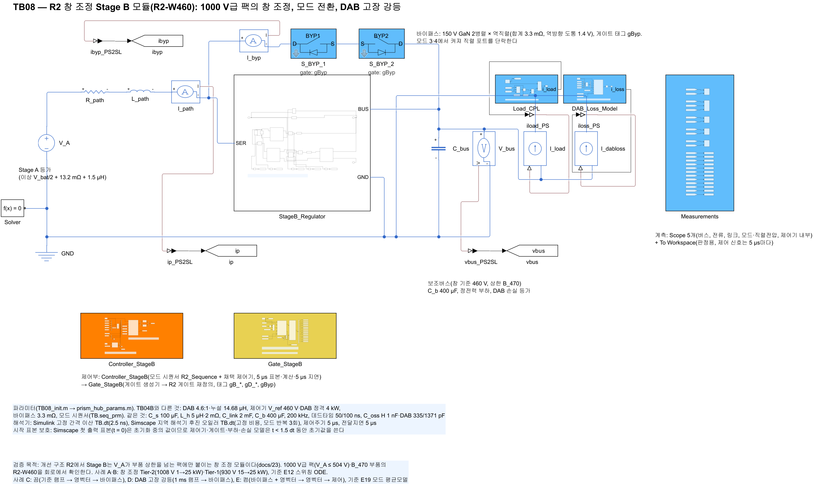
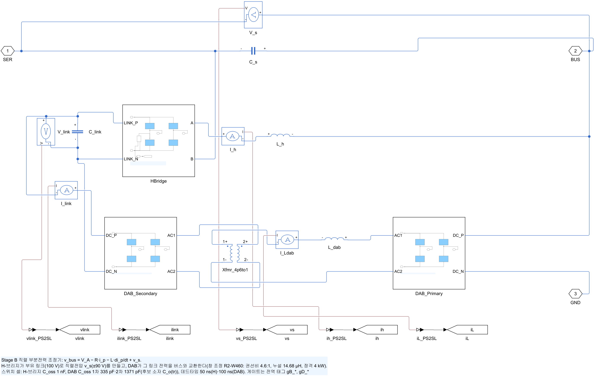
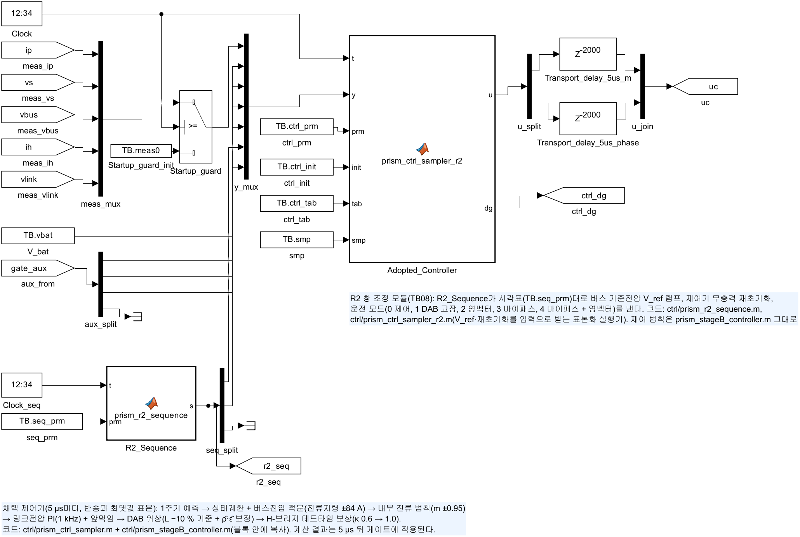
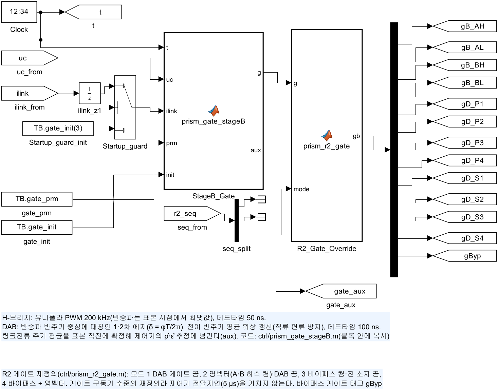
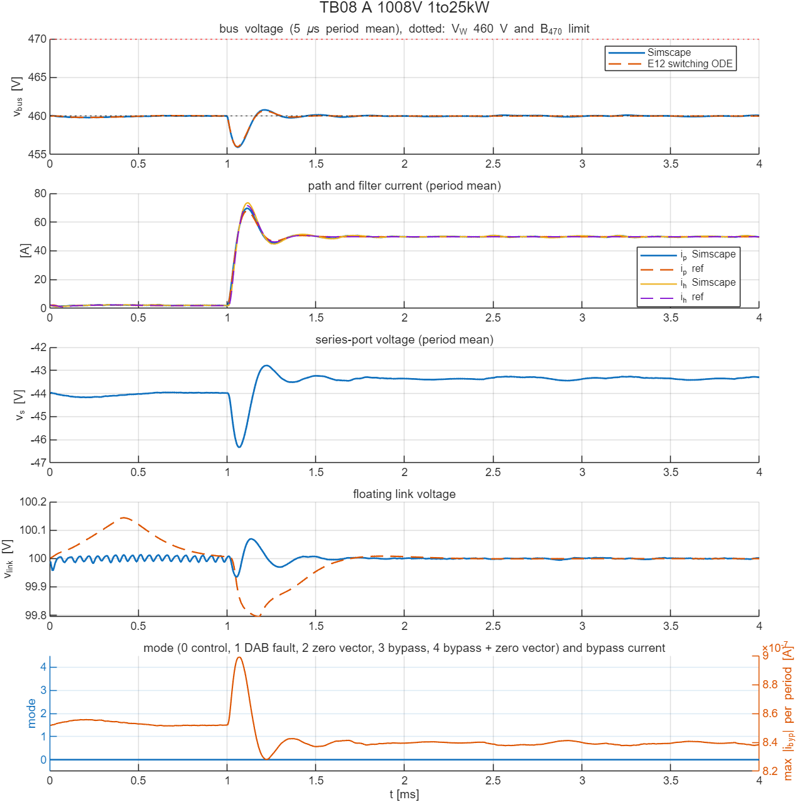
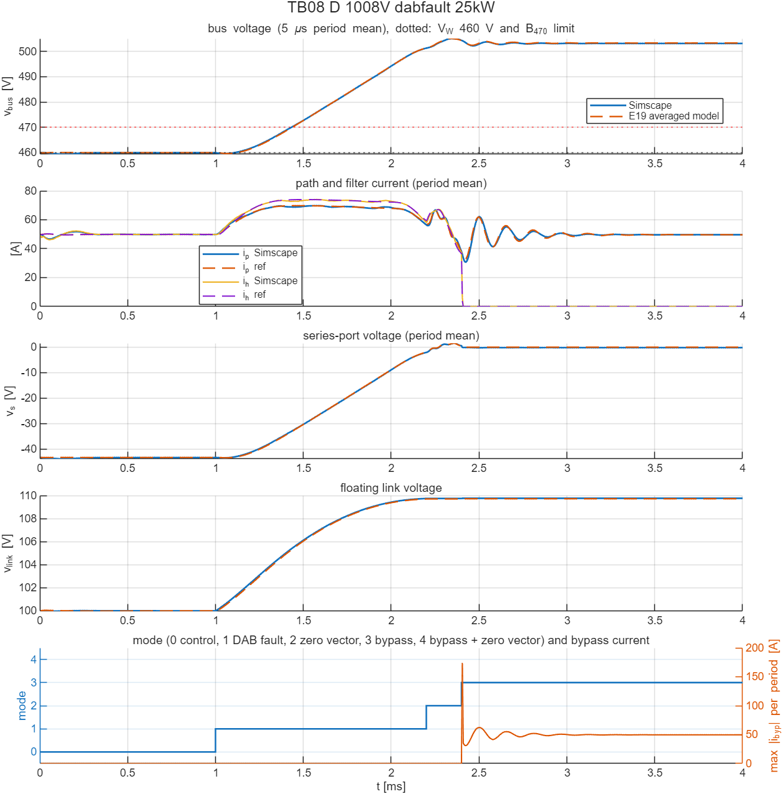
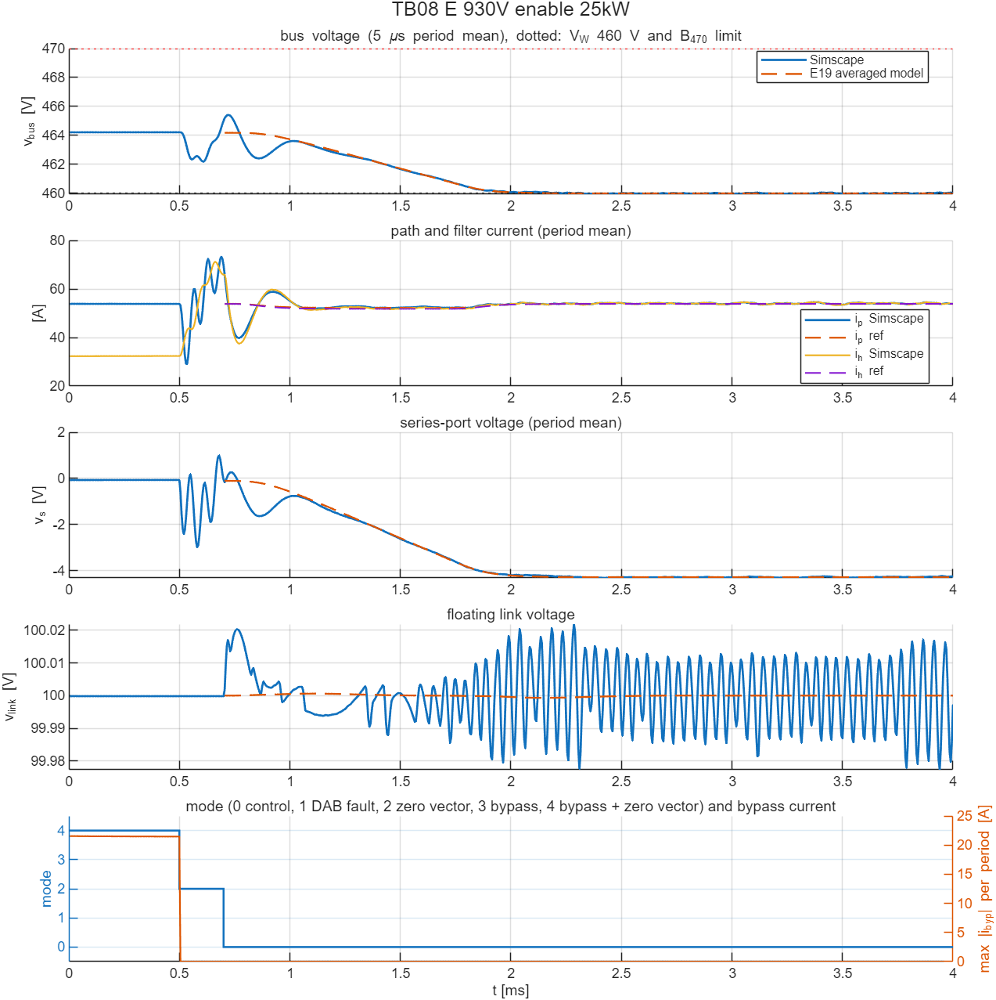
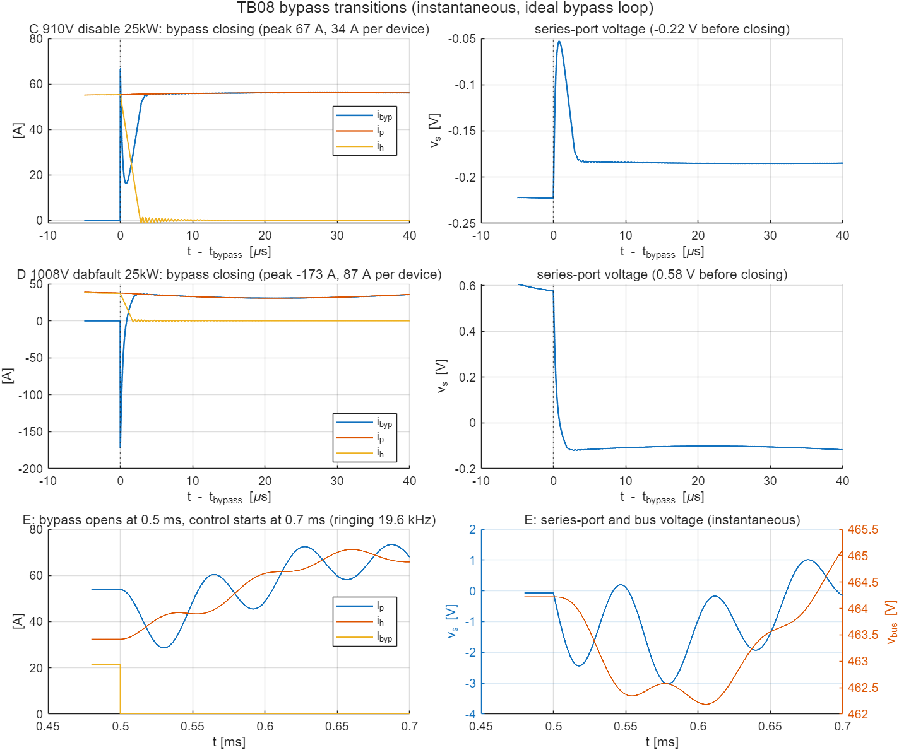

# TB08 — R2 창 조정 Stage B 모듈(R2-W460): 1000 V급 팩의 창 조정, 모드 전환, DAB 고장 강등

**결론(2026-10-23)**

- **판정 실행 5개가 모두 통과했다(게이트 격자 2.5 ns).** 사례 A를 설계 요구 격자 0.625 ns로 다시 계산한 정보 실행도 통과했고, 정상상태 리플은 0.050 V다. 창 조정 두 사례(A·B)는 회로 한계와 검증 모델(E12) 일치 기준을 모두 지켰다. 모드 전환·고장 강등 세 사례(C·D·E)는 회로 한계를 지켰고, 주기 평균 궤적이 평균모델(E19)과 버스 RMS 0.14–0.33 V 안에서 겹쳤다.
- **1000 V급 팩(1008 V)의 Tier-2 계단(1 → 25 kW)에서도 버스는 B\_470 상한 안이다.** 버스 455.95–460.79 V, 경로 순시 최대 69.66 A, 필터 79.68 A, 링크전력 최대 3.22 kW다. DAB 정격은 4 kW다. E12 대비 최대 경로·필터 전류는 +1.84·+2.08 A로, 허용폭(2.03·2.33 A)의 약 90 %를 썼다.
- **DAB 고장 강등은 회로에서도 E19와 같다.** 기준전압을 1 ms 동안 V\_A로 올린 뒤 영벡터 → 바이패스로 넘어간다. 링크 최대 109.76 V(E19 109.72 V), 경로 최대 69.74 A다. 강등 뒤 버스는 V\_A(503.2 V)로 B\_470을 넘는다. 400 V 부하를 분리해야 한다는 E19의 결론이 그대로 남는다.
- **평균모델로는 볼 수 없던 것 두 가지를 회로에서 확인했다.**
  1. **바이패스 투입 펄스.** 영벡터 상태의 직렬 포트에는 0.2–0.6 V가 남는다(영벡터 경로의 저항 강하 + 영벡터 0.2 ms 동안 남은 진동, E19도 0.17–0.51 V). 바이패스가 닫히면 직렬 커패시터 C\_s의 이 전압이 3.3 mΩ 바이패스로 방전된다. D에서 최대 −173 A(소자당 87 A), 폭 약 1 µs, 전하 68 µC(= C\_s·Δv\_s), 에너지 17 µJ다. 소자당 전류는 EPC2305 펄스 정격 329 A의 0.26배다. 기생 인덕턴스가 없는 이상 루프 값이므로 실제 첨두는 이보다 작다.
  2. **바이패스 열림 과도.** 켬 전환(E)에서 바이패스가 열리면 바이패스가 나르던 경로전류의 40 %(21.5 A)가 H-브리지 영벡터 경로로 옮겨 간다. 이때 경로전류가 19.6 kHz로 출렁인다(28.6–73.4 A, v\_s −3.0–1.0 V). 한계 90 A 안이지만 제어 시작(0.7 ms)까지 다 감쇠하지 않는다. 그래서 제어 시작 직후 주기 평균 경로전류가 E19보다 12 A 크다(정보). E19 켬 평균모델은 영벡터 정상상태에서 시작하므로 이 과도가 없다. 바이패스 열림과 제어 시작 사이 간격은 보호 상태기계(E17)에서 정한다.
- **모델 수정 1건.** 첫 실행에서는 바이패스 셀의 역병렬 다이오드에 H-브리지 셀과 같은 이상 클램프(V\_f 1 mV)를 썼다. 그러자 켜진 셀에서 다이오드가 채널과 병렬로 도통했다. 바이패스 저항이 설계값 3.3 mΩ이 아니라 약 1.7 mΩ이 되었고, 투입 펄스가 −325 A로 과대 계산됐다. 다이오드를 데이터시트 역방향 도통 전압(1.4 V)으로 고쳐 다시 돌렸다. 판정은 두 실행 모두 통과다. 고친 결과를 최종으로 쓰고, 첫 실행 요약은 `results/run1_bypass_diode_1mV/`에 남긴다.

## 왜 필요한가

개선 구조 R2에서 Stage B는 V\_A가 400 V급 부품 상한을 넘는 팩에만 붙이는 창 조정 모듈이다(docs/23). V\_A가 창 기준 V\_W를 넘을 때만 버스를 V\_W로 깎고, 그 밖에서는 바이패스 스위치로 직렬 포트를 단락한 채 정지한다. E19는 이 모듈의 축소 정격(4 kW), 모드 전환, 고장 강등을 평균모델로 확인했다. 평균모델로는 다음 세 가지를 확인할 수 없어 회로 모델이 필요하다.

1. **축소 설계가 스위칭 회로에서 400 V 설계와 같이 동작하는가.** DAB 권선비(4:1 → 4.6:1), 누설 인덕턴스(11.1 → 14.68 µH), 정격(8 → 4 kW), 버스 기준(400 → 460 V)이 바뀐다. 1000 V급 팩에서는 DAB 1차 소자(650 V GaN)가 최대 504 V를 받는다(사용률 78 %). 채택 제어기는 이득과 예측 구조를 바꾸지 않았다.
2. **바이패스 스위치와 H-브리지 영벡터 사이의 전류 이전.** E19는 바이패스를 직렬 포트를 단락하는 모드 전환으로만 다뤘다. 그래서 투입·열림 순간의 순시 전류는 E19의 한계로 남아 있었다.
3. **모드 순서가 실제 제어 구조에서 동작하는가.** 모드 시퀀서, 게이트 재정의, 제어기 무충격 재초기화가 5 µs 표본·5 µs 전달지연의 채택 제어기와 함께 동작해야 한다.

## 회로

| 그림 | 내용 |
| --- | --- |
|  | V\_A(이상 V\_bat/2) → 경로 13.2 mΩ·1.5 µH → `StageB_Regulator`(SER → BUS) → 버스(C\_b 400 µF ∥ 정전력 부하 ∥ DAB 손실 등가). SER–BUS 사이에 바이패스 셀 `S_BYP_1`·`S_BYP_2`(역직렬)와 바이패스 전류 센서 `I_byp` |
|  | TB04B 회로. DAB 변압기만 `Xfmr_4p6to1`(4.6:1), 누설 14.68 µH |
|  | 채택 제어기 + 모드 시퀀서 `R2_Sequence`(`ctrl/prism_r2_sequence.m`). 시퀀서 출력 [V\_ref; 재초기화; 모드]는 제어기 입력 y(10)·y(11)과 태그 `r2_seq`로 간다 |
|  | 게이트 생성기 → `R2_Gate_Override`(`ctrl/prism_r2_gate.m`) → 13개 게이트 태그(바이패스 `gByp` 포함) |

- **TB04B와 같은 것.** C\_s 100 µF, L\_h 5 µH·2 mΩ, C\_link 2 mF, C\_b 400 µF, 200 kHz, 데드타임 50/100 ns, 출력용량(H-브리지 1 nF, DAB 335/1371 pF), 채택 제어기의 이득·예측 구조, 해석기 설정이 같다.
- **바뀐 것.** DAB 권선비 4.6:1(= V\_W/100), 누설 인덕턴스 14.68 µH(= 11.1 µH·(460/400)²)다. 제어기는 기준전압 460 V, DAB 정격 4 kW, 공칭 누설 인덕턴스, 권선비만 바꿨다(`prm(9)`·`(14)`·`(17)`·`(19)`).
- **바이패스.** 150 V GaN(EPC2305)을 2병렬로 묶은 셀 두 개를 역직렬로 이었다. 셀 저항 1.65 mΩ, 합계 3.3 mΩ로 E15·E19의 R\_BYP와 같다. 역방향 도통 전압은 1.4 V(데이터시트 V\_SD)다. 꺼지면 두 셀의 역병렬 다이오드가 서로 막아 직렬전압 ±90 V를 양방향으로 견딘다. 바이패스 셀의 출력용량은 넣지 않았다. 바이패스가 전환되는 순간의 전압이 1 V 미만이라 영향이 작다.
- **모드 시퀀서.** 시험 시각표(`TB.seq_prm`)대로 기준전압 램프, 재초기화, 모드를 낸다. 측정값으로 판단하는 상태기계는 E17의 범위라 여기서는 시각표만 쓴다. 모드는 0 제어, 1 DAB 고장(DAB 게이트 끔), 2 영벡터(H-브리지 하측 두 소자 켬, DAB 끔), 3 바이패스(바이패스 켬, 전 소자 끔), 4 바이패스 + 영벡터다.
- **게이트 재정의.** 게이트 구동기 수준의 재정의라 제어기 전달지연(5 µs)을 거치지 않는다.
- **무충격 재초기화.** 모드 2–4 동안 제어기는 매 표본 적분기를 "지령 = 경로전류"로 다시 맞춘다. 링크 적분기, 직전 변조율, ρ̂, ε̂는 처음 값으로 둔다(`prism_stageB_controller.m`의 선택 입력 `rst`). 네 입력으로 부르는 TB04–TB07은 이전과 같다.

## 사례와 기준값

| 실행 | 배터리(V\_A) | 부하 | 시나리오 | 기준 | 고른 이유 |
| --- | --- | --- | --- | --- | --- |
| A | 1008 V(504 V) | 1 → 25 kW(1 ms) | 창 조정 Tier-2 | E12 스위칭 ODE | 최대 배터리 전압·최대 계단: 직렬전압·DAB 전력·1차 소자 전압 최대 |
| B | 930 V(465 V) | 15 → 25 kW(1 ms) | 창 조정 Tier-1 | E12 스위칭 ODE | 창 하단(V\_A = V\_W + 5 V): 직렬전압 ≈ 0, DAB 저전류 영역 |
| C | 910 V(455 V) | 25 kW | 끔: 1–2 ms 기준 460 V → V\_A 램프, 2–3 ms 유지, 3.0–3.2 ms 영벡터, 3.2 ms 바이패스 | E19 평균모델 | V\_A가 창 아래로 내려간 정상 끔 |
| D | 1008 V(504 V) | 25 kW | DAB 고장: 1 ms DAB 정지 + 1 ms 램프, 2.2 ms 영벡터, 2.4 ms 바이패스 | E19 평균모델 | 최악 전압·최대 부하의 고장 강등 |
| E | 930 V(465 V) | 25 kW | 켬: 0–0.5 ms 바이패스 + 영벡터, 0.5 ms 바이패스 열림, 0.7 ms 제어 시작 + 기준 V\_A → 460 V 1 ms 램프 | E19 평균모델(0.7 ms부터) | V\_A가 창 위로 올라간 켬 |

기준값은 `ref/make_ref_TB08.py`로 만든다.

- **A·B.** E12 스위칭 ODE를 R2-W460 설계값(E19 `plant("W460_240s", 4000)`)으로 같은 사례에 다시 계산한다. 결과는 TB04와 같은 열의 `_rec.csv`·`_wave.csv`다.
- **C·D·E.** E19 모드 평균모델(다이오드 상태 고정)의 궤적을 1 µs 간격으로 쓴다(`_avg.csv`).
  - E의 시작 상태는 바이패스와 영벡터가 저항비로 전류를 나누는 상태다. 영벡터 경로(2.2 mΩ)가 60 %를 맡는다.
  - E19 켬 모델은 영벡터 정상상태에서 시작하므로 기준 궤적은 0.7 ms부터 있다. 바이패스 열림(0.5 ms) 과도는 기준에 없다.

## 판정 기준(시험 전에 고정)

1. **창 조정(A·B), 회로 한계.**
   - 버스(5 µs 주기 평균): Tier-1(B)은 460 ± 8 V다. Tier-2(A)는 계단 뒤 444–470 V이고, 끝 0.2 ms 평균이 460 ± 4 V다.
   - 경로·필터 순시 전류: Tier-1 ≤ 98 A, Tier-2 ≤ 100 A.
   - 공통: 링크전류 주기 평균 ≤ 80 A, 링크전력 ≤ DAB 정격 4 kW, 링크 90–110 V, |v\_s| ≤ 90 V, 순시 버스 ≤ 470 V(B\_470).
   - 마지막 1 ms 리플은 정보다. 2.5 ns 격자이기 때문이다. 0.1 V 기준은 게이트 격자 0.625 ns에서 적용한다(TB04B).
2. **창 조정(A·B), E12 일치.** TB04와 같은 항목·허용폭이다.
   - 계단 전·끝 평균: 버스 0.2 V, 경로·필터 1 A.
   - 계단 뒤: 최저 버스 0.5 V, 최대 경로·필터 순시 전류 max(2 A, 3 %), 버스 궤적 RMS 0.2 V.
   - 링크전압·링크전류 일치는 A(SPS 영역)에서 판정하고, B(DAB 저전류)는 정보로 둔다.
3. **모드 전환·고장(C·D·E), 회로 한계.** E19와 같은 기준이다.
   - C: 경로·필터 순시 ≤ 90 A, |v\_s| ≤ 90 V, 링크 90–110 V, 순시 버스 260–470 V, 바이패스 직전 |v\_s| ≤ 2 V.
   - D: 경로·필터 순시 ≤ 100 A, |v\_s| ≤ 90 V, 링크 ≤ 120 V, 버스 ≥ 260 V. 강등 뒤 버스 = V\_A가 B\_470을 넘는 것은 구조적 결과로 기록한다.
   - E: 경로·필터 순시 ≤ 90 A, |v\_s| ≤ 90 V, 링크 90–110 V, 순시 버스 ≤ 470 V, 끝 0.2 ms 평균 460 ± 4 V.
4. **E19 대조(정보).** 주기 평균 버스 최저·최고 ±2 V, 최대 경로전류 ±3 A, 링크 최대 ±1 V, 바이패스 직전 v\_s ±1 V, 최종 버스 ±1 V, 버스 궤적 RMS 1 V로 본다. 평균모델에는 스위칭 리플과 DAB 추정기 동특성이 없으므로 판정에 쓰지 않는다.

## 결과

게이트 격자는 2.5 ns이고, 사례당 계산 시간은 약 100 s다. 실행 6(A, 0.625 ns)은 리플 확인용 정보 실행이다.

| 실행 | 버스(주기 평균) | 경로 / 필터 순시 최대 | 링크 | 링크전력 최대 | 직렬 최대 | 회로 한계 | 검증 모델 |
| --- | --- | --- | --- | --- | --- | --- | --- |
| A | 455.95–460.79 V | 69.66 / 79.68 A | 99.94–100.07 V | 3.22 kW | 46.4 V | 통과(Tier-2) | E12 일치 통과 |
| B | 458.31–460.73 V | 64.47 / 67.55 A | 99.94–100.02 V | 0.93 kW | 5.4 V | 통과(Tier-1) | E12 일치 통과 |
| C | 454.01–460.02 V | 57.20 / 58.91 A | 99.98–100.02 V | 0.45 kW | 5.8 V | 통과 | E19 대조 전 항목 허용폭 안 |
| D | 459.38–505.08 V | 69.75 / 79.31 A | 99.97–**109.76** V | 2.28 kW | 43.9 V | 통과 | E19 대조 전 항목 허용폭 안 |
| E | 459.94–465.42 V | 73.39 / 71.25 A | 99.98–100.02 V | 0.81 kW | 4.3 V | 통과 | 최대 경로전류만 +12.0 A(정보) |
| 6(A, 0.625 ns) | 455.99–460.81 V | 69.62 / 79.52 A | 99.93–100.07 V | 3.19 kW | 46.3 V | 통과(Tier-2), 리플 0.050 V | E12 일치 통과 |

링크전력 최대는 첫 주기(0–5 µs)를 뺀 값이다. 첫 주기에는 DAB가 초기 위상에서 시작하는 과도가 있다(B −1.38 kW, D −2.41 kW).

### 창 조정(A·B): E12와 일치

| 지표 | A 회로 | A E12 | 차이 / 허용 | B 회로 | B E12 | 차이 / 허용 |
| --- | --- | --- | --- | --- | --- | --- |
| 계단 전 버스 | 460.00 V | 460.02 V | −0.01 / 0.2 | 460.00 V | 460.00 V | −0.00 / 0.2 |
| 계단 전 경로전류 | 2.10 A | 1.90 A | +0.19 / 1.0 | 32.52 A | 32.30 A | +0.22 / 1.0 |
| 계단 뒤 최저 버스 | 455.95 V | 456.02 V | −0.07 / 0.5 | 458.31 V | 458.28 V | +0.02 / 0.5 |
| 최대 경로 순시 | 69.66 A | 67.82 A | +1.84 / 2.03 | 64.47 A | 64.46 A | +0.01 / 2.0 |
| 최대 필터 순시 | 79.68 A | 77.60 A | +2.08 / 2.33 | 67.55 A | 67.47 A | +0.08 / 2.02 |
| 버스 궤적 RMS 차 | 0.061 V | — | / 0.2 | 0.031 V | — | / 0.2 |
| 끝 경로전류 | 50.01 A | 49.85 A | +0.16 / 1.0 | 54.13 A | 53.88 A | +0.26 / 1.0 |
| 끝 링크전류 | −21.55 A | −21.60 A | +0.05 / 2.15 | −2.30 A | −2.26 A | 정보 |

- **A의 순시 전류 첨두는 E12보다 1.8–2.1 A(2.7 %) 크다.** 허용폭 max(2 A, 3 %)의 약 90 %다. 게이트 격자를 0.625 ns로 줄여도 +1.80·+1.92 A로 거의 같아서, 게이트 에지 양자화가 원인은 아니다. 원인은 분리하지 않았다. 회로에만 있는 소자 출력용량·다이오드 전이와 1008 V의 큰 직렬전압(−44 V)이 후보다. 버스 궤적은 0.06 V RMS(0.625 ns에서 0.03 V)로 겹친다.
- **B는 DAB가 저전류 영역(링크전류 −1.3 → −2.3 A)에 있어도 링크 99.94–100.02 V를 유지했다.** TB04에서 확인한 ε̂·링크 루프의 동작이 4.6:1·14.68 µH 설계에서도 같다.
- **마지막 1 ms 리플(정보)은 2.5 ns에서 A 0.187 V, B 0.145 V다.** TB04B의 400 V 사례(0.207·0.102 V)와 같은 크기다. 설계 요구 격자 0.625 ns로 A를 다시 계산하면(실행 6, 473 s) **0.050 V로 0.1 V 기준 안**이다. 이때도 회로 한계와 E12 일치 기준을 모두 통과했다. TB04B의 게이트 시간 분해능 요구(≤ 0.625 ns)가 1000 V급 창 조정에도 그대로 충분하다.



### 모드 전환·고장(C·D·E): E19와 대조

| 지표 | C 회로 | C E19 | D 회로 | D E19 | E 회로 | E E19 |
| --- | --- | --- | --- | --- | --- | --- |
| 주기 평균 버스 최저 / 최고 | 454.01 / 460.02 V | 454.06 / 460.01 V | 459.38 / 505.08 V | 459.66 / 505.12 V | 459.94 / 465.42 V | 460.00 / 464.18 V |
| 최대 주기 평균 경로전류 | 57.20 A | 57.84 A | 69.74 A | 69.79 A | **65.92 A** | 53.88 A |
| 링크 최대 | 100.02 V | 100.04 V | 109.76 V | 109.72 V | 100.02 V | 100.00 V |
| 바이패스 직전 v\_s(주기 평균) | −0.22 V | −0.17 V | 0.59 V | 0.51 V | — | — |
| 최종 버스 | 454.09 V | 454.27 V | 503.18 V | 503.34 V | 460.02 V | 460.00 V |
| 버스 궤적 RMS 차 | 0.14 V | — | 0.17 V | — | 0.33 V | — |

- **C·D는 E19와 거의 겹친다.** 최종 버스가 0.16–0.18 V 낮은 것은 바이패스 전압강하다. E19 평균모델은 바이패스 모드를 직렬전압 0으로 두고, 회로에는 경로전류 × 3.3 mΩ(50–55 A에서 0.17–0.18 V)가 있다.
- **D(DAB 고장)는 링크가 직렬 포트 전력을 흡수하는 동안 109.76 V까지 오른다.** E19의 109.72 V와 같고 기준 120 V 안이다. 바이패스 뒤 버스는 503.2 V로 B\_470을 넘는다. 이것은 R2의 구조적 결과다. DAB 고장 강등 때는 400 V 부하를 분리하고, 조정형 Stage C가 48 V를 잇는다(docs/23).
- **E의 차이는 바이패스 열림 과도다.** 0.5 ms에 바이패스가 열리면 경로전류가 출렁인다(아래 순시 분석). 주기 평균 경로전류는 제어 시작 직전(0.69 ms)에 73.3 A, 제어 시작 직후(0.705 ms)에 65.9 A다. 회로 한계(90 A) 안이다. 제어가 시작되면 약 0.4 ms 안에 출렁임이 가라앉고(1.1 ms 이후 51.9–52.4 A), 램프가 끝난 뒤(1.7 ms)에는 E19와 겹친다(최종 460.02 V).





### 바이패스 전환 순시 분석(정보, `run_TB08_zoom.m`)

같은 모델·사례를 전환 직후까지 다시 계산했다. 순시 파형은 10 ns 간격으로 `results/TB08_zoom_<사례>.csv`에 있다.

| 항목 | C(끔, 910 V) | D(DAB 고장, 1008 V) |
| --- | --- | --- |
| 투입 직전 v\_s / 경로전류 / 필터전류 | −0.223 V / 55.3 A / 55.2 A | 0.577 V / 37.6 A / 37.2 A |
| 바이패스 전류 첨두(투입 직후) | +67.0 A | **−173.4 A** |
| 정착값(+20–40 µs 평균) | 56.1 A | 32.2 A |
| 정착값에서 20 A 넘게 벗어난 시간 | 1.90 µs | 1.13 µs |
| C\_s 방전 전하(측정 / C\_s·Δv\_s) | 3.7 / 3.8 µC | −67.6 / −67.8 µC |
| 투입 직전 C\_s 에너지 | 2.5 µJ | 16.6 µJ |
| 소자당 첨두(2병렬) / EPC2305 펄스 정격 329 A | 34 A / 0.10배 | 87 A / 0.26배 |



- **투입 펄스는 직렬 커패시터 방전이다.** 방전 전하(바이패스 전류 − (경로전류 − 필터전류)의 적분)가 C\_s·Δv\_s와 0.3 % 안에서 같다. 첨두는 v\_s/R\_BYP(0.577 V / 3.3 mΩ = 175 A)와 같다.
  - 영벡터 상태의 v\_s는 0이 아니다. 영벡터 경로(R\_h 2 mΩ + 하측 소자 2개)의 저항 강하에, 영벡터 0.2 ms 동안 다 가라앉지 않은 경로전류·직렬전압 진동이 더해진다. D는 투입 순간 경로전류가 37.6 A로, 정상값(50 A)에서 출렁이는 중이었다. E19 평균모델도 같은 순간 0.17·0.51 V를 냈다.
  - 그래서 바이패스 직전 직렬전압 기준(≤ 2 V)을 지켜도 펄스는 생긴다. 다만 에너지가 수 µJ–수십 µJ로 작다. 소자당 첨두도 펄스 정격(25 °C, 300 µs)의 0.26배이고 폭은 약 1 µs다. 실제 루프의 기생 인덕턴스(수 nH)는 첨두를 더 낮춘다.
- **필터전류는 1.8–2.8 µs에 0이 된다.** H-브리지가 꺼지면 L\_h 전류가 다이오드를 거쳐 링크 쪽 −100 V로 감쇠하기 때문이다(5 µH × 55 A / 100 V = 2.8 µs). 그동안 경로전류는 바이패스로 넘어간다.
- **E(바이패스 열림).** 바이패스가 나르던 21.5 A가 L\_h 쪽으로 옮겨 가는 동안 C\_s가 충·방전한다. 그 결과 경로전류가 19.6 kHz로 출렁인다(28.6–73.4 A). 필터전류는 32.4 A에서 71.2 A까지 올라 경로전류를 넘겨받는다. v\_s는 −3.0–1.0 V, 버스는 최대 465.1 V다. 제어가 시작되기 전이라 감쇠는 회로 저항뿐이다. 바이패스 열림과 동시에 제어를 시작하거나 열림 전 바이패스 분담을 줄이는 순서는 E17에서 비교한다.

### 모델 수정 기록: 바이패스 셀 다이오드

| 항목 | 첫 실행(V\_f 1 mV, R\_d 0.1 mΩ) | 최종(V\_f 1.4 V, R\_d 1.65 mΩ) |
| --- | --- | --- |
| 바이패스 실효 저항(방전 시정수에서) | 약 1.7 mΩ | 3.3 mΩ |
| D 투입 첨두 / 소자당 | −325 A / 163 A(펄스 정격의 0.49배) | −173 A / 87 A(0.26배) |
| C 투입 첨두 | 125 A | 67 A |
| E 바이패스 분담(0–0.5 ms) | 40 %에서 45 %로 표류 | 40 % 유지(E19와 같음) |
| 판정 | 5/5 통과 | 5/5 통과 |

- **원인.** 스위치 셀 빌더는 H-브리지용 이상 클램프 다이오드(V\_f 1 mV)를 기본값으로 쓴다. 역직렬 바이패스에서는 한 셀의 다이오드가 순방향이 된다. 그 다이오드가 켜진 채널과 병렬로 도통해 그 셀의 저항이 거의 0이 되었다.
- **수정.** 바이패스 셀만 EPC2305의 역방향 도통 전압(V\_SD 1.4 V, I\_S 0.5 A, V\_GS 0 V)으로 두었다. 켜진 상태의 채널 강하(< 0.3 V)가 이보다 작아 다이오드는 도통하지 않는다.
- **H-브리지 셀은 그대로 둔다.** 검증 모델(E12)의 이상 클램프와 맞추기 위한 값이다.
- **기록.** 첫 실행 요약은 `results/run1_bypass_diode_1mV/`에 있다. 창 조정 사례 A·B는 바이패스가 꺼져 있어 두 실행의 결과가 같다.

## 모델 간 차이(해석 때 고려)

- **바이패스 루프가 이상적이다.** 기생 인덕턴스가 없고 C\_s ESR은 1 µΩ이다. 투입 첨두는 상한 쪽 값이다. 바이패스 셀 출력용량도 넣지 않았다.
- **모드 순서는 시각표다.** 측정값으로 판단하는 상태기계(E17)가 아니다.
- **400 V 부하 분리 소자가 없다.** D의 강등 뒤 버스 503 V가 그대로 정전력 부하에 걸린다.
- **V\_A는 이상 전원이다.** V\_bat/2 + 13.2 mΩ + 1.5 µH로, TB04와 같은 등가다. Stage A 회로(TB06)와 결합한 R2 통합 모델은 조정형 Stage C 재설계 뒤에 만든다.
- **게이트 격자 2.5 ns.** 정상상태 리플은 정보로 기록하고, 사례 A만 0.625 ns로 다시 계산했다. 나머지(후진 오일러, 시작 표본 보호)는 TB04B와 같다.

## 재현

```matlab
prism_run('build_TB08')      % TB08_R2_WindowModule.slx 생성, 회로도 그림
prism_run('run_TB08')        % 실행 1–5 판정(2.5 ns, 약 9분)
prism_run('run_TB08_zoom')   % 바이패스 전환 순시 분석(약 3분)
prism_run('run_TB08_fine')   % 실행 6: 사례 A, 게이트 격자 0.625 ns(정보)
```

기준값은 `ref/make_ref_TB08.py <검증 코드 python 폴더>`로 다시 만든다. 보고서 그림(docs/fig/tb08_bypass_transitions.png)은 `report_fig_TB08.py`가 결과 파일에서 만든다.
