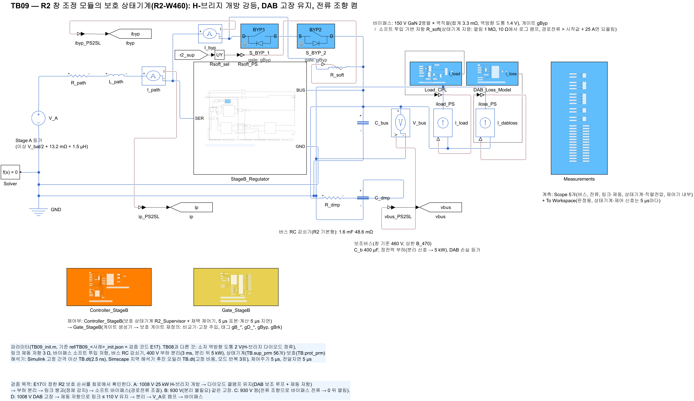
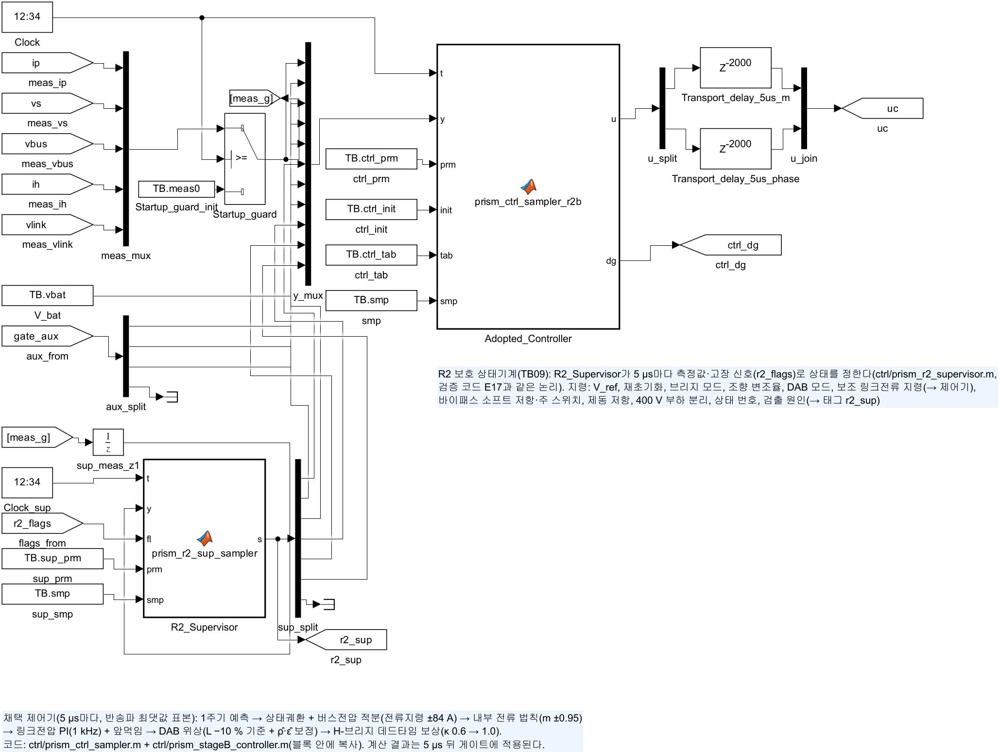
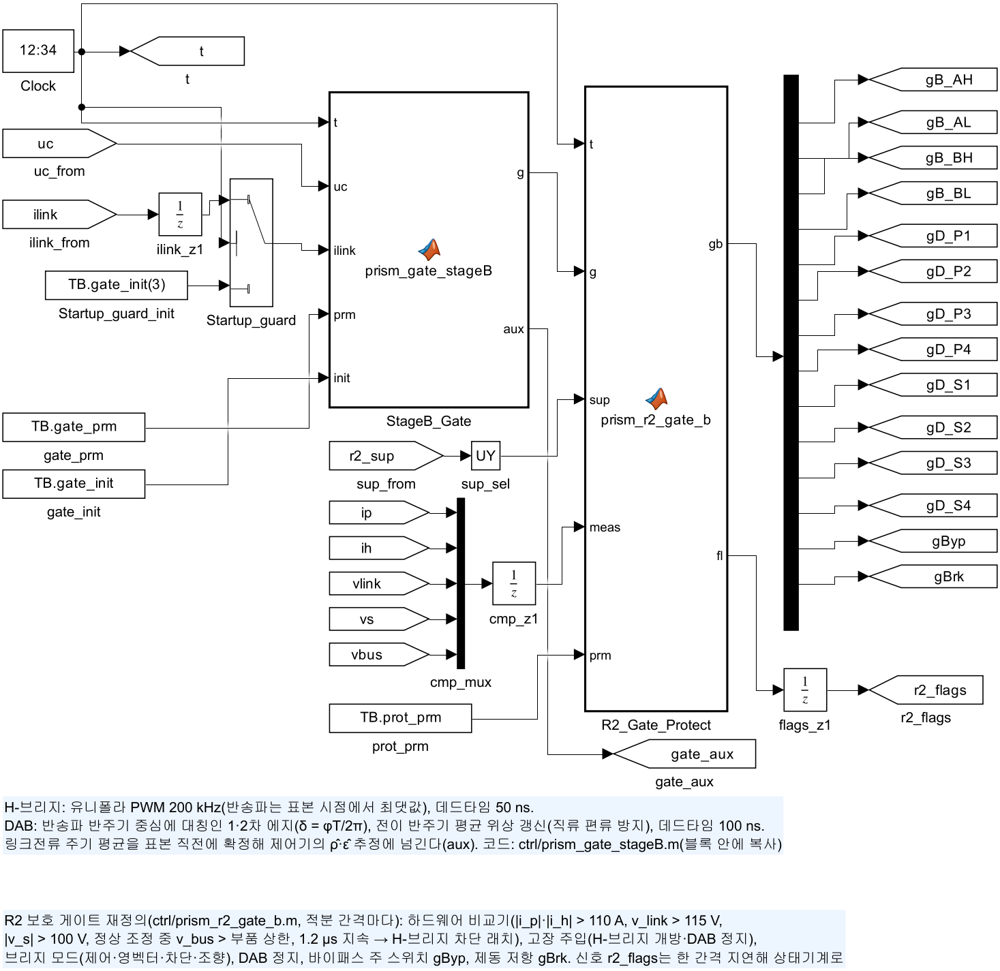

# TB09 — R2 창 조정 모듈의 보호 상태기계(R2-W460): H-브리지 개방 강등, DAB 고장 유지, 전류 조향 켬

**결론(2026-10-24)**

- **최종 실행 4/4가 통과했다(게이트 격자 2.5 ns).** 상태기계는 검증 코드 E17과 같은 논리를 MATLAB Function 블록(`ctrl/prism_r2_supervisor.m`)으로 옮긴 것이다. 회로의 상태 전이 시각은 E17과 0–20 µs 안에서 같았다(정체 감지로 늦어진 소프트 투입 제외).
- **H-브리지 개방 고장을 Stage A를 멈추지 않고 강등했다.** 1008 V·25 kW(A)에서 다이오드 클램프로 400 V 부하가 연결된 동안 버스를 460.1 V 이하로 붙잡았고, 경로 최대 71.1 A로 강등 상태에 도달했다. 930 V·25 kW(B)도 경로 92.9 A로 통과했다.
- **첫 실행에서는 A·B가 불통과였다.** 회로의 DAB는 전압비가 극단일 때 링크를 0.5 V까지 내리지 못하고 3.5–22 V에서 멈췄다(A: 강등 미도달). 남은 직렬전압을 로그 램프 저항으로 닫자 버스 커패시터·감쇠기 충전전류로 경로전류가 177 A가 되었다(B). 상태기계에 붕괴 정체 감지와 경로전류 조절 소프트 투입을 넣고, 같은 논리를 E17에도 넣어 다시 계산했다. 유지 중 제동 저항을 과전압 보호로만 쓰도록 바꾼 것(E17 결과 반영)도 최종 실행에 들어 있다.
- **회로에서 DAB 순환전류가 정격점의 4.2배였다.** 강등 중 링크 쪽 순시 첨두가 192.0 A(1차 41.7 A)로, 정격점 첨두 45.8 A보다 크다. E17의 SPS 해석값 197 A와 같다. 판정 항목은 아니지만 누설 인덕터·DAB 2차 소자 정격에 직접 걸리는 결과라 다음 설계 과제로 넘긴다(docs/24 6.3절).
- **B의 소프트 투입 에너지가 1.22 J다.** 분리가 필요 없는 사례라 경로전류(약 55 A)가 링크를 계속 충전해, 링크가 22 V에서 멈춘 채 시간 상한으로 투입했다. 바이패스 소자(EPC2305)의 선형 영역 SOA 확인이 필요하다.

## 왜 필요한가

E17은 R2 모듈의 보호 상태기계를 평균모델로 정했다. 평균모델의 가정이 가장 약한 곳이 바로 이 상태기계가 다루는 곳이다.

1. **H-브리지가 꺼진 뒤의 다이오드 정류.** 직렬전압이 −(v\_link + 2V\_D)로 묶인다는 성질이 강등 순서 전체의 근거다. 소자 역방향 도통과 데드타임이 있는 회로에서도 성립해야 한다.
2. **전압비가 극단인 DAB.** 강등 중 DAB는 1차 460–500 V, 2차(링크) 수–수십 V로 동작한다. 평균모델은 DAB를 지령 전류를 내는 전류원으로 본다.
3. **바이패스 투입 순간.** 남은 직렬전압을 버스 커패시터·감쇠기가 받는 과도는 회로 소자로만 볼 수 있다.
4. **상태기계가 실제 제어 구조에서 동작하는가.** 5 µs 표본, 5 µs 전달지연의 채택 제어기, 하드웨어 비교기 래치, 게이트 재정의와 함께 동작해야 한다.

## 회로

| 그림 | 내용 |
| --- | --- |
|  | TB08과 같은 경로(V\_A → 13.2 mΩ·1.5 µH → `StageB_Regulator`). 바이패스 `S_BYP_1`·`S_BYP_2`(2병렬 × 역직렬, 3.3 mΩ) ∥ 소프트 투입 가변 저항 `R_soft`(상태기계 지령). 버스: C\_b 400 µF ∥ RC 감쇠기 `R_dmp`·`C_dmp`(48.6 mΩ·1.6 mF) ∥ 정전력 부하(분리 신호) ∥ DAB 손실 등가 |
|  | TB08 회로 + 링크 제동 저항 `R_brk` 3 Ω과 스위치 `S_BRK`(게이트 `gBrk`), 제동 전류 센서 |
|  | 보호 상태기계 `R2_Supervisor`(5 µs, 측정은 한 간격 지연) → 지령 12개(V\_ref, 재초기화, 브리지 모드, 조향 변조율, DAB 모드, 보조 링크전류 지령, 소프트 저항, 주 스위치, 제동, 부하 분리, 상태, 검출 원인)를 태그 `r2_sup`로. 채택 제어기 `prism_ctrl_sampler_r2b`는 보조 지령이 켜지면 DAB 링크전류 지령을 그것으로 바꾼다 |
|  | 게이트 생성기 → `R2_Gate_Protect`(`ctrl/prism_r2_gate_b.m`): 하드웨어 비교기(\|i\_p\|·\|i\_h\| > 110 A, v\_link > 115 V, \|v\_s\| > 100 V, 정상 조정 중 v\_bus > 상한, 1.2 µs 지속 → H-브리지 차단 래치), 고장 주입(H-브리지 개방, DAB 정지), 모드별 게이트 → 14개 태그(`gByp`, `gBrk` 포함). 고장 신호 `r2_flags`는 한 간격 지연해 상태기계로 |

- **TB08과 같은 것.** Stage B 소자·수동소자, DAB 4.6:1·14.68 µH, 채택 제어기(기준 460 V, 정격 4 kW), 해석기 설정이 같다.
- **바뀐 것.** H-브리지·DAB 소자의 역방향 도통을 2 V로 두었다(TB08은 E12와 맞춘 이상 클램프 1 mV). H-브리지가 꺼졌을 때의 다이오드 정류를 보려면 실제 GaN 역방향 도통에 가까운 값이 필요하다. 바이패스 셀은 TB08과 같이 1.4 V다.
- **대수 루프 방지.** 상태기계 입력 측정값(`sup_meas_z1`)과 비교기 입력(`cmp_z1`), 고장 신호(`flags_z1`)에 한 간격(2.5 ns) 지연을 넣었다. 회로 → 상태기계 → 소프트 저항·부하 → 회로의 직접 경로를 끊기 위해서다.

## 사례와 기준값

| 실행 | 배터리(V\_A) | 부하 | 사건(0.5 ms) | 순서 | 계산 시간 |
| --- | --- | --- | --- | --- | --- |
| A | 1008 V(504 V) | 25 kW | H-브리지 개방(게이트 구동기 고장) | 클램프 유지 → 400 V 부하 분리(3 ms) → 링크 붕괴 → 소프트 투입 → 강등 | 13 ms |
| B | 930 V(465 V) | 25 kW | H-브리지 개방 | V\_A ≤ 상한이라 분리 없이 바로 붕괴 → 소프트 투입 → 강등 | 16 ms |
| C | 930 V(465 V) | 25 kW | 켬 | 바이패스 + 전류 조향 0.5 ms → 열림 → 바로 제어(기준 V\_A → 460 V 1 ms) | 4 ms |
| D | 1008 V(504 V) | 25 kW | DAB 고장(DAB 게이트 정지) | 링크 창 검출 → 제동 저항 유지 → 분리(3 ms) → V\_A 램프 → \|v\_s\| 확인 → 조향 → 바이패스 | 7 ms |

기준값은 `ref/make_ref_TB09.py <검증 코드 python 폴더>`가 E17(`r2_run`)로 같은 사례를 계산해 만든다. 사례마다 초기조건·상태기계 파라미터 56개·보호 파라미터(`_init.json`), 1 µs 궤적(`_avg.csv`), E17 판정 지표(`_metrics.json`)를 쓴다. 부하 분리 시간은 회로 계산 시간을 줄이려고 3 ms로 두었다(E17 기본 20 ms).

## 판정 기준(시험 전에 고정, E17과 같음)

1. **고장(A·B·D).** 0.5 ms 뒤 순시 경로·필터 ≤ 100 A, \|v\_s\| ≤ 120 V, 링크 ≤ 120 V, 바이패스 ≤ 329 A(2병렬, 소자당 펄스 정격의 50 %), 버스(5 µs 평균) ≥ 260 V, 강등 상태 도달, 400 V 부하가 연결된 동안 버스(5 µs 평균) ≤ 470 V.
2. **켬(C).** 순시 경로·필터 ≤ 90 A, \|v\_s\| ≤ 90 V, 링크 90–110 V, 버스 ≤ 470 V, 바이패스 ≤ 329 A, 끝 0.2 ms 평균 460 ± 4 V.
3. **E17 대조(정보).** 5 µs 주기 평균의 버스 최저·최고(±3 V), 경로·필터 최대(±5 A), 링크 최고·최저(±2 V), 최종 버스(±1 V), 상태 전이 시각(±0.05 ms).
4. **물리·부품 확인(정보).** 다이오드 클램프 오차, DAB 링크 쪽 순시 첨두 n·\|i\_L\|, 소프트 투입 소자 에너지 ∫\|v\_s·i\_byp\|dt.

## 결과(최종 실행)

| 실행 | 판정 | 순시 최대 | 버스(5 µs 평균) | 상태 전이(회로 / E17) | 비고 |
| --- | --- | --- | --- | --- | --- |
| A | 통과 | 경로 71.1 A, 필터 71.6 A, \|v\_s\| 76.2 V, 바이패스 38.8 A | 426.9–503.8 V, 부하 연결 중 ≤ 460.1 V | 유지 0.505/0.505, 붕괴 3.505/3.51, 소프트 9.085/8.135, 강등 10.26/9.14 ms | 링크 3.53 V에서 정체 감지 → 투입 1.18 ms, 0.076 J |
| B | 통과 | 경로 92.9 A, 필터 89.6 A, \|v\_s\| 67.2 V, 바이패스 91.7 A | 396.9–464.1 V | 붕괴 0.505/0.505, 소프트 10.505/10.51, 강등 12.845/11.515 ms | 링크 22.0 V에서 시간 상한 → 투입 2.34 ms, **1.22 J** |
| C | 통과 | 경로 59.1 A, 필터 62.2 A, \|v\_s\| 4.3 V | 459.9–464.3 V, 최종 460.05 V | 준비 0.5/0.5, 열림 1.0/1.0, 창 조정 1.005/1.005 ms | 열림 과도 없음(TB08 사례 E는 28.6–73.4 A 출렁임). 주기 평균 필터전류 최대는 E17보다 6.4 A 작음(대조 허용 5 A 초과, 정보) |
| D | 통과 | 경로 82.3 A, 필터 89.5 A, 링크 110.0 V, 바이패스 286.9 A | 459.4–503.9 V, 부하 연결 중 ≤ 460.1 V | 유지 1.265/1.275, 램프 4.265/4.28, 영벡터 5.71/5.725, 강등 5.91/5.93 ms | 제동 에너지 9.74 J(E17 9.81 J) |

- **다이오드 클램프는 식대로다.** H-브리지 차단 중 v\_s + (v\_link + 2V\_D + R\_h\|i\_h\|)·sign(i\_h)의 5 µs 평균은 A −0.011 V, B −0.050 V다.
- **E17과 회로가 갈라지는 곳은 링크 붕괴의 끝이다.** E17은 A에서 링크를 0.05 V까지 내렸지만 회로는 3.3 V에서 멈췄다. 그래서 회로의 최종 버스는 V\_A − 7.5 V였다가 소프트 투입 뒤 V\_A가 된다. 그 앞의 유지·분리 구간은 주기 평균 전류 최대값 차 5 A, 버스 최저 차 1–2 V 안이다.
- **D의 바이패스 투입 펄스 287 A는 기준(329 A) 안이지만 여유가 13 %다.** 직렬전압 조향 뒤에도 투입 순간 \|v\_s\|가 약 1 V 남아 3.3 mΩ로 방전된다(E17 225 A). 바이패스 루프의 기생 인덕턴스가 없는 상한 값이다.

### DAB 순환전류(정보)

| 실행 | 링크 쪽 순시 첨두 n·\|i\_L\| | 1차 \|i\_L\| | 그때 상태 | E17 SPS 해석 |
| --- | --- | --- | --- | --- |
| A | 192.0 A | 41.7 A | 링크 붕괴(링크 수 V) | 197 A |
| B | 178.1 A | 38.7 A | 소프트 투입 | 182 A |
| 정격점(4 kW, 링크 100 V) | 45.8 A | 약 10 A | — | — |

링크전압이 정격보다 크게 낮아지면 SPS DAB의 누설 인덕터에 1차 전압(v\_bus/n)과 링크전압의 차가 반주기 동안 걸린다. 링크 → 0이면 링크 쪽 첨두는 위상과 무관하게 v\_bus/(4 n f\_s L′)(L′ = L\_dab/n²)에 가까워진다. 평균모델은 순시 전류가 없으므로 E17은 이 값을 SPS 식으로 계산하고, 회로가 같은 값을 냈다.

### 1차 실행(불통과)과 수정 기록

| 항목 | 1차 실행(로그 램프 소프트 투입, 붕괴 문턱 0.5 V만) | 최종 실행 |
| --- | --- | --- |
| A | **불통과**(강등 미도달). 링크 3.5 V에서 멈춤, 8 ms에 붕괴 상태 | 통과. 정체 감지(0.5 ms 동안 0.5 V 미만 하강, 링크 ≤ 15 V)로 투입 |
| B | **불통과**(경로 176.6 A). 10 ms 시간 상한으로 링크 22 V(직렬 −26 V)에서 투입 → 로그 램프 끝에서 버스 커패시터·감쇠기 충전전류 | 통과(경로 92.9 A). 경로전류 > 투입 시작값 + 25 A면 저항을 되올림 |
| C, D | 통과 | 통과(같은 값) |
| A 유지 중 경로 최대 | 89.1 A(2차 실행: 유지 중에도 기준 추종 제동) | 71.1 A(유지 중 제동은 과전압 보호만) |

- **원인.** 평균모델의 DAB는 지령 전류를 그대로 낸다. 회로의 DAB는 전압비가 극단이면 지령보다 작은 전류만 낸다. 그래서 E17에서는 문제가 없던 0.5 V 붕괴 문턱이 회로에서는 닿지 않았고, 시간 상한으로 투입하면 남은 직렬전압이 컸다.
- **수정.** 붕괴 정체 감지와 경로전류 조절 소프트 투입을 상태기계에 넣었다(파라미터 51–56). 같은 논리를 E17에 넣고, "DAB 저링크 저하" 감도(링크 10 V 아래 DAB 전달 저하)로 평균모델에서도 이 동작을 확인했다. 유지 중 제동 저항을 과전압 보호로만 쓰는 수정은 E17 W410 결과(유지 중 기준 추종 제동 시 경로 103 A)에서 나왔다.
- **기록.** 1차 실행 요약은 `results/run1_logramp_soft/`, 중간 실행(정체 감지·전류 조절만 넣은 2차)은 `results/run2_hold_brake_tracking/`에 있다.

## 모델 간 차이(해석 때 고려)

- **소프트 투입은 가변 저항이다.** 게이트 전압 → 채널 저항 관계와 소자 온도는 없다. 투입 에너지는 소자 SOA로 따로 확인해야 한다.
- **기생 인덕턴스가 없다.** 바이패스·제동 루프가 이상적이라 투입 첨두는 상한 쪽 값이다.
- **400 V 부하 분리는 시간 지연 뒤 부하가 5 kW로 줄어드는 것뿐이다.** 분리 시간은 3 ms로 줄였다(E17 기본 20 ms). DAB 순환전류에 노출되는 시간은 실제로 더 길다.
- **V\_A는 이상 전원이다.** V\_bat/2 + 13.2 mΩ + 1.5 µH로 TB04·TB08과 같다.
- **게이트 격자 2.5 ns.** 사례당 계산 시간은 약 2–8분이다.

## 재현

```matlab
prism_run('build_TB09')      % TB09_R2_Protection.slx 생성, 회로도 그림
prism_run('run_TB09')        % 실행 1–4 판정(2.5 ns, 약 18분)
```

기준값은 `ref/make_ref_TB09.py <검증 코드 python 폴더>`로 다시 만든다. 결과: `results/TB09_<사례>_summary.txt·json`(판정·대조·부품 스트레스), `_periods.csv`(5 µs 주기 통계와 상태), `_response.png`, `TB09_summary.txt·json`.
