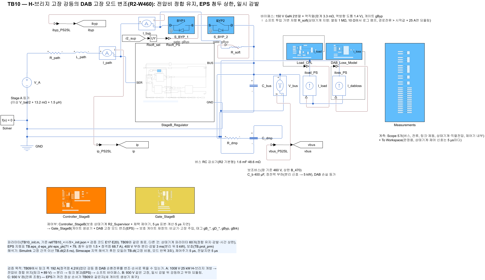
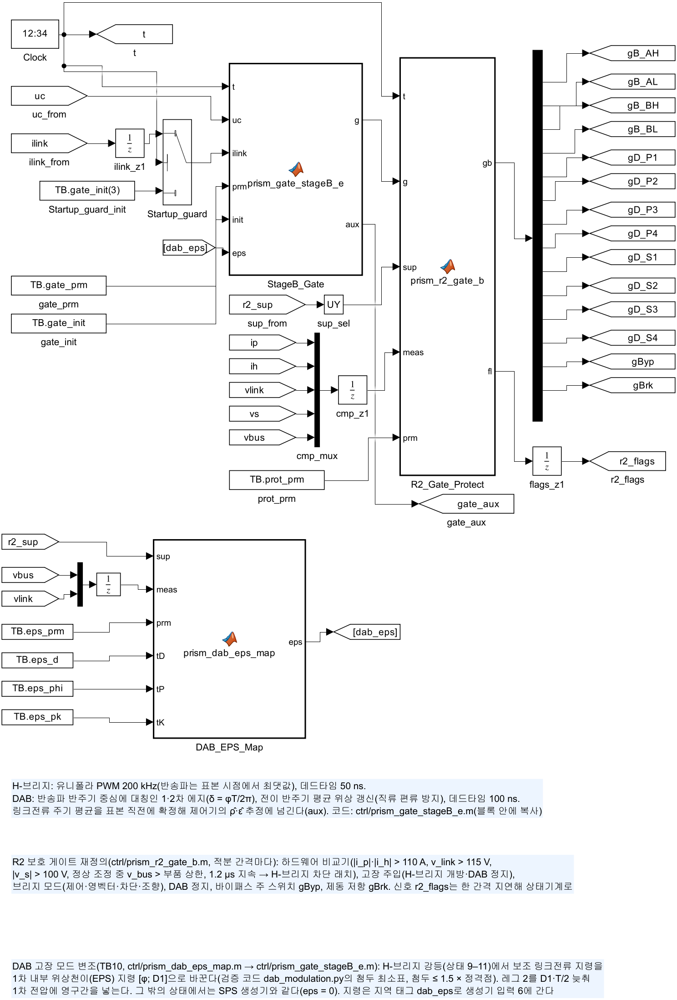
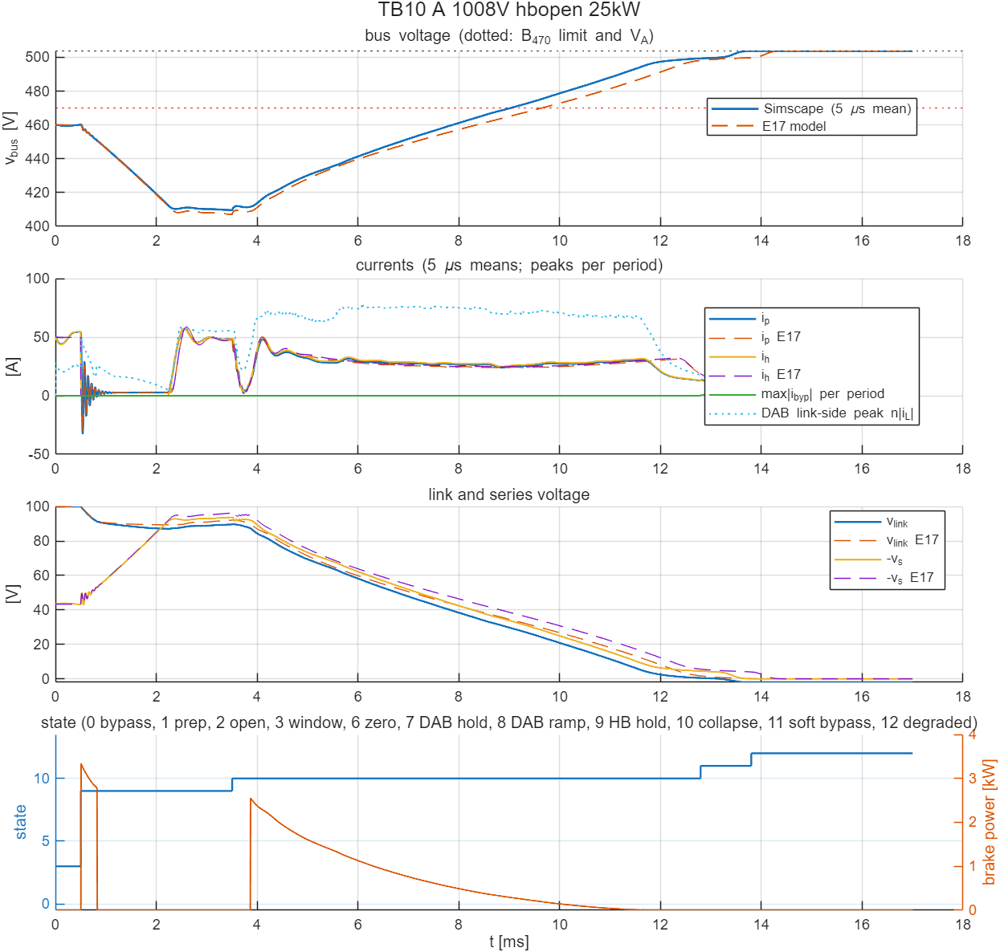
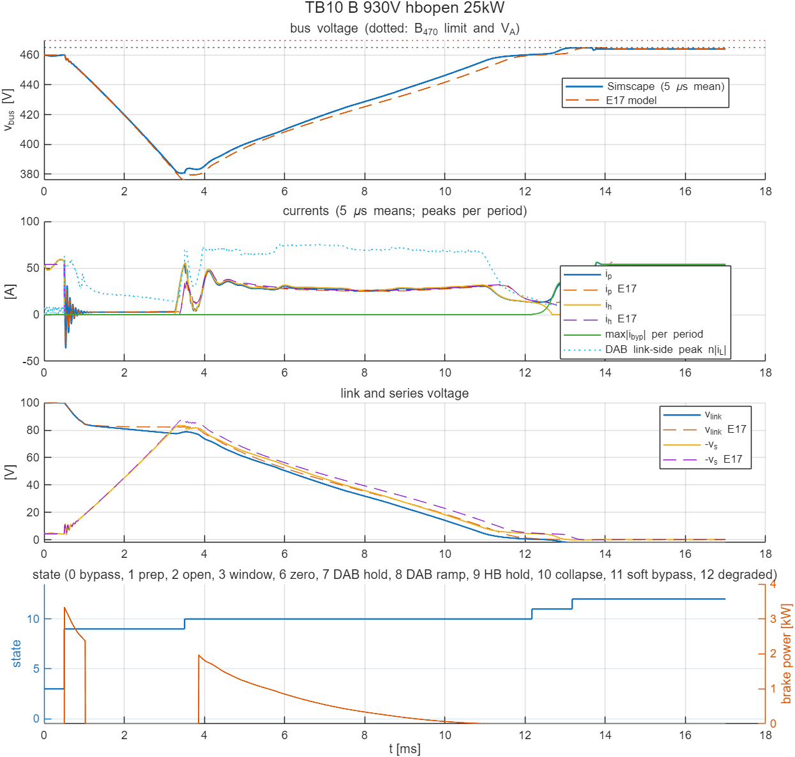

# TB10 — H-브리지 고장 강등의 DAB 고장 모드 변조(R2-W460): 전압비 정합 유지, EPS 첨두 상한, 일시 감발

**결론(2026-10-24)**

**세 사례 모두 회로 판정을 통과했다.** 강등 중 DAB 링크 쪽 첨두가 TB09의 192 A·178 A에서 79.4 A·75.3 A로 줄었다. 정격점 대비 4.2·3.9배가 1.73·1.64배가 됐다.

- **사전 기준과 설계 목표.** 회로 기준인 2배(91.7 A)는 지켰다. 해석 설계 목표 1.5배(68.7 A)는 링크 붕괴 구간에서 10–16 % 넘었다. 표 보간 때문은 아니다(검증 코드 E20에서 ≤ 0.1 %로 확인). 데드타임·소자 강하 같은 회로 효과로 남는다.
- **부수 효과.**
  - 링크가 0.49 V까지 붕괴해 TB09의 정체(3.5–22 V)가 없어졌다.
  - 소프트 투입 에너지가 0.024–0.026 J로 줄었다(TB09 930 V는 1.22 J).
  - 경로 순시 최대가 57–58 A로 줄었다(TB09 71·93 A).
- **비용.** 유지 중 버스가 낮고(최저 410·381 V), 강등 완료가 늦다(13.2–13.8 ms, TB09 10.3–12.8 ms).
- **회귀.** 켬 순서(C)는 TB09와 같아, 새 게이트 생성기는 EPS가 꺼지면 SPS 생성기와 같다.

## 왜 필요한가

TB09에서 H-브리지 고장 강등은 회로 한계 안에서 끝났지만, 강등 중 DAB 링크 쪽 순시 첨두가 192 A(1차 41.7 A)로 정격점 첨두 45.8 A(1차 약 10 A)의 4.2배였다. 원인은 단일 위상천이(SPS) DAB의 전압비 불일치다. 강등 중 링크전압이 1차 환산 전압(v\_bus/n ≈ 100–110 V)보다 크게 낮아지면, 전달 전류와 상관없이 누설 인덕터에 큰 전압이 반주기 동안 걸린다. 검증 코드 E20은 이를 세 가지로 묶었다(docs/25).

1. **1차 내부 위상천이(EPS).** 1차 레그 2를 D1·T/2 늦춰 1차 전압에 영구간을 넣는다. 펄스 폭이 줄어 인덕터 전류의 첨두가 링크에서 빼내는 평균전류 가까이로 줄어든다.
2. **전압비 정합 유지.** 버스를 V\_W에 붙잡지 않고 n·v\_link = v\_bus가 되도록 링크를 둔다(1008 V에서 약 89 V, 버스 약 410 V). DAB 정격 밖 링크전력은 제동 저항이 받는다.
3. **첨두 상한과 일시 감발.** 강등 상태에서 DAB 지령을 EPS 첨두 ≤ 1.5 × 정격점이 되는 전류로 제한한다. V\_A ≤ 부품 상한인 팩도 400 V 부하 출력을 잠시 줄인 뒤 붕괴·투입한다.

평균모델은 DAB를 전류원으로 보고 첨두는 해석식으로만 계산한다. 회로에서 확인해야 할 것은 세 가지다. 새 게이트 패턴(레그 2 지연, 위상 전이)이 직류 편류 없이 지령대로 동작하는가. 데드타임·소자 역방향 도통이 있는 회로의 첨두가 해석값과 얼마나 다른가. TB09에서 본 링크 붕괴 정체와 소프트 투입이 어떻게 바뀌는가.

## 회로

| 그림 | 내용 |
| --- | --- |
|  | TB09와 같은 전력 회로(바이패스 + 소프트 투입 저항, 버스 RC 감쇠기, 링크 제동 저항, 분리 신호 부하) |
|  | TB09와 같음 |
|  | TB09와 같은 구성. 상태기계 `prism_r2_supervisor`가 파라미터 60개를 받으면 정합 유지(57), 일시 감발(58), 소프트 투입 시간 상한 → 이중 고장(59), 감발 해제 지연(60)을 켠다. 56개(TB09)면 이전과 같다 |
|  | `DAB_EPS_Map`(`ctrl/prism_dab_eps_map.m`): 상태 9–11·DAB 모드 1에서 상태기계의 보조 링크전류 지령과 측정(v\_bus, v\_link, 한 간격 지연)을 EPS 지령표(71 × 79)로 [켬; φ; D1]으로 바꾼다. 첨두 상한을 넘는 지령은 깎는다. 게이트 생성기 `prism_gate_stageB_e.m`은 SPS 생성기에 레그 2 지연(D1·T/2, 상향 에지에서 잡아 한 주기 유지)을 더한 것이다. EPS가 꺼지면 SPS 생성기와 같은 게이트를 낸다 |

- **게이트 생성기 검증(회로 전).** 생성기를 Octave에서 단독 실행해 1·2차 브리지 전압 패턴으로 이상 인덕터 전류를 적분했다. 네 지점(링크 5·50·89·100 V)에서 평균 링크전류와 첨두가 해석값(dab\_modulation.py)과 0.2 A 안에서 같았다. 위상 기준(φ = α + D1·π)과 레그 2 지연의 부호가 맞다는 확인이다.
- **지령표.** 검증 코드가 만든 표(`ref/TB10_eps_table.json`)에서 j ≤ 0(링크 → 1차)만 쓴다. j = 0 열은 퇴화(전류 0이면 α가 정해지지 않음)라 j = −0.01 열로 채웠다. 표를 따라 φ가 가장 크게 바뀌는 칸은 0.41 rad다.

## 사례와 기준값

| 실행 | 배터리(V\_A) | 부하 | 사건(0.5 ms) | 순서 | 계산 시간 |
| --- | --- | --- | --- | --- | --- |
| A | 1008 V(504 V) | 25 kW | H-브리지 개방 | 정합 유지(링크 ≈ 89 V) → 400 V 부하 분리(3 ms) → 링크 붕괴(EPS) → 소프트 투입 → 강등 | 17 ms |
| B | 930 V(465 V) | 25 kW | H-브리지 개방 | 정합 유지 → 일시 감발(3 ms) → 붕괴(EPS) → 소프트 투입 → 강등 → 0.5 ms 뒤 부하 되돌림 | 17 ms |
| C | 930 V(465 V) | 25 kW | 켬 | 전류 조향 → 열림 → 제어(TB09 C와 같음, EPS 꺼짐 — 새 생성기 회귀) | 4 ms |

기준값은 `ref/make_ref_TB10.py <검증 코드 python 폴더>`가 E17 `r2_run`에 E20의 P3 설정(hold 'match', dmod 'eps', curtail, soft\_fail)을 주어 만든다.

## 판정 기준(시험 전에 고정)

1. **고장(A·B).** TB09와 같은 회로 한계(순시 경로·필터 ≤ 100 A, \|v\_s\| ≤ 120 V, 링크 ≤ 120 V, 바이패스 ≤ 329 A, 버스 ≥ 260 V, 강등 상태 도달, 400 V 부하가 연결된 동안 버스 ≤ 470 V)에 다음을 더했다. 강등 상태(9–11)의 DAB 링크 쪽 순시 첨두 n·max\|i\_L\| ≤ 2 × 정격점(91.7 A). 해석 설계 목표 1.5배(68.7 A)는 회로의 데드타임·역방향 도통을 넣지 않은 값이라 정보로 본다.
2. **켬(C).** TB09와 같다.
3. **E17 대조(정보).** TB09와 같은 항목.

## 결과

| 항목 | A 1008 V, H-브리지 개방 | B 930 V, H-브리지 개방 | C 930 V, 켬 |
| --- | --- | --- | --- |
| 회로 판정 | 통과 | 통과 | 통과 |
| DAB 링크 쪽 첨두(유지 / 붕괴 / 소프트 투입) | 58.5 / 79.4 / 17.6 A | 62.7 / 75.3 / 17.5 A | 8.6 A(정상) |
| 1차 첨두 | 17.3 A | 16.4 A | 1.9 A |
| 순시 최대 \|i\_p\| / \|i\_h\| | 57.2 / 57.3 A | 57.9 / 57.8 A | 59.1 / 62.2 A |
| \|v\_s\| 최대, 링크 범위 | 93.8 V, −2.0–100.0 V | 83.5 V, −2.0–100.1 V | 4.3 V, 99.9–100.0 V |
| 버스(5 µs 평균) | 409.6–503.8 V(부하 연결 중 최고 460.1 V) | 380.6–464.8 V | 459.9–464.3 V |
| 바이패스 순시 최대 | 33.1 A | 56.3 A | 53.9 A |
| 소프트 투입 | 12.795 ms, 링크 0.49 V, 1.005 ms, 0.024 J, 경로 31.3 A | 12.170 ms, 링크 0.49 V, 1.005 ms, 0.026 J, 경로 32.5 A | — |
| 제동 저항 에너지 | 6.9 J(E17 7.7 J) | 5.8 J(E17 6.4 J) | 0 |
| 상태 전이(회로 / E17) | 유지 0.505, 붕괴 3.505 / 3.51, 소프트 12.795 / 13.42, 강등 13.80 / 14.425 ms | 같은 순서, 강등 13.175 / 13.535, 되돌림 13.675 / 14.035 ms | TB09 C와 같음 |





- **첨두 초과의 위치.** 1.5배를 넘은 주기는 모두 상태 10(붕괴)이었다. 붕괴 주기의 41 %(A)·36 %(B)가 넘었고 링크 8–83 V에 퍼져 있었다. 붕괴는 지령이 상한보다 큰 전류를 요구해 내내 상한에 붙어 돌기 때문에, 회로와 이상 해석의 차이가 그대로 초과가 된다.
- **회로 붕괴가 평균모델보다 0.4–0.6 ms 빠르다.** 같은 지령에서 회로 DAB가 더 큰 전류를 냈다는 뜻이고, 첨두가 큰 것과 같은 방향이다.
- **다음 단계(미검증).** 해석 상한을 1.3배로 낮추는 안을 E20 감도로 봤다. 평균모델 4/4 통과지만 W460은 붕괴가 시간 상한 10 ms에 걸리고 소프트 투입 에너지가 0.26 J로 는다. 데드타임을 넣은 지령표도 대안이다.

## 모델 간 차이(해석 때 고려)

- EPS 지령표는 이상 소자(데드타임 없음) 해석이다. 회로의 데드타임 100 ns는 펄스 폭이 짧을 때(D1 → 0.95) 상대적으로 크다.
- 그 밖은 TB09와 같다(소프트 투입은 가변 저항, 바이패스·제동 루프 기생 인덕턴스 없음, V\_A 이상 전원, 분리·감발 3 ms).

## 재현

```matlab
prism_run('build_TB10')      % TB10_R2_FaultMod.slx 생성, 회로도 그림
prism_run('run_TB10')        % 실행 1–3 판정(2.5 ns, 약 21분)
```

기준값은 `ref/make_ref_TB10.py <검증 코드 python 폴더>`로 다시 만든다(먼저 검증 코드 `E20_dab_fault_modulation.py table`이 지령표를 만든다).
