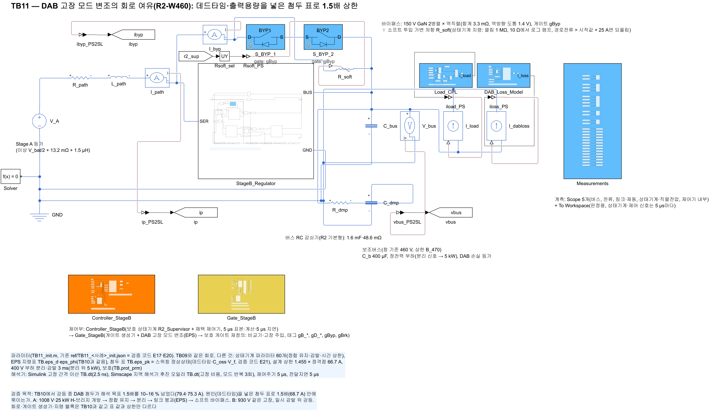
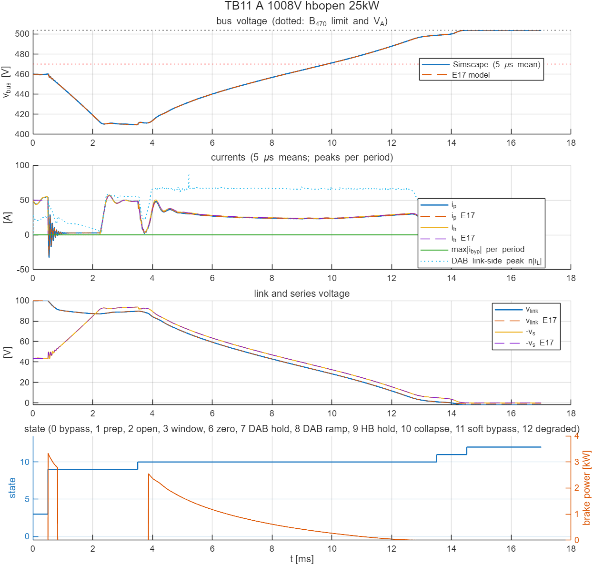

# TB11 — DAB 고장 모드 변조의 회로 여유(R2-W460): 데드타임·출력용량을 넣은 첨두 표로 1.5배 상한

**결론(2026-10-25): 불통과(두 사례 모두 1.5배 기준에서).**

- **정상 주기의 초과는 거의 없어졌다.** 1.5배(68.7 A)를 넘은 주기가 TB10의 1,082·916주기에서 7·3주기로 줄었다. 정상 주기의 회로 첨두는 같은 (버스, 링크)의 스위칭 정상상태 모의와 0.3 A 안에서 같았다.
- **넘은 주기는 대부분 지령표 칸이 바뀌는 순간이었다.**
  - 사례 A 5.215 ms에서는 허용 전류 탐색의 정지 칸이 바뀌었다. EPS 지령이 (위상, D1) = (−0.029 rad, 0.278)에서 (0.199 rad, 0.379)로 한 주기 만에 옮겨 갔고, 그 주기의 첨두가 88.5 A였다(앞 주기 66.9 A, 다음 주기 69.4 A).
  - 두 지령은 정상상태로는 첨두(66.6·66.5 A)와 실제 링크전류(−32.5·−32.4 A)가 거의 같은 운전점이다. 남은 초과는 지령 전이의 직류 편류다.
  - 사례 B는 최대 68.9 A로 0.2 A 넘었다. 붕괴 시작 직후 4.0 ms(D1·위상이 빠르게 바뀌는 구간)와 5.28 ms(칸 전환)다.
- **평균모델과의 일치가 크게 좋아졌다.** 상태 전이 시각이 E17(스위칭 표의 실제 링크전류)과 0.02 ms 안에서 같았다. TB10에서는 0.36–0.63 ms 차이였다.
- 대책은 두 단계로 확인했다. 게이트 생성기의 직류 편류 방지와 변화율 상한을 넣은 [TB12](../TB12_R2_FaultMod_TR/README.md)는 1/2 통과(70.0·68.5 A)였다. 여기에 설계 상한의 전이 여유 5 %를 더한 [TB13](../TB13_R2_FaultMod_TA/README.md)은 2/2 통과(66.4·64.4 A)했다.

## 왜 필요한가

TB10에서 강등 중 DAB 첨두는 79.4·75.3 A였다. 회로 기준 2배는 지켰지만 해석 설계 목표 1.5배는 링크 붕괴 구간에서 10–16 % 넘었다. 검증 코드 E21의 스위칭 정상상태 모의(데드타임 100 ns, C\_oss 335·1,371 pF, 역방향 도통 2 V)는 TB10 붕괴 구간의 회로 첨두를 평균 0.1–0.3 %, 최대 2.9 % 안에서 재현했다. 원인은 데드타임이다. 그래서 지령 블록의 첨두 표를 같은 칸의 스위칭 정상상태 값으로 바꾸고, 설계 상한을 1.455 × 정격점(66.7 A = 1.5배 / 1.03)으로 두었다. 이 표로 회로 첨두가 1.5배 안에 드는지 확인한다.

## 회로

TB10과 같다(전력 회로, 상태기계, 지령 블록 `prism_dab_eps_map`, 게이트 생성기 `prism_gate_stageB_e`). 다른 것은 두 가지다.

- **첨두 표.** `TB.eps_pk`(71 × 79)를 같은 칸의 스위칭 정상상태 첨두로 바꿨다. 버스 380·440·500 V 가운데 최댓값이고, `ref/TB11_eps_table.json`에 있다.
- **설계 상한.** `TB.eps_prm(5)` = 66.7 A다.

| 그림 | 내용 |
| --- | --- |
|  | TB10과 같은 전력 회로 |
|  | TB10과 같은 지령 블록·게이트 생성기(표 값만 다름) |

## 사례와 판정 기준(시험 전에 고정)

| 실행 | 배터리(V\_A) | 부하 | 사건(0.5 ms) | 계산 시간 |
| --- | --- | --- | --- | --- |
| A | 1008 V(504 V) | 25 kW | H-브리지 개방 | 17 ms(710 s) |
| B | 930 V(465 V) | 25 kW | H-브리지 개방(일시 감발) | 17 ms(648 s) |

- **판정.** TB10과 같은 회로 한계에 하나를 더했다. 강등 상태(9–11)의 DAB 링크 쪽 순시 첨두 n·max|i\_L| ≤ 1.5 × 정격점(68.7 A)이다. TB10의 2배 기준을 설계 목표로 좁힌 것이다.
- **기준값.** `ref/make_ref_TB11.py`가 E17 `r2_run`에 E21의 P3s(`pk_table='sw'`, `pk_fault=1.455`)를 주어 만든다.
- **켬 순서(C).** 지령 블록이 강등 상태에서만 동작하므로 TB10 C와 같아 실행하지 않았다.

## 결과

| 항목 | A 1008 V | B 930 V | TB10(A / B) |
| --- | --- | --- | --- |
| 판정(1.5배 포함) | 불통과(DAB 첨두만) | 불통과(DAB 첨두만) | 통과 / 통과(2배 기준) |
| DAB 링크 쪽 첨두(유지 / 붕괴 / 소프트 투입) | 58.5 / 88.5 / 22.1 A | 62.7 / 68.9 / 17.6 A | 최대 79.4 / 75.3 A |
| 1.5배 초과 주기 / 강등 상태 주기 | 7 / 2801 | 3 / 2688 | 1082 / 916 |
| 경로·필터 순시 최대 | 57.3 A | 57.9 A | 57.3 / 57.9 A |
| 버스 최저 | 409.6 V | 380.6 V | 409.6 / 380.6 V |
| 소프트 투입(진입 링크, 소자 에너지) | 1.06 V, 0.028 J | 0.49 V, 0.026 J | 0.49 V, 0.024·0.026 J |
| 제동 저항 에너지 | 7.6 J | 6.2 J | 6.9 / 5.8 J |
| 강등 완료 | 14.51 ms | 13.95 ms(되돌림 14.45 ms) | 13.80 / 13.18 ms |
| E17 대조(전이 시각) | 0–0.005 ms | 0.02 ms | 0.36–0.63 ms |

그 밖의 회로 한계(경로·필터 ≤ 100 A, 직렬·링크 ≤ 120 V, 바이패스 ≤ 329 A, 버스 ≥ 260 V, 강등 도달, 부하 연결 중 버스 ≤ 상한)는 모두 통과했다.



## 재현

```matlab
prism_run('build_TB11')      % TB11_R2_FaultMod_SW.slx 생성, 회로도 그림
prism_run('run_TB11')        % 실행 1–2 판정(2.5 ns, 약 23분)
```

기준값은 `ref/make_ref_TB11.py <검증 코드 python 폴더>`로 다시 만든다. 먼저 검증 코드 `E21_dab_switching_margin.py table`이 스위칭 표를 만든다.
