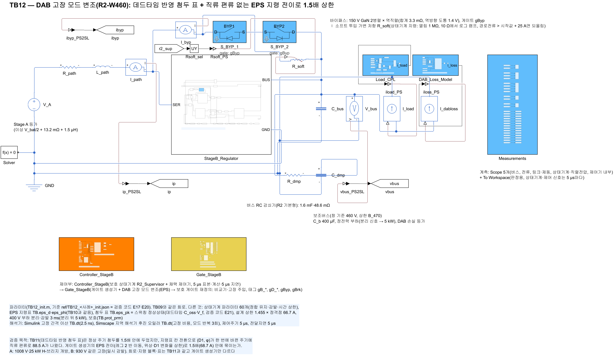
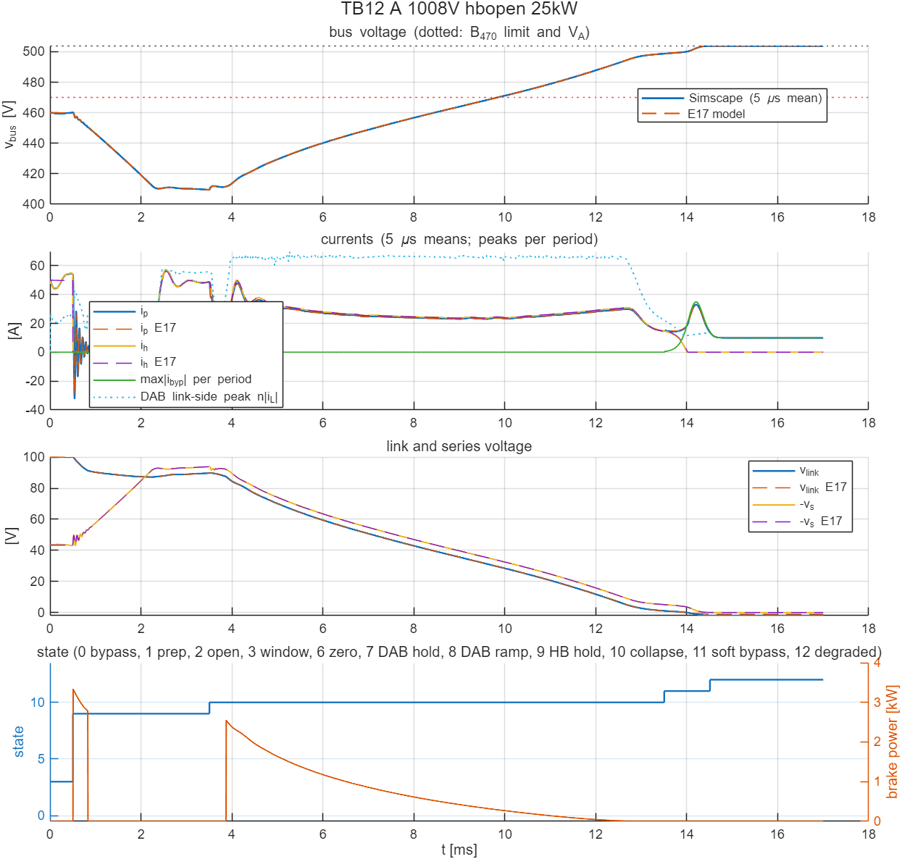

# TB12 — DAB 고장 모드 변조의 지령 전이(R2-W460): 직류 편류 방지와 변화율 상한으로 1.5배 상한

**결론(2026-10-25): 1/2 통과(1.5배 기준). 사례 B는 통과, 사례 A는 1.3 A 넘어 불통과.**

- **전이 첨두가 크게 줄었다.** TB11에서 지령표 칸 전환 주기의 첨두가 88.5 A였는데, TB12에서는 70.0 A로 줄었다. 1.5배(68.7 A)를 넘은 주기는 TB11의 7·3주기에서 3·0주기로 줄었다.
- **사례 A에서는 한 전이의 끝 세 주기가 넘었다.** 5.215 ms에 TB11과 같은 칸 전환이 일어났다. 변화율 상한으로 약 12주기에 나눠 옮긴 전이의 끝 5.260–5.270 ms에 70.0·69.3·68.8 A였다. 같은 (버스, 링크)의 스위칭 정상상태 첨두는 약 66 A다.
  - 전이 경로 중간의 (D1, 위상)은 정상 상한 칸보다 첨두가 조금 높다.
  - D1 변화의 직류 편류가 몇 A 남는다. 게이트 전이 확인에서는 ≤ 2.7 A였다.
- **사례 B는 통과했다.** 최대 68.5 A(5.295 ms, 칸 전환 끝)였다.
- **전이 첨두는 정상 주기 상한(66.7 A) 위로 최대 4.9 %였다.** 이 값을 설계 상한의 여유로 넣은 [TB13](../TB13_R2_FaultMod_TA/README.md)은 2/2 통과(66.4·64.4 A)했다.
- 그 밖의 회로 한계와 E17 대조는 TB11과 같은 수준이다. 사례 B의 소프트 투입 시각은 E17보다 0.05 ms 늦었다(정보 항목).

## 왜 필요한가

TB11은 데드타임을 반영한 첨두 표로 정상 주기의 초과를 없앴다. 하지만 지령표의 칸이 바뀌는 주기에 EPS 지령 (위상, D1)이 한 번에 옮겨 가면서 누설 전류에 직류 편류가 생겼다. 그 주기의 첨두가 88.5 A였다. 게이트 생성기만 떼어 낸 계산(`ref/check_gate_transition.m`)에서 원인을 확인했다. SPS 위상 변화에는 직류 편류 방지가 있었지만, EPS의 레그 2 지연(D1)은 상향 에지에서 한 주기 동안 잡아 두는 방식이어서 그런 대비가 없었다.

| 게이트 생성기(이상 스위칭, 버스 432 V·링크 67.5 V) | 계단 전 첨두 | 계단 뒤 1–4주기 첨두 | 남은 직류 편류 |
| --- | --- | --- | --- |
| `prism_gate_stageB_e.m`(TB10·TB11) | 70.1 A | 92.6, 76.9, 76.8, 76.7 A | −16.6 A |
| `prism_gate_stageB_f.m`(TB12) | 70.1 A | 70.6, 69.6, 69.7, 68.6 A | ≤ 2.7 A |

## 회로

TB11과 같다(전력 회로, 상태기계, 지령 블록 `prism_dab_eps_map`, 스위칭 반영 첨두 표, 설계 상한 66.7 A). 게이트 생성기만 `ctrl/prism_gate_stageB_f.m`으로 바꿨다(`build_stageB_control`의 선택 `r2d`).

- **레그 2 반 이동.** D1이 바뀌면 그 뒤 첫 레그 2 에지는 이전·새 값의 중간으로 옮기고, 다음 에지부터 새 값을 쓴다.
- **변화율 상한.** EPS 위상은 반주기마다 0.01 rad, D1은 에지마다 0.005까지만 옮긴다. EPS가 켜질 때는 지금 쓰던 SPS 위상에서 출발한다.
- EPS가 꺼져 있으면 `_e`와 같은 게이트를 낸다.

| 그림 | 내용 |
| --- | --- |
|  | TB11과 같은 전력 회로 |
|  | 지령 블록 + 고친 게이트 생성기 |

## 사례와 판정 기준(시험 전에 고정)

TB11과 같다. 사례 A(1008 V, 25 kW, H-브리지 개방)와 B(930 V, 같은 고장, 일시 감발)다. 판정은 TB10의 회로 한계에 강등 상태(9–11)의 DAB 링크 쪽 순시 첨두 n·max|i\_L| ≤ 1.5 × 정격점(68.7 A)을 더한 것이다. 기준값은 TB11과 같다(평균모델은 게이트 전이를 다루지 않는다).

## 결과

| 항목 | A 1008 V | B 930 V | TB11(A / B) |
| --- | --- | --- | --- |
| 판정(1.5배 포함) | 불통과(DAB 첨두만) | 통과 | 불통과 / 불통과 |
| DAB 링크 쪽 첨두(유지 / 붕괴 / 소프트 투입) | 58.0 / 70.0 / 22.2 A | 58.0 / 68.5 / 17.6 A | 최대 88.5 / 68.9 A |
| 1.5배 초과 주기 / 강등 상태 주기 | 3 / 2801 | 0 / 2694 | 7 / 3 |
| 1차 첨두 | 15.2 A | 14.9 A | 19.2 / 15.0 A |
| 경로·필터 순시 최대 | 57.1 A | 57.9 A | 57.3 / 57.9 A |
| 버스 최저(5 µs 평균) | 409.5 V | 380.4 V | 409.6 / 380.6 V |
| 소프트 투입(진입 링크, 소자 에너지) | 1.07 V, 0.028 J | 0.49 V, 0.026 J | 1.06·0.49 V, 0.028·0.026 J |
| 제동 저항 에너지 | 7.6 J | 6.3 J | 7.6 / 6.2 J |
| 강등 완료 | 14.51 ms | 13.98 ms(되돌림 14.48 ms) | 14.51 / 13.95 ms |
| E17 대조(전이 시각) | 0–0.005 ms | 0–0.05 ms | 0–0.02 ms |

그 밖의 회로 한계(경로·필터 ≤ 100 A, 직렬·링크 ≤ 120 V, 바이패스 ≤ 329 A, 버스 ≥ 260 V, 강등 도달, 부하 연결 중 버스 ≤ 상한)는 모두 통과했다.



## 재현

```matlab
prism_run('build_TB12')      % TB12_R2_FaultMod_TR.slx 생성, 회로도 그림
prism_run('run_TB12')        % 실행 1–2 판정(2.5 ns, 약 21분)
```

게이트 전이 확인은 `cd ref; check_gate_transition`(MATLAB·Octave 공용)이다. 결과는 `ref/check_gate_transition.txt`에 있다. 기준값은 `ref/make_ref_TB12.py <검증 코드 python 폴더>`로 다시 만든다.
