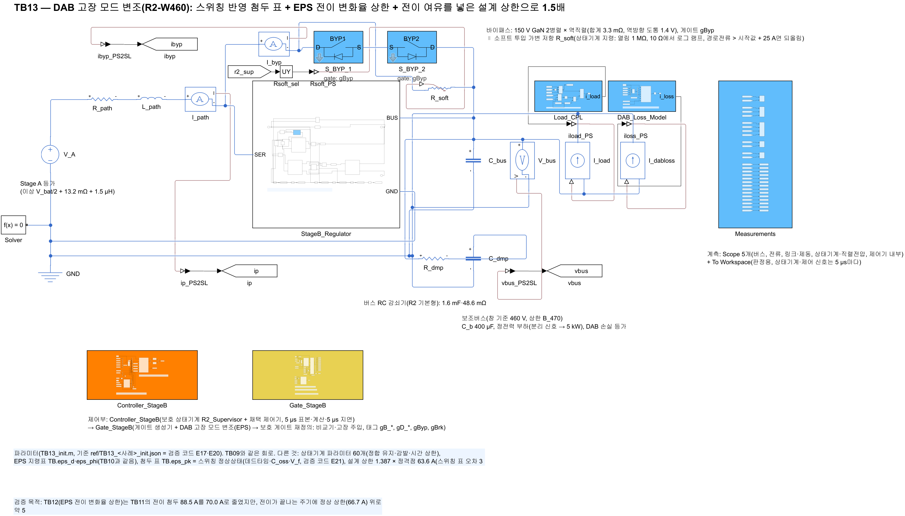
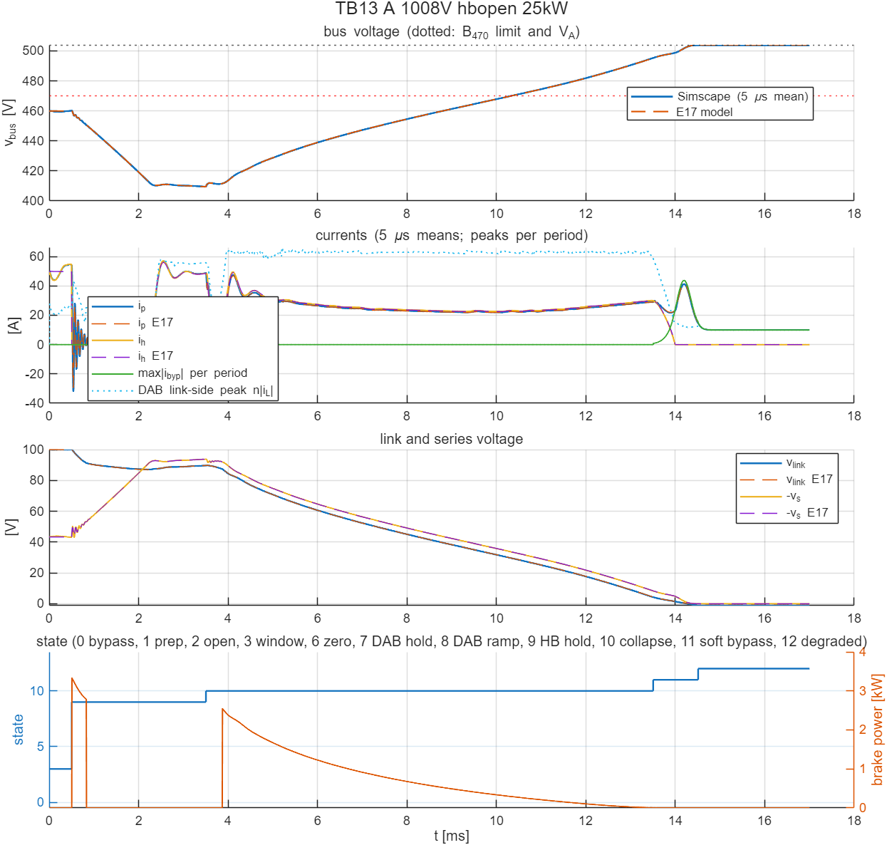

# TB13 — DAB 고장 모드 변조의 전이 여유(R2-W460): 설계 상한 1.387배로 1.5배 상한

**결론(2026-10-25): 통과 2/2(1.5배 기준 포함).**

- **강등 중 DAB 첨두가 1.5배(68.7 A) 안에 들었다.** 66.4·64.4 A였고, 1.5배를 넘은 주기는 0·0이다. 기준까지 여유는 2.4 A다. 정상 주기 상한(63.6 A) 위로는 최대 4.4 %로, 넣은 전이 여유 5 % 안이다.
- **평균모델과 잘 맞는다.** 상태 전이 시각이 E17 P3t와 0.005 ms 안에서 같았고, 사례 A의 소프트 투입 에너지도 0.0485 J로 같았다.
- **대가는 링크 붕괴가 덜 되는 것이다.** 붕괴 구간 DAB 전류가 약 5 % 줄어, 두 사례 모두 붕괴가 시간 상한(10 ms)에 닿았다.
  - 사례 A: 소프트 투입 진입 링크 4.27 V(TB12 1.07 V), 소자 에너지 0.048 J(TB12 0.028 J), 소프트 투입 중 DAB 첨두 58.3 A.
  - 사례 B: 강등 완료 14.51 ms(TB12 13.98 ms).
- 강등 중 DAB 첨두는 해석(정상상태 최적 지령표) → 스위칭 정상상태(3 %, TB11) → 지령 전이(5 %, TB12)의 세 단계를 거쳐 회로에서 설계 목표 안에 들었다.

## 왜 필요한가

TB12는 게이트 생성기의 직류 편류 방지와 변화율 상한으로 TB11의 전이 첨두 88.5 A를 70.0 A로 줄였다. 하지만 사례 A에서 한 전이의 끝 세 주기가 1.5배(68.7 A)를 최대 1.3 A 넘었다. 두 사례에서 전이 주기 첨두는 정상 주기 상한(66.7 A) 위로 최대 4.9 %였다.

- **전이를 더 매끄럽게 하는 안은 효과가 작았다.** 상한 탐색을 이웃 두 행에서 따로 해 전압비로 보간하는 안을 TB11 사례 A의 궤적에서 오프라인으로 점검했다. 주기당 지령 도약이 위상 0.227 → 0.202 rad로 11 %만 줄었다.
- **큰 도약은 지령표 자체에서 나온다.** 같은 전압비에서 전류 방향으로 이웃한 칸의 최적 (D1, 위상)이 최대 0.41 rad 차이 난다.
- **그래서 회로에서 잰 전이 첨두를 설계 상한의 여유로 넣었다.** 여유 5 %를 더해 설계 상한을 1.5배 / (1.03 × 1.05) = 1.387 × 정격점(63.6 A)으로 낮췄다. 1.03은 스위칭 표와 회로의 정상상태 차(E21), 1.05는 지령 전이 과도(TB12)다.

## 회로

TB12와 같다(전력 회로, 상태기계, 지령 블록 `prism_dab_eps_map`, 스위칭 반영 첨두 표, 게이트 생성기 `prism_gate_stageB_f`). 다른 것은 지령 블록의 첨두 상한 `TB.eps_prm(5)` = 63.6 A 하나다(TB11·TB12 66.7 A).

| 그림 | 내용 |
| --- | --- |
|  | TB12와 같은 전력 회로 |
|  | 지령 블록 + 게이트 생성기(상한 값만 다름) |

## 사례와 판정 기준(시험 전에 고정)

TB11·TB12와 같다. 사례 A(1008 V, 25 kW, H-브리지 개방)와 B(930 V, 같은 고장, 일시 감발)다. 판정은 TB10의 회로 한계에 강등 상태(9–11)의 DAB 링크 쪽 순시 첨두 n·max|i\_L| ≤ 1.5 × 정격점(68.7 A)을 더한 것이다. 판정 기준은 그대로 두고 설계 상한만 낮췄다.

- **기준값.** `ref/make_ref_TB13.py`가 E17 `r2_run`에 E21의 P3t(`pk_table='sw'`, `pk_fault=1.387`)를 주어 만든다. 평균모델 E21 P3t는 기본 8사례가 모두 통과했다.

## 결과

| 항목 | A 1008 V | B 930 V | TB12(A / B) |
| --- | --- | --- | --- |
| 판정(1.5배 포함) | 통과 | 통과 | 불통과 / 통과 |
| DAB 링크 쪽 첨두(유지 / 붕괴 / 소프트 투입) | 58.0 / 66.4 / 58.3 A | 58.0 / 64.4 / 19.2 A | 최대 70.0 / 68.5 A |
| 1.5배 초과 주기 / 강등 상태 주기 | 0 / 2801 | 0 / 2801 | 3 / 0 |
| 1차 첨두 | 14.4 A | 14.0 A | 15.2 / 14.9 A |
| 경로·필터 순시 최대 | 57.1 A | 57.9 A | 57.1 / 57.9 A |
| 버스 최저(5 µs 평균) | 409.5 V | 380.4 V | 409.5 / 380.4 V |
| 소프트 투입(진입 링크, 소자 에너지) | 4.27 V, 0.048 J | 0.68 V, 0.027 J | 1.07·0.49 V, 0.028·0.026 J |
| 제동 저항 에너지 | 8.1 J | 6.7 J | 7.6 / 6.3 J |
| 강등 완료 | 14.51 ms | 14.51 ms(되돌림 15.01 ms) | 14.51 / 13.98 ms |
| E17 대조(전이 시각) | 0–0.005 ms | 0–0.005 ms | 0–0.005 / 0–0.05 ms |

그 밖의 회로 한계(경로·필터 ≤ 100 A, 직렬·링크 ≤ 120 V, 바이패스 ≤ 329 A, 버스 ≥ 260 V, 강등 도달, 부하 연결 중 버스 ≤ 상한)는 모두 통과했다.



## 재현

```matlab
prism_run('build_TB13')      % TB13_R2_FaultMod_TA.slx 생성, 회로도 그림
prism_run('run_TB13')        % 실행 1–2 판정(2.5 ns, 약 21분)
```

기준값은 `ref/make_ref_TB13.py <검증 코드 python 폴더>`로 다시 만든다. 먼저 검증 코드 `E21_dab_switching_margin.py table`이 스위칭 표를 만든다.
