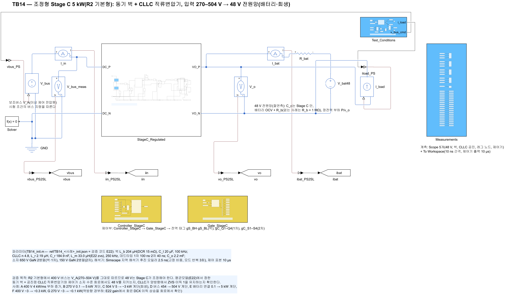
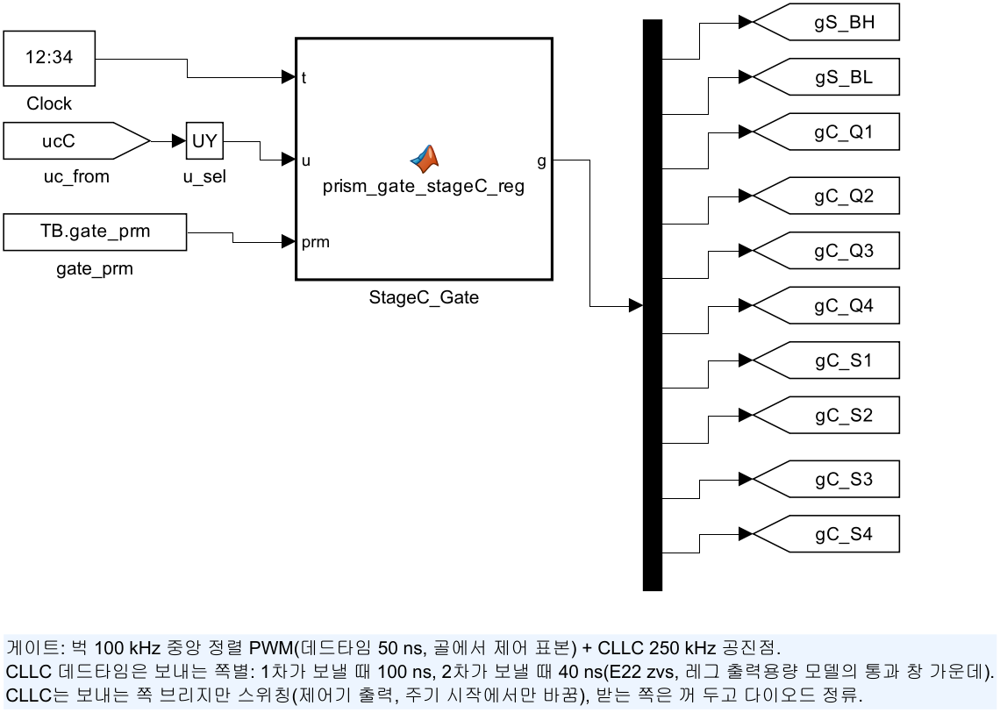
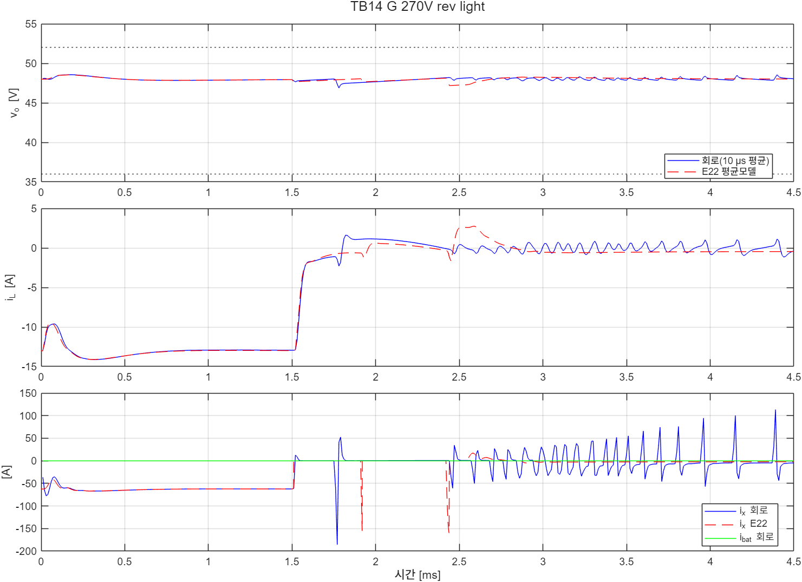

# TB14 — 조정형 Stage C 5 kW(R2 기본형): 동기 벅 + CLLC 직류변압기

**결론(2026-10-25): 2차 실행 6/7 통과. 1차 실행은 0/5(ZVS 불통과)였다.**

- **48 V 조정과 전류 제한은 평균모델대로였다.** 사례 A–E는 1·2차 실행 모두 v\_o 극값이 E22와 0.25 V 안, 끝 i\_L이 0.05 A 안에서 같았다. 270 V 0.1 → 5 kW 계단의 최저는 44.1 V(기준 36 V), 4 kW/ms 램프는 47.74–48.19 V(±2 %)였다.
- **1차 실행(L\_m 62.2 µH, 데드타임 100 ns)은 다섯 사례 모두 ZVS가 깨졌다.** 보내는 쪽 레그가 켜지기 직전 V\_ds가 1차 51.8–68.5 V, 2차 48.0 V였다(기준 레일의 5 %). 원인을 레그 출력용량 모델(E22 zvs)로 재현하고 L\_m 33 µH, 데드타임 1차 100 ns·2차 40 ns로 고쳤다.
- **2차 실행에서 ZVS가 지켜졌다.** 켜짐 직전 V\_ds는 1차 0.11–0.19 V, 2차 0.07–0.08 V였다(사례 A–F).
- **역방향 경부하에서 DCX 이득이 올랐다(사례 F·G, 시험 전에 예상한 것).** 끝 이득 n·v\_o/v\_I가 0.910·0.911로, 레그 모델의 예상(약 0.91)과 같았다. 400 V(F)에서는 v\_o가 조정되었지만 보내는 쪽이 14번 바뀌었다. 270 V(G)에서는 벅 듀티가 상한(0.97)에 붙고 보내는 쪽이 41번 바뀌며 출력전류가 ±50–110 A로 흔들렸다(불통과: ZVS, E22 끝 i\_L). 대책은 [TB15](../TB15_StageC_LightLoad/README.md)에서 확인한다.

## 왜 필요한가

R2 기본형의 Stage C는 270–504 V 버스에서 48 V를 조정해야 한다(docs/27). 구조와 제어는 평균모델(E22 control)에서, CLLC 직류변압기는 주기 정상상태 ODE(E22 dcx)에서 정했다. 두 모델에 없는 것을 이 회로에서 본다.

- **실제 소자와 결선.** 두 단을 소자 수준(출력용량, 역병렬 다이오드, 데드타임, 변압기 자화 인덕턴스)으로 이어도 전압 조정과 전류 제한이 평균모델대로 동작하는지 확인한다.
- **DCX 등가의 근거.** 평균모델의 DCX는 R\_x·L\_x 등가다. 회로의 이득과 동특성이 이 등가와 맞는지 본다.
- **영전압 스위칭.** 평균모델과 처음 ODE에는 레그 노드가 없다. 보내는 쪽 레그가 데드타임 안에 실제로 전이하는지는 회로에서만 볼 수 있다.

## 회로

| 블록 | 내용 |
|---|---|
| `StageC_Regulated`(`lib/build_stageC_reg.m`) | 동기 벅 레그(650 V GaN 2병렬) – L\_b 204 µH – C\_I 20 µF – 1차 풀브리지(650 V GaN 2병렬) – C\_r1·L\_r1 – 변압기 4.8:1(L\_m 1차 쪽) – L\_r2·C\_r2 – 2차 풀브리지(EPC2305 2병렬) – C\_o 2.2 mF |
| `V_bus` | 제어 전압원(시험 조건의 버스 지령) |
| 48 V 쪽 | 정전력 부하(제어 전류원, i = P/max(v\_o, 10 V)), 배터리(OCV 47 V + 20 mΩ, 사례 E만) |
| `Controller_StageC` | `ctrl/prism_stageC_reg_ctrl.m`. E22 control과 같은 알고리즘·게인(표본 10 µs, 계산 지연 1주기). Octave로 E22와 같은 평균 플랜트에 붙여 7사례 모두 출력 차 0(`ref/check_ctrl_octave.txt`) |
| `Gate_StageC` | `ctrl/prism_gate_stageC_reg.m`. 벅 중앙 정렬 PWM(데드타임 50 ns). CLLC는 보내는 쪽 브리지만 250 kHz 구형파이고 받는 쪽은 꺼 두고 다이오드 정류(이상 동기정류 근사). 데드타임은 보내는 쪽별(1차 td\_p, 2차 td\_s) |
| 해석기 | Simscape 지역 해석기 후진 오일러 2.5 ns, 고정 비용(모드 반복 3회, TB08–TB13과 같음). 사례 A를 가변 비용으로 다시 계산해 같은 결과를 확인 |

| 그림 | 내용 |
| --- | --- |
|  | 최상위: 버스 전압원, Stage C, 48 V 쪽, 제어·게이트·계측 |
|  | 동기 벅 + CLLC 직류변압기 |
|  | 게이트 생성기 |

## 사례와 판정 기준(시험 전에 고정)

| 사례 | 조건 | 전압 판정 |
|---|---|---|
| A | 400 V, 0.1 → 5 kW 램프(4 kW/ms, 계약 부하 변화) | 48 V ±2 % |
| B | 270 V(최저), 0.1 → 5 kW 계단(견고성) | 36–52 V |
| C | 504 V(최고), 5 → −3 kW 계단(회생, 보내는 쪽 전환) | 36–52 V |
| D | 3 kW, 버스 454 → 504 V(10 µs) | 48 V ±2 % |
| E | 400 V, 배터리 연결, 0.1 → 5 kW 계단 | 36–52 V, 사건 2.5 ms 뒤 출력 ≤ 105 A × 1.05 |
| F(2차 실행에 추가) | 400 V, −3 → −0.3 kW 계단(역방향 경부하) | 36–52 V |
| G(2차 실행에 추가) | 270 V, −3 → −0.1 kW 계단(역방향 경부하, 벅 V\_I 상한 근처) | 36–52 V |

공통 판정은 (b) 출력전류 100 µs 평균 ≤ 136.5 A, 2차 소자 순간 전류 ≤ 329 A(EPC2305 펄스 정격), (c) 보내는 쪽 레그 1이 켜지기 직전 V\_ds ≤ 레일의 5 %(사건 0.5 ms 전까지와 끝 0.5 ms), (d) 사건 전 DCX 이득 1 ± 3 %, (e) E22 대조(v\_o 극값 ±0.5 V, 끝 v\_o ±0.1 V, 끝 i\_L ±3 % 또는 0.3 A)다. 기준값은 `ref/make_ref_TB14.py`가 E22 평균모델로 만든다.

사례 F·G는 E22 gain 파트가 역방향 경부하의 이득 상승을 찾은 뒤 더했다. 회로 실행 전에 예상을 적어 두었다(`ref/expect_F_G.txt`: F 끝 이득 약 0.91, 조정 유지 / G 벅 듀티 상한, 정상상태 조정 보장 안 됨).

## 결과

**1차 실행(L\_m 62.2 µH, 데드타임 100 ns): 0/5.** 판정은 ZVS 하나만 깨졌다.

| 사례 | v\_o 회로(E22) | 켜짐 직전 V\_ds 1차 / 2차 | 사건 전 이득 |
|---|---|---|---|
| A | 47.77–48.19(47.79–48.18) V | 66.8 / – V | 0.9991 |
| B | 44.17–48.19(44.27–48.19) V | 66.7 / – V | 0.9991 |
| C | 47.76–50.92(47.78–51.00) V | 68.5 / 48.0 V | 0.9755 |
| D | 48.00–48.19(48.00–48.19) V | 51.8 / – V | 0.9840 |
| E | 46.43–47.52(46.40–47.52) V | 66.7 / – V | 0.9913 |

**2차 실행(L\_m 33 µH, 데드타임 1차 100 ns·2차 40 ns): 6/7.**

| 사례 | 판정 | v\_o 회로(E22) | V\_ds 1차 / 2차 | 이득 사건 전 / 끝 | 사건 뒤 듀티 최대, 보내는 쪽 전환 | 출력 100 µs 최대, 2차 소자 첨두 |
|---|---|---|---|---|---|---|
| A | 통과 | 47.74–48.19(47.79–48.18) V | 0.19 / – V | 1.010 / 0.977 | 0.605, 0 | 107.0 A, 84.7 A |
| B | 통과 | 44.09–48.18(44.33–48.18) V | 0.19 / – V | 1.010 / 0.977 | 0.970, 0 | 125.6 A, 98.8 A |
| C | 통과 | 47.75–50.78(47.77–50.95) V | 0.11 / 0.07 V | 0.977 / 1.012 | 0.475, 0 | 103.6 A, 81.6 A |
| D | 통과 | 48.00–48.19(48.00–48.19) V | 0.15 / – V | 0.985 / 0.985 | 0.520, 0 | 65.2 A, 56.3 A |
| E | 통과 | 46.43–47.52(46.43–47.52) V | 0.18 / – V | 0.993 / 0.976 | 0.852, 0 | 130.0 A, 105.8 A(2.5 ms 뒤 105.4 A) |
| F | 통과 | 47.25–48.52(47.26–48.19) V | – / 0.08 V | 1.012 / **0.910** | 0.739, **14** | 62.3 A, 71.6 A |
| G | **불통과**(ZVS, E22 끝 i\_L) | 46.88–48.57(47.19–48.26) V | 0.19 / **40.0** V | 1.012 / **0.911** | **0.970**, **41** | 62.3 A, 168.3 A |

- 끝 i\_L은 A–E에서 E22와 0.05 A 안이었다. B의 듀티 0.970은 270 V 계단 직후 짧은 포화로, E22에도 있다(0.09 ms).
- 2차 실행의 자화 전류 첨두는 6.8–7.0 A(설계 7.6 A는 최고 V\_I 기준)였다.
- **해석기 점검.** 사례 A를 가변 비용(모드 반복 제한 없음)으로 다시 계산했다(`probe_TB14_solver`, 2차 실행 설계). 10 µs 평균 v\_o·i\_L·v\_I·i\_x의 최대 차가 0.0000(소수 넷째 자리)이었고, 벽시계 시간은 1,432 s 대 105 s였다. 이 사례에서는 모드 반복 3회 제한이 결과를 바꾸지 않았다(`results/solver_probe/TB14_solver_probe.txt`).
- **사례 G.** 사건 뒤 DCX가 역방향 경부하 전력을 원하는 만큼 줄이지 못해 v\_o가 내려가고, 지령이 정방향으로 넘어갔다가 다시 역방향으로 돌아가기를 반복했다. 그 사이 보내는 쪽이 바뀌는 순간의 레그 전이가 불완전해 2차 V\_ds가 40 V였다. 출력전류 펄스는 시간이 갈수록 커졌다(±50 → 110 A). 평균모델 E22에도 모드 전환 때 −160 A의 순간 전류가 있었지만 반복되지는 않았다.



## 재현

```matlab
prism_run('build_TB14')      % TB14_StageC_Regulated.slx 생성, 회로도 그림
prism_run('run_TB14')        % 사례 1–7 판정(2.5 ns, 약 11분)
prism_run('diag_TB14')       % 사례 3·4만(파형 확인용)
prism_run('probe_TB14_solver')   % 사례 A 가변 비용 대조(약 24분)
```

기준값은 `python ref/make_ref_TB14.py`(검증 코드 E22를 `design zvs dcx control` 순서로 먼저 실행), 제어기 대조는 `ref/check_ctrl_octave.m`이다. 1차 실행의 요약은 검증 기록(validation/2026-10-25-stage-c-regulated/TB14_run1)에 있다.

## 한계

- CLLC의 받는 쪽은 역병렬 다이오드(Vf 50 mV)로 둔 이상 동기정류 근사다. 실제 동기정류 게이트 타이밍(전류 감지 지연)은 넣지 않았다.
- 출력용량은 선형(C\_o(tr))이다. GaN의 비선형 출력용량과 게이트 드라이버 지연 편차는 E22 zvs의 출력용량 ±20 % 창으로만 고려했다.
- 해석기(후진 오일러 2.5 ns, 고정 비용)는 수 MHz 링잉을 수치적으로 감쇠시킨다. 그래도 사례 F의 끝 이득은 레그 모델 예상과 같았다.
