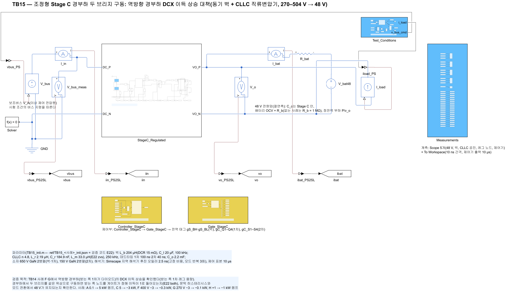
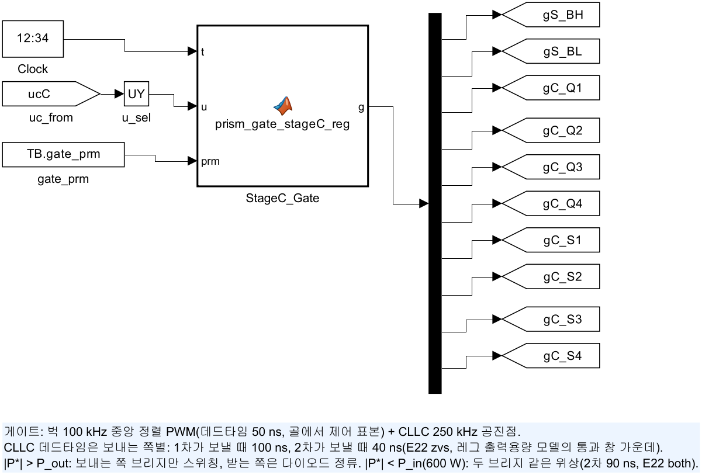
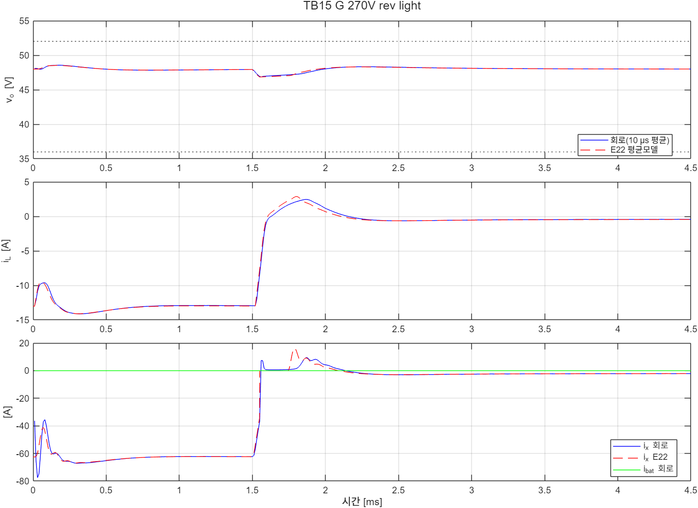

# TB15 — 조정형 Stage C 경부하 두 브리지 구동: 역방향 경부하 DCX 이득 상승 대책

**결론(2026-10-25): 통과 5/5.**

- **역방향 경부하의 이득 상승이 없어졌다.** TB14와 같은 조건(사례 F 400 V −3 → −0.3 kW, G 270 V −3 → −0.1 kW)에서 끝 DCX 이득이 0.910·0.911 → 1.001·1.000이 되었다. 보내는 쪽 전환은 14·41번 → 0·2번이었다.
- **270 V에서도 조정이 유지되었다(사례 G, TB14 불통과).** 출력전류 펄스(±50–110 A)가 없어졌고, 2차 소자 첨두는 168.3 → 49.2 A였다. v\_o는 E22와 0.02 V 안이었다.
- **두 브리지 구동 중에도 ZVS가 지켜졌다.** 켜짐 직전 V\_ds는 1차 0.18–0.22 V, 2차 0.06–0.08 V였다.
- **모드 전환이 48 V를 흔들지 않았다.** +1 → −1 kW 램프(사례 H)에서 보내는 쪽 하나 → 두 브리지 → 반대쪽 하나로 네 번 바뀌는 동안 v\_o는 47.79–48.07 V(±2 % 안)였다.

## 왜 필요한가

TB14 2차 실행의 사례 F·G에서 역방향 경부하의 DCX 이득 상승을 회로로 확인했다. 2차가 보낼 때 받는 쪽 1차 브리지를 다이오드로만 두면, 1차 레그의 출력용량 때문에 경부하에서 V\_I를 n·V\_o보다 크게 올려야 전력이 줄어든다(E22 gain, ngspice로도 확인). 270 V 버스에서는 벅이 받을 수 있는 V\_I 상한(0.97 × 270 V)을 넘어 조정이 깨졌다.

- **대책: 경부하에서 받는 쪽도 같은 위상으로 구동한다.** 받는 쪽 노드를 게이트가 정하므로 레그 용량에 의한 이득 상승이 없다. 두 방향이 대칭이고 전류가 0을 지나도 끊기지 않으므로, 평균모델의 선형 DCX(R\_x·L\_x)와 같은 꼴이 된다.
- **중부하에는 쓸 수 없다.** 자화 전류가 두 브리지로 나뉘어 2차 전이가 느려진다. 레그 모델(E22 both)에서 출력용량 ±20 %까지 두 브리지 모두 ZVS인 범위는 |P| ≤ 0.6 kW(2차 데드타임 80–100 ns)였다. 그래서 |P\*| < 0.6 kW에서 들어가고 > 0.7 kW에서 나간다(0.7 kW에서도 90 ns는 2.6 %로 통과).

## 회로

TB14와 같다(전력 회로, 버스 전압원, 정전력 부하, 해석기). 다른 것은 제어기와 게이트의 두 브리지 구동이다.

| 블록 | TB14와 다른 것 |
|---|---|
| `Controller_StageC`(`ctrl/prism_stageC_reg_ctrl.m`) | prm 25·26 = P\_in 600 W, P\_out 700 W. 출력 전력 지령 \|i\_x\*·v\_o\| < P\_in이면 모드 2, 모드 2에서 > P\_out이면 지령 부호의 보내는 쪽 하나 |
| `Gate_StageC`(`ctrl/prism_gate_stageC_reg.m`) | 모드 2: 1차(데드타임 100 ns)와 2차(데드타임 td\_sb 90 ns)를 같은 위상으로 구동. 모드는 CLLC 주기 시작에서만 바꾼다 |

두 함수 모두 prm이 짧으면(TB14) 두 브리지 구동을 하지 않는다. 변압기 극성은 1차 레그 1 상측 켬(+V\_I) ↔ 2차 레그 1 상측(+V\_o)이다(`lib/build_stageC_reg.m`).

| 그림 | 내용 |
| --- | --- |
|  | 최상위(TB14와 같은 전력 회로) |
|  | 게이트 생성기(두 브리지 구동 포함) |

## 사례와 판정 기준(시험 전에 고정)

| 사례 | 조건 | 전압 판정 |
|---|---|---|
| A | 400 V, 0.1 → 5 kW 램프(4 kW/ms): 두 브리지 구동에서 시작해 1차가 보내는 쪽으로 | 48 V ±2 % |
| C | 504 V, 5 → −3 kW 계단: 두 브리지 구동 구간을 지나감 | 36–52 V |
| F | 400 V, −3 → −0.3 kW 계단(TB14 F와 같음) | 36–52 V, (f) |
| G | 270 V, −3 → −0.1 kW 계단(TB14 G와 같음) | 36–52 V, (f) |
| H | 400 V, +1 → −1 kW 램프(1 kW/ms): 두 브리지 구동에 들어갔다 나감 | 48 V ±2 %, (f) |

(b)–(e)는 TB14와 같다. (f)는 끝 0.2 ms DCX 이득 1 ± 3 %다(TB14 F·G에서 0.91로 깨진 것). (c) ZVS는 두 브리지 구동 중이면 두 브리지 모두의 레그 1 켜짐을 본다. 기준값은 `ref/make_ref_TB15.py`가 E22 평균모델(방향 2 = 양방향 DCX, 같은 문턱)로 만든다. 회로 제어기는 Octave로 같은 평균 플랜트에 붙여 다섯 사례 모두 E22와 출력 차 0이었다(`ref/check_ctrl_octave.txt`).

## 결과

| 사례 | 판정 | v\_o 회로(E22) | V\_ds 1차 / 2차 | 이득 사건 전 / 끝 | 사건 뒤 듀티 최대, 모드 전환, 두 브리지 비율 | 2차 소자 첨두 |
|---|---|---|---|---|---|---|
| A | 통과 | 47.75–48.19(47.79–48.18) V | 0.21 / 0.06 V | 1.000 / 0.977 | 0.605, 1, 0.04 | 84.7 A |
| C | 통과 | 47.75–50.78(47.77–50.95) V | 0.11 / 0.07 V | 0.977 / 1.012 | 0.475, 0, 0 | 81.6 A |
| F | 통과 | 46.92–48.17(46.92–48.15) V | 0.22 / 0.07 V | 1.012 / **1.001** | 0.739, 0, 1.00 | 49.3 A |
| G | 통과 | 46.86–48.34(46.85–48.32) V | 0.21 / 0.07 V | 1.012 / **1.000** | 0.970, 2, 0.89 | 49.2 A |
| H | 통과 | 47.79–48.07(47.95–48.06) V | 0.18 / 0.08 V | 0.996 / 0.980 | 0.594, 4, 0.44 | 26.0 A |

| 같은 조건의 비교 | TB14(받는 쪽 다이오드) | TB15(두 브리지 구동) |
|---|---|---|
| F 끝 이득 / 보내는 쪽 전환 | 0.910 / 14번 | 1.001 / 0번 |
| G 끝 이득 / 전환 / 판정 | 0.911 / 41번 / 불통과(ZVS 40.0 V, 끝 i\_L) | 1.000 / 2번 / 통과 |
| G 2차 소자 첨두 | 168.3 A | 49.2 A |

- 사례 G의 사건 뒤 듀티 0.970은 계단 직후 인덕터 전류를 −13 A에서 +2 A로 뒤집는 동안의 짧은 포화로, E22에도 있다(0.05 ms). TB14 G에서는 포화가 끝까지 반복되었다.
- A·C는 TB14 2차 실행과 같은 결과였다. 두 브리지 구동이 중부하 동작을 바꾸지 않았다.



## 재현

```matlab
prism_run('build_TB15')      % TB15_StageC_LightLoad.slx 생성, 회로도 그림
prism_run('run_TB15')        % 사례 1–5 판정(2.5 ns, 약 8분)
prism_run('diag_TB15')       % 사례 F·G만
```

기준값은 `python ref/make_ref_TB15.py`(검증 코드 E22를 `design zvs gain both dcx control` 순서로 먼저 실행)다.

## 한계

- 두 브리지 구동 문턱(0.6·0.7 kW)과 2차 데드타임(90 ns)은 레그 모델(선형 출력용량, 출력용량 ±20 %)로 정했다. 실제 소자의 비선형 출력용량과 게이트 지연에서는 하드웨어로 다시 정해야 한다. 데드타임 창 폭은 20 ns다.
- 모드 판정은 출력 전력 지령(i\_x\*·v\_o)이다. 지령 잡음이 문턱 근처에서 모드를 흔들 수 있어 히스테리시스(0.1 kW)를 두었고, 램프(사례 H)에서는 반복 전환이 없었다. 느린 진동 부하는 확인하지 않았다.
- 정방향 경부하에도 같은 현상이 작게 있다(받는 쪽 2차 레그 용량, 1차 환산 0.24 nF). 레그 모델에서 V\_I를 n·V\_o의 0.94배로 내려도 +30 W였다. 두 브리지 구동이 정방향 경부하도 덮는다.
