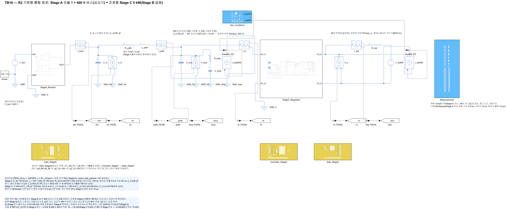
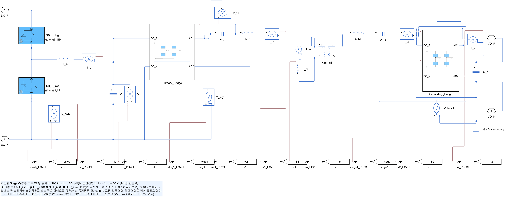
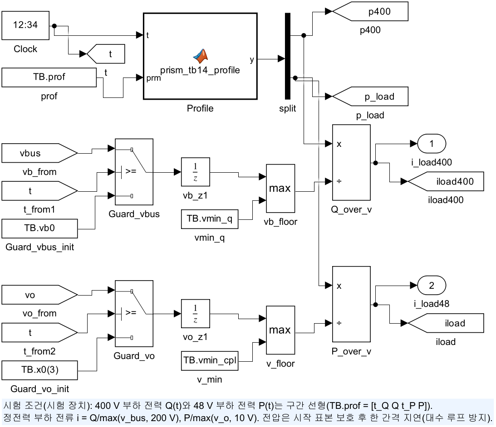
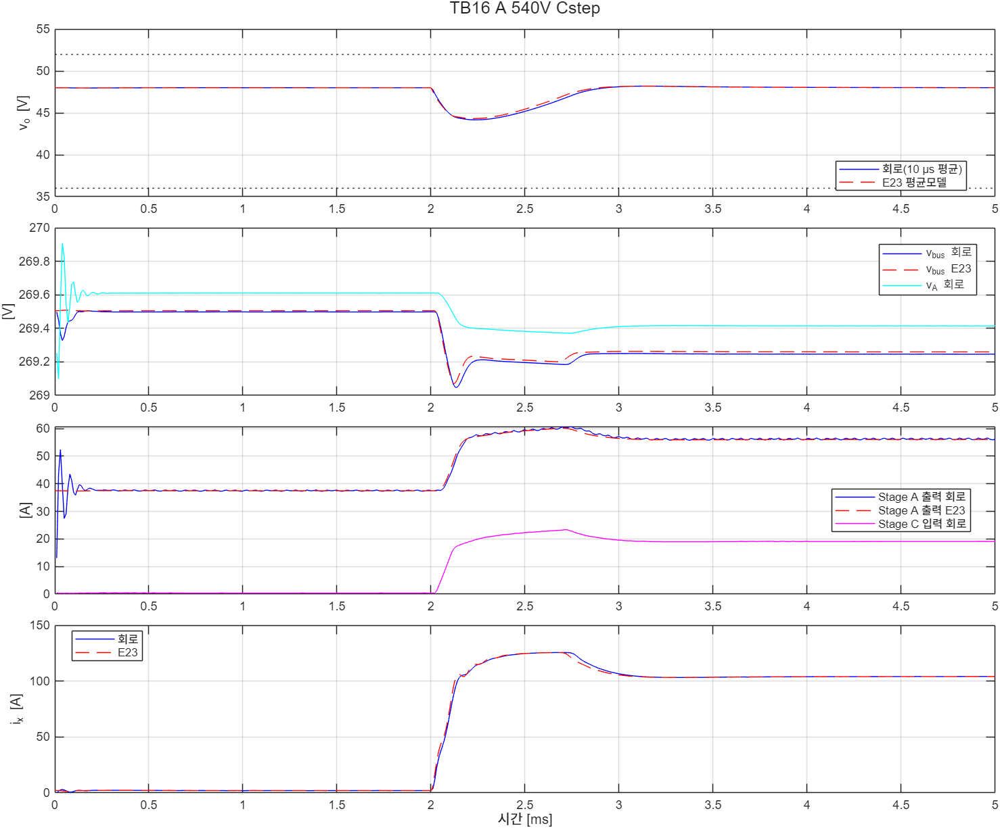
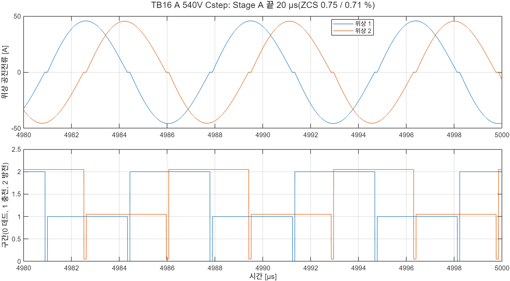

# TB16 — R2 기본형 통합 회로: Stage A 모듈 1 + 400 V 버스(감쇠기) + 조정형 Stage C

**결론(2026-10-25): 통과 3/3.**

- **실제 Stage A가 만드는 버스에서도 48 V 조정이 유지되었다.** v\_o(10 µs 평균)는 E23 평균모델과 최저·최고 0.18 V 안, 끝 0.000 V였다.
  - Stage C 0.1 → 5 kW 계단(V\_A ≈ 270 V, Stage C 입력 최저): 44.16–48.19 V(E23 44.31–48.18 V).
  - 400 V 부하 15 → 25 kW 계단(V\_A ≈ 403 V): 48.00–48.04 V(±2 % 안).
  - Stage C 5 → −3 kW 회생(V\_A ≈ 453 V): 47.73–50.73 V.
- **두 단이 한 버스에서 서로를 흔들지 않았다.** 버스(10 µs 평균) 변동은 사건마다 0.45–0.84 V였고, E23과 끝값 차는 0.016 V 안이었다. 끝 0.5 ms의 버스 진동은 ≤ 0.001 V였다.
- **Stage A ZCS가 유지되었다.** 턴오프 순간 전류/피크는 사건 전 0.12–0.54 %, 끝 0.71–2.27 %였다(E1 영교차 추종 2위상: 0.84–3.80 %). V\_A는 E1과 0.09 V 안, 위상 전류 차는 ≤ 0.80 %였다.
  - Stage C가 끌어가는 100 kHz 맥동 전류도 영교차 검출을 흐트러뜨리지 않았다.
- **Stage C ZVS도 유지되었다.** 켜짐 직전 V\_ds는 1차 0.11–0.21 V, 2차 0.00–0.07 V였다(레일 5 % 기준). 2차 소자 첨두는 ≤ 98.8 A(정격 329 A)였다.

## 왜 필요한가

R2 기본형(Stage A + 버스 감쇠기 + 조정형 Stage C)에는 Stage B가 없다. 그래서 400 V 버스는 V\_A(배터리 전압의 1/2)를 그대로 따른다.

- **이상 버스 전원으로는 확인한 것이 반쪽이다.** 조정형 Stage C(TB14·TB15)는 이상 버스 전원(지령 전압)으로만 확인했다.
- **실제 버스에는 서로 엮인 요소가 많다.** 실제 V\_A 노드에는 다음이 있다.
  - 공진 스위치드 커패시터의 출력 리플(약 600 kHz)
  - Stage A 출력저항(약 10 mΩ)과 V\_A 노드 커패시터
  - 배선, 버스 감쇠기
  - 400 V 정전력 부하
- **두 단이 서로를 흔든다.**
  - Stage C는 입력전류를 100 kHz로 끊는 정전력 부하다(음의 증분 저항).
  - 400 V 부하 계단은 Stage A 출력저항을 지나 Stage C 입력을 흔든다.
  - Stage C 부하 계단은 Stage A 공진 전류의 크기를 바꾼다.
- **두 단을 한 회로에서 확인해야 한다.** 그래야 48 V 조정, 버스 안정, Stage A ZCS, Stage C ZVS를 함께 말할 수 있다.

## 회로

| 블록 | 내용 |
|---|---|
| `V_bat` | 배터리(이상 전압원) 540·806·907 V |
| `StageA_Module1`(`lib/build_stageA_module`) | 공진 스위치드 커패시터 2:1, 2위상(C\_fly 7.8125 µF, L\_r 144.1 nH, f\_r0 150 kHz), TB06과 같음 |
| `Gate_StageA`(`lib/build_stageA_gate_zcp`) | 영교차 추종 게이트(검출 0.5 A·지연 20 ns, 데드타임 100 ns), 위상 2는 T/4 늦게. TB06과 같음 |
| V\_A 노드 → 버스 | C\_A 400 µF → 배선 3 mΩ·1.5 µH → C\_b 400 µF ∥ RC 감쇠기 48.6 mΩ + 1.6 mF ∥ 400 V 정전력 부하 Q/max(v, 200 V) |
| `StageC_Regulated`(`lib/build_stageC_reg`) | TB15와 같다: 동기 벅 100 kHz·204 µH + CLLC 4.8:1(L\_m 33 µH, 데드타임 1차 100·2차 40 ns) |
| `Controller_StageC`·`Gate_StageC` | TB15와 같다(경부하 두 브리지 구동 < 0.6 kW, 2차 90 ns) |
| 48 V 쪽 | C\_o 2.2 mF ∥ 정전력 부하 P/max(v\_o, 10 V), 배터리 없음(가지 1 MΩ) |
| `Test_Conditions` | 400 V 부하 Q(t)·48 V 부하 P(t) 구간 선형 프로파일(`prism_tb14_profile`) |

해석기는 Simscape 지역 해석기 후진 오일러 2.5 ns(고정 비용, 모드 반복 3회)다. Stage C 공진망 간격(TB05)과 같다.

| 그림 | 내용 |
| --- | --- |
|  | 최상위 회로 |
|  | Stage A 모듈(2위상) |
|  | 조정형 Stage C 전력 회로 |
|  | 시험 조건(부하 프로파일) |

## 사례와 판정 기준(시험 전에 고정)

Stage A는 주기 정상상태에서 시작하지 않는다(C\_fly = V\_bat/2, 공진전류 0). 그래서 사건은 2 ms에 두고 5 ms까지 본다.

| 사례 | 배터리(V\_A) | 사건 | 48 V 판정 |
|---|---|---|---|
| A\_540V\_Cstep | 540 V(≈ 270 V, Stage C 입력 최저) | 400 V 부하 10 kW, Stage C 0.1 → 5 kW 계단 | 36–52 V |
| B\_806V\_Qstep | 806 V(≈ 403 V, B\_420 부품 상한 근처) | Stage C 3 kW, 400 V 부하 15 → 25 kW(10 µs) | ±2 % |
| C\_907V\_Cregen | 907 V(≈ 453 V, B\_470) | 400 V 부하 10 kW, Stage C 5 → −3 kW 계단(회생은 400 V 부하가 받음) | 36–52 V |

| 항목 | 기준 |
|---|---|
| (a) 48 V | 사례별 범위. 사건 0.2 ms 전부터 끝까지, 10 µs 평균 |
| (b) 버스 범위 | 10 µs 평균이 [사건 전·끝 평균의 낮은 값 × 0.97, 높은 값 × 1.03] 안 |
| (c) 버스 안정 | 끝 0.5 ms 동안 10 µs 평균의 최대 − 최소 ≤ 0.5 V |
| (d) Stage C 전류 | 출력 100 µs 이동평균 ≤ 136.5 A, 2차 소자 순간 ≤ 329 A |
| (e) Stage C ZVS | 레그 1 켜짐 직전 V\_ds ≤ 레일 5 %(1 ms–사건 직전, 끝 0.5 ms) |
| (f) Stage A | 위상별 ZCS(턴오프 순간 \|i\|/피크) ≤ 5 %, V\_A − E1 ≤ 0.3 V, 위상 전류 차 ≤ 5 %(사건 전·끝 0.2 ms, TB06과 같음) |
| (g) E23 대조 | v\_o 최저·최고 ±0.5 V, 끝 v\_o ±0.1 V, 버스 최저·최고 ±1 V, 끝 버스 ±0.5 V |
| (h) 끝 DCX 이득 | n·v\_o/v\_I = 1 ± 3 % |

10 µs 평균은 벅 한 주기이면서 Stage A 출력 리플(약 600 kHz)의 6주기다. 그래서 두 리플이 함께 빠진다.

기준값은 `ref/make_ref_TB16.py`가 만든다.

- 버스·48 V: 검증 코드 E23(E22 평균모델 + 버스 회로, Stage A는 V\_bat/2 + 10.2 mΩ 정적 등가)
- Stage A: E1(영교차 추종 2위상 스위칭 모의, 사건 전·끝 평균 출력전류)

E23 평균모델은 같은 기준 (a)–(d)를 5 µs 평균으로 판정했고, 세 사례 모두 통과했다.

## 결과

| 사례 | 판정 | v\_o 회로(E23) [V] | 버스 회로(E23) [V] | V\_A 회로 / E1 [V] | Stage A ZCS 사건 전 / 끝 | Stage C V\_ds 1차 / 2차 |
|---|---|---|---|---|---|---|
| A | 통과 | 44.16–48.19(44.31–48.18) | 269.05–269.50(269.07–269.51) | 269.611 / 269.666 | 0.12·0.07 % / 0.75·0.71 % | 0.21 / 0.06 V |
| B | 통과 | 48.00–48.04(48.00–48.03) | 401.56–402.40(401.58–402.41) | 402.533 / 402.612 | 0.54·0.50 % / 0.97·0.93 % | 0.15 V / — |
| C | 통과 | 47.73–50.73(47.75–50.91) | 453.05–453.60(453.06–453.58) | 453.153 / 453.218 | 0.14·0.14 % / 2.27·2.27 % | 0.11 / 0.07 V |

| 사례 | Stage C 출력 100 µs 평균 최대 | 2차 소자 첨두 | 끝 DCX 이득 | 위상 전류 차 사건 전 / 끝 | 버스 원파형 리플(끝) |
|---|---|---|---|---|---|
| A | 125.5 A(E23 125.4 A) | 98.8 A | 0.977 | 0.68 / 0.64 % | 0.058 V |
| B | 62.7 A(62.5 A) | 49.4 A | 0.985 | 0.80 / 0.65 % | 0.080 V |
| C | 103.9 A(103.9 A) | 81.9 A | 1.012 | 0.42 / 0.31 % | 0.081 V |

- **사례 C의 끝 ZCS 2.27 %**: 회생으로 Stage A 출력전류가 15.6 A로 줄어든 경부하 점이다. E1도 같은 점에서 3.73–3.80 %였다. 경부하에서 비율이 커지는 것은 E1(−2 ∼ −5 A에서 10–23 %)과 같은 경향이다.
- **사례 B의 2차 ZVS 항목 "—"**: 정방향 3 kW에서는 2차가 다이오드 정류만 한다. 2차 레그 켜짐이 없다(0 edge).
- **회로 V\_A가 E1보다 0.06–0.09 V 낮다.** 회로에는 C\_A 리플 전류가 흐르는 배선 저항이 더 있다. 기준 0.3 V 안이다.
- **사건 뒤 벅 듀티 최대**: A 0.970(계단 직후 인덕터 전류를 올리는 짧은 포화, E23 0.09 ms와 같음), B 0.588, C 0.527.





## 재현

```matlab
prism_run('build_TB16')      % TB16_R2_Base.slx 생성, 회로도 그림
prism_run('run_TB16')        % 사례 1–3 판정(2.5 ns, 사례당 약 1.5분)
prism_run('diag_TB16')       % 사례 A만
```

기준값은 `python ref/make_ref_TB16.py`다(검증 코드 E22를 `design zvs both`, E23을 `base` 순서로 먼저 실행).

## 한계

- **Stage A는 모듈 1개(목표 정격 37.5 kW)다.** 실제 R2는 모듈 수를 부하에 맞춰 늘린다. 모듈을 늘리면 출력저항이 줄어 버스 변동은 더 작아진다. 모듈 사이 전류 분담은 회로로 확인하지 않았다(위상 사이 분담만 확인).
- **배터리는 이상 전압원이다.** 팩 내부저항과 충전기 연결 상태는 이 시험의 범위가 아니다.
- **400 V 부하는 정전력 등가다.** 실제 인버터·압축기 부하의 스위칭 맥동은 넣지 않았다.
- **48 V 쪽에 배터리가 없다.** 정전력 부하만 있어 가장 엄격한 조건이다. 배터리가 있는 경우는 TB14 사례 E에서 확인했다.
- **사례마다 3 ms다.** 열·장시간 동작은 다루지 않는다.
