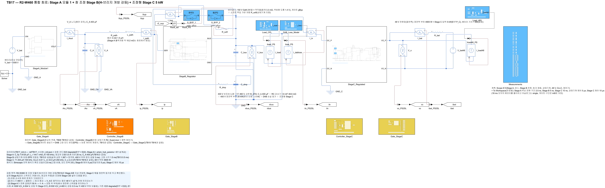
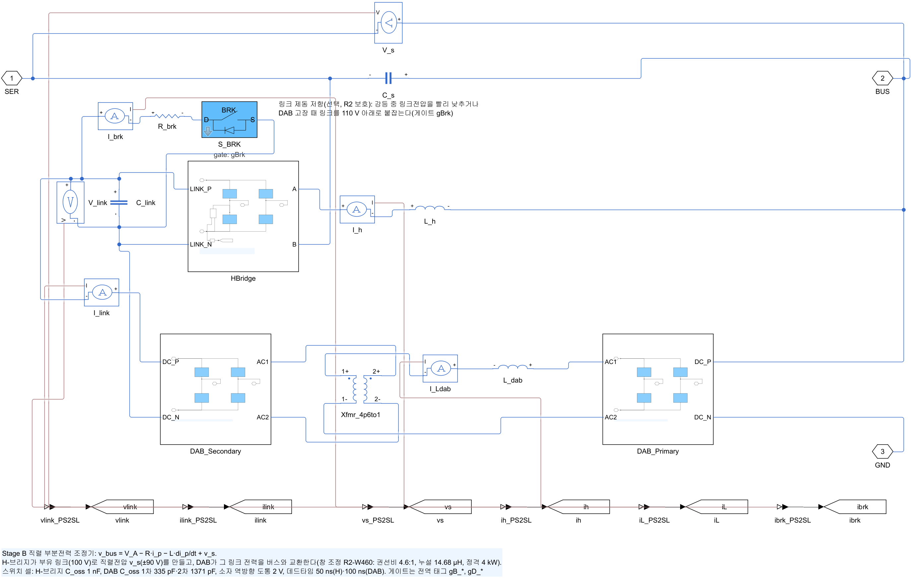
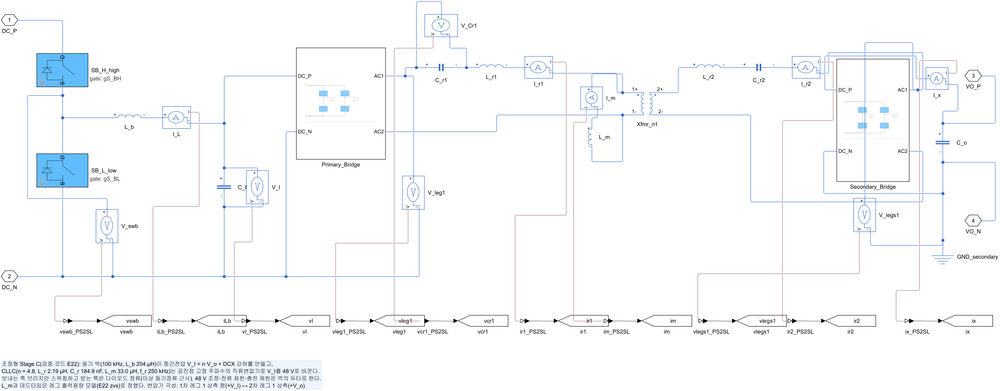
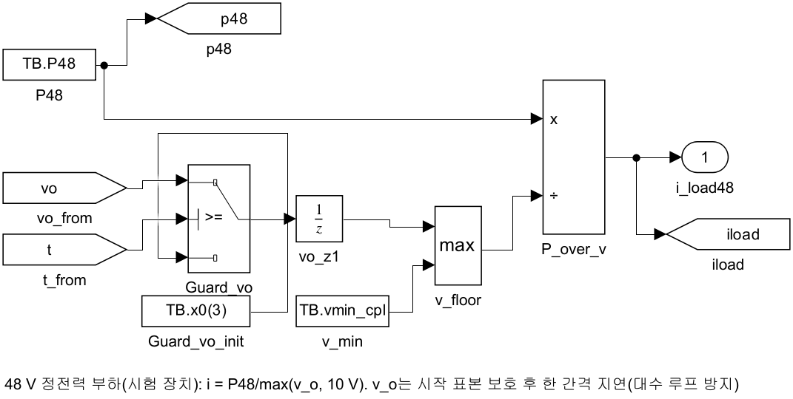
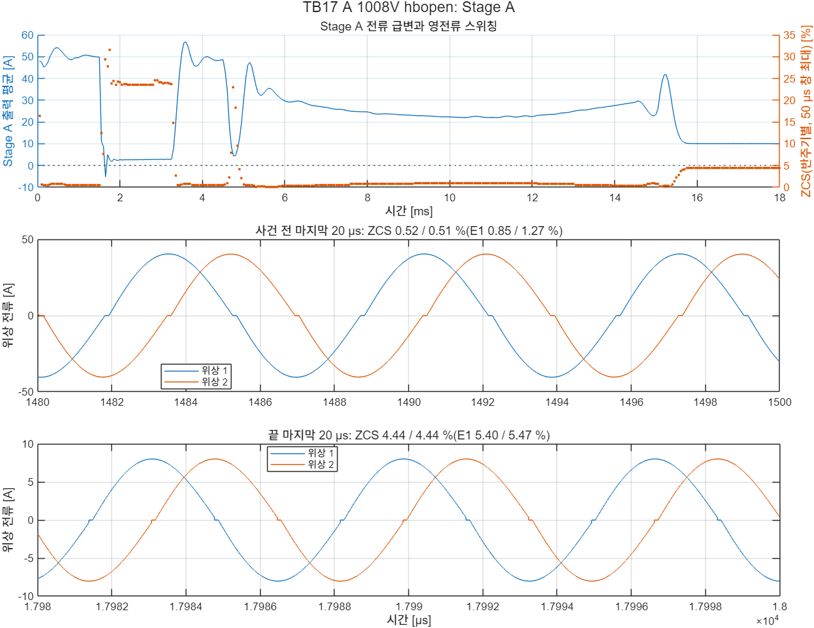
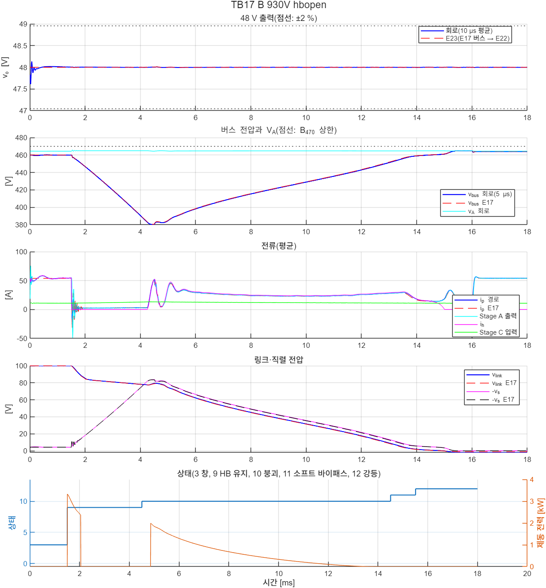

# TB17 — R2-W460 통합 회로: Stage A + 창 조정 Stage B(H-브리지 개방 강등) + 조정형 Stage C

**결론(2026-10-26): 통과 2/2.**

- **강등 내내 48 V가 유지되었다.** 버스가 460 V → 다이오드 클램프(최저 409·380 V) → 링크 붕괴 → V\_A(504·465 V)로 움직이는 16.5 ms 동안 v\_o(10 µs 평균)는 47.995–48.011 V였다(±2 % 기준 47.04–48.96 V). 평균모델(E23 degrade)과 최저·최고 0.004 V 안이었다.
- **강등 순서와 회로 한계는 TB13과 같았다.** 실제 Stage A와 조정형 Stage C를 넣어도 다음이 TB13(이상 V\_A, 정전력 등가)과 같았다.
  - 상태 전이 시각: E17과 0.01 ms 안
  - DAB 링크 쪽 첨두: 66.4·64.5 A(TB13 66.4·64.4 A, 기준 1.5배 68.7 A)
  - 버스 최저: 409.4·380.3 V(TB13 409.5·380.4 V)
  - 소프트 투입 에너지: 0.051·0.027 J(TB13 0.049·0.027 J)
- **Stage A는 판정 구간에서 영전류 스위칭을 유지했다.**
  - 사건 전(약 50 A): ZCS 0.51–0.77 %
  - 끝: 사례 A는 Stage C만 남는 경부하(10.0 A)라 4.44 %(E1 5.40–5.47 %), 사례 B는 400 V 부하가 돌아와 0.72–0.73 %
  - V\_A − E1: ≤ 0.10 V, 위상 전류 차: ≤ 0.48 %
- **Stage A 전류 급변 중(정보).** 고장 직후 Stage A 출력은 −6.4 A까지 갔다가, 클램프 유지 동안 약 3 A로 머문다. 이 경부하에서 반주기별 ZCS 비율은 최대 31.6·36.0 %였다. 턴오프 순간 전류의 절대값은 ≤ 0.72 A였다.
- **Stage C도 강등 내내 ZVS를 유지했다.** 1 ms 이후 1차 레그 켜짐 8,500번 모두 켜짐 직전 V\_ds ≤ 0.11 V였다. 2차는 정방향이라 다이오드 정류만 했다.

## 왜 필요한가

R2-W460 창 조정 모듈의 H-브리지 개방 강등(TB09–TB13)은 회로 두 곳을 등가로 두고 확인했다.

- Stage A: 이상 V\_bat/2 + 13.2 mΩ
- 400 V 부하 분리 뒤 남는 Stage C 몫: 5 kW 정전력 부하

강등 중 48 V 공급은 R2의 요구다. 400 V 부하는 분리해도 48 V 전원망(조향·제동 보조, 제어기)은 살아 있어야 한다. 이를 확인하려면 등가를 실제 회로로 바꿔야 한다.

- **Stage C 입력이 크게 움직인다.** 강등 동안 버스는 460 V → 클램프(최저 380 V) → V\_A(최고 504 V)로 움직인다. 조정형 Stage C(TB14·TB15)는 버스 전압 계단(±50 V/10 µs)까지 확인했지만, 이 궤적은 확인하지 않았다.
- **Stage A가 극단 전류 변화를 겪는다.** 고장 순간 경로전류가 약 50 A에서 수 A로 떨어지고, 잠시 역방향(−6 A)이 된다. 클램프 유지 중에는 약 3 A다. 영교차 추종 게이트는 경부하·역방향에서 ZCS 비율이 커진다(E1).
- **실제 Stage C는 이상 정전력 부하가 아니다.** 실제 Stage C는 입력전류를 100 kHz로 끊고, 제어 대역 밖에서는 정전력 부하가 아니다. 강등 순서(링크 붕괴, 소프트 투입)의 버스 동특성에 영향을 줄 수 있다.

## 회로

TB13 회로에서 두 곳을 바꿨다. 상태기계·보호·EPS 지령표·게이트 생성기와 그 파라미터는 TB13과 같다.

| 블록 | TB13 | TB17 |
|---|---|---|
| V\_A | 이상 V\_bat/2 + 13.2 mΩ + 1.5 µH | 배터리 + `StageA_Module1`(2위상, 영교차 추종, TB16과 같음) + C\_A 400 µF + 배선 3 mΩ·1.5 µH |
| 400 V 정전력 부하(`Load_CPL`) | 25 kW, 분리 뒤 5 kW | 20 kW, 분리 뒤 0 W |
| Stage C 몫 | 위 부하에 포함 | `StageC_Regulated`(TB15·TB16과 같음) + 48 V 정전력 부하 4,905 W(입력 5 kW = E17 P\_C) |
| 고장 시각 | 0.5 ms | 1.5 ms(Stage A 회로 정착) |

- **Stage A 출력저항은 회로에서 생긴다.** 약 10.2 mΩ이고, 배선 3 mΩ를 더하면 TB13·E17의 경로저항 13.2 mΩ와 같다.
- **태그를 나눴다.** Stage B의 DAB 누설 인덕터 전류 태그 `iL`은 DAB 손실 등가가 쓴다. 그래서 Stage C 벅 인덕터 전류 태그는 `iLb`로 두었다(`lib/build_stageC_reg`의 선택 인자).
- **Stage C 전류 PI 적분은 평형값으로 시작한다**(`ctrl/prism_stageC_reg_ctrl` prm(27), TB17부터). 4.9 kW에서 시작하므로 0에서 시작하면 시작 과도가 생긴다. 그 과도가 고장 판정 구간 앞부분과 겹쳐서 이렇게 했다. TB14–TB16은 그대로(0에서 시작)다.
- **계측은 메모리를 줄여 저장한다.** 18 ms 모의라 Stage A 위상 전류·구간은 2.5 ns, Stage B는 5 ns, Stage C는 10 ns로 남긴다. 아날로그는 single, 게이트·구간은 int8로 저장한다(`lib/sl_probe_panel` 네 번째 열).

해석기는 Simscape 지역 해석기 후진 오일러 2.5 ns(고정 비용, 모드 반복 3회)다. 사례당 약 15–16분이 걸렸다.

| 그림 | 내용 |
| --- | --- |
|  | 최상위 회로 |
|  | 창 조정 Stage B(TB13과 같음) |
|  | 조정형 Stage C |
|  | 48 V 정전력 부하 |

## 사례와 판정 기준(시험 전에 고정)

| 사례 | 조건 | 강등 뒤 |
|---|---|---|
| A\_1008V\_hbopen | 배터리 1008 V(V\_A ≈ 504 V), 400 V 부하 20 kW + Stage C 5 kW. H-브리지 개방 → 전압비 정합 유지 → 400 V 부하 분리(3 ms) → 링크 붕괴(EPS) → 소프트 바이패스 → 강등 | 버스 = V\_A > B\_470이라 400 V 부하는 분리된 채, Stage C만 |
| B\_930V\_hbopen | 배터리 930 V(V\_A ≈ 465 V), 같은 고장. 일시 감발(3 ms) → 붕괴 → 소프트 바이패스 → 강등 | 0.5 ms 뒤 400 V 부하 되돌림 |

| 항목 | 기준 |
|---|---|
| 보호·강등(TB13과 같음) | 순시 경로·필터 ≤ 100 A, \|v\_s\| ≤ 120 V, 링크 ≤ 120 V, 바이패스 ≤ 329 A, 버스(5 µs 최저) ≥ 260 V, 강등 상태 도달, 400 V 부하가 연결된 동안 버스 ≤ 470 V, DAB 링크 쪽 첨두(상태 9–11) ≤ 1.5 × 정격점 첨두(68.7 A) |
| 48 V | 10 µs 평균 v\_o가 ±2 %(47.04–48.96 V) 안. 고장 0.2 ms 전부터 끝까지(강등 내내) |
| Stage C 전류 | 출력 100 µs 이동평균 ≤ 136.5 A, 2차 소자 순간 ≤ 329 A |
| Stage C ZVS | 1 ms 이후 모든 레그 1 켜짐 직전 V\_ds ≤ 레일 5 % |
| Stage C 끝 DCX 이득 | 1 ± 3 % |
| Stage A(사건 전 1.3–1.5 ms, 끝 0.2 ms 각각) | 위상별 ZCS ≤ 5 %, V\_A − E1 ≤ 0.3 V, 위상 전류 차 ≤ 5 %(TB06·TB16과 같음) |

기준값은 `ref/make_ref_TB17.py`가 만든다.

- **보호·강등**: E17 보호 상태기계(강등 방식 E21 P3t, 고장 1.5 ms). TB13 기준과 고장 시각만 다르다.
- **48 V**: 검증 코드 E23 degrade. E17의 버스 궤적(5 µs 평균)을 E22 평균모델의 이상 버스 전원으로 넣었다.
- **Stage A**: E1(영교차 추종 2위상), 사건 전·끝 평균 출력전류에서 계산했다.

**시험 전 예상.** E1은 사례 A 끝(9.9 A)에서 ZCS 5.40–5.47 %로 기준 5 %를 넘었다. 회로는 TB16에서 E1보다 늘 낮았다(예: 15.6 A에서 2.27 % 대 3.73 %). 그래서 기준을 바꾸지 않고 그대로 판정했다.

## 결과

| 항목 | A 1008 V | B 930 V |
|---|---|---|
| 판정 | **통과** | **통과** |
| 48 V(10 µs 평균, 1.3 ms부터) 회로(E23) | 47.995–48.008(47.992–48.006) V | 47.996–48.011(47.992–48.012) V |
| 버스(5 µs 평균) 회로(E17) | 409.4–503.9(409.5–503.8) V | 380.3–464.9(380.5–464.8) V |
| 순시 경로 / 필터 / 바이패스 | 57.2 / 57.3 / 44.7 A | 56.8 / 54.5 / 56.8 A |
| \|v\_s\| / 링크 | 93.9 / −1.1–100.0 V | 83.8 / −2.0–100.1 V |
| DAB 링크 쪽 첨두(상태 9–11) | 66.4 A | 64.5 A |
| 소프트 투입: 시작, 에너지, 경로 첨두 | 14.505 ms, 0.051 J, 42.3 A | 14.505 ms, 0.027 J, 33.5 A |
| 제동 에너지 회로(E17) | 8.13(8.06) J | 6.74(6.58) J |
| 상태 전이(E17 대비) | −0.01–0 ms | −0.01–0 ms |
| Stage C 출력 100 µs 평균 최대 / 2차 소자 첨두 | 102.6 / 80.7 A | 102.7 / 80.8 A |
| Stage C 입력 전력(사건 뒤, 10 µs) | 5,014–5,121 W | 5,012–5,117 W |
| Stage C ZVS(1차, 8,500번) / 끝 DCX 이득 | 0.11 V / 0.977 | 0.11 V / 0.977 |
| Stage A 사건 전: ZCS(E1), V\_A(E1), 위상 차 | 0.52·0.51 %(0.85·1.27 %), 503.481(503.576) V, 0.28 % | 0.77·0.73 %(1.15·1.15 %), 464.434(464.531) V, 0.48 % |
| Stage A 끝: 전류, ZCS(E1), V\_A(E1), 위상 차 | 10.0 A, 4.44·4.44 %(5.40·5.47 %), 503.897(503.857) V, 0.12 % | 54.0 A, 0.72·0.73 %(1.16·1.15 %), 464.438(464.531) V, 0.14 % |
| (정보) Stage A 1 ms 이후 반주기별 ZCS 최대, 턴오프 전류 최대, 출력전류 범위 | 31.6 %(2.7 A, 1.75 ms), 0.72 A, −5.3–56.9 A | 36.0 %(2.6 A, 1.75 ms), 0.70 A, −6.4–56.2 A |

- **강등이 48 V에 준 영향은 ±0.01 V 수준이다.** 평균모델(E23)도 47.992–48.012 V였다. Stage C 제어기는 버스 전압으로 듀티를 나눠 쓴다(입력 앞먹임). 그래서 버스 변화율(최대 약 130 V/ms)이 48 V로 거의 넘어가지 않는다.
- **실제 Stage A·Stage C를 넣은 영향은 작다.** TB13과의 차는 다음과 같았다.
  - 순시 경로·필터: −3.3 ∼ +0.2 A
  - DAB 첨두: 0.1 A 이하
  - 소프트 투입 에너지: +0.002 J
  - 제동 에너지: +0.03–0.05 J
  
  Stage C 입력은 5.01–5.12 kW로 E17의 5 kW보다 최대 2.4 % 컸다(평균모델에 없는 스위칭·다이오드 손실).
- **사례 A 끝의 Stage A ZCS 4.44 %는 기준에 가깝다.** 강등 뒤 Stage C만 남아 모듈 정격(37.5 kW)의 약 13 %로 운전하는 경부하 점이다.
  - 회로는 E1(5.40–5.47 %)보다 낮게 나왔다(TB16과 같은 경향).
  - E1에서 위상 하나만 운전하면 2.43 %다. 경부하 위상 셰딩이 여유를 되찾는 방법이다.
  - 턴오프 순간 전류는 약 0.36 A(8.0 A 피크의 4.44 %)다.
- **클램프 유지 중(1.6–4.4 ms)에는 Stage A가 약 3 A로 운전한다.** 반주기별 ZCS 비율이 20–36 %로 크다. 그래도 턴오프 순간 전류는 ≤ 0.72 A이고, 영교차 검출 문턱(0.5 A)·지연(20 ns)과 같은 크기다. 이 구간은 판정 구간이 아니며 정보로 남긴다.






## 재현

```matlab
prism_run('build_TB17')      % TB17_R2_Integrated.slx 생성, 회로도 그림
prism_run('run_TB17')        % 사례 1–2 판정(2.5 ns, 사례당 약 16분)
prism_run('diag_TB17')       % 사례 A만
prism_run('diag2_TB17')      % 사례 B만
prism_run('smoke_TB17')      % 사례 A를 1.6 ms까지만(모델·판정 코드 점검, results/smoke)
```

기준값은 `python ref/make_ref_TB17.py`다. 검증 코드 E21 `table`, E22 `design zvs both dcx`를 먼저 실행해야 한다.

## 한계

- **Stage A는 모듈 1개, 배터리는 이상 전압원이다.** 모듈 사이 분담, 팩 내부저항은 넣지 않았다.
- **48 V 쪽에 배터리가 없다.** 정전력 부하만 있어 가장 엄격한 조건이다.
- **400 V 부하 분리·감발 시간은 3 ms다.** TB09–TB13과 같고, E17 기본은 20 ms다. 분리가 늦으면 클램프 유지가 길어지고, Stage A가 약 3 A 경부하로 머무는 시간도 길어진다.
- **두 사례 모두 H-브리지 개방 고장이다.** DAB 고장 강등(TB08·TB09 D)과 켬·끔은 TB17에 넣지 않았다. 그 사례들의 버스 변화는 이 사례보다 작다(TB08: DAB 고장 뒤 버스 503.2 V).
- **Stage C 받는 쪽은 이상 다이오드(Vf 50 mV)이고, 출력용량은 선형이다(TB14–TB16과 같음).**
