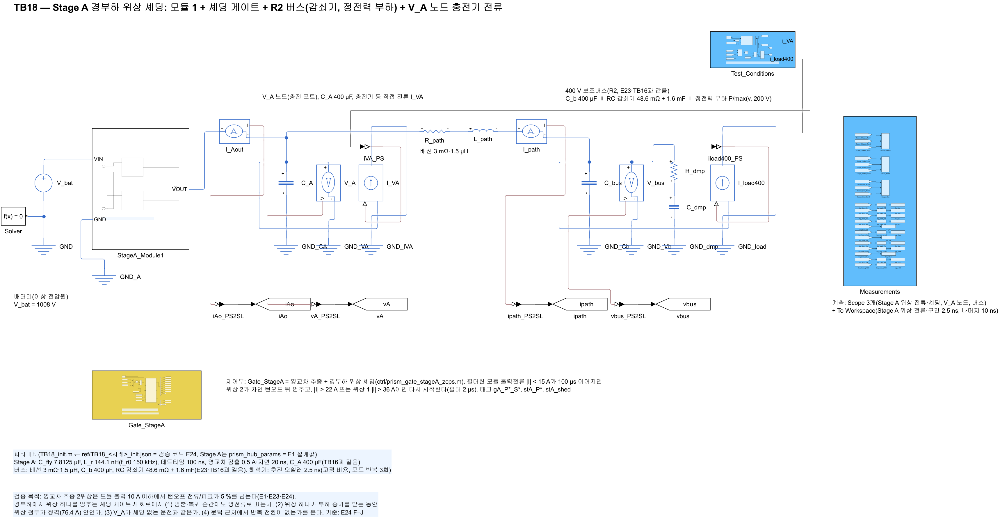
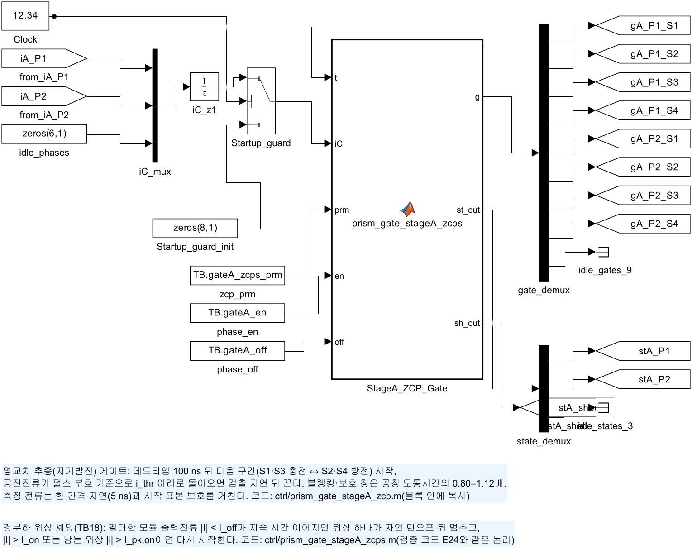
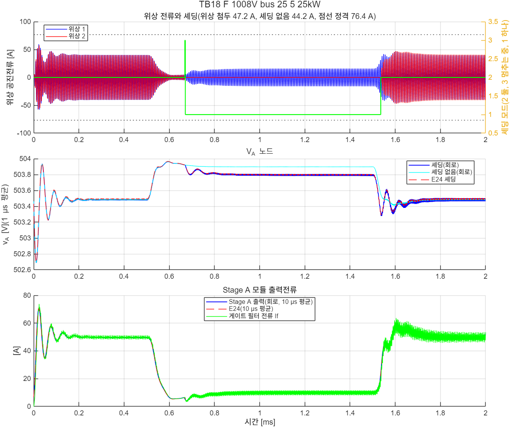
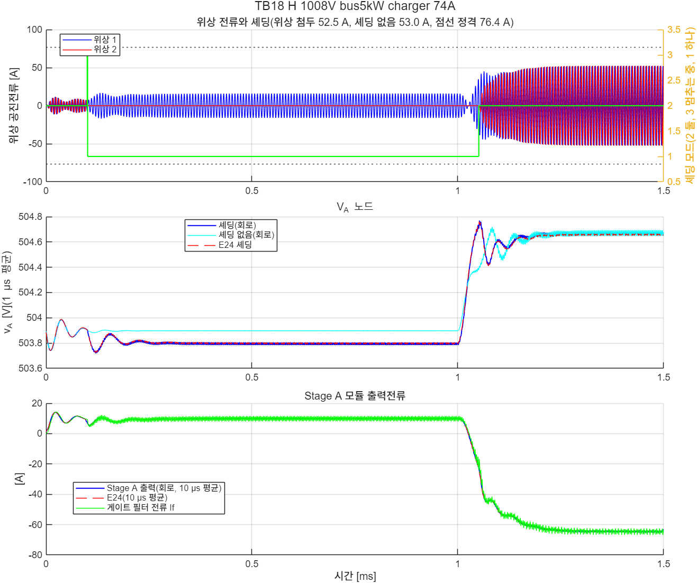

# TB18 — Stage A 경부하 위상 셰딩: 모듈 1 + 셰딩 게이트 + R2 버스 + V_A 노드 충전기 전류

**결론(2026-10-26): 통과 5/5.**

- **멈춤·복귀 순간에도 영전류로 껐다.**
  - 0.3 ms 이후 턴오프 3,547번 가운데 기준을 넘은 것은 0번이었다. 기준은 |i\_off| ≤ max(5 % × 반주기 첨두, 1 A)다.
  - 턴오프 전류의 최대는 0.77 A였다.
- **위상 하나가 부하 증가를 받는 동안에도 위상 첨두가 정격 안이었다.** 최대 52.5 A였고 정격 첨두는 76.4 A다. 셰딩 없는 같은 회로보다 많아야 5.1 A 컸다(J 16.3 대 11.2 A, F 47.2 대 44.2 A).
- **V\_A는 셰딩 없는 운전과 0.13 V 안이었다.** 위상 하나로 운전하는 동안에는 출력저항이 커져 V\_A가 약 0.1 V 낮다.
- **반복 전환이 없었다.** 사례마다 멈춤 1번, 복귀 1번(J는 복귀 0번)이었고 멈추기 취소는 없었다. 문턱을 천천히 지나는 램프(I)도 같았다.
- **회로가 검증 코드 E24와 같았다.**
  - 셰딩·복귀 시각: −2.3–+0.2 µs
  - 위상 첨두: 0.23 A 안
  - V\_A 최저·최고: 0.005 V 안

## 왜 필요한가

R2 통합 회로(TB17, docs/28)에서 영교차 추종 2위상은 모듈 출력 10 A 이하에서 턴오프 전류/피크가 5 %를 넘었다(E1). 강등 뒤 1008 V에서 Stage C만 남으면 출력이 약 10 A다. 경부하에서 위상 하나를 멈추면 같은 전류에서 첨두가 약 두 배라 비율이 절반 아래로 내려가고, 위상당 고정 손실도 준다(E24 design).

셰딩은 네 가지를 새로 만든다. 그래서 회로로 확인해야 한다.

- **멈추는 순간.** 도통 중에 끊으면 경전류 스위칭이 된다.
- **위상 하나의 부하 계단.** 복귀 전까지 위상 하나가 늘어난 부하를 받는다.
- **멈춰 있던 위상의 재시작.** 플라잉 커패시터 전압이 그대로인 채 다시 시작한다.
- **문턱 근처 반복 전환.** 전류가 문턱 근처에 머물면 멈춤·복귀가 되풀이될 수 있다.

## 셰딩 논리(ctrl/prism_gate_stageA_zcps.m, 검증 코드 E24와 같음)

| 항목 | 값 |
|---|---|
| 측정 | 모듈 출력전류 i\_o = Σ(충전 구간 +i, 방전 구간 −i), 1차 필터 τ = 2 µs |
| 멈춤 | \|I\| < I\_off = 15 A가 100 µs 이어지면 위상 2가 지금 구간을 자연 턴오프로 끝낸 뒤 멈춤(도통 중 구간을 자르지 않음) |
| 복귀 | \|I\| > I\_on = 22 A 또는 위상 1 순시 \|i\| > I\_pk,on = 36 A이면 바로 다시 시작(멈추기 전 구간의 다음 구간부터) |
| 근거(E24 design) | 2위상은 12 A 이상에서 ZCS ≤ 5 %(15 A 3.8 %). 위상 하나는 손실이 40 A 아래에서 작다. 위상 하나의 정상 첨두는 20 A 이하에서 32.6 A 이하라 I\_pk,on 36 A가 잘못 복귀시키지 않는다 |

게이트 대조(`ref/check_gate_parity.m`, MATLAB·Octave 공용): 사례 F에서 E24 모델이 게이트에 넣은 전류를 그대로 넣었다. 102,000 간격 동안 위상별 구간과 셰딩 모드가 파이썬 논리와 한 번도 다르지 않았다(`ref/check_gate_parity.txt`).

## 회로

| 블록 | 내용 |
|---|---|
| `V_bat` | 배터리(이상 전압원) 1008·540 V |
| `StageA_Module1` | 공진 스위치드 커패시터 2:1, 2위상(TB06·TB16과 같음) |
| `Gate_StageA` | 영교차 추종 + 경부하 위상 셰딩(`lib/build_stageA_gate_zcp`의 선택 인자 shed, 모드 태그 `stA_shed`) |
| V\_A 노드 | C\_A 400 µF, 직접 전류원 I\_VA(충전기 주입 등, 시험 조건) |
| 버스 | 배선 3 mΩ·1.5 µH → C\_b 400 µF ∥ RC 감쇠기 48.6 mΩ + 1.6 mF ∥ 정전력 부하 P/max(v, 200 V)(E23·TB16과 같음) |
| `Test_Conditions` | P(t)·I\_VA(t) 구간 선형 6점(`ctrl/prism_tb18_profile.m`) |

해석기는 후진 오일러 2.5 ns(고정 비용, 모드 반복 3회)다. 사례마다 셰딩 켬과 셰딩 없음(I\_off = −1)을 같은 회로로 두 번 계산한다. 한 번에 17–27초가 걸렸다.

| 그림 | 내용 |
| --- | --- |
|  | 최상위 회로 |
|  | 셰딩 게이트 |

## 사례와 판정 기준(시험 전에 고정, E24 F–J와 같음)

| 사례 | 조건 |
|---|---|
| F | 1008 V, 버스 정전력 부하 25 → 5 → 25 kW(0.5·1.5 ms 계단): 약 50 → 10 → 50 A, 셰딩 → 복귀 |
| G | 540 V, 13.5 → 2.7 → 13.5 kW(같은 전류) |
| H | 1008 V, 버스 5 kW(약 10 A, 위상 하나), 1 ms에 V\_A 충전기 0 → 74.4 A 주입(모듈당 충전 램프 요구 0.94 A/µs) |
| I | 1008 V, 버스 20 → 1.5 → 20 kW 램프(각 1 ms): 문턱을 천천히 지남 |
| J | 1008 V, 버스 5 kW, 0.5 ms에 충전기 16 A 주입(모듈 출력 약 −6 A, 역방향 경부하), 1.5 ms에 되돌림 |

| 항목 | 기준(0.3 ms 이후) |
|---|---|
| (T1) 턴오프 | 모든 턴오프: \|i\_off\| ≤ max(5 % × 그 반주기 첨두, 1.0 A) |
| (T2) 위상 첨두 | ≤ 76.4 A(위상 정격 첨두 = E1 충전 정격점 788 V·46.875 A/위상에서 위상 하나의 첨두) |
| (T3) V\_A | 최저·최고가 같은 회로의 셰딩 없는 실행과 0.5 V 안 |
| (T4) 반복 전환 | 멈춤·복귀 횟수가 예상과 같고 멈추기 취소(3 → 2)가 없음 |

기준값은 `ref/make_ref_TB18.py`(검증 코드 E24 `case_metrics`)다.

## 결과

| 사례 | 판정 | 턴오프(위반) | 최대 \|i\_off\| | 위상 첨두 셰딩 / 없음 | V\_A 셰딩 / 없음 [V] | 멈춤 / 복귀 [ms] | 끝 ZCS |
|---|---|---|---|---|---|---|---|
| F | 통과 | 740(0) | 0.42 A | 47.2 / 44.2 A | 503.28–503.96 / 503.41–503.96 | 0.671 / 1.536 | 0.61·0.70 % |
| G | 통과 | 740(0) | 0.42 A | 47.5 / 44.5 A | 269.28–269.96 / 269.40–269.96 | 0.671 / 1.536 | 0.57·0.71 % |
| H | 통과 | 479(0) | 0.77 A | 52.5 / 53.0 A | 503.79–504.77 / 503.90–504.72 | 0.100 / 1.050 | 0.92·0.97 % |
| I | 통과 | 1,089(0) | 0.40 A | 32.8 / 32.8 A | 503.57–503.94 / 503.57–503.97 | 1.117 / 1.785 | 0.31·0.40 % |
| J | 통과 | 499(0) | 0.71 A | 16.3 / 11.2 A | 503.64–504.28 / 503.71–504.24 | 0.100 / – | 1.30 %(위상 하나) |

| E24 대조 | F | G | H | I | J |
|---|---|---|---|---|---|
| 멈춤 시각 차 | −1.0 µs | −1.0 µs | −0.2 µs | −2.3 µs | −0.2 µs |
| 복귀 시각 차 | −0.2 µs | −0.3 µs | +0.2 µs | +0.3 µs | – |
| 위상 첨두 차 | +0.05 A | −0.15 A | −0.06 A | −0.20 A | −0.23 A |
| V\_A 최저·최고 차 | ≤ 0.005 V | ≤ 0.005 V | ≤ 0.004 V | ≤ 0.004 V | ≤ 0.004 V |

- **회로와 E24가 거의 같다.** E24는 데드타임 전류 소멸 처리를 켠 모델이다(`model_stage_a.sim_array(dead_fix=True)`). 이전 모델(E1–E23)은 RK4가 데드타임의 부호 의존 다이오드 기울기를 평균해, 데드타임 전류가 0으로 가지 않고 남았다. 멈춘 위상에서는 그 전류가 진동했다. 이 회로가 그 처리를 확인한다.
- **위상 하나로 운전하는 동안 V\_A가 약 0.1 V 낮다**(F 503.80 대 503.90 V). 위상 하나의 출력저항은 두 위상의 약 두 배다. 10 A에서 0.1 V 차다.
- **H(충전기 주입)는 위상 하나 상태에서 시작해 복귀했다.** 위상 첨두는 셰딩 없는 회로와 같은 수준이었다(52.5 대 53.0 A). 버스 정전력 부하는 감쇠기 뒤에 있어 Stage A 전류가 천천히 바뀐다. 충전기 램프는 요구(모듈당 0.94 A/µs) 안이다.
- **E24 사례 E는 회로로 다시 보지 않았다.** E는 V\_A 노드에 75 A를 17 µs에 건 경우다(모듈당 요구의 4배). E24에서 셰딩 없이도 위상 첨두가 82.5 A로 정격을 넘었고, 셰딩이 있으면 93.6 A였다.





## 재현

```matlab
prism_run('build_TB18')      % TB18_StageA_Shedding.slx 생성, 회로도 그림
prism_run('run_TB18')        % 사례 1–5, 셰딩 켬·없음(2.5 ns, 약 4분)
prism_run('diag_TB18')       % 사례 F만
```

기준값은 `python ref/make_ref_TB18.py`, 게이트 대조는 `ref/check_gate_parity.m`(MATLAB·Octave)이다.

## 한계

- **Stage A는 모듈 1개(위상 2개)다.** 8위상(모듈 4개)의 모듈 셰딩과 위상 셰딩의 조합은 다루지 않았다.
- **충전기·부하는 이상 전류원·정전력 등가다.** 실제 충전기의 전류 제어 응답은 넣지 않았다.
- **문턱은 공칭 부품값에서 정했다.** 부품 공차(공진주파수 차)에서 위상 하나의 ZCS는 E1 공차 표본과 같은 방식으로 다시 확인해야 한다.
- **멈춘 위상의 플라잉 커패시터는 누설 없이 전압을 유지한다**(스위치 꺼짐 전도 1e-8 S). 실제 누설이 크면 재시작 첫 펄스가 커질 수 있다.
