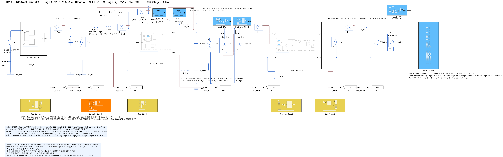
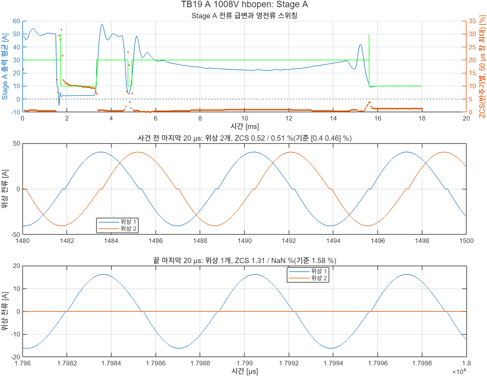
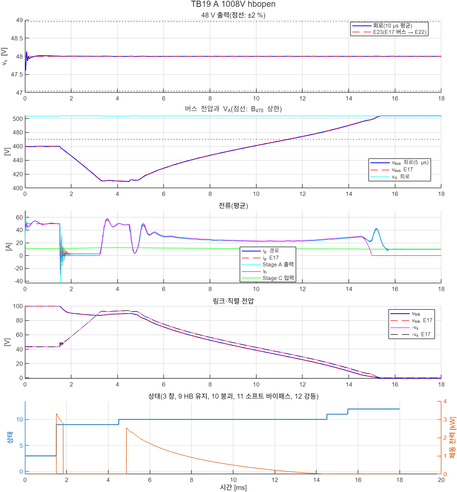
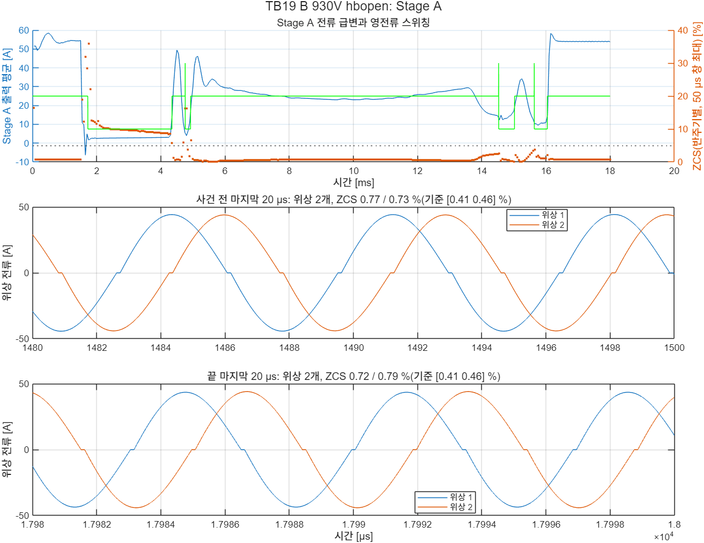
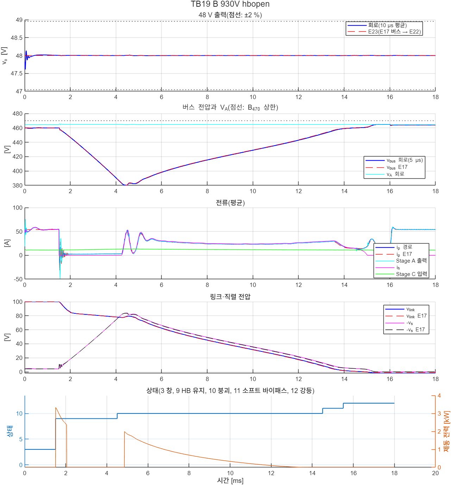

# TB19 — R2-W460 통합 강등 + Stage A 경부하 위상 셰딩

**결론(2026-10-26): 통과 2/2.**

- **강등 뒤 1008 V 경부하에서 Stage A가 위상 하나로 운전했다.**
  - 끝 0.2 ms(10.0 A)의 턴오프 전류/피크는 1.31 %였다. 셰딩 없는 TB17은 같은 점에서 4.44 %였다.
  - 기준(E24 모델, 위상 하나)은 1.58 %, V\_A 503.798 V다. 회로 V\_A는 503.792 V였다.
- **셰딩은 실제 전류 변화를 따라 세 번 멈추고 두 번 되살렸다.** 멈추기 취소는 없었다.
  - 클램프 유지 시작(1.72 ms) 때 멈췄다. 버스가 클램프 전압에 닿아 경로전류가 돌아오자(3.33 ms) 되살렸다.
  - 400 V 부하 분리 뒤(4.75 ms) 멈췄다. 링크 붕괴로 버스가 V\_A 쪽으로 오르며 충전 전류가 흐르자(4.93 ms) 되살렸다.
  - 강등 뒤 Stage C만 남자(15.62 ms) 멈췄다.
- **1 ms 이후 턴오프 8,708번 가운데 기준을 넘은 것은 0번이었다(최대 0.72 A).** 위상 첨두는 47.4 A였다(정격 76.4 A).
- **클램프 유지 중(약 2.7 A) 반주기별 턴오프 비율이 23.8 %에서 10.0 %로 내려갔다.** TB17은 두 위상, TB19는 위상 하나로 운전했다(1.9–3.2 ms 평균).
- **강등·48 V·Stage C 결과는 TB17과 같았다.**
  - 48 V: 47.997–48.008 V
  - DAB 링크 쪽 첨두: 66.4 A
  - 상태 전이: E17과 0.01 ms 안
  - Stage C ZVS: 8,500번, 켜짐 직전 V\_ds ≤ 0.11 V
- **930 V 사례(B)도 통과했다.** 강등 뒤 400 V 부하가 돌아와(16.01 ms) 두 위상으로 끝났다(54.0 A, 0.72·0.79 %).
  - 셰딩은 네 번 멈추고 네 번 되살렸다. 취소는 없었다.
  - 1 ms 이후 턴오프 8,853번 가운데 위반 0번(최대 0.70 A), 위상 첨두 48.6 A였다.
  - 링크 붕괴 뒤 출력이 15 A 근처로 천천히 내려간 구간이 있었다(14.4–15.0 ms, 11.7–17.4 A). 여기서 한 번 멈춘 뒤 22 A를 넘을 때까지 위상 하나로 남았다. 히스테리시스가 반복 전환을 막았다.

## 왜 필요한가

TB17(docs/28)에서 R2-W460 H-브리지 개방 강등 뒤 1008 V 사례의 Stage A 끝 턴오프 전류/피크는 4.44 %였다. 기준 5 %에 가깝고, E1은 5.40–5.47 %로 기준을 넘었다. 경부하 위상 셰딩(E24·TB18, docs/29)이 이 점의 여유를 되찾는지 같은 회로로 확인해야 한다.

셰딩 게이트는 TB18에서 R2 버스·정전력 부하·충전기 전류로 확인했다. 강등 중의 Stage A 전류는 그보다 극단적이다.

- **역방향과 급변.** 고장 순간 Stage A 출력이 50 A에서 −43 A까지 흔들리고(10 µs 평균), 클램프 유지 중 약 3 A로 떨어진다.
- **여러 번의 부하 변화.** 클램프 유지 → 버스가 클램프 전압에 닿음 → 400 V 부하 분리 → 링크 붕괴 → 소프트 바이패스 → 강등. 셰딩이 사건마다 멈춤·복귀를 맞게 하는지, 그 사이에 취소·반복 전환이 없는지를 본다.
- **셰딩이 강등에 영향을 주지 않는지.** 위상 하나로 운전하면 Stage A 출력저항이 커진다. 상태기계의 판정(버스·경로전류)이 바뀌지 않아야 한다.

## 회로

TB17 회로와 같다. Stage A 게이트만 셰딩 게이트(`lib/build_stageA_gate_zcp`의 선택 인자 shed, `ctrl/prism_gate_stageA_zcps.m`)로 바꿨다. 문턱은 E24·TB18과 같다.

| 항목 | 값 |
|---|---|
| 멈춤 | 모듈 출력 \|I\|(필터 τ 2 µs) < 15 A가 100 µs. 위상 2가 지금 구간을 자연 턴오프로 끝낸 뒤 멈춤 |
| 복귀 | \|I\| > 22 A 또는 위상 1 순시 \|i\| > 36 A이면 바로 |
| 모드 태그 | `stA_shed`(모드, 필터 전류) |

해석기는 후진 오일러 2.5 ns(고정 비용)다. 사례당 약 15분(18 ms)이 걸렸다.

| 그림 | 내용 |
| --- | --- |
|  | 최상위 회로 |
|  | Stage A 모듈 1(TB16·TB17과 같음) |

## 사례와 판정 기준(시험 전에 고정)

사례는 TB17과 같다(1008·930 V H-브리지 개방, 고장 1.5 ms, 400 V 부하 20 kW + Stage C 4.9 kW).

| 항목 | 기준 |
|---|---|
| TB17과 같은 항목 | 보호·강등(TB13과 같음), 48 V ±2 %(강등 내내), Stage C 전류·ZVS·끝 직류변압기 이득 |
| Stage A 사건 전(1.3–1.5 ms, 두 위상) | 위상별 턴오프 전류/피크 ≤ 5 %, V\_A − 기준 ≤ 0.3 V, 위상 전류 차 ≤ 5 % |
| Stage A 끝 0.2 ms | 기준 위상 수(A 위상 하나, B 두 위상)로 운전, 턴오프 전류/피크 ≤ 5 %, V\_A − 기준 ≤ 0.3 V, (두 위상이면) 위상 전류 차 ≤ 5 % |
| (T1) 턴오프 | 1 ms 이후 모든 턴오프: \|i\_off\| ≤ max(5 % × 그 반주기 첨두, 1.0 A) |
| (T2) 위상 첨두 | ≤ 76.4 A |
| (T4) 셰딩 | 멈추기 취소(모드 3 → 2) 없음, 끝 셰딩 모드가 기준 위상 수와 같음 |

기준값은 `ref/make_ref_TB19.py`다. 보호·강등·48 V 기준은 TB17과 같다. Stage A 기준은 데드타임 소멸 처리를 켠 E24 모델(`ref/TB19_<사례>_stageA_df.json`)이다.

- A(1008 V): 사건 전 49.8 A 두 위상, 턴오프/피크 0.40·0.46 %, V\_A 503.491 V. 끝 9.9 A 위상 하나, 1.58 %, V\_A 503.798 V.
- B(930 V): 끝에도 400 V 부하가 돌아와 53.9 A 두 위상, V\_A 464.450 V.

T4는 멈춤·복귀 횟수를 정하지 않았다. 강등 중의 전류 변화가 몇 번 문턱을 지날지는 시험 전에 정하지 않았기 때문이다. 대신 결과의 멈춤·복귀 시각을 Stage A 전류와 대조했다.

## 결과

| 항목 | A 1008 V | B 930 V |
|---|---|---|
| 판정 | **통과** | **통과** |
| 48 V(10 µs 평균, 1.3 ms부터) 회로(E23) | 47.997–48.008(47.992–48.006) V | 47.996–48.012(47.992–48.012) V |
| 버스(5 µs 평균) | 409.4–503.9 V | 380.2–464.9 V |
| DAB 링크 쪽 첨두(상태 9–11) | 66.4 A | 64.4 A |
| 상태 전이(E17 대비) | −0.01–0 ms | −0.01–0 ms |
| Stage C ZVS(1차) / 끝 DCX 이득 | 0.11 V(8,500번) / 0.977 | 0.11 V(8,500번) / 0.977 |
| Stage A 사건 전: 턴오프/피크(기준), V\_A(기준), 위상 차 | 0.52·0.51 %(0.40·0.46 %), 503.481(503.491) V, 0.28 % | 0.77·0.73 %(0.41·0.46 %), 464.434(464.450) V, 0.48 % |
| Stage A 끝: 위상 수, 전류, 턴오프/피크(기준), V\_A(기준) | 위상 하나, 10.0 A, 1.31 %(1.58 %), 503.792(503.798) V | 두 위상, 54.0 A, 0.72·0.79 %(0.41·0.46 %), 464.438(464.450) V |
| (T1) 1 ms 이후 턴오프(위반), 최대 \|i\_off\| | 8,708(0), 0.72 A | 8,853(0), 0.70 A |
| (T2) 위상 첨두 | 47.4 A | 48.6 A |
| (T4) 멈춤·복귀 [ms], 취소 | 1.723↓ 3.334↑ 4.753↓ 4.934↑ 15.615↓, 0 | 1.725↓ 4.347↑ 4.759↓ 4.927↑ 14.527↓ 15.021↑ 15.637↓ 16.044↑, 0 |
| TB17(셰딩 없음) 끝 턴오프/피크 | 4.44 %(두 위상) | 0.73 % |

(↓ 위상 하나가 된 시각, ↑ 두 위상으로 돌아간 시각)

사례 A의 셰딩 전환과 Stage A 출력전류(10 µs 평균):

| 시각 | 사건(상태기계) | Stage A 출력 | 셰딩 |
|---|---|---|---|
| 1.5 ms | H-브리지 개방 → 클램프 유지 | 50 → −43–+29 A → 약 3 A | 1.723 ms 위상 하나 |
| 3.3 ms | 버스가 클램프 전압(약 410 V)에 닿아 경로전류 복귀 | 3 → 48 A | 3.334 ms 두 위상(\|I\| > 22 A) |
| 4.5 ms | 400 V 부하 분리, 링크 붕괴 시작 | 48 → 2 A | 4.753 ms 위상 하나 |
| 4.9 ms | 링크 붕괴로 버스가 412 → 495 V로 오르며 충전 전류 | 2 → 50 → 22–43 A | 4.934 ms 두 위상 |
| 14.5–15.5 ms | 소프트 바이패스 → 강등 | 29 → 42 → 10 A | 15.615 ms 위상 하나 |

- **멈춤·복귀가 모두 실제 전류 변화를 따랐다.** 가장 짧은 위상 하나 구간은 4.753–4.934 ms(0.18 ms)였다. 이때 출력전류는 2 A에서 50 A로 올랐다. 문턱 근처의 반복 전환은 없었다.
- **5.2–14.5 ms에는 출력이 21.9–43.2 A라 두 위상으로 남았다.** 멈춤 문턱 15 A보다 크다. 최저점(10.4 ms 21.9 A)은 히스테리시스 폭(15–22 A) 안이라 두 위상을 유지했다.
- **셰딩이 강등에 영향을 주지 않았다.** 상태 전이, 버스, DAB 첨두, 소프트 투입 에너지(0.051 J), 제동 에너지(8.14 J)가 TB17과 같았다.



위 그림의 초록 선은 셰딩 모드 × 10이다(오른쪽 축: 20 두 위상, 30 멈추는 중, 10 위상 하나). 주황 점은 50 µs 창의 반주기별 턴오프 비율 최대다.



사례 B는 A와 같은 순서에 세 가지가 다르다.

- **경로전류 복귀가 늦다(4.35 ms).** 930 V의 클램프 전압은 약 380 V로 A(약 410 V)보다 낮다. 그래서 버스가 460 V에서 그 전압까지 내려가는 데 더 오래 걸린다.
- **링크 붕괴 뒤 출력이 더 작다.** 출력이 5.2 ms 39.8 A에서 14.4 ms 14.8 A로 천천히 내려갔다. 15 A 아래에 100 µs 머문 14.527 ms에 멈췄다. 소프트 바이패스로 출력이 22 A를 넘은 15.021 ms에 되살렸다. 그 사이 출력은 11.7–17.4 A로 멈춤 문턱 근처였지만 다시 바뀌지 않았다.
- **강등(15.51 ms) 뒤 Stage C만 남은 0.5 ms 동안 위상 하나로 운전했다.** 400 V 부하가 돌아오자(16.01 ms) 출력이 58 A로 올랐고, 34 µs 뒤 두 위상으로 돌아갔다. 위상 첨두는 48.6 A였다.





| 항목 | A | B |
|---|---|---|
| 클램프 유지 중 반주기별 턴오프 비율 평균(최대), TB19 | 10.0(11.2) % | 9.7(12.4) % |
| 같은 구간 TB17(셰딩 없음) | 23.8(24.6) % | 23.9(24.6) % |
| 같은 구간 턴오프 전류 최대 TB19 / TB17 | 0.43 / 0.61 A | 0.44 / 0.61 A |

(클램프 유지 구간: A 1.9–3.2 ms, B 1.9–4.2 ms, 50 µs 창)

## 재현

```matlab
prism_run('build_TB19')      % TB19_R2_Integrated_Shed.slx 생성, 회로도 그림
prism_run('run_TB19')        % 사례 1–2 판정(2.5 ns, 사례당 약 15분)
prism_run('diag_TB19')       % 사례 A만
prism_run('smoke_TB19')      % 사례 A를 1.6 ms까지만(모델·판정 코드 점검, results/smoke)
```

기준값은 `python ref/make_ref_TB19.py`다. TB17 기준값(`../TB17_R2_Integrated/ref`)을 복사하고 Stage A 기준을 E24 모델로 계산한다.

## 한계

- **TB17의 한계가 그대로 있다.** Stage A 모듈 1개, 이상 배터리, 48 V 쪽 배터리 없음, 400 V 부하 분리 3 ms, H-브리지 개방 고장만.
- **멈춤·복귀 횟수는 시험 전에 정하지 않았다.** 대신 결과의 전환 시각을 Stage A 전류와 대조했다.
- **분리 시간이 E17 기본 20 ms라면 클램프 유지가 길어진다.** 그동안 Stage A는 위상 하나로 약 3 A에서 운전한다(반주기별 비율 약 10 %, 턴오프 전류 ≤ 0.43 A). 멈춘 위상의 플라잉 커패시터 누설은 넣지 않았다.
