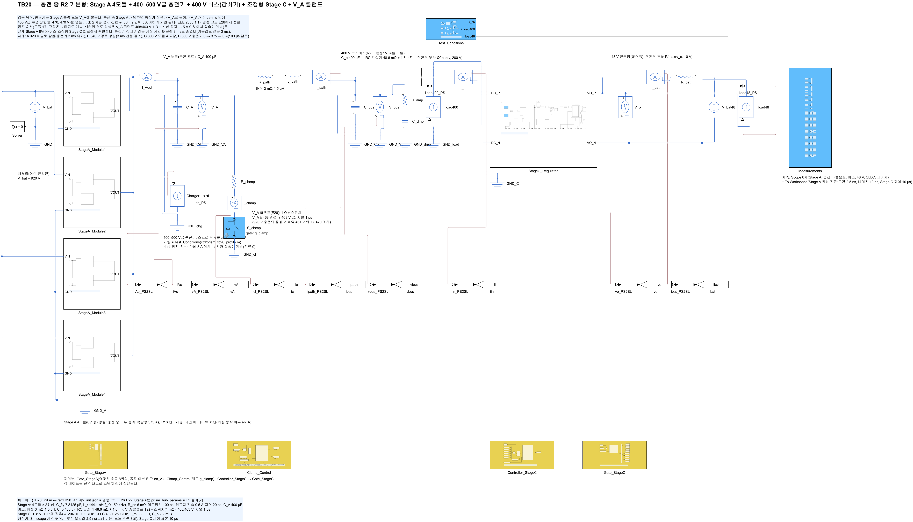
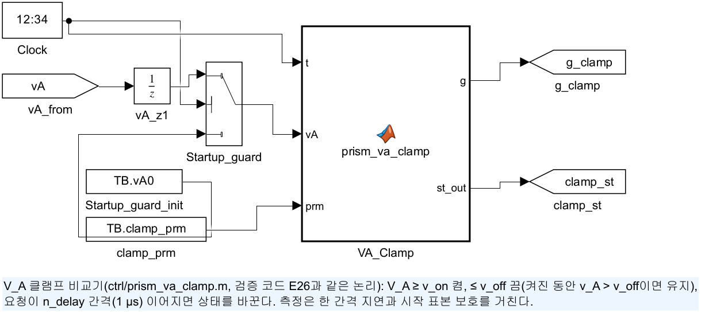
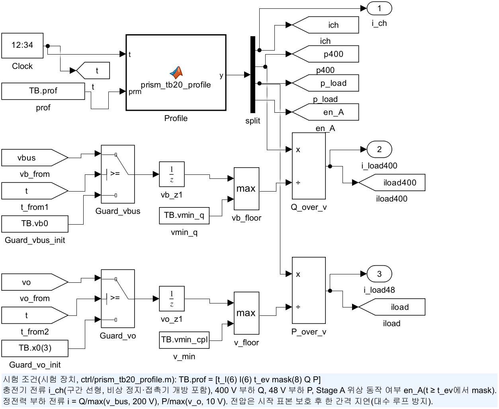
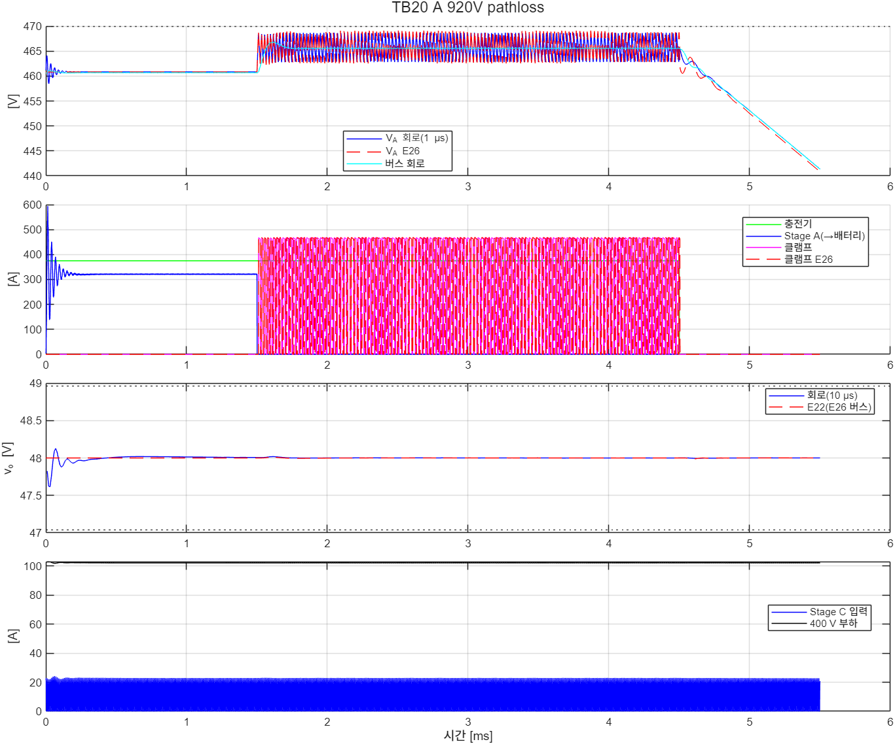
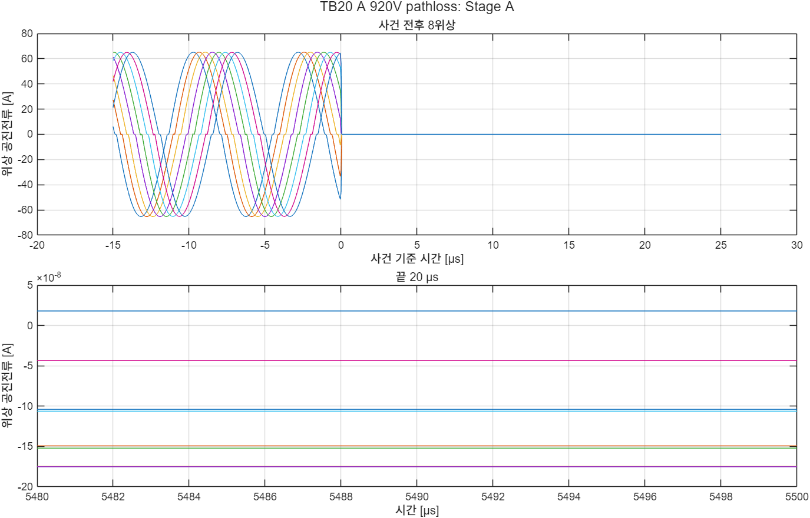
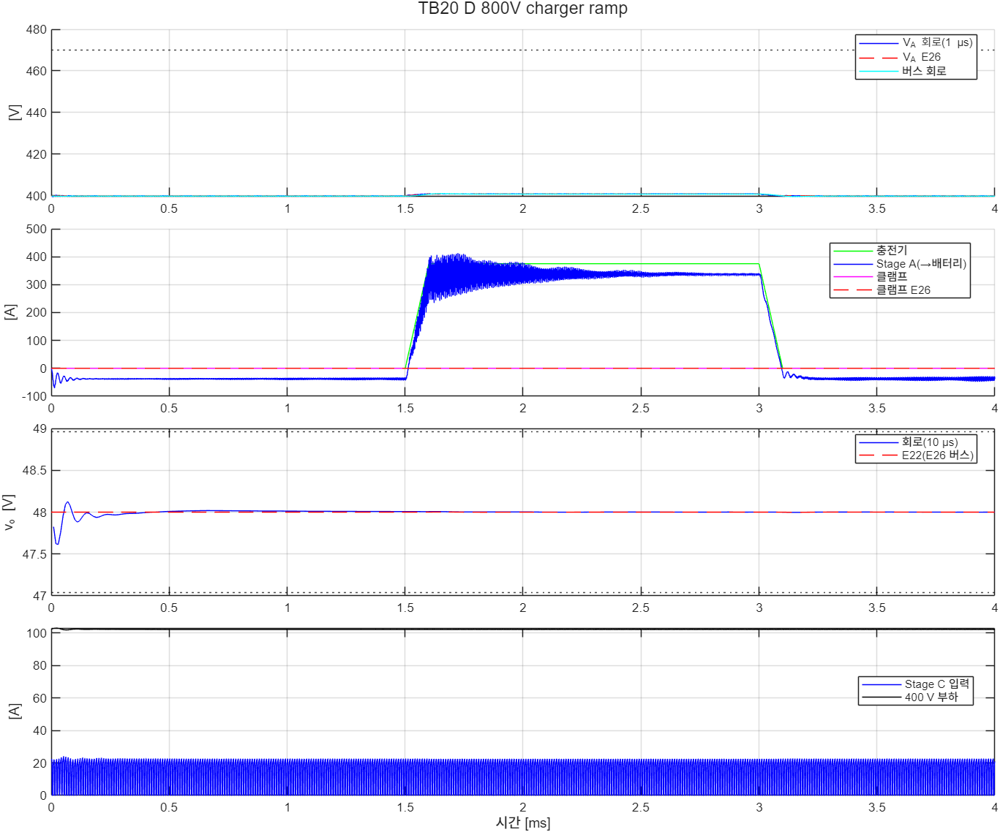

# TB20 — 충전 중 R2 기본형: Stage A 4모듈 + 충전기 + 400 V 버스 + 조정형 Stage C + V_A 클램프

**결론(2026-10-26): 3/4 통과, 사례 D 불통과(턴오프 1번이 기준을 0.01 A 넘음).**

- **배터리 경로 상실(A·B): 클램프가 V\_A를 470 V 아래로 붙잡았다.**
  - 회로 V\_A 최고(1 µs 평균)는 468.69·468.17 V였다. E26 모델은 469.13·468.40 V였다. 순시 최고는 468.81·468.28 V다.
  - 클램프 흡수 에너지 회로 443.2·21.5 J, 모델 444.0·22.9 J. 동작 시간 회로 2.046·0.100 ms, 모델 2.047·0.106 ms. 회로와 모델이 1–6 % 안에서 같았다.
  - 48 V는 47.988–48.065 V로 ±2 % 안이었다. Stage C ZVS도 유지되었다(켜짐 직전 V\_ds ≤ 0.11 V).
  - 차단 50 µs 뒤 Stage A 위상 전류는 모두 0이었다.
- **모듈 1개 고장(C): 나머지 3개 모듈로 충전을 이어 갔다.**
  - 남은 6위상의 첨두는 85.6 A(모델 85.1 A), 턴오프 전류/피크는 ≤ 1.34 %, 위상 전류 차는 0.14 %였다.
  - 고장 순간의 과도 첨두는 98.0 A로 기준 114.6 A 안이었다. V\_A는 +1.1 V 움직였다.
- **충전기 램프(D): 사례 D는 불통과다.**
  - 충전기 0 → 375 A(3.75 A/µs, 요구 상한) → 0 A 동안 V\_A·48 V·위상 첨두(71.9 A)는 기준 안이었다.
  - 턴오프 7,027번 가운데 1번이 기준을 넘었다. 1.5126 ms, 위상 1, \|i\_off\| 1.010 A였고 기준은 1.0 A다.
  - 그 반주기는 모듈 전류의 방향이 주행 쪽(경부하)에서 충전 쪽으로 바뀌는 순간이었다. 첨두가 2.44 A로 영교차 검출기의 무장 문턱(2.5 A = 5 × 0.5 A)보다 작았다. 그래서 영교차를 검출하지 못하고 최대 도통시간(공칭의 1.12배)에서 꺼졌다. 이때 전류는 이미 반대 방향 1.01 A였다.
  - 크기는 검출 문턱 수준이라 소자에는 문제가 없다. 그러나 판정 기준은 바꾸지 않고 불통과로 둔다. 방향 반전 중 무장 문턱 아래 반주기의 처리를 게이트의 남은 과제로 넘긴다.
- **사건 전 Stage A(8위상).** 턴오프 전류/피크는 1.09–1.15 %(모델 0.46 %), 위상 전류 차는 ≤ 0.49 %, V\_A − 모델은 ≤ 0.016 V였다.

## 왜 필요한가

R2에서 충전기는 Stage A 출력 노드 V\_A에 붙는다. 충전 중 Stage A가 멈추면(배터리 접촉기 개방, Stage A 고장) 충전기 전류가 V\_A 노드로 들어간다. 그러면 V\_A가 400 V급 부품 상한(470 V)을 수 µs–ms 안에 넘는다. 충전기는 정지 신호를 받은 뒤 30 ms 안에 5 A 이하가 되면 된다(IEEE Std 2030.1.1). 검증 코드 E26이 정지 순서와 V\_A 클램프(468/463 V, 1 Ω, 1 µs)를 정했다(docs/31).

평균모델로는 확인할 수 없는 것이 세 가지다. 그래서 회로로 확인한다.

- **클램프의 실제 동작.** 클램프는 수십 µs 주기로 켜고 끈다. 이때 V\_A 노드(C\_A), 배선 인덕턴스, 버스 커패시터·감쇠기, 8위상 Stage A가 함께 응답한다.
- **Stage A 8위상의 강제 차단.** 게이트를 끊으면 위상마다 공진전류가 남아 있다. 그 전류가 다이오드로 사라지는지, V\_A를 더 밀어 올리지 않는지 본다.
- **48 V 공급과 Stage C ZVS.** 버스가 463–469 V 사이를 오르내리는 동안에도 유지되는지 본다.

## 회로

| 블록 | 내용 |
|---|---|
| `V_bat` | 배터리(이상 전압원) 920·640·800 V |
| `StageA_Module1–4` | 공진 스위치드 커패시터 2:1, 4모듈 8위상(TB07과 같음), T/16 인터리빙 |
| `Gate_StageA` | 영교차 추종 8위상. 위상 동작 여부는 시험 조건 태그 `en_A`(사건 때 게이트 차단, `lib/build_stageA_gate_zcp`의 선택 인자 enTag) |
| `Charger` | 400–500 V급 충전기(제어 전류원, V\_A 노드에 주입) |
| `R_clamp`·`S_clamp`·`Clamp_Control` | V\_A 클램프 1 Ω + 스위치 셀, 비교기 `ctrl/prism_va_clamp.m`(468 V 켬, 463 V 끔, 지연 1 µs) |
| 버스 | 배선 3 mΩ·1.5 µH → C\_b 400 µF ∥ RC 감쇠기 48.6 mΩ + 1.6 mF ∥ 400 V 정전력 부하(TB16과 같음) |
| `StageC_Regulated` | 조정형 Stage C(TB15·TB16과 같음), 48 V 정전력 부하. 전류 PI 적분은 평형 시작(TB17과 같음) |
| `Test_Conditions` | `ctrl/prism_tb20_profile.m`: 충전기 전류(구간 선형 6점), 400 V·48 V 부하, Stage A 위상 동작 여부 |

해석기는 후진 오일러 2.5 ns(고정 비용, 모드 반복 3회)다. 사례당 2–4분이 걸렸다(1 ms당 약 40 s).

| 그림 | 내용 |
| --- | --- |
|  | 최상위 회로 |
|  | V\_A 클램프 비교기 |
|  | 시험 조건 |

## 사례와 판정 기준(시험 전에 고정)

| 사례 | 조건(사건 1.5 ms) |
|---|---|
| A\_920V\_pathloss | 920 V, 충전 375 A, 400 V 부하 20 kW + Stage C 입력 5 kW. 8위상 게이트 차단(배터리 경로 상실). 충전기 3 ms 동안 375 A 유지 뒤 0 |
| B\_640V\_pathloss\_ramp | 640 V, 같은 부하·사건. 충전기 3 ms 선형 감소 뒤 0 |
| C\_800V\_module\_fault | 800 V, 같은 부하. 모듈 4(위상 7·8) 게이트 차단. 충전 375 A 유지 |
| D\_800V\_charger\_ramp | 800 V, 400 V 10 kW + Stage C 5 kW. 충전기 0 → 375 A(1.5–1.6 ms) → 0 A(3.0–3.1 ms, 계획 정지) |

충전기 정지 시간은 규격 30 ms 대신 3 ms다(계산 시간). 기준값(E26)도 같은 3 ms로 계산했다. 흡수 에너지는 시간에 비례하므로 30 ms 값은 E26에서 얻는다.

| 기준 | 내용 |
|---|---|
| (C1) | V\_A·버스 1 µs 평균 ≤ 470 V(1 ms 이후). 순시 최고는 정보 |
| (C1r) | E26 대조: V\_A·버스 1 µs 최고 ±1.5 V, 클램프 흡수 에너지 ±10 %(또는 ±10 J) |
| (C3) | 48 V 10 µs 평균 ±2 %, E22(E26 버스 궤적) 대조 최저·최고 ±0.5 V, Stage C 전류(100 µs 평균 ≤ 136.5 A, 2차 소자 ≤ 329 A), ZVS(≤ 5 % 레일) |
| (C4) | 사건 전(0.2 ms – 2 µs 전): 8위상 턴오프 전류/피크 ≤ 5 %(A·B·C), 위상 전류 차 ≤ 5 %, V\_A − 기준 ≤ 0.3 V |
| (C5) | 1 ms 이후 모든 턴오프(사건 순간 강제 차단 제외): \|i\_off\| ≤ max(5 % × 반주기 첨두, 1 A)(E24·TB18·TB19와 같음) |
| (C2) | 모듈 고장(C): 0.5 ms 뒤부터 남은 6위상 첨두 ≤ 114.6 A(1.5 × 76.4 A), 턴오프 전류/피크 ≤ 5 %, 위상 전류 차 ≤ 5 % |
| (C6) | 충전기 램프(D): 위상 첨두 ≤ 114.6 A(전 구간), 충전 중(2.7–2.9 ms) 턴오프 전류/피크 ≤ 5 %·위상 전류 차 ≤ 5 % |

기준값은 `ref/make_ref_TB20.py`다. 검증 코드 E26(run\_event), E22(run\_avg, E26 버스 궤적), Stage A 스위칭 ODE(dead\_fix, 모듈 하나)를 쓴다.

## 결과

| 항목 | A 920 V 경로 상실 | B 640 V 경로 상실(감소) | C 800 V 모듈 고장 | D 800 V 충전기 램프 |
|---|---|---|---|---|
| 판정 | **통과** | **통과** | **통과** | **불통과(C5)** |
| V\_A 1 µs 최고 회로(E26) | 468.69(469.13) V | 468.17(468.40) V | 401.88(401.06) V | 401.11(400.86) V |
| 버스 1 µs 최고 회로(E26) | 466.88(466.83) V | 468.02(467.99) V | 401.03(400.94) V | 401.04(400.93) V |
| V\_A 순시 최고 | 468.81 V | 468.28 V | 401.91 V | 401.13 V |
| 클램프 흡수 회로(E26) | 443.2(444.0) J | 21.5(22.9) J | 0 | 0 |
| 클램프 동작 시간 회로(E26), 켬 횟수 | 2.046(2.047) ms, 124번 | 0.100(0.106) ms, 16번 | — | — |
| 48 V(10 µs) 회로(E22) | 47.994–48.018(47.989–48.012) V | 47.988–48.065(47.987–48.061) V | 48.000–48.014(48.000–48.001) V | 47.997–48.013(47.998–48.002) V |
| Stage C ZVS(1차) | 0.11 V | 0.11 V | 0.11 V | 0.11 V |
| 사건 전 턴오프/피크(모델), 위상 차 | 1.15(0.46) %, 0.49 % | 1.09(0.46) %, 0.37 % | 1.13(0.46) %, 0.32 % | 경부하 5.02(5.51) %, 1.48 % |
| 사건 전 위상 첨두(모델), V\_A − 모델 | 65.2(65.5) A, +0.016 V | 60.3(60.6) A, +0.015 V | 63.5(63.8) A, +0.016 V | 7.7(7.5) A, −0.002 V |
| 턴오프(위반), 최대 \|i\_off\| | 1,158(0), 0.75 A | 1,159(0), 0.66 A | 4,633(0), 1.42 A | 7,027(**1**), 1.01 A |
| 위상 첨두(1 ms 이후) | 65.2 A | 60.3 A | 98.0 A | 71.9 A |
| 사건 뒤 | 강제 차단 전류 9.8–64.8 A, 50 µs 뒤 0 A | 강제 차단 5.7–59.6 A, 50 µs 뒤 0 A | 6위상 첨두 85.6(85.1) A, 턴오프/피크 ≤ 1.34 %, 위상 차 0.14 % | 충전 중 첨두 68.8(68.9) A, ≤ 1.20 %, 위상 차 0.25 % |





- **클램프는 V\_A를 463–469 V 사이에서 붙잡았다.** 회로의 클램프 동작은 모델과 시간·에너지가 1–6 % 안에서 같았다. 그래서 30 ms 규격 조건의 흡수 에너지(최대 7.0 kJ)는 E26 값을 그대로 쓸 수 있다.
- **강제 차단 전류는 최대 64.8 A였다.** 고장 차단(게이트 즉시 차단)은 영전류가 아니다. 남은 공진전류는 바디 다이오드로 V\_A·배터리 쪽으로 흘러 수 µs 안에 사라졌다. 이 순간에도 V\_A는 클램프 문턱 위로 1 V 이상 오르지 않았다.
- **회로의 턴오프 전류/피크(1.1 %)는 모델(0.46 %)보다 크다.** 모델은 모듈 하나(2위상)만 계산했고 회로는 8위상 병렬이다. 차이의 원인은 따로 확인하지 않았다. 기준 5 % 안이다.
- **사례 D의 불통과 원인은 영교차 검출기의 무장 문턱이다.** 방향이 바뀌는 반주기의 첨두(2.44 A)가 무장 문턱 2.5 A보다 작으면 검출하지 못하고 최대 도통시간에 꺼진다. E24(사례 D·J, 역방향 경부하)에서는 문턱을 넘지 않았다(최대 0.64 A). 개선 후보는 두 가지다. 무장하지 못한 반주기를 공칭 도통시간에 끄거나, 무장 문턱을 직전 반주기 첨두에 비례시키는 것이다. 이 TB에서는 적용하지 않았다.



## 재현

```matlab
prism_run('build_TB20')      % TB20_R2_Charging_Stop.slx 생성, 회로도 그림
prism_run('run_TB20')        % 사례 1–4(2.5 ns, 약 13분)
prism_run('diag_TB20')       % 사례 A만
prism_run('diag4_TB20')      % 사례 D만(턴오프 위반 시각·위상 출력)
prism_run('smoke_TB20')      % 사례 A를 1.56 ms까지만(results/smoke)
```

기준값은 `python ref/make_ref_TB20.py`다. 검증 코드 E22 `design zvs both dcx`를 먼저 실행해야 한다.

## 한계

- **충전기는 이상 전류원이다.** 충전기 출력 커패시터, 전압 제한 루프, 케이블은 넣지 않았다.
- **충전기 정지 시간 3 ms는 규격 30 ms의 1/10이다.** 클램프 동작과 회로 상호작용을 보는 것이 목적이다.
- **클램프 스위치는 이상 스위치(1 mΩ)이고 배선 인덕턴스가 없다.** 실제 클램프 루프의 차단 과전압은 하드웨어 설계에서 정한다.
- **48 V 쪽에 배터리가 없다.** 경로 상실 뒤 버스는 부하가 커패시터를 비우며 내려간다(A: 4.5 ms 뒤). 실제로는 400 V 부하 분리와 48 V 배터리가 이어받는다.
- **Stage A는 공칭 부품값이다.**
