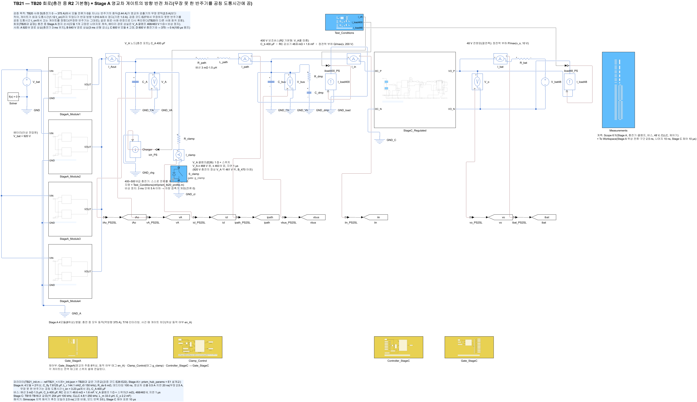
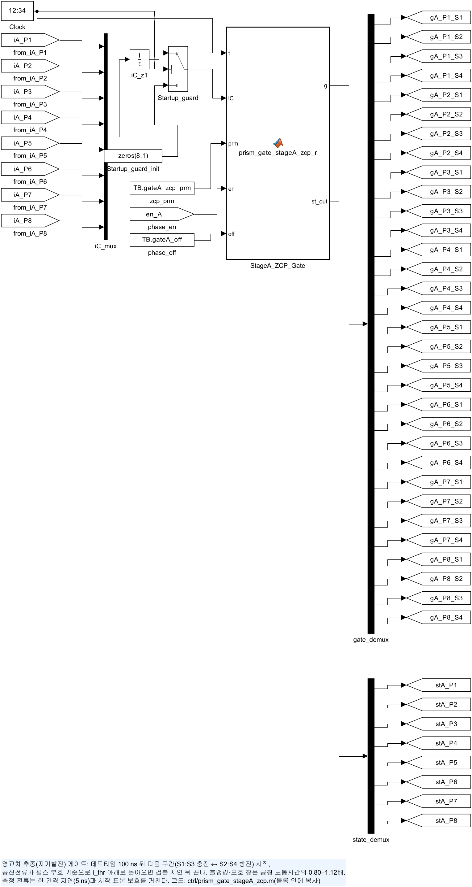
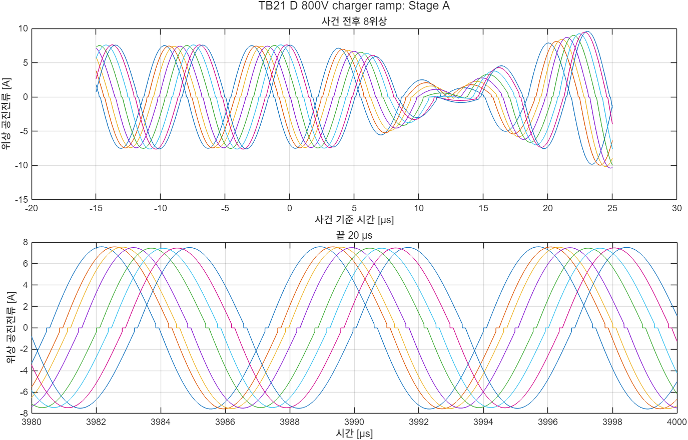

# TB21 — TB20 회로 + Stage A 영교차 게이트의 방향 반전 처리

**결론(2026-10-27): 4/4 통과.** TB20에서 불통과였던 사례 D가 통과했고, 나머지 세 사례는 TB20과 같은 값이었다.

- **사례 D(충전기 0 → 375 → 0 A): 턴오프 위반 1 → 0.**
  - 1 ms 이후 턴오프 7,026번 가운데 기준을 넘은 것은 없었다. 최대 \|i\_off\|는 0.83 A였다(TB20 1.010 A, 기준 1.0 A).
  - 위상 첨두는 69.0 A(TB20 71.9 A), V\_A 1 µs 최고는 401.03 V(TB20 401.11 V, E26 400.86 V)였다.
  - 48 V는 47.997–48.012 V, Stage C ZVS는 켜짐 직전 0.11 V로 TB20과 같았다.
- **사례 A·B·C: TB20과 같은 값.** 판정 지표(V\_A, 클램프 에너지, 48 V, 턴오프 수·최대, 사건 전 Stage A)가 TB20과 자릿수까지 같았다. 이 사례들의 1 ms 이후 반주기는 모두 무장했기 때문이다.
- **게이트 변경.** 무장하지 못한 반주기(도통 중 \|i\|가 5 × 0.5 A = 2.5 A를 넘지 않음)는 최대 도통시간(1.12·t\_on) 대신 공칭 도통시간 t\_on(3.23 µs)에서 끈다. 무장한 반주기는 그대로다. 검증 코드 E27에서 정했다(docs/32).

## 왜 필요한가

TB20 사례 D에서 모듈 전류가 주행 방향 경부하(모듈당 약 9 A)에서 충전 방향으로 바뀌는 순간, 한 반주기의 첨두가 2.44 A로 무장 문턱(2.5 A)보다 작았다. 이 반주기는 영교차를 검출하지 못하고 최대 도통시간까지 켜져 있다가 반대 방향 1.010 A에서 꺼졌다(기준 1.0 A). 모듈 전류가 0을 지나는 순간은 충전 시작·종료마다 생기므로 게이트에서 처리해야 한다.

검증 모델(E27)에서 같은 기구를 재현하고 게이트를 고쳤다. 이 TB는 같은 회로·사례·판정으로 그 변경을 회로에서 확인하고, TB20의 다른 사례가 바뀌지 않는지 본다.

## 회로

TB20과 같다(Stage A 4모듈 8위상 + 400–500 V급 충전기 + V\_A 클램프 + 400 V 버스·감쇠기 + 조정형 Stage C). 다른 것은 `Gate_StageA` 하나다.

| 블록 | TB20 | TB21 |
|---|---|---|
| `Gate_StageA` | `ctrl/prism_gate_stageA_zcp.m`, 파라미터 6개 | `ctrl/prism_gate_stageA_zcp_r.m`, 파라미터 7개(7번째 n\_nom = t\_on/dt = 1,293간격) |

`lib/build_stageA_gate_zcp`에 선택 인자 `gateFile`을 더해 게이트 함수 파일을 고른다(주지 않으면 이전과 같다).

| 그림 | 내용 |
| --- | --- |
|  | 최상위 회로 |
|  | Stage A 게이트(방향 반전 처리판) |

## 사례와 판정 기준(시험 전에 고정, TB20과 같음)

〔정정 2026-10-29〕 이 기준은 결과와 같은 커밋(15a8644)으로 올렸다. 실행 전에 정했다고 적었으나, 그 순서를 저장소 기록으로는 확인할 수 없다(docs/45 B2).

| 사례 | 조건(사건 1.5 ms) |
|---|---|
| A\_920V\_pathloss | 920 V, 충전 375 A, 400 V 부하 20 kW + Stage C 5 kW. 8위상 게이트 차단(배터리 경로 상실), 충전기 3 ms 유지 뒤 0 |
| B\_640V\_pathloss\_ramp | 640 V, 같은 사건. 충전기 3 ms 선형 감소 |
| C\_800V\_module\_fault | 800 V, 모듈 4(위상 7·8) 차단, 충전 375 A 유지 |
| D\_800V\_charger\_ramp | 800 V, 400 V 10 kW + Stage C 5 kW. 충전기 0 → 375 A(1.5–1.6 ms) → 0 A(3.0–3.1 ms) |

판정 기준은 TB20의 (C1)·(C1r)·(C3)·(C4)·(C5)·(C2)·(C6)과 같다. (C5)는 1 ms 이후 모든 턴오프(사건 순간의 강제 차단 제외) \|i\_off\| ≤ max(5 % × 반주기 첨두, 1 A)다. 기준값은 TB20과 같다(`ref/`는 TB20의 기준값을 이름만 바꿔 복사했다. 원본 `make_ref_TB20.py`). 게이트 변경이 기준값을 바꾸지 않는 이유는 그 운전점의 반주기가 모두 무장하기 때문이다(E27 regress).

## 결과

| 항목 | A 920 V 경로 상실 | B 640 V 경로 상실(감소) | C 800 V 모듈 고장 | D 800 V 충전기 램프 |
|---|---|---|---|---|
| 판정(TB20) | **통과**(통과) | **통과**(통과) | **통과**(통과) | **통과**(불통과) |
| 턴오프(위반), 최대 \|i\_off\| | 1,158(0), 0.75 A | 1,159(0), 0.66 A | 4,633(0), 1.42 A | 7,026(**0**), **0.83 A** |
| TB20 | 같음 | 같음 | 같음 | 7,027(1), 1.01 A |
| V\_A 1 µs 최고(E26) | 468.69(469.13) V | 468.17(468.40) V | 401.88(401.06) V | 401.03(400.86) V |
| 클램프 흡수(E26) | 443.2(444.0) J | 21.5(22.9) J | 0 | 0 |
| 48 V(10 µs) | 47.994–48.018 V | 47.988–48.065 V | 48.000–48.014 V | 47.997–48.012 V |
| 위상 첨두(1 ms 이후) | 65.2 A | 60.3 A | 98.0 A | 69.0 A(TB20 71.9 A) |
| 사건 전 턴오프/피크 | 1.15 % | 1.09 % | 1.13 % | 경부하 4.96 %(TB20 5.02 %) |
| 사건 뒤 | TB20과 같음 | TB20과 같음 | 6위상 첨두 85.6 A | 충전 중 첨두 68.7(68.9) A, ≤ 1.19 %, 위상 차 0.41 % |




- **사례 D의 무장하지 못한 반주기가 공칭 도통시간에 꺼졌다.** 최대 턴오프 전류 0.83 A는 무장한 반주기의 값이다(E27 모델에서도 무장하지 못한 반주기는 ≤ 0.48 A, 전체 최대는 무장한 반주기의 0.63–0.82 A).
- **사례 D의 다른 지표가 조금 바뀌었다.** 턴오프 수 7,027 → 7,026, 위상 첨두 71.9 → 69.0 A, 사건 전 비율 5.02 → 4.96 %다. 시뮬레이션은 공진전류 0에서 시작하는데, 시작 첫 펄스(무장하지 못함)를 일찍 끄면서 그 뒤 궤적이 조금 달라졌다(E27 regress의 E1 표본과 같은 이유). 판정 구간(1 ms 이후)의 결과에는 기준 안의 차이만 있다.

## 재현

```matlab
prism_run('build_TB21')      % TB21_R2_Charging_Reversal.slx 생성, 회로도 그림
prism_run('run_TB21')        % 사례 1–4(2.5 ns, 약 16분)
prism_run('smoke_TB21')      % 사례 A를 1.56 ms까지만(results/smoke)
```

## 한계

- TB20과 같다(충전기 이상 전류원, 충전기 정지 3 ms, 클램프 이상 스위치, 48 V 배터리 없음, Stage A 공칭 부품값).
- 회로에서 확인한 방향 반전은 사례 D(충전 시작·종료 각 한 번)뿐이다. 램프 속도·배터리 전압·부품 공차를 넓힌 확인은 검증 모델(E27 stress 48사례)로 했다.
- 셰딩 게이트(`prism_gate_stageA_zcps.m`)의 같은 변경은 회로에서 확인하지 않았다. 모듈 셰딩과 위상 셰딩을 함께 다루는 다음 테스트벤치에서 확인한다.
