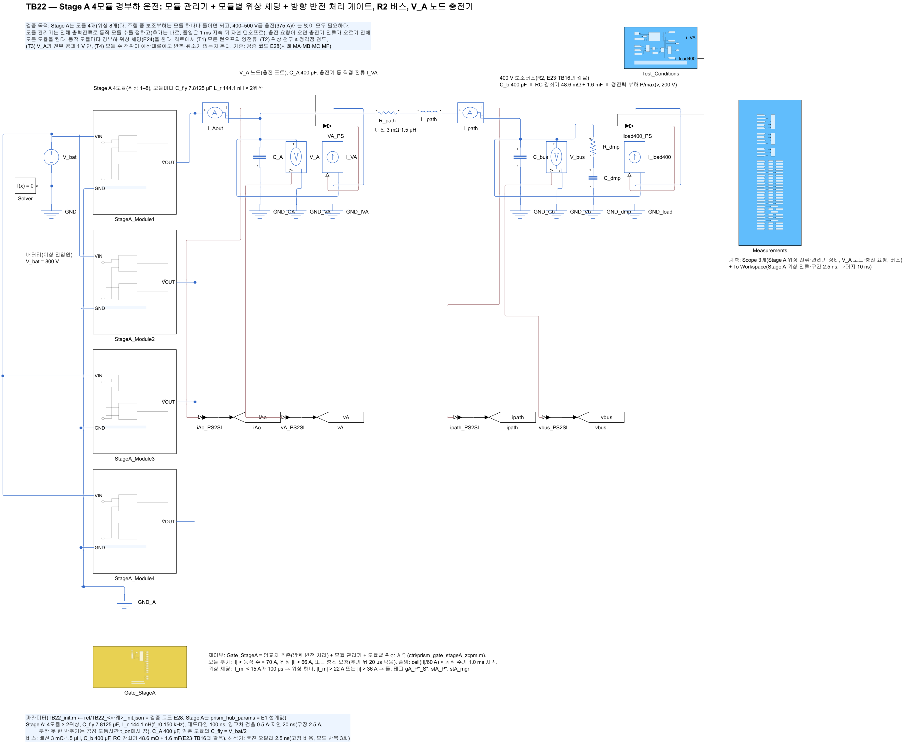
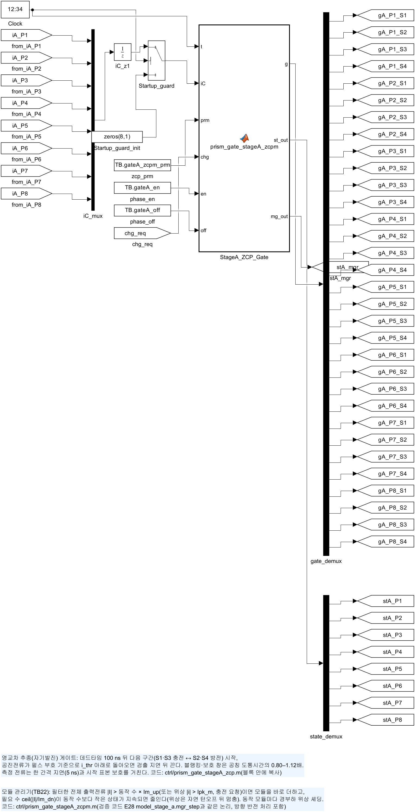
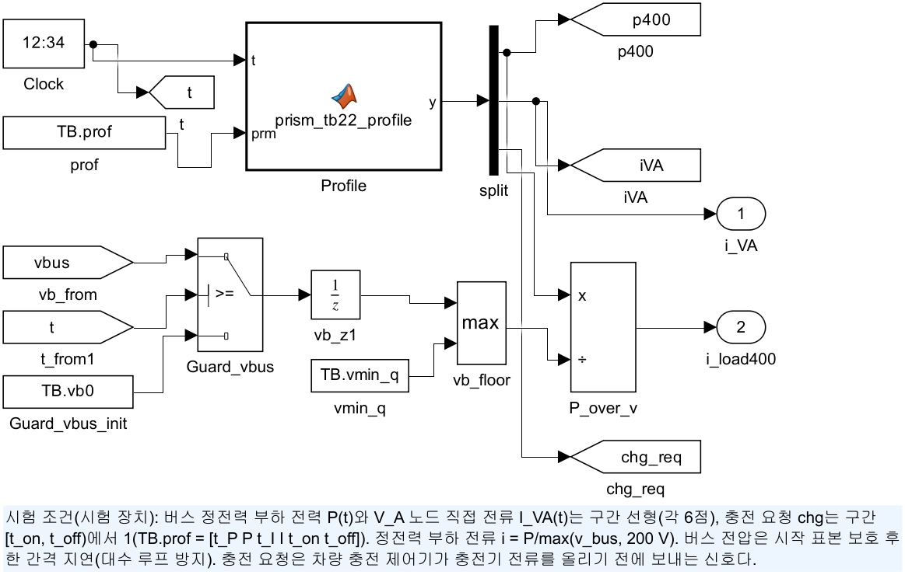
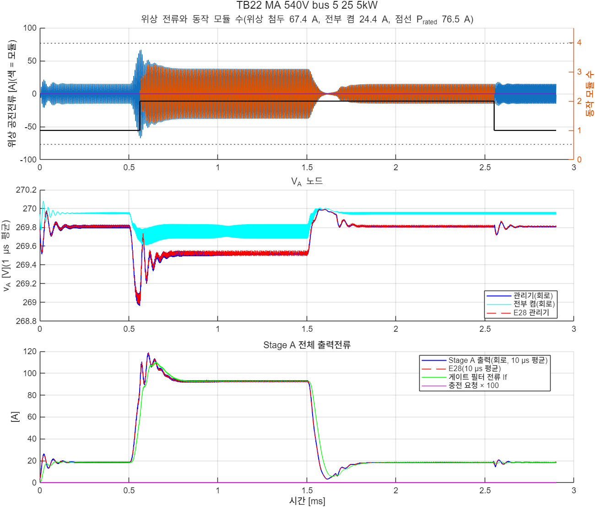

# TB22 — Stage A 4모듈 경부하 운전(모듈 관리기 + 모듈별 위상 셰딩 + 무장 전 부호 없는 영교차 검출)

**결론(2026-10-28): 사전 기동이 있는 세 사례(MA·MB·MC) 통과, 사전 기동이 없는 MF는 불통과(T1·T2). 모델(E28)과 같은 결과다.**

- **주행 부하 계단·램프(MA·MB): 모듈 1 → 2 → 1이 한 번씩.**
  - 턴오프 위반은 0, 최대 0.72 A였다.
  - 위상 첨두는 67.4·58.3 A였다. 모듈을 더하기 전 남은 모듈이 부하를 받는 값이다.
- **800 V 충전 시작·종료(MC): 충전 요청에 모듈 4개를 켜고, 종료 1 ms 뒤 1개로 줄였다.**
  - 턴오프 3,902번 가운데 위반 0, 최대 0.95 A였다.
  - 위상 첨두는 74.0 A였다(전부 켬 69.6 A, P\_rated 76.5 A).
- **사전 기동이 없는 충전(MF): 불통과.**
  - 관리기가 20 µs 간격으로 모듈을 넷까지 더했지만 위상 첨두가 83.2 A였다.
  - 턴오프 1.14 A가 한 번 있었다.
  - 충전 전 사전 기동을 요구사항으로 두는 근거다.
- **모델과 거의 같았다.** 모듈 수 전환 시각은 2 µs 안, 위상 첨두는 3.3 A 안, V\_A 최저·최고는 0.07 V 안이었다.

## 왜 필요한가

Stage A는 모듈 4개(위상 8개)다. 주행 중 보조부하(수–100 A)는 모듈 하나나 둘이면 되고, 400–500 V급 충전(375 A)에는 넷이 모두 필요하다. E24·TB18은 모듈 하나만 다뤘다. 검증 코드 E28에서 동작 모듈 수를 정하는 관리기를 설계했다(docs/34).

- 모듈은 바로 더한다. 조건은 셋 가운데 하나다. 전체 전류 > 동작 수 × 70 A, 위상 순시 전류 > 66 A, 충전 요청이다.
- 모듈 줄임은 1 ms 지속 뒤 자연 턴오프로 한다. 조건은 ⌈전체 전류/60 A⌉ < 동작 수다.
- 충전 요청이 오면 충전기 전류가 오르기 전에 모듈을 모두 켠다.
- 동작 모듈마다 E24의 위상 셰딩을 한다.

이 TB는 이 게이트를 회로에서 확인한다. 같은 게이트 함수를 Python 모델(E28)의 전류 기록에 넣으면 구간·모듈 상태가 간격마다 같다(`ref/check_gate_parity.txt`, 142,800간격).

## 회로

TB18(모듈 하나 + R2 버스)을 4모듈로 넓혔다. 충전기는 V\_A 노드의 제어 전류원이고, 버스 부하는 정전력 등가다(Stage C 없음).

| 블록 | 내용 |
|---|---|
| `StageA_Module1–4` | 2:1 공진 SC 모듈 4개(위상 1–8), C\_fly 7.8125 µF·L\_r 144.1 nH, 멈춘 모듈의 C\_fly = V\_bat/2 |
| `Gate_StageA` | `ctrl/prism_gate_stageA_zcpm.m`(파라미터 21개): 모듈 관리기 + 모듈별 위상 셰딩 + 영교차 추종(무장 전 부호 없는 검출) |
| `Test_Conditions` | `ctrl/prism_tb22_profile.m`: 버스 정전력 부하 P(t), V\_A 노드 전류 I\_VA(t), 충전 요청 chg(t) |
| 버스 | 배선 3 mΩ·1.5 µH, C\_b 400 µF ∥ RC 감쇠기 48.6 mΩ + 1.6 mF ∥ 정전력 부하(E23·TB16과 같음) |

| 그림 | 내용 |
| --- | --- |
|  | 최상위 회로 |
|  | Stage A 게이트(모듈 관리기) |
|  | 시험 조건(부하·충전기·충전 요청) |

## 사례와 판정 기준(시험 전에 고정, E28과 같음)

〔정정 2026-10-29〕 이 기준은 결과와 같은 커밋(7f7f75f)으로 올렸다. 실행 전에 정했다고 적었으나, 그 순서를 저장소 기록으로는 확인할 수 없다(docs/45 B2).

| 사례 | 조건 | 기대 |
|---|---|---|
| MA 540 V | 버스 5 → 25 → 5 kW(0.5·1.5 ms 계단) | 모듈 1 → 2 → 1 |
| MB 800 V | 버스 2 → 36 → 2 kW 램프(각 1 ms) | 모듈 1 → 2 → 1, 반복 전환 없음 |
| MC 800 V | 버스 15 kW, 0.4 ms 충전 요청 → 0.5 ms 충전기 0 → 375 A(100 µs) → 1.3 ms 0 A(100 µs), 1.45 ms 요청 끝 | 모듈 1 → 4 → 1 |
| MF 800 V | MC와 같으나 충전 요청 없음(사전 기동이 빠진 경우) | 모듈 1 → 2 → 3 → 4 → 1(추가 ≤ 3번) |

판정은 0.3 ms 이후에 한다.

- (T1) 모든 턴오프 \|i\_off\| ≤ max(5 % × 반주기 첨두, 1.0 A)
- (T2) 위상 첨두 ≤ P\_rated 76.5 A(공칭 정격 충전점 375 A·4모듈의 위상 첨두, E28 rated)
- (T3) V\_A 최저·최고가 같은 회로의 전부 켬 실행과 1.0 V 안이다. 전부 켬은 충전 요청을 계속 켜 모듈 4개로 두고, 위상 셰딩은 끈다.
- (T4) 끝 동작 모듈 수가 기대값이고, 추가·줄임 횟수가 상한 이하이며, 멈추던 모듈의 취소가 없다.

## 결과

| 항목 | MA 540 V | MB 800 V | MC 800 V | MF 800 V(사전 기동 없음) |
|---|---|---|---|---|
| 판정 | **통과** | **통과** | **통과** | **불통과**(T1·T2) |
| 턴오프(위반), 최대 \|i\_off\| | 2,169(0), 0.72 A | 2,701(0), 0.60 A | 3,902(0), 0.95 A | 3,592(1), 1.14 A |
| 위상 첨두(전부 켬) | 67.4(24.4) A | 58.3(18.7) A | 74.0(69.6) A | **83.2**(69.6) A |
| V\_A(전부 켬) [V] | 268.96–269.99(269.60–270.01) | 399.22–399.98(399.67–399.99) | 399.28–401.18(399.82–401.06) | 399.28–401.59(399.82–401.06) |
| 모듈 수 변화 [ms → 수] | 0.561 → 2, 2.552 → 1 | 1.109 → 2, 3.194 → 1 | 0.400 → 4, 2.450 → 1 | 0.540 → 2, 0.561 → 3, 0.581 → 4, 2.365 → 1 |
| E28 대비 | 시각 ±0.3 µs, 첨두 −0.6 A | 시각 ±1.9 µs, 첨두 −0.1 A | 시각 0, 첨두 +3.3 A | 시각 ±0.3 µs, 첨두 −1.0 A |




- **회로의 턴오프 전류는 모델보다 0.1–0.3 A 컸다.** 기준(1.0 A) 안이다. MF의 1.14 A는 모델에 없던 값이다. 사전 기동이 빠진 경우라 요구사항 판단은 같다.
- **중간 설계로 먼저 한 번 실행했다.** 모듈 수 판단 필터가 τ 2 µs였던 2차 설계다(docs/34 4절). 이때도 MA·MB·MC 통과, MF 불통과였다(`results` 대신 근거 파일 `validation/2026-10-28-stage-a-modules/TB22/TB22_summary_run1_intermediate.txt`). 최종 설계로 다시 빌드·실행했다.

## 재현

```matlab
prism_run('build_TB22')      % TB22_StageA_Modules.slx 생성, 회로도 그림
prism_run('run_TB22')        % 사례 1–4, 관리기 켬·전부 켬(2.5 ns, 약 20분)
prism_run('smoke_TB22')      % 사례 MC를 0.75 ms까지만(results/smoke)
```

기준값: `ref/make_ref_TB22.py <검증 코드 python 폴더>`(E28). 게이트 대조: `ref/check_gate_parity.m`(MATLAB·Octave).

## 한계

- 충전기는 이상 전류원, 버스 부하는 정전력 등가다. Stage C와 48 V는 넣지 않았다(TB16·TB20에서 확인).
- 부품값은 공칭이다. 공차 표본은 검증 모델(E28 transient 21사례)로 판정했다.
- 멈춘 모듈의 C\_fly는 누설 없이 V\_bat/2를 유지한다. 실제로는 균형 회로가 이 전압을 지켜야 한다. 허용 오차는 E28 restart에서 정했다.
- 모듈 고장(E26·TB20)과 관리기의 연동, 모듈 순환(마모 균등)은 다루지 않았다.
