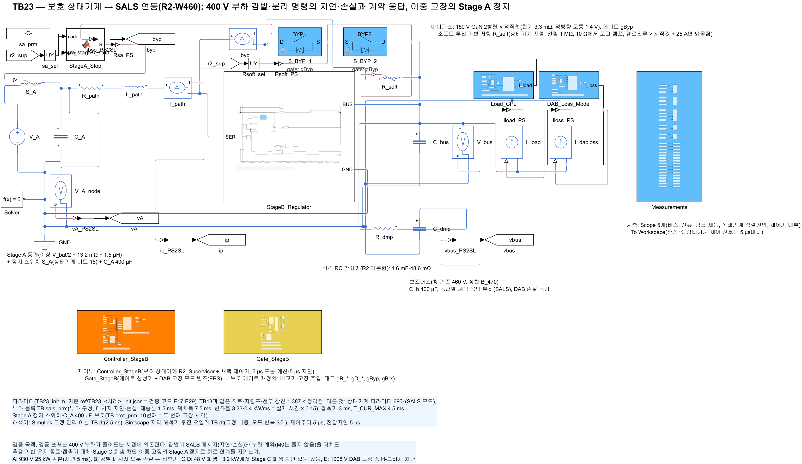
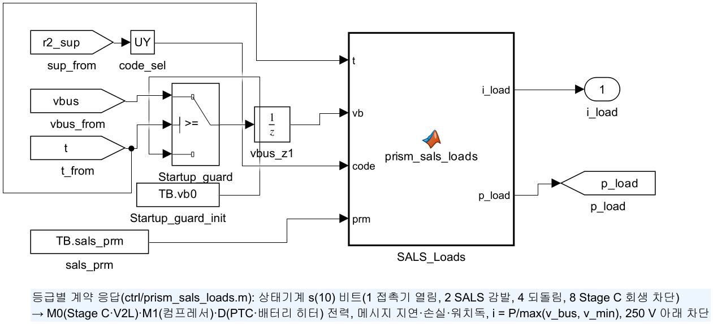
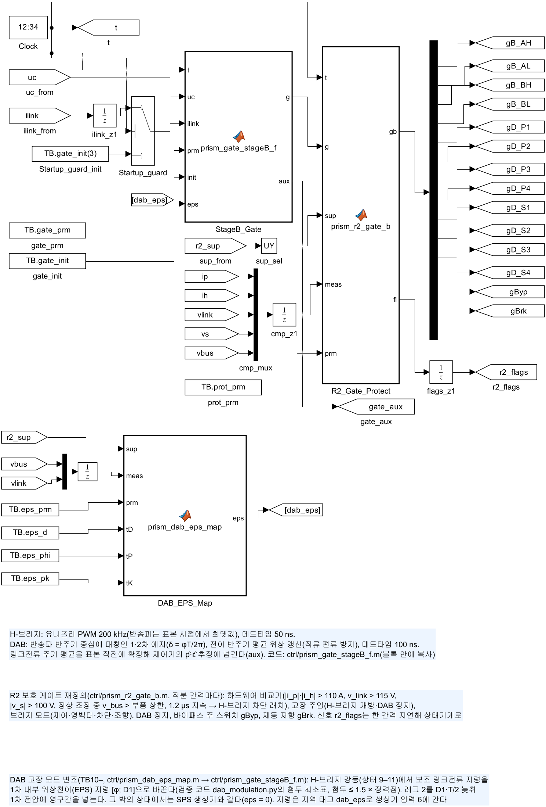
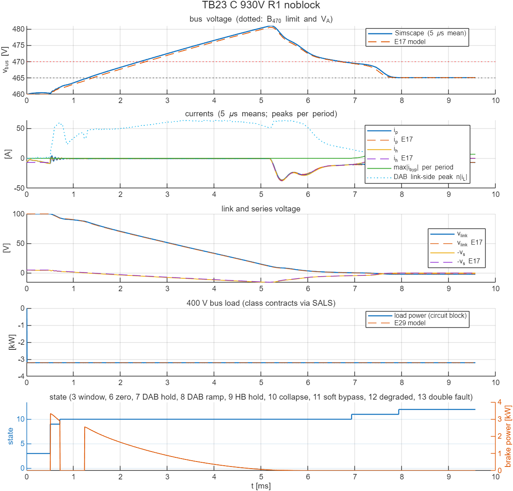

# TB23 — 보호 상태기계 ↔ SALS 연동(R2-W460): 400 V 부하 감발·분리 명령의 지연·손실과 계약 응답, 이중 고장의 Stage A 정지

**결론(2026-10-28): 판정이 모델(E29)과 다섯 사례 모두 같았다. 통과 4, 불통과 1이다. 불통과는 Stage C 회생 차단을 뺀 사례 C로, 모델과 같은 이유다.**

- **SALS 감발(A, 지연 5 ms를 0.75 ms로 축소): 통과.**
  - 부하가 계약 변화율로 줄었다. 부하전류 추정이 문턱(22.2 A) 아래로 내려가자 붕괴로 갔다. 이어 소프트 투입 → 강등 → SALS 되돌림 순서였다.
  - 상태 전이 시각은 모델과 0.005 ms 안에서 같았다. 소프트 투입 에너지는 0.476 J(모델 0.471 J)였다.
- **감발 메시지 모두 손실(B): 통과.** 시간 상한(4.5 ms)에서 접촉기로 넘어갔다. 분리 뒤 붕괴·강등까지 갔고, 전이 시각은 모델과 0.01 ms 안이다.
- **48 V 회생 −3.2 kW, Stage C 회생 차단 없음(C): 불통과.** 버스가 481.0 V(모델 480.6 V)로 부품 상한 470 V를 넘었다. 차단이 있으면(D) 467.5 V로 통과했다.
- **이중 고장(E): 통과.**
  - DAB 고장 검출 0.5 ms 뒤 H-브리지가 차단되었다. 이중 고장(13)으로 가자 Stage A를 멈추고, 접촉기 분리·SALS 감발·제동 저항 과전압 보호를 함께 썼다.
  - 링크 ≤ 110.0 V, 직렬 ≤ 98.2 V였다. 경로전류는 Stage A 정지 2.61 ms 뒤 1 A 아래가 되었다(모델 2.61 ms).
- **부하 블록 함수 대조.** 회로 블록(`ctrl/prism_sals_loads.m`)과 Python 모델(`sals_loads.py`)이 무작위 40개 시나리오, 32,040점에서 최대 6 × 10⁻⁸ W 안으로 같았다(`ref/check_sals_parity.txt`).

## 왜 필요한가

R2-W460의 H-브리지 고장 강등(TB09–TB13)은 400 V 부하가 명령 뒤 정해진 시간에 5 kW 계단으로 줄어든다고 두었다. 실제로는 두 경로가 있다. 감발은 SALS 메시지(지연·손실·워치독)를 거쳐 부하가 계약 변화율로 줄이고, M0(Stage C·V2L)는 줄지 않는다. 분리는 접촉기가 맡는다. 검증 코드 E29(docs/35)는 이 응답을 넣어 상태기계를 세 군데 바꿨다.

- 유지 종료를 부하전류 추정으로 정한다.
- 시간 상한이 지나면 접촉기로 넘어간다.
- Stage C 회생 차단과 이중 고장의 Stage A 정지를 더한다.

이 TB는 같은 논리를 소자 수준 회로에서 확인한다.

## 회로

TB13과 같은 R2-W460 전력 회로·EPS 지령 블록·스위칭 반영 첨두 표·설계 상한 1.387 × 정격점이다. 다른 것은 다음과 같다.

| 블록 | 내용 |
|---|---|
| `Load_CPL`(부하) | 등급별 계약 응답 `ctrl/prism_sals_loads.m`(파라미터 22개 `TB.sals_prm`). 상태기계 s(10)의 비트 명령에 응답한다: 1 접촉기 열림, 2 SALS 감발, 4 되돌림, 8 Stage C 회생 차단. M0·M1·D 전력, 메시지 지연·손실·재송신·워치독, i = P/max(v\_bus, 250 V), 250 V 아래 차단 |
| `R2_Supervisor` | `ctrl/prism_r2_supervisor.m` SALS 모드(파라미터 69개, 61–69: I\_COL, T\_CONF, T\_CUR\_MAX, 이중 고장 제동, Stage A 정지 지연, C\_tot, 추정 필터, 추정 시작값). 60개 이하면 이전과 같다 |
| `S_A`·`C_A`·`StageA_Stop` | Stage A 정지 스위치(가변 저항 0.1 mΩ / 1 MΩ, `ctrl/prism_stageA_stop.m`, 비트 16) + V\_A 노드 커패시터 400 µF |
| 보호 블록 | `ctrl/prism_r2_gate_b.m`에 10번째 파라미터(두 번째 고장 시각: 그때 비교기 차단 래치를 켬) |

| 그림 | 내용 |
| --- | --- |
|  | 최상위 회로(Stage A 정지 스위치·C\_A 포함) |
|  | 등급별 계약 응답 부하 |
|  | 상태기계 + 채택 제어기 |
|  | 게이트(EPS 지령 블록, 보호 재정의) |

**시간 축소 0.15.** 회로 계산 시간 때문에 SALS 시간을 줄였다. TB09–TB13의 분리 20 → 3 ms와 같은 비율이다. 기준값(E29)도 같은 축소로 계산했다.

- 메시지 지연 5 → 0.75 ms, 재송신 10 → 1.5 ms, 워치독 50 → 7.5 ms
- M1·D 감소 0.5 → 3.33 kW/ms, 증가 0.06 → 0.4 kW/ms
- T\_CUR\_MAX 30 → 4.5 ms, 접촉기 20 → 3 ms
- 전기 측정(확인 0.2 ms, 추정 필터 0.2 ms)과 Stage C 회생 차단(0.1 ms, 4 kW/ms)은 줄이지 않았다.

## 사례와 판정 기준(시험 전에 고정, E29와 같음)

| 사례 | 조건 |
|---|---|
| A | 930 V, 25 kW(Stage C 5.3 + V2L 3.8 + 컴프레서 6 + PTC 7 + 배터리 히터 2.9 kW), H-브리지 개방(0.5 ms), 메시지 지연 5 ms |
| B | A와 같고 감발 메시지 모두 손실 |
| C | 930 V, 고장 순간 순부하 −3.2 kW(Stage C 48 V 회생), H-브리지 개방, Stage C 회생 차단 없음 |
| D | C와 같고 회생 차단 있음 |
| E | 1008 V, 25 kW, DAB 고장(0.5 ms) → 검출 0.5 ms 뒤 H-브리지 차단(이중 고장) |

- **H-브리지 고장(A–D).** TB13의 회로 한계를 적용한다. 순시 경로·필터 ≤ 100 A, \|v\_s\| ≤ 120 V, 링크 ≤ 120 V, 바이패스 ≤ 329 A, 버스 ≥ 260 V, 강등 상태 도달, 400 V 부하 연결 중 버스 ≤ 470 V, 강등 상태 9–11의 DAB 링크 쪽 순시 첨두 ≤ 1.5 × 정격점(68.7 A)이다. 여기에 제동 저항 에너지 ≤ 64 J를 더한다.
- **이중 고장(E).** 순시 경로·필터 ≤ 100 A, \|v\_s\| ≤ 120 V, 링크 ≤ 120 V, 400 V 부하 연결 중 버스 ≤ 470 V, 제동 ≤ 64 J를 본다. 또 Stage A 정지 뒤 5 ms 안에 경로전류(5 µs 평균) \|i\_p\| ≤ 1 A가 되어 끝까지 유지되어야 한다.

## 결과

| 항목 | A | B | C | D | E |
|---|---|---|---|---|---|
| 판정 | **통과** | **통과** | **불통과**(부하 연결 중 버스) | **통과** | **통과** |
| E29 기준값의 판정 | 통과 | 통과 | 불통과 | 통과 | 통과 |
| 순시 경로 / 필터 [A] | 60.4 / 58.3 | 70.6 / 71.2 | 36.4 / 37.7 | 11.0 / 8.6 | 55.4 / 61.7 |
| 직렬 / 링크 최대 [V] | 70.8 / 100.1 | 91.3 / 100.1 | 16.0 / 100.0 | 4.8 / 100.0 | 98.2 / 110.0 |
| 버스(5 µs 평균) [V], 부하 연결 중 최대 | 394.0–464.7, 464.7 | 372.9–464.8, 460.1 | 460.0–481.0, **481.0** | 460.0–467.5, 467.5 | 393.1–460.1, 460.1 |
| 강등 중 DAB 링크 쪽 첨두 | 64.3 A | 64.4 A | 64.3 A | 64.3 A | —(DAB 고장) |
| 제동 저항 에너지(모델) | 7.53 J(7.46) | 9.22 J(9.15) | 4.31 J(4.60) | 4.32 J(4.60) | 1.98 J(1.96) |
| 소프트 투입 소자 에너지(모델) | 0.476 J(0.471) | 0.036 J(0.036) | 0.021 J(0.020) | 0.005 J(0.003) | — |
| 상태 전이 시각 차(모델 대비) | ≤ 0.005 ms | ≤ 0.01 ms | ≤ 0.065 ms | ≤ 0.01 ms | ≤ 0.01 ms |
| 비고 | 붕괴 3.69 ms, 강등 15.42 ms, 되돌림 15.92 ms | 접촉기 명령 5.0 ms, 분리 8.0 ms, 강등 19.01 ms | 회생 전류가 직렬 커패시터를 충전해 버스가 V\_A 위로 | 회생 차단으로 버스 ≤ 467.5 V | 이중 고장 1.78 ms, Stage A 정지 1.785 ms, \|i\_p\| ≤ 1 A까지 2.61 ms(모델 2.61 ms) |




- **회로와 모델이 잘 맞는다.** 주기 평균의 차는 버스 0.5 V, 경로·필터 전류 1.8 A, 링크 1.3 V 안이다. 부하 에너지(고장 뒤)는 A 177.4 J(모델 177.4 J), C −29.0 J(모델 −29.0 J)였다.
- **E의 Stage A 정지 뒤 V\_A 노드는 491 V였다.** 시간 축소로 접촉기가 3 ms에 열려 부하가 일찍 끊겼기 때문이다. 실제 시간(접촉기 20 ms)에서는 E29가 357–358 V를 보였다(docs/35 6.5절).

### 실행 경과(판정 기준은 그대로)

- **1차 실행에서 사례 C의 조건이 틀렸다.** 회로 부하 블록에는 Stage C 회생 차단의 켬·끔 인자가 없었다. 그래서 감발 비트를 받자 차단이 시작되어, C가 사실상 D와 같은 조건이 되었다(통과, 버스 467.5 V).
  - 기준값 생성기(`ref/make_ref_TB23.py`)에서 끔을 시작 지연 t\_sc = 10⁹ s로 나타내게 고쳤다.
  - 사례 C만 다시 계산했다(`run_TB23_C.m`). 1차 결과는 `results/run1_C/`에 남겼다.
- `results/TB23_summary.*`는 다섯 사례의 최종 판정을 모은 것이다. A·B·D·E는 1차 실행, C는 다시 계산한 결과다.

## 재현

```matlab
prism_run('build_TB23')        % TB23_R2_SALS_Link.slx 생성, 회로도 그림
prism_run('smoke_TB23')        % 사례 A를 1.5 ms까지만(약 1분, results/smoke)
prism_run('run_TB23')          % 사례 A–E(2.5 ns, 약 45분)
prism_run('run_TB23_C')        % 사례 C만 다시(약 7분)
prism_run('check_sals_parity') % 부하 블록 함수 ↔ Python 모델 대조
```

- 기준값: `ref/make_ref_TB23.py <검증 코드 python 폴더>`(E17·E29, 먼저 `E21_dab_switching_margin.py table`).
- 대조 자료: `ref/make_sals_parity.py <검증 코드 python 폴더>`.

## 한계

- 버스 부하는 등급별 정전력 등가다. 접촉기 아크와 부하 쪽 커패시터, Stage C 변환기 자체는 넣지 않았다(Stage C는 정전력 + 회생 차단 하한).
- SALS 시간은 0.15배로 줄였다. 전기 동특성(유지·붕괴·소프트 투입)은 줄이지 않았으므로, 감발이 실제보다 빨리 끝나 유지가 짧다.
- Stage A는 이상 전원 + 정지 스위치 + C\_A로 등가했다. 정지 중 플라잉 커패시터와 모듈 상태는 넣지 않았다.
- R2-W410은 평균모델(E29)만 있다.
