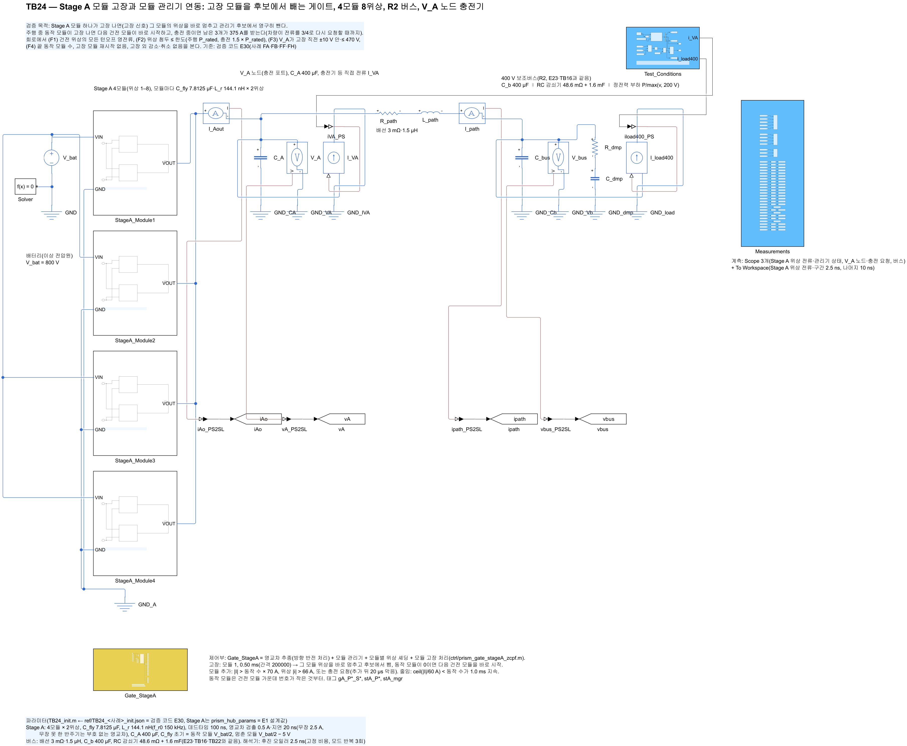
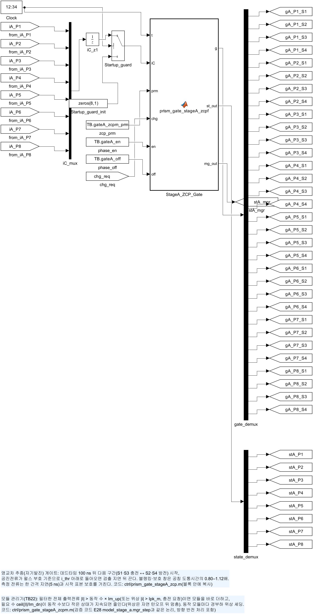
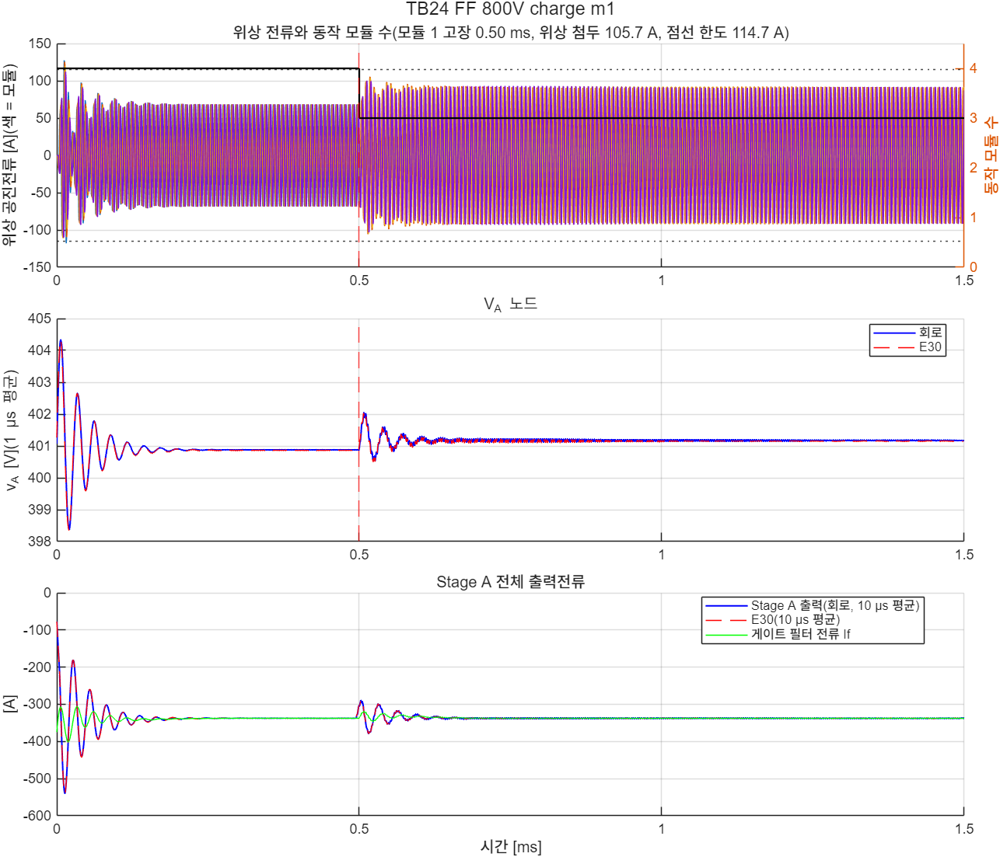
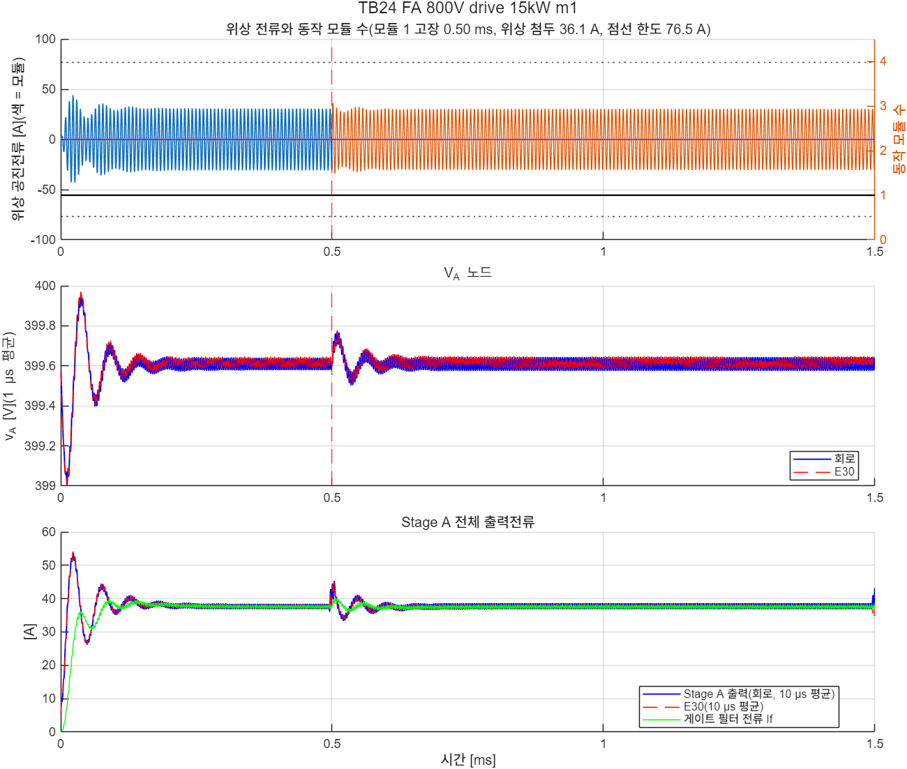

# TB24 — Stage A 모듈 고장과 모듈 관리기 연동(고장 모듈 제외)

**결론(2026-10-28): 네 사례 모두 통과(F1–F4). 모델(E30)과 같은 결과다.**

- **주행 중 동작 모듈 고장(FA 800 V·15 kW): 고장 간격에 다음 건전 모듈이 바로 시작했다.** V\_A는 고장 직전 399.61 V에서 399.50–399.78 V 안에 있었다. 위상 첨두 36.1 A, 턴오프 최대 0.14 A였다.
- **주행 중 2모듈 가운데 하나 고장(FB 540 V·25 kW): 대신할 모듈이 바로 들어가 끝 동작 수 2를 지켰다.** 위상 첨두 39.2 A였다.
- **충전 중 모듈 고장(FF 모듈 1, FH 모듈 4, 800 V·375 A): 남은 3모듈이 375 A를 받았다.** 위상 첨두 105.7·106.4 A로 한도 114.7 A(1.5 × P\_rated) 안이었다. 턴오프 2,200번 가운데 위반 0, 최대 1.56·1.51 A였다(한도는 반주기 첨두의 5 %, 약 5 A).
- **모델과의 차.** 위상 첨두 0.9 A 안, V\_A 0.05 V 안, 모듈 수 전환 시각 같음. 턴오프 전류는 충전 사례에서 회로가 0.3 A 컸고 주행 사례에서 0.2–0.3 A 작았다.
- **게이트 함수 대조.** 회로 게이트 함수에 모델(E30)의 전류·충전 요청 기록을 넣으면 FA·FF에서 76,500간격 모두 같은 구간·동작 모듈 수·모듈 모드가 나왔다(`check_gate_parity_TB24`).

## 왜 필요한가

E28·TB22의 모듈 관리기는 동작 모듈을 모듈 번호 순으로 골랐고, 고장 난 모듈을 후보에서 빼는 처리가 없었다. 주행 중 동작 모듈이 하나뿐인데 그 모듈이 고장 나면 V\_A 노드(C\_A 400 µF)는 부하전류로 곧 내려간다. 충전 중 고장이면 충전기가 전류를 줄일 때까지 남은 3모듈이 375 A를 받는다(E26 P-b). 검증 코드 E30에서 고장 처리(고장 모듈 위상 즉시 정지 → 건전 모듈 목록에서 영구 제외 → 동작 수 갱신 → 동작 모듈이 없으면 다음 건전 모듈 즉시 시작)를 넣고 판정했다. 이 TB는 같은 처리를 회로 게이트(`ctrl/prism_gate_stageA_zcpf.m`)로 확인한다.

## 회로

TB22와 같다(Stage A 4모듈 + R2 버스 + V\_A 노드 충전기). 바뀐 것은 둘이다.

| 블록 | 내용 |
|---|---|
| `Gate_StageA` | `ctrl/prism_gate_stageA_zcpf.m`(파라미터 23개): TB22의 zcpm + 고장 모듈 번호(22번)·고장 간격 번호(23번). 고장 간격에 그 모듈 위상을 끄고 건전 모듈 목록에서 뺀다 |
| C\_fly 초기값 | 위상마다 지정(`TB.vC0_ph`): 동작 모듈 V\_bat/2, 멈춘 모듈 V\_bat/2 − 5 V(docs/34 균형 회로 목표, E30과 같음) |

| 그림 | 내용 |
| --- | --- |
|  | 최상위 회로 |
|  | Stage A 게이트(모듈 관리기 + 고장 처리) |

## 사례와 판정 기준(시험 전에 고정, E30과 같음)

고장 시각 0.5 ms, 끝 1.5 ms. 판정은 0.3 ms 이후에 한다.

| 사례 | 조건 | 기대 |
|---|---|---|
| FA 800 V | 버스 15 kW(모듈 1개 동작), 모듈 1 고장 | 모듈 2가 바로 대신, 끝 1개 |
| FB 540 V | 버스 25 kW(모듈 2개 동작), 모듈 1 고장 | 끝 2개(모듈 2·3) |
| FF 800 V | 충전 375 A + 버스 15 kW(4개 동작), 모듈 1 고장 | 끝 3개 |
| FH 800 V | FF와 같고 모듈 4 고장(인터리빙 위치가 다름) | 끝 3개 |

- (F1) 턴오프: 고장 모듈의 고장 순간 이후를 뺀 모든 턴오프 \|i\_off\| ≤ max(5 % × 그 반주기 첨두, 1.0 A)
- (F2) 위상 첨두: 주행 ≤ P\_rated 76.5 A, 충전 ≤ 1.5 × P\_rated = 114.7 A
- (F3) V\_A: 고장 뒤 고장 직전 20 µs 평균의 ±10 V 안, ≤ 470 V
- (F4) 끝 동작 모듈 수가 기대값, 고장 모듈 재시작 없음, 고장 뒤 동작 수 감소는 고장 한 번뿐, 멈추기 취소 0

## 결과

| 항목 | FA 800 V 주행 | FB 540 V 주행 | FF 800 V 충전(모듈 1) | FH 800 V 충전(모듈 4) |
|---|---|---|---|---|
| 판정 | **통과** | **통과** | **통과** | **통과** |
| 턴오프(위반), 최대 \|i\_off\| | 698(0), 0.14 A | 1,396(0), 0.26 A | 2,201(0), 1.56 A | 2,200(0), 1.51 A |
| 위상 첨두(한도) | 36.1(76.5) A | 39.2(76.5) A | 105.7(114.7) A | 106.4(114.7) A |
| V\_A 고장 전 → 뒤 [V] | 399.61 → 399.50–399.78 | 269.52 → 269.46–269.57 | 400.88 → 400.51–402.06 | 400.88 → 400.49–402.07 |
| 동작 모듈 수(끝) | 1 | 2 | 4 → 3(0.5 ms) | 4 → 3(0.5 ms) |
| E30 대비 첨두 | −0.1 A | +0.4 A | −0.9 A | −0.2 A |





- **실행 순서.** 게이트 대조(통과) → 빌드 → 짧은 실행(FF를 0.6 ms까지, 통과) → 네 사례(각 88–100 s, 2.5 ns). 판정 기준과 회로는 실행 중 바꾸지 않았다.

## 재현

```matlab
prism_run('check_gate_parity_TB24')   % 게이트 함수 대조(FA·FF, 76,500간격)
prism_run('build_TB24')               % TB24_StageA_ModuleFault.slx 생성, 회로도 그림
prism_run('smoke_TB24')               % FF를 0.6 ms까지만(results/smoke)
prism_run('run_TB24')                 % 네 사례(약 7분)
```

기준값: `ref/make_ref_TB24.py <검증 코드 python 폴더>`(E30).

## 한계

- 고장은 검출 순간 게이트를 끄는 것으로 두었다. 고장 원인(소자 단락·구동 고장)과 검출 지연은 넣지 않았다.
- 부품값은 공칭이다. 공차 표본은 모델(E30, 공차 3개)로 판정했다.
- Stage A 손실 모델의 출력용량 항이 실제보다 작았다(docs/37). 이 TB의 판정(턴오프·첨두·V\_A·모듈 수)은 손실 항과 무관하다. 다만 Stage A 공진주파수를 바꾸면 다시 확인해야 한다.
