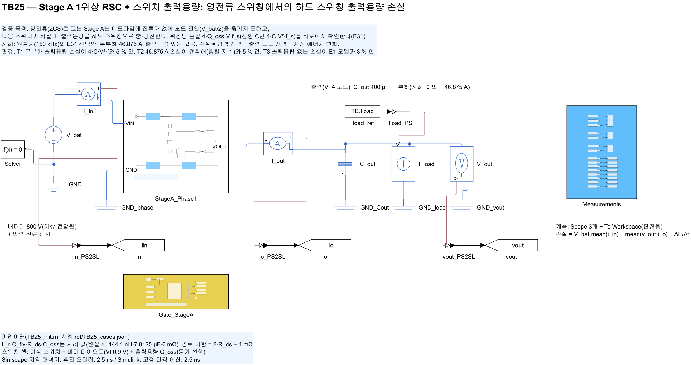
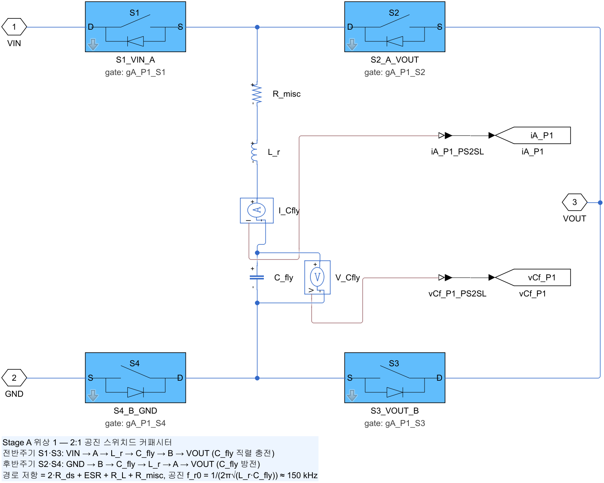
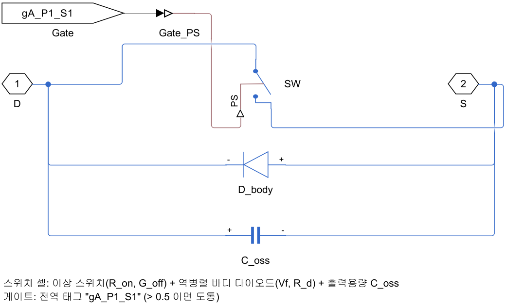
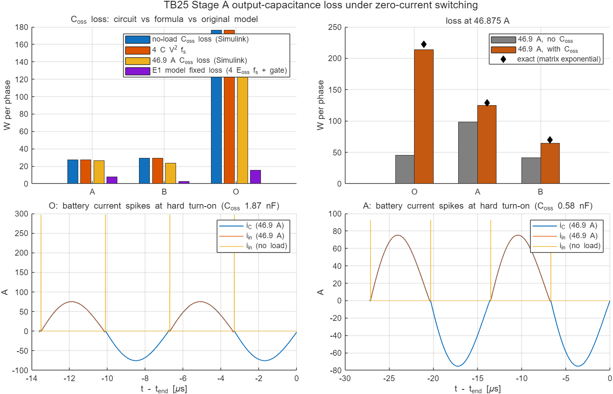

# TB25 — Stage A 1위상 + 스위치 출력용량: 영전류 스위칭의 하드 스위칭 출력용량 손실

**결론(2026-10-28): 핵심 판정(T1)은 세 설계 모두 통과, 전체 판정은 불통과(9개 중 3개).** 출력용량 손실의 크기는 회로에서 확인됐다. 불통과 셋은 부하 시 기준값과의 차이이며, 원인은 시험 게이트(고정 타이밍)가 낮은 f\_r에서 남기는 턴오프 전류와 기준 모델의 적분 간격이다(아래 진단).

- **T1 무부하 출력용량 손실 = 4·C·V²·f: 세 설계 모두 0.00 % 차.** 원설계 176.34 W, 선택 (가) 27.52 W, (나) 29.39 W. 원모델의 고정 손실 항(4·E\_oss·f\_s + 게이트)은 같은 조건에서 15.29·7.64·2.55 W였다.
- **46.875 A에서의 출력용량 손실은 공식의 0.96·0.97·0.81배였다.** 고정 타이밍은 공진 반주기와 조금 다른 시점에 꺼서 턴오프 전류(3.3·5.8·8.7 A)를 남긴다. 이 전류가 데드타임에 노드 전하 일부를 옮긴다(부분 소프트 스위칭). R2가 쓰는 영교차 추종 게이트는 |i| < 0.5 A에서 끄므로 공식 값이 맞다(E31이 쓴 값).
- **불통과 셋.**
  - (나) T2: 출력용량 있음 손실 64.92 W, 정확해 69.66 W(−6.8 %, 기준 ±5 %). 정확해(행렬 지수)는 바디 다이오드가 없다. 8.7 A 턴오프 전류가 회로에서는 다이오드로 흐르고 정확해에서는 노드 용량만 충전한다.
  - (가) T3: 출력용량 없음 손실 98.70 W, E1 103.26 W(−4.4 %, 기준 ±3 %). 적분 간격을 줄여도 E1은 103.31 W(데드타임 소멸 처리 101.87 W)다. 낮은 Q(3.7)에서 턴오프 전류 5.8 A의 다이오드 환류를 두 모델이 다르게 다룬다.
  - (나) T3: 41.23 W, E1 44.35 W(−7.0 %). 기준값을 주기당 340단계(25 kHz에서 120 ns)로 계산했기 때문이다. 간격을 150 kHz와 같은 약 20 ns로 두면 E1도 41.23 W다.
  - 판정 기준과 기준값은 바꾸지 않았다. 진단은 `results/TB25_e1_step_diag.txt`(`ref/diag_e1_step_TB25.py`)에 있다.

## 왜 필요한가

E31(docs/37)은 Stage A 손실 모델의 출력용량 항이 실제보다 한 자릿수 작다는 것을 찾았다. 영전류에서 끄면 데드타임에 노드 전압을 옮길 전류가 없어, 다음 스위치가 켜질 때 출력용량을 하드 스위칭한다. 한 전이의 손실은 Q\_oss·V다. E31은 이를 노드 용량을 넣은 정확해(행렬 지수)로 확인했다. TB01–TB24는 Stage A 스위치에 출력용량을 넣지 않았으므로 이 손실이 회로 모델에도 없었다. TB25는 같은 현상을 소자 수준 회로에서 확인한다.

## 회로

TB01(Stage A 1위상 + 고정 타이밍 게이트)에 두 가지를 더했다.

| 블록 | 내용 |
|---|---|
| `StageA_Phase1` | 스위치 셀 넷에 출력용량 C\_oss(파라미터 `TB.A.Coss`, `build_stageA_phase`의 선택 인자). 등가 선형 C = Q\_oss,위치(400 V)/400 V. 하드 스위칭 전이 손실이 전하 × 전압이므로 비선형 Q\_oss와 같은 손실을 낸다 |
| `I_in` | 배터리 전류 센서(입력 전력) |
| 손실 계산 | 마지막 10주기: V\_bat·mean(i\_in) − mean(v\_out·i\_o) − [½C\_fly·Δ(v\_C²) + ½L\_r·Δ(i\_C²)]/Δt |

| 그림 | 내용 |
| --- | --- |
|  | 최상위 회로(배터리 전류 센서 포함) |
|  | 위상 서브시스템 |
|  | 스위치 셀(이상 스위치 + 바디 다이오드 + 출력용량) |

## 사례와 판정 기준(시험 전에 고정)

설계 3 × 부하 2 × 출력용량 2 = 12사례. 배터리 800 V, C\_out 400 µF, 고정 타이밍 f\_s = 0.98·f\_r, 데드타임 100 ns, 50주기, 해석기 2.5 ns.

| 설계 | L\_r, C\_fly, f\_r | R\_ds(위치) | C\_oss(스위치당 등가) |
|---|---|---|---|
| O 원설계 | 144.1 nH, 7.81 µF, 150 kHz | 6.00 mΩ | 1.874 nF(C4MS008075U2 2병렬) |
| A E31 (가) | 288 nH, 15.6 µF, 75 kHz | 16.43 mΩ | 0.585 nF(C4MS025075K1 2병렬) |
| B E31 (나) | 865 nH, 46.9 µF, 25 kHz | 5.27 mΩ | 1.874 nF(C4MS008075U2 2병렬) |

- (T1) 무부하 출력용량 손실 P(nl\_C) − P(nl\_0)이 4·C·(V\_bat/2)²·f\_s와 5 % 안
- (T2) 46.875 A 출력용량 있음 손실이 정확해(같은 출력전류의 출력전압)와 5 % 안
- (T3) 46.875 A 출력용량 없음 손실이 E1 모델(sim\_array 고정 타이밍)과 3 % 안

## 결과

| 설계 | T1 무부하 C\_oss 손실(공식) | T2 46.9 A, C\_oss 있음(정확해) | T3 46.9 A, C\_oss 없음(E1) | 46.9 A C\_oss 손실/공식 | 턴오프 전류(E1) |
|---|---|---|---|---|---|
| O | 176.34(176.34) W 통과 | 213.80(222.29) W −3.8 % 통과 | 45.31(44.36) W +2.1 % 통과 | 0.955 | 3.3 A |
| A | 27.52(27.52) W 통과 | 125.32(128.89) W −2.8 % 통과 | 98.70(103.26) W **−4.4 % 불통과** | 0.967 | 5.8 A |
| B | 29.39(29.39) W 통과 | 64.92(69.66) W **−6.8 % 불통과** | 41.23(44.35) W **−7.0 % 불통과** | 0.806 | 8.7 A |



- 그림 아래 칸: 무부하에서 배터리 전류가 하드 턴온마다 한 간격의 펄스로만 흐른다(노드 용량 충전 전하). 이 전하 × 800 V가 손실이다.
- 실행 경과: 빌드 → 짧은 실행 1차(평가 구간 시작 색인 0 오류, 8주기 실행에서 평가 주기 수 10) → 수정 → 짧은 실행 2차(O 무부하 176.35 W) → 12사례(약 12분). 수정은 평가 구간 계산 코드뿐이고 판정 기준은 그대로다.

## 진단(실행 뒤, 판정을 바꾸지 않음)

| 설계 | 회로 | E1 340단계/주기 | E1 약 20 ns | E1 약 20 ns + 데드타임 소멸 처리 |
|---|---|---|---|---|
| O | 45.31 W | 44.36 W | 44.36 W | 44.34 W |
| A | 98.70 W | 103.26 W | 103.31 W | 101.87 W |
| B | 41.23 W | 44.35 W | 41.23 W | 40.93 W |

- 고정 타이밍의 도통시간은 T/2 − t\_d다. f\_r이 낮아지면 데드타임의 비중이 줄어 도통시간이 공진 반주기를 넘는다. 그래서 턴오프 전류가 3.3 → 5.8 → 8.7 A로 커졌다. 회로와 정확해·E1이 이 전류의 환류(다이오드, 노드 용량)를 다르게 다루는 것이 T2·T3 차이의 원인으로 보인다.
- 다음에 낮은 f\_r 설계를 회로로 확인할 때는 R2의 영교차 추종 게이트(TB18–TB24와 같은 게이트)를 쓴다. 기준 모델 간격은 f\_r에 맞춰 줄인다.

## 재현

```matlab
prism_run('build_TB25')   % TB25_StageA_Coss.slx 생성, 모델 갱신 검사
prism_run('smoke_TB25')   % O 무부하 8주기(results/smoke)
prism_run('run_TB25')     % 12사례(약 12분)
```

기준값: `ref/make_ref_TB25.py <검증 코드 python 폴더>`(E31 결과 필요). 진단: `ref/diag_e1_step_TB25.py`.

## 한계

- 출력용량은 등가 선형 C다. Q\_oss(V)의 모양 자체는 데이터시트 표 값의 거듭제곱 근사(E31)이고 회로로 확인한 것이 아니다.
- 게이트는 고정 타이밍이다(위 진단). 출력용량 히스테리시스 손실, 소자 내부 게이트 저항·밀러 구간은 없다.
- 위상 하나, 이상 배터리·이상 전류 부하다.
