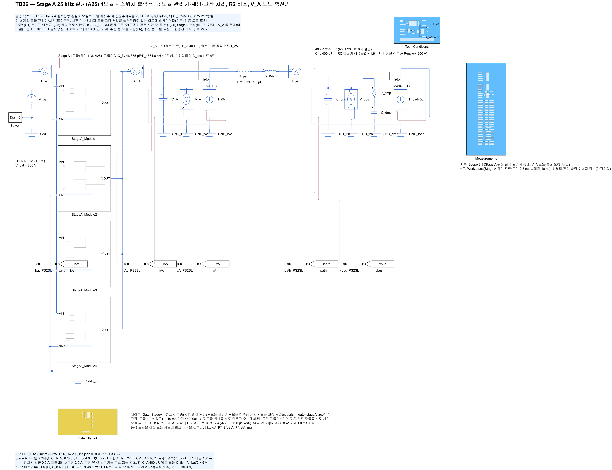
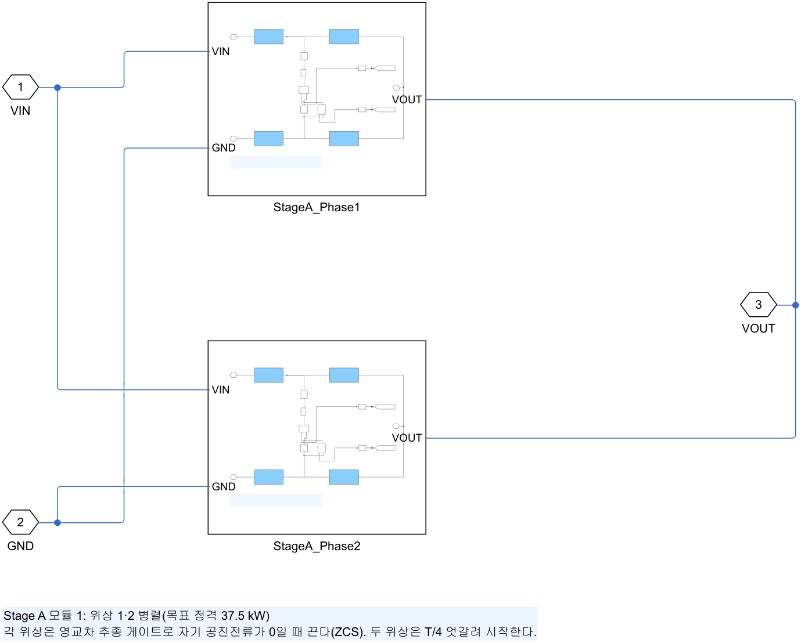
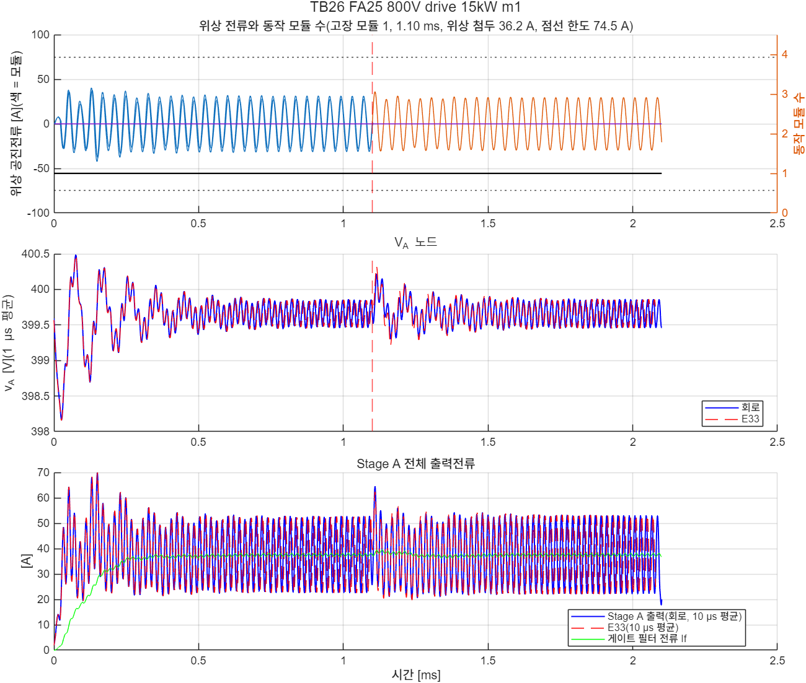
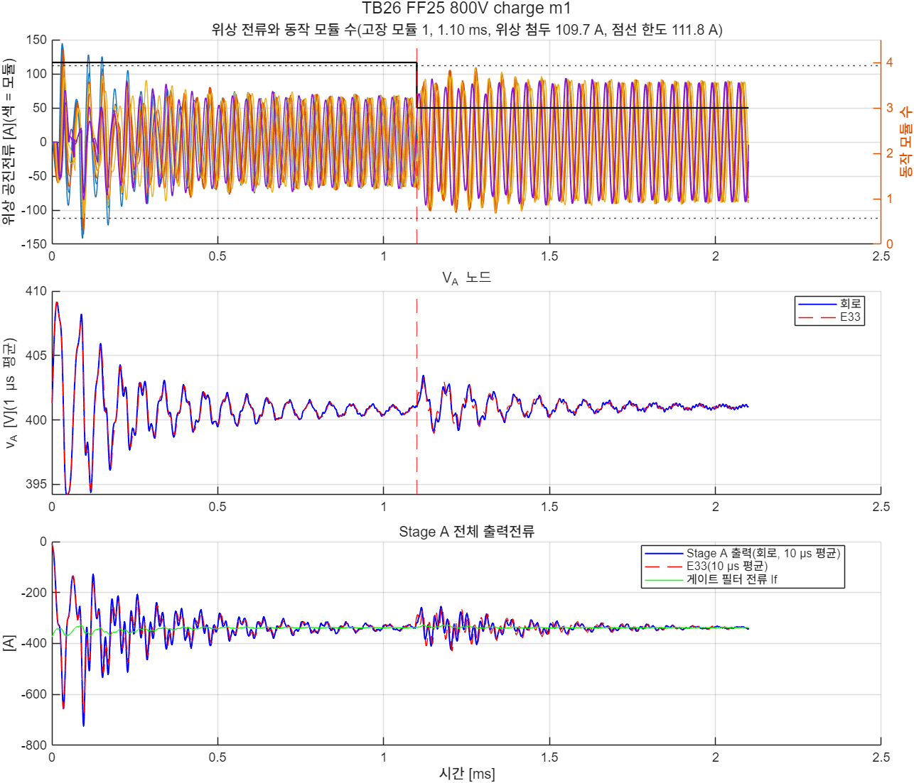
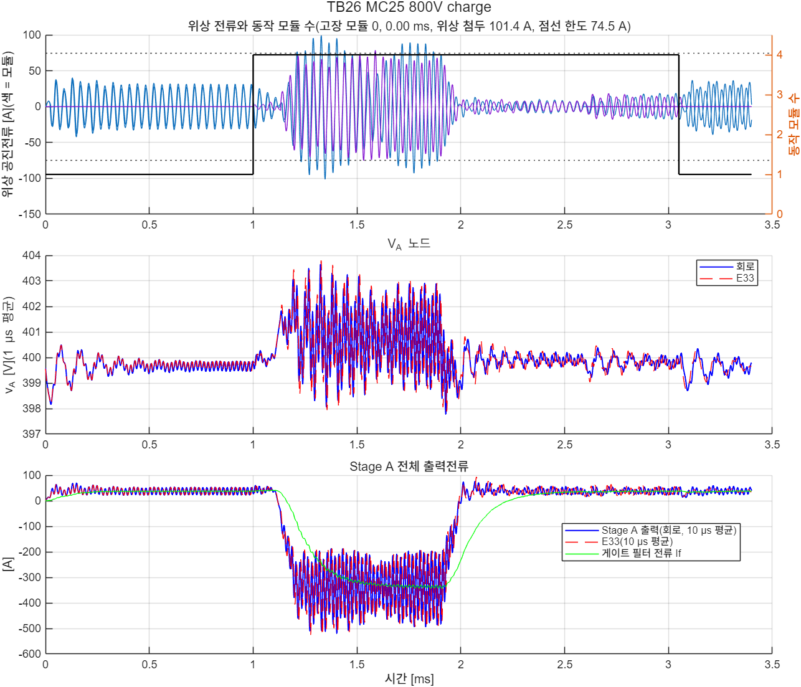

# TB26 — Stage A 25 kHz 설계(A25) 4모듈 + 스위치 출력용량: 모듈 관리기·셰딩·고장 처리

**결론(2026-10-28): 세 사례 모두 불통과.** 동특성 판정(C1–C4)은 세 사례 모두 모델(E33)과 같은 결과였다. 고장 두 사례는 C1–C4를 통과했고, 충전 시작·종료 사례(MC25)는 모델처럼 턴오프·위상 첨두에서 불통과였다. 세 사례가 모두 불통과인 이유는 손실 대조 C5다. 실행 뒤 진단에서 C5의 손실 추정 방식이 A25에 맞지 않음을 확인했다(아래).

- **회로와 모델의 동특성은 거의 같았다.**
  - 위상 첨두 차: FA25 +1.1 A, FF25 0.0 A, MC25 −1.6 A.
  - V\_A 최저·최고 차: 0.18 V 안.
  - 동작 모듈 수 전환 시각: 같음.
  - 턴오프 최대: FA25 0.43 A, FF25 0.32 A. 모델은 0.50 A였다. MC25는 회로 5.34 A, 모델 3.78 A로 둘 다 위반이다.
- **고장 처리(FA25·FF25): C1–C4 통과.**
  - FA25(주행 15 kW, 모듈 1 고장): 모듈 2가 고장 간격에 바로 시작했다. 위상 첨두는 36.2 A였다.
  - FF25(충전 375 A, 모듈 1 고장): 남은 3모듈의 위상 첨두가 109.7 A였고, 한도 111.8 A(1.5 × P\_rated) 안이었다.
- **충전 시작·종료(MC25): C1·C2 불통과(모델과 같음).**
  - 턴오프 829번 가운데 24번이 위반이었고, 최대 5.34 A였다.
  - 위상 첨두는 101.4 A로 한도 74.5 A를 넘었다.
  - 원인은 충전전류 램프 100 µs가 25 kHz 공진의 2.5주기라는 점이다(docs/38). E33의 요구 갱신 규칙에서 느린 시각도 불통과였으므로, 원 시각 사례를 그대로 썼다.
- **C5(손실) 불통과 세 건은 판정 방식의 문제다.** 회로 손실은 FA25 88.8 W, FF25 856.4 W, MC25 382.5 W였다. 모델은 73.8·522.3·161.3 W였다.
  - C5는 마지막 10주기의 (배터리 전력 − V\_A 쪽 출력 전력)이다. 이 값에는 그 구간 C\_fly·L\_r 저장 에너지의 변화율이 들어 있다.
  - A25의 C\_fly는 46.9 µF이고 리플은 ±10 V다. 창의 끝이 실제 스위칭 주기와 어긋나면 저장 에너지 항이 수백 W가 된다.
  - 모델에서 창의 끝을 한 주기 안에서 20곳으로 옮겨 보았다. 저장 변화율이 FA25 −451…450 W, FF25 −702…771 W, MC25 −736…128 W로 흩어졌다(`ref/diag_loss_TB26.py`, `TB26_loss_diag.json`).
  - 회로 값은 FA25·FF25에서 이 범위 안이고, MC25는 범위 위쪽 끝에서 92 W 위다.
  - 판정 기준과 방식은 바꾸지 않았다. 손실을 회로로 확인하려면 다음 회로에서 C\_fly·L\_r 저장 에너지를 보정해야 한다(TB25처럼). 또는 창을 위상별 실제 주기에 맞춰야 한다.

## 왜 필요한가

E31(docs/37)에서 Stage A 손실 모델의 출력용량 항이 한 자릿수 작았다. 그래서 공진주파수를 25 kHz로 낮춘 A25로 바꿨다. A25는 위치당 C4MS008075U2 2병렬, L\_r 864.6 nH, C\_fly 46.875 µF다. 공진이 6배 느려졌으므로 모듈 관리기·셰딩의 문턱과 시간 상수를 E32에서 다시 정했다. E33에서 모델로 동특성을 다시 판정했다. TB26은 같은 설계를 출력용량이 있는 소자 수준 회로에서 확인한다. TB24까지의 4모듈 회로는 150 kHz 설계였고 출력용량이 없었다.

## 회로

TB24 회로(배터리 → Stage A 모듈 1–4 → V\_A 노드 → 배선 → 400 V 버스, 모듈 관리기·셰딩·고장 처리 게이트 `ctrl/prism_gate_stageA_zcpf.m`)에서 세 가지를 바꿨다.

| 블록 | 내용 |
|---|---|
| Stage A 소자값 | A25(L\_r 864.6 nH, C\_fly 46.875 µF, R\_ds 위치당 5.27 mΩ, V\_f 4.5 V). 게이트 파라미터 23개는 A25 공진주기와 E32 문턱으로 정했다 |
| 스위치 셀 | 셀마다 등가 선형 출력용량 C\_oss = Q\_oss,위치(V\_bat/2)/(V\_bat/2)(`build_stageA_phase`의 선택 인자, TB25와 같은 방식) |
| 전력 측정 | 배터리 전류 센서. 배터리 전하 q = ∫i\_bat, 출력 에너지 e = ∫v\_A·i\_Ao를 간격마다 적분한다(하드 턴온 전류 펄스를 놓치지 않게) |

| 그림 | 내용 |
| --- | --- |
|  | 최상위 회로 |
|  | Stage A 게이트(모듈 관리기 + 셰딩 + 고장 처리) |
|  | Stage A 모듈(2위상, 출력용량 포함 셀) |

## 사례와 판정 기준(시험 전에 고정)

해석기 간격 2.5 ns. 사건 시각은 E33과 같다(E28·E30 시각 + 0.6 ms). 판정은 0.9 ms 이후에 한다.

| 사례 | 조건 | 기대 |
|---|---|---|
| FA25 800 V | 버스 15 kW(모듈 1개 동작), 모듈 1 고장(1.1 ms) | 모듈 2가 바로 대신, 끝 1개 |
| FF25 800 V | 충전 375 A + 버스 15 kW(4개 동작), 모듈 1 고장(1.1 ms) | 끝 3개 |
| MC25 800 V | 충전 시작·종료(사전 기동 100 µs·램프 100 µs, E33 요구 갱신 규칙: 느린 시각도 불통과라 원 시각) | 끝 1개 |

- (C1) 모든 턴오프(고장 모듈의 고장 순간 이후는 뺌) \|i\_off\| ≤ max(5 % × 그 반주기 첨두, 1.0 A)
- (C2) 위상 첨두: 주행·충전 시작 ≤ P\_rated(A25 공칭 74.5 A), 충전 중 고장 ≤ 1.5 × P\_rated
- (C3) V\_A: 고장 사례는 고장 직전 20 µs 평균 ±10 V 안·≤ 470 V, 충전 시작·종료는 모델 최저·최고와 1.0 V 안
- (C4) 끝 동작 모듈 수 = 기대값, 동작 수 변화 횟수 = 모델, 고장 모듈 재시작 없음, 멈추기 취소 0
- (C5) 마지막 10주기 Stage A 손실(배터리 전력 − V\_A 쪽 출력 전력)이 모델(도통 + 다이오드 + 출력용량, 게이트 제외)과 10 % 안
- 정보: 모델과 모듈 수 전환 시각 ±0.05 ms, 위상 첨두 ±10 %, V\_A 최저·최고 ±0.5 V

## 결과

| 사례 | C1 턴오프 | C2 위상 첨두 | C3 V\_A | C4 모듈 | C5 손실 회로/모델 | 판정 |
|---|---|---|---|---|---|---|
| FA25 | 통과(0.43 A) | 통과(36.2/74.5 A) | 통과(399.31–400.22 V) | 통과(끝 1) | 88.8/73.8 W 불통과 | 불통과(C5) |
| FF25 | 통과(0.32 A) | 통과(109.7/111.8 A) | 통과(399.11–403.46 V) | 통과(1.1 ms → 3) | 856.4/522.3 W 불통과 | 불통과(C5) |
| MC25 | 불통과(24번, 5.34 A) | 불통과(101.4/74.5 A) | 통과(397.78–403.66 V) | 통과(1.0 ms → 4, 3.05 ms → 1) | 382.5/161.3 W 불통과 | 불통과(C1·C2·C5) |

| 그림 | 내용 |
| --- | --- |
|  | FA25: 위상 전류·동작 모듈 수, V\_A(회로·모델), Stage A 출력전류 |
|  | FF25 |
|  | MC25 |

- 실행 경과: 게이트 함수 대조 3사례 일치(FA25·FF25 106,080간격, MC25 173,400간격) → 빌드 → 짧은 실행(FF25 1.3 ms, 65 s) → 3사례(354 s).
- 짧은 실행의 C5 불통과는 고장 과도가 창에 들어간 것이라 의미가 없다고 보고 본 실행으로 넘어갔다. 본 실행에서도 C5가 모두 불통과였고, 실행 뒤 진단으로 원인을 찾았다.

## 진단(실행 뒤, 판정을 바꾸지 않음)

| 사례 | 회로 C5 | 모델 손실 | 모델 저장 변화율(창 끝 20곳) | 모델 손실 + 저장 |
|---|---|---|---|---|
| FA25 | 88.8 W | 73.8 W | −451 … 450 W | −377 … 524 W |
| FF25 | 856.4 W | 522.3 W | −702 … 771 W | −179 … 1,293 W |
| MC25 | 382.5 W | 161.3 W | −736 … 128 W | −575 … 290 W |

- 창 길이는 공칭 주기 × 10이다. 실제 스위칭 주파수는 24.9 kHz 근처라 창의 시작과 끝에서 위상마다 C\_fly 전압이 리플의 다른 곳에 있다. 46.9 µF × 400 V × 2.8 V / 400 µs ≈ 130 W/위상이다.
- 150 kHz 설계(TB24까지)는 C\_fly가 1/6이었고, 손실 대조 판정이 없었다. TB25는 저장 에너지 보정을 넣었지만 TB26에서는 빠졌다. 판정 코드의 빈틈이다.

## 재현

```matlab
prism_run('check_gate_parity_TB26')   % 게이트 함수 대조(ref/gate_parity)
prism_run('build_TB26')               % TB26_StageA25_Integrated.slx 생성
prism_run('smoke_TB26')               % FF25 1.3 ms(results/smoke)
prism_run('run_TB26')                 % 3사례(약 6분)
```

기준값: `ref/make_ref_TB26.py <검증 코드 python 폴더>`(E32·E33 결과 필요). 진단: `ref/diag_loss_TB26.py`.

## 한계

- 출력용량은 등가 선형 C다(TB25와 같음).
- C5 손실 대조는 위 진단대로 저장 에너지 보정이 없다. A25 손실은 이 회로로 확인하지 못했다(무부하 출력용량 손실은 TB25 T1에서 확인).
- 충전기·400 V 부하는 이상 전류원·정전력원이다. 게이트 지연, 소자 내부 게이트 저항, 기생 인덕턴스는 없다.
