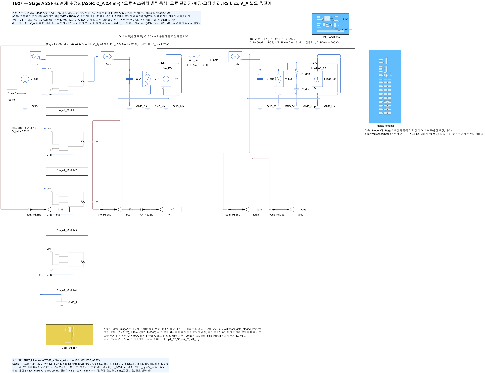
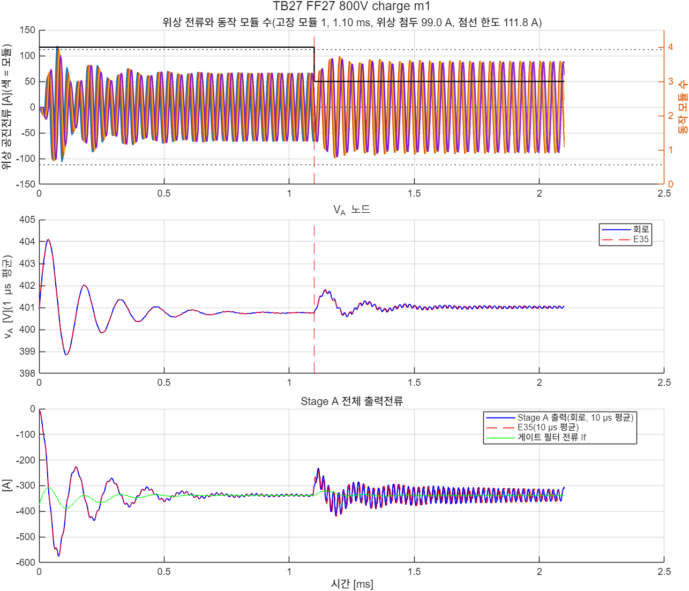
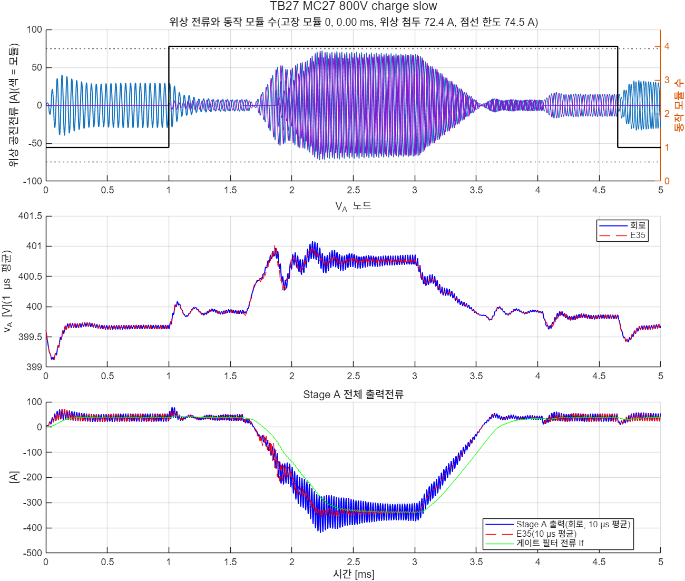
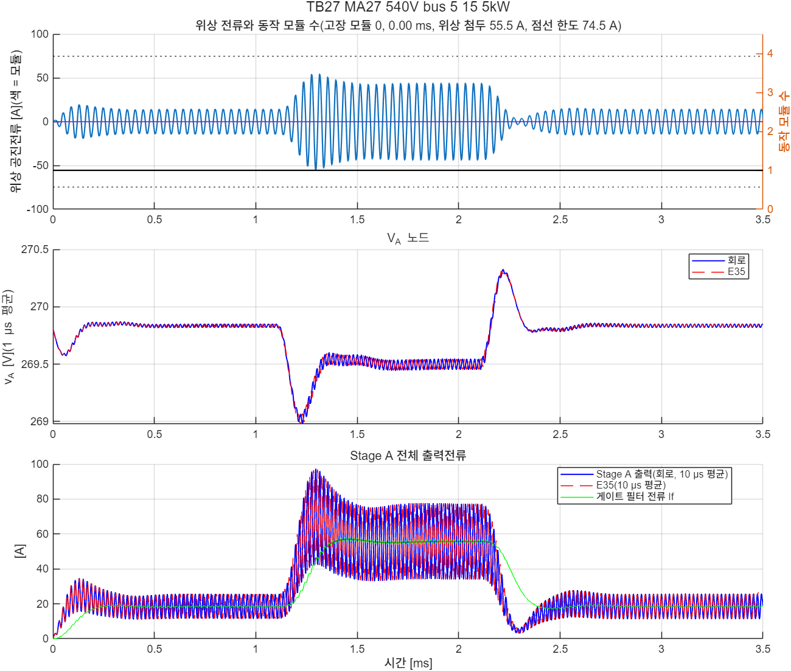
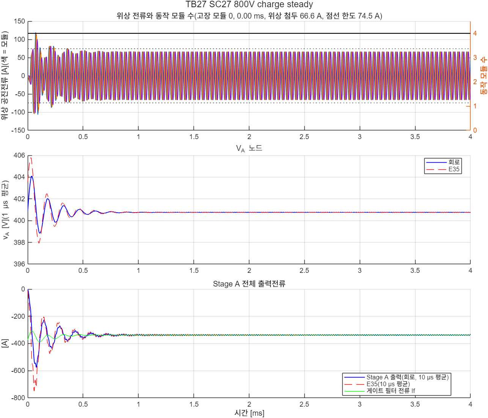

# TB27 — Stage A 25 kHz 설계 수정안(A25R: C\_A 2.4 mF) 4모듈 + 스위치 출력용량

**결론(2026-10-28): 네 사례 모두 통과(C1–C4, 정상상태 사례 C5).** 모델(E35)과 같은 결과다. A25 손실 모델(출력용량 Q\_oss·V 포함)도 정격 충전 정상상태에서 회로와 3.0 % 안이었다.

- **충전 중 모듈 고장(FF27).** 남은 3모듈의 위상 첨두는 99.0 A로 한도 111.8 A 안이었다. A25(TB26)는 109.7 A였다. V\_A는 400.57–401.81 V였다.
- **느린 충전 시작·종료(MC27).** 사전 기동 600 µs·램프 600 µs 조건이다. 턴오프 1,366번 가운데 위반이 0이었고 최대 0.79 A였다. 위상 첨두는 72.4 A로 한도 74.5 A 안이었다. A25(E33 slow)는 같은 사례에서 위반 3–13번이었다.
- **Tier-1 계단(MA27, 540 V 버스 5 → 15 → 5 kW).** 위상 첨두 55.5 A, 턴오프 위반 0이었다.
- **정격 충전 정상상태(SC27, 800 V, −375 A + 15 kW).** 회로 손실은 510.5 W, 모델은 495.8 W로 +3.0 %(기준 10 %)였다. 위상 첨두 66.6 A, V\_A 400.75–400.77 V였다.
- **모델과의 차.**
  - 위상 첨두: MC27 +2.2 A, 나머지 ±0.5 A 안
  - V\_A: 0.06 V 안
  - 모듈 수 전환 시각: 같음
- 정보: FF27·MC27의 손실은 모델과 크게 다르다(372.9/521.9, 347.1/161.1 W). 사건 뒤 C\_fly 평균 전압이 아직 움직이는 구간이라 저장 에너지가 창에 남기 때문이다(TB26 진단과 같음). 판정 대상이 아니다.

## 왜 필요한가

E33·TB26(docs/38)에서 A25는 모듈 고장 처리는 통과했지만 과도 판정을 대부분 통과하지 못했다. 설계 단계(E35\_a25r\_design)에서 고칠 후보를 개발 사례로 확인했다.

- 관리기 시간 상수, 충전 중 셰딩 정지, 인터리빙 맞춤 시작은 모두 불통과였다.
- V\_A 노드 커패시터 C\_A를 6배(2.4 mF)로 키운 경우만 모두 통과했다.

E35에서 이 수정안(A25R)을 모델로 다시 판정했고, 요구 안 과도 12/12와 고장 16/16을 통과했다. TB27은 같은 판정을 출력용량이 있는 소자 수준 회로에서 확인한다. 또 TB26에서 판정할 수 없었던 손실 대조를 정상상태 사례와 실제 주기 창으로 다시 한다.

## 회로

TB26과 같은 결선이다(Stage A 4모듈 + 스위치 셀 출력용량 + 모듈 관리기·셰딩·고장 처리 게이트 `ctrl/prism_gate_stageA_zcpf.m` + R2 버스 + V\_A 노드 충전기). 바뀐 값은 C\_A = 2.4 mF(`TB.A.CA`, 기준값 파일에서 읽음) 하나다.

| 그림 | 내용 |
| --- | --- |
|  | 최상위 회로 |
|  | Stage A 게이트 |
|  | Stage A 모듈(2위상, 출력용량 포함 셀) |

## 사례와 판정 기준(시험 전에 고정)

해석기 간격 2.5 ns. 사건 시각은 E35와 같다.

| 사례 | 조건 | 기대 |
|---|---|---|
| FF27 800 V | 충전 375 A + 버스 15 kW(4개 동작), 모듈 1 고장(1.1 ms) | 끝 3개 |
| MC27 800 V | 충전 시작·종료, 사전 기동 600 µs·충전전류 램프 600 µs(E33 slow와 같은 시각) | 끝 1개 |
| MA27 540 V | 버스 5 → 15 → 5 kW 계단(docs/14 D3 Tier-1) | 끝 1개 |
| SC27 800 V | 정격 충전 정상상태(V\_A 노드 −375 A + 버스 15 kW, 처음부터 충전 요청, 4 ms). 판정 창은 끝 1 ms | 4개 |

- (C1) 모든 턴오프(고장 모듈의 고장 순간 이후는 뺌) \|i\_off\| ≤ max(5 % × 그 반주기 첨두, 1.0 A)
- (C2) 위상 첨두: 고장 없는 사례 ≤ P\_rated(74.5 A), 충전 중 고장 ≤ 1.5 × P\_rated
- (C3) V\_A: 고장 사례는 고장 직전 20 µs 평균 ±10 V 안·≤ 470 V, 그 밖은 모델 최저·최고와 1.0 V 안
- (C4) 끝 동작 모듈 수 = 기대값, 동작 수 변화 횟수 = 모델, 고장 모듈 재시작 없음, 멈추기 취소 0
- (C5, SC27만) Stage A 손실(배터리 전력 − V\_A 쪽 출력 전력)을 마지막 20주기 창에서 계산해 모델(도통 + 다이오드 + 출력용량, 게이트 제외, 마지막 20주기)과 10 % 안. 창의 주기는 회로 위상 1의 구간 1 시작 간격으로 잰 실제 주기다(TB26 진단 반영). 모델에서 이 창의 저장 에너지 오차는 ±37 W(3 ms, 10주기)로 확인한 뒤 20주기·4 ms로 정했다.

## 결과

| 사례 | C1 턴오프 | C2 위상 첨두 | C3 V\_A | C4 모듈 | C5 손실 | 판정 |
|---|---|---|---|---|---|---|
| FF27 | 통과(378번, 최대 0.31 A) | 통과(99.0/111.8 A) | 통과(400.57–401.81 V) | 통과(1.1 ms → 3) | — | **통과** |
| MC27 | 통과(1,366번, 최대 0.79 A) | 통과(72.4/74.5 A) | 통과(399.42–401.08 V) | 통과(1.0 ms → 4, 4.65 ms → 1) | — | **통과** |
| MA27 | 통과(262번, 최대 0.49 A) | 통과(55.5/74.5 A) | 통과(268.98–270.32 V) | 통과 | — | **통과** |
| SC27 | 통과(399번, 최대 0.31 A) | 통과(66.6/74.5 A) | 통과(400.75–400.77 V) | 통과 | 510.5/495.8 W(+3.0 %) | **통과** |

| 그림 | 내용 |
| --- | --- |
|  | FF27 |
|  | MC27 |
|  | MA27 |
|  | SC27 |

- 실행 경과: 기준값 생성 1차는 스칼라 부하 프로파일(MA27) 처리 오류로 중단됐다. 코드만 고친 뒤 다시 생성했다. 이후 순서는 게이트 함수 대조 4사례 일치(106,080–255,000간격) → 빌드 → 짧은 실행(FF27 1.3 ms) → 4사례(677 s)였다.

## 재현

```matlab
prism_run('check_gate_parity_TB27')
prism_run('build_TB27')
prism_run('smoke_TB27')
prism_run('run_TB27')                 % 4사례(약 11분)
```

기준값: `ref/make_ref_TB27.py <검증 코드 python 폴더>`(E32 결과 필요, E35 설정).

## 한계

- 출력용량은 등가 선형 C다. 게이트 지연, 소자 내부 게이트 저항, 기생 인덕턴스는 없다.
- C\_A 2.4 mF는 이상 커패시터다(ESR·ESL 없음). 실제 부품의 리플 전류·부피는 부품 정격 표에서 다룬다.
- 요구 밖 사례(20 kW 순간 계단, 100 µs 충전 램프, 사전 기동 없는 충전)는 회로로 돌리지 않았다. 모델(E35 beyond)에서 모두 불통과다.
