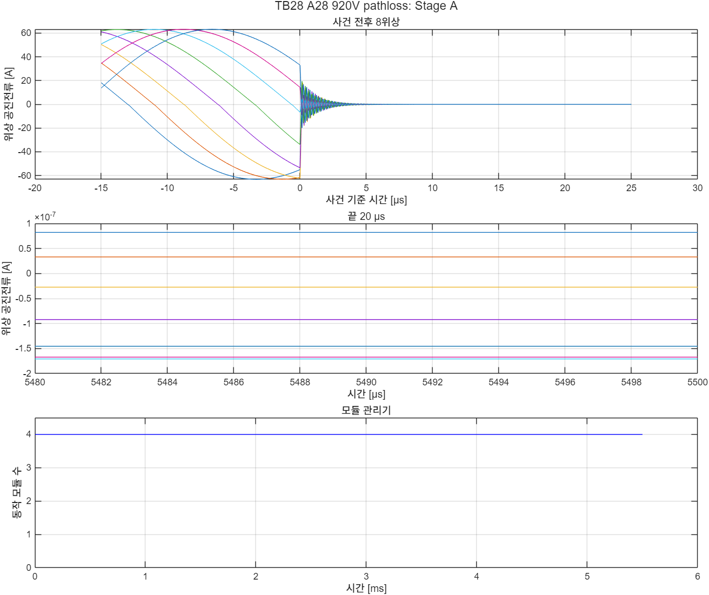
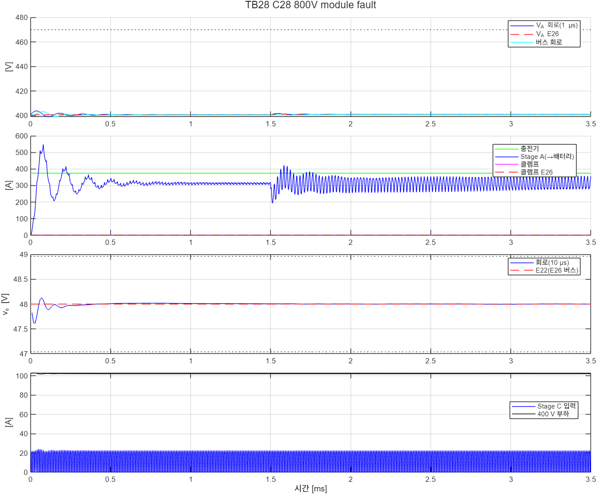
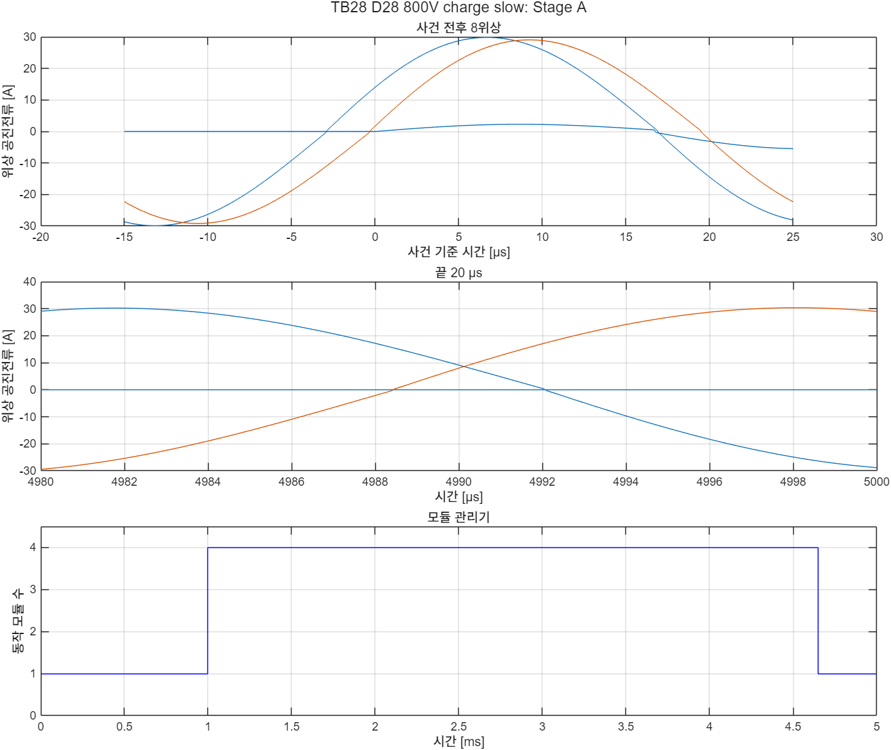

# TB28 — 충전 중 정지·V\_A 클램프를 Stage A 설계 A25R로

**결론(2026-10-28): 4/4 통과.** 충전 중 정지 순서는 Stage A를 A25R로 바꿔도 그대로 성립한다.

〔2026-10-29 주석〕 이 TB의 클램프는 1 Ω 하나(이전 구성)다. 최종 클램프(가지 2개 × 1.6 Ω, CAB530M12BM3)는 TB30–TB32에서 확인했다.

- **배터리 경로 상실(A 920 V): 클램프가 V\_A를 470 V 아래로 붙잡았다.**
  - 회로 V\_A 최고(1 µs)는 468.12 V였다(E26 468.20 V).
  - 클램프 흡수 에너지는 440.2 J(E26 441.5 J), 동작 시간은 2.034 ms(E26 2.038 ms)였다.
  - 켬 횟수는 3 ms 동안 26번으로 TB20의 124번보다 적다. C\_A가 6배라 한 번 켜고 끄는 데 오래 걸린다.
- **A25 위상의 강제 차단 전류는 최대 62.3 A였고, 50 µs 안에 모두 0이 되었다.** TB20(150 kHz)의 최대 64.8 A와 같은 크기다. 공진 인덕터 에너지가 6배여도 V\_A는 클램프 문턱 위로 오르지 않았다.
- **640 V 경로 상실(B)은 클램프가 켜지지 않았다.** 충전기가 3 ms 동안 선형으로 줄 때 V\_A가 407.17 V까지만 올랐다(E26 407.27 V). C\_A 400 µF였던 TB20은 클램프가 21.5 J를 흡수했다.
- **모듈 4 고장(C): 게이트의 고장 처리로 3모듈 충전을 이어 갔다.** 고장 0.5 ms 뒤 남은 6위상 첨두는 84.1 A(모델 84.4 A), 위상 전류 차는 1.46 %였다. 고장 순간 과도 첨두는 92.2 A로 한도 111.75 A 안이었다.
- **느린 충전 시작·종료(D): 모듈 수 사건이 모델과 같았다**(1.0 ms 4모듈, 4.65 ms 1모듈). 위상 첨두는 72.5 A로 P\_rated 74.5 A 안이었다(모델 70.2 A, TB27 MC27 72.4 A).
- **48 V와 사건 전 Stage A는 모든 사례에서 모델과 맞았다.**
  - 48 V는 47.994–48.027 V였고, Stage C ZVS는 켜짐 직전 0.11 V였다.
  - 사건 전 V\_A − 모델은 ≤ 0.002 V였다. 턴오프 전류/피크는 0.51–1.42 %, 1 ms 이후 턴오프 위반은 없었다(최대 0.79 A).

## 왜 필요한가

TB20·TB21은 충전 중 Stage A가 멈출 때의 정지 순서를 150 kHz Stage A(C\_A 400 µF)로 확인했다. 배터리 경로를 잃으면 V\_A 클램프(468/463 V, 1 Ω)와 비상 정지로 V\_A를 470 V 아래에 붙잡고, 모듈 1개가 고장 나면 나머지 모듈로 충전을 이어 간다(docs/31).

Stage A를 25 kHz 설계 A25R로 바꿨으므로(docs/40) 같은 순서를 다시 확인해야 한다. 바뀐 것은 세 가지다.

- **위상 공진 에너지가 6배다.** L\_r이 864.6 nH(150 kHz 설계 144.1 nH)라 강제 차단 때 남는 공진전류의 에너지가 크다. 그 전류가 바디 다이오드와 출력용량으로 사라지는지, V\_A를 클램프 문턱 위로 밀어 올리지 않는지 본다.
- **C\_A가 2.4 mF다.** 배터리 경로를 잃은 뒤 V\_A가 오르는 속도와 클램프의 켜고 끄는 주기가 바뀐다(E35 clamp 모델 5.8–8.7 kHz, E36 e26 도달 시간 약 2–6배).
- **게이트가 A25R 게이트다.** 모듈 관리기·셰딩·모듈 고장 처리 게이트(`ctrl/prism_gate_stageA_zcpf.m`, TB24·TB27)가 충전 요청, 위상 동작 여부(경로 상실), 모듈 고장을 함께 받는다.

또 A25R 요구(충전 사전 기동·충전기 램프 ≥ 600 µs)에 맞춰 TB20 사례 D(100 µs 램프)를 느린 충전 시작·종료로 바꿨다. 이 사례로 조정형 Stage C·클램프가 있는 회로에서 모듈 관리기 동작을 본다(TB27 MC27은 Stage C 없음).

## 회로

TB21 회로(Stage A 4모듈 + 400–500 V급 충전기 + V\_A 클램프 + 400 V 버스·감쇠기 + 조정형 Stage C + 48 V)에서 Stage A·게이트·C\_A를 TB27의 A25R로 바꿨다.

| 블록 | TB21 | TB28 |
|---|---|---|
| `StageA_Module1–4` | 150 kHz(L\_r 144.1 nH, C\_fly 7.8125 µF, R\_ds 6 mΩ) | A25(L\_r 864.6 nH, C\_fly 46.875 µF, R\_ds 5.27 mΩ, V\_f 4.5 V, 스위치 셀마다 등가 선형 C\_oss) |
| `C_A` | 400 µF | 2.4 mF |
| `Gate_StageA` | 영교차 추종(방향 반전 처리), 위상 동작 여부 `en_A` | A25R 게이트 `prism_gate_stageA_zcpf.m`(관리기·셰딩·고장 처리, E32 문턱), `en_A`, 충전 요청 `chg_req` |
| `Test_Conditions` | `prism_tb20_profile.m` | `prism_tb28_profile.m`(TB20 시험 조건 + 충전 요청) |

해석기는 후진 오일러 2.5 ns(고정 비용, 모드 반복 3회)다.

## 사례와 판정 기준(시험 전에 고정)

| 사례 | 조건 |
|---|---|
| A28\_920V\_pathloss | 920 V, 충전 375 A(처음부터 충전 요청, 4모듈), 400 V 부하 20 kW + Stage C 입력 5 kW. 1.5 ms에 배터리 경로 상실(8위상 게이트 차단). 충전기 3 ms 동안 375 A 유지 뒤 0. 5.5 ms까지 |
| B28\_640V\_pathloss\_ramp | 640 V, 같은 부하·사건. 충전기 3 ms 선형 감소 뒤 0. 5.5 ms까지 |
| C28\_800V\_module\_fault | 800 V, 같은 부하, 충전 375 A 유지. 1.5 ms에 모듈 4 고장(게이트 고장 처리, E30) → 3모듈. 3.5 ms까지 |
| D28\_800V\_charge\_slow | 800 V, 400 V 10 kW + Stage C 5 kW. 충전 요청 1.0–3.65 ms, 충전기 0 → 375 A(1.6–2.2 ms) → 0 A(3.0–3.6 ms). 5 ms까지 |

충전기 정지 시간은 규격 30 ms 대신 3 ms다(TB20과 같음). 30 ms 조건의 흡수 에너지는 E35 clamp(모델)에서 얻는다.

| 기준 | 내용 |
|---|---|
| (C1) | V\_A·버스 1 µs 평균 ≤ 470 V(1 ms 이후). 순시 최고는 정보 |
| (C1r) | E26 대조(R\_A 9.0 mΩ, C\_A 2.4 mF): V\_A·버스 1 µs 최고 ±1.5 V, 클램프 흡수 에너지 ±10 %(또는 ±10 J) |
| (C3) | 48 V 10 µs 평균 ±2 %, E22(E26 버스 궤적) 대조 최저·최고 ±0.5 V, Stage C 전류(100 µs 평균 ≤ 136.5 A, 2차 소자 ≤ 329 A), ZVS(≤ 5 % 레일) |
| (C4) | 사건 전(0.2 ms – 2 µs 전): 8위상 턴오프 전류/피크 ≤ 5 %·위상 전류 차 ≤ 5 %(A·B·C), V\_A − A25R 모델 ≤ 0.3 V(모든 사례, D는 충전 요청 전 경부하) |
| (C5) | 1 ms 이후 모든 턴오프(사건 순간 강제 차단, 고장 모듈의 고장 순간 이후 제외): \|i\_off\| ≤ max(5 % × 반주기 첨두, 1 A) |
| (C2) | 모듈 고장(C): 고장 0.5 ms 뒤부터 남은 6위상 첨두 ≤ 1.5 × P\_rated(111.75 A), 턴오프 전류/피크 ≤ 5 %, 위상 전류 차 ≤ 5 %, 끝 동작 모듈 3, 고장 모듈 재시작 없음 |
| (C6) | 느린 충전(D): 위상 첨두 ≤ P\_rated(74.5 A, 1 ms 이후), 충전 유지 중(2.6–2.9 ms) 턴오프 전류/피크 ≤ 5 %·위상 전류 차 ≤ 5 % |
| (C7) | 느린 충전(D): 끝 동작 모듈 수·동작 수 변화 횟수 = 모델(E35 configure), 멈추기 취소 0 |

기준값은 `ref/make_ref_TB28.py`다. 검증 코드 E26(run\_event, R\_A 9.0 mΩ·C\_A 2.4 mF), E22(run\_avg, E26 버스 궤적), A25R Stage A 스위칭 모델(E35 configure, Stage C는 입력 5 kW 정전력 등가)을 쓴다.

## 결과

| 항목 | A 920 V 경로 상실 | B 640 V 경로 상실(감소) | C 800 V 모듈 고장 | D 800 V 느린 충전 |
|---|---|---|---|---|
| 판정 | **통과** | **통과** | **통과** | **통과** |
| V\_A 1 µs 최고 회로(E26) | 468.12(468.20) V | 407.17(407.27) V | 401.66(400.94) V | 401.08(400.76) V |
| 버스 1 µs 최고 회로(E26) | 467.60(467.58) V | 407.12(407.16) V | 401.48(400.81) V | 400.92(400.68) V |
| 클램프 흡수 회로(E26), 동작 시간, 켬 횟수 | 440.2(441.5) J, 2.034(2.038) ms, 26번 | 0 | 0 | 0 |
| 48 V(10 µs) 회로(E22) | 47.994–48.019(47.990–48.014) V | 47.994–48.027(47.994–48.024) V | 47.997–48.012(48.000–48.001) V | 47.998–48.013(48.000–48.000) V |
| Stage C ZVS(1차) | 0.11 V | 0.11 V | 0.11 V | 0.11 V |
| 사건 전 턴오프/피크(모델), 위상 차 | 0.51(0.79) %, 1.18 % | 0.57(0.85) %, 1.14 % | 0.53(0.79) %, 1.18 % | 경부하 1.42(1.51) %, 1.18 % |
| 사건 전 위상 첨두(모델), V\_A − 모델 | 63.3(63.5) A, +0.001 V | 58.6(58.8) A, 0.000 V | 61.7(61.8) A, +0.001 V | 29.9(29.9) A, −0.001 V |
| 1 ms 이후 턴오프(위반), 최대 \|i\_off\| | 200(0), 0.32 A | 199(0), 0.33 A | 796(0), 0.32 A | 1,356(0), 0.79 A |
| 위상 첨두(1 ms 이후) | 63.5 A | 58.7 A | 92.2 A(고장 과도) | 72.5 A(모델 70.2 A) |
| 사건 뒤 | 강제 차단 6.6–62.3 A, 50 µs 뒤 0 A | 강제 차단 7.1–58.2 A, 50 µs 뒤 0 A | 6위상 첨두 84.1(84.4) A, ≤ 0.33 %, 위상 차 1.46(1.31) % | 유지 중 첨두 69.7(67.4) A, ≤ 0.47 %, 위상 차 3.91(0.85) % |
| 모듈 수 사건 회로(모델) | 없음(4) | 없음(4) | 1.5 ms 3(같음) | 1.0 ms 4, 4.65 ms 1(같음) |




- **클램프 동작은 모델과 시간·에너지가 0.3 % 안에서 같았다.** C\_A가 2.4 mF라 클램프가 켜진 동안 V\_A가 468 → 463 V로 내려가는 데 평균 약 78 µs(2.034 ms/26번), 꺼진 뒤 다시 468 V까지 오르는 데 약 37 µs가 걸린다. 그래서 켬 횟수가 TB20의 약 1/5이다. 클램프 스위치의 손실·온도 문제(docs/39 P5)는 켬 횟수가 줄어든 만큼 나아지지만, 판정은 E35 clamp(30 ms 조건)를 따른다.
- **사례 D의 유지 중 위상 전류 차(3.91 %)가 모델(0.85 %)보다 크다.** 처음부터 동작한 모듈 1의 두 위상 전류가 크고, 사전 기동으로 켠 모듈 2–4는 서로 같았다. 판정 기준(5 %) 안이라 원인은 따로 확인하지 않았다. 위상 첨두 여유(74.5 − 72.5 = 2.0 A)도 작다. 부품 정격은 공차를 넣은 첨두(E32 표본 1–3 86.5–102.8 A)로 정한다.
- **사례 C의 V\_A 최고가 E26보다 0.72 V 높다.** E26은 Stage A를 정적 등가(V\_bat/2 + R\_A/모듈 수)로 두므로 고장 순간의 공진 과도를 넣지 않는다. 기준 ±1.5 V 안이다.





## 재현

```matlab
prism_run('build_TB28')      % TB28_A25R_Charging_Stop.slx 생성, 회로도 그림
prism_run('smoke_TB28')      % 사례 A를 1.56 ms까지만(results/smoke)
prism_run('run_TB28')        % 사례 1–4
```

기준값은 `python ref/make_ref_TB28.py`다. 검증 코드 E22 `design zvs both dcx`와 E32·E28 결과(rated, thresholds)가 있어야 한다.

## 한계

- **충전기는 이상 전류원이다.** 충전기 출력 커패시터, 전압 제한 루프, 케이블은 넣지 않았다(TB20과 같음).
- **충전기 정지 시간 3 ms는 규격 30 ms의 1/10이다.**
- **클램프 스위치는 이상 스위치(1 mΩ)이고 배선 인덕턴스가 없다.** 클램프 소자 정격은 docs/39 P5에서 따로 본다.
- **48 V 쪽에 배터리가 없다.**
- **부품값은 공칭이다.** 공차 표본은 모델(E35)에서 확인했다.
- **기준값 파일의 모델 턴오프 수.** `ref/TB28_C28_800V_module_fault_stageA.json`의 턴오프 위반 2번은 고장 순간 모듈 4의 강제 차단(위상 7·8, 1.5 ms)이다. 회로 판정 (C5)는 이를 빼도록 정해 두었다.
